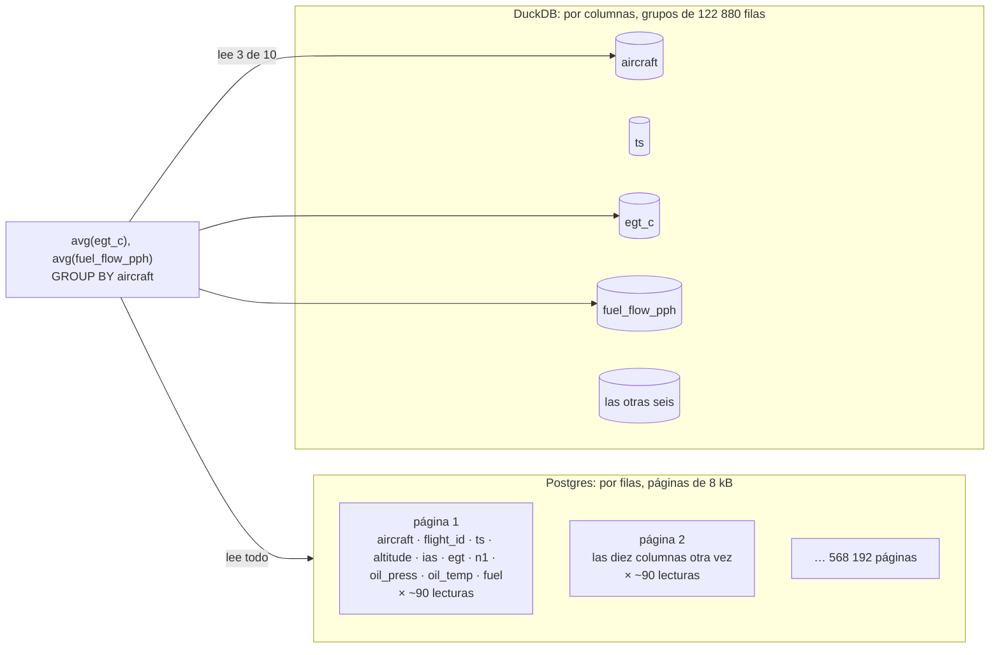

# 🦆 Fase 07 — Analítico embebido: el precio de Ala Continua, leído por columnas

> **Curso:** Ruta NoSQL Lite · Fase 07 de 26 · Bloque II — Leer de otra forma · **10 h**
> **Familia:** analítico embebido · **Motor:** DuckDB 1.5.6, embebido en Python (`duckdb==1.5.6` del
> `uv.lock`; no hay imagen ni servidor)
> **Línea base:** PostgreSQL 18.6 `pgvector/pgvector@sha256:2ba9ca5f2e7d…` (base `analitico`)
> **Entorno de ejecución:** **Python** para DuckDB, porque el ecosistema columnar vive ahí (la regla de
> [`a06`](a06-lenguajes-y-drivers.md)); TypeScript para medir Postgres con el arnés
> **Volumen:** `reading-5m` (`datasetSha256` `8dc486dea089…`): 5 M de lecturas de 17 aeronaves con
> grabador, y su ampliación sintética ×10 a **50 M**, hecha igual dentro de los dos motores
> **Depende de:** Fase 06 · **Habilita:** Fase 08
> **Apéndices de apoyo:** [`a02`](a02-compose-de-la-ruta.md), [`a04`](a04-el-arnes-de-medida.md),
> [`a05`](a05-el-dominio-de-flota.md), [`a06`](a06-lenguajes-y-drivers.md), [`a09`](a09-catalogo-de-errores.md)
> **Fecha de verificación ejecutada:** 07/10/2026, en macOS arm64
> **Objetivo:** calcular el costo por hora volada de Cóndor con el mismo SQL en DuckDB y en Postgres, y
> medir por qué para contestarlo uno lee **203 MiB** y el otro **4439 MiB** de la misma tabla.

---

## 🧭 1. Dónde estamos

El Bloque I terminó con dos familias que el lector ya usaba: documental y clave-valor. Las dos cambian
**cómo se guarda una cosa**. El Bloque II cambia otra: **qué se lee, y en qué orden**. Son tres
familias —analítico embebido, series temporales y búsqueda— y abren con el contraste más nítido del
curso, que es también el más incómodo para la etiqueta "NoSQL": DuckDB habla SQL. El mismo SQL que ya
escribes.

El dolor es el de Lucía Arango. Ala Continua se cotiza sobre el **costo histórico por hora volada**,
por modelo y por operador. Hoy ese número lo arma ella exportando de `SIGMA` a una hoja de cálculo,
cruzando a mano con la del taller de componentes, y confiando. Si está mal, el contrato nace perdiendo
dinero y nadie se entera hasta el año tres. No le falta un motor: le falta **un cálculo que se pueda
repetir**, sobre todas las horas y todas las órdenes, y que salga igual dos veces.

Esta fase lo escribe primero en SQL que conoces, lo corre en los dos motores, comprueba que dan **la
misma tabla** y después mide qué tuvo que leer cada uno para darla. Ahí aparece el 🪞 más importante
del curso, y conviene decirlo desde ya: **es la tesis de la ruta demostrada con un contraejemplo**. Si
habla SQL y aun así se comporta distinto, lo que decide no es la etiqueta. Es el modelo de acceso.

---

## 🎯 2. Objetivos de esta fase

1. Construir la base analítica desde `reading-5m` con su hash comprobado, ampliarla a 50 M lecturas y
   demostrar con una huella que **DuckDB y Postgres tienen los mismos 50 M**.
2. Calcular el costo por hora volada por modelo y operador con **un solo archivo SQL** que corre igual
   en los dos, y el pivote por año con `PIVOT`.
3. Medir una agregación de **tres columnas sobre 50 M**: bytes leídos en DuckDB contra páginas en
   Postgres, con la línea base bien jugada (índice cubriente y BRIN).
4. Explicar con aritmética por qué la diferencia es estructural —12 bytes por fila contra 93— y cuándo
   desaparece.
5. Reproducir la situación 3: DuckDB como base de una aplicación con cuatro escritores, que **pierde
   entre 272 y 403 aterrizajes de 8000** sin que nadie lo note.

---

## 🚫 3. Qué NO entra todavía

- **La apuesta de la familia** —el `ALTER TABLE` de una métrica nueva contra añadirla en columnar—, el
  `EXPLAIN` de DuckDB leído con calma, el dataset que no cabe en memoria y el *spilling* a disco: son la
  [Fase 08](08-analitico-romper-y-medir.md).
- **Dos procesos sobre el mismo archivo** y el candado que lo impide: el punto de rotura de la Fase 08.
  Aquí se ve lo que pasa con varios escritores **dentro** del mismo proceso.
- **Series temporales**: el mismo dato de lecturas, con hypertables y roll-ups, es la Fase 09. Aquí la
  lectura es solo la fuente de las horas voladas.
- **Las tres cifras distintas del costo por hora** —cuando DuckDB, Timescale y OpenSearch no coinciden—
  son el boss del bloque, al final de la [Fase 12](12-busqueda-romper-y-medir.md). El ejercicio 22 deja la primera pista.
- **Almacenes de datos de nube, orquestadores y dataframes.** Fuera del curso; los dataframes, como 🔥.

---

## 🏗️ 4. Levantar el motor

**No hay nada que levantar.** DuckDB es una biblioteca: se abre dentro de tu proceso, y la base es un
archivo. Eso es la mitad de lo que esta familia promete, y también la mitad de lo que le impide ser la
base de una aplicación (sección 8). Lo único con contenedor es la línea base, el perfil `base` de
[`a02`](a02-compose-de-la-ruta.md). El entorno de Python con DuckDB 1.5.6 está en
[`a06`](a06-lenguajes-y-drivers.md). Desde `src/`:

```bash
cd lab && docker compose --profile base up -d --wait && cd ..
node lab/generator/src/generate.ts --focus reading --volume 5m
uv run python 07-analitico-levantar-y-modelar/build.py --dataset lab/data/reading-5m
```

```text
dataset lab/data/reading-5m · datasetSha256 8dc486dea089… verificado
cargado en DuckDB: 2.0 s
ampliado ×10: 50000000 lecturas, 8.6 s
  condor.duckdb       751.8 MiB
  reading.csv         322.2 MiB
  reading.parquet      56.1 MiB
  reading.csv sha256 0db9f6de9fe8b0c7c8ecf311d8f92cbcba24d52699be92d9b4502385063fad77
```

Por qué `reading-5m` y no uno de los datasets de 1 M de [`a05`](a05-el-dominio-de-flota.md): el costo
por hora necesita **horas**, y en el generador las horas salen de las lecturas, que solo traen las
aeronaves con grabador. `reading-1m` tiene 3 de 16; `reading-5m` tiene **17 de 80**, en tres modelos y
los ocho operadores. Su hash está en la tabla de `a05`. Tarda 6,8 s en generarse y ocupa 899 MB.

`build.py` deja todo en `src/lab/data/analitico/`, que git ignora: la base `condor.duckdb`, las
lecturas en CSV con su hash y en Parquet. **Si la borras, se regenera con el mismo comando**, y
saldrán los mismos bytes. La línea base carga el mismo CSV, comprobando el hash antes de escribir una
fila:

```bash
uv run python 07-analitico-levantar-y-modelar/load_postgres.py
```

```text
cargado: 6.7 s
ampliado ×10: 60.5 s
  aircraft             80 filas · 48 kB
  work_order        30822 filas · 2920 kB
  reading         5000000 filas · 444 MB
  reading_x10    50000000 filas · 4440 MB
```

Los tiempos son contexto, con la máquina de la [bitácora](bitacora-de-medicion.md).

---

## 📖 5. El diccionario de la familia

| Relacional (Postgres) | Analítico embebido (DuckDB) | Dónde se rompe el paralelo |
|---|---|---|
| servidor, conexión por red | biblioteca dentro de tu proceso | no hay puerto ni usuario: hay un archivo y un candado |
| tabla en un *heap* de páginas de 8 kB, fila tras fila | tabla en **grupos de filas** de 122 880, columna por columna | leer una columna no obliga a leer las demás |
| página | bloque de 256 kB de **una sola columna**, comprimido | el bloque solo trae valores de un tipo, y comprime |
| BRIN (opcional, lo creas tú) | mínimo y máximo de cada columna en cada grupo, **siempre** | el motor salta grupos sin que crees nada |
| `EXPLAIN (ANALYZE, BUFFERS)` | `EXPLAIN ANALYZE`, o su perfilador en JSON | se mide en bytes leídos, no en páginas |
| `COPY … FROM` | `read_json`, `read_csv`, `read_parquet`: el archivo es una tabla | se consulta el archivo sin cargarlo |
| `crosstab` o `CASE WHEN` a mano | `PIVOT … ON` | las columnas salen de los datos |
| transacción con candados de fila | transacción optimista: **el segundo que escribe falla** | sección 8 |

Y de vuelta: un grupo de filas de DuckDB se parece a un rango de 128 páginas de BRIN con mínimo y
máximo, pero por columna; `read_parquet` es lo que en Postgres pediría una extensión de tablas
externas; y el perfilador de DuckDB contesta lo mismo que `BUFFERS`, en otra unidad. El diccionario
completo está en [`a08`](a08-diccionario-y-glosario.md).

> 🩻 **Esto sí funciona igual.** El SQL: `WITH`, `JOIN`, `GROUP BY`, ventanas, `FILTER`. La consulta de
> la sección 6.1 corre **sin cambiar un carácter** en los dos motores y devuelve la misma tabla. Un
> plan sigue siendo un árbol de operadores, filtrar pronto sigue siendo más barato que filtrar tarde, y
> los tipos siguen importando: declarados, son los mismos en los dos lados.

---

## 🧩 6. Modelar Cóndor a la manera analítica

### 6.1 La consulta de Lucía, en el SQL que ya conoces

El problema, primero. Cuánto cuesta mantener una hora de vuelo de un Twin Otter de Carga del Llano. El
costo sale de las órdenes de trabajo —mano de obra más partes—; las horas, de las lecturas: **una
lectura es un minuto de vuelo**, así que las horas de una aeronave son sus lecturas divididas entre
60. Las dos cosas, dentro de la ventana del dataset.

```sql
-- 07-analitico-levantar-y-modelar/cost_per_hour.sql (fragmento)
WITH hours AS (
    SELECT aircraft, count(*) / 60.0 AS flight_hours
    FROM reading WHERE ts < TIMESTAMP '2026-10-01' GROUP BY aircraft
), cost AS (
    SELECT aircraft, sum(labor_cost_usd + parts_cost_usd) AS cost_usd
    FROM work_order WHERE opened_at < TIMESTAMP '2026-10-01' GROUP BY aircraft
)
SELECT a.model, a.operator_id, count(*) AS aircraft, round(sum(h.flight_hours)) AS flight_hours,
       round(sum(c.cost_usd)) AS cost_usd, round(sum(c.cost_usd) / sum(h.flight_hours), 2) AS usd_per_hour
FROM aircraft a JOIN hours h ON h.aircraft = a.registration
LEFT JOIN cost c ON c.aircraft = a.registration
GROUP BY a.model, a.operator_id ORDER BY a.model, a.operator_id;
```

En DuckDB y en Postgres, la misma salida (la de Postgres, recortada):

```text
          model          | operator_id | aircraft | flight_hours | cost_usd | usd_per_hour
-------------------------+-------------+----------+--------------+----------+--------------
 ATR 42-500              | OP-AMB      |        1 |         4902 |  5120618 |      1044.61
 ATR 42-500              | OP-SEL      |        1 |         4902 |  4140058 |       844.57
 Beechcraft King Air 350 | OP-LLA      |        1 |         4902 | 14386843 |      2934.91
 Beechcraft King Air 350 | OP-SEL      |        2 |         9804 | 10979514 |      1119.91
 DHC-6-300 Twin Otter    | OP-LLA      |        2 |         9804 | 11324181 |      1155.07
 DHC-6-300 Twin Otter    | OP-PET      |        1 |         3734 |   197114 |        52.80
(15 rows)
```

Quince combinaciones de modelo y operador, iguales en los dos motores hasta el centavo, y **esto ya es
más de lo que tenía Lucía**: un archivo que se corre dos veces y da lo mismo. Mira la última fila antes de seguir. Un Twin Otter que cuesta 52,80 dólares por
hora, contra unos mil de sus hermanos, no es una ganga: es un dato que hay que explicar, y el ejercicio
22 lo explica.

Detalle con intención: el corte es `ts < TIMESTAMP '2026-10-01'`, sin zona, porque todo el dataset está
en UTC y las dos bases se configuraron en UTC. La sección 9 cuenta qué pasa si una sesión no lo está.

### 6.2 Por filas contra por columnas

Ahora el mecanismo. Postgres guarda cada lectura como **una tupla**: cabecera de 24 bytes, puntero, y
los diez campos uno detrás de otro, en páginas de 8 kB. Para sumar `egt_c` tiene que traer la página
entera, y en la página vienen los diez campos de unas noventa lecturas. DuckDB guarda **cada columna
por separado**: los 122 880 valores de `egt_c` de un grupo de filas van juntos, comprimidos, en sus
propios bloques. Para sumar `egt_c`, lee los bloques de `egt_c` y nada más.



La aritmética, con los números de esta base: la tabla de 50 M de Postgres ocupa **568 192 páginas**,
4439 MiB, **93 bytes por lectura**. La de DuckDB, leída entera, son **577 MiB**: **12 bytes por
lectura**. La diferencia no es una sola cosa. Una parte es que Postgres guarda una cabecera por fila y
DuckDB ninguna. La otra es que una columna de enteros parecidos se comprime muy bien: `pragma_storage_info`
dice que las siete columnas numéricas van con *bit-packing* y las dos de texto con diccionario, porque
una columna de matrículas tiene 170 valores distintos repetidos 50 millones de veces.

```bash
uv run python -c "import duckdb; print(duckdb.connect('lab/data/analitico/condor.duckdb', read_only=True).sql(\"SELECT column_name, count(DISTINCT row_group_id) AS row_groups, string_agg(DISTINCT compression, ',') AS compression FROM pragma_storage_info('reading_x10') WHERE segment_type <> 'VALIDITY' GROUP BY 1 ORDER BY 1\"))"
```

### 6.3 Cargar los mismos bytes, y probarlo

Dentro de cada familia, el motor y Postgres cargan exactamente lo mismo ([`a05`](a05-el-dominio-de-flota.md)).
Aquí la carga tiene dos tramos, y cada uno se comprueba distinto.

**Las 5 M lecturas reales** pasan por un archivo: `build.py` las lee del NDJSON con `read_json`, con los
tipos declarados para que sean los mismos que en Postgres (`INTEGER`, no el `BIGINT` que DuckDB infiere
si lo dejas), y las escribe a `reading.csv`. `load_postgres.py` comprueba el SHA-256 del CSV antes de
copiarlo. **La ampliación a 50 M no pasa por ningún archivo**: los dos motores hacen la misma operación
sin azar —diez copias, y las copias 1 a 9 con la matrícula marcada (`HK-4207~3`)—, DuckDB con `range` y
Postgres con `generate_series`. Que coincidan no se supone: se comprueba con una huella que corre igual
en los dos.

```bash
uv run python -c "import duckdb; print(duckdb.connect('lab/data/analitico/condor.duckdb', read_only=True).sql(open('07-analitico-levantar-y-modelar/fingerprint.sql').read()).fetchall())"
docker compose -f lab/compose.yaml exec -T base psql -U postgres -d analitico -At < 07-analitico-levantar-y-modelar/fingerprint.sql
```

```text
[(50000000, 170, 624860, datetime.datetime(2021, 10, 1, 0, 0), datetime.datetime(2026, 12, 7, 5, 27), 681418258180, 10333068600, 33300429290, 4428797640, 5250028350, 4124929550, 22138089230)]
50000000|170|624860|2021-10-01 00:00:00|2026-12-07 05:27:00|681418258180|10333068600|33300429290|4428797640|5250028350|4124929550|22138089230
```

Cincuenta millones de lecturas, 170 aeronaves —las 17 reales y 153 sintéticas—, 624 860 vuelos, y la
suma de cada columna numérica, idéntica. **La ampliación es sintética y se declara así**: sirve para medir
la forma de la lectura, no para sacar conclusiones de negocio, y por eso el costo por hora se calcula
sobre las 5 M reales. Fíjate en el último instante: **7 de diciembre de 2026**, más de dos meses después
del cierre de la ventana. Es el mismo dato raro del Twin Otter de 52,80 dólares, y es el ejercicio 22.

### 6.4 El pivote, hecho por el motor

Lucía no quiere una fila por modelo y año: quiere **una fila por modelo y un año por columna**, que es
como se lee una cotización. En SQL estándar eso se escribe a mano, una columna por año:

```sql
-- pivot_postgres.sql (fragmento)
SELECT model,
       round(max(usd_per_hour) FILTER (WHERE yr = 2021)) AS "2021",
       -- … una línea por año …
       round(max(usd_per_hour) FILTER (WHERE yr = 2026)) AS "2026"
FROM per_year GROUP BY model ORDER BY model;
```

En DuckDB, el pivote es una operación del lenguaje, y **las columnas salen de los datos**:

```sql
-- pivot_duckdb.sql (fragmento)
PIVOT per_year ON yr USING round(first(usd_per_hour)) ORDER BY model;
```

```text
('ATR 42-500', 1044.0, 1265.0, 1109.0, 1187.0, 827.0, 875.0)
('Beechcraft King Air 350', 2310.0, 2095.0, 1727.0, 1521.0, 1394.0, 1007.0)
('DHC-6-300 Twin Otter', 1490.0, 1265.0, 1128.0, 918.0, 1337.0, 905.0)
```

Son las filas del pivote, tal como las devuelve `fetchall()`, y Postgres da los mismos números. La
diferencia es de mantenimiento: el año 2027 aparece solo en una consulta, y la otra hay que editarla.

### 6.5 Parquet: el archivo es la tabla

El formato de intercambio de esta familia no es el CSV. Es **Parquet**: columnar como la tabla de
DuckDB, comprimido, y con un pie que dice qué hay dentro sin leerlo. Las mismas 5 M lecturas, en los
cuatro formatos de esta fase:

| Formato | Tamaño | Cómo se lee una columna |
|---|---|---|
| NDJSON del generador | 851 MiB | el archivo entero, línea por línea |
| CSV para Postgres | 322 MiB | el archivo entero |
| tabla `reading` de Postgres | 444 MB | todas sus páginas |
| Parquet | **56,1 MiB** | solo los bytes de esa columna |

El pie del archivo lo dice: 41 grupos de filas, y lo que ocupa cada columna comprimida. `egt_c` son
4,4 MB; `fuel_flow_pph`, 5,0; `aircraft`, **2,7 kB**, porque son 17 matrículas repetidas y ordenadas; y `ts`, 30,2 MB, más de la mitad del archivo, porque un instante por minuto es lo único de
esta tabla que casi no se repite.

```bash
uv run python -c "import duckdb; print(duckdb.sql(\"SELECT path_in_schema, sum(total_compressed_size) AS bytes FROM parquet_metadata('lab/data/analitico/reading.parquet') GROUP BY 1 ORDER BY 2 DESC\"))"
```

Y la consulta va **directa al archivo**, sin cargarlo en ninguna parte:

```sql
SELECT aircraft, avg(egt_c), avg(fuel_flow_pph)
FROM 'lab/data/analitico/reading.parquet' GROUP BY aircraft;
```

Esa es la promesa entera de la familia en una línea: un archivo que alguien exportó, consultado donde
está, leyendo tres columnas de diez. Lo que DuckDB lee de un Parquet **no lo mide su perfilador**, que
solo cuenta los bytes de su propia base: lo que dice esta sección sale del pie del archivo, y se declara
así. Las mediciones de la sección 6.6 son sobre la tabla de DuckDB, donde sí se miden.

### 6.6 La medición: tres columnas sobre 50 millones

La consulta del 🪞 es la más simple que hay: el promedio de temperatura de gases y de flujo de
combustible por aeronave. Tres columnas de diez, sobre los 50 M. En DuckDB, cada consulta corre con una
conexión nueva —con la misma, la segunda vez lee 0 bytes porque ya tiene los bloques—, y el perfilador
cuenta los bytes que leyó del archivo. En Postgres, el arnés de [`a04`](a04-el-arnes-de-medida.md) lee
las páginas del plan real.

```bash
uv run python 07-analitico-levantar-y-modelar/measure.py
node 07-analitico-levantar-y-modelar/measure.ts
```

> 📐 **Medición — lo que se lee para contestar** · `reading_x10`, 50 M (ampliación ×10 de `reading-5m`,
> `8dc486dea089…`) · DuckDB 1.5.6 · PostgreSQL 18.6 `pgvector/pgvector@sha256:2ba9ca5f2e7d…`, 2 workers ·
> verificado el 07/10/2026
>
> | Consulta | DuckDB: filas recorridas · leído | Postgres sin índices: filas · leído |
> |---|---|---|
> | las diez columnas (`max` de cada una) | 50 000 000 · **577,2 MiB** | 50 000 000 · 568 192 páginas, **4439 MiB** |
> | una columna: `avg(egt_c)` | 50 000 000 · **101,8 MiB** | 50 000 000 · 4439 MiB |
> | **tres columnas por aeronave** | 50 000 000 · **203,2 MiB** | 50 000 000 · **4439 MiB** |
> | `egt_c = -1`, un valor que no existe | **0 · 0 MiB** | 50 000 000 · 4439 MiB |
> | una aeronave: `aircraft = 'HK-4207'` | 5 283 840 · 0,8 MiB | 50 000 000 · 4439 MiB |
>
> Reproducir: `uv run python 07-analitico-levantar-y-modelar/measure.py` y
> `node 07-analitico-levantar-y-modelar/measure.ts` (desde `src/`)

Léela por filas, que es lo que importa. **Postgres lee la tabla entera para cualquier cosa**: una
columna o diez, un valor que existe o uno que no, 4439 MiB. DuckDB lee **lo que la consulta nombra**:
101,8 MiB por columna numérica, 203,2 por las tres de la consulta: **21,8 veces menos** que Postgres
para lo mismo. Y las dos últimas filas muestran el segundo mecanismo: el mínimo y el máximo de cada grupo
de filas. Con `egt_c` entre 632 y 760, **ningún grupo puede tener un −1**, y DuckDB contesta sin leer
nada. Con la tabla ordenada por matrícula, `HK-4207` solo puede estar en 43 de 407 grupos.

Los tiempos, como contexto de esta máquina: la de tres columnas, 3,9 s en Postgres y entre 0,08 y 0,13 s
en DuckDB. No sostienen nada. Lo que sí sostiene es que **la proporción no depende del hardware**: con
200 M filas, Postgres leería unos 17,3 GiB y DuckDB unos 813 MiB para las tres columnas. Es aritmética
sobre la medición de 50 M, no una medición, y se declara así.

### 6.7 La línea base bien jugada

Ganarle a un Postgres sin índices no demuestra nada. Esto es lo que haría alguien que sabe: un índice
cubriente para la consulta de tres columnas —el índice trae las tres, y Postgres puede contestar sin
tocar la tabla— y BRIN, el índice de mínimo y máximo por rango de páginas, que es lo más parecido que
tiene Postgres a los grupos de filas de DuckDB.

```sql
-- 07-analitico-levantar-y-modelar/indexes.sql (fragmento)
CREATE INDEX reading_x10_cover ON reading_x10 (aircraft) INCLUDE (egt_c, fuel_flow_pph);  -- 18,5 s · 1893 MB
CREATE INDEX reading_x10_aircraft_brin ON reading_x10 USING brin (aircraft);              -- 2,6 s · 200 kB
CREATE INDEX reading_x10_egt_brin ON reading_x10 USING brin (egt_c);                      -- 2,2 s · 128 kB
VACUUM ANALYZE reading_x10;
```

> 📐 **Medición — Postgres con sus índices** · el mismo volumen y la misma máquina · verificado el
> 07/10/2026
>
> | Consulta | Lo que elige el planificador | Prohibiendo el recorrido secuencial |
> |---|---|---|
> | tres columnas por aeronave | Seq Scan · 4439 MiB | Index Only Scan del cubriente · 241 213 páginas, **1884,5 MiB** |
> | `egt_c = -1` | Seq Scan · 4439 MiB | Bitmap sobre el BRIN · **65 páginas, 0,5 MiB** |
> | una aeronave | Index Only Scan del cubriente · **1135 páginas, 8,9 MiB** | lo mismo |
>
> Reproducir: `node 07-analitico-levantar-y-modelar/measure.ts --indexes [--no-seqscan]`

Tres lecturas, las tres honestas. **Con el índice cubriente, Postgres baja de 4439 a 1884,5 MiB** para
la consulta de tres columnas: menos de la mitad, pagando 1893 MB más de disco y un índice que solo
sirve a esa consulta. Aun así lee nueve veces lo que DuckDB, y **el planificador no lo elige**: estima
que recorrer la tabla en paralelo sale más barato que el índice, y hay que prohibirle el recorrido
secuencial para verlo. **El BRIN de `egt_c` hace lo mismo que el mínimo y máximo de DuckDB** —65 páginas
para descartar un valor que no existe—, pero lo tienes que crear tú, columna por columna, y el
planificador tampoco lo eligió con las estadísticas de esta tabla. Y **para una aeronave, Postgres gana
en su terreno**: el B-tree va directo a sus 294 118 lecturas.

**El patrón a memorizar.** Una base por filas lee filas; una por columnas lee columnas. Cuando la
consulta toca pocas columnas de muchas filas, la diferencia es estructural y no la cierra ningún
índice: lo mejor que consigue Postgres es un índice por consulta. Cuando la consulta toca pocas filas,
el B-tree sigue ganando.

---

## 🪞 7. Tu instinto relacional dice… y esta vez se equivoca

> 🪞 **"Si habla SQL, es lo mismo que Postgres."** El mismo archivo `cost_per_hour.sql` corre sin cambiar
> un carácter en los dos motores y devuelve la misma tabla. Pero para la agregación de tres columnas
> sobre 50 M lecturas, **DuckDB lee 203,2 MiB y Postgres 4439 MiB**; con el mejor índice que admite la
> consulta, 1884,5. La diferencia no está en el lenguaje: está en cómo están puestos los bytes en el
> disco.

Es el instinto más razonable del curso, y por eso es el más importante. Hasta aquí, cada familia traía
su propio lenguaje —`find`, `HSET`, una búsqueda por vector—, y era fácil aceptar que un lenguaje
distinto viene con un comportamiento distinto. DuckDB rompe esa asociación: mismo SQL, misma
respuesta, **otra forma**. Si la etiqueta "SQL" o "NoSQL" decidiera algo, estas dos bases serían la
misma. No lo son, y la diferencia se mide en la unidad de siempre: lo que se lee para contestar.

Es la tesis de la ruta demostrada al revés: las fases anteriores lo mostraron con motores que no
hablaban SQL; esta, con uno que sí y que aun así pertenece a otra familia. La pregunta que lo habría anticipado es
la 3: **¿cuál es la unidad de lectura?** Para Lucía, son **tres columnas de todas las filas**, y esa es
exactamente la rebanada para la que una base por filas no está hecha.

---

## ⚰️ 8. La situación 3: elegiste bien la familia y la modelaste como relacional

**La decisión, con su mejor argumento.** *"El tablero ya está en DuckDB y vuela. En vez de exportar de
`SIGMA` cada mes, que la aplicación de plataforma registre cada aterrizaje directo ahí: un contador de
minutos por aeronave, actualizado en cada aterrizaje desde los terminales de las bases. Así el costo
por hora está siempre al día, y nos ahorramos un servidor."*

**Por qué era razonable.** DuckDB es transaccional de verdad, ACID, y desde un proceso varias
conexiones pueden escribir. Y no pide un servidor que nadie cuide.

**Qué pasa.** `writers.py` lo reproduce con cuatro hilos del mismo proceso —cuatro terminales— que
registran 2000 aterrizajes cada uno sobre las mismas 17 aeronaves, cada uno con su conexión, como lo
haría la aplicación: un `UPDATE` del contador por aterrizaje.

```bash
uv run python 07-analitico-levantar-y-modelar/writers.py
```

```text
counter   escrituras 8000 · fallidas   403 · minutos registrados 7597 de 8000
          403 × TransactionContext Error: Conflict on update!
append    escrituras 8000 · fallidas     0 · minutos registrados 8000 de 8000
postgres  escrituras 8000 · fallidas     0 · minutos registrados 8000 de 8000
```

DuckDB no pone candados de fila: deja que las transacciones avancen y, si dos tocaron la misma fila, la
segunda **falla al escribir**. Postgres pone el candado y la segunda **espera**. En tres corridas, el
contador de DuckDB perdió **272, 403 y 382 de 8000 aterrizajes** —entre el 3,4 % y el 5 %— y la cifra
cambia en cada corrida, porque depende de cómo se cruzan los hilos. Con un reintento en la aplicación
no se pierden; sin él, faltan horas y el costo por hora de Lucía sale **entre un 3,5 % y un 5,3 % más caro que el
real**, que es
justamente el orden de margen de un contrato.

**Antes y después, con números.** La forma analítica no actualiza un contador: **agrega al leer**. Un
`INSERT` por aterrizaje en una tabla `landing`, y las horas se calculan con `sum` cuando alguien las
pide. En DuckDB, escribir filas nuevas no choca con nadie:

| Forma | Escrituras | Fallidas | Minutos registrados |
|---|---|---|---|
| contador con `UPDATE` en DuckDB | 8000 | 272–403 | 7597–7728 |
| un `INSERT` por aterrizaje en DuckDB, suma al leer | 8000 | **0** | **8000** |
| contador con `UPDATE` en Postgres | 8000 | **0** | **8000** |

**Cuánto cuesta salir.** Poco, si se hace antes de que el contador acumule meses de error: cambiar el
contador por la tabla de eventos. Lo caro llega en la Fase 08: si escribe **otro proceso**, DuckDB ya no
deja ni intentarlo.

**La pregunta que lo habría evitado** es la 1: **¿dónde está la frontera transaccional?** Un aterrizaje
que se registra desde cuatro bases es una escritura concurrente de la operación, y esa frontera
pertenece a la fuente de verdad —`SIGMA`, o Postgres—. DuckDB está bien elegido **para leer** lo que la
operación ya escribió, no para ser el lugar donde la operación escribe.

---

## ⚠️ 9. Errores comunes y diagnóstico

**Dos escritores sobre la misma fila** (E-38 en [`a09`](a09-catalogo-de-errores.md)):

```text
TransactionContext Error: Conflict on update!
```

🩺 Si el error sale con varias conexiones y nunca con una, es concurrencia optimista: la segunda
transacción que tocó la fila pierde. Reintentar la transacción entera, o cambiar el modelo a eventos
que solo se insertan (sección 8).

**El nombre de la columna del archivo** (E-39):

```text
Binder Error: Referenced column "egt_c" not found in FROM clause!
Candidate bindings: "egtC", "flightId"
```

🩺 Consultaste el NDJSON directo con el nombre de la tabla. El archivo trae los nombres del generador
en `camelCase` y la tabla los tiene en `snake_case`, la convención de DuckDB y de Postgres en este
curso ([`a08`](a08-diccionario-y-glosario.md)). El mensaje propone los candidatos: úsalos, o
renómbralos al leer como hace `build.py`.

**El corte de la ventana que cambia según quién consulta.** Sin mensaje. Con la sesión de Python en la
zona horaria de la máquina (`America/Bogota`), comparar las lecturas contra un instante con zona da
**70 386** lecturas posteriores al cierre; con la sesión en UTC, o con un instante sin zona, **70 108**.
DuckDB convierte el `TIMESTAMP` sin zona usando la zona de la sesión. 🩺
`SELECT current_setting('TimeZone')`. Por eso `build.py` fija `SET TimeZone = 'UTC'` y las consultas
cortan con `TIMESTAMP` sin zona. Es la segunda pista del boss del bloque.

**El perfilador que no devuelve nada.** `EXPLAIN (ANALYZE, FORMAT json)` de un `count(columna)`
devuelve `{"result": "error"}`. No es un fallo de la consulta: DuckDB la contesta con las estadísticas
del archivo, sin leer la columna. 🩺 Mide con `max(columna)`, como hace `measure.py`.

**Bytes leídos que bajan a cero.** Con la misma conexión, la segunda vez lee 0 bytes: los bloques ya
están en su memoria. 🩺 Una conexión nueva por medición.

**Filas examinadas 50 000 001 en Postgres.** Postgres 18 da las filas de cada worker como promedio con
decimales, y el arnés multiplica por el número de workers y redondea. 🩺 Una fila de diferencia sobre 50
M es ese redondeo, no una fila de más.

---

## 📋 10. Checklist de validación

```text
[ ] Tu datasetSha256 de reading-5m es 8dc486dea089… y build.py lo verificó
[ ] reading.csv tiene el SHA-256 0db9f6de9fe8… y load_postgres.py lo aceptó
[ ] La huella de fingerprint.sql es idéntica en DuckDB y en Postgres
[ ] cost_per_hour.sql da las mismas 15 filas en los dos motores
[ ] El PIVOT de DuckDB y el FILTER de Postgres dan la misma tabla por año
[ ] Tres columnas sobre 50 M: DuckDB 203 MiB leídos, Postgres 4439 MiB
[ ] Sé por qué egt_c = -1 lee 0 bytes en DuckDB y 4439 MiB en Postgres sin BRIN
[ ] Medí Postgres con el índice cubriente y sé por qué el planificador no lo elige
[ ] writers.py perdió aterrizajes con el contador y ninguno con la tabla de eventos
[ ] M-15 a M-17 están en la bitácora, E-38 y E-39 en a09, el 🪞 4 en INSTINTOS.md
```

---

## 🧪 11. Ejercicios (24)

Salvo donde se indique, desde `src/`, con `condor.duckdb` construida y la base `analitico` cargada. El
código está en `src/07-analitico-levantar-y-modelar/`.

### 🟢 Fácil — la base y la consulta (1–7)

#### 🟢 Ejercicio 1 — Tu base

Genera `reading-5m`, corre `build.py` y compara el `datasetSha256` y el hash de `reading.csv` con los de
la sección 4.

**Objetivo:** los dos hashes iguales, antes de medir nada.

#### 🟢 Ejercicio 2 — La huella

Corre `fingerprint.sql` en los dos motores.

**Pregunta:** ¿qué columna de la huella detectaría que un motor redondeó `egt_c` a decenas, y cuál no
lo detectaría nunca?

#### 🟢 Ejercicio 3 — La consulta de Lucía

Corre `cost_per_hour.sql` en los dos motores y compara fila por fila.

**Objetivo:** las 15 filas iguales, y explicar por qué DuckDB escribe `1556.9` y Postgres `1556.90`.

#### 🟢 Ejercicio 4 — Una columna, dos columnas, tres

Con `measure.py` como modelo, mide en frío `avg(egt_c)`, después `avg(egt_c), avg(n1_pct)` y después
añade `avg(oil_temp_c)`.

**Objetivo:** cuánto sube lo leído con cada columna, y compararlo con el tamaño de cada columna en
`pragma_storage_info`.

#### 🟢 Ejercicio 5 — Las páginas de Postgres

Con `EXPLAIN (ANALYZE, BUFFERS)`, corre `avg(egt_c)` y la consulta de diez columnas sobre `reading_x10`.

**Pregunta:** ¿por qué las dos tocan el mismo número de páginas?

#### 🟢 Ejercicio 6 — El archivo como tabla

Calcula el promedio de `egt_c` por aeronave directo sobre `reading.parquet`, y otra vez sobre
`reading.csv` con `read_csv`.

**Objetivo:** el mismo resultado, y qué parte de cada archivo tuvo que leerse según su formato.

#### 🟢 Ejercicio 7 — El pivote

Cambia `pivot_duckdb.sql` para pivotar por operador en lugar de por año.

**Objetivo:** una fila por modelo y una columna por operador, sin escribir el nombre de ningún operador.

### 🟡 Intermedio — leer por columnas (8–14)

#### 🟡 Ejercicio 8 — Los grupos que se saltan

Cuenta cuántos de los 407 grupos de filas de `reading_x10` pueden contener `aircraft = 'HK-4207'`
según el mínimo y el máximo de `pragma_storage_info`.

**Objetivo:** llegar a las 5 283 840 filas recorridas de la sección 6.6 con tu propia cuenta.

#### 🟡 Ejercicio 9 — Desordenar

Crea una copia de `reading_x10` ordenada por `ts` en lugar de por matrícula, y repite la consulta de una
aeronave.

**Objetivo:** filas recorridas y bytes leídos en las dos tablas, y por qué el orden de carga es una
decisión de modelado aquí.

#### 🟡 Ejercicio 10 — El BRIN que no se elige

Con `EXPLAIN` sin `ANALYZE`, compara el costo que estima Postgres para `egt_c = -1` con y sin
`enable_seqscan`.

**Pregunta:** ¿qué estimación hace que el planificador descarte el BRIN, y qué estadística tendrías que
cambiar?

#### 🟡 Ejercicio 11 — La compresión de cada columna

Lista, para cada columna de `reading_x10`, su compresión y sus bloques en `pragma_storage_info`.

**Objetivo:** explicar por qué `ts` ocupa más que cualquier columna numérica y por qué `aircraft` casi
nada.

#### 🟡 Ejercicio 12 — Cinco años en un CSV contra un Parquet

Exporta las órdenes de trabajo a CSV y a Parquet con DuckDB.

**Objetivo:** el tamaño de cada uno, y cuál de las columnas de `work_order` domina el Parquet.

#### 🟡 Ejercicio 13 — El costo por hora, por mes

Escribe la versión mensual de `cost_per_hour.sql` para un solo modelo.

**Objetivo:** que corra igual en los dos motores, y explicar los meses sin órdenes.

#### 🟡 Ejercicio 14 — Medir 5 M y 50 M

Corre `measure.py --table reading` y `measure.ts --table reading`.

**Pregunta:** ¿escalan los bytes leídos en línea recta con las filas en los dos motores? ¿Qué fila de la
tabla no escala, y por qué?

### 🟠 Difícil — diagnosticar y decidir (15–20)

#### 🟠 Ejercicio 15 — Predecir el índice cubriente

Antes de crear un índice cubriente para `avg(n1_pct), avg(ias_kt) GROUP BY aircraft`, predice su
tamaño y las páginas que leería un *index-only scan*. Después créalo y mídelo.

**Objetivo:** tu predicción escrita antes, y la diferencia con lo medido.

#### 🟠 Ejercicio 16 — El índice que vuelve a la tabla

Borra el `VACUUM` de `indexes.sql`, recrea los índices sobre una tabla recién cargada y mide la
consulta de una aeronave.

**Objetivo:** el número de `Heap Fetches`, y por qué el *index-only scan* dejó de serlo.

#### 🟠 Ejercicio 17 — Un reintento honesto

Añade a `writers.py` un modo `counter-retry` que reintente la transacción cuando falla.

**Objetivo:** 8000 de 8000 minutos, el número de reintentos, y cuántos hicieron falta en el peor
aterrizaje.

#### 🟠 Ejercicio 18 — Más escritores

Repite `writers.py` con 2, 4, 8 y 16 escritores.

**Objetivo:** una tabla de escritores contra aterrizajes perdidos, y la forma de la curva.

#### 🟠 Ejercicio 19 — La consulta que Postgres gana

Escribe una consulta de Lucía donde Postgres lea menos que DuckDB: pocas filas, todas las columnas.

**Objetivo:** las dos mediciones, y la regla que separa una consulta de la otra.

#### 🟠 Ejercicio 20 — El pivote que miente

Ejecuta el pivote por año con `first` y con `sum` como agregado.

**Pregunta:** ¿cuándo dan lo mismo y cuándo no, y qué te garantiza que solo hay un valor por celda?

### 🔴 Muy difícil — autopsias y pistas (21–24)

#### 🔴 Ejercicio 21 — La autopsia del contador

Un equipo pasó el registro de aterrizajes a DuckDB *"porque es ACID"* y seis meses después el costo por
hora no cuadra con la facturación.

**Objetivo:** los cinco pasos de la Fase 00, con la factura calculada a partir de las pérdidas de la
sección 8 y el volumen de aterrizajes de Cóndor.

#### 🔴 Ejercicio 22 — Las horas del futuro

El Twin Otter `HK-5178` cuesta 52,80 dólares la hora y la tabla tiene lecturas hasta diciembre de 2026.
Encuentra la causa en los datos —cuándo entró a la flota y cuántos minutos voló por día— y después en
`src/lab/generator/src/generate.ts`.

**Objetivo:** explicar por qué el filtro de ventana no basta para que su costo por hora sea creíble.
**Pista para el boss del Bloque II:** guarda la respuesta. Cuando tres sistemas den tres costos por hora
distintos para la misma aeronave, la primera pregunta es **de dónde salen las horas y en qué zona
horaria se cortan**.

#### 🔴 Ejercicio 23 — El tablero sin servidor

Lucía quiere que cada base vea su costo por hora sin instalar nada. Diseña cómo se reparte
`reading.parquet` y quién lo genera.

**Objetivo:** un diseño de una página donde quede escrito quién escribe y quién lee, y en qué momento
DuckDB deja de servir.

#### 🔴 Ejercicio 24 — 200 millones

Amplía a ×40 en los dos motores, mide la consulta de tres columnas y compara con la aritmética de la
sección 6.6.

**Objetivo:** confirmar o desmentir que la proporción no cambia, y anotar dónde se quedó sin memoria o
sin disco cada uno.

### 🔥 Opcionales

- **Dataframes al lado.** El costo por hora con una biblioteca de dataframes sobre el mismo Parquet, y
  cuánta memoria pide contra DuckDB.
- **Un Parquet particionado** por año con `PARTITION_BY`, y la consulta de un año.

---

## 📚 12. Referencias

> ⚠️ Las URLs y sus contenidos cambian, y la documentación de estos productos cubre la última versión.
> Esta fase se verificó con DuckDB 1.5.6 y PostgreSQL 18.6.

- **DuckDB, almacenamiento** — https://duckdb.org/docs/stable/internals/storage — grupos de filas,
  bloques y compresión.
- **DuckDB, `PIVOT`** — https://duckdb.org/docs/stable/sql/statements/pivot
- **DuckDB, perfilado** — https://duckdb.org/docs/stable/dev/profiling — `EXPLAIN ANALYZE` y el
  perfilador en JSON.
- **DuckDB, concurrencia** — https://duckdb.org/docs/stable/connect/concurrency — un proceso que
  escribe, control optimista entre conexiones.
- **Apache Parquet, formato** — https://parquet.apache.org/docs/file-format/ — grupos de filas, páginas
  y el pie del archivo.
- **PostgreSQL 18, BRIN** — https://www.postgresql.org/docs/18/brin.html
- **PostgreSQL 18, index-only scans** — https://www.postgresql.org/docs/18/indexes-index-only-scans.html
- **Abadi, Madden y Hachem, *Column-Stores vs. Row-Stores: How Different Are They Really?*** (SIGMOD
  2008) — https://dl.acm.org/doi/10.1145/1376616.1376712 — por qué un almacén por filas no se vuelve
  columnar con índices.

**Orden sugerido:** almacenamiento de DuckDB antes de la sección 6.2; perfilado durante la 6.6; BRIN e
index-only scans antes de la 6.7; concurrencia antes de la sección 8; el paper, después.

---

## 🏁 13. Resultado de la fase

```text
condor.duckdb (archivo, sin servidor)              Postgres · base analitico
├── aircraft      80                               ├── aircraft      80
├── work_order    30 822                           ├── work_order    30 822
├── reading       5 000 000   (43 grupos)          ├── reading       5 000 000   (444 MB)
└── reading_x10   50 000 000  (407 grupos, 577 MiB) └── reading_x10   50 000 000  (4439 MB + cubriente 1893 MB)

cost_per_hour.sql  → la misma tabla en los dos (15 filas)
tres columnas / 50 M → DuckDB 203 MiB · Postgres 4439 MiB · con índice cubriente 1884 MiB
```

Calculaste el precio de Ala Continua con un archivo SQL que corre igual en dos motores, y mediste que
la misma pregunta cuesta **veintidós veces menos de leer** en uno de ellos. No por el lenguaje: por la
forma de los bytes.

> **La señal de que quedó bien:** *"Puedo explicar con la medición de M-16 por qué dos bases que hablan
> el mismo SQL leen 203 y 4439 MiB para la misma respuesta, y decir qué consulta haría que Postgres
> ganara."*

> 🏷️ **No cierres la fase sin el tag.** Con el checklist en verde y `git status` limpio:
>
> ```bash
> git tag -a fase-07-analitico-levantar-y-modelar -m "F07 cerrada: base desde reading-5m con hash; huella igual en los dos motores; costo por hora en 15 filas iguales; 3 columnas sobre 50 M, 203 contra 4439 MiB; contador con conflictos y tabla de eventos sin pérdidas"
> ```
>
> Commits de la fase con prefijo `f07:`, los de ejercicio `f07 ej17: …`.
