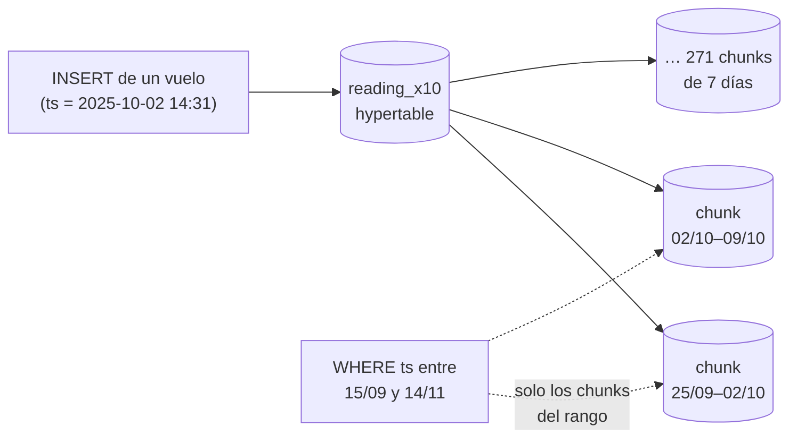

# ⏱️ Fase 09 — Series temporales: lecturas que llegan en orden, se resumen solas y se borran por semanas

> **Curso:** Ruta NoSQL Lite · Fase 09 de 26 · Bloque II — Leer de otra forma · **10 h**
> **Familia:** series temporales · **Motor:** TimescaleDB 2.30.1 sobre PostgreSQL 18.6, imagen con
> Timescale License `timescale/timescaledb@sha256:9dede0e3ccc0…`
> **Línea base:** PostgreSQL 18.6 `pgvector/pgvector@sha256:2ba9ca5f2e7d…` (base `series_base`, tabla
> normal con índices en `(aircraft, ts)` y en `ts`)
> **Entorno de ejecución:** TypeScript
> **Volumen:** `reading-5m` (`datasetSha256` `8dc486dea089…`) y su ampliación ×10 a **50 M**, la misma
> de las Fases 07 y 08, con la misma huella en los dos motores
> **Depende de:** Fase 08 · **Habilita:** Fase 10
> **Apéndices de apoyo:** [`a02`](a02-compose-de-la-ruta.md), [`a04`](a04-el-arnes-de-medida.md),
> [`a05`](a05-el-dominio-de-flota.md), [`a09`](a09-catalogo-de-errores.md), [`a10`](a10-licencias-y-riesgo.md)
> **Fecha de verificación ejecutada:** 07/10/2026, en macOS arm64
> **Objetivo:** modelar las lecturas de vuelo como una serie que se parte por tiempo, se resume y se
> borra por semanas, y medir dónde eso cambia algo frente a una tabla con índice en la fecha: **no al
> leer, sino al resumir y al borrar**.

---

## 🧭 1. Dónde estamos

Las Fases 07 y 08 leyeron las lecturas de vuelo **por columnas**. Esta las lee **por tiempo**, que es
otra forma de leer el mismo dato. Treinta aeronaves de Cóndor —17 en el dataset de esta fase— descargan
un registro por minuto de vuelo al aterrizar: altitud, velocidad, temperatura de gases, presión de
aceite. Llegan en orden, nadie las corrige y sirven para una sola cosa, que es la que Édinson Riaño
necesita y hoy no tiene: **ver la tendencia antes de que la tendencia se vuelva una novedad**. Hoy se
acumulan en un disco y nadie las mira, porque consultarlas tarda una tarde.

La familia de series temporales hace una apuesta sobre el dato: **llega ordenado por tiempo y no se
actualiza**. A cambio de esa restricción da tres cosas: partir la tabla por tiempo sin pedírselo,
resumir minuto a hora a día sin recalcular todo, y borrar el pasado tirando trozos enteros. TimescaleDB
lo hace como **extensión de Postgres**: el mismo SQL, el mismo `psql`, el mismo driver. Por eso el rival
de esta familia es Postgres a secas, y la Fase 10 lo dice en voz alta.

Una advertencia antes de empezar, que el resultado de la sección 6.2 confirma: **para leer, una tabla
bien indexada ya hace casi todo lo que hace una hypertable**. Lo que esta fase va a medir es lo otro.

---

## 🎯 2. Objetivos de esta fase

1. Cargar las 5 M lecturas reales en una hypertable con chunks de 7 días y en una tabla normal, ampliar a
   50 M en los dos y comprobar que la huella es la de la Fase 07.
2. Medir, en filas, páginas y chunks, tres consultas de serie —una aeronave 60 días, la flota un mes,
   una aeronave cinco años— y reconocer que **Postgres con el índice correcto empata**.
3. Construir los roll-ups de minuto a hora a día como agregados continuos, y medir lo que cuesta
   mantenerlos al día: **2420 lecturas** tras un vuelo nuevo, contra **50 000 090** de una vista
   materializada.
4. Borrar el primer año: **52 chunks y 3,1 MiB de WAL** contra **8,8 M filas y 1254 MiB**, y el espacio
   que no vuelve.
5. Comprimir la historia y corregirla después, y ver por qué la situación 3 de esta familia choca con un
   límite de seguridad del propio motor.

---

## 🚫 3. Qué NO entra todavía

- **La apuesta de la familia**, el particionado declarativo de Postgres contra Timescale, el tamaño
  comprimido medido contra Postgres, la cardinalidad que mata y el *backfill* contra chunks
  comprimidos: son la [Fase 10](10-series-romper-y-medir.md).
- **La licencia**, en detalle: los agregados continuos y la compresión son Timescale License
  (*source-available*), y por eso esta fase usa la imagen con TSL y no la `-oss`. Está en
  [`a10`](a10-licencias-y-riesgo.md), y el veredicto de la Fase 10 la pone en la balanza.
- **Las lecturas de las 140 aeronaves**, cuando ya no caben en un nodo: columnar ancha, Fases [17](17-columnar-levantar-y-modelar.md) y 18.
- **El costo por hora volada en tres sistemas distintos**: el boss del bloque, en la Fase 12.

---

## 🏗️ 4. Levantar el motor

La receta está en [`a02`](a02-compose-de-la-ruta.md): el perfil `series`, la imagen con TSL y el puerto
15433. La línea base sigue en el perfil `base`. Desde `src/`:

```bash
cd lab && docker compose --profile base --profile series up -d --wait && cd ..
node 09-series-levantar-y-modelar/load.ts
```

```text
dataset lab/data/reading-5m · datasetSha256 8dc486dea089… verificado
cargadas 5000000 lecturas en los dos motores: 47.5 s
timescale ×10 en 636.1 s · huella 50000000 · 170 · 624860 · 2021-10-01T05:00:00.000Z · 33300429290 · 22138089230
postgres  ×10 en 474.3 s · huella 50000000 · 170 · 624860 · 2021-10-01T05:00:00.000Z · 33300429290 · 22138089230
```

`load.ts` comprueba el hash del dataset, crea de cero las dos bases —`condor` en Timescale y
`series_base` en Postgres—, carga las mismas lecturas en lotes de 50 000 (cada columna viaja como un
array: **un viaje por lote y por motor, 100 en total**) y amplía ×10 dentro de cada motor con la misma
operación de la Fase 07. La huella —lecturas, aeronaves, vuelos, sumas del EGT y del flujo de
combustible— es idéntica en los dos y **la misma que dieron DuckDB y Postgres en la Fase 07**.

El instante que imprime, `05:00Z`, no es un error de los datos: es el driver. La sección 9 lo explica, y
es una trampa que conviene ver una vez.

---

## 📖 5. El diccionario de la familia

| Relacional (Postgres) | Series temporales (TimescaleDB) | Dónde se rompe el paralelo |
|---|---|---|
| tabla | **hypertable**: una tabla que se parte sola por tiempo | sigue siendo una tabla para tu SQL |
| partición, creada a mano | **chunk**: una tabla hija por intervalo de tiempo, creada al insertar | nadie crea el chunk de la semana que viene |
| `DELETE … WHERE ts < …` | `drop_chunks(…, older_than => …)` o una política de retención | se borran chunks enteros, no filas |
| vista materializada | **agregado continuo**, refrescado por ventanas | solo recalcula lo que cambió |
| `date_trunc` | `time_bucket`, con cualquier intervalo | `date_trunc` sigue funcionando |
| `pg_cron` o un job propio | políticas: retención, compresión, refresco | son parte del esquema, no de la operación |
| una tabla comprimida no existe | chunk comprimido por columnas (*columnstore*) | corregirlo cuesta descomprimirlo |

Y de vuelta: un chunk es una partición de rango con un `CHECK` sobre `ts`; un agregado continuo es una
vista materializada que sabe qué tramos están viejos; `drop_chunks` es un `DROP TABLE` de particiones. La
Fase 10 escribe esa traducción en Postgres puro y la mide. El diccionario completo está en
[`a08`](a08-diccionario-y-glosario.md).

> 🩻 **Esto sí funciona igual.** Todo. El SQL, el driver `pg`, `psql`, `EXPLAIN (ANALYZE, BUFFERS)`, los
> índices B-tree y el planificador son los de Postgres 18.6, porque Timescale **es** Postgres con una
> extensión. La consulta de la Fase 07 sobre `fingerprint.sql` corrió sin cambiar un carácter, y el
> índice `(aircraft, ts)` hace en cada chunk lo mismo que haría en una tabla.

---

## 🧩 6. Modelar Cóndor a la manera de las series

### 6.1 La serie de Édinson

El problema. En `answers.json` de [`a05`](a05-el-dominio-de-flota.md) hay un caso plantado: el motor de
`HC-2157` subió su EGT **0,6 °C por día durante los 60 días** previos a que lo desmontaran, entre el
15/09 y el 14/11/2025. Es exactamente lo que Édinson quiere ver venir: una curva que sube despacio, en
un gráfico de un punto por día. La consulta es trivial en SQL:

```sql
SELECT date_trunc('day', ts) AS day, avg(egt_c) FROM reading_x10
WHERE aircraft = 'HC-2157' AND ts >= '2025-09-15' AND ts < '2025-11-14'
GROUP BY 1 ORDER BY 1;
```

Lo que no es trivial es la tabla que hay debajo cuando los minutos de vuelo de cinco años son 50 M, y
cuando la misma tabla tiene que servir también para borrar el año viejo y para resumir sin recalcular.

### 6.2 Hypertable y chunks: leer por tiempo

Una hypertable se declara sobre una tabla normal, y desde ahí **cada inserción va al chunk de su
semana**, que se crea solo si no existe:

```sql
-- 09-series-levantar-y-modelar/schema-timescale.sql (fragmento)
SELECT create_hypertable('reading_x10', by_range('ts', INTERVAL '7 days'));
CREATE INDEX ON reading_x10 (aircraft, ts DESC);
```



Con las 50 M lecturas, `reading_x10` tiene **271 chunks**, del 30/09/2021 al 10/12/2026. Diez de ellos
empiezan después del cierre de la ventana: son las lecturas del futuro de la Fase 07, y el ejercicio 21
las persigue. Cada chunk es una tabla de Postgres con su propio índice, y el planificador descarta los
que no cruzan el rango de la consulta. `measure.ts` corre las tres consultas de serie en los dos motores:

> 📐 **Medición — leer por tiempo** · `reading_x10`, 50 M · TimescaleDB 2.30.1 (chunks de 7 días) ·
> PostgreSQL 18.6 (tabla con índices en `(aircraft, ts)` y en `ts`) · verificado el 07/10/2026
>
> | Consulta | Timescale: examinadas · páginas · chunks | Postgres: examinadas · páginas |
> |---|---|---|
> | `HC-2157`, 60 días | 9666 · 218 · 10 | 9666 · **155** (bitmap sobre `(aircraft, ts)`) |
> | la flota, marzo de 2025 | 944 240 · **10 733** · 5 | 50 000 000 · **568 198** (el planificador elige el secuencial) |
> | la flota, marzo, con el índice de `ts` forzado | — | 839 270 · **11 040** |
> | `HC-2157`, cinco años | 294 118 · 6482 · 261 | 294 118 · **4529** |
>
> Reproducir: `node 09-series-levantar-y-modelar/measure.ts` (desde `src/`); la fila forzada, con
> `SET enable_seqscan = off` en `psql`

**El resultado honesto es un empate, y en dos de tres gana Postgres.** Para una aeronave, el índice
`(aircraft, ts)` de una tabla normal toca menos páginas que diez o 261 índices de chunk. Para la flota
en un mes, el planificador de Postgres se equivocó —estimó que el índice de `ts` serviría poco, porque
la tabla está ordenada por matrícula, y eligió leer los 50 M—, pero **con el índice forzado lee 11 040
páginas, lo mismo que Timescale**. Timescale examina un poco más (944 240) porque sus chunks de 7 días no
coinciden con el mes y lee los bordes.

Lo que sí da la hypertable es que **ese plan no depende del planificador**: el chunk descarta por
construcción lo que está fuera del rango. Y el tamaño del chunk es una decisión del modelo, que
`chunk_interval.ts` mide sobre las 5 M reales:

| Chunk | Chunks | `HC-2157`, 60 días | La flota, un mes | `HC-2157`, cinco años |
|---|---|---|---|---|
| 7 días | 271 | 205 páginas · 10 chunks | 94 424 examinadas · 1075 páginas · 5 chunks | 6089 páginas · 261 chunks |
| 1 mes | 64 | 187 páginas · 3 chunks | 83 927 · 1685 · 2 | 5578 páginas · 61 chunks |

Chunks más grandes: menos índices que recorrer para una aeronave, bordes exactos para un mes, y más
páginas cuando se recorre el chunk entero. La regla que da la documentación —que el chunk activo, con
sus índices, quepa en la memoria— es la que decide; con 17 aeronaves, los dos tamaños caben.

### 6.3 Roll-ups: minuto a hora a día, sin recalcular

El gráfico de Édinson no necesita minutos: necesita un punto por hora o por día. La forma relacional es
una vista materializada; la de esta familia, un **agregado continuo**, que se materializa una vez y
después **solo recalcula los tramos donde llegó algo nuevo**. Y se pueden apilar: el diario se construye
sobre el horario.

```sql
-- 09-series-levantar-y-modelar/rollups.sql (fragmento)
CREATE MATERIALIZED VIEW reading_hourly WITH (timescaledb.continuous) AS
SELECT aircraft, time_bucket(INTERVAL '1 hour', ts) AS bucket,
       count(*) AS minutes, avg(egt_c) AS egt_avg, max(egt_c) AS egt_max, avg(fuel_flow_pph) AS fuel_avg
FROM reading_x10 GROUP BY aircraft, bucket WITH NO DATA;

CREATE MATERIALIZED VIEW reading_daily WITH (timescaledb.continuous) AS
SELECT aircraft, time_bucket(INTERVAL '1 day', bucket) AS bucket, sum(minutes) AS minutes,
       sum(egt_avg * minutes) / sum(minutes) AS egt_avg, max(egt_max) AS egt_max
FROM reading_hourly GROUP BY aircraft, time_bucket(INTERVAL '1 day', bucket) WITH NO DATA;
```

Detalle con intención: el promedio diario **se pondera por minutos**. Promediar los promedios horarios
daría el mismo peso a una hora con 5 minutos de vuelo que a una con 60, y la curva de Édinson saldría
torcida justo en los días de vuelos cortos.

La primera materialización tardó 80,8 s el horario (1 430 190 filas) y 3,2 s el diario (287 080). Después
la mantiene una política —refrescar los últimos tres días cada hora, dejando fuera la última hora, que
todavía puede estar llegando—. `rollups.ts` mide lo que importa: leer el gráfico y mantenerlo.

```bash
docker compose -f lab/compose.yaml exec -T series psql -U postgres -d condor < 09-series-levantar-y-modelar/rollups.sql
node 09-series-levantar-y-modelar/rollups.ts
```

> 📐 **Medición — el roll-up diario** · `reading_x10`, 50 M · verificado el 07/10/2026
>
> | | Timescale (agregado continuo) | Postgres (vista materializada con índice) |
> |---|---|---|
> | la tendencia de cinco años de `HC-2157` | 1826 filas · 263 páginas | 1826 filas · **28 páginas** |
> | la tabla cruda, para comparar | 294 118 filas · 6482 páginas | 294 118 · 4529 |
> | **mantenerlo al día tras un vuelo de 90 minutos** | **2420 lecturas leídas** | **50 000 090 lecturas leídas**, 8,9 s |
>
> Reproducir: `node 09-series-levantar-y-modelar/rollups.ts` (las lecturas leídas salen de los contadores
> de `pg_stat_user_tables` de cada chunk y de la tabla, antes y después del refresco)

Las dos primeras filas son otro empate que Postgres gana: leer de una vista materializada con su índice
cuesta 28 páginas; del agregado continuo, que guarda lo materializado en su propia hypertable con
chunks, 263. **La tercera es la familia entera.** `REFRESH MATERIALIZED VIEW` no sabe qué cambió:
vuelve a leer las 50 M lecturas para incorporar 90. El agregado continuo anotó qué tramo invalidó el
vuelo nuevo y recalculó ese tramo: **2420 lecturas**. Con un vuelo por minuto en la flota, una vista
que se refresca entera es una vista que nunca está al día.

### 6.4 Retención y compresión, como parte del modelo

Las dos últimas decisiones del modelo no son mantenimiento: **dicen qué es la serie**. La retención dice
cuánto pasado existe en crudo; la compresión, a partir de cuándo el pasado ya no se toca.

```sql
-- compress_update.ts (fragmento)
ALTER TABLE reading_x10 SET (timescaledb.compress,
    timescaledb.compress_segmentby = 'aircraft', timescaledb.compress_orderby = 'ts');
SELECT add_compression_policy('reading_x10', INTERVAL '90 days');
```

`segmentby` dice qué columna agrupa los lotes comprimidos —la aeronave, porque casi toda consulta filtra
por ella—, y `orderby`, en qué orden van dentro del lote. Timescale 2.30 llama a un chunk comprimido
***columnstore***: guarda cada columna por separado, como DuckDB en la Fase 07. Comprimir los 223 chunks
anteriores a 2026 tardó 49,5 s, y `chunk_compression_stats` dice que pasaron de **7672 a 476 MiB**. La
Fase 10 mide ese número contra Postgres; aquí lo que importa es la consecuencia de modelo: **un chunk
comprimido es un chunk que se da por terminado**. La sección 8 cuenta qué pasa cuando no lo está.

### 6.5 Por qué la restricción se vuelve rendimiento

Todo lo de esta fase sale de la misma promesa del dato. **Porque llega en orden**, cada inserción cae en
el chunk de la semana en curso y los demás no se tocan: los índices de los chunks viejos no crecen, y el
chunk activo cabe en memoria. **Porque no se actualiza**, el agregado continuo puede materializar un tramo
y darlo por bueno, la compresión puede reescribir un chunk por columnas y no volver a abrirlo, y la
retención puede tirar semanas enteras. Si cualquiera de las dos cosas deja de ser verdad, la sección 8
mide lo que se paga.

**El patrón a memorizar.** Una hypertable no lee más rápido que una tabla bien indexada. Lo que cambia es
lo que cuesta **mantener** la serie: resumirla, comprimirla y borrarla. Esos tres costos dependen de que
el dato llegue en orden y no se corrija.

---

## 🪞 7. Tu instinto relacional dice… y esta vez se equivoca

> 🪞 **"Una tabla con índice en la fecha ya es una serie temporal."** Para leer, la sección 6.2 le da la
> razón. Para borrar el primer año de los 50 M, no: el `DELETE` toca **8 823 630 filas**, escribe
> **1254,2 MiB de WAL** y la tabla sigue ocupando **4589,7 MiB** después, incluso tras un `VACUUM`.
> `drop_chunks` borra **52 chunks**, escribe **3,1 MiB de WAL** y el espacio vuelve al sistema.

```bash
node 09-series-levantar-y-modelar/retention.ts
```

```text
postgres  antes del corte 8823630 → 0 · filas borradas 8823630 · WAL 1254.2 MiB · tamaño 4589.7 MiB → 4589.7 MiB · 6.2 s
timescale antes del corte 8823630 → 48450 · chunks borrados 52 · WAL 3.1 MiB · tamaño 1448.7 MiB → 1356.7 MiB · 0.1 s
reading_daily antes del corte: 54750 días-aeronave → 54750 (el roll-up conserva la historia)
postgres  después de VACUUM: 4589.7 MiB · 7.3 s
```

El `DELETE` tiene que encontrar cada fila, marcarla como muerta y registrar cada marca en el WAL. Las
páginas quedan donde estaban: un `VACUUM` las deja reutilizables, pero **no le devuelve un byte al
disco**; para eso hace falta `VACUUM FULL`, que reescribe la tabla entera con un candado exclusivo.
`drop_chunks` borra tablas: lo que escribe es el catálogo. Tres matices, declarados. **Quedan 48 450
lecturas antes del corte**, porque el chunk que cruza el 01/10/2022 no se borra hasta que termina
entero. **Los tamaños no son comparables entre motores**, porque la hypertable ya estaba comprimida
(sección 6.4); lo comparable es el WAL y las filas. Y **el roll-up diario conservó los 54 750
días-aeronave** del año borrado: la retención de la serie cruda no tiene por qué ser la del resumen, y
esa es una decisión de modelo que la tabla normal no puede tomar.

Es el instinto más razonable de la familia, porque para leer es correcto. Se rompe en la operación que
nadie diseña el primer día: **tirar el pasado**. La pregunta que lo habría anticipado es la 2:
**¿conoces tus consultas, y son estables?** Borrar por tiempo es una consulta conocida desde el primer
día, y modelar para ella es partir por tiempo.

---

## ⚰️ 8. La situación 3: elegiste bien la familia y la modelaste como relacional

**La decisión, con su mejor argumento.** *"Las lecturas de marzo de 2025 vinieron con un desfase de
calibración de +3 °C en el EGT de toda la flota. Las corregimos en la base, que para eso es una base:
un `UPDATE` y listo."*

**Por qué era razonable.** Es un error de datos real y la corrección es correcta. En una tabla normal,
es exactamente lo que se hace. Y Timescale es Postgres: acepta el `UPDATE`.

**Qué pasa.** `compress_update.ts` aplica la corrección en las dos bases, con los chunks anteriores a 2026
comprimidos en Timescale:

```bash
node 09-series-levantar-y-modelar/compress_update.ts --skip-compress
```

```text
antes de corregir: chunks parcialmente descomprimidos 0
una aeronave (HK-4207)         timescale filas    5043 · WAL      3.8 MiB · 0.0 s · chunks parcialmente descomprimidos 5
una aeronave (HK-4207)         postgres  filas    5043 · WAL      4.6 MiB · 0.0 s
toda la flota                  timescale ERROR: tuple decompression limit exceeded by operation
                                         DETAIL: current limit: 100000, tuples decompressed: 919810
                                         HINT: Consider increasing timescaledb.max_tuples_decompressed_per_dml_transaction or set to 0 (unlimited).
toda la flota, sin límite      timescale filas  839270 · WAL    654.3 MiB · 8.4 s · chunks parcialmente descomprimidos 5
toda la flota                  postgres  filas  839270 · WAL    393.4 MiB · 9.3 s
```

Para corregir una aeronave, nada grave: 5043 filas, menos WAL que Postgres. Pero **cinco chunks quedaron
parcialmente descomprimidos**: las filas corregidas salieron del *columnstore* y viven al lado, sin
comprimir, hasta que algo vuelva a comprimir el chunk. Para corregir la flota, **el motor se niega**:
para tocar 839 270 filas tendría que descomprimir 919 810 —lotes enteros de cada aeronave, más los
bordes de los chunks—, y el límite de seguridad es de 100 000 por transacción (E-44 en
[`a09`](a09-catalogo-de-errores.md)). Quitando el límite a propósito, lo hace, y escribe **654,3 MiB de
WAL contra los 393,4 de Postgres**: un 66 % más, para dejar los chunks a medio comprimir.

**Antes y después, con números.** La forma que respeta la familia no corrige la serie: **la deja como
llegó y corrige al leer**, con una tabla de ajustes por aeronave y período que la consulta aplica, o
corrige antes de comprimir, mientras el chunk sigue activo.

| Forma de corregir marzo de 2025 en toda la flota | Filas reescritas | WAL | Chunks que quedan a medias |
|---|---|---|---|
| `UPDATE` sobre los chunks comprimidos | 839 270 (919 810 descomprimidas) | 654,3 MiB | 5, hasta recomprimir |
| `UPDATE` en la tabla normal de Postgres | 839 270 | 393,4 MiB | — |
| ajuste aplicado al leer (tabla de ajustes) | 0 | lo de insertar una fila de ajuste | 0 |

La tercera fila no se midió como script: es una fila en una tabla de ajustes, y el ejercicio 17 pide
medirla de verdad, incluida la consulta que la aplica.

**Cuánto cuesta salir.** Poco si la corrección es rara: subir el límite en esa sesión, corregir y
recomprimir. Mucho si corregir es parte del proceso —lecturas que se recalibran cada mes—, porque
entonces la serie no cumple la promesa de la familia y cada compresión se deshace.

**La pregunta que lo habría evitado** es la 2: **¿son estables tus consultas… y tus datos?** Una serie
que se corrige retroactivamente no es una serie temporal en el sentido de esta familia, y la Fase 10 lo
escribe en el veredicto.

---

## ⚠️ 9. Errores comunes y diagnóstico

**La corrección que el motor rechaza** (E-44 en [`a09`](a09-catalogo-de-errores.md)):

```text
ERROR: tuple decompression limit exceeded by operation
DETAIL: current limit: 100000, tuples decompressed: 919810
HINT: Consider increasing timescaledb.max_tuples_decompressed_per_dml_transaction or set to 0 (unlimited).
```

🩺 El `DETAIL` dice cuántas filas habría que descomprimir. Si son muchas más que las que querías tocar,
el `UPDATE` cruza lotes enteros: filtra por la columna de `segmentby`, o sube el límite **solo en esa
sesión** y recomprime después.

**El chunk que quedó a medias.** Sin mensaje. 🩺 En `_timescaledb_catalog.chunk`, `status & 8 = 8` marca
un chunk comprimido con filas sin comprimir al lado. `compress_chunk(c, true)` lo vuelve a comprimir.

**La hora que se corre cinco horas.** `load.ts` imprime el primer instante como `2021-10-01T05:00:00.000Z`,
cuando la base dice `2021-10-01 00:00:00`. 🩺 El driver `pg` convierte un `timestamp` **sin zona** en un
`Date` de JavaScript usando la zona de la máquina (Bogotá, UTC−5) y lo muestra en UTC. Para no
equivocarte, pide el instante como texto (`ts::text`) o usa `timestamptz`. Es la misma trampa que la
sesión de Python de la Fase 07, en otro lenguaje.

**El refresco que no lee nada.** Al principio, `rollups.ts` decía **0 lecturas** para el refresco
incremental, porque contaba los chunks de `_hyper_1_` —la hypertable de las 5 M— y no los de
`reading_x10`, que es la 2. 🩺 Los nombres de chunk se leen de `timescaledb_information.chunks`, nunca se
suponen.

**`… is already converted to columnstore`.** Un `NOTICE` por cada chunk ya comprimido al llamar a
`compress_chunk(c, true)`. 🩺 Es informativo: el `true` es *si no está comprimido*.

---

## 📋 10. Checklist de validación

```text
[ ] La huella de reading_x10 en Timescale y en series_base es la de la Fase 07
[ ] Sé cuántos chunks tiene reading_x10 (271) y cuántos empiezan después de la ventana (10)
[ ] Para una aeronave, la tabla normal toca menos páginas que la hypertable (155 contra 218)
[ ] Para la flota en un mes, Postgres empata (11 040 páginas) solo con el índice de ts forzado
[ ] El diario se pondera por minutos, y sé por qué
[ ] Refresco incremental: 2420 lecturas; REFRESH MATERIALIZED VIEW: 50 000 090
[ ] DELETE del primer año: 1254,2 MiB de WAL y la tabla igual; drop_chunks: 52 chunks y 3,1 MiB
[ ] Provoqué E-44 corrigiendo la flota sobre chunks comprimidos
[ ] M-21 a M-24 en la bitácora, E-44 en a09, el 🪞 5 en INSTINTOS.md
```

---

## 🧪 11. Ejercicios (26)

Desde `src/`, con los perfiles `base` y `series` arriba y `load.ts` corrido. Ojo: `retention.ts` borra el
primer año; para los ejercicios que lo necesiten, vuelve a correr `load.ts` y `rollups.sql`.

### 🟢 Fácil — la hypertable por dentro (1–8)

#### 🟢 Ejercicio 1 — Tu huella

Corre `load.ts` y compara la huella con la de la Fase 07.

**Objetivo:** las mismas siete cifras en los dos motores.

#### 🟢 Ejercicio 2 — Los chunks

Lista los chunks de `reading_x10` con `timescaledb_information.chunks`.

**Pregunta:** ¿qué día de la semana empieza cada chunk, y por qué ese?

#### 🟢 Ejercicio 3 — Un chunk es una tabla

Elige un chunk y consúltalo directamente por su nombre.

**Objetivo:** el mismo número de filas que la hypertable con el rango del chunk.

#### 🟢 Ejercicio 4 — El plan con chunks

Con `EXPLAIN (ANALYZE, BUFFERS)`, corre la consulta de 60 días de `HC-2157`.

**Objetivo:** nombrar los 10 chunks que toca y explicar por qué no son 9.

#### 🟢 Ejercicio 5 — `time_bucket`

Reescribe la consulta de la sección 6.1 con `time_bucket('6 hours', ts)`.

**Objetivo:** cuatro puntos por día y la misma tendencia.

#### 🟢 Ejercicio 6 — Leer el roll-up

Consulta `reading_daily` para `HC-2157` entre el 15/09 y el 14/11/2025.

**Pregunta:** ¿cuánto subió el EGT en esos 60 días? Compáralo con los 0,6 °C por día de `answers.json`.

#### 🟢 Ejercicio 7 — Las políticas

Lista los trabajos con `timescaledb_information.jobs`.

**Objetivo:** las tres políticas de esta fase, cada una con su intervalo.

#### 🟢 Ejercicio 8 — `drop_chunks` en seco

Con `show_chunks('reading_x10', older_than => …)`, cuenta los chunks que borraría un corte al 01/10/2023.

**Objetivo:** el número antes de borrar nada.

### 🟡 Intermedio — modelar la serie (9–15)

#### 🟡 Ejercicio 9 — El promedio mal ponderado

Crea un diario que promedie los promedios horarios sin ponderar.

**Objetivo:** el día de `HC-2157` donde más difieren los dos diarios, y por qué.

#### 🟡 Ejercicio 10 — El planificador equivocado

Para la flota en un mes, compara la estimación de filas de Postgres con las reales, y la correlación de
`ts` en `pg_stats`.

**Pregunta:** ¿qué estadística llevó al planificador a elegir el recorrido secuencial?

#### 🟡 Ejercicio 11 — Chunks de un día

Repite `chunk_interval.ts` con chunks de 1 día.

**Objetivo:** cuántos chunks, y en qué consulta empiezan a pesar más los índices que los datos.

#### 🟡 Ejercicio 12 — Un agregado más

Crea un agregado continuo semanal sobre el diario.

**Objetivo:** el promedio ponderado bien hecho, y cuántas filas tiene.

#### 🟡 Ejercicio 13 — El tiempo real

Activa `materialized_only = false` en `reading_hourly` e inserta un vuelo de prueba sin refrescar.

**Objetivo:** que aparezca en la consulta, y el plan que lo explica.

#### 🟡 Ejercicio 14 — La retención del resumen

Añade una política de retención de 2 años a la serie cruda y ninguna al diario.

**Pregunta:** ¿qué gráficos de Édinson siguen funcionando y cuáles no?

#### 🟡 Ejercicio 15 — Comprimir por otra columna

Comprime una copia de un mes con `segmentby = 'flight_id'`.

**Objetivo:** el tamaño comprimido contra el de `segmentby = 'aircraft'`, y lo que lee la consulta de
una aeronave.

### 🟠 Difícil — diagnosticar y decidir (16–21)

#### 🟠 Ejercicio 16 — Predecir el WAL del `DELETE`

Antes de medir, predice el WAL de borrar el segundo año en la tabla normal. Después mídelo.

**Objetivo:** tu predicción escrita antes, y la diferencia con lo medido.

#### 🟠 Ejercicio 17 — Corregir al leer

Crea `reading_adjustment (aircraft, from_ts, to_ts, egt_offset)` con el desfase de marzo y una vista que
lo aplique.

**Objetivo:** lo que escribe la corrección, lo que lee la consulta de un mes, y si el agregado continuo
puede construirse sobre la vista.

#### 🟠 Ejercicio 18 — El `VACUUM FULL`

Después del `DELETE` de `retention.ts`, corre `VACUUM FULL reading_x10` en la tabla normal.

**Objetivo:** el tamaño que devuelve, el tiempo, y qué candado tomó mientras tanto.

#### 🟠 Ejercicio 19 — El vuelo atrasado

Inserta un vuelo de hace 40 días, que ya está fuera de la ventana de la política de refresco.

**Pregunta:** ¿aparece en el diario? ¿Qué tendrías que hacer para que aparezca, y cuánto leería?

#### 🟠 Ejercicio 20 — La recompresión

Después de `compress_update.ts`, recomprime los chunks a medias.

**Objetivo:** cuánto WAL escribe y cuánto tarda, y sumarlo a la factura de la corrección.

#### 🟠 Ejercicio 21 — Las lecturas del futuro

Encuentra los 10 chunks posteriores a la ventana y de qué aeronave son sus lecturas.

**Objetivo:** relacionarlo con el ejercicio 22 de la Fase 07, y decidir si una política de retención
los borraría alguna vez.

### 🔴 Muy difícil — autopsias (22–26)

#### 🔴 Ejercicio 22 — La autopsia de la recalibración mensual

Un equipo recalibra cada mes las lecturas del mes anterior con un `UPDATE` sobre la hypertable
comprimida.

**Objetivo:** los cinco pasos de la Fase 00, con la factura de un año calculada con las cifras de la
sección 8.

#### 🔴 Ejercicio 23 — La serie que no lo es

Elige del dominio de Cóndor una tabla con marca de tiempo que **no** sea una serie temporal en el sentido
de esta fase.

**Objetivo:** las tres condiciones de la familia aplicadas, y cuál falla.

#### 🔴 Ejercicio 24 — Retener el resumen, no el dato

Diseña la retención de Cóndor: cuánto crudo, cuánto horario, cuánto diario.

**Objetivo:** una tabla con el tamaño de cada nivel a cinco años, medido sobre `reading_x10`, y qué
pregunta deja de poder contestarse en cada corte.

#### 🔴 Ejercicio 25 — Postgres sin extensión

Construye en la tabla normal un resumen diario que se mantenga por ventanas, sin Timescale.

**Objetivo:** cuánto lee tu refresco tras un vuelo nuevo, comparado con las 2420 lecturas del agregado
continuo.

#### 🔴 Ejercicio 26 — La apuesta antes de la Fase 10

Escribe tu predicción de la apuesta de la Fase 10 —el particionado declarativo llega al 80 % de
Timescale— con los números de esta fase.

**Objetivo:** la predicción escrita y fechada, para compararla con el resultado.

### 🔥 Opcionales

- **`timescaledb-tune`** y la memoria del chunk activo: qué recomienda para la máquina de laboratorio.
- **Hyperfunctions** (`time_weight`, `counter_agg`) para promedios ponderados en el tiempo.

---

## 📚 12. Referencias

> ⚠️ Las URLs y sus contenidos cambian, y la documentación de Timescale cubre la última versión. Esta
> fase se verificó con TimescaleDB 2.30.1 sobre PostgreSQL 18.6. Al revisar los enlaces (07/10/2026), el
> sitio de documentación de Timescale redirigía a otro dominio con rutas cambiantes; por eso se enlazan las
> fuentes de esa documentación en su repositorio público, que respondían.

- **Hypertables y chunks** — https://github.com/timescale/docs/blob/latest/use-timescale/hypertables/index.md
- **Agregados continuos** — https://github.com/timescale/docs/blob/latest/use-timescale/continuous-aggregates/index.md —
  ventanas de refresco, jerárquicos y tiempo real.
- **Compresión e *hypercore*** — https://github.com/timescale/docs/blob/latest/use-timescale/compression/index.md —
  `segmentby`, `orderby` y modificar datos comprimidos.
- **Retención** — https://github.com/timescale/docs/blob/latest/use-timescale/data-retention/index.md
- **PostgreSQL 18, `VACUUM`** — https://www.postgresql.org/docs/18/routine-vacuuming.html — por qué el
  espacio no vuelve.
- **La licencia**, en [`a10`](a10-licencias-y-riesgo.md).

**Orden sugerido:** hypertables antes de la sección 6.2; agregados continuos durante la 6.3; compresión
antes de la sección 8; `VACUUM` antes de la 7.

---

## 🏁 13. Resultado de la fase

```text
TimescaleDB · base condor                         Postgres · base series_base
reading_x10   50 M · 271 chunks de 7 días         reading_x10   50 M · índices (aircraft, ts) y (ts)
reading_hourly 1 430 190 · reading_daily 287 080  reading_daily (vista materializada) 287 080
223 chunks comprimidos: 7672 → 476 MiB
políticas: refresco cada hora / día, compresión a 90 días
```

Modelaste las lecturas como una serie y mediste algo que el marketing de la familia no dice: **para
leer, empata con una tabla bien indexada**. Donde no empata es al mantenerla: **2420 lecturas** para
refrescar el resumen contra 50 M, **52 chunks** para borrar un año contra 8,8 M filas y 1,2 GB de WAL.
Y viste el precio de la promesa: corregir la historia comprimida choca con el propio motor.

> **La señal de que quedó bien:** *"Puedo decir qué parte de la serie de Cóndor gana con una hypertable
> —resumir y borrar— y cuál no —leer—, con el número de cada una, y qué condición del dato tiene que
> cumplirse para que valga la pena."*

> 🏷️ **No cierres la fase sin el tag.** Con el checklist en verde y `git status` limpio:
>
> ```bash
> git tag -a fase-09-series-levantar-y-modelar -m "F09 cerrada: huella igual en Timescale y Postgres; leer por tiempo empata; refresco incremental 2420 contra 50 M; drop_chunks 52 chunks y 3,1 MiB contra DELETE de 1254 MiB; E-44 al corregir chunks comprimidos"
> ```
>
> Commits de la fase con prefijo `f09:`, los de ejercicio `f09 ej17: …`.
