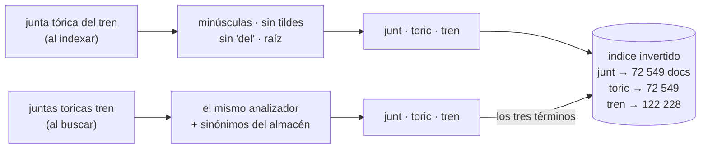

# 🔍 Fase 11 — Búsqueda: "la junta esa del tren", con analizadores, alternos y un mapping que es un esquema

> **Curso:** Ruta NoSQL Lite · Fase 11 de 26 · Bloque II — Leer de otra forma · **10 h**
> **Familia:** búsqueda · **Motor:** OpenSearch 3.8.0 (Lucene 10.5.0)
> `opensearchproject/opensearch@sha256:fafe3fc35870…`
> **Línea base:** PostgreSQL 18.6 `pgvector/pgvector@sha256:2ba9ca5f2e7d…` (`LIKE` e `ILIKE`; el full-text de
> Postgres es la apuesta de la Fase 12)
> **Entorno de ejecución:** TypeScript (`@opensearch-project/opensearch` 3.9.0 y `pg`)
> **Volumen:** `partCatalog-10k` (`06a890024812…`) para los ejemplos, `partCatalog-1m` (`a28d39be0bdb…`)
> para las mediciones
> **Depende de:** Fase 10 · **Habilita:** Fase 12
> **Apéndices de apoyo:** [`a02`](a02-compose-de-la-ruta.md), [`a05`](a05-el-dominio-de-flota.md),
> [`a06`](a06-lenguajes-y-drivers.md), [`a09`](a09-catalogo-de-errores.md), [`a10`](a10-licencias-y-riesgo.md)
> **Fecha de verificación ejecutada:** 07/10/2026, en macOS arm64
> **Objetivo:** que Sandra encuentre *"juntas toricas tren"*, *"oring del tren"* y un número de parte
> escrito de cualquier forma —con su alterno al lado—, y medir por qué `LIKE` no puede, aunque lea el
> millón entero.

---

## 🧭 1. Dónde estamos

El Bloque II leyó las lecturas de vuelo por columnas (Fases 07 y 08) y por tiempo (Fases 09 y 10). La
tercera forma de leer de este bloque es **por palabras**: el índice no dice dónde está una fila, dice en
qué documentos aparece cada término. Es la familia de búsqueda, y aquí con OpenSearch, el fork con
licencia Apache 2.0 de Elasticsearch; por qué ese y no el original está en
[`a10`](a10-licencias-y-riesgo.md).

El dolor es el de Sandra Vélez, jefe de almacén y compras. El catálogo de Cóndor son unas ochenta mil
referencias —el dataset de esta fase llega al millón— con números de parte, alternos y equivalencias, y
proveedores que escriben el mismo número de cuatro formas. La gente le pide *"la junta esa del tren"*, y
ella busca con el equivalente de un `LIKE`: encuentra lo que ya sabía que existía. **Lo que no encuentra
es el alterno que le habría ahorrado la importación.**

Esta fase modela el catálogo para que se pueda buscar como habla la gente del hangar, y mide contra lo
que Postgres hace con `LIKE`. El full-text de Postgres —`tsvector` con GIN— no aparece aquí a propósito:
es la apuesta de la Fase 12.

---

## 🎯 2. Objetivos de esta fase

1. Cargar el catálogo en OpenSearch con un `mapping` estricto y analizadores propios, en lotes de
   `_bulk` —**200 viajes para el millón**—, y en Postgres, los mismos registros.
2. Ver con `_analyze` qué términos produce cada analizador: plurales, tildes, jerga y números con guiones.
3. Medir las cuatro búsquedas de Sandra contra la verdad del catálogo: OpenSearch encuentra **10 287 de
   10 287** y **2 de 2**; `LIKE` encuentra **0**, leyendo el millón.
4. Modelar el alterno en las dos direcciones, porque el catálogo lo guarda en una, y descubrir que sin eso
   **el buscador también falla**.
5. Reproducir la situación 3: el buscador como fuente de verdad pierde **500 de 500** correcciones al
   reconstruirse desde la fuente.

---

## 🚫 3. Qué NO entra todavía

- **El full-text de Postgres** con `tsvector` y GIN, la relevancia comparada, el reindexado del millón
  medido, el disco lleno y cuánto tarda en verse lo recién escrito: son la [Fase 12](12-busqueda-romper-y-medir.md).
- **El boss del Bloque II**, *"El tablero que nadie puede reconstruir"*, al final de la Fase 12.
- **Búsqueda por parecido** —*"ruido metálico"* que encuentra *"golpeteo"*—: es vectorial, Fases 15 y 16. Esta
  fase busca palabras, no significados.
- **Clústeres, réplicas y fragmentos múltiples.** Un nodo, un fragmento, cero réplicas; operar OpenSearch
  en producción está fuera del curso.

---

## 🏗️ 4. Levantar el motor

La receta está en [`a02`](a02-compose-de-la-ruta.md): el perfil `busqueda`, el puerto 19200, la seguridad
desactivada para el laboratorio y el heap de 512 MB con un límite de 1400 MB (con 600, muere por memoria:
E-05 en [`a09`](a09-catalogo-de-errores.md)). Con la máquina de laboratorio de 8 GB, esta fase detiene el
perfil `series` mientras corre. Desde `src/`:

```bash
cd lab && docker compose --profile series stop && docker compose --profile base --profile busqueda up -d --wait && cd ..
node 11-busqueda-levantar-y-modelar/load.ts                                  # 10 k
node 11-busqueda-levantar-y-modelar/load.ts --dataset lab/data/partCatalog-1m
```

```text
dataset lab/data/partCatalog-10k · datasetSha256 06a890024812… verificado
opensearch 10000 documentos en 2 viajes de _bulk · 1.0 s · count 10000 · 1.7 MiB · 1 segmentos
postgres   10000 filas · 3272 kB · 0.2 s

dataset lab/data/partCatalog-1m · datasetSha256 a28d39be0bdb… verificado
opensearch 1000000 documentos en 200 viajes de _bulk · 33.1 s · count 1000000 · 170.0 MiB · 10 segmentos
postgres   1000000 filas · 313 MB · 18.6 s
```

Dos detalles con intención. **`refresh_interval` a `-1` durante la carga**: cada refresco crea un segmento
nuevo, y sin él la carga escribe segmentos que después hay que fusionar. **Un índice de un fragmento y sin
réplicas**: en un nodo, más fragmentos solo reparten el mismo disco, y la sección 6.5 muestra que incluso
con uno las facetas tienen trampa. El millón ocupa **170 MiB en OpenSearch y 313 MB en Postgres**.

---

## 📖 5. El diccionario de la familia

| Relacional (Postgres) | Búsqueda (OpenSearch) | Dónde se rompe el paralelo |
|---|---|---|
| tabla | índice | un índice de búsqueda es lo que en Postgres sería la tabla **y** su índice a la vez |
| fila | documento JSON | se guarda entero en `_source`, pero se busca por lo que dejó el analizador |
| esquema (`CREATE TABLE`) | `mapping` | **es un esquema**: tipos fijos, y un campo no cambia de tipo sin reconstruir |
| índice B-tree | índice invertido: término → documentos | ordena términos, no filas |
| `WHERE x = 'y'` | `term` sobre `keyword` | exacto, sin analizar |
| `WHERE x LIKE '%y%'` | `match` sobre `text` | no busca subcadenas: busca términos analizados |
| `GROUP BY` | agregaciones (`terms`) | aproximadas por defecto (sección 6.5) |
| `COMMIT` visible al instante | `refresh` cada segundo | lo escrito tarda en verse (Fase 12) |
| `INSERT` en lote | `_bulk` | un viaje por lote, y cada documento puede fallar por separado |

Y de vuelta: un `match` con `operator: and` es un `WHERE` con un `AND` por término; un `term` sobre un
`keyword` es un `=`; un analizador es una función que Postgres aplicaría en un índice de expresión. El
diccionario completo está en [`a08`](a08-diccionario-y-glosario.md).

> 🩻 **Esto sí funciona igual.** Cargar en lotes baja los viajes: 200 para un millón, como en las fases
> anteriores. Un esquema estricto rechaza lo que no conoce. Y lo que no está en el índice no se encuentra
> rápido: aquí el índice es todo, porque no hay recorrido secuencial que lo salve.

---

## 🧩 6. Modelar Cóndor a la manera de la búsqueda

### 6.1 "La junta esa del tren"

El problema, como llega al almacén. Cuatro búsquedas tal como las escribe la gente: *"juntas toricas
tren"*, en plural y sin tildes; *"oring del tren"*, como se dice en el taller; un número con la barra de un
proveedor, `20-100013/05`; y el mismo número sin separadores, `2010001305`. La verdad está en el propio
catálogo: la descripción del generador es *"junta tórica del tren"* —10 287 referencias en el millón—, y
el número `20-100013-05` tiene un alterno, `20-380100-15`, que es justo lo que Sandra no sabía que
existía.

```sql
SELECT part_number FROM part_catalog WHERE description LIKE '%juntas toricas tren%';   -- 0 filas
```

`LIKE` compara caracteres. Ningún catálogo dice *"juntas toricas tren"*, así que no hay nada que comparar.

### 6.2 El índice invertido por dentro

El buscador no compara caracteres: **compara términos**. Al indexar, cada descripción pasa por un
analizador que la parte en palabras, las pasa a minúsculas, les quita las tildes y las reduce a su raíz.
Al buscar, la consulta pasa por un analizador compatible. Si los dos producen el mismo término, hay
coincidencia. `_analyze` deja ver lo que hace cada uno:

```bash
curl -s localhost:19200/part_catalog/_analyze -H 'content-type: application/json' \
  -d '{"analyzer": "description_es", "text": "juntas toricas tren"}'
# y lo mismo con description_es_search y con part_number, para cada texto de abajo
```

Las respuestas, reducidas a la lista de términos:

```text
description_es         Junta tórica del tren → ['junt', 'toric', 'tren']
description_es         juntas toricas tren → ['junt', 'toric', 'tren']
description_es         oring del tren → ['oring', 'tren']
description_es_search  oring del tren → ['junt', 'toric', 'tren']
part_number 72-829002-27 → ['7282900227']
part_number 72829002-27 → ['7282900227']
part_number 72 829002 27 → ['7282900227']
part_number 72-829002/27 → ['7282900227']
```



La consulta reescrita lo confirma: `+description:junt +description:toric +description:tren`. Tres listas de
documentos —las *posting lists*— que se cruzan. **Leer un término cuesta lo que mide su lista, no lo que
mide el catálogo**: `tren` aparece en 122 228 documentos, y la intersección con los otros dos deja 10 287.
Las cifras de cada lista incluyen documentos borrados que todavía no se fusionaron —el campo cuenta
1 001 000 documentos con un millón vivos—, y eso es Lucene, no un error.

Detalle con intención: **los sinónimos van solo en el analizador de búsqueda**. `oring` se indexa tal cual
—nadie escribió "oring" en el catálogo— y al buscar se expande a `junta tórica`. Si fueran también al
indexar, cambiar un sinónimo obligaría a reconstruir el índice.

### 6.3 El `mapping` es un esquema

```json
"mappings": {
  "dynamic": "strict",
  "properties": {
    "partNumber":  { "type": "keyword", "fields": { "normalized": { "type": "text", "analyzer": "part_number" } } },
    "description": { "type": "text", "analyzer": "description_es", "search_analyzer": "description_es_search",
                     "fields": { "raw": { "type": "keyword" } } },
    "ataChapter":  { "type": "integer" },
    "unitCostUsd": { "type": "scaled_float", "scaling_factor": 100 }
  }
}
```

(Fragmento de `catalog-index.json`.) Cada campo dice su tipo y cómo se analiza, y eso **es un esquema
aunque se llame de otra forma**. `dynamic: strict` hace que se comporte como tal: un documento con un
campo que no está declarado se rechaza, con el mensaje de la sección 9. Sin `strict`, OpenSearch inventa el
tipo con el primer valor que ve, y el día que un proveedor manda `"ataChapter": "32A"` el campo ya es
número y el documento falla. **"Sin esquema" quiere decir "esquema decidido por el primer documento que
llegó"**.

Y un campo no cambia de tipo. Pasar `ataChapter` de `integer` a `keyword` falla, y la única salida es
crear otro índice y volver a cargarlo: es el día del reindexado de la sección 8. Un mismo dato puede
tener varias caras: `description` se busca analizado y `description.raw` se agrega exacto.

### 6.4 Los números de cuatro formas, y el alterno que no estaba

El analizador `part_number` borra todo lo que no sea letra o dígito, así que las cuatro formas de un
número son un solo término (sección 6.2). Eso resuelve la mitad del problema. La otra mitad la reveló la
primera medición: buscando `20-100013/05`, OpenSearch devolvió **1 de 2**. Encontró el número, no su
alterno.

La razón está en el dato: el catálogo guarda la relación **en una sola dirección**. `20-100013-05` dice que
`20-380100-15` es su alterno; `20-380100-15` no dice nada. Buscar el primero no tiene por qué encontrar el
segundo. La solución es de modelo, no de motor: `load.ts` hace una primera pasada por el archivo, arma la
relación inversa y la indexa como `alternateOf`. **Es desnormalizar para la consulta**, el gesto de la
Fase 03, y el catálogo no lo tenía porque nadie lo había buscado así.

```ts
// load.ts (fragmento): A dice que B es su alterno; B no dice nada de A
for await (const e of readNdjson<Entry>(join(dir, "partCatalog.ndjson"))) {
  for (const a of e.alternates) alternateOf.set(a, [...(alternateOf.get(a) ?? []), e.partNumber]);
}
```

Con el campo nuevo, la misma búsqueda devuelve **2 de 2**, y el índice pasó de 154,1 a 170,0 MiB.

¿Era un caso raro? No. Una consulta a la tabla de Postgres lo cuenta: de las **100 152 referencias** del
millón que tienen algún alterno, **100 048** tienen al menos uno que no las nombra de vuelta. Solo los pares
de números de parte con posición en la aeronave —un centenar— se nombran mutuamente; el resto del catálogo
guarda la equivalencia en el sentido en que alguien la anotó. Es lo que pasa en cualquier catálogo armado
por personas, y es exactamente el hueco por el que Sandra importa una pieza que ya tenía en el estante.

### 6.5 Facetas, y la trampa de las agregaciones

La pantalla de Sandra no es solo una lista: a la izquierda, cuántas juntas tóricas hay por categoría, por
capítulo ATA, por modelo compatible y por proveedor. `facets.ts` lo pide en **una petición** a OpenSearch,
y en Postgres con un `GROUP BY` por faceta:

```bash
node 11-busqueda-levantar-y-modelar/facets.ts
```

```text
opensearch · 1 viaje · 72485 coincidencias
  ataChapter    20: 72485 · error máximo 0
  supplier      S-026: 3592 · S-057: 2733 · S-047: 2700 · error máximo 3521
  model         Beechcraft King Air 350: 26428 · ATR 42-500: 26396 · Bell 407: 26324 · Piper PA-31 Navajo: 26318 · Cessna 208B Grand Caravan: 26265 · DHC-6-300 Twin Otter: 26176 · error máximo 0
  supplierExact S-026: 3592 · S-055: 3554 · S-059: 3541 · error máximo 0
  category      consumable: 72485 · error máximo 0
postgres · 4 viajes · filas examinadas en total 4142651
  supplier      S-026: 3592 · S-055: 3554 · S-059: 3541
```

(Postgres, recortado a la faceta que difiere.) **La faceta de proveedores salió mal.** Pidiendo los tres
primeros, OpenSearch devolvió `S-057` y `S-047`, y los de verdad son `S-055` y `S-059`, con 800 documentos
más cada uno. No es un error escondido: la respuesta trae `doc_count_error_upper_bound: 3521`, que dice
*"cada número puede estar mal hasta en 3521"*. Las agregaciones `terms` cortan candidatos por partes antes
de juntarlas, y con muchos valores parecidos el corte deja fuera a los verdaderos. Pidiendo más candidatos
(`shard_size: 100`), el error baja a **0** y coincide con Postgres. Por qué cortó tanto con un solo
fragmento no se investigó; lo que sí se comprobó es que el campo que lo avisa estaba ahí.

El resto: **una petición contra cuatro**, y Postgres examinó **4 142 651 filas** para las cuatro facetas,
porque cada `GROUP BY` vuelve a recorrer el millón con su `ILIKE`.

### 6.6 Actualizar es borrar y volver a escribir

Hay un dato de la carga que conviene mirar antes de la sección 8. Después de que `source-of-truth.ts`
corrigiera 500 precios y los devolviera a su valor, el índice dice:

```text
health status index        uuid                   pri rep docs.count docs.deleted store.size pri.store.size
green  open   part_catalog -BTV6i_yQ6Caj70ywcd7Bg   1   0    1000000         1000    170.2mb        170.2mb
```

Un millón de documentos vivos y **1000 borrados**, aunque nadie borró nada. Es como funciona Lucene por
debajo: **los segmentos no se modifican nunca**. Actualizar un documento es marcar el viejo como borrado y
escribir uno nuevo en otro segmento; 500 correcciones y 500 deshechas son mil documentos muertos que
siguen ocupando disco hasta que una fusión de segmentos los limpie. Es la misma idea que las tuplas muertas
de Postgres en la Fase 08, con otro nombre, y explica dos cosas que vienen: por qué escribir mucho en un
buscador cuesta más de lo que parece, y por qué lo recién escrito no se ve hasta el próximo *refresh*, que
es cuando el segmento nuevo se abre para leer (Fase 12).

Y explica una cifra de la sección 6.2: las listas de términos contaban 1 001 000 documentos con
descripción. Eran los mil muertos de las correcciones, que todavía estaban en algún segmento.

### 6.7 Cargar es modelar, otra vez

Todo lo que hace buscable al catálogo ocurrió **al cargarlo**: el analizador eligió los términos, el
`mapping` fijó los tipos y `load.ts` calculó una relación que el catálogo no tenía. Nada de eso se arregla
consultando. **El índice de búsqueda es una vista del dato construida para una forma de preguntar**, y
cambiar la forma de preguntar es volver a construirla. Esa frase es el veredicto de la Fase 12 dicho
antes de tiempo.

Y tiene una consecuencia de oficio que conviene decir ahora: **el código que carga el índice es parte del
modelo**, igual que un `CREATE TABLE`. Si `alternateOf` se calcula en un script que solo existe en la
máquina de quien lo escribió, el índice no se puede reconstruir, y un índice que no se puede reconstruir
desde la fuente ya no es un índice: es la segunda verdad de la sección 8.

**El patrón a memorizar.** El buscador no encuentra lo que se parece al texto: encuentra lo que produce
los mismos términos que el texto. Lo que no esté en los términos —un alterno inverso, un sinónimo— hay que
ponerlo ahí al indexar.

---

## 🪞 7. Tu instinto relacional dice… y esta vez se equivoca

> 🪞 **"Un `LIKE '%junta%'` ya busca."** Busca caracteres, y para eso **lee el millón entero**. Con lo que
> escribe Sandra, `LIKE '%juntas toricas tren%'` y `ILIKE '%oring%'` devuelven **0** de las 10 287
> correctas. El `ILIKE '%junta%'` que sí devuelve algo trae **72 485**, y al menos **62 198** de ellas no son la pieza buscada.
> OpenSearch devuelve **10 287 de 10 287** para las dos frases, con los diez primeros correctos.

```bash
node 11-busqueda-levantar-y-modelar/search.ts
```

> 📐 **Medición — las búsquedas de Sandra** · `partCatalog-1m`, `a28d39be0bdb…` · OpenSearch 3.8.0 ·
> PostgreSQL 18.6 · verificado el 07/10/2026
>
> | Lo que escribe Sandra | Verdad | OpenSearch: devueltos · de la verdad | Postgres: examinadas · devueltas · de la verdad |
> |---|---|---|---|
> | juntas toricas tren | 10 287 | 10 287 · **10 287** | `LIKE` literal: 1 000 000 · 0 · **0**; `ILIKE '%junta%'`: 1 000 000 · 72 485 · 10 287 |
> | oring del tren | 10 287 | 10 287 · **10 287** | `ILIKE '%oring%'`: 1 000 000 · 0 · **0** |
> | `20-100013/05` | 2 | 2 · **2** | `= ANY(supplier_part_numbers)`: 1 000 000 · 1 · **1** |
> | `2010001305` | 2 | 2 · **2** | `replace(…) = $1`: 1 000 000 · 1 · 1; con subconsulta de alternos: 1 000 004 · 2 · **2** |
>
> Reproducir: `node 11-busqueda-levantar-y-modelar/search.ts` (desde `src/`)

El instinto es razonable porque `LIKE` es lo que hay en la caja y para un catálogo pequeño funciona. Se
rompe dos veces. **Primero en lo que encuentra**: el texto que la gente escribe no es el texto que guardó
el catálogo, y `LIKE` no sabe de plurales, tildes ni jerga. **Después en lo que cuesta**: un patrón que
empieza con `%` no puede usar un B-tree, así que cada búsqueda examina el millón. Y la última fila muestra
el tercer costo: para encontrar el alterno, SQL necesita una subconsulta que alguien tiene que saber
escribir; el buscador lo encuentra porque se modeló al cargar.

La pregunta que lo habría anticipado es la 5: **¿exactitud o parecido?** Aquí la respuesta es incómoda:
Sandra quiere **exactitud sobre lo que quiso decir**, no sobre lo que tecleó. Esa es la familia de búsqueda.

---

## ⚰️ 8. La situación 3: elegiste bien la familia y la modelaste como relacional

**La decisión, con su mejor argumento.** *"El buscador ya tiene todo el catálogo, y la pantalla de Sandra
ya habla con él. Que las correcciones de precio se escriban ahí directamente: un viaje, sin pasar por
`SIGMA`, y se ven en la búsqueda al segundo."*

**Por qué era razonable.** OpenSearch guarda el documento entero en `_source`, acepta actualizaciones y las
devuelve. Para la pantalla, funciona igual que una base.

**Qué pasa.** `source-of-truth.ts` escribe 500 correcciones de precio —un 7 % más— solo en OpenSearch.
Después, el `mapping` tiene que cambiar —un campo nuevo, otro tipo, otro analizador—, lo que obliga a
reconstruir el índice, y hay dos formas:

```bash
node 11-busqueda-levantar-y-modelar/source-of-truth.ts
```

```text
correcciones escritas solo en OpenSearch: 500 · errores false
índice part_catalog: precios distintos de la fuente 500 de 500
_reindex: 1000000 documentos en 32.5 s · precios distintos de la fuente 500 de 500
desde la fuente: 37.0 s · precios distintos de la fuente 0 de 500 · correcciones perdidas 500
```

**Las dos salidas son malas, y de formas opuestas.** Con `_reindex`, el índice nuevo copia al viejo y las
500 correcciones sobreviven… pero siguen sin estar en la fuente: **dos verdades**, y la próxima
reconstrucción desde `SIGMA` las borra. Reconstruyendo desde la fuente, el índice vuelve a coincidir con
el catálogo y **las 500 correcciones se pierden**, sin error y sin aviso.

**Antes y después, con números.**

| Dónde se escribe la corrección | Tras reconstruir desde `_reindex` | Tras reconstruir desde la fuente |
|---|---|---|
| solo en el buscador | 500 distintas de la fuente | **500 perdidas** |
| en la fuente, y el buscador se reconstruye o se actualiza desde ella | 0 | **0** |

**Cuánto cuesta salir.** Encontrar cuáles son: comparar el índice con la fuente documento a documento, que
es lo que hace este script con 500 identificadores conocidos y lo que en la realidad nadie tiene.

**La pregunta que lo habría evitado** es la 1: **¿dónde está la frontera transaccional?** El precio es un
dato de la operación y vive en la fuente; el buscador es una vista para encontrarlo. **Siempre al lado,
siempre reconstruible**, y la [Fase 24](24-poliglota-la-costura.md) mide cómo se mantiene al día.

---

## ⚠️ 9. Errores comunes y diagnóstico

**Un campo que el mapping no conoce** (E-47 en [`a09`](a09-catalogo-de-errores.md)):

```text
{"error":{"root_cause":[{"type":"strict_dynamic_mapping_exception","reason":"mapping set to strict, dynamic introduction of [descripcion] within [_doc] is not allowed"}],…,"status":400}
```

🩺 Es el esquema funcionando: alguien mandó `descripcion` en lugar de `description`. Con `dynamic: true`, el
documento habría entrado con un campo nuevo que ninguna búsqueda mira.

**Un campo que no puede cambiar de tipo** (E-48):

```text
{"error":{"root_cause":[{"type":"illegal_argument_exception","reason":"mapper [ataChapter] cannot be changed from type [integer] to [keyword]"}],…,"status":400}
```

🩺 El tipo de un campo es para siempre en ese índice. Índice nuevo con el `mapping` corregido, carga desde
la fuente y cambio de alias (Fase 12).

**El reindexado que se lanzó cuatro veces** (E-49): `TimeoutError: Request timed out` en un `_reindex` de un
millón. 🩺 El cliente espera 30 s por defecto y **reintenta solo**: el índice destino terminó con 622 208
documentos reescritos de más. Para operaciones largas, `wait_for_completion: false` y consultar la tarea,
o `maxRetries: 0` y un `requestTimeout` largo.

**`Header overflow` al esperar un `_reindex`** (E-50): `ConnectionError: Parse Error: Header overflow`. 🩺
La respuesta síncrona trae una cabecera `TASK_RESOURCE_USAGE` por cada lote recorrido (comprobado con
`curl -D -`), y con un millón Node la rechaza. La misma salida: lanzarlo como tarea.

**Facetas que no cuadran.** Sin error. 🩺 Mira `doc_count_error_upper_bound` en cada agregación `terms`: si
no es 0, los números pueden estar mal hasta en esa cifra. `shard_size` mayor que `size`.

**Filas examinadas 999 999 en Postgres.** El arnés imprime 999 999 en algunos `LIKE` sobre el millón: es el
redondeo del promedio por proceso de Postgres 18 que ya contó la Fase 07, no una fila que faltó. La tabla de
la sección 7 dice 1 000 000.

**Una búsqueda que no encuentra lo obvio.** 🩺 `_analyze` con el texto del documento y con el de la
búsqueda: si no producen los mismos términos, no hay coincidencia posible.

---

## 📋 10. Checklist de validación

```text
[ ] El millón cargado en 200 viajes de _bulk; el mapping es strict
[ ] _analyze: las cuatro formas de un número dan el mismo término, y "oring" se expande al buscar
[ ] juntas toricas tren: OpenSearch 10 287 de 10 287; LIKE, 0 leyendo el millón
[ ] Sé por qué el alterno no aparecía, y qué hace alternateOf
[ ] La faceta de proveedores sale mal con el error máximo a la vista, y bien con shard_size
[ ] Las correcciones escritas solo en el buscador: 500 distintas tras _reindex, 500 perdidas desde la fuente
[ ] Provoqué E-47 y E-48
[ ] M-28 a M-30 en la bitácora, E-47 a E-50 en a09, el 🪞 6 en INSTINTOS.md
```

---

## 🧪 11. Ejercicios (26)

Desde `src/`, con el perfil `busqueda` arriba y `load.ts` corrido con el millón.

### 🟢 Fácil — el índice por dentro (1–8)

#### 🟢 Ejercicio 1 — Tu carga

Corre `load.ts` con `partCatalog-10k` y con el millón.

**Objetivo:** los viajes de `_bulk` de cada uno, y explicar por qué son 2 y 200.

#### 🟢 Ejercicio 2 — Los términos

Pasa por `_analyze` *"Neumáticos principales"* y *"llanta principal"* con los dos analizadores de
descripción.

**Pregunta:** ¿producen los mismos términos? ¿Qué hace el sinónimo, y en cuál de los dos?

#### 🟢 Ejercicio 3 — La consulta reescrita

Con `_validate/query?explain=true`, mira la reescritura de *"juntas toricas tren"*.

**Objetivo:** los tres términos, y por qué el `operator: and` los vuelve obligatorios.

#### 🟢 Ejercicio 4 — Un número de cuatro formas

Busca un número de `partCatalog-10k` en sus cuatro grafías.

**Objetivo:** el mismo documento las cuatro veces.

#### 🟢 Ejercicio 5 — El mapping estricto

Indexa un documento con un campo mal escrito.

**Objetivo:** E-47, y decir qué habría pasado con `dynamic: true`.

#### 🟢 Ejercicio 6 — Las facetas

Corre `facets.ts`.

**Objetivo:** la faceta de proveedores con y sin `shard_size`, y su `doc_count_error_upper_bound`.

#### 🟢 Ejercicio 7 — `term` contra `match`

Busca `"junta tórica del tren"` con `term` sobre `description` y sobre `description.raw`.

**Pregunta:** ¿por qué uno devuelve 0 y el otro 10 287?

#### 🟢 Ejercicio 8 — Los segmentos

Consulta `_cat/segments/part_catalog`.

**Objetivo:** cuántos segmentos y cuántos documentos borrados hay en cada uno.

### 🟡 Intermedio — modelar la búsqueda (9–15)

#### 🟡 Ejercicio 9 — Un sinónimo nuevo

Añade *"empaque, junta"* a los sinónimos y busca *"empaque del tren"*.

**Pregunta:** ¿necesitaste reconstruir el índice? ¿Por qué no, y en qué caso sí?

#### 🟡 Ejercicio 10 — Sin `alternateOf`

Carga una copia del índice sin el campo y repite la búsqueda del número.

**Objetivo:** 1 de 2, y cuántas referencias del millón tienen un alterno que solo aparece en una dirección.

#### 🟡 Ejercicio 11 — El tamaño de cada campo

Con `_disk_usage?run_expensive_tasks=true`, mira cuánto ocupa cada campo.

**Objetivo:** cuál es el más caro y si vale lo que ocupa.

#### 🟡 Ejercicio 12 — Una faceta de precio

Agrega por rangos de `unitCostUsd` las juntas tóricas.

**Objetivo:** la misma tabla en Postgres con `width_bucket`, y cuántas filas examina.

#### 🟡 Ejercicio 13 — Tolerancia a tecleo

Busca *"junta torcia"* con `fuzziness: AUTO`.

**Pregunta:** ¿cuántos encuentra y qué término aceptó? ¿Qué pasa con *"tren"* escrito *"tern"*?

#### 🟡 Ejercicio 14 — El alterno en SQL

Escribe en Postgres la búsqueda de un número que devuelva también sus alternos en las dos direcciones.

**Objetivo:** la consulta, sus filas examinadas, y compararla con el campo `alternateOf`.

#### 🟡 Ejercicio 15 — Un tipo equivocado

Indexa un documento con `"ataChapter": "32A"` en el índice estricto y en uno dinámico.

**Objetivo:** el error en cada uno, y lo que queda en el índice dinámico.

### 🟠 Difícil — diagnosticar y decidir (16–21)

#### 🟠 Ejercicio 16 — Predecir la lista de términos

Antes de medir, predice en cuántos documentos aparece el término `helic` (hélice). Después compruébalo con
`_termvectors`.

**Objetivo:** tu número escrito antes, y explicar la diferencia con un `count` de la descripción.

#### 🟠 Ejercicio 17 — El reindexado que duplica

Lanza un `_reindex` del millón con el cliente por defecto y mira el índice destino.

**Objetivo:** reproducir E-49 y contar los documentos borrados del destino. ¿Cuántas veces corrió?

#### 🟠 Ejercicio 18 — Las cuatro grafías en Postgres

Haz que Postgres encuentre un número en sus cuatro grafías con un índice de expresión.

**Objetivo:** filas examinadas con y sin el índice, y lo que no resuelve (el alterno, el sinónimo).

#### 🟠 Ejercicio 19 — Relevancia

Busca *"junta tórica"* y mira por qué el primer resultado es el primero (`explain: true`).

**Pregunta:** ¿qué pesa más, la frecuencia del término o el largo del campo?

#### 🟠 Ejercicio 20 — El precio, desde la fuente

Rediseña `source-of-truth.ts` para que la corrección se escriba en Postgres y el índice se actualice desde
ahí.

**Objetivo:** 0 perdidas y 0 distintas tras las dos reconstrucciones.

#### 🟠 Ejercicio 21 — La faceta exacta, a qué costo

Repite la faceta de proveedores con `shard_size` de 10, 50, 100 y 1000.

**Objetivo:** el primero exacto y lo que cambia en la respuesta.

### 🔴 Muy difícil — autopsias (22–26)

#### 🔴 Ejercicio 22 — La autopsia de las correcciones

El buscador de Cóndor recibió correcciones de precio durante un año. Hoy hay que cambiar el `mapping`.

**Objetivo:** los cinco pasos de la Fase 00, con la sección 8 como factura, y cómo encontrarías las
correcciones perdidas sin conocer sus identificadores.

#### 🔴 Ejercicio 23 — Sinónimos que mienten

Añade *"junta, sello"* y busca *"sello del motor"*.

**Objetivo:** cuántos resultados son de verdad sellos, y por qué un sinónimo mal puesto es peor que
ninguno.

#### 🔴 Ejercicio 24 — El catálogo de otro proveedor

Un proveedor escribe los números con un prefijo propio (`AV-20-100013-05`).

**Objetivo:** el analizador que lo resuelve sin romper los demás, probado con `_analyze` y con una búsqueda.

#### 🔴 Ejercicio 25 — Lo que `LIKE` hace bien

Encuentra una búsqueda del catálogo donde `LIKE` sea la herramienta correcta y el buscador sobre.

**Objetivo:** la búsqueda, las dos mediciones y la regla.

#### 🔴 Ejercicio 26 — El modelo para la Fase 12

Escribe la apuesta de la Fase 12 —el full-text de Postgres cubre el 90 % de este catálogo— con lo que viste
aquí.

**Objetivo:** tu predicción por escrito, con qué búsqueda crees que Postgres no alcanza.

### 🔥 Opcionales

- **OpenSearch Dashboards** para mirar el índice, y lo que no muestra del mapping.
- **Un analizador de n-gramas** para buscar por prefijo de número, y lo que cuesta en disco.

---

## 📚 12. Referencias

> ⚠️ Las URLs y sus contenidos cambian, y la documentación cubre la última versión. Esta fase se verificó
> con OpenSearch 3.8.0 y el cliente `@opensearch-project/opensearch` 3.9.0.

- **Analizadores** — https://docs.opensearch.org/latest/analyzers/ — tokenizadores, filtros y `_analyze`.
- **Mappings** — https://docs.opensearch.org/latest/field-types/ — tipos, `dynamic` y multi-campos.
- **Sinónimos** — https://docs.opensearch.org/latest/analyzers/token-filters/synonym-graph/
- **Agregaciones `terms`** — https://docs.opensearch.org/latest/aggregations/bucket/terms/ — `shard_size` y
  el error de los conteos.
- **`_reindex`** — https://docs.opensearch.org/latest/api-reference/document-apis/reindex/
- **Manning, Raghavan y Schütze, *Introduction to Information Retrieval*** —
  https://nlp.stanford.edu/IR-book/ — el índice invertido, el capítulo 1.
- **Por qué OpenSearch y no Elasticsearch**, en [`a10`](a10-licencias-y-riesgo.md).

**Orden sugerido:** el capítulo 1 del libro antes de la sección 6.2; analizadores y mappings durante la 6;
`terms` antes de la 6.5; `_reindex` antes de la sección 8.

---

## 🏁 13. Resultado de la fase

```text
part_catalog (OpenSearch, 1 fragmento, mapping strict)          part_catalog (Postgres, busqueda_base)
  1 000 000 documentos · 170 MiB · 10 segmentos                   1 000 000 filas · 313 MB
  description  → description_es (+ sinónimos al buscar)           description text
  partNumber · alternates · alternateOf · supplierPartNumbers     part_number · alternates[] · supplier_part_numbers[]
     → part_number (sin separadores)
```

Modelaste el catálogo para que se busque como habla el hangar, y mediste lo que `LIKE` no puede: **10 287 de
10 287** contra **0**, leyendo el millón. Descubriste que el buscador también falla cuando el dato no tiene
lo que buscas —el alterno en una sola dirección— y que la salida es modelar al cargar. Y viste por qué el
buscador no puede ser la fuente: **500 de 500** correcciones perdidas al reconstruirlo.

> **La señal de que quedó bien:** *"Puedo explicar con `_analyze` por qué una búsqueda encuentra o no un
> documento, y decir qué dato del catálogo tuve que preparar al indexar para que Sandra encuentre el
> alterno."*

> 🏷️ **No cierres la fase sin el tag.** Con el checklist en verde y `git status` limpio:
>
> ```bash
> git tag -a fase-11-busqueda-levantar-y-modelar -m "F11 cerrada: millón en 200 viajes; analizadores y mapping strict; Sandra 10 287 de 10 287 contra 0 con LIKE; alternateOf; facetas aproximadas; 500 correcciones perdidas al reconstruir desde la fuente"
> ```
>
> Commits de la fase con prefijo `f11:`, los de ejercicio `f11 ej17: …`.
