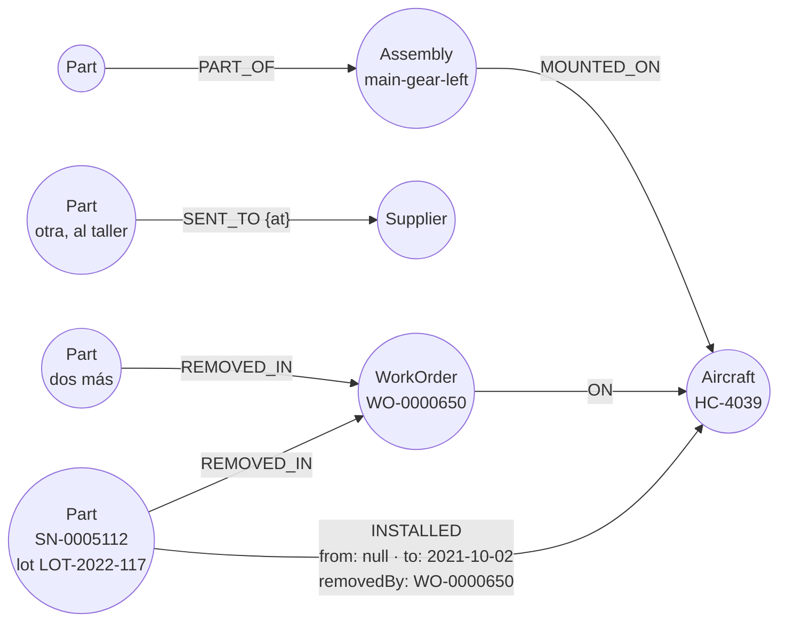

# 🕸️ Fase 13 — Grafos: la directiva que llega un jueves, con la estadía como relación

> **Curso:** Ruta NoSQL Lite · Fase 13 de 26 · Bloque III — Preguntas que no sabes escribir en SQL · **10 h**
> **Familia:** grafos · **Motor:** Neo4j 2026.09.0 Community `neo4j@sha256:91fb0bf237c4…`
> **Línea base:** PostgreSQL 18.6 `pgvector/pgvector@sha256:2ba9ca5f2e7d…` (esquema de la Fase 01 y
> `trace_edge` de [`a07`](a07-postgres-linea-base.md))
> **Entorno de ejecución:** TypeScript (`neo4j-driver` 6.2.0 y `pg`)
> **Volumen:** `workOrder-10k` (`5a107518d726…`) para los ejemplos, `workOrder-1m` (`11a67c65fb22…`) para
> las mediciones
> **Depende de:** Fase 12 · **Habilita:** [Fase 14](14-grafos-romper-y-medir.md)
> **Apéndices de apoyo:** [`a02`](a02-compose-de-la-ruta.md), [`a03`](a03-clis-de-los-motores.md),
> [`a04`](a04-el-arnes-de-medida.md), [`a05`](a05-el-dominio-de-flota.md), [`a07`](a07-postgres-linea-base.md)
> **Fecha de verificación ejecutada:** 07/10/2026, en macOS arm64
> **Objetivo:** modelar la trazabilidad de Cóndor como grafo —con la estadía de cada pieza en cada aeronave
> como relación con fechas—, contestar la directiva con la respuesta de `answers.json` en los dos motores y
> medir en qué se diferencian cuando el número de saltos se conoce.

---

## 🧭 1. Dónde estamos

El Bloque II cambió **qué se lee**. El Bloque III cambia algo más incómodo: **qué se puede preguntar**. Son
dos familias —grafos, aquí y en la Fase 14, y vectorial, que el curso publicó antes en las Fases
[15](15-vectorial-levantar-y-modelar.md) y [16](16-vectorial-romper-y-medir.md)— que no compiten en
rendimiento sino en expresividad. Hay preguntas que en relacional no es que salgan caras: es que no se
escriben, o se escriben con tanto esfuerzo que nadie las hace.

El dolor de Cóndor que les toca es el más caro de la historia de la empresa. Llega un boletín sobre un lote
de piezas fabricadas en un rango de fechas, y hay que contestar **hoy**: *¿en cuáles de nuestras aeronaves
estuvo instalada alguna vez una pieza de este lote, y qué más se desmontó junto con ella?* Las piezas se
mueven entre aeronaves, pasan por almacén y por talleres aliados, se intercambian. Hoy se contesta con
cuatro días y la memoria de Yamile Cruz.

Esta fase modela eso como grafo y lo mide contra el esquema de la Fase 01, donde la trazabilidad ya existía
como tabla de movimientos. La pregunta que la Fase 14 va a apostar —a partir
de cuántos saltos gana el grafo— queda para ella. Aquí los saltos se conocen, y eso importa más de lo que
parece.

---

## 🎯 2. Objetivos de esta fase

1. Cargar `workOrder-1m` en Neo4j —**1 131 932 nodos y 2 653 164 relaciones en 704 viajes**— armando al
   cargar las **673 010 estadías**, que no están en ningún archivo.
2. Contestar la directiva en sus dos mitades con la respuesta conocida: **351 aeronaves** y **350 retiros**
   en los dos motores, igual que `answers.json`.
3. Medir la **cardinalidad de travesía** —*db hits* y filas en Neo4j, filas examinadas y páginas en
   Postgres— de tres preguntas con saltos conocidos.
4. Explicar por qué la relación con propiedades es "ciudadana de primera" y qué le cuesta a Postgres
   tenerla: derivarla en cada consulta o guardarla en una tabla.
5. Reproducir la situación 3: el grafo como tablas genéricas, **351 aeronaves donde la respuesta es 22**.

---

## 🚫 3. Qué NO entra todavía

- **La apuesta de la familia** —el grafo gana a `WITH RECURSIVE` a partir del cuarto salto—, la escalera de
  profundidades, la consulta de patrón, el grafo que no cabe en memoria y la consulta sin límite sobre un
  grafo con ciclos: son la [Fase 14](14-grafos-romper-y-medir.md).
- **El boss del Bloque III**, *"Freddy ya vio esto"*, que cruza este grafo con los vectores de la Fase 16, al
  final de la [Fase 16](16-vectorial-romper-y-medir.md).
- **Algoritmos de grafos** (centralidad, comunidades, caminos mínimos ponderados): la biblioteca que los trae
  es otro producto y otra licencia, y no responde a ninguna de las cinco preguntas del curso.
- **Los intercambios como relación.** El dataset no registra qué número de serie reemplazó a cuál en un
  intercambio con un taller aliado; solo lo sabe `answers.json`, que no se carga. Es exactamente la historia
  que se bifurca sin dejar rastro, y el ejercicio 22 la persigue.

---

## 🏗️ 4. Levantar el motor

La receta está en [`a02`](a02-compose-de-la-ruta.md): el perfil `grafos`, Neo4j Community con el heap en
512 MB, la caché de páginas en 256 MB y un límite de 1 GB, Bolt en el 17687 y la consola web en el 17474. La
línea base es el esquema de la Fase 01 cargado con `workOrder-1m`, más los índices de esta fase. Desde
`src/`:

```bash
cd lab && docker compose --profile base --profile grafos up -d --wait && cd ..
node 01-el-dominio-de-flota-y-el-arnes/load.ts --dataset lab/data/workOrder-1m
docker compose -f lab/compose.yaml exec -T base psql -U postgres < 13-grafos-levantar-y-modelar/indexes.sql
node 13-grafos-levantar-y-modelar/load.ts --dataset lab/data/workOrder-1m
```

```text
dataset lab/data/workOrder-1m · datasetSha256 11a67c65fb22… verificado
armado: 377468 órdenes con movimientos · 673010 estadías
neo4j: 1131932 nodos · 2653164 relaciones · 704 viajes · 90.2 s
```

`indexes.sql` añade a la línea base lo que la directiva cruza y la Fase 01 no necesitaba: el lote de la
pieza y la orden de cada movimiento. El grafo ocupa 490 MB en disco; con él cargado, `docker stats` marca
**1004 MiB de 1 GiB**, y la [Fase 14](14-grafos-romper-y-medir.md) mide qué pasa cuando no cabe.

---

## 📖 5. El diccionario de la familia

| Relacional (Postgres) | Grafos (Neo4j) | Dónde se rompe el paralelo |
|---|---|---|
| fila | nodo, con uno o varios *labels* | el label no es una tabla: un nodo puede tener varios |
| clave foránea | relación, con tipo y dirección | la relación existe como dato propio, con sus propiedades |
| tabla intermedia con columnas (`part_stint`) | relación con propiedades (`:INSTALLED {from, to}`) | en SQL hay que crearla; en el grafo es la forma normal |
| `JOIN` | recorrer una relación (`-[:INSTALLED]->`) | se sigue un puntero del nodo, no se busca en un índice |
| `WITH RECURSIVE` | patrón de longitud variable (`-[:INSTALLED*1..4]-`) | la Fase 14 mide la diferencia |
| `EXPLAIN (ANALYZE, BUFFERS)` | `PROFILE`: *db hits* y filas por operador | otra unidad, la misma idea |
| índice B-tree | índice sobre una propiedad de un label | sirve para encontrar el primer nodo; el resto es recorrer |
| restricción `UNIQUE` | `CREATE CONSTRAINT … IS UNIQUE` | igual |

Y de vuelta: una relación tipada con propiedades es una fila de una tabla intermedia con sus dos claves
foráneas; un label es una tabla con su clave primaria; un patrón de longitud fija es una cadena de `JOIN`. El
diccionario completo está en [`a08`](a08-diccionario-y-glosario.md).

> 🩻 **Esto sí funciona igual.** El primer nodo se encuentra con un índice, como siempre: sin él, Neo4j recorre
> todos los nodos del label, y la sección 8 lo mide. Una restricción de unicidad es una restricción. Cargar
> en lotes baja los viajes: 704 para dos millones y medio de relaciones. Y un plan sigue siendo un árbol de
> operadores que se lee de abajo arriba.

---

## 🧩 6. Modelar Cóndor a la manera de los grafos

### 6.1 La directiva que llega un jueves

El problema, con la respuesta delante. El generador plantó en `workOrder-1m` un lote, `LOT-2022-117`: **713
actuadores de tren** fabricados en 2022, que en cinco años pasaron por **351 aeronaves**, y **350 retiros**
de alguno de ellos con lo que salió en la misma orden ([`a05`](a05-el-dominio-de-flota.md)). Esas cifras
están en `answers.json`, que no se carga en ningún motor: son contra lo que se comprueba.

La directiva tiene dos mitades, y las dos son de saltos conocidos. **Dónde estuvo**: pieza → aeronave, un
salto. **Qué salió con ella**: pieza → orden que la retiró → otras piezas de esa orden, dos saltos. Ninguna
necesita recursión. Esta fase empieza por ahí a propósito: antes de preguntar si el grafo gana cuando la
profundidad crece, conviene ver qué pasa cuando no crece.

### 6.2 Nodos, relaciones y la estadía como ciudadana de primera



Cinco labels —`Aircraft`, `Part`, `WorkOrder`, `Assembly`, `Supplier`— y siete tipos de relación. La
decisión de la que depende todo es la flecha de arriba: **cada vez que una pieza estuvo instalada en una
aeronave es una relación `INSTALLED`, con su desde, su hasta y las órdenes que la abrieron y la cerraron**.
No es un atributo de la pieza ni una fila de un movimiento: es el hecho que la directiva pregunta, guardado
como lo que es, una relación entre dos cosas que dura un tiempo. La del diagrama es real: `SN-0005112`, una
pieza del lote, ya estaba en `HC-4039` cuando empieza la ventana —`from` nulo— y salió con la orden
`WO-0000650` al día siguiente.

Una relación de Neo4j tiene siempre un tipo, una dirección y sus dos extremos, y puede tener propiedades
como un nodo. Lo que la hace "ciudadana de primera" no es la sintaxis: es que **se guarda junto a los nodos
que une**, de modo que pasar de una pieza a sus aeronaves es seguir los punteros de la pieza, no buscar en un
índice. Es la propiedad de la que vive la familia —la llaman *index-free adjacency*—, y la sección 6.5 mide
cuánto importa cuando los saltos son pocos: menos de lo que se suele decir.

Detalle con intención: solo entran como nodo las **377 468 órdenes con movimientos** de las 1 000 000. Una
orden que no instaló ni retiró nada no está en ningún camino de la trazabilidad, y en un grafo cada nodo que
no se recorre es memoria que ocupa la caché.

### 6.3 Cargar es modelar: las estadías no están en ningún archivo

El generador escribe movimientos —"en la orden WO-0123 se retiró SN-0005112"—, no estadías. Armarlas es
modelar, y `load.ts` lo hace al cargar: recorre las órdenes **en orden de tiempo**, abre una estadía con cada
instalación y la cierra con el retiro siguiente de la misma pieza.

```ts
// load.ts (fragmento): una pieza retirada sin instalación conocida estaba puesta desde antes de la ventana
for (const w of orders) {
  for (const m of w.removed) {
    const s = open.get(m.serialNumber) ?? { serial: m.serialNumber, aircraft: w.aircraft, from: null, … };
    s.to = w.openedAt;
    s.removedBy = w.workOrderId;
    stints.push(s);
    open.delete(m.serialNumber);
  }
  for (const m of w.installed) open.set(m.serialNumber, { serial: m.serialNumber, aircraft: w.aircraft, from: w.openedAt, … });
}
```

Tres casos que el código cuida, porque los datos los tienen: la pieza que **estaba instalada antes de la
ventana** (su primera aparición es un retiro: `from` nulo), la que **sigue instalada al final** (`to` nulo),
y la que **nunca se movió** (no aparece en ninguna orden; su estadía sale del estado final de `part.ndjson`).
Resultado: **673 010 estadías**. Algunas órdenes plantadas por el generador no están en orden de fecha
dentro del archivo, así que se ordenan por fecha antes de emparejar.

### 6.4 Cypher, lo justo para la directiva

```cypher
// dónde estuvo alguna vez una pieza del lote: un salto
MATCH (p:Part {lotNumber: 'LOT-2022-117'})-[:INSTALLED]->(a:Aircraft)
RETURN count(DISTINCT a);

// qué salió con ella: dos saltos, a la orden que la retiró y de vuelta a las demás piezas
MATCH (p:Part {lotNumber: 'LOT-2022-117'})-[:REMOVED_IN]->(w:WorkOrder)
OPTIONAL MATCH (w)<-[:REMOVED_IN]-(o:Part) WHERE o <> p
RETURN p.serialNumber, w.workOrderId, collect(o.serialNumber);
```

Un patrón de Cypher es un dibujo de la consulta: paréntesis para nodos, corchetes para relaciones, la flecha
en el sentido en que se guardó. `MATCH` busca todas las formas en que ese dibujo aparece en el grafo;
`OPTIONAL MATCH` es el `LEFT JOIN`. En Postgres, la primera pregunta como la escribiría quien conoce el
esquema:

```sql
SELECT count(DISTINCT aircraft) FROM (
  SELECT wo.aircraft FROM part p JOIN work_order_movement m USING (serial_number) JOIN work_order wo USING (work_order_id)
  WHERE p.lot_number = 'LOT-2022-117'
  UNION ALL SELECT aircraft FROM part WHERE lot_number = 'LOT-2022-117' AND aircraft IS NOT NULL) x;
```

Las dos dan **351**. La de Postgres necesita saber que una pieza que nunca se movió no aparece en los
movimientos y hay que ir a buscarla al estado final: es el mismo cuidado de la sección 6.3, escrito en la
consulta en lugar de en la carga.

### 6.5 La cardinalidad de travesía

La medida propia de la familia: cuánto recorre el motor para contestar. En Neo4j, los *db hits* del
`PROFILE` —cada acceso a un nodo, una relación, una propiedad o un índice— y las filas del operador más
ancho; en Postgres, las filas examinadas y las páginas de siempre ([`a04`](a04-el-arnes-de-medida.md)).

```bash
node 13-grafos-levantar-y-modelar/measure.ts
```

> 📐 **Medición — la directiva y una pregunta con fechas** · `workOrder-1m` (`11a67c65fb22…`) · Neo4j
> 2026.09.0 Community · PostgreSQL 18.6 con `indexes.sql` · verificado el 07/10/2026
>
> | Pregunta | Resultado | Neo4j: *db hits* · filas máx. | Postgres: examinadas · páginas |
> |---|---|---|---|
> | 1 · dónde estuvo una pieza del lote | **351** (= `answers.json`) | 2655 · 713 | consulta directa: **1413 · 4626** |
> | 2 · qué salió con ella en cada retiro | **350** (= `answers.json`) | 5952 · 713 | **1801 · 4222** |
> | 3 · qué piezas compartieron aeronave **al mismo tiempo** | **12 944** en los dos | 219 423 · 93 601 | derivando estadías: **4 939 732 · 203 052** |
> | 3, con las estadías guardadas en `part_stint` | 12 944 | — | **94 761 · 88 300** |
>
> Reproducir: `node 13-grafos-levantar-y-modelar/measure.ts` (desde `src/`). Los *db hits* de la 3 variaron
> entre 219 423 y 220 020 en dos cargas del mismo dataset.

**Para las dos mitades de la directiva, Postgres no pierde.** Con sus índices, la primera examina 1413 filas
y la segunda 1801; Neo4j hace 2655 y 5952 accesos. No son la misma unidad, y no hace falta que lo sean para
la conclusión: **un salto o dos, conocidos, son un `JOIN`**, y un `JOIN` con índice es lo que Postgres mejor
hace.

Una nota de método, porque las dos columnas no se pueden restar. Un *db hit* de Neo4j es un acceso lógico
al almacén —leer un nodo, una relación o una propiedad—, y una fila examinada de Postgres es una tupla que un
recorrido tocó; ninguno de los dos cuenta bytes. Lo que sí se compara es **cómo crecen** cuando cambia la
pregunta: de la primera a la segunda, Neo4j pasa de 2655 a 5952 y Postgres de 1413 a 1801. Los dos crecen poco
porque los dos siguen índices o punteros desde 713 piezas.

La tercera pregunta es la que separa, y no por los saltos. *"Qué piezas compartieron aeronave con una del
lote mientras estuvo instalada"* necesita las **fechas de cada estadía**, y en el esquema de la Fase 01 la
estadía no existe: hay movimientos. Postgres la deriva en la consulta con una función de ventana sobre los
1,2 millones de movimientos —4,9 millones de filas examinadas—, y la respuesta coincide: 12 944. Guardada en
una tabla con índices, `part_stint` (673 010 filas, 62 MB, 4,4 s en crearla), baja a **94 761 filas**,
del orden de las 93 601 del operador más ancho de Neo4j.

### 6.6 El despiece, que sí es un árbol

La otra forma de la trazabilidad es qué pieza va dentro de qué conjunto. En el generador ese árbol tiene un
solo nivel —aeronave, conjunto, piezas— y es la foto al cierre de la ventana; se declara así:

```text
conjunto, piezas
"engine-1", ["propeller", "starterGenerator", "engine"]
"main-gear-left", ["tire", "landingGear", "actuator"]
…
Total database accesses: 56, total allocated memory: 88
```

Cincuenta y seis accesos para el despiece de `HC-4039`. Un árbol poco profundo y de forma conocida es la
consulta más fácil del mundo en cualquier motor: Postgres la resuelve con el índice de `assembly` de la Fase
01. **El despiece es un árbol; la historia de instalación no lo es**, porque las piezas vuelven a pasar por
las mismas aeronaves y se cruzan entre sí. Esa diferencia es toda la Fase 14.

**El patrón a memorizar.** En un grafo, la relación es un dato: se guarda con sus propiedades y se recorre.
En relacional, una relación con propiedades es una tabla que alguien tiene que decidir crear. Con saltos
conocidos, las dos formas cuestan lo mismo **si la tabla existe**.

---

## 🪞 7. Tu instinto relacional dice… y esta vez se equivoca

> 🪞 **"Eso es una tabla de adyacencia con un `JOIN` recursivo."** Con saltos conocidos, **es exactamente
> eso**, y Postgres lo hace igual o mejor: 1413 filas contra 2655 accesos para la primera mitad de la
> directiva, 1801 contra 5952 para la segunda. Donde el instinto falla no es en el `JOIN`: es en **qué hay en
> la tabla**. La estadía con sus fechas no estaba en el esquema; derivarla en cada consulta examinó
> **4 939 732 filas** donde guardarla como relación —en el grafo, o en `part_stint`— recorre unas **94 000**.

Es un instinto que acierta más de lo que el marketing de la familia admite, y la fase lo dice con el número.
Pero tiene un punto ciego que se repite en todos los esquemas que nacieron como registro de transacciones:
**lo que se guarda es el evento, y lo que se pregunta es el estado entre dos eventos**. En la Fase 01 la
tabla de movimientos era la decisión correcta —es lo que el taller firma—, y la estadía era una consulta. En
un grafo, la estadía es la forma natural de guardar el dato, y obliga a construirla al cargar. Postgres puede
hacer lo mismo con una tabla; **la diferencia es que en el grafo no se puede no hacerlo**.

Y el instinto tiene una segunda parte —*"…hasta que la profundidad es desconocida de antemano"*— que esta
fase no mide. La directiva de hoy es de dos saltos; la de la Fase 14 no sabe cuántos.

La pregunta del instrumento que lo habría anticipado es la 4: **¿cuántos saltos tiene tu relación típica, y
los conoces de antemano?** Aquí, dos, y conocidos: territorio de Postgres.

---

## ⚰️ 8. La situación 3: elegiste bien la familia y la modelaste como relacional

**La decisión, con su mejor argumento.** *"Un grafo genérico: un solo tipo de nodo con un campo `type`, y una
sola relación. Así el modelo no cambia nunca, cualquier cosa nueva es un nodo más, y lo cargamos desde las
tablas que ya tenemos: nodos y aristas, como siempre."*

**Por qué era razonable.** Es flexible de verdad, y es exactamente cómo se ve un grafo desde una base
relacional: una tabla de nodos y una de aristas. La propia `trace_edge` de [`a07`](a07-postgres-linea-base.md)
es eso.

**Qué pasa.** `generic.ts` construye ese modelo al lado del bueno, con los mismos datos: **743 334 nodos
`:Node`** con su `type` y **669 271 relaciones `:REL`** sin propiedades —un `MERGE` las deja una por par
pieza-aeronave, así que 3739 estadías repetidas se funden en una—. Y le hace la pregunta que la directiva
hace de verdad, con fechas: *¿en qué aeronaves estuvo una pieza del lote durante 2024?*

```bash
node 13-grafos-levantar-y-modelar/generic.ts
```

```text
modelo genérico: 743334 nodos :Node · 669271 relaciones :REL sin propiedades
durante 2024, con estadías fechadas: 22 aeronaves · db hits 3032 · ProduceResults EagerAggregation Filter Expand(All) NodeIndexSeek
modelo genérico (no hay fechas que filtrar): 351 aeronaves · db hits 2831085 · ProduceResults EagerAggregation Filter Expand(All) NodeByLabelScan
```

**El modelo genérico no puede contestar la pregunta.** Sin fechas en la relación, lo mejor que da es "todas
las aeronaves donde estuvo alguna vez": **351, cuando la respuesta es 22**. Y para dar esa respuesta
equivocada hace **2 831 085 accesos** contra 3032, porque `type` y `lot` no tienen índice y el plan empieza
recorriendo los 743 334 nodos del label (`NodeByLabelScan`). Es perder **exactamente lo único que el grafo
daba**: la relación como dato con propiedades.

Y el otro error de la familia, que el motor sí avisa. Dos patrones sin conexión en el mismo `MATCH`:

```text
aviso: Neo.ClientNotification.Statement.CartesianProduct · This query builds a cartesian product between disconnected patterns. · If a part of a query contains multiple disconnected patterns, this will build a cartesian product between all those parts. This may produce a large amount of data and slow down query processing. While occasionally intended, it may often be possible to reformulate the query that avoids the use of this cross product, perhaps by adding a relationship between the different parts or by using OPTIONAL MATCH (identifier is: (a))
  ejecutado: 1848809 filas · db hits 1850236
```

`MATCH (p:Part {lotNumber: …}), (a:Aircraft)` son 713 piezas por 2593 aeronaves: **1 848 809 filas** que nadie
quería. El aviso aparece en `EXPLAIN`, antes de ejecutar; un cliente que no lee las notificaciones del
resultado no lo ve nunca.

**Antes y después, con números.**

| La directiva de 2024 | Respuesta | Accesos | Por qué |
|---|---|---|---|
| modelo genérico, `:Node` y `:REL` | 351 (**mal**) | 2 831 085 | sin fechas que filtrar, sin índice que empiece |
| modelo de la familia, `:Part`-`:INSTALLED {from, to}`->`:Aircraft` | **22** | 3032 | la estadía es un dato y el lote tiene índice |

**Cuánto cuesta salir.** Reconstruir el grafo desde la fuente con labels y relaciones tipadas, y las fechas
en las relaciones: con `load.ts`, 90 s para el millón. Lo caro no es eso: es descubrir que las respuestas que
se dieron durante meses eran conjuntos demasiado grandes, y a quién se le dieron.

**La pregunta que lo habría evitado** es la 3: **¿cuál es la unidad de lectura?** Aquí es la estadía, con su
desde y su hasta. Un modelo que no la guarda no puede leerla.

---

## ⚠️ 9. Errores comunes y diagnóstico

**Borrar el grafo de una vez agota la memoria de transacciones** (E-53 en [`a09`](a09-catalogo-de-errores.md)):

```text
51N72: system configuration or operation exception - memory pool out of memory. Failed to allocate memory in a memory pool. See dbms.memory.transaction.total.max in the neo4j.conf file.
The allocation of an extra 2.0 MiB would use more than the limit 358.4 MiB. Currently using 357.0 MiB. dbms.memory.transaction.total.max threshold reached
```

🩺 Con el heap de 512 MB del laboratorio, el límite de memoria por transacciones es 358,4 MiB. Borrar nodos con
cientos de relaciones de una vez lo agota, y en esta versión `CALL … IN TRANSACTIONS` también. Salir: primero
las relaciones y después los nodos, en tandas de 5000 que cierran su transacción, como hace `load.ts`.

**El producto cartesiano** (E-54): el aviso de la sección 8. 🩺 `EXPLAIN` antes de ejecutar y leer
`summary.notifications` en el driver. Casi siempre falta la relación que une los dos patrones.

**Una consulta que empieza por todos los nodos.** Sin mensaje. 🩺 `PROFILE`: si el operador de abajo es
`NodeByLabelScan` o `AllNodesScan` en lugar de `NodeIndexSeek`, la propiedad del primer nodo no tiene índice.

**La directiva que da menos aeronaves que `answers.json`.** 🩺 Las piezas que nunca se movieron no aparecen en
ninguna orden: hay que tomar su estadía del estado final. Es el error que `load.ts` y la consulta directa de
Postgres evitan, cada uno a su manera.

**Un entero que llega como objeto.** El driver devuelve los enteros de Neo4j como `Integer` de 64 bits, no
como `number`: `record.get("n").toNumber()`. Leer `record.n` da `undefined`.

---

## 📋 10. Checklist de validación

```text
[ ] Neo4j: 1 131 932 nodos y 2 653 164 relaciones en 704 viajes; 673 010 estadías
[ ] La directiva da 351 aeronaves y 350 retiros en los dos motores, como answers.json
[ ] Sé leer db hits y filas en un PROFILE, y por qué no son la misma unidad que las páginas
[ ] Con saltos conocidos, Postgres examina 1413 y 1801 filas; Neo4j, 2655 y 5952 accesos
[ ] Sé por qué la pregunta con fechas examina 4,9 M filas derivando estadías y 94 761 con part_stint
[ ] El modelo genérico responde 351 donde la respuesta es 22, con 2,8 M accesos
[ ] Vi el aviso de producto cartesiano en EXPLAIN
[ ] M-34 a M-36 en la bitácora, E-53 y E-54 en a09, el 🪞 7 en INSTINTOS.md
```

---

## 🧪 11. Ejercicios (24)

Desde `src/`, con los perfiles `base` y `grafos` arriba y `workOrder-1m` cargado en los dos. El boss del
Bloque III reemplaza el grafo por el de `pirep-1m`; si lo cargaste, vuelve a correr `load.ts` con
`--dataset lab/data/workOrder-1m` antes de medir.

### 🟢 Fácil — el grafo por dentro (1–8)

#### 🟢 Ejercicio 1 — Tu carga

Carga `workOrder-10k` y después el millón con `load.ts`.

**Objetivo:** los nodos, relaciones y viajes de cada uno, y por qué hay más relaciones que nodos.

#### 🟢 Ejercicio 2 — Contar por label y por tipo

Cuenta los nodos por label y las relaciones por tipo.

**Pregunta:** ¿por qué hay exactamente tantas `REMOVED_IN` como `INSTALLED_IN`?

#### 🟢 Ejercicio 3 — La directiva

Corre las dos consultas de la sección 6.4 en `cypher-shell`.

**Objetivo:** 351 y 350, y comprobarlos contra `answers.json`.

#### 🟢 Ejercicio 4 — Una estadía

Elige una pieza del lote y lista sus estadías con sus fechas y órdenes.

**Objetivo:** reconstruir su historia y compararla con sus movimientos en `workOrder.ndjson`.

#### 🟢 Ejercicio 5 — `PROFILE`

Pide el `PROFILE` de la primera mitad de la directiva.

**Objetivo:** el operador de abajo, el índice que usa y los *db hits* de cada operador.

#### 🟢 Ejercicio 6 — El despiece

Lista los conjuntos y piezas de otra aeronave.

**Pregunta:** ¿cuántos accesos? ¿Qué consulta de Postgres da lo mismo?

#### 🟢 Ejercicio 7 — El producto cartesiano

Escribe una consulta que lo provoque y otra que haga lo mismo sin provocarlo.

**Objetivo:** el aviso en la primera y no en la segunda.

#### 🟢 Ejercicio 8 — El taller aliado

Cuenta cuántas piezas del lote pasaron por un taller aliado y por cuál.

**Objetivo:** la consulta en Cypher y en SQL, y sus accesos y filas.

### 🟡 Intermedio — modelar la trazabilidad (9–15)

#### 🟡 Ejercicio 9 — Sin el índice del lote

Borra el índice `part_lot` y repite la directiva.

**Objetivo:** el operador que cambia y los *db hits* antes y después.

#### 🟡 Ejercicio 10 — La estadía en SQL

Lee la definición de `STINTS` en `measure.ts` y explica cada caso que cuida.

**Pregunta:** ¿qué pasaría con una pieza retirada dos veces seguidas sin instalación en medio?

#### 🟡 Ejercicio 11 — Una pregunta con fechas, otra

*¿Qué piezas del lote estaban instaladas el 01/01/2025, y en qué aeronave?* Escríbela en los dos motores.

**Objetivo:** el mismo resultado, y la cardinalidad de travesía de cada uno.

#### 🟡 Ejercicio 12 — Órdenes como relación

Diseña una versión del grafo donde las órdenes no sean nodos sino propiedades de las relaciones.

**Pregunta:** ¿qué pregunta de la directiva deja de poder escribirse?

#### 🟡 Ejercicio 13 — Las piezas que vuelven

Encuentra las piezas que estuvieron dos veces o más en la misma aeronave.

**Objetivo:** cuántas son, y por qué el modelo genérico de la sección 8 las fundió.

#### 🟡 Ejercicio 14 — La carga sin ordenar

Quita el ordenamiento por fecha de `load.ts` y carga `workOrder-10k`.

**Objetivo:** cuántas estadías cambian, y por qué una sola orden fuera de lugar basta.

#### 🟡 Ejercicio 15 — `part_stint` como vista

Convierte `part_stint` en una vista materializada que se refresca.

**Pregunta:** ¿cuánto cuesta mantenerla al día cuando entra una orden nueva? Compáralo con el grafo.

### 🟠 Difícil — diagnosticar y decidir (16–20)

#### 🟠 Ejercicio 16 — Predecir los accesos

Antes de medir, predice los *db hits* de la segunda mitad de la directiva para otro lote del millón.

**Objetivo:** tu número escrito antes, y explicar la diferencia.

#### 🟠 Ejercicio 17 — Tres saltos conocidos

*¿Qué otras aeronaves recibieron alguna pieza que salió junto con una del lote?* Escríbela en los dos.

**Objetivo:** los dos resultados iguales, y en qué motor crece más la cardinalidad.

#### 🟠 Ejercicio 18 — El modelo genérico con fechas

Añade `from` y `to` a `:REL` en el modelo genérico y repite la directiva de 2024.

**Pregunta:** ¿qué le sigue faltando, medido en accesos?

#### 🟠 Ejercicio 19 — La memoria del grafo

Con `docker stats` y el `memory.stat` del cgroup, mira cuánto ocupa Neo4j antes y después de la carga.

**Objetivo:** cuánto es heap, cuánto caché de páginas, y cuánto le falta para el límite.

#### 🟠 Ejercicio 20 — La autopsia del grafo genérico

Un equipo modeló su red de proveedores con `:Node {type}` y `:REL`.

**Objetivo:** los cinco pasos de la Fase 00, con la sección 8 como factura.

### 🔴 Muy difícil — autopsias y modelos ajenos (21–24)

#### 🔴 Ejercicio 21 — La directiva de otro lote

Elige del millón un número de parte con muchas piezas y trátalo como lote nuevo.

**Objetivo:** la directiva completa en los dos motores, y si cambia la conclusión de la sección 6.5.

#### 🔴 Ejercicio 22 — El intercambio que no está

Con `answers.json`, añade al grafo relaciones `EXCHANGED_FOR` entre la pieza que salió y la que volvió.

**Pregunta:** ¿cuántas aeronaves más tiene la directiva si un intercambio cuenta como "la misma pieza"? ¿Qué
dato debería guardar Cóndor que hoy no guarda?

#### 🔴 Ejercicio 23 — El grafo desde `trace_edge`

Carga en Neo4j las aristas de `trace_edge` (`a07`) tal como están.

**Objetivo:** qué preguntas de esta fase puede contestar y cuáles no, y por qué.

#### 🔴 Ejercicio 24 — El veredicto antes de la apuesta

Con los números de esta fase, escribe cuándo crees que el grafo empieza a ganar.

**Objetivo:** tu predicción por escrito, para compararla con la Fase 14.

### 🔥 Opcionales

- **La consola web de Neo4j** en el 17474: visualizar la historia de una pieza del lote.
- **Cypher 25**: los patrones cuantificados y lo que cambian en la sintaxis.

---

## 📚 12. Referencias

> ⚠️ Las URLs y sus contenidos cambian, y la documentación cubre la última versión. Esta fase se verificó con
> Neo4j 2026.09.0 Community y el driver `neo4j-driver` 6.2.0.

- **Manual de Cypher** — https://neo4j.com/docs/cypher-manual/current/ — patrones, `MATCH` y `OPTIONAL MATCH`.
- **Planes y `PROFILE`** — https://neo4j.com/docs/cypher-manual/current/planning-and-tuning/ — operadores y
  *db hits*.
- **Modelado de grafos** — https://neo4j.com/docs/getting-started/data-modeling/ — relaciones con propiedades.
- **Memoria de Neo4j** — https://neo4j.com/docs/operations-manual/current/performance/memory-configuration/ —
  heap, caché de páginas y memoria de transacciones.
- **Robinson, Webber y Eifrem, *Graph Databases*** (O'Reilly, 2.ª ed., 2015) — el modelado de relaciones
  con propiedades, capítulos 3 y 4.

**Orden sugerido:** modelado de grafos antes de la sección 6.2; Cypher durante la 6.4; planes antes de la 6.5;
memoria antes de la sección 9.

---

## 🏁 13. Resultado de la fase

```text
Neo4j · workOrder-1m                                  Postgres · workOrder-1m
  Part 740 741 · WorkOrder 377 468 · Assembly 11 070    esquema de la Fase 01 + indexes.sql
  Aircraft 2593 · Supplier 60                           part_stint 673 010 (opcional, 62 MB)
  INSTALLED 673 010 {from, to, installedBy, removedBy}
  REMOVED_IN 623 736 · INSTALLED_IN 623 736 · ON · SENT_TO · PART_OF · MOUNTED_ON
directiva: 351 aeronaves · 350 retiros, en los dos, como answers.json
```

Modelaste la trazabilidad como grafo con la estadía como relación, contestaste la directiva con la respuesta
conocida y mediste algo que la familia no suele contar: **con saltos conocidos, Postgres no pierde**. La
diferencia estuvo en otra parte, en guardar la estadía como dato, y Postgres también puede hacerlo si alguien
crea la tabla. La Fase 14 pregunta lo que esta no: qué pasa cuando no sabes cuántos saltos hay.

> **La señal de que quedó bien:** *"Puedo decir, para una pregunta de trazabilidad, cuántos saltos tiene y si
> los conozco, y mostrar con PROFILE y EXPLAIN qué recorre cada motor para contestarla."*

> 🏷️ **No cierres la fase sin el tag.** Con el checklist en verde y `git status` limpio:
>
> ```bash
> git tag -a fase-13-grafos-levantar-y-modelar -m "F13 cerrada: grafo de 1,1 M nodos con 673 010 estadías; directiva 351 y 350 como answers.json; saltos conocidos, Postgres 1413/1801 filas contra 2655/5952 accesos; estadías derivadas 4,9 M contra 94 761 en part_stint; modelo genérico 351 donde son 22"
> ```
>
> Commits de la fase con prefijo `f13:`, los de ejercicio `f13 ej17: …`.
