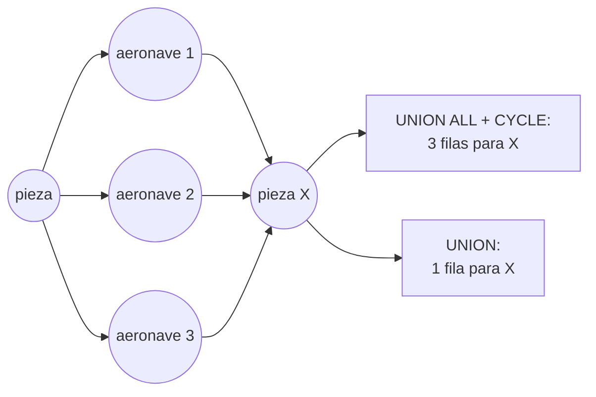

# 🕸️ Fase 14 — Grafos: la apuesta que se pierde, y la pregunta que SQL no sabe devolver

> **Curso:** Ruta NoSQL Lite · Fase 14 de 26 · Bloque III — Preguntas que no sabes escribir en SQL · **10 h**
> **Familia:** grafos · **Motor:** Neo4j 2026.09.0 Community `neo4j@sha256:91fb0bf237c4…`
> **Línea base:** PostgreSQL 18.6 `pgvector/pgvector@sha256:2ba9ca5f2e7d…` con `WITH RECURSIVE` sobre
> `stint_edge` (las estadías de la Fase 13 como aristas)
> **Entorno de ejecución:** TypeScript
> **Volumen:** `workOrder-1m` (`11a67c65fb22…`): 1 338 542 aristas en Postgres, 2 653 164 relaciones en Neo4j
> **Depende de:** Fase 13 · **Habilita:** Fase 15 (en el orden canónico)
> **Apéndices de apoyo:** [`a04`](a04-el-arnes-de-medida.md), [`a07`](a07-postgres-linea-base.md),
> [`a09`](a09-catalogo-de-errores.md)
> **Fecha de verificación ejecutada:** 07/10/2026, en macOS arm64
> **Objetivo:** perder en público la apuesta del cuarto salto contra un `WITH RECURSIVE` bien escrito, y
> encontrar con la medición la pregunta exacta donde el grafo deja de ser más cómodo y lo otro deja de
> poder escribirse.

---

## 🧭 1. Dónde estamos

La [Fase 13](13-grafos-levantar-y-modelar.md) contestó la directiva —351 aeronaves, 350 retiros— y dejó una
conclusión que el marketing de la familia no suele contar: **con saltos conocidos, Postgres no pierde**. Lo
que separaba a los dos motores no eran los saltos sino guardar la estadía como dato. Esta fase va a por la
otra mitad del instinto: *"…hasta que la profundidad es desconocida de antemano"*.

**Es la fase más importante del curso**, por una razón que conviene decir antes de medir: la apuesta de
esta familia es la que el curso espera perder. El argumento habitual a favor de los grafos —"a partir del
cuarto salto, el `JOIN` recursivo se vuelve imposible"— es la frase que más motores de grafos ha vendido, y
la medición tiene que decir si es verdad sobre los datos de Cóndor. Si sale tibia, no sirve.

Y si al medir la apuesta se gana, la primera sospecha es la medición: un `WITH RECURSIVE` mal escrito o sin
índice. Esa sospecha, se verá, tenía fundamento en este mismo curso.

---

## 🎯 2. Objetivos de esta fase

1. Escribir la apuesta antes de medir y correr la **escalera de 1 a 8 saltos** desde tres piezas en Neo4j y
   en dos versiones de `WITH RECURSIVE`.
2. Explicar por qué una versión de Postgres explota y la otra no: **caminos contra nodos**, y corregir
   [`a07`](a07-postgres-linea-base.md), que publicó la que explota.
3. Subir la apuesta a una consulta de patrón —el camino más corto entre una pieza y una aeronave,
   **devuelto entero**— y medir la diferencia: **1061 accesos contra 1,7 millones de filas**.
4. Llevar los dos motores a la consulta sin límite sobre un grafo con ciclos y anotar cómo se rompe cada uno.
5. Medir el grafo con menos memoria de la que necesita, poner al lado el costo de mantener un motor más, y
   escribir el veredicto más honesto del curso.

> 🧰 **Miniproyecto de esta familia:** [Voltaria — la red eléctrica donde cada maniobra tiene un camino
> alternativo](h-mini-06-grafos-voltaria.md). Opcional, fuera de las horas del curso, y no entra a la
> bitácora.

---

## 🪞 3. La apuesta

> 🪞 **Apuesta antes de ejecutar.** Creo que **el grafo gana a `WITH RECURSIVE` a partir del cuarto salto**,
> por un factor de al menos **5×** entre los *db hits* de Neo4j y las filas que genera el CTE de Postgres,
> desde cualquiera de tres piezas: la de [`a07`](a07-postgres-linea-base.md) (`SN-0391969`), la primera del
> lote de la directiva (`SN-0000255`) y una elegida por hash (`SN-0705472`).

Escrita en el temario el 30/09/2026 y fijada el 07/10/2026 antes de correr `ladder.ts`, con una condición
dicha antes: la línea base es **el `WITH RECURSIVE` mejor escrito que se encuentre**, no el de `a07`. Un
sondeo previo había mostrado que el de `a07` y otro escrito con `UNION` no se parecían en nada, y una apuesta
que se gana contra el peor de los dos no demuestra nada. **Resultado, en la sección 4.4: perdida, y no por
poco.**

---

## 📐 4. La medición contra la línea base

### 4.1 Las mismas aristas en los dos motores

Postgres recorre `stint_edge`: una arista por estadía, en los dos sentidos —pieza a aeronave y aeronave a
pieza—, sacada de `part_stint` de la Fase 13. Son **1 338 542 aristas, 106 MB con su índice**, y son
exactamente las relaciones `INSTALLED` del grafo vistas como tabla. Desde `src/`:

```bash
docker compose -f lab/compose.yaml exec -T base psql -U postgres < 14-grafos-romper-y-medir/edges.sql
node 14-grafos-romper-y-medir/ladder.ts
```

En cada profundidad `d`, la pregunta es la misma: **¿a cuántos nodos distintos se llega en `d` saltos o
menos?** En Neo4j, `[:INSTALLED*1..d]` con `count(DISTINCT x)`. En Postgres, dos versiones:

```sql
-- UNION ALL + CYCLE: la de a07. Corta el camino que vuelve a un nodo, pero enumera caminos
WITH RECURSIVE t(node, depth) AS (SELECT 'part:SN-0391969', 0
  UNION ALL SELECT e.dst, t.depth + 1 FROM t JOIN stint_edge e ON e.src = t.node WHERE t.depth < 4)
CYCLE node SET is_cycle USING path
SELECT count(DISTINCT node) FROM t WHERE depth > 0;

-- UNION: descarta las filas repetidas. Cada (nodo, profundidad) entra una vez
WITH RECURSIVE t(node, depth) AS (SELECT 'part:SN-0391969', 0
  UNION SELECT e.dst, t.depth + 1 FROM t JOIN stint_edge e ON e.src = t.node WHERE t.depth < 4)
SELECT count(DISTINCT node) FROM t WHERE depth > 0;
```

Una palabra de diferencia: `ALL`.

### 4.2 La escalera

> 📐 **Medición — nodos alcanzables por profundidad, desde `SN-0391969`** · `workOrder-1m` · Neo4j
> 2026.09.0 · PostgreSQL 18.6, `statement_timeout` de 120 s · verificado el 07/10/2026
>
> | Saltos | Nodos | Neo4j, *db hits* | Postgres `UNION`, filas del CTE · páginas | Postgres `UNION ALL` + `CYCLE`, filas · páginas |
> |---|---|---|---|---|
> | 1 | 18 | 21 | 19 · 4 | 19 · 4 |
> | 2 | 4435 | 4682 | 4437 · 119 | 4583 · 119 |
> | 3 | 5183 | 63 681 | 5203 · 17 897 | 21 320 · 18 416 |
> | **4** | **96 203** | **257 487** | **100 640 · 22 670** | **3 345 159 · 96 407** |
> | 5 | 96 204 | 951 431 | 101 407 · 405 260 | 15 651 933 · 13 420 383 |
> | 6 | 96 242 | 951 500 | 196 882 · 410 038 | `canceling statement due to statement timeout` |
> | 8 | 96 242 | 951 640 | 293 124 · 797 558 | no se corre |
>
> Reproducir: `node 14-grafos-romper-y-medir/ladder.ts` (desde `src/`; unos diez minutos)

Las otras dos piezas cuentan la misma historia con otras cifras:

| A 4 saltos | Nodos | Neo4j | `UNION` | `UNION ALL` + `CYCLE` |
|---|---|---|---|---|
| `SN-0000255`, del lote | 48 521 | 90 697 | 48 786 | 187 705 |
| `SN-0705472`, por hash | 23 129 | 92 750 | 24 496 | 1 257 897 |

El salto del tercero al cuarto es el de la flota entera: de 5183 nodos a 96 203. Es la forma de este grafo
—una pieza lleva a sus aeronaves, una aeronave a todas las piezas que pasaron por ella, y esas piezas a
todas sus aeronaves—, y es justo donde la apuesta decía que el grafo se separaba.

### 4.3 Caminos contra nodos

Las dos versiones de Postgres contestan lo mismo y recorren cosas distintas. **`UNION ALL` con `CYCLE`
genera una fila por camino**: si a una pieza se llega por mil caminos distintos de cuatro saltos, son mil
filas, y `CYCLE` solo descarta los que vuelven sobre sí mismos. A cuatro saltos desde `SN-0391969` son
**3 345 159 filas para 96 203 nodos**; a seis, no termina en dos minutos. **`UNION` genera una fila por
nodo y profundidad**: descarta toda fila que ya esté en el resultado, así que cada nodo entra como mucho una
vez por nivel. Son **100 640 filas para los mismos 96 203 nodos**.



Neo4j hace lo segundo sin que se lo pidan: con `count(DISTINCT x)`, su plan usa `VarLengthExpand(Pruning,
BFS)`, que recorre en anchura y poda lo ya visitado. Lo que hace el grafo "por dentro" es lo que hace
`UNION`. **`a07` publicó la versión de los caminos como la bien escrita**, y esta fase la corrige: para
alcanzar nodos a cualquier profundidad, `UNION` sin `ALL`.

`UNION` tampoco es gratis, y la escalera lo muestra a partir del sexto salto. Lo que descarta son filas
repetidas, y la fila lleva la profundidad: `(SN-0391969, 2)` y `(SN-0391969, 4)` son filas distintas. Una
vez recorrido todo lo alcanzable, los mismos nodos vuelven a entrar en cada nivel, por eso las filas pasan de
101 407 a 196 882 y luego a 293 124 mientras los nodos se quedan en 96 242, y las páginas se duplican cada
dos niveles. Si la pregunta no necesita la profundidad, se quita de la fila y el problema desaparece: el
cierre completo, sin límite, son **96 242 nodos en 0,6 s** (sección 5). Si la necesita, se paga en filas; no
en una explosión.

La pieza del lote dibuja la misma curva con otra escala: a ocho saltos, 55 492 nodos, 521 746 accesos de Neo4j
y 159 772 filas de `UNION`; la de hash se queda en 23 143 nodos. Ninguna de las tres llega a ese tamaño por el
mismo número de saltos, y por eso la apuesta se fijó con tres piezas y no con una.

### 4.4 El resultado de la apuesta

> 🪞 **Resultado: perdida.** A cuatro saltos, Neo4j hizo **257 487 accesos** donde el `WITH RECURSIVE` con
> `UNION` generó **100 640 filas**; desde la pieza del lote, 90 697 contra 48 786; desde la de hash, 92 750
> contra 24 496. En ninguna de las tres el grafo llega al 5× de ventaja: **queda por detrás** en la unidad de
> cada uno. Contra la versión con `CYCLE` de `a07`, en cambio, el grafo gana por 13× a cuatro saltos y la de
> Postgres no termina a seis. **La apuesta se ganaba contra un `WITH RECURSIVE` mal escrito, y se pierde
> contra uno bien escrito.**

Lo de la unidad conviene decirlo sin rodeos: un *db hit* y una fila de CTE no son lo mismo, y a cinco saltos
Postgres toca 405 260 páginas por las búsquedas en el índice de cada nivel, contra 951 431 accesos de Neo4j.
No hay una ventaja de órdenes de magnitud para nadie. Lo que sí hay es una advertencia para quien lea
benchmarks ajenos: el "imposible a partir del cuarto salto" casi siempre se mide contra la versión que
enumera caminos, y en este mismo curso esa versión estaba publicada como la buena. Para **alcanzar nodos**, sea a cuatro saltos o a ocho,
**Postgres aguanta**, y ese es el resultado que el curso esperaba y publica con gusto.

### 4.5 Se sube la apuesta: devolver el camino

El alcance es una pregunta sobre **nodos**. La que de verdad hace el hangar es otra: *¿por qué cadena de
estadías llega esta pieza del lote a esa aeronave?* Es la pregunta del inspector que tiene que justificar
una trazabilidad, y su respuesta es un **camino**. `shortest.ts` busca la aeronave más lejana que alcanza
`SN-0000255` —`HC-10251`, a cinco saltos— y pide el camino:

```bash
node 14-grafos-romper-y-medir/shortest.ts
```

```text
desde SN-0000255 hasta HC-10251: 5 saltos (la más lejana de 55492 nodos alcanzables)
neo4j    · 5 saltos · 1061 db hits · 1 viaje · SN-0000255 → HK-5434 → SN-0639633 → HK-10657 → SN-0574404 → HC-10251
postgres · arreglo: 2092380 filas examinadas · 1 viaje
postgres · niveles + vuelta atrás: 1746991 filas examinadas · 8 viajes · SN-0000255 → HK-5434 → SN-0099601 → HK-6593 → SN-0003021 → HC-10251
```

> 📐 **Medición — el camino más corto, devuelto** · `workOrder-1m` · verificado el 07/10/2026
>
> | | Recorrido | Viajes |
> |---|---|---|
> | Neo4j, `SHORTEST 1` | **1061** *db hits* | 1 |
> | Postgres, el camino en un arreglo | 2 092 380 filas | 1 |
> | Postgres, niveles con `UNION` y vuelta atrás desde la aplicación | 1 746 991 filas | 8 |
>
> Reproducir: `node 14-grafos-romper-y-medir/shortest.ts`

**Aquí sí hay órdenes de magnitud: 1061 contra 1,7 millones.** Neo4j busca el camino más corto desde los
dos extremos a la vez y para cuando se encuentran. En Postgres, el truco de `UNION` ya no sirve: para
devolver el camino hay que **arrastrarlo en cada fila**, y dos caminos distintos al mismo nodo son filas
distintas, así que se vuelve a enumerar caminos (2 092 380 filas). La alternativa honesta es recorrer los
niveles con `UNION` y reconstruir el camino hacia atrás, un salto por viaje: 8 viajes y 1,7 millones de filas
porque el recorrido desde un solo extremo tiene que alcanzar los 55 492 nodos antes de llegar. Escribir la
búsqueda desde los dos extremos en SQL se puede, con una tabla por frente y un bucle en la aplicación; ya no
es una consulta, es un programa. Los dos motores devuelven un camino de cinco saltos, y no el mismo: hay
varios igual de cortos.

**Ese es el punto donde el grafo no es más cómodo: es que lo otro no se escribe como consulta.** No es
descender un árbol ni contar alcanzables: es **encontrar un patrón** —un camino entre dos nodos cualquiera,
de largo desconocido, devuelto— en un grafo con ciclos.

### 4.6 El grafo que no cabe en memoria

La travesía de ocho saltos desde `SN-0391969` toca casi todo el grafo alcanzable: en frío lee unos 190 MiB
del almacén, y la caché de páginas del compose es de 256 MB. `cache.ts` corre esa travesía dos veces seguidas —en frío, después de vaciar la caché de archivos de la máquina virtual, y en
caliente— y mide lo que el contenedor leyó de disco en su cgroup, porque Neo4j Community no informa sus
aciertos de caché. Después repite con **64 MB**, con un archivo que se pone encima del compose
(`compose.pagecache-64m.yaml`) y se quita al terminar.

> 📐 **Medición — la travesía de ocho saltos con menos caché** · `workOrder-1m` · verificado el 07/10/2026
>
> | Caché de páginas | En frío: leído de disco · fallos mayores | En caliente: leído de disco · fallos mayores |
> |---|---|---|
> | 256 MB | 197,2 MiB · 28 | **7,5 MiB** · 0 |
> | 64 MB | 185,3 MiB · 25 | **25,7 MiB** · 4 |
>
> Reproducir: los pasos de `14-grafos-romper-y-medir/cache.ts`, con la caché de la máquina virtual vaciada
> antes de cada corrida en frío. Tiempos de contexto: en caliente, 0,3 s con 256 MB y 0,9 s con 64 MB.

**El grafo que no cabe no se rompe: se vuelve disco**, como Qdrant en la Fase 16. Con una caché que no
alcanza para la parte que recorre la travesía, cada repetición vuelve a leer 3,4 veces más. Lo que sí se
rompe con poca memoria es otra cosa, y es la sección 5.

### 4.7 El costo de un motor más por una consulta al mes

Poniendo lado a lado lo que pidió cada camino en las Fases 13 y 14:

| | Neo4j al lado de Postgres | Postgres solo |
|---|---|---|
| memoria | un contenedor más, con 1 GiB de límite casi lleno (808–1004 MiB) | nada nuevo |
| carga | 90 s para `workOrder-1m`, 198 s para `pirep-1m` | `part_stint` en 4,4 s, `stint_edge` con un `CREATE TABLE … AS` |
| disco | 490 MB con `workOrder-1m`, 890 MB con `pirep-1m`, además de la fuente | 62 MB de `part_stint` + 106 MB de aristas |
| mantenerlo al día | un proceso que traduzca cada orden en relaciones | un `INSERT` en la misma transacción que la orden |
| lo que gana | el camino devuelto: 1061 accesos contra 1,7 M filas | el alcance y la directiva: igual o mejor |

Para **una consulta de caminos al mes** —la directiva que llega un jueves—, la última fila dice que el
grafo la contesta mejor, y las cuatro primeras dicen lo que cuesta tenerlo listo los otros veintinueve días.

### 4.8 Lo que no se midió

**El contagio en orden de tiempo** —piezas a las que se llega pasando por aeronaves solo hacia adelante en
el tiempo—: en Postgres, el truco de `UNION` no sirve porque el mismo nodo vale distinto según cuándo se
llegó, y en Cypher pide un patrón cuantificado con condiciones entre saltos sucesivos; no se escribió en
ninguno de los dos, y es el ejercicio 26. **La búsqueda bidireccional en SQL**. **Grafos más densos** que el
de Cóndor. Y **la latencia**, por diseño.

---

## 💥 5. El punto de rotura

La consulta sin límite de profundidad sobre un grafo con ciclos. Pedir **nodos** sin límite termina en los
dos motores: Neo4j poda y Postgres, con `UNION`, también. Pedir **caminos** no termina en ninguno:

```bash
node 14-grafos-romper-y-medir/unbounded.ts
```

> 💥 **Rotura — caminos sin límite desde `SN-0391969`** · `workOrder-1m` · Neo4j con heap de 512 MB ·
> Postgres con `statement_timeout` de 120 s · verificado el 07/10/2026
>
> ```text
> neo4j    · nodos alcanzables, sin límite: 96242 · 0.4 s
> neo4j    · caminos, a los 3.6 s: Neo.TransientError.General.MemoryPoolOutOfMemoryError · The allocation of an extra 2.0 MiB would use more than the limit 358.4 MiB. Currently using 358.0 MiB. dbms.memory.transaction.total.max threshold reached
> postgres · cierre con UNION, sin límite: 96242 nodos · 0.6 s
> postgres · UNION ALL sin CYCLE, a los 120.0 s: 57014 · canceling statement due to statement timeout
> ```

**Neo4j se rompe rápido y con un mensaje claro**: a los 3,6 s la consulta agota la memoria de
transacciones —el 70 % del heap de 512 MB— y el motor la mata con un error transitorio (E-55 en
[`a09`](a09-catalogo-de-errores.md)). El motor sigue sano. **Postgres no se rompe: no termina.** El
`UNION ALL` sin `CYCLE` da vueltas por los ciclos para siempre, escribiendo en disco su tabla de trabajo,
hasta que el `statement_timeout` lo corta (E-56); **sin ese tope, el límite sería el disco del servidor**, y
esa prueba no se corrió.

Lo que hay que cambiar para salir: en los dos, **preguntar por nodos y no por caminos** cuando se puede
(`DISTINCT` en Cypher, `UNION` en SQL); si hacen falta caminos, **un límite de profundidad y un tope de
filas** (`LIMIT`, `SHORTEST k`); y en Postgres, un `statement_timeout` y un `temp_file_limit` en la sesión que
hace consultas exploratorias.

---

## 🚑 6. Salir de aquí

Cuando la trazabilidad ya duele, en orden de costo:

1. **La consulta.** `UNION` en lugar de `UNION ALL` cambió 3,3 millones de filas por 100 640. Antes de
   cambiar de motor, revisa si tu `WITH RECURSIVE` enumera caminos o nodos.
2. **El modelo.** Guardar la relación con sus propiedades (`part_stint`, Fase 13) en lugar de derivarla en
   cada consulta: 4,9 millones de filas contra 94 761.
3. **El motor.** Si la pregunta es **un camino entre dos nodos, de largo desconocido, devuelto**, el grafo la
   contesta con 1061 accesos donde SQL necesita 1,7 millones de filas o un programa. Esa es la pregunta que
   justifica Neo4j.
4. **La arquitectura.** El grafo **al lado** de la fuente de verdad, alimentado desde ella y reconstruible:
   la carga entera son 90 segundos, y ese número es tu plan de recuperación.

---

## ❓ 7. Las cinco preguntas, respondidas para grafos

1. **Frontera transaccional.** Neo4j es transaccional, pero si la fuente de verdad de las órdenes es otra
   base, el grafo es una copia: la estadía se escribe allá y se traduce acá, con su ventana ([Fase 24](24-poliglota-la-costura.md)).
2. **Consultas conocidas.** Las de saltos fijos, sí, y para ellas basta SQL (Fase 13). La familia se gana su
   sitio con las que **no** se conocen: profundidad y camino desconocidos.
3. **Unidad de lectura.** Un camino, o un vecindario alrededor de un nodo. No un conjunto de filas.
4. **Saltos.** **Es la pregunta de esta familia.** Uno o dos: SQL. Muchos, pero solo para alcanzar nodos:
   SQL con `UNION`. Muchos, y el camino es la respuesta: grafo.
5. **Exactitud o parecido.** Exactitud. Pero el boss de este bloque cruza esta familia con la del parecido.

---

## ⚖️ 8. Veredicto honesto: cuándo NO usar esto

> ⚖️ **Uno o dos saltos no justifican un grafo**: la directiva de la Fase 13 se contestó con 1413 y 1801 filas
> en Postgres. **Alcanzar nodos a cualquier profundidad tampoco**: con `UNION`, Postgres generó 100 640 filas
> a cuatro saltos donde Neo4j hizo 257 487 accesos, y la apuesta del cuarto salto **se perdió en las tres
> piezas**. Meter Neo4j para bajar cuatro niveles de un árbol de categorías es justo el caso que mide la
> escalera de esta fase: 100 640 filas con `UNION` contra 257 487 accesos de Neo4j, y el grafo pierde. **Y no lo uses si tu `WITH RECURSIVE` está mal escrito**: arréglalo primero, que es una
> palabra.
>
> **Úsalo** cuando la pregunta sea un **patrón**: un camino entre dos nodos cualesquiera, de largo
> desconocido, en un grafo con ciclos, **y la respuesta sea el camino**. Ahí, 1061 accesos contra 1,7 millones
> de filas y un programa de ocho viajes. Si esa pregunta es la de todos los días, el grafo se gana su motor.

Para Cóndor: la directiva que llega un jueves pregunta **dónde estuvo** el lote y **qué salió con él**. Las dos
son de saltos conocidos, y Postgres con `part_stint` las contesta. La pregunta que pondría a Neo4j en el
diagrama es la del inspector: *¿por qué camino llegó esta pieza a esta aeronave?* Si Hernán la necesita una
vez al año, es una consulta lenta en Postgres. Si la necesita en cada liberación al servicio, es un motor.

---

## ⚠️ 9. Errores comunes y diagnóstico

**Caminos sin límite que agotan la memoria** (E-55 en [`a09`](a09-catalogo-de-errores.md)):

```text
Neo.TransientError.General.MemoryPoolOutOfMemoryError · The allocation of an extra 2.0 MiB would use more than the limit 358.4 MiB. Currently using 358.0 MiB. dbms.memory.transaction.total.max threshold reached
```

🩺 Es un error transitorio: la consulta muere, el motor sigue. Si pides caminos (`RETURN p`, `count(p)`), cada
camino ocupa memoria. Pide nodos con `DISTINCT`, o pon límite de largo y `LIMIT`.

**La consulta recursiva que no termina** (E-56):

```text
canceling statement due to statement timeout
```

🩺 En un `WITH RECURSIVE` con `UNION ALL` sobre un grafo con ciclos: sin `CYCLE` ni límite de profundidad no
termina nunca. Con `CYCLE` termina, pero enumerando caminos. `UNION` termina enumerando nodos.

**`WITH RECURSIVE` que explota a cierta profundidad.** Sin mensaje: crece. 🩺 Compara las filas del nodo
`Recursive Union` del `EXPLAIN ANALYZE` con los nodos distintos del resultado: si son 30 veces más, estás
enumerando caminos (3 345 159 filas para 96 203 nodos).

**La travesía que lee disco cada vez.** 🩺 `io.stat` y `memory.stat` del cgroup antes y después de la
consulta: si en caliente sigue leyendo, la caché de páginas no alcanza para lo que recorre.

---

## 📋 10. Checklist de validación

```text
[ ] edges.sql: 1 338 542 aristas, las mismas estadías que el grafo
[ ] La escalera: a 4 saltos, Neo4j 257 487 accesos, UNION 100 640 filas, UNION ALL + CYCLE 3 345 159
[ ] Sé explicar por qué UNION enumera nodos y UNION ALL + CYCLE enumera caminos
[ ] La apuesta está escrita antes, con su resultado: perdida en las tres piezas
[ ] El camino más corto: 1061 accesos en Neo4j contra 1,7 M filas y 8 viajes en Postgres
[ ] Provoqué E-55 y E-56 con caminos sin límite
[ ] Con 64 MB de caché, la travesía en caliente lee 25,7 MiB de disco
[ ] a07 corregido: UNION para alcanzar nodos
[ ] M-37 a M-40 en la bitácora, la apuesta 8, E-55 y E-56 en a09
```

---

## 🧪 11. Ejercicios (28)

Desde `src/`, con `workOrder-1m` cargado en Neo4j (`13-…/load.ts --dataset lab/data/workOrder-1m`) y en
Postgres con `edges.sql`. Si cargaste el grafo del boss, vuelve a cargar este.

### 🟢 Fácil — reproducir (1–6)

#### 🟢 Ejercicio 1 — La escalera

Corre `ladder.ts --max 5`.

**Objetivo:** reproducir la tabla de la sección 4.2 para la pieza de `a07`.

#### 🟢 Ejercicio 2 — Una palabra

Corre las dos versiones de la sección 4.1 a 3 saltos con `EXPLAIN (ANALYZE)`.

**Objetivo:** las filas del nodo `Recursive Union` de cada una, y señalar la palabra que cambia.

#### 🟢 Ejercicio 3 — El plan de Neo4j

Pide el `PROFILE` de la travesía a 4 saltos.

**Pregunta:** ¿qué operador recorre, y qué significan `Pruning` y `BFS` en su nombre?

#### 🟢 Ejercicio 4 — El camino

Corre `shortest.ts`.

**Objetivo:** los dos caminos, y comprobar en el grafo que cada estadía del camino existe.

#### 🟢 Ejercicio 5 — La rotura

Corre `unbounded.ts` con `--timeout 30`.

**Objetivo:** E-55 en Neo4j y E-56 en Postgres, y que los dos motores siguen sanos después.

#### 🟢 Ejercicio 6 — El cierre

Calcula en Postgres el cierre completo con `UNION` desde la pieza del lote.

**Objetivo:** los nodos y las filas, contra `[:INSTALLED*]` con `DISTINCT` en Neo4j.

### 🟡 Intermedio — medir de otra forma (7–14)

#### 🟡 Ejercicio 7 — Cien piezas

Corre la escalera a 4 saltos desde cien piezas elegidas por hash.

**Objetivo:** en cuántas el grafo gana por 5× a `UNION`, si en alguna.

#### 🟡 Ejercicio 8 — `CYCLE` con `UNION`

Escribe la versión con `UNION` y `CYCLE` a la vez.

**Pregunta:** ¿cambia algo? ¿Por qué `CYCLE` sobra cuando no se enumeran caminos?

#### 🟡 Ejercicio 9 — La profundidad en una columna aparte

Escribe el alcance con `UNION` sin la profundidad en la fila, y limita los saltos de otra forma.

**Objetivo:** las filas, y por qué el límite de profundidad y el `UNION` se estorban.

#### 🟡 Ejercicio 10 — `SHORTEST 3`

Pide los tres caminos más cortos en Neo4j.

**Objetivo:** cuántos accesos más, y si son distintos.

#### 🟡 Ejercicio 11 — El arreglo con tope

Repite el camino en arreglo de Postgres con un límite de 4 saltos para un destino a 4.

**Objetivo:** las filas, y cómo crecen con el destino.

#### 🟡 Ejercicio 12 — La caché a 32 MB

Repite `cache.ts` con 32 MB.

**Objetivo:** lo que lee en caliente, y si aparece algún error.

#### 🟡 Ejercicio 13 — `temp_file_limit`

Repite el `UNION ALL` sin `CYCLE` con `temp_file_limit` de 500 MB.

**Objetivo:** el mensaje literal, y cuánto llegó a escribir.

#### 🟡 Ejercicio 14 — Corregir `a07`

Repite la tabla de profundidades de [`a07`](a07-postgres-linea-base.md) con `UNION`.

**Objetivo:** la tabla nueva, y cuánto cambia a profundidad 4.

### 🟠 Difícil — diagnosticar y decidir (15–21)

#### 🟠 Ejercicio 15 — Predecir la escalera

Antes de medir, predice los accesos de Neo4j y las filas de `UNION` a 5 saltos desde una pieza del lote que
no sea la primera.

**Objetivo:** tus números escritos antes, y la diferencia.

#### 🟠 Ejercicio 16 — Los dos extremos en SQL

Escribe en la aplicación la búsqueda del camino más corto desde los dos extremos, con una tabla por frente.

**Objetivo:** filas y viajes, contra los 1061 accesos de Neo4j.

#### 🟠 Ejercicio 17 — Patrón con fechas

*¿Qué piezas estuvieron en una aeronave en la que antes había estado una pieza del lote?* Escríbela en los
dos con un salto de aeronave.

**Objetivo:** el mismo resultado, y cuál de los dos lo escribe más corto.

#### 🟠 Ejercicio 18 — La directiva, por caminos

Devuelve para cada aeronave de la directiva el camino que la conecta con una pieza del lote.

**Pregunta:** ¿en cuál de los dos motores es una consulta y en cuál un programa?

#### 🟠 Ejercicio 19 — El grafo sin la caché

Pon la caché de páginas en 16 MB y corre la directiva de la Fase 13.

**Objetivo:** lo que lee de disco, y si la directiva siente la diferencia.

#### 🟠 Ejercicio 20 — El costo operativo, con tus números

Completa la tabla de la sección 4.7 con lo que costaría en tu empresa: monitoreo, copias, gente.

**Objetivo:** una cifra mensual por columna.

#### 🟠 Ejercicio 21 — La autopsia de `a07`

El curso publicó la versión de los caminos como "bien escrita". Escribe su autopsia.

**Objetivo:** los cinco pasos de la Fase 00, y qué medición la habría evitado antes.

### 🔴 Muy difícil — autopsias y patrones (22–28)

#### 🔴 Ejercicio 22 — El intercambio, como camino

Con `EXCHANGED_FOR` de la Fase 13 (ejercicio 22), busca el camino más corto que pasa por un intercambio.

**Objetivo:** el camino, y si cambia la directiva.

#### 🔴 Ejercicio 23 — Los anillos

Busca piezas que intercambiaron aeronave entre sí: A estuvo en X y luego en Y, B en Y y luego en X.

**Objetivo:** cuántos hay, la consulta en los dos motores y su recorrido.

#### 🔴 Ejercicio 24 — La apuesta, con otra forma de grafo

Escribe una apuesta nueva, antes de medir, sobre un grafo más denso (todas las piezas de cada orden
conectadas entre sí).

**Objetivo:** medirla y publicarla, gane o pierda.

#### 🔴 Ejercicio 25 — El árbol de categorías

Construye el árbol de capítulos ATA y categorías del catálogo y bájalo cuatro niveles en los dos.

**Objetivo:** la demostración, con números, de la frase del veredicto.

#### 🔴 Ejercicio 26 — El contagio en orden de tiempo

Escribe la búsqueda de piezas alcanzables pasando por aeronaves solo hacia adelante en el tiempo.

**Objetivo:** en los dos motores, o la razón escrita por la que en uno no se pudo.

#### 🔴 Ejercicio 27 — La autopsia del grafo para todo

Un equipo migró toda la trazabilidad a Neo4j "porque es un grafo".

**Objetivo:** los cinco pasos de la Fase 00, con la escalera y la sección 4.7 como factura.

#### 🔴 Ejercicio 28 — El veredicto de Cóndor

Con las Fases 13 y 14, decide si Cóndor necesita Neo4j.

**Objetivo:** una página con las preguntas de trazabilidad clasificadas por saltos y por si la respuesta es
un camino, y la factura de cada opción.

### 🔥 Opcionales

- **Graph Data Science** y por qué no entra en este curso.
- **Apache AGE**: Cypher dentro de Postgres, y si cambia el veredicto.

---

## 📚 12. Referencias

> ⚠️ Las URLs y sus contenidos cambian, y la documentación cubre la última versión. Esta fase se verificó con
> Neo4j 2026.09.0 Community y PostgreSQL 18.6.

- **PostgreSQL 18, `WITH RECURSIVE`** — https://www.postgresql.org/docs/18/queries-with.html — `UNION` contra
  `UNION ALL`, `CYCLE` y `SEARCH`.
- **Cypher, caminos más cortos** — https://neo4j.com/docs/cypher-manual/current/patterns/shortest-paths/
- **Cypher, patrones de longitud variable** — https://neo4j.com/docs/cypher-manual/current/patterns/variable-length-patterns/
- **Memoria de Neo4j** — https://neo4j.com/docs/operations-manual/current/performance/memory-configuration/
- **Robinson, Webber y Eifrem, *Graph Databases*** (O'Reilly, 2.ª ed., 2015) — el capítulo de casos de uso,
  para leerlo con la escalera delante.

**Orden sugerido:** `WITH RECURSIVE` antes de la sección 4.1; caminos más cortos antes de la 4.5; memoria
antes de la sección 5.

---

## 🏁 13. Resultado de la fase

Perdiste la apuesta del curso en público: **el grafo no gana a partir del cuarto salto** contra un
`WITH RECURSIVE` bien escrito, y la diferencia entre bien y mal escrito era una palabra. Encontraste dónde sí
gana, y no es la profundidad: es **devolver el camino**, 1061 accesos contra 1,7 millones de filas. Y viste
los dos motores romperse con caminos sin límite: uno rápido y con mensaje, el otro sin terminar.

> **La señal de que quedó bien:** *"Puedo decir, para una pregunta de grafos, si pide nodos o caminos, y
> mostrar con la escalera por qué la primera no justifica un motor y la segunda sí."*

> 🏷️ **Tag:** `fase-14-grafos-romper-y-medir` · prefijo de commit `f14:`

El 💀 **boss del Bloque III**, *"Freddy ya vio esto"*, cruza este grafo con los vectores de la Fase 16, y vive
al final de la [Fase 16](16-vectorial-romper-y-medir.md), que es la que cierra el bloque.
