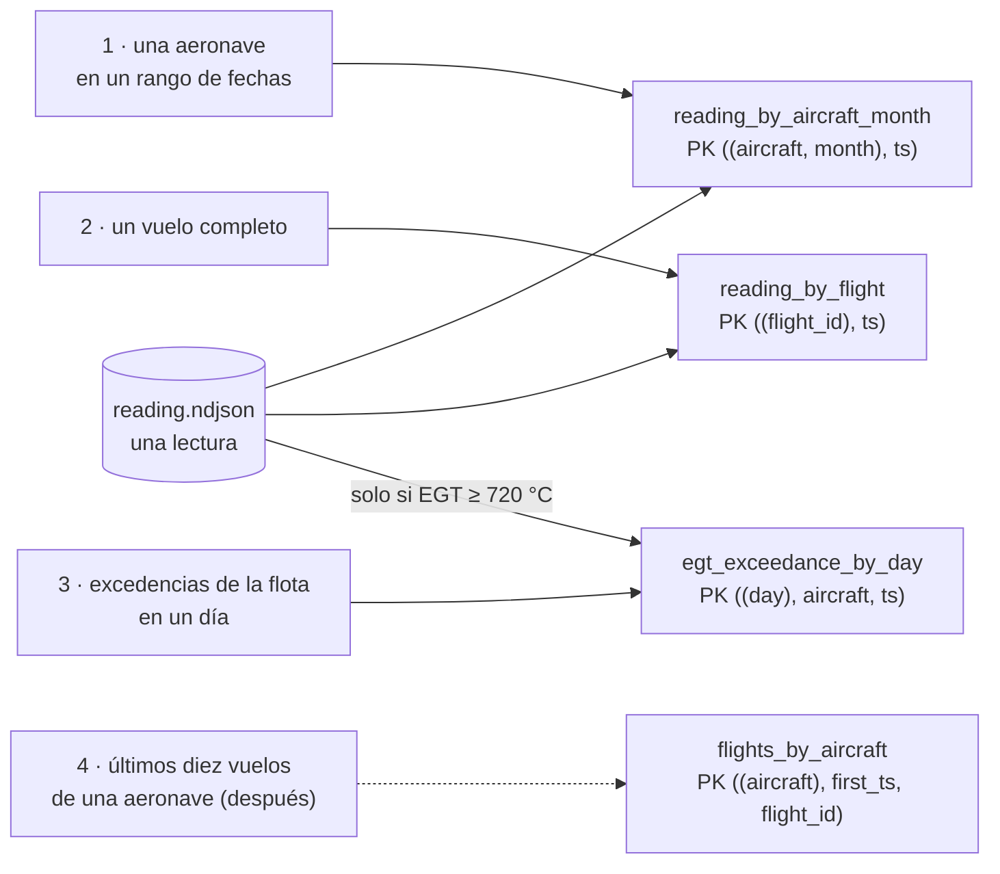

# 🏛️ Fase 17 — Columnar ancha: una tabla por pregunta, y las preguntas primero

> **Curso:** Ruta NoSQL Lite · Fase 17 de 26 · Bloque IV — Cuando el dato no cabe en un nodo · **10 h**
> **Familia:** columnar ancha · **Motor:** Apache Cassandra 5.0.9 `cassandra@sha256:8819d1b7877e…`, heap fijado
> en 512 MB; un nodo, y un anillo de tres para la sección 6.6
> **Línea base:** PostgreSQL 18.6 `pgvector/pgvector@sha256:2ba9ca5f2e7d…` con particionado declarativo por mes
> (base `series_base`, el de la [Fase 10](10-series-romper-y-medir.md)) y un índice por consulta
> **Entorno de ejecución:** TypeScript (`cassandra-driver` 4.10.0 y `pg`)
> **Volumen:** `reading-5m` (`datasetSha256` `8dc486dea089…`) para modelar, y su ampliación ×10 a **50 M**, la
> de las Fases 07–10, para medir contra Postgres
> **Depende de:** Fase 16 (en el orden canónico) · **Habilita:** Fase 18
> **Apéndices de apoyo:** [`a02`](a02-compose-de-la-ruta.md), [`a03`](a03-clis-de-los-motores.md),
> [`a04`](a04-el-arnes-de-medida.md), [`a05`](a05-el-dominio-de-flota.md), [`a06`](a06-lenguajes-y-drivers.md),
> [`a09`](a09-catalogo-de-errores.md)
> **Fecha de verificación ejecutada:** 10/10/2026, en macOS arm64
> **Objetivo:** modelar las lecturas de vuelo de Cóndor **por consulta y no por entidad** —una tabla por
> pregunta, con el mismo dato repetido a propósito—, medir qué toca cada consulta en Cassandra y en Postgres
> particionado, y ejecutar la consistencia ajustable en un anillo de tres nodos.

---

## 🧭 1. Dónde estamos

El Bloque IV cambia la restricción: **ya no es el modelo, es la distribución**. Son tres familias —columnar
ancha aquí y en la [Fase 18](18-columnar-romper-y-medir.md), offline-first y NewSQL después— que existen porque el dato no cabe, o no puede
estar, en una sola máquina. Es el bloque más difícil del curso, y va al final porque necesita todo lo anterior.

El dolor de Cóndor que le toca es una conversación que la empresa todavía no ha tenido. Treinta de las
ciento cuarenta aeronaves descargan un registro por minuto de vuelo, y las Fases 09 y 10 ya lo guardaron en
una serie. Pero Lucía Arango está por firmar con un segundo operador estatal, y el contrato pide **registro
de parámetros en toda la flota**: miles de parámetros por segundo por aeronave, escritos y jamás
actualizados, consultados siempre por aeronave y por rango de fechas.

Columnar ancha nació para eso, con un trato que conviene leer antes de firmarlo: **escribe sin coordinador
y reparte las filas entre nodos por una clave que tú eliges, a cambio de que solo puedas preguntar lo que
esa clave sabe contestar**. La Fase 00 lo contó desde el otro lado, con once tablas para cuatro consultas.
Esta fase enseña a modelar bien; la Fase 18 mide cuándo el trato compensa.

---

## 🎯 2. Objetivos de esta fase

1. Escribir **las preguntas antes que las tablas**, y derivar de cada una su partition key y su
   clustering key.
2. Cargar `reading-5m` en tres tablas de lo mismo —**10 048 539 filas para 5 000 000 de lecturas**— y saber
   qué cuesta mantener N copias de un dato.
3. Leer la traza de una consulta (`TRACING ON`): particiones y SSTables tocadas, filas vivas leídas contra
   devueltas, y compararla con las particiones podadas y las páginas de Postgres.
4. Sumar una consulta que llega después: **tabla nueva más backfill**, medido.
5. Ejecutar la consistencia ajustable en un anillo de tres nodos: qué responde `ONE`, `QUORUM` y `ALL` con
   nodos caídos, y una lectura vieja provocada a propósito.
6. Reproducir la situación 3: las lecturas como entidad, con `ALLOW FILTERING`, y ver cómo crece lo que lee.

---

## 🚫 3. Qué NO entra todavía

- **La apuesta de la familia** —el particionado de Postgres cubre este caso hasta el volumen de Cóndor—, el
  *hot spot* provocado, la amplificación de escritura y las compactaciones, los tombstones, lo que de verdad
  cuesta `ALLOW FILTERING` a escala y la partición que crece sin cota: son la [Fase 18](18-columnar-romper-y-medir.md).
- **Varios datacenters y la latencia entre regiones.** El anillo de la sección 6.6 vive en una sola máquina
  y en un solo datacenter; la geografía en el esquema es de las Fases 21 y 22.
- **ScyllaDB**, que habla el mismo CQL: su licencia está en [`a10`](a10-licencias-y-riesgo.md), y el
  veredicto de la Fase 18 la nombra como alternativa.
- **Repartir Postgres entre varias máquinas** (Citus y similares): es otro producto y otra licencia, y no
  responde a ninguna de las cinco preguntas del curso.

---

## 🏗️ 4. Levantar el motor

La receta está en [`a02`](a02-compose-de-la-ruta.md): el perfil `columnar`, Cassandra 5.0.9 con el heap
**fijado** en 512 MB —sin él, el motor calcula el heap con la RAM de la máquina y en reposo ocupa 4,63 GiB—,
un límite de 1600 MB y CQL en el 19042. Tarda alrededor de un minuto en aceptar conexiones. La línea base es
la base `series_base` de las Fases 09 y 10, que ya tiene `reading` (5 M) y `reading_x10` (50 M). Desde `src/`:

```bash
cd lab && docker compose --profile base --profile columnar up -d --wait && cd ..
docker compose -f lab/compose.yaml exec -T columnar cqlsh < 17-columnar-levantar-y-modelar/schema.cql
node 17-columnar-levantar-y-modelar/load.ts                # las tres tablas de consulta, 5 M
node 17-columnar-levantar-y-modelar/load.ts --only-x10     # la ampliación ×10, 50 M
node 17-columnar-levantar-y-modelar/baseline.ts            # Postgres: reading_part5, 5 M particionadas
node 10-series-romper-y-medir/partition.ts                 # Postgres: reading_part, 50 M particionadas
```

```text
dataset lab/data/reading-5m · datasetSha256 8dc486dea089… verificado
leídas 5000000 lecturas · escritas 10048539 filas en 248 s (40529 filas/s)
  byAircraftMonth  5000000
  byFlight         5000000
  exceedance       48539
leídas 5000000 lecturas · escritas 50000000 filas en 1206 s (41468 filas/s)
  x10              50000000
reintentos: 13 por write timeout · 0 por otros motivos
reading_part5: 61 particiones · tabla 447 MB · índices 352 MB · cargada en 27.2 s
reading_part: 61 particiones · 7629 MB con índices · 701080 lecturas en DEFAULT · cargada en 188.5 s
```

La primera carga es anterior a los reintentos, y costó dos intentos fallidos. Con Postgres cargando en la
misma máquina virtual, se cortó a los 3 M de lecturas con un *write timeout* (sección 9); y la de 50 M,
**sin Postgres**, se cortó igual a los 25 M de filas, con las compactaciones atrasadas y 512 MB de heap.
Desde entonces `load.ts` **reintenta** lo que no se confirma: en la carga de arriba, 13 veces. No es un
parche: escribir la misma fila dos veces deja una sola, y por eso reintentar es seguro.

---

## 📖 5. El diccionario de la familia

| Relacional (Postgres) | Columnar ancha (Cassandra) | Dónde se rompe el paralelo |
|---|---|---|
| base de datos | *keyspace*, con su factor de replicación | la replicación se declara por keyspace, no por servidor |
| tabla | tabla | se diseña para **una** consulta, no para una entidad |
| clave primaria | *partition key* + *clustering key* | la primera decide **en qué nodo** vive la fila; la segunda, **en qué orden** dentro de la partición |
| partición de una tabla particionada | partición | en Postgres es un trozo de la tabla; aquí, el conjunto de filas con la misma partition key, siempre en los mismos nodos |
| índice secundario | otra tabla con otra partition key | existen índices secundarios, pero la forma normal es duplicar |
| `JOIN` | no existe | se resuelve al escribir, guardando el dato ya junto |
| `INSERT` / `UPDATE` | los dos son *upsert* | escribir una fila que existe la reemplaza, sin error y sin leerla antes |
| `EXPLAIN (ANALYZE, BUFFERS)` | `TRACING ON` | la traza cuenta particiones, SSTables y filas vivas leídas |
| transacción | lote (`BATCH`) | atómico tarde o temprano, no aislado (sección 6.3) |

Y de vuelta: una tabla de Cassandra es una tabla de Postgres **particionada por la partition key, con un
índice cubriente en la clustering key del que no puedes salir**; un *upsert* es un `INSERT … ON CONFLICT DO
UPDATE` que nunca lee lo que había. El diccionario completo está en [`a08`](a08-diccionario-y-glosario.md).

> 🩻 **Esto sí funciona igual.** CQL se lee como SQL: `CREATE TABLE`, `SELECT … WHERE`, tipos con nombres
> conocidos. Un rango sobre una columna ordenada se resuelve recorriendo un trozo contiguo, como en un índice
> B-tree. Y la regla de oro de la Fase 01 sigue en pie: **la consulta que no usa la clave lee de más**. Lo que
> cambia es que aquí el motor no te deja hacerlo sin decírselo.

---

## 🧩 6. Modelar Cóndor a la manera de columnar ancha

### 6.1 Las preguntas primero

En relacional, el orden es entidades, relaciones, normalizar, y después las consultas. En columnar ancha
**se invierte**: primero las consultas, y de cada una sale una tabla. Las que Édinson Riaño y confiabilidad
hacen de verdad sobre las lecturas de vuelo son tres:

1. **Una aeronave en un rango de fechas**: la curva de EGT de `HC-2157` en los sesenta días antes de que se
   retirara su motor, el caso `egtTrend` plantado por el generador ([`a05`](a05-el-dominio-de-flota.md)).
2. **Un vuelo completo, en orden**: lo que pide el piloto que reporta una novedad.
3. **Las excedencias de EGT de toda la flota en un día**: lo que se revisa cada mañana.



La flecha punteada es la consulta que todavía no existe: llega en la sección 6.5, y su costo es la mitad de
la lección.

### 6.2 La partition key decide dónde vive el dato

```cql
CREATE TABLE condor.reading_by_aircraft_month (
    aircraft text, month text, ts timestamp, flight_id text,
    altitude_ft int, ias_kt int, egt_c int, n1_pct int, oil_press_psi int, oil_temp_c int, fuel_flow_pph int,
    PRIMARY KEY ((aircraft, month), ts)
) WITH CLUSTERING ORDER BY (ts ASC);
```

Los dobles paréntesis son la decisión. `(aircraft, month)` es la **partition key**: Cassandra calcula su hash
y ese número decide en qué nodos vive la partición entera. `ts` es la **clustering key**: dentro de la
partición, las filas se guardan ordenadas por ella, y un rango de fechas es un trozo contiguo. La consulta 1
se escribe con las dos:

```cql
SELECT ts, egt_c FROM reading_by_aircraft_month
WHERE aircraft = 'HC-2157' AND month IN ('2025-09', '2025-10', '2025-11')
  AND ts >= '2025-09-15' AND ts < '2025-11-14';
```

Hay que **nombrar las particiones**: la partition key se compara entera, por igualdad, o no se usa. En
Postgres, en cambio, el planificador poda particiones a partir de un rango.

¿Por qué **por mes** y no la aeronave sola? Por el tamaño: la aeronave sola sería una partición que crece
cinco años, y la [Fase 18](18-columnar-romper-y-medir.md) la lleva hasta que el nodo cae. Con un mes, `tablestats` dice:

```text
Table: reading_by_aircraft_month
Number of partitions (estimate): 945
Compacted partition maximum bytes: 2346799
Compacted partition mean bytes: 377577
```

La más grande pesa **2,2 MiB** y la media 369 KiB, lejos de los cientos de MB donde empieza el problema. Pero
eso vale para una lectura por minuto con siete parámetros. Con los miles por segundo del contrato nuevo,
**el bucket mensual se vuelve horario**, y la consulta 1 nombra 1440 particiones para sesenta días. El tamaño
de la partición es un dato de diseño, y se recalcula cuando cambia el ritmo de escritura.

### 6.3 Tres tablas de lo mismo

Las otras dos consultas no se contestan con esa tabla: un vuelo no sabe de qué mes es, y las excedencias de
la flota serían diecisiete particiones leídas enteras. Cada una recibe su tabla:

```cql
CREATE TABLE condor.reading_by_flight (
    flight_id text, ts timestamp, aircraft text, …,
    PRIMARY KEY ((flight_id), ts));

CREATE TABLE condor.egt_exceedance_by_day (
    day date, aircraft text, ts timestamp, flight_id text, egt_c int,
    PRIMARY KEY ((day), aircraft, ts));
```

La tercera **solo guarda las lecturas sobre el umbral**: el percentil 99 de la EGT es 719 °C, así que entran
48 539 de 5 000 000. El filtro lo aplica quien escribe. `load.ts` escribe cada lectura donde hace falta:

```ts
// load.ts (fragmento): una lectura, dos o tres escrituras, cada una a su partición
await push("byAircraftMonth", [r.aircraft, month, ts, r.flightId, ...values]);
await push("byFlight", [r.flightId, ts, r.aircraft, ...values]);
if (r.egtC >= EGT_THRESHOLD) await push("exceedance", [LocalDate.fromString(r.ts.slice(0, 10)), r.aircraft, ts, r.flightId, r.egtC]);
```

**Desnormalizar aquí no es un atajo: es el modelo**, y se paga en disco y en escrituras. Las dos tablas
grandes ocupan **156,6 y 160,8 MiB** con la compresión LZ4 por defecto: 317 MiB para dos copias. Postgres,
con una copia y un índice por consulta, ocupa **447 MiB de tabla y 352 de índices**. Eso dice más de la
compresión por bloques que del modelo.

¿Y si una escritura entra en una tabla y no en la otra? `BATCH` no es una transacción: un lote **con
registro** garantiza que, si una escritura se aplica, se aplican todas tarde o temprano, y lo paga
escribiendo antes el lote en una tabla de sistema. `batch.ts` escribe 100 000 lecturas en dos tablas:

```text
sueltas              100000 lecturas · 200000 escrituras · escrituras en system.batches 0 · 4.3 s
BATCH sin registro   100000 lecturas · 200000 escrituras · escrituras en system.batches 0 · 3.2 s
BATCH con registro   100000 lecturas · 200000 escrituras · escrituras en system.batches 200000 · 4.3 s
```

El lote con registro escribe **dos filas de sistema por lote**: el lote antes de aplicarlo y su borrado
después. El lote sin registro no promete nada entre particiones distintas; los tiempos son contexto. Para
las lecturas de Cóndor, `load.ts` escribe suelto y **reintenta lo que no se confirma**, porque una copia que
falta se repone escribiendo otra vez la misma fila. El lote con registro se justifica cuando una copia
faltante no se puede detectar ni reponer.

### 6.4 La traza de cada consulta

La medida de la familia es la traza (`TRACING ON`, o `traceQuery` en el driver), que
`lab/harness/cassandra-trace.ts` suma ([`a04`](a04-el-arnes-de-medida.md)): particiones leídas, SSTables
abiertas y filas vivas leídas. En Postgres, particiones recorridas, filas examinadas y páginas.

```bash
node 17-columnar-levantar-y-modelar/measure.ts          # 5 M: las tres consultas
node 17-columnar-levantar-y-modelar/measure.ts --x10    # 50 M: la consulta 1
```

> 📐 **Medición — las tres preguntas en los dos motores** · `reading-5m` (`8dc486dea089…`) y su ampliación ×10 ·
> Cassandra 5.0.9, un nodo · PostgreSQL 18.6 particionado por mes · segunda de dos pasadas · verificado el
> 10/10/2026
>
> | Pregunta | Devueltas | Cassandra: particiones · SSTables · filas vivas leídas | Postgres: particiones · examinadas · páginas |
> |---|---|---|---|
> | 1 · `HC-2157`, 60 días, sobre 5 M | 9666 | 3 · 3 · 9666 | 3 · 9666 · 157 |
> | 1 · la misma, sobre 50 M | 9666 | 3 · 3 · 9666 | 3 · 9666 · 161 |
> | 1 · `HC-2157~9` (sintética), sobre 50 M | 9666 | 3 · 3 · 9666 | 3 · 9666 · 205 |
> | 2 · el vuelo `FL-00002996` completo | 65 | 1 · 1 · 65 | **61** · 65 · 184 |
> | 3 · excedencias de la flota el 19/09/2026 | 78 | 1 · 2 · 78 | 1 · 78 · 19 (índice parcial) |
> | 3b · la 3 sin su tabla, sobre `reading_by_aircraft_month` | 78 | 17 · 18 · **3807** | — |
>
> Reproducir: los dos comandos de arriba, desde `src/`.

**Lo que no se esperaba: para la consulta 1, Postgres particionado iguala la forma.** Tres particiones y
9666 filas leídas para 9666 devueltas en los dos. Multiplicar la tabla por diez **no cambia nada en ninguno**,
salvo unas páginas en Postgres (157, 161 y 205): el costo depende de la partición que se toca, no del tamaño de
la tabla. Que `HC-2157~9` devuelva lo mismo en los dos prueba que la ampliación es la misma.

**La diferencia está en la consulta 2.** Postgres parte una tabla **de una sola manera**, aquí por tiempo; un
vuelo no dice en qué mes cae, así que el plan entra a las **61 particiones**. Cassandra guarda una copia por
consulta, cada una partida por lo que su consulta sabe, y lee **una**. Desnormalizar compra eso: **una forma
de partir por cada pregunta**. La 3b es el costo de no tener la tabla: **3807 filas para devolver 78**. Las
SSTables y las páginas no son la misma unidad y no se restan.

Lo que esta medición no ve, porque corre en un nodo, es **dónde están** las particiones: en un anillo, cada
una vive en los nodos que su hash diga, y la consulta habla solo con ellos. Esa es la diferencia que paga el
trato, y la Fase 18 mide si Cóndor la necesita. En disco, las 50 M ocupan **1595 MiB** en Cassandra contra
**7629 MiB** en Postgres con su índice.

### 6.5 Llega una consulta nueva

Tres semanas después, confiabilidad pide una cuarta: *los últimos diez vuelos de una aeronave, con su EGT
máxima*. En Postgres es una consulta nueva. En Cassandra **no hay tabla que la conteste**: hay que crearla y
llenarla con lo ya guardado, que es el backfill.

```cql
CREATE TABLE condor.flights_by_aircraft (
    aircraft text, first_ts timestamp, flight_id text, last_ts timestamp, readings int, max_egt_c int,
    PRIMARY KEY ((aircraft), first_ts, flight_id)
) WITH CLUSTERING ORDER BY (first_ts DESC, flight_id ASC);
```

```bash
node 17-columnar-levantar-y-modelar/backfill.ts
```

```text
backfill: 5000000 filas leídas de reading_by_flight en 18 s · 62486 filas escritas en flights_by_aircraft · 19 s en total
4 · últimos diez vuelos de HC-2157
  cassandra  devueltas 10 · particiones 1 · sstables 0 · filas vivas leídas 10
  postgres   devueltas 10 · examinadas 294118 · páginas 4630
  los mismos diez vuelos en los dos: sí
```

Para escribir **62 486 filas** hubo que leer **las 5 000 000** de otra tabla: el backfill crece con todo lo
guardado, no con lo que la consulta necesita. Después, la cuarta pregunta lee una partición y **10 filas**
(cero SSTables: la tabla todavía vive en la memtable). Postgres contesta sin crear nada y lo paga en cada
consulta: **294 118 filas examinadas y 4630 páginas**. También podría guardar un resumen por vuelo; la
diferencia es que en Cassandra **no hay otra forma**. Y desde hoy `load.ts` escribe en una tabla más, para
siempre.

### 6.6 La consistencia, ejecutada en un anillo

En un nodo, la consistencia no tiene a quién referirse. `lab/compose.anillo.yaml` levanta **tres nodos** de
la misma imagen y el mismo heap, en un proyecto aparte: con el laboratorio detenido ocupan unos **3,5 GiB** y
tardan 207 s en entrar al anillo, uno detrás del otro ([`a02`](a02-compose-de-la-ruta.md)).

```bash
docker compose -f lab/compose.anillo.yaml up -d --wait
17-columnar-levantar-y-modelar/quorum.sh
docker compose -f lab/compose.anillo.yaml down -v
```

El keyspace replica cada partición en los tres nodos (`replication_factor` 3), y cada operación declara
cuántas réplicas tienen que contestar: `ONE`, `QUORUM` (dos de tres) o `ALL`. El guion apaga nodos y prueba:

```text
  0 caídos · ONE · escribir ok · leer ok
  0 caídos · QUORUM · escribir ok · leer ok
  0 caídos · ALL · escribir ok · leer ok
  1 caídos · ONE · escribir ok · leer ok
  1 caídos · QUORUM · escribir ok · leer ok
  1 caídos · ALL · escribir falla · leer falla
  2 caídos · ONE · escribir ok · leer ok
  2 caídos · QUORUM · escribir falla · leer falla
  2 caídos · ALL · escribir falla · leer falla
```

Con un nodo caído, `ALL` deja de funcionar y `QUORUM` sigue; con dos, solo queda `ONE` (E-58, sección 9).
Pedir más consistencia es tolerar menos nodos caídos.

La regla cabe en una línea: **si las réplicas que escriben más las que leen superan al factor de replicación
(W + R > RF), toda lectura ve la última escritura confirmada**. `QUORUM` y `QUORUM` son 2 + 2 > 3; `ONE` y
`ONE`, 1 + 1, y no alcanza. La segunda parte del guion lo prueba: con los *hints* desactivados —el mecanismo
que guarda para un nodo caído lo que se perdió—, se apaga `c3`, se escribe en `ONE` y se lee en `ONE`:

```text
  c1 = 172.20.0.2 · c2 = 172.20.0.3 · c3 = 172.20.0.4
  con c3 caído: 700 → 745, escrito en ONE
  ONE desde c3 → 745 · leyó 172.20.0.3
  ONE desde c3 → 745 · leyó 172.20.0.2
  ONE desde c3 → 700 · leyó 172.20.0.4
  QUORUM desde c3 → 745 · leyó 172.20.0.2 172.20.0.3 172.20.0.4 · reparación al leer
  ONE desde c3 → 745 · leyó 172.20.0.4
```

Las dos primeras lecturas eligieron otra réplica: el coordinador evita la que acaba de volver. La tercera la
leyó `c3` y **devolvió 700, un valor que ya no existía**, sin error ni aviso. La lectura en `QUORUM` comparó
réplicas, vio que no coincidían y reparó `c3`; desde entonces devuelve 745. Con los *hints* activos, esta
ventana casi siempre se cierra sola (ejercicio 27). "Eventual" quiere decir eso: la réplica atrasada se pone al
día por un mecanismo concreto.

**El patrón a memorizar.** En columnar ancha, la tabla es la respuesta a una pregunta, la partition key es
dónde vive esa respuesta, y la consistencia es un número que eliges en cada operación. Nada de eso se
deduce del dominio: se deduce de las consultas.

---

## 🪞 7. Tu instinto relacional dice… y esta vez se equivoca

> 🪞 **"Primero modelo el dominio y luego escribo las consultas."** Aquí es literalmente al revés: **cada
> consulta nueva es una tabla nueva más un backfill**. La cuarta pregunta de esta fase costó una tabla nueva y un recorrido de **5 000 000 de filas para escribir 62 486**,
> donde Postgres la contestó con el índice que ya tenía. Eso no es un defecto de Cassandra: **es el trato**.

En relacional el instinto es correcto: un modelo normalizado contesta preguntas que nadie había pensado,
porque el planificador arma el camino en cada consulta. Columnar ancha renuncia a eso a propósito: hay un solo
camino por tabla, la partition key, y a cambio ese camino no depende del tamaño de la tabla ni de cuántos
nodos haya. Un esquema por entidades tiene una tabla de lecturas cuya clave es un identificador, y ninguna
consulta de Cóndor pregunta por él. La sección 8 mide qué pasa.

La pregunta del instrumento que lo habría anticipado es la 2: **¿conoces tus consultas de antemano, y son
estables?** Para las lecturas de vuelo, sí: son tres, y llevan años siendo las mismas. Es el terreno de esta
familia, y la Fase 18 mide si Cóndor lo necesita.

---

## ⚰️ 8. La situación 3: elegiste bien la familia y la modelaste como relacional

**La decisión, con su mejor argumento.** *"Una tabla por entidad, como en Postgres: `reading` con un `uuid`
como clave primaria y las columnas de siempre. Si una consulta pide filtrar por otra columna, le ponemos
`ALLOW FILTERING` y funciona. Más adelante, si hace falta, optimizamos."*

**Por qué era razonable.** Es el esquema que el equipo ya conoce, se migra con un script, y en la laptop con
el dataset de prueba **funciona**: devuelve lo correcto y contesta al instante. Sin `ALLOW FILTERING`,
Cassandra se niega a ejecutar la consulta, y el mensaje (sección 9) sugiere justamente añadirlo.

**Qué pasa.** `entity.ts` crea esa tabla, carga cada volumen y le hace la consulta 1 del caso `egtTrend` de
ese mismo dataset, trazada:

```bash
node 17-columnar-levantar-y-modelar/entity.ts
```

```text
reading-10k     10000 filas · HC-2157 2025-09-15→2025-11-14 · devueltas 328 · páginas 1 · rangos 1 · filas vivas leídas 10000 · 30 por cada devuelta · 22 ms en la traza
reading-1m    1000000 filas · HC-2157 2025-09-15→2025-11-14 · devueltas 11012 · páginas 3 · rangos 3 · filas vivas leídas 1000000 · 91 por cada devuelta · 2021 ms en la traza
reading-5m    5000000 filas · HC-2157 2025-09-15→2025-11-14 · devueltas 9666 · páginas 2 · rangos 2 · filas vivas leídas 5000000 · 517 por cada devuelta · 9430 ms en la traza
```

**Lee la tabla entera en los tres volúmenes**: 10 000 filas para 328, un millón para 11 012, cinco millones
para 9666. La consulta no cambió; lo único que creció fue la tabla, y con ella lo leído. A 10 k es invisible:
22 ms. A 5 M, la traza del coordinador marca **9,4 s** en dos páginas, y el nodo cancela la lectura de una página
que pasa de 5 s: la más lenta tardó 4,9. Un poco más de datos, o la misma consulta con otra en paralelo, y deja
de contestar: la [Fase 18](18-columnar-romper-y-medir.md) la empuja hasta ahí. `ALLOW FILTERING` no es una opción de rendimiento: es la firma de que la tabla no se
diseñó para esa pregunta.

**Antes y después, con números.**

| La consulta 1 | Lo que lee | Por qué |
|---|---|---|
| `reading_entity` con `ALLOW FILTERING`, sobre 10 k | 10 000 filas para 328 | no hay partición que nombrar: recorre la tabla |
| la misma, sobre 1 M | 1 000 000 para 11 012 | ídem, 91 por cada devuelta |
| la misma, sobre 5 M | 5 000 000 para 9666 · 9,4 s en la traza | ídem, 517 por cada devuelta, al borde del timeout |
| `reading_by_aircraft_month`, sobre 5 M | **9666 para 9666** · 3 particiones | la partition key es la pregunta |

**Cuánto cuesta salir.** El backfill de la sección 6.5, una vez por cada tabla nueva. Lo caro no es el
recorrido: es que durante la migración la aplicación escribe en las dos formas, y la consulta que
"funcionaba" sigue funcionando hasta el día en que no termina.

**La pregunta que lo habría evitado** es la 2: **¿conoces tus consultas de antemano?** Quien la contesta antes
de crear la primera tabla no crea una tabla por entidad.

---

## ⚠️ 9. Errores comunes y diagnóstico

**Un *write timeout* en una carga que antes funcionaba** (E-57 en [`a09`](a09-catalogo-de-errores.md)):

```text
ResponseError: Server timeout during write query at consistency LOCAL_ONE (0 peer(s) acknowledged the write over 1 required)
```

🩺 El nodo no confirmó la escritura en sus 2 s (`write_request_timeout`), y eso **no quiere decir que no la
aplicó**: puede haber entrado. Apareció dos veces: con Postgres cargando en la misma máquina virtual, y sola, a
los 25 M de filas de la carga ×10, con las compactaciones atrasadas. Salir: reintentar sin miedo, porque
escribir la misma fila dos veces deja una sola (*upsert*), como hace `writeAll` en el arnés; y bajar la
concurrencia si los reintentos no bajan.

**`QUORUM` que no se alcanza** (E-58):

```text
<stdin>:1:NoHostAvailable: ('Unable to complete the operation against any hosts', {<Host: 127.0.0.1:9042 datacenter1>: Unavailable('Error from server: code=1000 [Unavailable exception] message="Cannot achieve consistency level QUORUM" info={\'consistency\': \'QUORUM\', \'required_replicas\': 2, \'alive_replicas\': 1}')})
```

🩺 Quedan menos réplicas vivas que las que pide el nivel de consistencia. El mensaje dice cuántas hacen
falta y cuántas hay. Salir: devolver los nodos, o bajar el nivel **sabiendo** que W + R deja de superar al
factor de replicación.

**Una consulta que nombra la partition key a medias** (E-59). `WHERE aircraft = 'HC-2157'` sin `month`, sobre
`reading_by_aircraft_month`:

```text
InvalidRequest: Error from server: code=2200 [Invalid query] message="Cannot execute this query as it might involve data filtering and thus may have unpredictable performance. If you want to execute this query despite the performance unpredictability, use ALLOW FILTERING"
```

🩺 Sin la partition key entera, Cassandra no puede calcular en qué nodo está la partición, y la única forma de
contestar es recorrerlas todas. El mensaje ofrece la salida equivocada: es la puerta de la sección 8. Salir:
toda la partition key, por igualdad o con `IN`, o una tabla cuya partition key sea lo que sí sabes.

**El disco que no se libera.** Cada `DROP TABLE` o `TRUNCATE` deja una instantánea de lo borrado
(`auto_snapshot: true` por defecto). Al vaciar la tabla de la carga cortada, el directorio del keyspace siguió
en **1,4 GB**, y `nodetool listsnapshots` explicó por qué:

```text
truncated-1791686767026-reading_x10_by_aircraft_month condor  reading_x10_by_aircraft_month 875.44 MiB 875.44 MiB
Total TrueDiskSpaceUsed: 875.44 MiB
```

🩺 `nodetool clearsnapshot --all` cuando ya no las quieras: el directorio bajó a 319 MB. Es una red de
seguridad deliberada, y en producción se deja activa.

**El driver que no conecta.** Sin `localDataCenter` el cliente de Node no arranca; está en
[`a06`](a06-lenguajes-y-drivers.md).

---

## 📋 10. Checklist de validación

```text
[ ] Cassandra con el heap fijado: 1,37 GiB de 1,56 con las tablas cargadas
[ ] Escribí las tres preguntas antes que las tablas, y sé decir la partition key de cada una
[ ] load.ts: 10 048 539 filas para 5 000 000 de lecturas; 48 539 excedencias
[ ] La partición más grande de reading_by_aircraft_month pesa 2,2 MiB, y sé por qué el bucket es el mes
[ ] La consulta 2 toca 1 partición en Cassandra y las 61 en Postgres
[ ] El backfill de la cuarta consulta leyó 5 000 000 de filas para escribir 62 486
[ ] En el anillo, QUORUM responde con un nodo caído y falla con dos; ONE devolvió un valor viejo
[ ] La tabla por entidades con ALLOW FILTERING lee la tabla entera en cada volumen: 5 000 000 de filas para 9666
[ ] M-41 a M-45 en la bitácora, E-57 a E-59 en a09, el 🪞 8 en INSTINTOS.md
```

---

## 🧪 11. Ejercicios (28)

Desde `src/`, con los perfiles `base` y `columnar` arriba y las tablas de la sección 4 cargadas. Los
ejercicios del anillo piden detener antes el laboratorio (`docker compose --profile base --profile columnar
stop`, desde `lab/`).

### 🟢 Fácil — las tablas por dentro (1–8)

#### 🟢 Ejercicio 1 — Tu carga

Carga `reading-10k` con `load.ts` y después `reading-5m`.

**Objetivo:** las filas de cada tabla, y por qué hay dos veces más filas que lecturas, y algo más.

#### 🟢 Ejercicio 2 — `cqlsh`

Entra con `cqlsh`, lista el keyspace `condor` y describe sus tablas ([`a03`](a03-clis-de-los-motores.md)).

**Objetivo:** la partition key y la clustering key de cada una, leídas del `DESCRIBE`.

#### 🟢 Ejercicio 3 — La curva de `HC-2157`

Corre la consulta 1 en `cqlsh` con `TRACING ON`.

**Objetivo:** las 9666 lecturas, y en la traza las particiones y SSTables que tocó.

#### 🟢 Ejercicio 4 — Un vuelo

Elige otro vuelo de `HC-2157` y pídelo entero a `reading_by_flight`.

**Objetivo:** sus lecturas en orden, y la traza con una sola partición.

#### 🟢 Ejercicio 5 — El día con más excedencias

Encuentra en Postgres el día con más excedencias de 2025 y pídelo a `egt_exceedance_by_day`.

**Objetivo:** el mismo número de filas en los dos motores.

#### 🟢 Ejercicio 6 — `tablestats`

Corre `nodetool tablestats condor` después de `nodetool flush`.

**Objetivo:** particiones, tamaño máximo y medio de partición, y ratio de compresión de cada tabla.

#### 🟢 Ejercicio 7 — La partition key a medias

Pide a `reading_by_aircraft_month` las lecturas de `HC-2157` sin decir el mes.

**Objetivo:** el mensaje literal, y explicarlo en una línea.

#### 🟢 Ejercicio 8 — El *upsert*

Inserta dos veces la misma lectura con valores distintos de `egt_c`.

**Pregunta:** ¿cuántas filas hay, cuál quedó y qué habría hecho Postgres con la misma clave primaria?

### 🟡 Intermedio — modelar por consulta (9–16)

#### 🟡 Ejercicio 9 — Otro bucket

Crea `reading_by_aircraft_day`, con la partición por aeronave y día, y cárgala.

**Objetivo:** particiones, tamaño máximo de partición, y particiones que toca la consulta 1.

#### 🟡 Ejercicio 10 — La consulta 1 en Postgres sin particionar

Repite la consulta 1 sobre `reading` (5 M, sin particiones) con su índice `(aircraft, ts)`.

**Pregunta:** ¿qué cambió frente a `reading_part5`, y qué no?

#### 🟡 Ejercicio 11 — La consulta 2 en Postgres, bien jugada

Haz que la consulta 2 de Postgres toque una sola partición sin cambiar la pregunta.

**Pregunta:** ¿qué tuviste que saber del vuelo, y de dónde lo sacaste?

#### 🟡 Ejercicio 12 — Otro umbral

Confiabilidad pide bajar el umbral de excedencia a 700 °C.

**Objetivo:** qué tabla cambia, cuántas filas nuevas tiene, y cómo se llena la diferencia.

#### 🟡 Ejercicio 13 — La quinta pregunta

*"Las lecturas de toda la flota entre las 10:00 y las 10:05 de un día."* Diseña su tabla.

**Objetivo:** el `CREATE TABLE`, el tamaño estimado de sus particiones y la consulta.

#### 🟡 Ejercicio 14 — El índice secundario

Crea un índice secundario sobre `egt_c` en `reading_by_aircraft_month` y pide las excedencias de un día.

**Objetivo:** la traza, comparada con la de `egt_exceedance_by_day`.

#### 🟡 Ejercicio 15 — Los lotes, otra vez

Corre `batch.ts` con 10 000 y con 200 000 lecturas.

**Pregunta:** ¿qué escala con el número de lecturas y qué no?

#### 🟡 Ejercicio 16 — El backfill de otro mes

Imagina que `flights_by_aircraft` solo se necesita desde 2026.

**Objetivo:** un backfill que lea solo lo necesario, y cuántas filas lee frente al de la sección 6.5.

### 🟠 Difícil — diagnosticar y decidir (17–23)

#### 🟠 Ejercicio 17 — Predecir la traza

Antes de medir, predice particiones, SSTables y filas vivas de la consulta 1 para `HK-4993` en el primer
semestre de 2024.

**Objetivo:** tu número escrito antes, y explicar la diferencia.

#### 🟠 Ejercicio 18 — Compactar

Corre `nodetool compact condor reading_by_aircraft_month` y repite la consulta 1.

**Objetivo:** las SSTables antes y después en la traza, y el tamaño en disco.

#### 🟠 Ejercicio 19 — La consulta 3 sin su tabla

Compara la traza de la sección 6.4 de la consulta 3 con la de 3b.

**Pregunta:** ¿a partir de cuántas aeronaves deja de valer la pena leer de `reading_by_aircraft_month`?

#### 🟠 Ejercicio 20 — El anillo en `ONE` y `ALL`

En el anillo, escribe en `ALL` y lee en `ONE` con un nodo caído; después escribe en `ONE` y lee en `ALL`.

**Objetivo:** cuál de las dos combinaciones garantiza leer lo último y cuál puede no responder.

#### 🟠 Ejercicio 21 — Factor de replicación 2

Recrea el keyspace del anillo con `replication_factor` 2.

**Objetivo:** la matriz de la sección 6.6 otra vez, y qué significa `QUORUM` con RF 2.

#### 🟠 Ejercicio 22 — La memoria del nodo

Con `docker stats` y el `memory.stat` del cgroup, mira cuánto ocupa Cassandra en reposo, cargando y leyendo.

**Objetivo:** cuánto es heap, cuánto caché de archivos y cuánto margen queda contra el límite de 1600 MB.

#### 🟠 Ejercicio 23 — La autopsia de las once tablas

Toma el caso de la Fase 00, *"Elegimos Cassandra porque escala"*.

**Objetivo:** los cinco pasos de la autopsia, con esta fase como factura.

### 🔴 Muy difícil — modelos ajenos y el contrato nuevo (24–28)

#### 🔴 Ejercicio 24 — La cuenta del contrato

Supón ciento cuarenta aeronaves, seis horas de vuelo diarias y mil parámetros por segundo.

**Objetivo:** filas o celdas por día, el bucket que mantiene las particiones por debajo de 100 MB, y cuántas
particiones nombra la consulta 1 para sesenta días. Todo como aritmética declarada.

#### 🔴 Ejercicio 25 — Un modelo estrecho

Diseña `reading_by_aircraft_param`: una fila por aeronave, parámetro e instante, en lugar de una columna por
parámetro.

**Objetivo:** cárgala con un mes de `reading-5m` y compara filas, bytes y la traza de la curva de EGT.

#### 🔴 Ejercicio 26 — La entidad, al millón

Repite la sección 8 con `reading-1m` y `reading-5m` y una pregunta de otra aeronave.

**Pregunta:** ¿las filas leídas dependen de la aeronave que preguntas? ¿Por qué?

#### 🔴 Ejercicio 27 — La lectura vieja que no se repite

Corre la segunda parte de `quorum.sh` con los *hints* activos.

**Objetivo:** qué valor devuelve la réplica que volvió, y qué mecanismo lo corrigió.

#### 🔴 Ejercicio 28 — El veredicto antes de la apuesta

Con los números de esta fase, escribe a partir de qué volumen crees que Cassandra empieza a ganarle a
Postgres particionado en Cóndor.

**Objetivo:** tu predicción por escrito, para compararla con la Fase 18.

### 🔥 Opcionales

- **`sstablemetadata` y `sstabledump`** sobre una SSTable de `reading_by_flight`: ver la partición por dentro.
- **Los perfiles de ejecución del driver**: un nivel de consistencia por defecto distinto para lecturas y
  escrituras.

---

## 📚 12. Referencias

> ⚠️ Las URLs y sus contenidos cambian, y la documentación cubre la última versión. Esta fase se verificó con
> Apache Cassandra 5.0.9 y el driver `cassandra-driver` 4.10.0.

- **Modelado de datos en Cassandra** — https://cassandra.apache.org/doc/latest/cassandra/developing/data-modeling/index.html
  — modelar por consulta, partition key y clustering key.
- **El diseño relacional, visto desde Cassandra** — https://cassandra.apache.org/doc/latest/cassandra/developing/data-modeling/data-modeling_rdbms.html
  — el capítulo que contesta el 🪞 de esta fase.
- **Replicación y consistencia ajustable** — https://cassandra.apache.org/doc/latest/cassandra/architecture/dynamo.html
  — factor de replicación, niveles de consistencia, *hints* y reparación.
- **`cqlsh`** — https://cassandra.apache.org/doc/latest/cassandra/managing/tools/cqlsh.html — `TRACING`,
  `CONSISTENCY` y los comandos del shell.
- **El driver de Node** — https://github.com/apache/cassandra-nodejs-driver — `executeConcurrent`, lotes,
  paginación y trazas.
- **Carpenter y Hewitt, *Cassandra: The Definitive Guide*** (O'Reilly, 3.ª ed., 2020) — el modelado por
  consulta, capítulos 5 y 6.
- **Kleppmann, *Designing Data-Intensive Applications*** (O'Reilly, 2017) — capítulo 5, la regla W + R > N de
  los quórums y sus límites.

**Orden sugerido:** modelado de datos antes de la sección 6.1; el diseño relacional antes de la 7; replicación
y consistencia antes de la 6.6; Kleppmann, capítulo 5, después de correr `quorum.sh`.

---

## 🏁 13. Resultado de la fase

```text
Cassandra · condor (un nodo, RF 1)                      Postgres · series_base
  reading_by_aircraft_month   5 000 000 · 945 part. (est.)  reading_part5   5 M · 61 particiones · 3 índices
  reading_by_flight           5 000 000 · 63 252 part. (est.)  reading_part    50 M · 61 particiones
  egt_exceedance_by_day          48 539 · 1888 part.
  flights_by_aircraft               62 486 · 17 part. (backfill)
  reading_x10_by_aircraft_month 50 000 000
anillo · 3 nodos, RF 3: QUORUM con 1 caído sí, con 2 no; ONE leyó un valor viejo
```

Modelaste las lecturas de vuelo al revés de como lo habrías hecho siempre: las preguntas primero, una tabla
por pregunta, el mismo dato repetido. Mediste lo que el trato da —una partición por consulta, la que sea— y
lo que cobra: cada pregunta nueva es una tabla y un recorrido completo de lo que ya está guardado. La Fase 18
pregunta si Cóndor necesita ese trato o si Postgres particionado le alcanza.

> **La señal de que quedó bien:** *"Puedo escribir, para una tabla de Cassandra, la consulta que contesta y la
> que no puede contestar, y mostrar en la traza qué particiones toca."*

> 🏷️ **No cierres la fase sin el tag.** Con el checklist en verde y `git status` limpio:
>
> ```bash
> git tag -a fase-17-columnar-levantar-y-modelar -m "F17 cerrada: lecturas por consulta en tres tablas (10 M de filas para 5 M); consulta 1 igual en Cassandra y Postgres particionado a 5 y 50 M (3 particiones, 9666 filas); consulta 2, 1 partición contra 61; backfill 5 M leídas para 62 486; QUORUM con 1 caído sí y con 2 no, lectura vieja en ONE provocada; entidad con ALLOW FILTERING lee 5 M para 9666"
> ```
>
> Commits de la fase con prefijo `f17:`, los de ejercicio `f17 ej9: …`.
