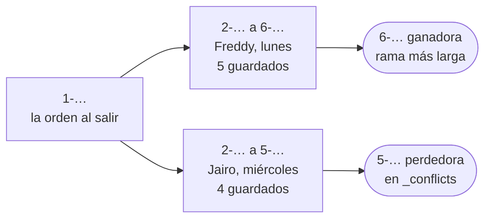

# 📴 Fase 19 — Offline-first: el conflicto es el caso normal, y se diseña

> **Curso:** Ruta NoSQL Lite · Fase 19 de 26 · Bloque IV — Cuando el dato no cabe en un nodo · **10 h**
> **Familia:** offline-first · **Motor:** Apache CouchDB 3.5.2 `couchdb@sha256:8cf5f8442585…` en el servidor, y
> PouchDB 9.0.0 en la tableta (LevelDB, desde Node)
> **Línea base:** ninguna honesta (sección 1). PostgreSQL 18.6 `pgvector/pgvector@sha256:2ba9ca5f2e7d…` aparece
> en la sección 6.5 como contraste: lo que haría con el mismo viaje, no una competencia
> **Entorno de ejecución:** TypeScript (`pouchdb` 9.0.0 y `pg`)
> **Volumen:** `workOrder-10k` (`datasetSha256` `5a107518d726…`): las 10 000 órdenes en el servidor, y las cuatro
> del viaje de Freddy para los conflictos
> **Depende de:** Fase 18 · **Habilita:** Fase 20
> **Apéndices de apoyo:** [`a02`](a02-compose-de-la-ruta.md), [`a03`](a03-clis-de-los-motores.md),
> [`a04`](a04-el-arnes-de-medida.md), [`a05`](a05-el-dominio-de-flota.md), [`a06`](a06-lenguajes-y-drivers.md),
> [`a09`](a09-catalogo-de-errores.md)
> **Fecha de verificación ejecutada:** 11/10/2026, en macOS arm64
> **Objetivo:** modelar las órdenes de trabajo que un técnico edita sin señal, replicarlas en los dos sentidos
> con el cable medido, provocar el conflicto de dos técnicos sobre el mismo componente, y contar qué edición
> sobrevive con cada forma de documento y cada manera de resolver.

---

## 🧭 1. Dónde estamos

La [Fase 18](18-columnar-romper-y-medir.md) cerró columnar ancha. Ahí el dato no cabía en un nodo por su
**volumen**. Aquí no cabe por otra razón: **el usuario está donde no hay red**. Freddy Manrique se sube a una
avioneta el lunes con una caja de herramientas y vuelve el jueves. En el medio atiende cuatro aeronaves en
tres pistas del Guaviare, sin señal de celular. Hoy lo levanta en papel y lo transcribe el viernes, con los
errores que nadie ve hasta la auditoría.

La respuesta de esta familia es poner **la base de datos en la tableta**. Freddy escribe ahí, y la tableta y el
servidor se ponen al día cuando vuelve la conexión, en los dos sentidos. CouchDB es el servidor, y PouchDB, que
habla el mismo protocolo de replicación, es la base local. El precio aparece el jueves, cuando Freddy
sincroniza: Jairo Vélez también estuvo en dos de esas aeronaves, también sin señal, y los dos escribieron
sobre la misma orden. Uno de ellos, sobre el mismo componente.

**Aquí no hay línea base relacional honesta, y no se va a fabricar.** Postgres no corre en la tableta, y
compararlo con una base que sí corre ahí sería forzar el resultado. Lo que sí se puede medir con honestidad es **qué haría Postgres como
servidor** si las tabletas le mandaran sus colas al volver. Esa es la sección 6.5, y su papel es de contraste.

---

## 🎯 2. Objetivos de esta fase

1. Escribir **las ediciones de Freddy antes que los documentos**, y decidir con ellas qué tan grande es cada
   documento.
2. Leer la revisión de CouchDB como **historia y no como versión**: qué guarda la tableta, qué guarda el
   servidor, y por qué un guardado con una revisión vieja falla con 409.
3. Replicar en los dos sentidos **midiendo el cable**: peticiones y bytes de la bajada completa, de la bajada de
   las cuatro aeronaves y de la subida después del viaje.
4. Provocar el conflicto de dos técnicos sin señal, **detectarlo**, y contar qué edición sobrevive con cinco
   combinaciones de forma de documento y resolución.
5. Escribir un CRDT a mano, en unas cuarenta líneas, y **ver qué resuelve solo y qué no**.

---

## 🚫 3. Qué NO entra todavía

- **La apuesta de la familia** —tres días desconectado con cien órdenes editadas sincronizan sin intervención
  manual—, el volumen del historial de revisiones, el conflicto masivo, la compactación y lo que se pierde con
  ella, el límite de tamaño razonable en la tableta, y la sincronización que no converge: son la
  [Fase 20](20-offline-romper-y-medir.md).
- **El navegador y el teléfono.** La tableta de esta fase es PouchDB en Node, que guarda en LevelDB. En un
  navegador guarda en IndexedDB y el protocolo es el mismo; la app móvil, el *service worker* y la interfaz
  quedan fuera del curso.
- **Automerge y Yjs**, las librerías de CRDT maduras: están en las referencias. Aquí el CRDT se escribe a mano
  para verlo por dentro (sección 6.6).
- **Un clúster de CouchDB** de varios nodos: el servidor de esta fase es uno solo.

---

## 🏗️ 4. Levantar el motor

La receta está en [`a02`](a02-compose-de-la-ruta.md). Se usa el perfil `offline`, con CouchDB 3.5.2 en el
15984 y el usuario `condor`. El healthcheck crea `_users` y `_replicator`, que un nodo solo no crea, y que sin
ellas repite un error cada cinco segundos (E-09 en [`a09`](a09-catalogo-de-errores.md)). En reposo ocupa
**116 MiB**, y **204 MiB** con las bases de esta fase. La sección 6.5 usa además el perfil `base`. Desde `src/`:

```bash
cd lab && docker compose --profile offline --profile base up -d --wait && cd ..
node 19-offline-levantar-y-modelar/sync.ts         # servidor, tableta, viaje y replicación
node 19-offline-levantar-y-modelar/conflicts.ts    # el viaje con las cinco formas de resolver
node 19-offline-levantar-y-modelar/postgres.ts     # lo que haría Postgres
```

La tableta no es un contenedor: es una carpeta. `freshTablet("freddy")` abre una base de PouchDB en
`lab/data/tablets/freddy`, y "sin señal" quiere decir que nadie la replica. PouchDB en Node guarda en LevelDB
([`a06`](a06-lenguajes-y-drivers.md)). La interfaz web de CouchDB, Fauxton, está en `http://localhost:15984/_utils`.

---

## 📖 5. El diccionario de la familia

| Relacional (Postgres) | Offline-first (CouchDB y PouchDB) | Dónde se rompe el paralelo |
|---|---|---|
| fila | documento JSON con `_id` | el documento es la unidad de replicación **y de conflicto** |
| columna de versión | `_rev`: `N-hash` | el número cuenta guardados de esa rama; el hash distingue dos guardados con el mismo número |
| `UPDATE … WHERE version = $1` | `PUT` con el `_rev` leído | igual en el servidor (409 si no coincide); **la replicación no pregunta**, y acepta las dos ramas |
| réplica de lectura | otra base que replica en los dos sentidos | las dos aceptan escrituras, también sin verse |
| WAL y *slot* de replicación | `_changes` y el *checkpoint* en `_local/` | cada replicación recuerda hasta dónde llegó, y sigue desde ahí |
| bloqueo o error de serialización | conflicto: el documento con dos hojas | nadie recibe un error; el motor elige una ganadora y guarda la otra |
| `CHECK`, `UNIQUE` | nada | la regla de "un serial por posición" es tuya |
| `MERGE`, `ON CONFLICT` | tu función de resolución, o un CRDT | se ejecuta después, sobre hojas que ya existen |

Y de vuelta: un documento de CouchDB es una fila con **una columna de versión que no se puede saltar en el
servidor y que la replicación sí salta**. Un conflicto es lo que Postgres habría rechazado, guardado. El
diccionario completo está en [`a08`](a08-diccionario-y-glosario.md).

> 🩻 **Esto sí funciona igual.** El bloqueo optimista que ya usas: leer la versión, escribir con ella, y fallar
> si alguien escribió en el medio. En un solo servidor, CouchDB hace exactamente eso, con un 409. El registro de
> cambios también: `_changes` es a CouchDB lo que el WAL a la replicación lógica, una secuencia que el que replica
> recorre desde el último punto que confirmó. Lo que cambia es que aquí **el escritor puede no ver nunca al
> servidor** antes de escribir.

---

## 🧩 6. Modelar Cóndor a la manera de offline-first

### 6.1 Las ediciones antes que los documentos

En las familias anteriores se empezaba por las consultas. Aquí se empieza por **las ediciones**: qué escribe
cada quien sin señal, y quién más escribe sobre lo mismo. En el viaje del 21 al 24 de septiembre de 2026,
Freddy (`T-004`) atiende cuatro órdenes reales de `workOrder-10k`, reabiertas como estaban al salir:

| Orden | Aeronave | Lo que hace Freddy | Quién más |
|---|---|---|---|
| `WO-0009931` | `HK-4107` | dos tareas, cambia la llanta principal derecha, cierra el pendiente de la llanta, 6 h | Jairo (`T-009`), el miércoles |
| `WO-0009951` | `HK-5258` | una tarea, cambia la bomba de combustible 1 y el indicador de actitud, cierra el pendiente de la bomba, 5 h | Jairo, el miércoles |
| `WO-0009941` | `HK-4235` | dos tareas, cambia una llanta y un actuador, 11 h | nadie |
| `WO-0009927` | `HK-4287` | tres tareas, 8 h | nadie |

Son **19 guardados de Freddy y 7 de Jairo**. Cada guardado es una edición con nombre: firmar una tarea, cambiar
una pieza en una posición, sumar horas, cerrar un pendiente, dejar una nota (`trip.ts`). Jairo llega el
miércoles a la primera pista, con la copia que bajó el lunes, que todavía no tiene nada de Freddy. La prueba
funcional de la bomba falla, él la cambia, y anota que retiró **la que su copia dice que estaba**.

¿Es raro que dos técnicos escriban sobre la misma orden? En `workOrder-10k`, **4138 de las 10 000 órdenes
tienen más de un técnico**, y en las de Freddy son **761 de 1111**. Que se encuentren sin señal depende de
la ruta, pero el caso no es raro: es lo que pasa con dos de cada tres órdenes de Freddy.

### 6.2 La revisión es historia, no versión

Cada documento lleva un `_rev` con la forma `N-hash`. Guardar exige mandar el `_rev` que se leyó; si en el
servidor ya hay otro, CouchDB contesta 409 (E-64 en [`a09`](a09-catalogo-de-errores.md)):

```text
$ curl -s -u condor:condor localhost:15984/work_order/WO-0009941 -X PUT -H 'content-type: application/json' -d '{"_rev":"1-00000000000000000000000000000000","x":1}'
{"error":"conflict","reason":"Document update conflict."}
```

Hasta ahí es bloqueo optimista. La diferencia está en qué se guarda. `sync.ts` sigue la orden `WO-0009941` del
viaje:

```text
  WO-0009941 en la tableta: revisión 6-ace1bf31… · historia de 6 revisiones · 6 available, 5 available, 4 available, 3 available, 2 available, 1 available
  WO-0009941 en el servidor: historia de 7 revisiones · 7 available, 6 available, 5 missing, 4 missing, 3 missing, 2 missing, 1 available
```

La tableta tiene **los seis cuerpos**: el original y cinco guardados. El servidor tiene **los siete
identificadores** pero solo tres cuerpos: el 1, que nació en el servidor, y los dos últimos que subió. La replicación
transfiere la hoja y **la lista de identificadores de sus antepasados**, no los cuerpos intermedios. Eso es lo
que sirve para replicar: saber si dos revisiones descienden una de otra, o si son ramas. No sirve para volver
atrás: una revisión vieja no es una versión que se pueda leer, y la compactación de la [Fase 20](20-offline-romper-y-medir.md) borra hasta los
cuerpos que sí estaban. El límite es `_revs_limit`: **1000 identificadores por documento**, por defecto.

### 6.3 La replicación en los dos sentidos

Replicar es recorrer `_changes` de una base desde el último punto confirmado, preguntarle a la otra qué
revisiones le faltan (`_revs_diff`), mandarle solo esas (`_bulk_get` y `_bulk_docs`), y guardar el punto nuevo
en un documento `_local/` de las dos. La tableta no necesita las 10 000 órdenes, solo las de sus cuatro
aeronaves, y PouchDB las filtra en el servidor con un `selector`:

```ts
// trip.ts y sync.ts (fragmento): lo que baja la tableta antes de salir
export const tripSelector = { aircraft: { $in: TRIP_AIRCRAFT } };
await freddy.replicate.from(remote("work_order", wire), { selector: tripSelector });
```

El arnés cuenta cada petición HTTP y sus bytes (`lab/harness/couch.ts`, [`a04`](a04-el-arnes-de-medida.md)):

> 📐 **Medición — la tableta de Freddy contra el servidor** · `workOrder-10k` (`5a107518d726…`) · CouchDB 3.5.2
> `couchdb@sha256:8cf5f8442585…` y PouchDB 9.0.0 · verificado el 11/10/2026
>
> | Paso | Docs leídos · escritos | Peticiones | Subidos | Bajados |
> |---|---|---|---|---|
> | lunes: todo `work_order` | 10 000 · 10 000 | 504 | 665 KiB | 8977 KiB |
> | lunes: sus cuatro aeronaves (`selector`) | 1686 · 1686 | 89 | 113 KiB | 1520 KiB |
> | lunes: otra vez, sin nada nuevo | 0 · 0 | 6 | 0 KiB | 2 KiB |
> | jueves: subir lo del viaje (19 guardados en 4 órdenes) | 4 · 4 | **55** | **93 KiB** | 6 KiB |
> | jueves: bajar lo nuevo | 0 · 0 | 9 | 1 KiB | 4 KiB |
> | jueves: una edición más, otra subida | 1 · 1 | 7 | 1 KiB | 1 KiB |
>
> Reproducir: `node 19-offline-levantar-y-modelar/sync.ts`, desde `src/`.

**El filtro rinde**: 1686 órdenes en lugar de 10 000, y 1,5 MiB en lugar de 8,8. **El *checkpoint* rinde**: la
segunda bajada cuesta seis peticiones. Y lo que no se esperaba: **la primera subida hace 55 peticiones y manda 93 KiB para subir cuatro documentos**. La tableta
recorre su propio `_changes` desde cero, y en él están las 1686 órdenes que bajó: le pregunta al servidor por
cada una, en 17 `_revs_diff` de cien, y el servidor contesta que ya las tiene. Desde ahí cada subida empieza
donde quedó la anterior: la siguiente cuesta siete peticiones.

De los 19 guardados, el servidor recibió **cuatro documentos**, uno por orden, con su lista de antepasados.

La misma replicación puede correr **entre dos servidores**, persistente, como un documento en `_replicator`.
Para eso existe esa base de sistema. Si la base de Villavicencio tuviera su propio CouchDB:

```text
replicación persistente work_order → work_order_vvc · estado completed · docs leídos 1686 · escritos 1686 · en la base de Villavicencio 1686
```

El servidor la ejecuta, la reintenta si falla y la reporta en `_scheduler/docs` ([`a03`](a03-clis-de-los-motores.md)).

### 6.4 El conflicto, detectado

Jairo vuelve a tener señal el miércoles en la noche y sincroniza primero. Freddy sincroniza el jueves. En un solo
servidor, el segundo habría recibido un 409. La replicación, en cambio, **acepta las dos ramas**: las dos son
historias válidas de `WO-0009951` que salen de la misma revisión 1. El documento queda con **dos hojas**:



CouchDB elige la ganadora **sin preguntar y sin reloj**: la hoja con la rama más larga, y si empatan, la de
`_rev` mayor como texto. Todas las réplicas eligen la misma, así que convergen solas. Pero **nadie decidió**: Freddy
ganó porque guardó más veces, no porque escribiera después. La perdedora no se borra: queda guardada, y solo
aparece si se pide (`?conflicts=true`). Una lectura normal devuelve la ganadora, sin aviso.

`conflicts.ts` repite el viaje con cinco combinaciones: sincronizan Jairo y Freddy, se resuelve (o no) en el
servidor, sincronizan otra vez, y cada una de las 26 ediciones se busca en lo que quedó:

> 📐 **Medición — el viaje de Freddy, cinco maneras de terminarlo** · las cuatro órdenes de `workOrder-10k`,
> 19 + 7 ediciones sin señal · CouchDB 3.5.2 y PouchDB 9.0.0 · verificado el 11/10/2026
>
> | Forma · resolución | Conflictos | De Freddy | De Jairo | En disputa | Escondidas | Perdidas |
> |---|---|---|---|---|---|---|
> | orden por documento · ganadora de CouchDB | 2 | 19/19 | **1/7** | 0 | **6** | 0 |
> | orden por documento · el último que escribe gana | 2 | **10/19** | 7/7 | 0 | 0 | **9** |
> | orden por documento · fusión a mano | 2 | 18/19 | 7/7 | 2 | 0 | **1** |
> | un documento por cosa · ganadora de CouchDB | 3 | 18/19 | 6/7 | 0 | 2 | 0 |
> | orden como CRDT · fusión del CRDT | 2 | 19/19 | 7/7 | **2** | 0 | **0** |
>
> *En disputa:* la edición sobrevive junto a otra incompatible, y las dos se ven. *Escondida:* solo está en una
> revisión perdedora, que la app no lee. *Perdida:* no está en ninguna hoja. En las cinco, las tres réplicas
> terminan con la misma ganadora. Reproducir: `node 19-offline-levantar-y-modelar/conflicts.ts --detail`.

Fila por fila:

- **Sin resolver**, Freddy gana las dos órdenes (ramas de seis revisiones contra cuatro y cinco) y **seis de las siete
  ediciones de Jairo desaparecen de la vista**; sobrevive el cierre de la bomba, porque Freddy también lo cerró.
  La base convergió, y los conflictos siguen ahí sin que nadie los mire.
- **El último que escribe gana** es la sección 8.
- **La fusión a mano** junta tareas, notas y horas, y deja las dos bombas marcadas para que las vea una persona.
  Pierde una edición, la más traicionera: **reabre el pendiente de la llanta que Freddy cerró**. La unión no
  distingue "Freddy lo cerró" de "Jairo no lo vio cerrado", porque no mira al antepasado común. Podría: el cuerpo
  de la revisión 1 sigue en el servidor, pero solo hasta la compactación (sección 6.2).
- **Un documento por cosa** —cada tarea, posición, pendiente y nota, y las horas de cada técnico— deja el conflicto
  donde se cruzaron: la tarea que los dos firmaron, el pendiente que los dos cerraron y la bomba. Nada se pierde;
  dos quedan escondidas, porque las ramas empataron y desempató el hash.
- **El CRDT** no pierde nada, y deja **la bomba en disputa, con los dos seriales a la vista**. Es la sección 6.6.

**La forma del documento es la palanca más barata.** Pasar de una orden por documento a un documento por cosa
lleva las ediciones escondidas de seis a dos sin escribir una línea de resolución. El conflicto queda donde está
el desacuerdo real.

### 6.5 Lo que haría Postgres

Postgres no puede estar en la tableta, pero sí puede ser el servidor que recibe lo que cada técnico guardó sin
señal. `postgres.ts` vacía la cola de Jairo y después la de Freddy, de tres maneras:

> 📐 **Medición — el mismo viaje contra Postgres como servidor** · las cuatro órdenes · PostgreSQL 18.6
> `pgvector/pgvector@sha256:2ba9ca5f2e7d…` · verificado el 11/10/2026
>
> | Forma del servidor | Rechazados | De Freddy | De Jairo |
> |---|---|---|---|
> | 1a · documento con versión, un `UPDATE` por guardado | 7 de 19 guardados | 19/19 | **1/7** |
> | 1b · documento con versión, una subida por orden | 2 de 4 órdenes | 10/19 | 7/7 |
> | 2 · una fila por cosa, `UNIQUE (work_order_id, position)` | **1**: la bomba de Freddy | 18/19 | 7/7 |
>
> Reproducir: `node 19-offline-levantar-y-modelar/postgres.ts`, desde `src/`.

La **1a** es un error que vale la pena ver. La tableta encola cada guardado con la versión que **cree** que tiene
el servidor: la leída más sus propios guardados. Los tres primeros de Freddy sobre `WO-0009931` se rechazan,
pero el cuarto espera la versión 4, y la versión 4 es la que dejaron los tres guardados de Jairo. **El número
coincide, el `UPDATE` pasa, y pisa el trabajo de Jairo sin error.** Por eso el `_rev` de CouchDB lleva un hash
además del número.

La **1b** es el bloqueo optimista bien hecho: una subida por orden con la versión leída al salir. Rechaza las dos
órdenes compartidas, y **nueve ediciones de Freddy** se quedan esperando a que alguien las rehaga a mano. Se
pierde lo mismo que con "el último que escribe gana", pero el rechazo avisa y nadie lo pierde en silencio.

La **2** es la mejor respuesta de Postgres. Cada edición llega como una sentencia sobre su propia fila, y la
regla del dominio está en la tabla:

```text
    rechazado 09-21T15:30 WO-0009951 swap fuel-pump-1 · duplicate key value violates unique constraint "one_install_per_position"
```

Rechaza **exactamente el desacuerdo real** (E-66), y es la misma lección de la sección 6.4: lo que decide es la
forma, no el motor. Con una diferencia que el contraste deja a la vista: Postgres rechaza **al segundo que
llega**, y ese fue Freddy, que cambió la bomba dos días antes. Y la tableta, la cola, el reintento y el registro
de qué ya subió los tienes que escribir tú: es lo que PouchDB trae hecho.

### 6.6 El CRDT, y cuándo te ahorra escribir la resolución

Un CRDT (*conflict-free replicated data type*) es un tipo de dato con una función de fusión que cumple tres
leyes: da lo mismo fusionar `a` con `b` que `b` con `a`, el orden en que se agrupan tampoco importa, y fusionar
algo consigo mismo no lo cambia. Con eso, dos réplicas que reciben lo mismo en cualquier orden terminan iguales,
sin preguntarle a nadie. `crdt.ts` trae tres, a mano:

```ts
// crdt.ts (fragmento): el conjunto con bajas, y el registro que no elige
export const orRemove = <T>(s: ORSet<T>, match: (v: T) => boolean): ORSet<T> => ({
  adds: s.adds,
  removed: union(s.removed, Object.keys(s.adds).filter((t) => match(s.adds[t]))),
});
export const mvSet = <T>(r: MVRegister<T>, tag: string, value: T): MVRegister<T> => ({
  writes: { ...r.writes, [tag]: { value, supersedes: Object.keys(r.writes).sort() } },
});
```

- **OR-Set**, para las tareas firmadas, los pendientes y las notas. Cada alta lleva una etiqueta única, y una baja
  entierra **las etiquetas que vio**, no el valor. Freddy, al cerrar el pendiente de la llanta, entierra su
  etiqueta; en la copia de Jairo sigue viva, pero al fusionar queda enterrada, y el pendiente cerrado. Es lo que
  la fusión a mano no pudo hacer.
- **G-Counter**, para las horas: una cuenta por técnico que solo sube, y fusionar es tomar el máximo de cada una.
- **MV-Register** (registro de varios valores), para cada posición. Cada escritura entierra las que vio, y **si
  dos no se vieron, sobreviven las dos**.

La resolución en el servidor es una línea que no sabe nada de aviones: `leaves.reduce(mergeCrdt)`. El guion
comprueba que fusionar las hojas en los dos órdenes da lo mismo (`fusión en los dos órdenes, igual: sí`).

Y aquí está el límite, medido en la última fila de la tabla. El CRDT converge, no pierde nada, y **no decide**:
la posición `fuel-pump-1` de `HK-5258` termina con `SN-0004130` y `SN-0000829` vivos a la vez. Solo una persona
frente a la placa de la bomba sabe cuál está montada. **Un CRDT te ahorra escribir la resolución cuando la
fusión tiene una respuesta correcta que no depende del dominio**: juntar firmas, sumar horas, cerrar lo que
alguien cerró. Cuando dos personas afirmaron cosas incompatibles sobre el mundo, lo mejor que puede hacer es
no esconder ninguna.

**El patrón a memorizar.** En offline-first se diseña primero **qué se edita y quién más lo edita**. El
documento se corta por donde no hay desacuerdo posible, y cada campo que sí lo tiene lleva una regla de fusión
escrita antes del primer conflicto. Lo que ninguna regla puede fusionar se le muestra a una persona.

---

## 🪞 7. Tu instinto relacional dice… y esta vez se equivoca

> 🪞 **"Sincronizo cuando vuelva la conexión y ya."** El conflicto no es un caso de error: **es el caso
> normal**. En un viaje de tres días con dos técnicos, **dos de las cuatro órdenes** terminaron con dos hojas. En
> `workOrder-10k`, **4138 de las 10 000 órdenes** tienen más de un técnico. Y el conflicto no llega con un error
> que alguien atrape: llega como dos revisiones perdedoras que **ninguna lectura normal devuelve**, con seis
> ediciones de Jairo adentro.

El instinto es razonable porque en relacional el servidor serializa: el segundo que escribe recibe un error o
espera, y el conflicto no llega a existir. Offline-first renuncia a eso a propósito: cada tableta acepta
escrituras sin ver al servidor, y el precio es que **dos historias válidas del mismo documento existen a la
vez**. Decidir qué pasa entonces después del primer viaje es decidirlo con trabajo de alguien ya perdido.

La pregunta del instrumento que lo habría anticipado es la 1: **¿dónde está la frontera transaccional?** En el
servidor relacional, alrededor de la orden. En la tableta de Freddy, alrededor de cada edición que él hizo sin
ver a nadie. La orden deja de ser la unidad de acuerdo, y el documento tiene que cortarse para reflejarlo.

---

## ⚰️ 8. La situación 3: elegiste bien la familia y la modelaste como relacional

**La decisión, con su mejor argumento.** *"Una orden por documento, como la fila de siempre, con un `updatedAt`.
Cuando haya un conflicto, gana la revisión con el `updatedAt` más reciente: el último que escribe gana. Es
determinista y no hay que escribir lógica de dominio."*

**Por qué era razonable.** Es lo que hace un `UPDATE` sin versión en un servidor, y la alternativa de CouchDB,
la rama más larga, parece arbitraria. En las pruebas con un solo técnico no hay con quién chocar.

**Qué pasa.** Jairo escribió el miércoles y Freddy el lunes, así que gana Jairo en las dos órdenes compartidas.
La resolución borra las revisiones de Freddy. Del detalle de `conflicts.ts`:

```text
    lost     T-004 09-21T07:40 WO-0009931 task inspección visual
    lost     T-004 09-21T09:10 WO-0009931 swap tire-main-right SN-0002822
    lost     T-004 09-21T09:15 WO-0009931 closeItem llanta principal derecha: desgaste fuera de límite
    lost     T-004 09-21T09:20 WO-0009931 task reemplazo de componente
    lost     T-004 09-21T11:30 WO-0009931 labor 6 h
    lost     T-004 09-21T14:10 WO-0009951 task inspección visual
    lost     T-004 09-21T15:30 WO-0009951 swap fuel-pump-1 SN-0004130
    lost     T-004 09-21T16:50 WO-0009951 swap attitude-indicator SN-0007093
    lost     T-004 09-21T17:30 WO-0009951 labor 5 h
```

**Nueve ediciones: el lunes entero de Freddy en esas dos aeronaves.** No queda registrado que cambió la llanta
de `HK-4107`, ni que se cambió el indicador de actitud de `HK-5258`, ni sus once horas. El problema de fondo no es
la regla: **una edición que nadie contradijo pierde contra otra que trataba de otra cosa**. La nota de Jairo sobre
la presión de la llanta borró el cambio de llanta de Freddy solo porque vivían en el mismo documento. Además, `updatedAt` es la hora de la tableta, y una tableta sin señal tres días no tiene
con quién corregir su reloj.

**Antes y después, con números.**

| El mismo viaje | Ediciones de Freddy | De Jairo | Lo que nadie ve |
|---|---|---|---|
| orden por documento · el último que escribe gana | 10/19 | 7/7 | 9 perdidas, fuera de toda hoja |
| orden por documento · ganadora de CouchDB | 19/19 | 1/7 | 6 escondidas en revisiones perdedoras |
| un documento por cosa · ganadora de CouchDB | 18/19 | 6/7 | 2 escondidas, las dos donde de verdad chocaron |
| orden como CRDT | 19/19 | 7/7 | nada: la bomba queda en disputa, a la vista |

**Cuánto cuesta salir.** Si los perdedores ya se borraron, sus cuerpos siguen en el servidor **hasta la primera
compactación**, y la [Fase 20](20-offline-romper-y-medir.md) la corre. Después se recupera de la tableta de
Freddy, si todavía no la compactó tampoco. Y si no, del papel. Cambiar la forma del documento con datos en
producción es una migración en la que todas las tabletas tienen que estar al día antes.

**La pregunta que lo habría evitado** es la 1: **¿dónde está la frontera transaccional?** Quien la contesta
"alrededor de cada edición de cada técnico" no mete la llanta y la nota en el mismo registro con un solo
`updatedAt`.

---

## ⚠️ 9. Errores comunes y diagnóstico

**Un guardado que falla con 409** (E-64 en [`a09`](a09-catalogo-de-errores.md)):

```text
{"error":"conflict","reason":"Document update conflict."}
```

Desde PouchDB, el mismo caso es `409 conflict Document update conflict`.

🩺 El `_rev` que mandaste no es la hoja actual: alguien guardó en esa misma base después de que leíste. Ocurre
**dentro de una base**, nunca al replicar. Salir: leer otra vez, aplicar el cambio sobre lo nuevo y guardar; es
el reintento del bloqueo optimista. Si aparece al resolver un conflicto, la ganadora cambió mientras fusionabas.

**El trabajo que desaparece sin ningún mensaje.** No hay error que copiar, y por eso es el más caro de la
familia. Un técnico jura que firmó una tarea, la app no la muestra, y la base no reporta nada. 🩺 Pide el
documento con `?conflicts=true`, o recorre la base con `allDocs({ conflicts: true })` como hace `conflicts()` en el
arnés. Si `_conflicts` trae revisiones, lo que falta está ahí: `?open_revs=all` devuelve todas las hojas con su
cuerpo. Salir: una resolución, y una vista de "documentos con conflicto" que alguien revise todos los días.

**La tableta que no abre** (E-65):

```text
OpenError IO error: lock lab/data/tablets/freddy/LOCK: Resource temporarily unavailable
```

🩺 Otro proceso tiene abierta la misma base local: LevelDB admite un solo proceso por carpeta. Pasa cuando corres
un guion con otro todavía vivo. Salir: cerrar el otro (`db.close()`), o darle a cada proceso su tableta.

**Una restricción que rechaza la cola** (E-66, en Postgres):

```text
duplicate key value violates unique constraint "one_install_per_position"
```

🩺 La regla del dominio hizo su trabajo: dos técnicos registraron dos instalaciones en la misma posición. No se
"arregla" el error. Lo que se hace es mandarle a una persona las dos versiones, como hace el CRDT.

---

## 📋 10. Checklist de validación

```text
[ ] CouchDB 3.5.2 arriba con _users y _replicator; 204 MiB con las bases de la fase
[ ] Escribí las ediciones del viaje antes que los documentos, y sé decir quién más edita cada orden
[ ] En la tableta, WO-0009941 tiene los 6 cuerpos; en el servidor, 7 identificadores y 3 cuerpos
[ ] La bajada con selector: 1686 órdenes, 89 peticiones, 1520 KiB (contra 10 000 y 8977 KiB)
[ ] La primera subida: 55 peticiones para 4 documentos, y sé explicar por qué
[ ] El conflicto de WO-0009951 aparece solo con ?conflicts=true, y la ganadora es la rama más larga
[ ] La tabla de cinco filas: con "el último que escribe gana", Freddy conserva 10 de 19
[ ] El CRDT: 0 ediciones perdidas, la bomba en disputa, y la fusión da lo mismo en los dos órdenes
[ ] Postgres como servidor: 1a pisa a Jairo, 1b rechaza 2 órdenes, 2 rechaza solo la bomba
[ ] M-53 a M-55 en la bitácora, E-64 a E-66 en a09, el 🪞 9 en INSTINTOS.md
```

---

## 🧪 11. Ejercicios (24)

Desde `src/`, con los perfiles `offline` y `base` arriba. Los ejercicios que tocan `conflicts.ts` o `trip.ts`
cambian el viaje: corre el guion antes y después, y compara.

### 🟢 Fácil — documentos, revisiones y réplicas (1–7)

#### 🟢 Ejercicio 1 — El servidor

Corre `sync.ts` y entra a Fauxton (`http://localhost:15984/_utils`).

**Objetivo:** las bases que existen, cuántos documentos tiene `work_order` y su tamaño vivo contra el del
archivo.

#### 🟢 Ejercicio 2 — Una orden por dentro

Pide `WO-0009951` con `curl`, con `?revs_info=true` y sin él ([`a03`](a03-clis-de-los-motores.md)).

**Objetivo:** el `_rev`, cuántas revisiones lista y cuáles tienen cuerpo.

#### 🟢 Ejercicio 3 — El 409

Guarda `WO-0009941` dos veces con el mismo `_rev`, desde `curl`.

**Objetivo:** el primer guardado pasa y el segundo devuelve el mensaje literal de E-64; explica por qué.

#### 🟢 Ejercicio 4 — Tu tableta

Crea con PouchDB una tableta para Jairo y baja solo las órdenes de `HK-5258`.

**Objetivo:** cuántas órdenes bajó, y las peticiones y bytes que contó el arnés.

#### 🟢 Ejercicio 5 — `_changes`

Pide `_changes?limit=5` de `work_order`, y después `_changes?since=` con el último `seq`.

**Objetivo:** qué trae cada entrada, y qué devuelve la segunda llamada si nadie escribió.

#### 🟢 Ejercicio 6 — El conflicto a mano

Crea una base de prueba y fabrica un conflicto con `_bulk_docs` y `new_edits: false`, como en
[`a03`](a03-clis-de-los-motores.md).

**Objetivo:** qué hoja gana, y por qué gana esa con dos ramas del mismo largo.

#### 🟢 Ejercicio 7 — El detalle del viaje

Corre `conflicts.ts --detail`.

**Objetivo:** para la primera fila, cuáles son las seis ediciones escondidas y de quién es cada ganadora.

### 🟡 Intermedio — replicar y resolver (8–15)

#### 🟡 Ejercicio 8 — Otro filtro

Freddy solo necesita las órdenes de sus aeronaves **abiertas en los últimos dos años**. Cambia el `selector`.

**Objetivo:** documentos y bytes de la bajada, contra los de la sección 6.3.

#### 🟡 Ejercicio 9 — `doc_ids` contra `selector`

Baja las cuatro órdenes del viaje por `doc_ids` en lugar de por `selector`.

**Pregunta:** ¿cuántas peticiones y bytes, y qué pierde la tableta frente a bajar las 1686?

#### 🟡 Ejercicio 10 — La segunda subida

Después de `sync.ts`, haz que Freddy guarde cinco ediciones más y suba.

**Objetivo:** peticiones y bytes, y explicar la diferencia con los 55 de la primera subida.

#### 🟡 Ejercicio 11 — Resolver desde la tableta

Cambia `conflicts.ts` para que la fusión a mano corra en la tableta de Freddy y no en el servidor.

**Pregunta:** ¿qué ve Jairo antes y después de que Freddy suba la resolución?

#### 🟡 Ejercicio 12 — El pendiente que vuelve

Arregla la fusión a mano para que no reabra el pendiente de la llanta, sin usar el CRDT.

**Objetivo:** 19/19 y 7/7 en esa fila, y de dónde sacaste lo que la orden decía antes del viaje.

#### 🟡 Ejercicio 13 — Las horas como número

Cambia la forma de orden por documento para que `labor` sea un solo número, `laborHours`.

**Objetivo:** qué hace la fusión a mano con las 6 horas de Freddy y las 2 de Jairo en `WO-0009931`, y por qué no
puede saber el total.

#### 🟡 Ejercicio 14 — El orden de la sincronización

Haz que Freddy sincronice antes que Jairo.

**Objetivo:** las cinco filas otra vez, y cuáles cambian.

#### 🟡 Ejercicio 15 — La replicación persistente, continua

Crea en `_replicator` una replicación `continuous: true` de `work_order` a `work_order_vvc`, y guarda una orden nueva
en `work_order`.

**Objetivo:** cuánto tarda en aparecer en `work_order_vvc`, y el estado en `_scheduler/docs`.

### 🟠 Difícil — diagnosticar y decidir (16–21)

#### 🟠 Ejercicio 16 — Predecir la ganadora

Antes de correrlo, predice qué hoja gana en `WO-0009931` y `WO-0009951` si Jairo guarda dos veces más.

**Objetivo:** tu predicción por escrito, y la ganadora medida.

#### 🟠 Ejercicio 17 — El reloj de la tableta

Atrasa una hora el reloj de la tableta de Jairo (sus `at`) y repite "el último que escribe gana".

**Pregunta:** ¿qué cambia, y qué dice eso de usar la hora de la tableta para decidir?

#### 🟠 Ejercicio 18 — La 1a, explicada

Con el detalle de `postgres.ts`, reconstruye guardado por guardado qué versión esperaba Freddy y cuál tenía el
servidor.

**Objetivo:** el guardado exacto que pisó a Jairo en cada orden, y una cola que no lo haga.

#### 🟠 Ejercicio 19 — Un CRDT para las notas

Las notas ya son un OR-Set. Haz que Jairo borre su nota mientras Freddy, sin verlo, la responde con otra.

**Objetivo:** qué queda después de fusionar, y si es lo que quería cada uno.

#### 🟠 Ejercicio 20 — La disputa, a una persona

Escribe la vista que le muestra a Hernán Peñaloza (`T-001`, el inspector que libera) las posiciones en disputa
de las órdenes abiertas.

**Objetivo:** la consulta (un `selector` o una vista), y que devuelva `fuel-pump-1` de `HK-5258` con sus dos seriales.

#### 🟠 Ejercicio 21 — ¿Cuánto más pesa el CRDT?

Compara el tamaño de `WO-0009951` en la forma de orden por documento y en la de CRDT, después del viaje.

**Objetivo:** los bytes de cada uno, y de dónde sale la diferencia.

### 🔴 Muy difícil — diseño y adversarios (22–24)

#### 🔴 Ejercicio 22 — Tres técnicos

Agrega a Hernán Manrique (`T-012`), que el jueves cambia otra vez la bomba de `HK-5258` con una tercera copia.

**Objetivo:** antes de correr, predice cuántos seriales quedan vivos en el MV-Register; después, mide.

#### 🔴 Ejercicio 23 — La forma para el operador nuevo

Diseña la forma de documento para las inspecciones del segundo operador estatal, donde cada inspector llena un
formulario de cuarenta campos y dos inspectores revisan el mismo avión.

**Objetivo:** qué es documento, qué campo es CRDT y de qué tipo, y qué va a una persona; justificado con la
tabla de la sección 6.4.

#### 🔴 Ejercicio 24 — La apuesta antes de la apuesta

Con los números de esta fase, escribe cuántos conflictos esperas si Freddy edita cien órdenes en tres días y dos
técnicos más trabajan en la mitad de sus aeronaves.

**Objetivo:** tu predicción por escrito, con su razonamiento, para compararla con la [Fase 20](20-offline-romper-y-medir.md).

### 🔥 Opcionales

- **Automerge sobre el mismo viaje**: el documento como un `Automerge.Doc` guardado en CouchDB, y la fusión con
  `Automerge.merge`. Compara bytes y resultado con `crdt.ts`.
- **PouchDB en el navegador**: la misma tableta en IndexedDB, replicando con el CouchDB del laboratorio (requiere
  habilitar CORS en CouchDB).

---

## 📚 12. Referencias

> ⚠️ Las URLs y sus contenidos cambian, y la documentación de CouchDB y PouchDB cubre la última versión. Esta
> fase se verificó con CouchDB 3.5.2 y PouchDB 9.0.0.

- **Conflictos en CouchDB** — https://docs.couchdb.org/en/stable/replication/conflicts.html — cómo nace un
  conflicto, cómo se elige la ganadora y cómo se resuelve.
- **El protocolo de replicación** — https://docs.couchdb.org/en/stable/replication/protocol.html — `_changes`,
  `_revs_diff`, `_bulk_get` y los *checkpoints*, paso a paso.
- **La replicación persistente** — https://docs.couchdb.org/en/stable/replication/replicator.html — `_replicator` y
  `_scheduler/docs`.
- **Consistencia eventual, según CouchDB** — https://docs.couchdb.org/en/stable/intro/consistency.html — el
  modelo de revisiones explicado por el propio proyecto.
- **PouchDB: conflictos y replicación** — https://pouchdb.com/guides/conflicts.html y
  https://pouchdb.com/guides/replication.html — la misma historia desde el cliente.
- **Shapiro, Preguiça, Baquero y Zawirski, *Conflict-free Replicated Data Types*** (SSS 2011) —
  https://inria.hal.science/inria-00609399 — el artículo que define los CRDT y sus leyes.
- **Shapiro y otros, *A comprehensive study of Convergent and Commutative Replicated Data Types*** (Inria, 2011) —
  https://inria.hal.science/inria-00555588 — el catálogo: OR-Set, G-Counter, MV-Register y más.
- **Kleppmann, Wiggins, van Hardenberg y McGranaghan, *Local-first software*** (Ink & Switch, 2019) —
  https://www.inkandswitch.com/local-first/ — por qué la base local, y lo que todavía falta.
- **Automerge** — https://automerge.org/ — y **Yjs** — https://docs.yjs.dev/ — los CRDT de producción.
- **Kleppmann, *Designing Data-Intensive Applications*** (O'Reilly, 2017) — capítulo 5, la replicación con varios
  líderes y la detección de escrituras concurrentes.

**Orden sugerido:** conflictos en CouchDB antes de la sección 6.4; el protocolo de replicación después de correr
`sync.ts`; el artículo de Shapiro antes de la 6.6; *Local-first software* y Kleppmann, capítulo 5, al cerrar la
fase.

---

## 🏁 13. Resultado de la fase

```text
CouchDB · servidor                                  Tabletas · PouchDB (LevelDB)
  work_order       10 000 órdenes, 4 reabiertas       freddy   1686 órdenes de sus 4 aeronaves (selector)
  work_order_vvc   1686, por _replicator             jairo    las mismas, otra copia
  f19_trip         el viaje: 19 + 7 ediciones, en la última forma que corrió (CRDT)
Postgres · postgres, esquema offline
  work_order (con versión) · task_signature · part_swap UNIQUE (work_order_id, position) · labor · open_item · note
```

Modelaste las órdenes de Freddy a partir de lo que se edita y de quién más lo edita. Mediste lo que cuesta
replicar y viste una revisión que es historia y no versión. Sobre todo, contaste qué edición sobrevive a un
conflicto que **nadie puede evitar**, solo diseñar: la forma del documento lo achica, un CRDT fusiona lo que
tiene una respuesta correcta, y lo que no la tiene se le muestra a una persona. La [Fase 20](20-offline-romper-y-medir.md) lleva el viaje a
cien órdenes y lo deja crecer hasta que la tableta no da más.

> **La señal de que quedó bien:** *"Puedo decir, para cada campo de una orden, qué pasa si dos técnicos lo editan
> sin señal, y mostrar con `?conflicts=true` dónde quedó la edición que perdió."*

> 🏷️ **No cierres la fase sin el tag.** Con el checklist en verde y `git status` limpio:
>
> ```bash
> git tag -a fase-19-offline-levantar-y-modelar -m "F19 cerrada: viaje de Freddy con 19 + 7 ediciones sin señal sobre 4 órdenes reales; revisión como historia (servidor con 7 ids y 3 cuerpos); selector 1686 órdenes y 1520 KiB contra 10 000 y 8977; primera subida 55 peticiones para 4 docs; 5 formas de resolver: el último que escribe gana pierde 9 de Freddy, CRDT 0 con la bomba en disputa; Postgres como servidor: la versión que coincide pisa a Jairo, UNIQUE rechaza solo la bomba"
> ```
>
> Commits de la fase con prefijo `f19:`, los de ejercicio `f19 ej12: …`.
