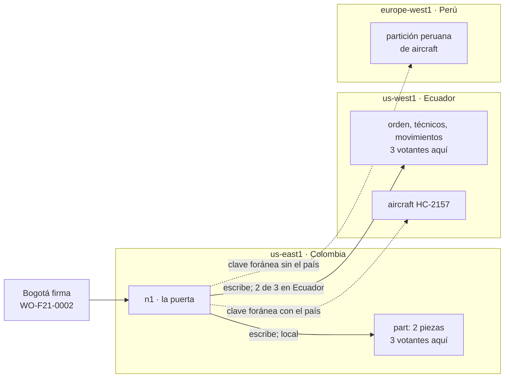

# ⚡ Fase 21 — NewSQL: el mismo SQL en tres países, y la ley decide dónde vive cada fila

> **Curso:** Ruta NoSQL Lite · Fase 21 de 26 · Bloque IV — Cuando el dato no cabe en un nodo · **10 h**
> **Familia:** NewSQL · **Motor:** CockroachDB v26.3.2 `cockroachdb/cockroach@sha256:bc15746ef2c2…`, en un nodo
> (`newsql`) y en nueve nodos en tres regiones simuladas (`newsql-global`, `cockroach demo --global`)
> **Línea base:** PostgreSQL 18.6 `pgvector/pgvector@sha256:2ba9ca5f2e7d…`, un nodo, con el esquema de la Fase 01
> **Entorno de ejecución:** TypeScript (`pg` 8.23.0 contra los tres: CockroachDB habla el protocolo de Postgres)
> **Volumen:** `workOrder-10k` (`datasetSha256` `5a107518d726…`) sin las lecturas de parámetros, y dos órdenes del
> escenario de octubre de 2026 (sección 6.1)
> **Depende de:** Fase 20 · **Habilita:** Fase 22
> **Apéndices de apoyo:** [`a02`](a02-compose-de-la-ruta.md), [`a03`](a03-clis-de-los-motores.md),
> [`a04`](a04-el-arnes-de-medida.md), [`a05`](a05-el-dominio-de-flota.md), [`a06`](a06-lenguajes-y-drivers.md),
> [`a09`](a09-catalogo-de-errores.md), [`a10`](a10-licencias-y-riesgo.md)
> **Fecha de verificación ejecutada:** 11/10/2026, en macOS arm64
> **Objetivo:** llevar el esquema de la Fase 01 a un motor SQL distribuido, ver qué cambia con el mismo SQL, y
> diseñar el expediente de una aeronave ecuatoriana para que sus filas no salgan de Ecuador aunque la aeronave sí
> salga, contando réplicas y regiones en lugar de suponerlas.

---

## 🧭 1. Dónde estamos

La [Fase 20](20-offline-romper-y-medir.md) cerró offline-first: ahí el dato no cabía en un nodo porque **el usuario
estaba donde no hay red**. Aquí no cabe por **la ley**. `HC-2157` es un Twin Otter del operador estatal ecuatoriano
(`OP-EST`), con base en el Coca, y su contrato dice que sus registros no salen del territorio. Pero la aeronave sí
sale: hace la rutina en el Coca y la inspección mayor en Bogotá. El expediente es uno solo, lo firman técnicos de
dos países, y cada una de las tres autoridades —Colombia, Ecuador y Perú— espera poder pedir el de sus aeronaves.

**NewSQL** promete resolverlo **sin quitarle nada al lector relacional**: SQL, transacciones ACID y el mismo driver,
sobre un clúster que reparte los datos en rangos y los replica por consenso. Es la síntesis del curso, y esta fase
comprueba qué parte de la promesa es literal y qué cuesta el resto.

**La línea base es Postgres de un nodo, y es honesta a medias.** Para el SQL y las transacciones (sección 6.2) es
la comparación exacta. Para la residencia no compite: un Postgres vive en un país, y si ese país no es Ecuador, el
expediente ya salió. **Ese incumplimiento es legal, no de rendimiento.** La [Fase 22](22-newsql-romper-y-medir.md) le da a Postgres su mejor
jugada —un nodo con réplica de lectura— y resuelve la apuesta.

---

## 🎯 2. Objetivos de esta fase

1. Escribir **las transacciones del expediente antes que las tablas**: quién escribe qué, y desde qué país.
2. Correr el esquema de la [Fase 01](01-el-dominio-de-flota-y-el-arnes.md) en CockroachDB, medir **las mismas
   sentencias** en los dos motores, y provocar la anomalía que cada aislamiento deja pasar o no.
3. Ver **rangos, réplicas, leaseholder y consenso** con `SHOW RANGES`, en un nodo y en nueve.
4. Poner **la geografía en el esquema** y contar cuántas filas del operador estatal tienen una copia fuera de
   Ecuador.
5. **Provocar un reinicio por incertidumbre del reloj** y leer en el mensaje la ventana de 500 ms.

---

## 🚫 3. Qué NO entra todavía

- **La latencia como argumento.** Aquí se cuentan regiones, nodos y réplicas; la latencia de `COMMIT` por
  localidad es la [Fase 22](22-newsql-romper-y-medir.md), **la única excepción declarada del curso** donde el tiempo sí es el argumento. Con ella
  van la apuesta, la contención, el reintento como modelo de programación y el costo.
- **Una red real.** `cockroach demo --global` simula la latencia entre regiones dentro de un solo proceso: fija y
  reproducible, pero no es una red.
- **La licencia de un clúster de verdad**: [`a10`](a10-licencias-y-riesgo.md). Un nodo y el modo `demo` no la necesitan.

---

## 🏗️ 4. Levantar el motor

Dos perfiles, nunca a la vez. `newsql` es CockroachDB de un nodo, en el 26258, y va con `base`. `newsql-global`
son **nueve nodos en tres regiones** en un solo proceso, con los datos en memoria: se pierden al apagarlo, y con
8 GB cabe **una base por demo recién creado** ([`a02`](a02-compose-de-la-ruta.md)). Desde `src/`:

```bash
cd lab && docker compose --profile base --profile newsql up -d --wait && cd ..
node 21-newsql-levantar-y-modelar/load.ts --target base --db expediente   # Postgres, el esquema de la Fase 01
node 21-newsql-levantar-y-modelar/load.ts --target newsql --db condor     # CockroachDB, el mismo
node 21-newsql-levantar-y-modelar/transactions.ts && node 21-newsql-levantar-y-modelar/skew.ts   # 6.2
cd lab && docker compose stop && docker compose --profile newsql-global up -d --wait --force-recreate && cd ..
S=autoridad    # o copy (con --db condor_copia) o regional; un esquema por demo recién creado
node 21-newsql-levantar-y-modelar/load.ts --target global --db condor --schema $S
node 21-newsql-levantar-y-modelar/placement.ts --db condor --schema $S --keep         # 6.4
node 21-newsql-levantar-y-modelar/regions.ts --db condor --schema $S
node 21-newsql-levantar-y-modelar/clock.ts --schema autoridad                         # 6.5
```

Las regiones de `demo --global` tienen nombres de nube que no se cambian, así que **cada una hace de un país**:

| Región del laboratorio | Hace de | Nodos | Puerta desde tu máquina |
|---|---|---|---|
| `us-east1` (primaria) | Colombia, la casa de Cóndor | n1–n3 | 26259 → n1 |
| `us-west1` | Ecuador | n4–n6 | 26260 → n4 |
| `europe-west1` | Perú | n7–n9 | 26261 → n7 |

`demo` escucha solo en `127.0.0.1` (E-10 en [`a09`](a09-catalogo-de-errores.md)), y el sidecar del compose
publicaba un nodo. **Esta fase le agregó dos puertas**: medir "desde dónde se escribe" exige entrar por un nodo de
ese país. `connect("global", "condor", "EC")` entra por n4.

---

## 📖 5. El diccionario de la familia

| Relacional (Postgres) | NewSQL (CockroachDB) | Dónde se rompe el paralelo |
|---|---|---|
| tabla en un archivo | tabla partida en **rangos** de hasta 512 MiB | el rango es la unidad de réplica; varias tablas chicas comparten uno |
| réplica por *streaming* | **tres réplicas votantes por rango**, que acuerdan con Raft | una escritura confirma cuando la mayoría la tiene, **esté donde esté** |
| el primario | el **leaseholder**, uno por rango | hay un "primario" por rango, y puede estar en otro país |
| `READ COMMITTED` por defecto | `SERIALIZABLE` por defecto | el `40001` es parte del contrato, y se reintenta |
| el servidor en un país | `REGIONAL BY ROW` y la ubicación restringida | **la región es una columna de la fila** |
| tabla de referencia | `LOCALITY GLOBAL` | se lee local en todas partes; escribirla cuesta (F22) |
| `EXPLAIN (ANALYZE, BUFFERS)` | `EXPLAIN ANALYZE`: filas del almacén, nodos y regiones | la métrica pasa a ser **a cuántas máquinas fue** |
| `now()` | reloj híbrido y **500 ms de incertidumbre** | dos nodos nunca tienen la misma hora, y el motor lo sabe |

Y de vuelta: un rango es **un pedazo de tabla con su primario y sus réplicas**, y `REGIONAL BY ROW`, una tabla
particionada con particiones en países distintos ([`a08`](a08-diccionario-y-glosario.md)).

> 🩻 **Esto sí funciona igual.** El SQL, el driver `pg`, las claves foráneas, `BEGIN … COMMIT`, los índices y
> `EXPLAIN`. El esquema de la Fase 01 entra con **dos líneas menos** y las consultas devuelven lo mismo. Lo que
> cambia está **en dónde vive cada fila y en cuántas máquinas tienen que ponerse de acuerdo** para guardarla.

---

## 🧩 6. Modelar Cóndor a la manera de NewSQL

### 6.1 Las transacciones del expediente antes que las tablas

Aquí se empieza por **las transacciones y el país desde donde se ejecutan**, porque en un motor distribuido cada
sentencia va a alguna región. El expediente de `HC-2157` tiene tres trabajos:

| Trabajo | Desde | Qué lee o escribe |
|---|---|---|
| la autoridad de Ecuador pide el expediente | Ecuador | la aeronave, sus 390 órdenes, quién las firmó, cada pieza que entró o salió, lo instalado hoy |
| el Coca firma la rutina `WO-F21-0001` | Ecuador | la orden, su técnico (`T-007`), dos movimientos y dos piezas: la llanta de nariz |
| Bogotá firma la inspección mayor `WO-F21-0002` | Colombia | la orden, dos técnicos (`T-002` libera), dos movimientos y dos piezas: el actuador de nariz |

Las dos órdenes de octubre **son del escenario**, y por eso empiezan por `WO-F21`: de las 10 000 órdenes de
`workOrder-10k`, **ninguna** se hizo fuera del país de la aeronave. La historia sí lo hace, y el escenario la sigue:
en Bogotá se cambia el actuador de nariz `SN-0001068` por el `SN-0000011`, del mismo número de parte que el de
marzo (`expediente.ts`).

¿De quién es cada fila? El esquema de la Fase 01 no tuvo que decidirlo; esta fase lo decide en tres partes,
declaradas:

1. **Lo que se lee en todas partes y casi no cambia** —hangares, técnicos, proveedores, catálogo— no es de ninguna
   autoridad, y se replica en las tres regiones.
2. **El expediente** —la aeronave, sus órdenes, quién las firmó, qué se movió, sus conjuntos y reportes— es de la
   autoridad del país de matrícula, **aunque se firme en otro país**: la inspección de Bogotá es una fila
   ecuatoriana escrita desde Colombia.
3. **La pieza física es de Cóndor**: sale, se repara en otro país y se instala en otra aeronave, y su fila vive en
   Colombia. Del expediente es **el movimiento**. Si el abogado del operador dice que la posición de una pieza
   instalada también es registro, esto cambia: es el ejercicio 25.

El expediente del operador estatal (`HC-2157` y `HC-1475`) son **1990 filas**: 2 aeronaves, 538 órdenes, 538
asignaciones de técnico, 750 movimientos, 10 conjuntos, 109 reportes y 43 piezas instaladas.

### 6.2 El mismo esquema, las mismas sentencias, en los dos motores

El esquema de la Fase 01, corrido tal cual en CockroachDB, falla en dos líneas, ninguna del dominio: el
`CREATE EXTENSION pg_stat_statements` (`unimplemented: extension "pg_stat_statements" is not yet supported`, E-69 en
[`a09`](a09-catalogo-de-errores.md)) y el `ANALYZE;` sin tabla. Sin ellas entran **las doce tablas, sus claves
foráneas, sus `CHECK`, el `jsonb`, los arreglos y el índice parcial**, y el cargador es el mismo para los dos
motores. `transactions.ts` mide en los dos las cinco lecturas del expediente y la firma de Bogotá, cada sentencia
con el `EXPLAIN ANALYZE` de su motor (el de CockroachDB lo lee `lab/harness/crdb-explain.ts`,
[`a04`](a04-el-arnes-de-medida.md)):

| Sentencia | Postgres: filas examinadas · bloques | CockroachDB: filas del almacén · llamadas |
|---|---|---|
| la aeronave | 26 · 1 | 1 · 1 |
| sus órdenes (390) | 390 · 191 | 780 · 2 |
| técnicos de cada orden (390) | 15 238 · 286 | 780 · 2 |
| movimientos de piezas (512) | 13 086 · 356 | 902 · 2 |
| lo instalado hoy (21) | 21 · 21 | 42 · 2 |

No se comparan uno a uno. CockroachDB cuenta **la entrada del índice y la fila por separado**: 390 + 390 = 780.
Postgres eligió un *hash join* que recorre entera la tabla de técnicos (14 848 filas) porque le sale más barato que
390 búsquedas. **Son dos planificadores, no dos modelos**, y en un nodo los dos leen de la misma máquina (`kv
nodes: n1`). La primera diferencia que importa está en la firma: Postgres hace **18 comprobaciones de clave
foránea** con disparadores, invisibles en el plan; CockroachDB las pone **en el plan** (`constraint-check`) o en el
mismo lote del *insert fast path*. En un nodo da igual. En nueve, **cada comprobación es una lectura en la región
de la fila referenciada** (sección 6.4).

La diferencia de fondo es una línea de la salida: `read committed` por defecto en Postgres, `serializable` en
CockroachDB. `skew.ts` la pone a prueba con una regla que ninguna restricción expresa: **una posición, una pieza**.
La llanta de nariz de `HC-2157` se retiró, y el Coca y Bogotá la reponen a la vez, cada uno con una de su almacén:
los dos comprueban que la posición está libre, los dos instalan, los dos confirman.

| Motor y aislamiento | Confirmó el Coca · Bogotá | Llantas en la nariz |
|---|---|---|
| Postgres `READ COMMITTED` | sí · sí | **2** |
| Postgres `SERIALIZABLE` | sí · no: `40001` al instalar | 1 |
| CockroachDB `SERIALIZABLE` | sí · no: `40001` al confirmar | 1 |
| CockroachDB `READ COMMITTED` | sí · sí | **2** |

Es *write skew*: cada una escribe una fila distinta, ningún bloqueo las choca, y las dos decidieron sobre una
lectura que la otra invalidó. El mensaje de CockroachDB (E-71):

```text
40001 restart transaction: TransactionRetryWithProtoRefreshError: TransactionRetryError: retry txn (RETRY_SERIALIZABLE): "sql txn" meta={… key=/Table/139/1/"SN-0004351"/0 iso=Serializable … ts=1791759300.181344210,2 …} … gul=1791759300.681344210,0 …
```

> 🩻 **Esto sí funciona igual**, y es la mitad de la lección: el `SERIALIZABLE` de Postgres rechaza la misma
> anomalía con el mismo código. Lo que cambia es **el valor por defecto**: en CockroachDB el `40001` llega sin
> pedirlo, y una aplicación que no reintenta se lo muestra al técnico. Y CockroachDB **también** tiene
> `READ COMMITTED`, con dos llantas en la nariz. Ser distribuido no hace correcta a una transacción; el aislamiento sí.

Fíjate en el `gul` del mensaje: la fecha de la transacción **más 500 ms exactos**. Es el reloj (sección 6.5).

### 6.3 Rangos, réplicas y consenso, sin misticismo

CockroachDB no reparte tablas: reparte **rangos**, pedazos de claves de hasta 512 MiB. `ranges.ts`, en un nodo y
en nueve con el esquema copiado:

```text
newsql · base condor · 1 rango(s) · … num_replicas = 1 …
  rango 88 · 12 tabla(s): aircraft, assembly, hangar, part, part_catalog, pirep, reading, supplier, technician, work_order, …
global · base condor_copia · 1 rango(s) · … num_replicas = 3, constraints = '[]', lease_preferences = '[]'
  rango 88 · 12 tabla(s): aircraft, assembly, hangar, part, part_catalog, pirep, reading, supplier, technician, work_order, …
    leaseholder n1 us-east1 · votantes: n1 us-east1, n8 europe-west1, n6 us-west1 · no votantes: ninguna
```

**Las doce tablas de Cóndor son un solo rango**, y en nueve nodos ese rango tiene **tres votantes en tres países**.
Uno es el **leaseholder**, que atiende las lecturas y propone las escrituras. Una escritura se confirma cuando **la
mayoría de los votantes** —dos de tres— la guardó en su registro de Raft: con los votantes en tres regiones, **cada
escritura espera a otra región**, esté donde esté el leaseholder. `regions.ts` lo marca como `(quórum fuera)` en
las trece escrituras de las dos firmas. Y el leaseholder no tiene región fija: entre una carga y otra de la misma
base quedó en Perú y en Colombia. El expediente ecuatoriano lo atendió, en una carga, un nodo peruano.

Con el esquema regional de la sección 6.4 son **47 rangos**: cada tabla del expediente y cada índice se parte por
región, con sus tres votantes **en su región**, en tres zonas. Raft confirma dentro del país, y eso se paga en
tolerancia: el rango sobrevive a la caída de una zona, no a la de la región.

### 6.4 La geografía en el esquema

La base se crea con regiones —`CREATE DATABASE condor PRIMARY REGION "us-east1" REGIONS "us-west1",
"europe-west1"`— y cada tabla dice dónde vive. `GLOBAL` para la referencia; `REGIONAL BY TABLE` para la pieza, en
Colombia; y `REGIONAL BY ROW` para el expediente, donde **cada fila lleva una columna `crdb_region`**. Como una orden
no sabe de qué país es su aeronave sin un `JOIN`, cada tabla del expediente lleva la autoridad, y la región sale de
ella (`schema-regional.sql`):

```sql
  authority   text NOT NULL,
  crdb_region crdb_internal_region NOT VISIBLE NOT NULL AS (
    CASE authority WHEN 'EC' THEN 'us-west1' WHEN 'PE' THEN 'europe-west1' ELSE 'us-east1' END) STORED
) LOCALITY REGIONAL BY ROW;
```

La pregunta del contrato: **¿cuántas filas del operador estatal tienen una copia fuera de Ecuador?** `placement.ts`
la contesta rango por rango, y una muestra de filas ubicadas una a una confirma los rangos contados:

| Esquema | Filas de `OP-EST` con copia fuera de Ecuador | Dónde |
|---|---|---|
| el de la Fase 01, copiado | **1990 de 1990** | un rango con votantes en las tres regiones |
| región por fila, ubicación por defecto | **1990 de 1990** | votantes en Ecuador, y **una copia no votante en Colombia y otra en Perú** |
| región por fila, `PLACEMENT RESTRICTED` | **43 de 1990** | las piezas instaladas, en Colombia (decisión 3) |
| la autoridad en la clave, `PLACEMENT RESTRICTED` o una super región de Ecuador | **43 de 1990** | lo mismo |

La segunda fila es la sorpresa. `REGIONAL BY ROW` pone los votantes en Ecuador, pero pide **cinco réplicas**
(`num_replicas = 5, num_voters = 3`: los tres votantes en Ecuador, y una no votante en cada una de las otras dos
regiones). Las dos de más son **no votantes**: no deciden, pero tienen los datos para leer sin cruzar. Una copia que no vota también se lee: pedido desde Perú con `AS OF SYSTEM TIME follower_read_timestamp()`, el expediente lo sirve `n8`, **en Perú**,
con 4,2 s de atraso. `PLACEMENT RESTRICTED` las quita (pide antes una variable de sesión, E-70), y el clúster tardó
**311 s** en mover las réplicas. A cambio, la base ya no puede sobrevivir a la caída de una región:

```text
ALTER DATABASE condor SURVIVE REGION FAILURE · 22023 a region-survivable database cannot also have a restricted placement policy
```

**Son dos requisitos que se contradicen** (E-74): si Ecuador se cae, el expediente queda sin servicio, y esa
decisión la firma alguien que no es el DBA. La documentación no recomienda `PLACEMENT RESTRICTED` —lo mantiene
por compatibilidad— sino **super regiones**. Una super región solo con Ecuador dio las mismas 43 filas y el mismo
choque, con otro mensaje: `super region ecuador only has 1 region(s): at least 3 regions are required for surviving
a region failure`. Y la misma página advierte que ninguna es una garantía completa: las claves indexadas pueden
aparecer en rangos del sistema replicados en todas las regiones, y el motor puede saltarse la configuración para
no perder datos. **Ni un 0 en esta tabla sería un 0.**

Las filas ya están en su país; falta ver qué hace cada sentencia. `regions.ts` corre los tres trabajos desde su
puerta y cuenta las sentencias que **salen de la región desde donde se escriben**:

| Trabajo (desde) | Esquema copiado | Región por fila | La autoridad en la clave |
|---|---|---|---|
| el expediente (Ecuador) | 5 de 5, a Colombia | 4 de 5; tres, a las tres regiones | **1 de 5**: lo instalado, en Colombia |
| la rutina del Coca (Ecuador) | 6 de 6 escriben en Colombia, **y las seis esperan quórum en otra región** | 6 de 6; cada `INSERT` lee en las tres | **4 de 6**, a Colombia, por la pieza |
| la inspección mayor (Colombia) | 0 de 7 (el leaseholder quedó en Colombia), **y las siete esperan quórum fuera** | 6 de 7 | 6 de 7: cinco escriben en Ecuador, porque la fila es ecuatoriana |

La columna del medio explica el paso que faltaba. Con la clave de la Fase 01 y la región en otra columna, el motor
**no sabe en qué región está una clave**: para insertar `WO-F21-0001` comprueba que no exista en ninguna de las
tres particiones —las tres filas del almacén de cada `INSERT`—, y para "las órdenes de `HC-2157`" recorre las tres
particiones del índice. **Cada transacción cruza la frontera dos veces**: para escribir, y para comprobar que no
había otra igual del otro lado. El arreglo es **la autoridad al principio de cada clave** (`schema-autoridad.sql`):

```sql
  PRIMARY KEY (authority, work_order_id),
  FOREIGN KEY (authority, aircraft) REFERENCES aircraft (country, registration),
```

Como `crdb_region` sale de la autoridad, la clave dice su región: sin comprobaciones en otras regiones, la clave
foránea va directo, y una consulta con `authority = 'EC'` lee una partición. Lo que queda fuera de Ecuador **es todo
la pieza** (decisión 3), y una clave foránea de `part.aircraft` que apunta a la matrícula sin el país. Bogotá
escribe en Ecuador porque la fila es ecuatoriana: es lo que pide el contrato.



> 💡 **La geografía es una columna, y tiene que estar en la clave.** Con `REGIONAL BY ROW` y la clave de siempre,
> cada `INSERT` pregunta en los otros países si ya existe, y cada consulta que no nombra la región los recorre. Es
> la lección de la partition key de columnar ancha.

### 6.5 El reloj, que es el problema de fondo

En Postgres, una máquina ordena todo, y "antes" quiere decir antes. En un clúster, cada nodo tiene su reloj, y
CockroachDB fecha cada transacción con un **reloj híbrido** (HLC): la hora de la pared en nanosegundos y un contador
lógico, como `1791759110545457094.0000000000`. En `demo`, los nueve nodos comparten el reloj de tu máquina: **el
desfase entre relojes no se puede provocar aquí**, y lo que pasa cuando un nodo se aleja demasiado —se apaga solo—
no se puede provocar aquí; la [Fase 22](22-newsql-romper-y-medir.md) lo vio pasar por otra causa.

Lo que sí se provoca es la consecuencia. CockroachDB supone que dos relojes difieren en **500 ms como máximo**: una
lectura con fecha *t* que encuentra un valor fechado entre *t* y *t* + 500 ms no sabe si se escribió antes o después
de que ella empezara. Para no arriesgarse, mueve su fecha y revalida lo que ya leyó; si eso también cambió, se
reinicia. `clock.ts` lo arma con el expediente: una lectora en Quito lee la última orden de `HC-2157`; el Coca
cambia esa orden y el actuador de nariz —una pieza, en Colombia— y confirma; la lectora va por el actuador, a un
nodo que no había visitado.

```text
vuelta 1 · la lectora empezó en 1791759111828504762.0000000000
     6 ms lectora lee la orden
   219 ms firmante confirma
   292 ms lectora: 40001 ReadWithinUncertaintyIntervalError
           su fecha 1791759111.828504762,0 · la escritura 1791759111.834201387,0 (+6 ms) · su límite 1791759112.328504762,0 (+500 ms)
```

**Cinco reinicios de cinco**, con la escritura entre 3 y 6 ms después de la lectora y el límite siempre a +500 ms
(E-72). La escritura está fechada a +6 ms aunque se confirmó a los 219: una transacción lleva la fecha de cuando
empezó. Y el mensaje trae un segundo límite, `local=`, a +254 ms: la hora en que la lectora llegó al nodo del
actuador; lo escrito ahí después es futuro sin duda. Por eso hace falta un nodo **no** visitado.

> 🧠 **El modelo mental.** Spanner acota la incertidumbre con relojes atómicos y GPS a unos milisegundos, y **el
> que escribe espera** a que pase. CockroachDB no exige ese hardware: la ventana es de 500 ms, y **paga el que lee**,
> con un reinicio. Nadie puede decir "antes" entre dos máquinas sin pagar por la duda.

El reinicio es el `40001` de la sección 6.2 con otro motivo, y se trata igual: reintentando la transacción entera.
Una lectura que acepta ser un poco vieja se sale de la ventana con `AS OF SYSTEM TIME`.

**El patrón a memorizar.** En NewSQL se diseña primero **de quién es cada fila y desde dónde se escribe**: la
autoridad decide la región, la región va en la clave, y la ubicación se restringe cuando la ley lo pide.

---

## 🪞 7. Tu instinto relacional dice… y esta vez se equivoca

> 🪞 **"Si habla SQL y es ACID, es Postgres con más nodos."** Lo es, más de lo que esperabas: el esquema entra con
> **dos líneas menos** y la anomalía que rechaza el `SERIALIZABLE` de Postgres la rechaza también aquí. Deja de
> serlo cuando una fila tiene que vivir **en algún lugar**: copiado tal cual, el esquema dejó **las 1990 filas** del
> operador estatal con copias en Colombia y Perú, el expediente atendido en una carga por un nodo peruano, y **cada
> escritura de la rutina del Coca esperando a una segunda región** para confirmar.

El instinto es razonable porque la promesa se cumple en todo lo que el SQL expresa. Lo que no se cumple está fuera
del SQL: el aislamiento por defecto, que hace del `40001` parte del contrato; el reloj, que reinició cinco de cinco
lecturas; y la geografía, que decide dónde vive cada fila y quién vota cada escritura. Postgres no tiene esas
preguntas porque vive en una máquina. Cuando una transacción cruza regiones, la latencia aparece en el `COMMIT`, y
la Fase 22 la mide.

La pregunta del instrumento que lo habría anticipado es la 1: **¿dónde está la frontera transaccional?** Aquí,
además, **¿de quién es cada fila que cae adentro?** El expediente es una sola unidad, tiene dueño legal, y se
escribe desde dos países.

---

## ⚰️ 8. La situación 3: elegiste bien la familia y la modelaste como relacional

**La decisión, con su mejor argumento.** *"CockroachDB habla Postgres. Corremos el esquema de siempre, el motor
reparte los datos entre las tres regiones, y tenemos ACID en todas. Para eso lo compramos."*

**Por qué era razonable.** Funciona: dos líneas menos, los mismos resultados, transacciones serializables. Ningún
error avisa, y en un nodo no hay nada que pueda estar mal.

**Qué pasa.** El balanceador no sabe del contrato. Pone las doce tablas en **un solo rango** con un votante en cada
país y el leaseholder donde le conviene. Cada fila del operador tiene copias en los tres países, y una lectura
desde Perú la sirve un nodo peruano. La rutina del Coca, escrita en Ecuador sobre filas ecuatorianas, manda sus
seis escrituras a Colombia, y cada una espera un segundo votante en otro país.

**Antes y después, con números.**

| El expediente de `HC-2157` | Esquema de la Fase 01, copiado | La autoridad en la clave, restringido |
|---|---|---|
| filas del operador con copia fuera de Ecuador | **1990 de 1990** | **43 de 1990**, las piezas |
| sentencias del expediente que salen de Ecuador | 5 de 5 | 1 de 5 |
| sentencias de la rutina del Coca que salen de Ecuador | 6 de 6, y las seis con quórum fuera | 4 de 6, a Colombia, por la pieza |
| dónde está el leaseholder del expediente | donde lo deje el balanceador | en Ecuador, con sus tres votantes |

**Cuánto cuesta salir.** Un `ALTER PRIMARY KEY` por tabla del expediente, que la reescribe, más rehacer las claves
foráneas y cambiar las consultas para decir la autoridad. Se hace en línea, pero no deshace lo que pasó: **las
copias existieron** en dos países, y si el contrato pedía demostrar que no salieron, no se puede.

**La pregunta que lo habría evitado** es la 1, con su segunda mitad: quien contesta "el expediente es de la
autoridad de su matrícula" pone la autoridad en la clave antes de cargar la primera fila.

---

## ⚠️ 9. Errores comunes y diagnóstico

**Una transacción que se reinicia** (E-71 y E-72): `40001 restart transaction: … RETRY_SERIALIZABLE` o
`… ReadWithinUncertaintyIntervalError …`. 🩺 No es una falla: es `SERIALIZABLE` o el reloj, y la palabra después de
`ProtoRefreshError` dice cuál. Salir: reintentar **desde el `BEGIN`**. Bajar a `READ COMMITTED` lo hace desaparecer
y deja pasar la anomalía.

**El arnés de Postgres que no corre** (E-69 y E-73): `extension "pg_stat_statements" is not yet supported` y
`EXPLAIN does not support placeholders`. 🩺 El protocolo es el de Postgres; las extensiones y un `EXPLAIN` preparado,
no. Salir: quitar la línea, y escribir los valores como literales (`inline()`).

**La residencia** (E-70 y E-74): `ALTER DATABASE PLACEMENT requires that the session setting
enable_multiregion_placement_policy is enabled` y `a region-survivable database cannot also have a restricted
placement policy`. 🩺 El primero es una variable de sesión; el segundo, una decisión entre la ley y la
disponibilidad.

**La copia que nadie ve.** Sin mensaje, y es el más caro: un expediente con copias fuera del país no da ningún error.
🩺 `SHOW RANGES FROM TABLE <t> WITH DETAILS`: `non_voting_replicas` no vacío, o votantes en varias regiones. Salir:
`REGIONAL BY ROW`, la ubicación restringida, y contar otra vez con `placement.ts`.

**El laboratorio sin memoria.** `newsql-global` murió por OOM de la VM con dos bases de `workOrder-10k`, y con la
memoria SQL bajada a 64 MiB por nodo un índice esperó para siempre en `Backfilling index`. 🩺 `docker inspect …
--format '{{.State.OOMKilled}}'` y `SHOW JOBS`. Salir: el compose del curso (`GOMEMLIMIT` de 3 GiB,
[`a02`](a02-compose-de-la-ruta.md)) y una base por demo recién creado.

---

## 📋 10. Checklist de validación

```text
[ ] newsql y base cargados con el mismo load.ts; el esquema de la Fase 01 falla en dos líneas
[ ] La tabla de 6.2, y por qué 780 filas del almacén son 390 órdenes
[ ] skew.ts: dos llantas con READ COMMITTED en los dos motores, una con SERIALIZABLE
[ ] Un nodo: 1 rango para 12 tablas; la copia en nueve: 1 rango, un votante por región
[ ] Tres puertas, y SELECT gateway_region() devuelve la región de cada una
[ ] placement.ts: 1990 → 1990 → 43 filas fuera de Ecuador, y la regla de 5 réplicas que lo explica
[ ] SURVIVE REGION FAILURE rechazado con la ubicación restringida y con la super región
[ ] regions.ts con la autoridad en la clave: el expediente sale de Ecuador en 1 de 5 sentencias
[ ] clock.ts: cinco reinicios de cinco, con el límite a +500 ms
[ ] M-61 a M-65 en la bitácora, E-69 a E-74 en a09, el 🪞 10 en INSTINTOS.md
```

---

## 🧪 11. Ejercicios (26)

Desde `src/`. Los ejercicios 1–5 y 8–9 usan `newsql` y `base`; el resto, `newsql-global`, solo, con la base que
diga cada uno cargada con `load.ts`. Recuerda que `newsql-global` pierde los datos al apagarse.

### 🟢 Fácil — el motor, el esquema y los rangos (1–7)

#### 🟢 Ejercicio 1 — Un nodo por dentro

Entra a `newsql` con `cockroach sql` ([`a03`](a03-clis-de-los-motores.md)) y recorre la base `condor`.

**Objetivo:** la versión, las doce tablas, y el aislamiento por defecto de tu sesión (`SHOW transaction_isolation`).

#### 🟢 Ejercicio 2 — Las dos líneas

Corre `01-el-dominio-de-flota-y-el-arnes/schema.sql` tal cual contra `newsql`, sin el cargador.

**Objetivo:** los dos errores literales y la línea del archivo que provoca cada uno.

#### 🟢 Ejercicio 3 — El mismo resultado

Corre "sus órdenes" de `expediente.ts` en `base` y en `newsql`, y suma `labor_hours` en los dos.

**Objetivo:** las mismas 390 filas y la misma suma en los dos motores.

#### 🟢 Ejercicio 4 — Leer un plan distribuido

`EXPLAIN ANALYZE` de "movimientos de piezas" en `newsql`.

**Objetivo:** las filas del almacén, los operadores y los nodos; y por qué son 902 filas del almacén para 512
movimientos devueltos.

#### 🟢 Ejercicio 5 — Tus rangos

Corre `ranges.ts --target newsql --db condor`.

**Objetivo:** cuántos rangos tiene la base, cuántas réplicas tiene cada uno, y por qué un nodo no puede tener tres
votantes.

#### 🟢 Ejercicio 6 — Las tres puertas

Conéctate a 26259, 26260 y 26261 y pregunta `SELECT gateway_region()` en cada una.

**Objetivo:** reconstruir la tabla de la sección 4 desde tu máquina.

#### 🟢 Ejercicio 7 — La copia, en el mapa

Con `condor_copia` cargada, corre `ranges.ts --target global --db condor_copia`.

**Objetivo:** en qué región quedó **tu** leaseholder del expediente, y en cuántas regiones están sus votantes.

### 🟡 Intermedio — aislamiento y localidad (8–15)

#### 🟡 Ejercicio 8 — Otra anomalía

Cambia `skew.ts` para que las dos bases sumen horas a la misma orden leyendo el valor, sumando en la aplicación y
escribiendo el resultado.

**Objetivo:** la tabla de cuatro filas para esta anomalía (*lost update*), y en cuál se pierden horas.

#### 🟡 Ejercicio 9 — `FOR UPDATE`

Arregla `skew.ts` en `READ COMMITTED` sin cambiar el aislamiento: que cada base bloquee algo antes de leer la
posición.

**Objetivo:** una llanta en la nariz en los dos motores, y qué fila bloqueaste y por qué esa.

#### 🟡 Ejercicio 10 — La consulta que dice su región

Con el esquema regional (`--schema regional`), corre "sus órdenes" desde Ecuador con y sin `AND authority = 'EC'`.

**Objetivo:** las regiones y las filas del almacén de cada una, y por qué el filtro solo no alcanza sin el índice
del esquema de la autoridad.

#### 🟡 Ejercicio 11 — Perú

Con el esquema de la autoridad, pide el expediente de `OB-1565` (operador peruano) desde la puerta de Perú.

**Objetivo:** que cada sentencia lea solo en `europe-west1`, salvo la que no puede, y cuál es.

#### 🟡 Ejercicio 12 — `GLOBAL`, de verdad

`EXPLAIN ANALYZE` de `SELECT * FROM hangar` desde las tres puertas.

**Objetivo:** que las tres lean en su propia región, y dónde está el leaseholder de `hangar`.

#### 🟡 Ejercicio 13 — La pieza que viaja

En la firma del Coca con el esquema de la autoridad, identifica la sentencia que cruza a Colombia.

**Objetivo:** cuál es, y qué decisión de la sección 6.1 la provoca.

#### 🟡 Ejercicio 14 — Una lectura un poco vieja

Pide el expediente desde Perú con `AS OF SYSTEM TIME follower_read_timestamp()`, sobre `condor` con la ubicación
por defecto (sin `PLACEMENT RESTRICTED`).

**Objetivo:** las regiones de cada sentencia con y sin la cláusula, y **qué prueba eso** sobre dónde hay copias del
expediente ecuatoriano.

#### 🟡 Ejercicio 15 — El reintento

Envuelve la transacción de Bogotá de `skew.ts` en un reintento (tres intentos como máximo, solo para `40001`).

**Objetivo:** que el segundo intento vea la llanta del Coca y **se niegue** a instalar, con un mensaje del dominio y
no con un `40001`.

### 🟠 Difícil — diagnosticar y decidir (16–22)

#### 🟠 Ejercicio 16 — La ruleta del leaseholder

Recrea `newsql-global` tres veces, carga `condor_copia` y anota dónde quedó el leaseholder del expediente.

**Objetivo:** las tres regiones, y por qué el esquema copiado no puede prometer nada sobre ese lugar.

#### 🟠 Ejercicio 17 — Contar fronteras

Con el esquema regional, `EXPLAIN (VERBOSE)` del `INSERT` de la orden del Coca.

**Objetivo:** el operador que va a cada región, y cuál es la comprobación de unicidad.

#### 🟠 Ejercicio 18 — Lo que se lee en Perú

Con el esquema de la autoridad y la ubicación por defecto, pide desde Perú, con lectura un poco vieja, la orden
`WO-0009965`.

**Objetivo:** que se lea **en Perú**, y redactar en un párrafo por qué eso incumple el contrato del operador aunque
nadie la haya pedido.

#### 🟠 Ejercicio 19 — El índice que no dice la región

En el esquema regional, crea un índice `(authority, aircraft, opened_at)` en `work_order` y repite el ejercicio 10.

**Objetivo:** las regiones antes y después, comparadas con el esquema de la autoridad.

#### 🟠 Ejercicio 20 — La incertidumbre que no se ve

Cambia `clock.ts` para que la lectora no lea la orden antes del actuador.

**Objetivo:** cuántos reinicios ve el cliente en cinco vueltas, y por qué el motor pudo resolverlo solo.

#### 🟠 Ejercicio 21 — Postgres en Quito

Diseña la línea base honesta: un Postgres en Ecuador con el expediente ecuatoriano y otro en Bogotá con el resto.

**Objetivo:** cómo queda la firma de la inspección de Bogotá (dos transacciones, o un `PREPARE TRANSACTION`), qué
invariante queda en riesgo, y qué hace la aplicación si el segundo `COMMIT` falla.

#### 🟠 Ejercicio 22 — Sobrevivir o cumplir

Escribe la decisión que pide E-74 para el expediente del operador estatal.

**Objetivo:** qué deja de funcionar si `us-west1` cae con `PLACEMENT RESTRICTED`, qué sigue funcionando, y quién
tiene que firmar la decisión.

### 🔴 Muy difícil — diseño y adversarios (23–26)

#### 🔴 Ejercicio 23 — El segundo operador estatal

Lucía va a firmar con un segundo operador estatal, peruano. Ajusta el esquema de la autoridad para que su
expediente cumpla lo mismo en `europe-west1`.

**Objetivo:** `placement.ts` con 0 filas suyas con copia fuera de Perú, salvo las que tu decisión 3 deje fuera.

#### 🔴 Ejercicio 24 — La licencia que cambia

Un inspector renueva su licencia: un `UPDATE` en `technician`, que es `GLOBAL`.

**Objetivo:** las regiones que toca esa escritura y las que toca una lectura de `technician` desde cada puerta, y por
qué la Fase 22 la va a encontrar cara.

#### 🔴 Ejercicio 25 — La pieza como registro

El abogado del operador dice que la posición de una pieza instalada también es registro. Cambia la decisión 3:
la pieza instalada vive con la autoridad de la aeronave.

**Objetivo:** `placement.ts` con **0 de 1990** filas fuera de Ecuador, y qué le pasa a la fila de una pieza que se
retira en el Coca y se instala en Bogotá en una aeronave colombiana.

#### 🔴 Ejercicio 26 — La apuesta antes de la apuesta

Con los números de esta fase, escribe cuántas regiones espera la firma del Coca en cada esquema y qué crees que
cuesta en milisegundos, antes de que la Fase 22 lo mida.

**Objetivo:** tu predicción por escrito, con el razonamiento por región y por quórum, para compararla con la
Fase 22.

### 🔥 Opcionales

- **YugabyteDB o TiDB con el mismo expediente:** el esquema de la Fase 01 en otro motor que habla el protocolo de
  Postgres (YugabyteDB) o de MySQL (TiDB), y la tabla de la sección 6.2 con su `EXPLAIN`.
- **Un nodo que se cae:** con `cockroach demo`, `\demo shutdown 5` desde el shell interactivo del contenedor, y el
  expediente pedido otra vez: qué pasa con `PLACEMENT RESTRICTED` y qué con la ubicación por defecto.

---

## 📚 12. Referencias

> ⚠️ Las URLs y sus contenidos cambian, y la documentación de CockroachDB cubre la última versión. Esta fase se
> verificó con CockroachDB 26.3.2.

- **Multi-region, la visión de conjunto** — https://www.cockroachlabs.com/docs/stable/multiregion-overview — regiones,
  región primaria, metas de supervivencia y cómo se combinan.
- **Las localidades de tabla** — https://www.cockroachlabs.com/docs/stable/table-localities — `GLOBAL`,
  `REGIONAL BY TABLE` y `REGIONAL BY ROW`, con lo que cuesta leer y escribir cada una.
- **Domiciliar los datos** — https://www.cockroachlabs.com/docs/stable/data-domiciling — `PLACEMENT RESTRICTED`, las
  réplicas no votantes y lo que la documentación misma dice que no garantiza.
- **Las lecturas de seguidor** — https://www.cockroachlabs.com/docs/stable/follower-reads — `AS OF SYSTEM TIME` y la
  réplica más cercana.
- **Errores de reintento** — https://www.cockroachlabs.com/docs/stable/transaction-retry-error-reference — cada motivo
  de un `40001`, con lo que lo provoca.
- **La capa de replicación y la de transacciones** —
  https://www.cockroachlabs.com/docs/stable/architecture/replication-layer y
  https://www.cockroachlabs.com/docs/stable/architecture/transaction-layer — rangos, Raft, leaseholders, *intents* y
  el intervalo de incertidumbre, por dentro.
- **`cockroach demo`** — https://www.cockroachlabs.com/docs/stable/cockroach-demo — el modo del laboratorio y sus
  límites.
- **Taft y otros, *CockroachDB: The Resilient Geo-Distributed SQL Database*** (SIGMOD 2020) —
  https://www.cockroachlabs.com/guides/cockroachdb-the-resilient-geo-distributed-sql-database-sigmod-2020/ — el diseño
  completo, contado por quienes lo hicieron.
- **Corbett y otros, *Spanner: Google's Globally-Distributed Database*** (OSDI 2012) —
  https://www.usenix.org/conference/osdi12/technical-sessions/presentation/corbett — TrueTime y la espera al confirmar.
- **Kimball y Sharif, *Living Without Atomic Clocks*** — https://www.cockroachlabs.com/blog/living-without-atomic-clocks/ — por
  qué CockroachDB reinicia lecturas donde Spanner espera escrituras.
- **Kulkarni y otros, *Logical Physical Clocks and Consistent Snapshots in Globally Distributed Databases*** (2014) —
  https://cse.buffalo.edu/tech-reports/2014-04.pdf — el reloj híbrido.
- **Ongaro y Ousterhout, *In Search of an Understandable Consensus Algorithm*** (USENIX ATC 2014) —
  https://raft.github.io/raft.pdf — Raft, el consenso de cada rango.
- **Ports y Grittner, *Serializable Snapshot Isolation in PostgreSQL*** (VLDB 2012) — https://arxiv.org/abs/1208.4179 —
  el `SERIALIZABLE` de la línea base, y por qué rechaza el *write skew*.
- **El aislamiento en PostgreSQL 18** — https://www.postgresql.org/docs/18/transaction-iso.html — los cuatro niveles y
  sus anomalías.
- **Jepsen, *CockroachDB beta-20160829*** — https://jepsen.io/analyses/cockroachdb-beta-20160829 — una auditoría
  adversaria del modelo, con el reloj en el centro.
- **YugabyteDB** — https://docs.yugabyte.com/ — y **TiDB** — https://docs.pingcap.com/tidb/stable — los otros dos
  NewSQL de código abierto, para el opcional.
- **Kleppmann, *Designing Data-Intensive Applications*** (O'Reilly, 2017) — capítulo 7 (aislamiento y *write
  skew*) y capítulo 9 (consenso y relojes).

**Orden sugerido:** el capítulo 7 de Kleppmann antes de la sección 6.2; las localidades de tabla y domiciliar los
datos antes de la 6.4; *Living Without Atomic Clocks* antes de la 6.5; Spanner, el artículo de CockroachDB y Raft al
cerrar la fase.

---

## 🏁 13. Resultado de la fase

```text
newsql (un nodo) · base condor          el esquema de la Fase 01, menos dos líneas: 1 rango, 12 tablas
base (Postgres) · base expediente        el mismo esquema y los mismos datos, la línea base
newsql-global (nueve nodos, en memoria)  condor_copia: 1 rango, un votante por país
                                         condor (la autoridad en la clave): 62 rangos, el expediente
                                         ecuatoriano con sus tres votantes en Ecuador y PLACEMENT RESTRICTED
```

Llevaste el esquema de la Fase 01 a un motor distribuido y comprobaste que el SQL es el mismo y que el aislamiento
no. Viste que una tabla no es un rango, que una escritura espera a la mayoría de sus votantes estén donde estén, y
que el balanceador no sabe nada de contratos. Pusiste la geografía en el esquema y contaste lo que la ley pregunta:
**1990 filas del operador estatal con copia fuera de Ecuador, después 43, y por qué no 0**. Y provocaste el reloj.
La [Fase 22](22-newsql-romper-y-medir.md) le pone milisegundos a cada frontera que contaste aquí, resuelve la apuesta contra Postgres con réplica
de lectura, y cierra el bloque con el boss.

> **La señal de que quedó bien:** *"Puedo decir, para cada tabla del expediente, en qué región vive cada fila, por
> qué, quién vota sus escrituras, y qué sentencia de cada firma sale del país, y mostrarlo con `SHOW RANGES`."*

> 🏷️ **No cierres la fase sin el tag.** Con el checklist en verde y `git status` limpio:
>
> ```bash
> git tag -a fase-21-newsql-levantar-y-modelar -m "F21 cerrada: esquema de F01 en CockroachDB con 2 líneas menos (extensión y ANALYZE); write skew: 2 llantas con READ COMMITTED en Postgres y CockroachDB, 40001 con SERIALIZABLE en los dos; 1 rango para 12 tablas; copia con un votante por país y leaseholder al azar; filas de OP-EST con copia fuera de Ecuador 1990 → 1990 (REGIONAL BY ROW) → 43 (PLACEMENT RESTRICTED, solo piezas); SURVIVE REGION FAILURE incompatible; la autoridad en la clave deja el expediente en 1 de 5 sentencias fuera; reinicio por incertidumbre 5 de 5 a +500 ms"
> ```
>
> Commits de la fase con prefijo `f21:`, los de ejercicio `f21 ej25: …`.
