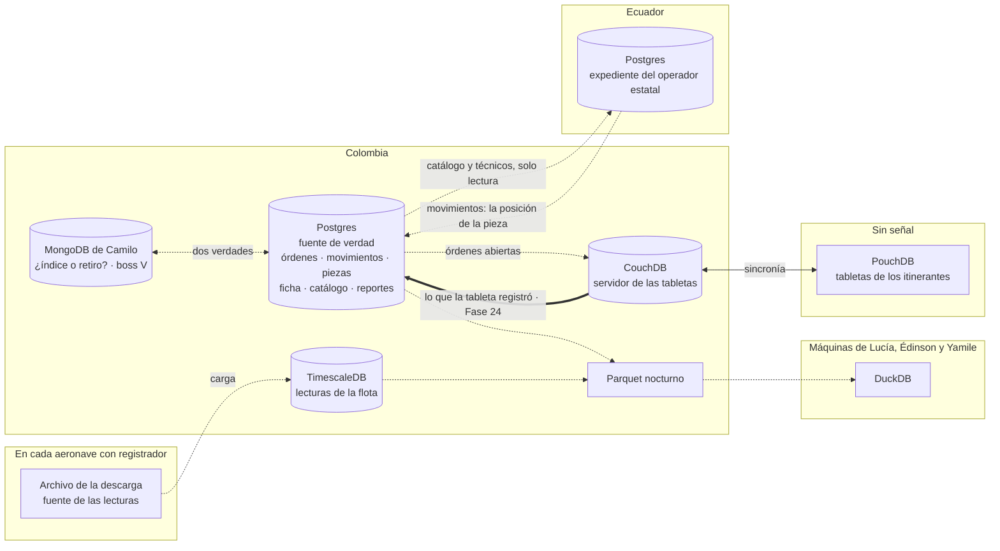

# ⚖️ Fase 23 — El capstone políglota: qué motor para qué parte, y la fuente de verdad que lo ordena

> **Curso:** Ruta NoSQL Lite · Fase 23 de 26 · Bloque V — El árbitro · **12 h**
> **Familia:** todas · **Motores:** PostgreSQL 18.6 `pgvector/pgvector@sha256:2ba9ca5f2e7d…` como fuente de verdad, y
> para comprobar que se reconstruyen desde ella, DuckDB 1.5.6, Apache CouchDB 3.5.2 `couchdb@sha256:8cf5f8442585…` y
> TimescaleDB 2.30.1
> **Línea base:** es Postgres, y aquí también es el árbitro
> **Entorno de ejecución:** TypeScript (`pg` 8.23.0), y Python para DuckDB, como en la Fase 07
> **Volumen:** `workOrder-1m` (`datasetSha256` `11a67c65fb22…`), `reading-5m` (`8dc486dea089…`) y `workOrder-10k`
> (`5a107518d726…`), ya cargados por las fases que los usaron
> **Depende de:** todas las fases anteriores, de la [00](00-la-decision-que-se-hereda.md) a la
> [22](22-newsql-romper-y-medir.md) · **Habilita:** [Fase 24](24-poliglota-la-costura.md)
> **Apéndices de apoyo:** [`a02`](a02-compose-de-la-ruta.md), [`a04`](a04-el-arnes-de-medida.md),
> [`a05`](a05-el-dominio-de-flota.md), [`a08`](a08-diccionario-y-glosario.md), [`a10`](a10-licencias-y-riesgo.md)
> **Fecha de verificación ejecutada:** 12/10/2026, en macOS arm64
> **Objetivo:** pasar el sistema entero de Cóndor por las cinco preguntas, decidir qué motores entran y cuáles se
> descartan con su número, fijar una fuente de verdad por entidad, y comprobar contra el laboratorio que cada motor
> que entra se puede reconstruir desde ella.

---

## 🧭 1. Dónde estamos

Diez familias, veintidós fases y once apuestas después, el curso tiene una pila de veredictos parciales. Cada fase B
terminó con un *"para Cóndor"*: la ficha es documental pero cabe en JSONB, las reservas viven en Postgres, el tablero
de costos es de DuckDB, los parámetros de la flota se ganan TimescaleDB, Freddy necesita una tableta que funcione sin
señal y el expediente del operador estatal no puede salir de Ecuador. Ninguna de esas frases dice **cómo conviven**.
Esta fase junta los veredictos en un solo diseño, y descubre que juntarlos obliga a una decisión que ninguna fase
tomó: **dónde se escribe cada hecho**.

El bloque se llama *El árbitro* porque eso es lo que hace: no propone un motor, decide entre los que ya se midieron.
Por eso esta fase **no mide nada nuevo de ningún motor**. Cada decisión cita su medición en la
[bitácora](bitacora-de-medicion.md), y lo único que se ejecuta es la comprobación que pide la regla del bloque: si cada
motor que entra se puede reconstruir desde la fuente de verdad, o si ya es una segunda verdad.

> 📝 **La plantilla, adaptada.** El capstone no tiene plantilla propia: usa la de fase A, con la sección 4 dedicada a
> levantar lo que se comprueba y la sección 6 al diseño. El 🪞 de la sección 7 no se copia a
> [`INSTINTOS.md`](INSTINTOS.md), que guarda uno por familia, y este no es de ninguna.

---

## 🎯 2. Objetivos de esta fase

1. Contestar **las cinco preguntas por partes** para todo Cóndor, y que cada respuesta apunte a una familia o a
   Postgres, con la fase y la medición que la sostienen.
2. Escribir **la lista de motores que entran y la de los que se descartan**, cada uno con su número y con la
   condición que lo haría cambiar de lista.
3. Fijar **una fuente de verdad por entidad**, y decir en voz alta las dos que no son Postgres.
4. **Comprobar en el laboratorio** que el tablero, el servidor de las tabletas y las lecturas de la flota se
   reconstruyen desde su fuente, y medir cuánto del inventario de piezas no se reconstruye desde las órdenes.
5. Dibujar **el diagrama del sistema con sus fronteras**: países, motores y qué flecha es un hecho y cuál una copia.

---

## 🚫 3. Qué NO entra todavía

- **La costura**: cómo viaja una escritura de la fuente a cada motor, la doble escritura contra *outbox* y CDC, la
  ventana de inconsistencia medida, cuánto dura una reconstrucción completa y qué hacer con un motor caído → [Fase 24](24-poliglota-la-costura.md).
- **La factura**: lo que cuesta operar cada motor que entra, el árbol de veredicto de las diez familias y *"cuándo
  bastaba Postgres"* → [Fase 25](25-poliglota-la-factura.md).
- **El sistema de Camilo**: si se retira o se queda como índice reconstruible lo decide el boss del Bloque V, *"Las dos
  verdades"*, en la [Fase 25](25-poliglota-la-factura.md). Aquí aparece en el diagrama con su pregunta abierta.

---

## 🏗️ 4. Levantar lo que se comprueba

Nada nuevo: los perfiles `base`, `offline` y `series` con lo que dejaron las fases que los cargaron. Los tres caben
juntos en 8 GB ([`a02`](a02-compose-de-la-ruta.md)); `newsql-global` no hace falta. Desde `src/`:

```bash
cd lab && docker compose --profile base --profile offline --profile series up -d --wait && cd ..
node 23-poliglota-el-diseno/inventory.ts                      # 6.4: las piezas, desde las órdenes (workOrder-1m)
uv run python 23-poliglota-el-diseno/rebuild_duckdb.py        # 6.4: el tablero, desde Postgres (base analitico)
node 23-poliglota-el-diseno/rebuild-couch.ts                  # 6.4: el servidor de las tabletas, desde Postgres
node 23-poliglota-el-diseno/readings.ts                       # 6.4: las lecturas, desde la descarga
```

Lo que cada guion necesita ya cargado: `workOrder-1m` en la base `postgres` ([Fase 01](01-el-dominio-de-flota-y-el-arnes.md)),
`analitico` y `condor.duckdb` ([Fase 07](07-analitico-levantar-y-modelar.md)), `work_order_1m` en CouchDB
([Fase 20](20-offline-romper-y-medir.md)) y `reading` en TimescaleDB ([Fase 09](09-series-levantar-y-modelar.md)).
Si falta alguno, se corre el cargador de esa fase; ninguno pasa de veinte minutos.

---

## 📖 5. El diccionario del bloque

| Lo que ya sabías | En un sistema con varios motores | Dónde se rompe el paralelo |
|---|---|---|
| la tabla donde se escribe | **fuente de verdad**: el único lugar donde un hecho nace | hay una por entidad, no una por empresa |
| un índice | **dato derivado**: una copia en otra forma, que se tira y se vuelve a armar | vive en otro proceso, y nadie lo mantiene al día por ti |
| `REINDEX` | **reconstrucción**: armar el derivado otra vez desde la fuente | cuesta minutos u horas, y es la [Fase 24](24-poliglota-la-costura.md) |
| una columna que se actualiza | **estado**: el resultado de aplicar hechos | si se actualiza sin un hecho detrás, nadie la puede rehacer |
| una fila de movimiento | **hecho**: algo que pasó, con fecha, que no se edita | es lo único que se reconstruye hacia adelante |
| una restricción violada | **segunda verdad**: un dato que vive solo en el derivado | no da error: se nota cuando dos pantallas no coinciden |
| la transacción | **la frontera**: lo que tiene que cambiar junto | entre dos motores no hay `COMMIT` que la sostenga |

Y de vuelta: una fuente de verdad es **la tabla donde se hace el `INSERT`**, y un dato derivado es **un índice que vive
en otra máquina**. Las dos traducciones, con su glosario, están en [`a08`](a08-diccionario-y-glosario.md).

> 🩻 **Esto sí funciona igual.** Un índice, una vista materializada o una columna generada ya cumplen lo que este
> bloque pide a cada motor: se tiran y se vuelven a armar desde las tablas sin perder nada. Lo nuevo es que ahora el
> índice está en otro servidor, con otro esquema, y la garantía hay que construirla.

---

## 🧩 6. El diseño

### 6.1 Cóndor, parte por parte

La [Fase 02](02-las-cinco-preguntas.md) pedía contestar las cinco preguntas **por partes, no por sistema**. Con las
mediciones del curso delante, Cóndor tiene once partes:

| Parte | Frontera | Consultas | Unidad de lectura | Saltos | Exactitud | Sale |
|---|---|---|---|---|---|---|
| órdenes, movimientos y firma | cruza orden y pieza | conocidas y nuevas | la orden | 1–2 | exacta | **Postgres** |
| ficha de aeronave y de componente | el agregado | conocidas | la ficha entera | 0 | exacta | **Postgres** con JSONB (F03–F04) |
| reservas de puesto y candados | la reserva | conocidas | una clave | 0 | exacta | **Postgres** (F05–F06) |
| costo por hora volada | ninguna: se lee | estables | tres columnas de millones | 1 | exacta | **DuckDB**, sobre un Parquet nocturno (F07–F08) |
| parámetros de la flota | ninguna: llegan y no se corrigen | estables | rango de tiempo | 0 | exacta | **TimescaleDB** (F09–F10) |
| catálogo de partes | la referencia | nuevas cada semana | la referencia | 1 | exacta, con alternos | **Postgres**, búsqueda de texto (F11–F12) |
| la directiva que llega un jueves | se lee | nuevas | el lote | desconocidos | exacta | **Postgres**, `WITH RECURSIVE` (F13–F14) |
| "esto ya lo vimos" | se lee | estables | el reporte | 0 | parecido | **Postgres**, `pgvector` (F15–F16) |
| parámetros a 1 Hz, si llega el contrato | ninguna | estables | rango de tiempo | 0 | exacta | columnar ancha, **hoy no** (F17–F18) |
| el trabajo de Freddy sin señal | la orden abierta | conocidas | la orden | 0 | exacta, con conflictos | **CouchDB y PouchDB** (F19–F20) |
| el expediente del operador estatal | cruza países | conocidas | el expediente | 1–2 | exacta | **Postgres en Ecuador** (6.5) |

Dos cosas se ven en la tabla antes que en cualquier diagrama. La primera: **siete de once partes salen en Postgres**,
cuatro de ellas con algo que el lector relacional no solía usar: JSONB, la búsqueda de texto, `WITH RECURSIVE` y
`pgvector`. La segunda: las cuatro que salen fuera
tienen la frontera vacía o casi —se leen, llegan y no se corrigen, o se editan sin red—. Ninguna parte con una
frontera que cruza entidades terminó fuera de un motor relacional, y no es casualidad: es lo que la Fase 02 predijo
en la sección 4.2.

### 6.2 La fuente de verdad, antes que los motores

La regla del triaje de la Fase 02 era *"una sola fuente de verdad por entidad, siempre"*. Se lee rápido y se aplica
mal, porque el plural importa: **por entidad**, no por empresa. Cóndor tiene tres, y solo una es Postgres.

**Postgres —la base que el curso modela desde la Fase 01, la de `SIGMA`— es la fuente de las órdenes, los
movimientos, las piezas, la ficha, el catálogo, los reportes y las reservas.** Es donde nace cada hecho que tiene una
frontera transaccional, y por eso es la primera decisión: todas las demás se contestan como *"¿cómo llega este hecho
desde Postgres?"*.

**La lectura de vuelo no nace en Postgres: nace en el registrador.** El archivo que se descarga al aterrizar llega
ordenado y no se corrige nunca (historia, §4). Es un hecho inmutable y ya está escrito; cargarlo primero en Postgres
para después copiarlo a TimescaleDB sería pagar dos escrituras por nada. La fuente de las lecturas es **el archivo**, y
la hypertable es su índice.

**El trabajo de Freddy, mientras no hay señal, nace en la tableta.** Durante tres días, lo que registra existe solo
ahí. Eso no rompe la regla: es una fuente **provisional**, con fecha de vencimiento —la próxima sincronización— y un
solo lugar donde se resuelve, el servidor ([Fase 20](20-offline-romper-y-medir.md), sección 6). Lo que la rompe es que
la orden se quede en CouchDB después de esa fecha.

> 🧠 **La regla que ordena el bloque.** Todo motor que no sea la fuente de verdad de una entidad tiene que ser
> **reconstruible desde ella**. Si no lo es, no es un índice: es una segunda verdad, y tarde o temprano se contradice
> con la primera. El actuador de marzo de 2026 es esa contradicción, con cuatro días de tres personas de factura.

### 6.3 Qué entra, qué se descarta y qué lo haría cambiar

**Entran cuatro motores, y uno de ellos es Postgres.** Los otros tres entran **al lado** y ninguno recibe un hecho
que no venga de una fuente:

| Motor | Para qué parte | El número que lo pone ahí | Su fuente |
|---|---|---|---|
| **PostgreSQL** | todo lo que tiene frontera, más ficha, catálogo, directiva y parecido | apuestas 1, 2, 7, 8, 9 y 11 ganadas por Postgres; la 3, en su fondo | es la fuente |
| **TimescaleDB** | los parámetros de la flota, años a un clic | la apuesta 6 la perdió Postgres: 7,0× el tamaño, 46,5× el resumen | la descarga |
| **DuckDB** | el costo por hora volada y el tablero | 23,8 MiB leídos contra 446,8 (Fase 08) | Postgres y la descarga, en un Parquet nocturno |
| **CouchDB + PouchDB** | las órdenes abiertas de los itinerantes | apuesta 10: 0 intervenciones en 89 conflictos | Postgres, y la tableta mientras no hay red |

**Se descartan seis**, y cada uno con la condición escrita que lo haría entrar. Un descarte sin condición es una
opinión; con ella, es una decisión que se puede revisar:

| Motor | Por qué no | Entra el día que… |
|---|---|---|
| **MongoDB** | apuesta 1: JSONB con GIN examina lo mismo (1,00×) | …la ficha deje de caber en un agregado acotado; y el de Camilo, lo decide el boss V |
| **Valkey** | apuesta 2: `UNLOGGED`, los mismos viajes en 0,74× los bytes | …haga falta una cola, un TTL sin `DELETE` o un contador de miles por segundo |
| **OpenSearch** | apuesta 7: 19 de 20 búsquedas con el full-text de Postgres | …Sandra necesite facetas sobre millones: 1 petición contra 34 169 páginas |
| **Neo4j** | apuesta 8: perdida en las tres piezas (257 487 accesos contra 100 640 filas) | …Hernán pida el camino de cada pieza en cada liberación: 1061 contra 1,7 M |
| **Qdrant** | `pgvector` empata sin filtro desde `ef` 80 | …*"lo más parecido de este sistema ATA"* sea la pantalla diaria: 0,995 contra 0,10 |
| **Cassandra** | apuesta 9: Postgres particionado empata 4 de 5 a 50 M | …se firme el contrato a 1 Hz: unos 8,8 TB al año, solo para las lecturas |

**Y CockroachDB queda fuera hoy**, por una razón que no está en su apuesta sino en la sección 6.5: entra solo si el
inventario de piezas no se puede volver reconstruible.

> 📝 **¿Cuatro motores o cinco?** El diseño tiene cuatro. Cóndor hoy opera cinco, porque el MongoDB de Camilo sigue
> vivo, y la [Fase 25](25-poliglota-la-factura.md) hace la factura de los cinco porque esa es la que se paga mientras el boss no decida.

### 6.4 Reconstruible o segunda verdad: la comprobación

La regla se comprueba, no se declara. Para cada motor que entra se arma **otra copia desde su fuente** y se compara con
la que el laboratorio ya tiene, cargada por su fase desde el dataset. Si las dos coinciden, ningún dato del motor vive
solo en el motor.

> 📐 **Medición — el tablero, el servidor de las tabletas y las lecturas, rearmados desde su fuente** · verificado el
> 12/10/2026 · M-73, M-74 y M-75 en la [bitácora](bitacora-de-medicion.md)
>
> | Motor | Rearmado desde | Comparado | Resultado |
> |---|---|---|---|
> | DuckDB (`condor.duckdb`, Fase 07) | Postgres, base `analitico` | huella de 3 tablas y las 15 filas del costo por hora | **idénticas** |
> | CouchDB (`work_order_1m`, Fase 20) | Postgres, base `postgres` | 1 000 000 de órdenes, campo por campo | **idénticas** |
> | TimescaleDB (`reading`, Fase 09) | `reading-5m/reading.ndjson` | huella de las 17 aeronaves: lecturas, extremos y sumas | **17 de 17** |
> | CouchDB (`work_order`, Fase 19) | Postgres, base `expediente` | 10 000 órdenes | **9996 iguales, 4 distintas** |
>
> Reproducir: `uv run python 23-poliglota-el-diseno/rebuild_duckdb.py`, `node 23-poliglota-el-diseno/rebuild-couch.ts
> [--db expediente --couch work_order]` y `node 23-poliglota-el-diseno/readings.ts`.

Tres motores pasan. La cuarta fila es la interesante: las cuatro órdenes distintas son las del viaje de Freddy en la
[Fase 19](19-offline-levantar-y-modelar.md), reabiertas en CouchDB con la forma de la tableta —estado, trabajo,
piezas, notas, quién y cuándo— y **nunca devueltas a Postgres**. Hoy su única copia está en el servidor de las
tabletas. Es la fuente provisional de la sección 6.2 con la fecha de vencimiento pasada: sin una costura que las
traiga, esas cuatro son el comienzo de una segunda verdad, y la [Fase 24](24-poliglota-la-costura.md) la construye.

El rearmado del tablero, ojo, compara contra un DuckDB que salió del mismo dataset, y por eso tenía que dar igual. Lo
que la comprobación demuestra no es que los datos sean correctos: es que **Postgres tiene todos los campos que el
motor necesita**, y que no hay uno solo que viva únicamente en el derivado.

La sorpresa estaba donde nadie la buscaba: **dentro de la fuente de verdad**. La tabla `part` del esquema de la
[Fase 01](01-el-dominio-de-flota-y-el-arnes.md) guarda, para cada pieza, su estado y dónde está. Si Postgres es la
fuente y los movimientos de las órdenes son los hechos, ese estado debería ser **una proyección**: el último
movimiento de cada pieza dice dónde quedó. `inventory.ts` la proyecta y la compara:

> 📐 **Medición — el inventario de piezas, proyectado desde las órdenes** · `workOrder-1m`, 740 741 piezas · PostgreSQL
> 18.6 · verificado el 12/10/2026 · M-72
>
> | Clase | Piezas | % |
> |---|---|---|
> | reconstruible desde las órdenes | 193 587 | 26,1 |
> | saldo inicial: ninguna orden la movió nunca | 411 597 | 55,6 |
> | intercambio: el aliado devolvió otra, esta no volvió | 59 829 | 8,1 |
> | regreso del taller a un almacén, sin registro | 56 814 | 7,7 |
> | sustituto que entró por un intercambio | 18 913 | 2,6 |
> | el actuador de marzo: de almacén al taller, sin orden | 1 | 0,0 |
>
> Reproducir: `node 23-poliglota-el-diseno/inventory.ts`. Con `workOrder-10k`, las mismas proporciones: 26,1 % y 55,4 %.

**Lo instalado se reconstruye entero**: las 47 152 piezas instaladas que alguna orden movió coinciden todas en
aeronave y posición con su último movimiento, y las 1501 que se fueron con su aeronave también. El saldo inicial
tampoco es un problema de diseño: es el inventario del día en que empezó el sistema, y basta con guardarlo como un
hecho más.

Lo que no se reconstruye son **135 557 piezas**, el 41 % de las que se movieron alguna vez. A todas les pasó algo que
ninguna orden de trabajo registra: volvieron de un taller aliado a un almacén, o el aliado devolvió una pieza
equivalente con otro número de serie, o salieron del almacén hacia un taller. La columna `status` se actualizó, y el
hecho que la actualizó **no existe en ninguna tabla**. De esas, 78 743 tienen rastro en algún lado —los intercambios y
sus sustitutos están en `answers.json`, el cuaderno donde el generador anota lo que la base no sabe, y el actuador
también—. Las otras 56 814 no lo tienen en ninguna parte.

`answers.json` hace aquí el papel de Yamile: es la memoria que sabe lo que el sistema no registró. Y la pieza que
queda sola en su clase es el actuador de marzo, que salió del almacén al taller aliado de Bogotá sin que nadie
abriera una orden. **La autopsia de la [Fase 00](00-la-decision-que-se-hereda.md) no era un accidente de dos
sistemas: el inventario de piezas ya era una segunda verdad dentro del primero.**

**La corrección es de diseño, y es barata**: que esos tres eventos —el regreso del taller, el intercambio y el envío
desde almacén— sean filas, con fecha y documento del aliado, igual que un movimiento. Con eso, el estado de la pieza
pasa a ser una proyección, y se puede tirar y rearmar. Sin eso, ningún motor que se alimente del inventario puede ser
reconstruible, porque su fuente no lo es.

### 6.5 La frontera que cruza países

El expediente de `HC-2157` es el único lugar del diseño donde la frontera transaccional cruza una frontera política.
La [Fase 22](22-newsql-romper-y-medir.md) dejó dos datos en la mesa: Postgres con réplica gana todo lo que se midió
—0,02, 0,14 y 0,00× la latencia de CockroachDB, con dos nodos contra nueve— y **pierde lo único que el contrato
pide**, porque guarda las firmas ecuatorianas en Colombia. Su sección 6 proponía la salida: un Postgres por país y
NewSQL solo para la firma.

Visto desde la regla del bloque, esa firma es más estrecha de lo que parecía. La inspección de Bogotá escribe **dos
caras de un mismo hecho**: el movimiento, que es del expediente ecuatoriano, y la posición de la pieza, que es de
Cóndor y vive en Colombia (la decisión 3 de la Fase 21). Son dos países solo si las dos caras son hechos. Si la
posición de la pieza es una proyección de los movimientos, **el hecho es uno solo, se escribe en Ecuador**, y la
posición en Colombia es un índice que se rearma desde los movimientos de los dos países.

El diseño queda así: **un Postgres en Ecuador, fuente de verdad del expediente de los operadores con cláusula de
residencia**, y el de Colombia para todo lo demás. El catálogo, los técnicos y los hangares llegan a Ecuador como copia
de solo lectura. La firma de Bogotá es **una transacción en un solo motor**, mandada en un viaje: con los 68 ms de RTT
entre Colombia y Ecuador (M-66) y los 1,1 ms de servidor de la misma firma en Postgres (M-67), unos 69 ms. Es una
cuenta declarada, no una medición: el ejercicio 8 de la Fase 22 la pide. Lo que firma el inspector tiene que estar en
Ecuador: la trazabilidad de cada pieza que se instala viaja con el movimiento, para que la firma no dependa de leer
otro país en el peor momento.

**Y este diseño depende de la sección 6.4.** Hoy la posición de la pieza no es una proyección: el 41 % de las piezas
que se movieron no se reconstruye desde sus movimientos. Hasta que los eventos sin registro sean filas, partir el
expediente en dos motores fabrica la segunda verdad de marzo de 2026 con una frontera política en el medio. **Si esos
eventos no se pueden registrar, CockroachDB entra, y entra como fuente de verdad de todo**, no al lado: un motor que
sostiene la frontera de la pieza tiene que tener la pieza adentro. Son los nueve nodos de la Fase 22 para los 140
aviones, no para los dos del operador estatal. **NewSQL no se pone al lado de nada: si entra, reemplaza.**

### 6.6 El diagrama, con sus fronteras



Las flechas punteadas son copias: se pueden borrar y volver a armar. La continua es la sincronía, que lleva hechos que
todavía no tienen otra copia. La doble es la única que lleva hechos **hacia** Postgres desde otro motor, y por eso es la
costura más delicada del sistema: si se corta, la tableta tiene razón y nadie más lo sabe. La de Camilo tiene dos
puntas porque hoy las dos bases se escriben, y esa es la pregunta del boss.

Las fronteras que dibuja son tres: **la política** (Colombia y Ecuador, cruzada por dos flechas que son copias:
ningún hecho sale de su país), **la de la red** (la tableta, que es fuente mientras no hay señal) y **la de la máquina** (DuckDB, que
vive donde lo usan y nunca escribe hacia atrás).

---

## 🪞 7. Tu instinto relacional dice… y esta vez se equivoca

*"Lo que está en Postgres ya es la fuente de verdad."* Es el instinto que trae cualquiera que haya defendido una base
relacional en una discusión de arquitectura, y tiene razón en lo que importa: el motor transaccional es donde debe
nacer cada hecho. **Se equivoca en lo que guarda.** Una columna que se actualiza en su lugar no es un hecho, es el
resultado de aplicar hechos, y si el hecho no quedó escrito en ninguna parte, esa columna es tan irreconstruible como
un índice de búsqueda con correcciones a mano.

La medición lo pone en números: de las 329 144 piezas que se movieron alguna vez, **135 557 tienen un estado que
ninguna orden explica**, sin un solo error de restricción, sin una clave foránea rota y sin nada que lo avise. Postgres
garantizó todo lo que se le pidió. Nadie le pidió que el regreso del taller fuera una fila.

La pregunta que lo habría anticipado es la primera de las cinco: **¿qué hechos tienen que cambiar juntos?** El regreso
de una pieza cambia el inventario y el taller aliado al mismo tiempo, y ninguna transacción lo escribe.

---

## ⚰️ 8. La situación 3: elegiste bien cada motor y no elegiste la fuente

**La decisión, con su mejor argumento.** Cada equipo carga su motor desde la fuente más cómoda: el buscador desde la
exportación de anoche, la tableta desde lo que el técnico tecleó, el tablero desde la hoja de cálculo de Lucía. *"Cada
motor tiene su dueño y su carga; si algo se desfasa, se recarga."* Es razonable: es como se construyó el laboratorio de
este curso, donde **cada motor se cargó desde el dataset, a la par que Postgres y no desde él**. Solo uno se rearmó
alguna vez desde Postgres, y fue para medir lo que se perdía.

**Qué pasó después, con número.** El primer síntoma es silencioso. En la [Fase 11](11-busqueda-levantar-y-modelar.md),
un buscador que recibía correcciones de precio solo en él perdió **500 de 500** al rearmarse desde la tabla de
Postgres (M-30). Y en esta fase, la recarga ni siquiera es posible para el inventario: **135 557 piezas** tienen un estado sin
hecho detrás. *"Si algo se desfasa, se recarga"* supone que existe desde dónde recargar.

**Cuánto costó salir.** En Cóndor, cuatro días de tres personas para un solo actuador (historia, §3), y la memoria de
Yamile como única copia de lo que faltaba. En el curso, la salida es la que muestra la sección 6.4 en la dirección
correcta.

**Antes y después, con números:** con cada motor cargado desde donde le convino, el buscador de la Fase 11 se rearmó
sin sus **500** correcciones. Con cada motor rearmado desde su fuente, el tablero dio **0 filas distintas** en el costo
por hora, CouchDB **0 órdenes distintas de 1 000 000** y TimescaleDB **17 de 17** aeronaves con la misma huella. La
diferencia no la hace el motor: la hace de dónde viene cada dato.

**La pregunta que lo habría evitado:** la frontera transaccional, contestada para el sistema entero y no para cada
motor: *¿dónde se escribe cada hecho, por primera vez y una sola vez?*

---

## ⚠️ 9. Errores comunes y diagnóstico

- **Proyectar por la fecha equivocada.** *Síntoma:* 4093 piezas desguazadas aparecen instaladas, y 1049 instaladas
  aparecen retiradas. *Mensaje:* ninguno; la consulta devuelve un resultado plausible. *Causa:* ordenar los
  movimientos por el cierre de la orden, cuando el generador los fecha a la apertura: una inspección mayor que dura
  semanas cierra después de órdenes cortas que se abrieron más tarde. *Comprobación:* las dos corridas, por cierre y
  por apertura, y contar las piezas instaladas que coinciden: 45 927 contra 47 152. *Salida:* ordenar por apertura y,
  en empate, por número de orden. Vale para cualquier proyección: **el orden de los hechos es parte del hecho**.
- **Comprobar contra el mismo origen y llamarlo validación.** *Síntoma:* el rearmado da idéntico y alguien concluye que
  los datos están bien. *Causa:* los dos lados salieron del mismo archivo. *Salida:* decir lo que demuestra —Postgres
  tiene todos los campos del motor— y dejar para la [Fase 24](24-poliglota-la-costura.md) si siguen iguales tras un mes de escrituras.
- **Comparar documentos con arreglos en el orden en que se guardaron.** *Síntoma:* órdenes iguales que salen
  distintas. *Causa:* Postgres no guarda el orden de las piezas de una orden, y el documento sí. *Comprobación:* ¿el
  orden significa algo en el dominio? Aquí no: es el de la simulación. *Salida:* normalizar antes de comparar, y
  escribir en el guion qué se normalizó y por qué, como hace `rebuild-couch.ts`.
- **Declarar una fuente provisional sin fecha de vencimiento.** *Síntoma:* órdenes que existen solo en el servidor de
  las tabletas semanas después de sincronizar, como las cuatro de la Fase 19. *Comprobación:* `rebuild-couch.ts` contra
  la base de la tableta. *Salida:* la costura que las devuelve, con alerta si una orden pasa más de un día sin volver.

Ninguno deja un mensaje de error; por eso esta fase no suma entradas a [`a09`](a09-catalogo-de-errores.md).

---

## 📋 10. Checklist de validación

```text
[ ] La tabla de la sección 6.1 contestada por partes, cada fila con su fase
[ ] Tres fuentes de verdad nombradas, y por qué dos no son Postgres
[ ] Cuatro motores que entran y seis descartados, cada uno con su número y su condición
[ ] rebuild_duckdb.py: huella y costo por hora idénticos
[ ] rebuild-couch.ts: 1 000 000 iguales en work_order_1m; 4 distintas en work_order, y cuáles son
[ ] readings.ts: 17 de 17 aeronaves con la misma huella
[ ] inventory.ts: 26,1 % reconstruible, 55,6 % saldo inicial, 135 557 piezas sin hecho detrás
[ ] La frontera del expediente: por qué depende del inventario, y cuándo entra CockroachDB
[ ] El diagrama dibujado, con las flechas que son hechos distinguidas de las que son copias
```

---

## 🧪 11. Ejercicios (22)

Desde `src/`, con `base`, `offline` y `series` arriba (sección 4), salvo donde se diga. Los ejercicios de diseño se
entregan como texto, con el número de la bitácora que sostiene cada afirmación.

### 🟢 Fácil — reproducir y leer (1–5)

#### 🟢 Ejercicio 1 — Las cuatro comprobaciones

Corre los cuatro guiones de la sección 4.

**Objetivo:** tus números contra los de la sección 6.4, y el tiempo de cada uno en tu máquina.

#### 🟢 Ejercicio 2 — Una pieza que no se reconstruye

Elige una pieza de la clase *"regreso del taller"* y lista sus movimientos.

**Objetivo:** en qué orden salió, a qué taller, y qué dice hoy la tabla `part` sobre dónde está.

#### 🟢 Ejercicio 3 — Las cuatro órdenes de Freddy

Abre en CouchDB las cuatro órdenes distintas de `work_order` y las mismas en la base `expediente`.

**Objetivo:** qué campos tiene cada lado que el otro no, y cuál de los dos tendría razón si Hernán pidiera el
expediente hoy.

#### 🟢 Ejercicio 4 — La tabla, en tu voz

Toma tres filas de la tabla de la sección 6.1 y escribe, para cada una, la medición de la bitácora que la sostiene.

**Objetivo:** tres frases de la forma *"sale X porque M-NN midió Y"*.

#### 🟢 Ejercicio 5 — Las flechas

En el diagrama de la sección 6.6, clasifica cada flecha como hecho o copia.

**Objetivo:** la lista, y qué se pierde si se corta cada una durante un día.

### 🟡 Intermedio — comprobar de otra forma (6–11)

#### 🟡 Ejercicio 6 — El saldo inicial

Escribe la tabla `part_opening_balance` con el estado de cada pieza al empezar la ventana del dataset, derivado de
`part` y de los movimientos.

**Objetivo:** cuántas filas tiene, y por qué no se puede derivar para las piezas que se movieron.

#### 🟡 Ejercicio 7 — Los intercambios como hecho

Carga los intercambios de `answers.json` en una tabla `part_exchange` y vuelve a correr la proyección contándolos.

**Objetivo:** cuántas piezas pasan a reconstruirse, y cuántas siguen sin hecho.

#### 🟡 Ejercicio 8 — El tablero desde el operativo

Rehaz `rebuild_duckdb.py` para que lea las órdenes de la base `postgres` (`workOrder-1m`) en lugar de `analitico`.

**Objetivo:** el costo por hora con esas órdenes, si coincide con el de la Fase 07, y por qué.

#### 🟡 Ejercicio 9 — Una corrección en el derivado

Corrige a mano el `laborCostUsd` de una orden en `work_order_1m` de CouchDB y corre `rebuild-couch.ts`.

**Objetivo:** que la comprobación la encuentre, y qué haría falta para que la encontrara cada noche.

#### 🟡 Ejercicio 10 — Una corrección en la hypertable

Repite la corrección de calibración de la Fase 09 sobre `reading` y corre `readings.ts` antes de deshacerla.

**Objetivo:** qué aeronaves cambian de huella, y qué pasa con esa corrección la próxima vez que se recargue la
descarga.

#### 🟡 Ejercicio 11 — Lo que vive dentro de Postgres

Lista los derivados que viven dentro de la fuente: el `tsvector` de la Fase 12, los vectores de la Fase 15,
`part_stint` de la Fase 13.

**Objetivo:** para cada uno, cómo se rearma y cuánto tarda; y si `part_stint` hereda el problema del inventario.

### 🟠 Difícil — diagnosticar y decidir (12–17)

#### 🟠 Ejercicio 12 — Los eventos que faltan

Diseña las tablas que vuelven reconstruible el inventario: el regreso del taller, el intercambio, el envío desde
almacén.

**Objetivo:** el esquema, quién escribe cada fila y qué documento del aliado la respalda; y la proyección que,
corrida sobre un dataset con esas filas, daría 0 piezas sin hecho.

#### 🟠 Ejercicio 13 — Un motor menos

Quita TimescaleDB del diseño y pon las lecturas en Postgres particionado.

**Objetivo:** qué tarjeta de la Fase 10 pierdes, con sus números, y qué ganas en la factura.

#### 🟠 Ejercicio 14 — Un motor más

Defiende la entrada de Qdrant en el diseño con la condición de la sección 6.3.

**Objetivo:** qué tendría que decir Freddy sobre su pantalla para que entre, y cuál sería su fuente.

#### 🟠 Ejercicio 15 — La firma de Bogotá

Escribe la transacción de la inspección mayor de `HC-2157` en el diseño de la sección 6.5: qué filas escribe en
Ecuador y qué índice se rearma en Colombia.

**Objetivo:** las sentencias, y qué ve Bogotá si el índice de piezas está una hora atrasado.

#### 🟠 Ejercicio 16 — La residencia del índice

Las 43 piezas del operador estatal tienen su posición en el índice de Colombia.

**Objetivo:** si eso es un registro que sale del país, y dónde viviría ese índice si el abogado dice que sí.

#### 🟠 Ejercicio 17 — SIGMA y la plata

`SIGMA` sigue siendo la fuente de verdad de la facturación.

**Objetivo:** si el costo por hora del tablero debe salir de `SIGMA` o de las órdenes de este diseño, y qué pasa el
día que no coinciden.

### 🔴 Muy difícil — diseño y adversarios (18–22)

#### 🔴 Ejercicio 18 — El diseño de un abogado del diablo

Escribe el diseño que mete los diez motores del curso, cada uno con su mejor argumento.

**Objetivo:** que cada argumento cite una medición real, y después tacharlos uno por uno con la tabla de la
sección 6.3.

#### 🔴 Ejercicio 19 — CockroachDB como fuente

Rehaz el diagrama con CockroachDB como fuente de verdad de todo Cóndor.

**Objetivo:** qué flechas desaparecen, cuáles aparecen, y qué latencia paga cada pantalla según la Fase 22.

#### 🔴 Ejercicio 20 — El segundo operador estatal

El operador peruano del boss del Bloque IV firma mañana.

**Objetivo:** el diagrama con Perú, cuántos Postgres hay, y qué pasa con una pieza que va de un avión peruano a uno
ecuatoriano.

#### 🔴 Ejercicio 21 — Sin los eventos

Supón que el aliado nunca va a mandar un documento por cada pieza que devuelve.

**Objetivo:** qué parte del diseño de la sección 6.5 se cae, qué la reemplaza y cuánto cuesta.

#### 🔴 Ejercicio 22 — Tu sistema

Pasa por esta fase un sistema que conozcas: once partes o las que tenga, cinco preguntas, fuentes de verdad y
motores.

**Objetivo:** la tabla de la sección 6.1, la lista de descartes con sus condiciones, y **un derivado de tu sistema que
hoy no se pueda reconstruir**.

### 🔥 Opcionales

- **Debezium** contra la base `postgres`, leyendo los movimientos del WAL: la primera mitad de la costura de la [Fase 24](24-poliglota-la-costura.md),
  sin escribir código de aplicación.
- **El diagrama como código**: genera el Mermaid de la sección 6.6 desde una tabla de motores, fuentes y flechas, para
  que cambie cuando cambia el diseño.

---

## 📚 12. Referencias

> ⚠️ Las URLs y sus contenidos cambian. Esta fase se verificó con PostgreSQL 18.6, DuckDB 1.5.6, CouchDB 3.5.2 y
> TimescaleDB 2.30.1.

- **Martin Fowler, *PolyglotPersistence*** (2011) — https://martinfowler.com/bliki/PolyglotPersistence.html — el
  término, y la advertencia que lo acompañaba desde el principio: cada motor más es complejidad que se paga.
- **Martin Fowler, *Event Sourcing*** (2005) — https://martinfowler.com/eaaDev/EventSourcing.html — el estado como
  resultado de aplicar hechos, que es lo que le falta a la tabla `part`.
- **Pat Helland, *Data on the Outside versus Data on the Inside*** (CIDR 2005) —
  https://www.cidrdb.org/cidr2005/papers/P12.pdf — qué datos pertenecen a un servicio y cuáles son copias que viajan.
- **Pat Helland, *Immutability Changes Everything*** (CIDR 2015) —
  https://www.cidrdb.org/cidr2015/Papers/CIDR15_Paper16.pdf — por qué los hechos que no se editan son los únicos que se
  pueden copiar sin miedo.
- **Dan McKinley, *Choose Boring Technology*** (2015) — https://mcfunley.com/choose-boring-technology — las fichas de
  innovación: cada motor nuevo gasta una, y una empresa tiene pocas.
- **Kleppmann, *Designing Data-Intensive Applications*** (O'Reilly, 2017) — introducción a la Parte III (sistemas de
  registro y datos derivados) y capítulo 12 (el sistema como una base de datos desarmada).
- **COPY en PostgreSQL 18** — https://www.postgresql.org/docs/18/sql-copy.html — cómo sale la fuente hacia un derivado
  sin escribir un cargador.
- **CSV en DuckDB** — https://duckdb.org/docs/stable/data/csv/overview — los tipos declarados de `rebuild_duckdb.py`.

**Orden sugerido:** Fowler y McKinley antes de la sección 6.3; Kleppmann y el *Event Sourcing* antes de la 6.4;
Helland al cerrar la fase, antes de la [Fase 24](24-poliglota-la-costura.md).

---

## 🏁 13. Resultado de la fase

```text
src/23-poliglota-el-diseno/inventory.ts       el inventario de piezas, proyectado desde las órdenes
src/23-poliglota-el-diseno/rebuild_duckdb.py  el tablero, rearmado desde Postgres
src/23-poliglota-el-diseno/rebuild-couch.ts   el servidor de las tabletas, rearmado desde Postgres
src/23-poliglota-el-diseno/readings.ts        las lecturas de TimescaleDB, contra la descarga
lab/data/analitico/condor-rebuilt.duckdb      la copia del tablero (se borra sin perder nada)
```

Pasaste Cóndor por las cinco preguntas y te quedaste con cuatro motores, uno de ellos Postgres, con seis descartes que
dicen qué los haría entrar. Fijaste tres fuentes de verdad y comprobaste que tres derivados se rearman desde ellas sin
perder un campo. Y encontraste la segunda verdad donde menos se esperaba: en la tabla de piezas de la fuente misma,
con 135 557 estados que ninguna orden explica, y con ella la razón por la que el expediente del operador estatal
puede vivir en un Postgres en Ecuador o necesita CockroachDB para todo.

> **La señal de que quedó bien:** *"Puedo señalar cada motor de mi diagrama y decir desde dónde se reconstruye, con
> la comprobación corrida; y si alguno no se puede reconstruir, sé que no tengo un índice: tengo otra verdad."*

> 🏷️ **No cierres la fase sin el tag.** Con el checklist en verde y `git status` limpio:
>
> ```bash
> git tag -a fase-23-poliglota-el-diseno -m "F23 cerrada: Cóndor en once partes por las cinco preguntas; cuatro motores entran (Postgres, TimescaleDB, DuckDB, CouchDB) y seis se descartan con condición; tres fuentes de verdad; DuckDB, CouchDB (1 000 000 de 1 000 000) y TimescaleDB (17 de 17) se rearman desde su fuente; 4 órdenes de la Fase 19 viven solo en CouchDB; el inventario de piezas: 26,1 % reconstruible, 55,6 % saldo inicial, 135 557 sin hecho; el expediente en un Postgres en Ecuador si el inventario se vuelve proyección, CockroachDB para todo si no"
> ```
>
> Commits de la fase con prefijo `f23:`, los de ejercicio `f23 ej12: …`.

