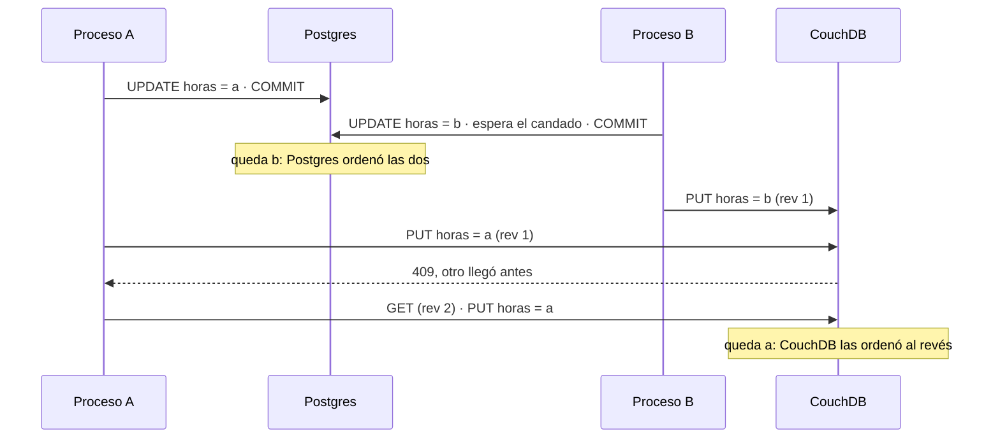

# ⚖️ Fase 24 — El capstone políglota: la costura entre motores, y lo que se pierde en ella

> **Curso:** Ruta NoSQL Lite · Fase 24 de 26 · Bloque V — El árbitro · **14 h**
> **Familia:** todas · **Motores:** PostgreSQL 18.6 `pgvector/pgvector@sha256:2ba9ca5f2e7d…` como fuente de verdad, con
> `wal_level=logical` (`lab/compose.costura.yaml`), y Apache CouchDB 3.5.2 `couchdb@sha256:8cf5f8442585…` como derivado
> **Línea base:** es Postgres, y aquí es el único lugar donde una escritura se confirma
> **Entorno de ejecución:** TypeScript (`pg` 8.23.0, `node:http` para CouchDB)
> **Volumen:** `workOrder-10k` (`datasetSha256` `5a107518d726…`) como base de cada corrida, con 12 000 órdenes nuevas
> escritas a 200 por segundo; `workOrder-1m` (`11a67c65fb22…`) para la reconstrucción completa
> **Depende de:** todas las fases anteriores, en especial la [23](23-poliglota-el-diseno.md), la
> [19](19-offline-levantar-y-modelar.md) y la [20](20-offline-romper-y-medir.md) · **Habilita:** [Fase 25](25-poliglota-la-factura.md)
> **Apéndices de apoyo:** [`a02`](a02-compose-de-la-ruta.md), [`a04`](a04-el-arnes-de-medida.md),
> [`a05`](a05-el-dominio-de-flota.md), [`a08`](a08-diccionario-y-glosario.md), [`a09`](a09-catalogo-de-errores.md)
> **Fecha de verificación ejecutada:** 12/10/2026, en macOS arm64
> **Objetivo:** llevar las escrituras de la fuente de verdad a un derivado de tres formas —doble escritura, *outbox* y
> CDC—, medir su ventana de inconsistencia con el derivado arriba y caído, provocar la divergencia que la doble
> escritura deja sin avisar, cronometrar la reconstrucción completa y montar la costura de vuelta desde la tableta.

---

## 🧭 1. Dónde estamos

La [Fase 23](23-poliglota-el-diseno.md) terminó con un diagrama de flechas punteadas y una regla: todo motor que no
sea la fuente de verdad tiene que poder rearmarse desde ella. Rearmar es la red de seguridad. Lo que la fase no dijo es
**cómo viaja cada escritura por la flecha** el resto del tiempo, cuando nadie está rearmando nada: Freddy cierra una
orden, Postgres la confirma, y la tableta de Jairo tiene que verla en el servidor de CouchDB antes de salir a la pista.

Esa flecha es la costura. Este curso la ha esquivado veintitrés fases, porque cada motor se cargó desde el dataset
por su lado. Aquí se cose, de las tres formas que se usan en la industria, y se mide **lo único que importa de una
costura**: cuántas escrituras confirmadas no llegan, y cuánto tarda en saberse.

> 📝 **La plantilla, adaptada.** Como en la Fase 23: plantilla de fase A, con la sección 4 dedicada a levantar lo que
> se mide y la sección 6 a la costura. El 🪞 de la sección 7 no se copia a [`INSTINTOS.md`](INSTINTOS.md).

---

## 🎯 2. Objetivos de esta fase

1. Montar las tres costuras de Postgres a CouchDB —**doble escritura, *outbox* y CDC**— sobre las mismas órdenes, y
   saber qué cambia en el código de quien escribe con cada una.
2. **Medir la ventana de inconsistencia** de las tres, del `COMMIT` a la copia, con CouchDB arriba y con CouchDB caído
   treinta segundos en medio de la carga.
3. **Provocar la divergencia de la doble escritura** de dos formas: con una falla parcial, y sin ninguna falla, con
   dos procesos que cambian la misma orden.
4. **Cronometrar la reconstrucción completa** del servidor de las tabletas y decidir cuándo conviene más que esperar
   a que la costura se ponga al día.
5. Montar **la costura de vuelta**, de la tableta a la fuente, con las cuatro órdenes de Freddy de la
   [Fase 19](19-offline-levantar-y-modelar.md) como primer caso.

---

## 🚫 3. Qué NO entra todavía

- **La factura** de operar cada costura y cada motor, el árbol de veredicto y *"cuándo bastaba Postgres"* → [Fase 25](25-poliglota-la-factura.md).
- **El sistema de Camilo**: si se retira o se queda como índice reconstruible, y de qué costura sale cada una de sus
  discrepancias, es el boss del Bloque V, *"Las dos verdades"*, en la [Fase 25](25-poliglota-la-factura.md). Esta fase deja listo su dataset
  ([`a05`](a05-el-dominio-de-flota.md)).
- **Debezium y Kafka.** El CDC de esta fase lee el WAL con lo que trae Postgres (`test_decoding`); un conector
  administrado es la misma idea con otra factura, y se queda en los opcionales.

---

## 🏗️ 4. Levantar lo que se mide

`base` y `offline`, con un cambio: el CDC necesita el WAL en nivel lógico, y `base` corre con el nivel por defecto
(`replica`). Ese cambio va en su propio archivo, que se suma al compose del laboratorio
([`a02`](a02-compose-de-la-ruta.md)), para que las mediciones de WAL de las fases 10 y 18 sigan reproduciéndose con el
compose de siempre. Desde `src/`:

```bash
docker compose -f lab/compose.yaml -f lab/compose.costura.yaml --profile base --profile offline up -d --wait
node 24-poliglota-la-costura/run.ts --mode dual                     # 6.4: la ventana de cada costura
node 24-poliglota-la-costura/run.ts --mode outbox --outage 20:30    # 6.5: CouchDB caído 30 s desde el segundo 20
node 24-poliglota-la-costura/race.ts --mode dual                    # 6.1: dos procesos, la misma orden
node 24-poliglota-la-costura/rebuild.ts                             # 6.5: el millón, rearmado de cero
node 24-poliglota-la-costura/back.ts                                # 6.6: la vuelta desde la tableta
node 24-poliglota-la-costura/setup.ts --drop                        # antes de volver al compose de siempre
```

Cada corrida empieza con `setup.ts`, que copia la base `expediente` en una base `costura` —las 10 000 órdenes de la
Fase 19, con sus aeronaves, piezas y técnicos— y deja las mismas órdenes en una base `costura` de CouchDB, como si la
costura llevara tiempo funcionando. Las órdenes nuevas son las de `workOrder-10k` con otro número (`WO-C0000001`…). La
reconstrucción usa `workOrder-1m` en la base `postgres` ([Fase 01](01-el-dominio-de-flota-y-el-arnes.md)), y la vuelta,
la base `work_order` de CouchDB ([Fase 19](19-offline-levantar-y-modelar.md)).

> ⚠️ **El último comando no es opcional.** Con un slot lógico vivo, Postgres no arranca con `wal_level=replica`: si
> vuelves al compose de siempre sin `setup.ts --drop`, `base` no levanta ([E-81](a09-catalogo-de-errores.md#e-81--un-slot-lógico-que-no-deja-arrancar)).

---

## 📖 5. El diccionario del bloque

| Lo que ya sabías | Entre motores | Dónde se rompe el paralelo |
|---|---|---|
| `COMMIT` de dos tablas | **doble escritura**: la aplicación escribe en un motor y después en el otro | no hay `COMMIT` que cubra los dos; el segundo puede fallar, o llegar en otro orden |
| un trigger que inserta en una tabla de log | ***outbox***: la fila "esto cambió", en la misma transacción que el cambio | alguien tiene que leerla y llevarla; ese alguien es otro proceso |
| la réplica que lee el WAL | **CDC**: un proceso que lee el WAL y lo traduce para otro motor | el WAL se queda en disco hasta que ese proceso confirma |
| el retraso de la réplica | **ventana de inconsistencia**: del `COMMIT` en la fuente a que el derivado lo muestra | se mide con un reloj, no lo reporta ningún motor |
| `INSERT … ON CONFLICT DO NOTHING` | **idempotencia**: entregar dos veces deja lo mismo que una | es lo que permite reintentar sin miedo |
| `REINDEX` | **reconstrucción completa**: el derivado entero, de cero, desde la fuente | se hace al lado y se cambia el puntero, no encima |

Y de vuelta: un *outbox* es **un log de cambios escrito por la aplicación**, el CDC es **una réplica lógica hacia otro
motor**, y la doble escritura es **una transacción distribuida sin coordinador**. Las dos direcciones, con su glosario,
están en [`a08`](a08-diccionario-y-glosario.md).

> 🩻 **Esto sí funciona igual.** La replicación lógica de Postgres —publicación, slot, suscriptor— ya resuelve lo que
> esta fase arma a mano, entre dos Postgres. Lo nuevo es que del otro lado hay un motor que no habla el protocolo, y
> el traductor lo escribes tú.

---

## 🧵 6. La costura

### 6.1 La doble escritura, y por qué falla sin avisar

Es la que escribe cualquiera la primera vez, y la que tenía el cruce entre `SIGMA` y el sistema de Camilo: *"terminó
escrito en el código de la aplicación"* (historia, §3). Se confirma en Postgres y, si salió bien, se escribe en
CouchDB:

```ts
await insertOrder(db, order, false);                          // COMMIT en Postgres
if (!(await put(order.workOrderId, JSON.stringify(order)))) dualFailed++;   // y después, CouchDB
```

Su mejor argumento es real: con los dos motores arriba, **es la costura con la ventana más corta** (sección 6.4), y no
necesita ningún proceso más. El problema es lo que pasa en las dos líneas cuando algo sale mal, y hay dos formas de
que salga mal.

**💥 La primera es una falla parcial.** Con la carga corriendo a 200 órdenes por segundo, CouchDB se detiene en el
segundo 20 y vuelve en el 50:

> 📐 **Medición — la doble escritura con CouchDB caído 30 s** · 12 000 órdenes nuevas · PostgreSQL 18.6, CouchDB 3.5.2 ·
> verificado el 12/10/2026 · M-77
>
> | | Órdenes |
> |---|---|
> | confirmadas en Postgres | 12 000 |
> | segundas escrituras que la aplicación dio por fallidas | 6762 |
> | que no llegaron nunca a CouchDB | **6761** |
> | dadas por fallidas que sí quedaron guardadas | 1 |
>
> Reproducir: `node 24-poliglota-la-costura/run.ts --mode dual --outage 20:30`.

Las 6761 no tienen ventana: no llegan nunca, y **nada en el sistema lo sabe**. La aplicación anotó el error y
siguió: la orden ya estaba confirmada en Postgres y no había nada que deshacer. La que sobra es la otra mitad del problema: un `PUT` que CouchDB guardó mientras se apagaba, y cuya
respuesta no volvió. La aplicación la cuenta como perdida, y apareció en el servidor 35,9 s después de confirmarse.
**Con una doble escritura, ni siquiera el error es confiable**: reintentar la que "falló" funciona aquí, pero en un
`INSERT` sin clave natural la duplica.

La comparación de la Fase 23 contra la base `costura` encuentra las 6761 en 3 s. Ese es el costo de detectarlas **si
alguien la corre**: contra el millón, son 149 s por cada pasada, y una doble escritura obliga a correrla después de
cada caída que nadie notó.

**La segunda forma no necesita ninguna falla.** Dos procesos de la aplicación cambian las horas de la misma orden a la
vez. Cada uno confirma en Postgres y escribe en CouchDB, y si CouchDB le contesta `409` porque otro llegó antes,
relee la revisión y vuelve a guardar, que es lo correcto:



Postgres ordena las dos escrituras con el candado de la fila. CouchDB las recibe en el orden en que llegan, que puede
ser otro, y gana la última que llega. El reintento del `409` es correcto y **no lo arregla**: cada proceso vuelve a
escribir su propio valor, y en el diagrama es justo el reintento el que deja el equivocado. En 500 rondas de dos
cambios simultáneos sobre 10 órdenes:

> 📐 **Medición — dos procesos, la misma orden, sin ninguna falla** · 500 rondas · verificado el 12/10/2026 · M-78
>
> | Costura | Rondas que dejaron en CouchDB el valor que perdió en Postgres | Órdenes distintas al terminar |
> |---|---|---|
> | doble escritura | **115 de 500** (23 %) | 1 de 10 |
> | *outbox* | 0 de 500 | 0 de 10 |
> | CDC | 0 de 500 | 0 de 10 |
>
> Reproducir: `node 24-poliglota-la-costura/race.ts --mode dual|outbox|cdc`. Una ronda cuenta como divergida si los dos
> motores siguen distintos un segundo después, el mismo plazo para las tres.

Ni un error, ni un `409` sin resolver, ni una línea en el log. Una de cada cuatro rondas deja una orden que dice una
cosa en la oficina y otra en la tableta, y se queda así **hasta que alguien vuelve a escribir esa orden**. La que quedó
distinta al final no la arregla nadie.

### 6.2 El *outbox*: el cambio y su aviso, en la misma transacción

La salida es que la aplicación **escriba un solo motor**. La orden y una fila que dice *"esta orden cambió"* van en la
misma sentencia, y por eso en la misma transacción: o quedan las dos, o ninguna.

```sql
WITH x AS (…), w AS (INSERT INTO work_order …), t AS (…), m AS (…)
INSERT INTO outbox (work_order_id) SELECT "workOrderId" FROM x
```

Un proceso aparte, el relevo, toma lotes del *outbox* con `FOR UPDATE SKIP LOCKED`, **lee cada orden de Postgres en
ese momento** y la escribe en CouchDB. Solo si CouchDB contestó, borra las filas y confirma. Si CouchDB no responde,
deshace y espera un segundo: lo pendiente se queda en Postgres, no en la memoria del relevo (`relay.ts`).

Dos decisiones de ese código hacen todo el trabajo. La primera es **leer la orden, no copiar el cambio**: si dos
cambios de la misma orden esperan en el *outbox*, el relevo escribe lo que Postgres tiene ahora, y el orden en que
lleguen a CouchDB deja de importar. Por eso la sección 6.1 da cero. La segunda es **entregar antes de confirmar**: si
el relevo muere entre escribir en CouchDB y borrar las filas, las vuelve a entregar, y como escribe el estado actual,
entregar dos veces deja lo mismo que una.

Lo que cuesta: una tabla, una fila más por escritura, un proceso que vigilar, y tocar el código de quien escribe.
Ese último costo es el que no siempre se puede pagar.

### 6.3 CDC: el WAL como *outbox*

`SIGMA` es un sistema comprado a un proveedor local (historia, §3). Nadie en Cóndor puede agregar un `INSERT INTO
outbox` a su código. Pero Postgres ya escribe cada cambio en un lugar: **el WAL**. Con `wal_level=logical` y un slot
de replicación, ese registro se puede leer como texto:

```text
table public.work_order: INSERT: work_order_id[text]:'WO-C0000001' aircraft[text]:'HK-5339' …
```

El relevo en modo CDC mira el slot sin consumirlo (`pg_logical_slot_peek_changes`), saca los números de orden, escribe
cada orden en CouchDB igual que el del *outbox*, y **recién entonces** avanza el slot hasta ahí
(`pg_replication_slot_advance`). Si CouchDB no responde, el slot no avanza y Postgres conserva el WAL.

La aplicación no cambia ni una línea, y esa es toda la ventaja. Lo que se paga está en la configuración: un reinicio
para cambiar `wal_level`, un slot que retiene WAL mientras nadie lo lee —con el relevo detenido, el disco de la fuente
crece sin límite—. `test_decoding` viene con Postgres y
alcanza para saber qué cambió; para llevar el cambio entero, el *plugin* de producción es `pgoutput`, el de la
replicación lógica, y leerlo es lo que hace Debezium.

> ⚠️ **Un consumidor por slot.** Mirar el slot desde un segundo proceso mientras el relevo lo lee da
> [E-80](a09-catalogo-de-errores.md#e-80--el-slot-que-ya-tiene-dueño).

### 6.4 La ventana, medida

La ventana se mide con un solo reloj, el de la máquina: quien escribe anota la hora al volver el `COMMIT`, y un
observador escucha el `_changes` de CouchDB y anota la primera vez que ve cada orden ([`a04`](a04-el-arnes-de-medida.md)).
Una orden que no llega no tiene ventana, y se cuenta aparte.

> 📐 **Medición — la ventana de inconsistencia, con CouchDB arriba** · 12 000 órdenes nuevas a 200 por segundo, 60 s ·
> PostgreSQL 18.6, CouchDB 3.5.2 · verificado el 12/10/2026 · M-76
>
> | Costura | Ritmo logrado | p50 | p99 | Máx. | No llegaron |
> |---|---|---|---|---|---|
> | doble escritura | **167/s** | 5 ms | 14 ms | 78 ms | 0 |
> | *outbox* | 200/s | 14 ms | 82 ms | 288 ms | 0 |
> | CDC | 200/s | 21 ms | 55 ms | 149 ms | 0 |
>
> Reproducir: `node 24-poliglota-la-costura/run.ts --mode dual|outbox|cdc`. El relevo espera 100 ms cuando no hay nada
> que entregar; el *outbox* nunca pasó de 16 filas pendientes.

Con todo arriba, la doble escritura gana la ventana, y no por poco. Y **pierde algo que la tabla dice en la segunda
columna**: con un solo proceso escribiendo, no llegó a 200 órdenes por segundo, porque cada orden espera a CouchDB
antes de pasar a la siguiente. La latencia del derivado pasó a ser latencia de la fuente, y su disponibilidad también:
si CouchDB tarda, tarda escribir una orden.

El *outbox* y el CDC quedan en el mismo orden de magnitud, acotados por el intervalo del relevo. Son decenas de
milisegundos en una máquina de escritorio, y **ningún veredicto se sostiene sobre esa diferencia**: con un relevo que
espera 10 ms en lugar de 100, cambia. Lo que no cambia es la forma, que se ve cuando el derivado se cae.

### 6.5 El motor caído, y cuándo conviene rearmar

> 📐 **Medición — las tres costuras con CouchDB caído 30 s** · la misma carga, CouchDB detenido del segundo 20 al 50 ·
> verificado el 12/10/2026 · M-77
>
> | Costura | No llegaron | Confirmadas durante la caída: p50 · máx. | Al día después de volver | Pendiente en el pico |
> |---|---|---|---|---|
> | doble escritura | **6761** | — | nunca | nada: se perdió |
> | *outbox* | 0 | 17,0 s · 31,6 s | 9,9 s | 6299 filas |
> | CDC | 0 | 16,9 s · 31,5 s | 9,9 s | 8,7 MiB de WAL |
>
> Reproducir: `run.ts --mode … --outage 20:30`. "Al día" incluye el arranque de CouchDB; después de la caída, los dos
> derivados dieron 22 000 de 22 000 iguales contra Postgres.

Esta es la tabla del bloque. Con el *outbox* y el CDC, la caída de CouchDB **se convierte en ventana**: las órdenes
confirmadas en esos 30 s esperan, la más vieja 31,6 s, y llegan todas. Con la doble escritura, se convierte en
**pérdida**, y la pérdida no se ve.

Lo pendiente vive en la fuente, y ahí está el límite. A 200 órdenes por segundo, el *outbox* sumó 6299 filas en 30 s;
el slot, 8,7 MiB de WAL. Un día de CouchDB caído serían unos 17 millones de filas o unos 25 GiB de WAL, y el disco de
la fuente de verdad **no es el lugar para descubrirlo**. La regla que sale de esto se escribe antes de necesitarla:
una alerta cuando lo pendiente pasa de un umbral, y un punto de corte después del cual **no se espera la costura: se
rearma**.

Rearmar es la reconstrucción de la Fase 23, en la otra dirección: el servidor de las tabletas armado de cero desde
Postgres, en una base nueva, al lado de la vigente. Mientras se arma, las tabletas siguen sincronizando con la vieja;
cuando la comparación da cero distintas, la aplicación cambia de base (`rebuild.ts`):

> 📐 **Medición — la reconstrucción completa** · `workOrder-1m` en la base `postgres` → `work_order_1m_v2` · verificado el
> 12/10/2026 · M-79
>
> | | |
> |---|---|
> | órdenes escritas, en `_bulk_docs` de 2000 | 1 000 000 |
> | tiempo | 132 s (7549 órdenes por segundo) |
> | tamaño de la base nueva | 582 MiB |
> | comparación contra Postgres | 1 000 000 de 1 000 000 iguales, en 169 s |
>
> Reproducir: `node 24-poliglota-la-costura/rebuild.ts`, y `node 23-poliglota-el-diseno/rebuild-couch.ts --couch
> work_order_1m_v2`.

Con esos números, el punto de corte deja de ser una opinión. Rearmar el millón cuesta unos cinco minutos —132 s de
escritura y 169 s de comparación— y **no depende de cuánto duró la caída**. Ponerse al día sí: las 6299 filas
pendientes de M-77 tardaron 9,9 s, arranque incluido, unas 600 por segundo como mínimo. A ese ritmo, cinco minutos de
puesta al día son unas 180 000 órdenes, y a 200 por segundo eso son quince minutos de CouchDB caído. Pasado ese
punto, o antes si lo pendiente amenaza el disco de la fuente, se rearma. Es una cuenta, no una medición: el
ejercicio 6 la pide con tus números.

> 🧠 **Lo que decide una costura no es su ventana: es dónde espera lo pendiente.** En la memoria de la aplicación, se
> pierde con ella. En la fuente, se paga en disco, pero llega.

### 6.6 La vuelta: lo que la tableta sabe y la fuente no

La flecha doble del diagrama de la Fase 23 va **hacia** Postgres: lo que Freddy registró sin señal. Las cuatro órdenes
de su viaje siguen en la base `work_order` de CouchDB, en la forma de la tableta, y nunca volvieron.

La costura de vuelta es un *outbox* al revés: una **bandeja de entrada** en Postgres. `back.ts` lee el `_changes` de
CouchDB desde el último punto guardado; cada documento escrito por una tableta entra a `tablet_report` con su
revisión como clave, y el punto se guarda **en la misma transacción**. Lo que vino de Postgres —el eco de la costura de
ida— se salta: sin ese filtro, cada orden daría la vuelta entera para siempre.

> 📐 **Medición — la vuelta de las cuatro órdenes de Freddy** · `work_order` (Fase 19) → `costura_vuelta`, una copia de
> `expediente` · verificado el 12/10/2026 · M-80
>
> | Pasada | Cambios leídos | Ecos saltados | Informes nuevos |
> |---|---|---|---|
> | primera | 10 000 | 9996 | 4 |
> | segunda, desde el punto guardado | 0 | — | 0 |
> | tercera, sin punto, como tras perderlo | 10 000 | 9996 | 0 |
>
> | Los 44 hechos de los 4 informes, contra la fuente | Hechos |
> |---|---|
> | ya están: piezas retiradas e instaladas, tareas hechas, horas de una orden | 19 |
> | no tienen columna: quién firmó cada tarea, quién y cuándo cambió cada pieza, horas por técnico, una nota | 18 |
> | contradicen a la fuente: la orden abierta que Postgres tiene cerrada (4), las horas (3) | 7 |
>
> Reproducir: `node 24-poliglota-la-costura/back.ts`.

La bandeja funciona: entregar tres veces dejó cuatro informes. Lo que no funciona es lo que viene después. **De 44
hechos, 18 no tienen dónde vivir en el esquema de la Fase 01**: quién firmó cada tarea, quién cambió cada pieza y a qué
hora, las horas de cada técnico. La tableta los registra porque el inspector los necesita para firmar; la fuente de
verdad no los puede guardar. Y 7 la contradicen: el esquema obliga a que toda orden tenga cierre
(`closed_at NOT NULL`), y la tableta trae cuatro órdenes abiertas.

Es la sección 6.4 de la Fase 23 otra vez, vista desde el otro lado: **la fuente de verdad solo puede serlo de los
hechos que tiene dónde escribir**. La bandeja guarda el informe entero como un hecho —el documento, su revisión, cuándo
llegó—, y eso basta para no perder nada. Proyectarlo a las tablas exige tres columnas o tablas nuevas y una regla
escrita para cada contradicción, con alguien que la aplique teniendo las dos versiones delante.

### 6.7 Qué costura para cada flecha

| Flecha de la Fase 23 | Costura | Por qué esa |
|---|---|---|
| Postgres → CouchDB, órdenes abiertas | ***outbox*** | el código de las órdenes es de Cóndor; la caída se vuelve ventana, no pérdida |
| `SIGMA` → cualquier derivado | **CDC** | `SIGMA` es de un proveedor y no se le agrega una fila; se paga con el slot |
| CouchDB → Postgres, lo que registró la tableta | **bandeja de entrada**, idempotente | el informe es el hecho; proyectarlo pide un esquema que hoy no existe |
| Postgres y la descarga → Parquet → DuckDB | **reconstrucción nocturna** | el tablero tolera un día; rearmar es más simple que coser |
| la descarga → TimescaleDB | **recarga del archivo** | el hecho ya está escrito y no cambia; pero `reading` no tiene clave (Fase 09), y cargar dos veces el mismo archivo lo duplica |
| cualquiera | ~~doble escritura~~ | 6761 perdidas en 30 s y 115 de 500 rondas al revés, sin un error |

---

## 🪞 7. Tu instinto relacional dice… y esta vez se equivoca

*"Si las dos escrituras salen bien, los dos motores quedan iguales; y si una falla, me entero."* Es el instinto de
quien pasó años con transacciones: dentro de un motor, las dos mitades de esa frase son ciertas. Se equivoca en que
**entre dos motores las dos mitades son falsas**.

Que las dos salgan bien no basta: en 115 de 500 rondas las dos escrituras salieron bien, con el reintento correcto
del `409`, y CouchDB quedó con el valor que perdió en Postgres, porque cada motor ordenó las escrituras a su manera. Y
enterarse de la falla tampoco: la aplicación contó 6762 errores para 6761 órdenes perdidas, y una de las que dio por
perdidas estaba guardada.

La pregunta que lo anticipa es la frontera transaccional, la primera de las cinco: **si dos escrituras tienen que
quedar juntas, tienen que quedar en un solo motor**. El *outbox* no es un truco de integración; es la respuesta a esa
pregunta: una sola escritura, y una copia que se puede repetir.

---

## ⚰️ 8. La situación 3, cosida: la integración que escribe en dos lados

**La decisión, con su mejor argumento.** Cuando hubo que cruzar los componentes de Camilo con las órdenes de `SIGMA`,
el cruce se escribió en la aplicación (historia, §3): guardar en un lado y después en el otro. *"Es una línea, no
necesita otro proceso, y la copia queda al día al instante."* Las tres son ciertas: 5 ms de mediana, la ventana más
corta (sección 6.4).

**Qué pasó después, con número.** Una caída de 30 s del derivado, con la carga normal de un día ajetreado, deja
**6761 órdenes** que existen en un lado y no en el otro, sin un solo error que nadie mire. Dos procesos que cambian la
misma orden dejan **una de cada cuatro** veces el valor equivocado en el derivado, sin ninguna caída. Y el cruce de
Camilo no tenía una comparación como la de la Fase 23: la divergencia se acumuló desde 2023 hasta que un operador pidió
un expediente.

**Cuánto costó salir.** En Cóndor, el actuador de marzo: cuatro días de tres personas para una sola pieza. En el
curso, una tabla y un proceso: el *outbox* de la sección 6.2, o el CDC si el código no es tuyo.

**Antes y después, con números:** con doble escritura, **6761 perdidas** en una caída de 30 s y **115 de 500** rondas
divergidas. Con *outbox*, **0 y 0**, a cambio de 14 ms de mediana en lugar de 5, y 6299 filas esperando en Postgres
mientras CouchDB estuvo caído.

**La pregunta que lo habría evitado:** *¿qué pasa con esta escritura si el segundo motor no contesta, o si contesta en
otro orden?* Si la respuesta es "se pierde" o "depende", la costura está en el lugar equivocado.

---

## ⚠️ 9. Errores comunes y diagnóstico

- **Contar los errores de la segunda escritura y llamarlo pérdida.** *Síntoma:* el log dice 6762 fallas y faltan 6761.
  *Causa:* un `PUT` que el servidor guardó mientras se apagaba, sin que la respuesta volviera. *Comprobación:* la
  comparación contra la fuente, no el log. *Salida:* que lo pendiente viva en la fuente, donde el reintento es seguro.
- **Comparar por rango cuando faltan claves.** *Síntoma:* la comparación de la Fase 23 contaba más órdenes ausentes de
  las que faltaban. *Causa:* pedía la página de CouchDB con `startkey` y la emparejaba con la de Postgres; con
  documentos de menos, la página de CouchDB se corre. *Salida:* pedir a CouchDB las mismas claves de la página de
  Postgres (`POST _all_docs` con `keys`), como hace hoy `rebuild-couch.ts`. Con los dos lados completos, como en la Fase
  23, las dos formas dan lo mismo: se volvió a correr y dio otra vez 1 000 000 de 1 000 000.
- **Volver al compose de siempre con el slot vivo.** *Mensaje:* el de [E-81](a09-catalogo-de-errores.md#e-81--un-slot-lógico-que-no-deja-arrancar).
  *Salida:* `setup.ts --drop` antes de cambiar de compose; o levantar con `compose.costura.yaml` y borrarlo.
- **Correr `setup.ts` sin el WAL lógico.** *Mensaje:* el de [E-83](a09-catalogo-de-errores.md#e-83--crear-un-slot-lógico-sin-el-wal-lógico).
  *Salida:* levantar `base` con `compose.costura.yaml` sumado.
- **Un slot que nadie lee.** *Síntoma:* el disco de Postgres crece sin que crezcan las tablas. *Comprobación:*
  `pg_wal_lsn_diff(pg_current_wal_lsn(), restart_lsn)` en `pg_replication_slots`. *Salida:* alerta sobre ese número, y
  `max_slot_wal_keep_size` para que Postgres invalide el slot antes de llenar el disco: se pierde la costura, no la
  fuente, y se rearma.
- **El eco.** *Síntoma:* cada orden que la costura de ida escribe en CouchDB vuelve a Postgres por la de vuelta.
  *Causa:* la vuelta no distingue lo que escribió una tableta de lo que escribió la costura. *Salida:* una marca de
  origen en el documento, y filtrar por ella; `back.ts` saltó 9996 ecos de 10 000 cambios.
- **El `fetch` de Node con el servidor detenido.** *Mensaje:* el de [E-82](a09-catalogo-de-errores.md#e-82--fetch-que-tumba-el-proceso-con-el-servidor-caído).
  *Salida:* `node:http`, cuyos errores llegan a quien los espera.

---

## 📋 10. Checklist de validación

```text
[ ] run.ts sin caída: las tres costuras, 0 sin llegar, y el ritmo de la doble escritura por debajo de 200/s
[ ] run.ts con caída: 6761 perdidas en la doble escritura (o tu número), 0 en outbox y CDC, y cuánto tardó en ponerse al día
[ ] race.ts: rondas divergidas en la doble escritura, 0 en outbox y CDC
[ ] rebuild.ts: el millón rearmado, su tiempo, y la comparación en cero distintas
[ ] back.ts: 4 informes, 0 en la segunda y la tercera pasada, y los hechos sin columna
[ ] Una costura elegida para cada flecha de la Fase 23, con su razón
[ ] setup.ts --drop corrido antes de volver al compose de siempre
```

---

## 🧪 11. Ejercicios (26)

Desde `src/`, con `base` y `offline` levantados con `compose.costura.yaml` (sección 4), salvo donde se diga.

### 🟢 Fácil — reproducir y leer (1–6)

#### 🟢 Ejercicio 1 — Las tres ventanas

Corre `run.ts` en los tres modos, sin caída.

**Objetivo:** tu tabla de la sección 6.4, y el ritmo que logró la doble escritura en tu máquina.

#### 🟢 Ejercicio 2 — La caída

Corre `run.ts --mode outbox --outage 20:30` y mira el *outbox* durante la caída con `SELECT count(*) FROM outbox`.

**Objetivo:** el pico, y cuánto tardó en vaciarse después de volver CouchDB.

#### 🟢 Ejercicio 3 — El WAL, en texto

Con el slot creado, inserta una orden a mano y mírala con `pg_logical_slot_peek_changes('costura', NULL, NULL)`.

**Objetivo:** cuántas líneas produce una orden con dos movimientos, y cuál de ellas usa el relevo.

#### 🟢 Ejercicio 4 — Una ronda divergida

Corre `race.ts --mode dual --rounds 20` y toma una ronda divergida.

**Objetivo:** el valor en cada motor, y qué proceso confirmó último en Postgres.

#### 🟢 Ejercicio 5 — La bandeja

Corre `back.ts` y abre `tablet_report` en `costura_vuelta`.

**Objetivo:** las cuatro filas, con su revisión, y por qué la tercera pasada no las duplicó.

#### 🟢 Ejercicio 6 — El punto de corte

Con tus números de M-77 y M-79, calcula a partir de cuántos minutos de CouchDB caído conviene rearmar en lugar de esperar.

**Objetivo:** el número, y qué supuesto de ritmo lo sostiene.

### 🟡 Intermedio — variar y comprobar (7–13)

#### 🟡 Ejercicio 7 — El orden al revés

Cambia la doble escritura para que escriba primero en CouchDB y después en Postgres, y repite la caída.

**Objetivo:** cuántas órdenes quedan solo en CouchDB, y si eso es mejor o peor que la sección 6.1.

#### 🟡 Ejercicio 8 — Pausa en vez de parada

Repite la caída con `docker pause` en lugar de `docker stop`.

**Objetivo:** qué le pasa al ritmo de la doble escritura cuando CouchDB no rechaza la conexión sino que no contesta.

#### 🟡 Ejercicio 9 — El relevo impaciente

Corre el *outbox* con `relay.ts --idle 10`.

**Objetivo:** la ventana nueva, y cuántas consultas de más por segundo le cuesta a Postgres.

#### 🟡 Ejercicio 10 — Dos relevos

Lanza dos relevos del *outbox* a la vez durante `run.ts`.

**Objetivo:** que `SKIP LOCKED` reparta los lotes, y si alguna orden se escribe dos veces en CouchDB.

#### 🟡 Ejercicio 11 — El relevo que muere

Mata el relevo con `kill -9` en medio de la carga y vuelve a lanzarlo.

**Objetivo:** 0 órdenes perdidas, y cuántas se entregaron dos veces.

#### 🟡 Ejercicio 12 — La comparación nocturna

Programa `rebuild-couch.ts` contra la base `costura` después de una caída con doble escritura.

**Objetivo:** que encuentre las perdidas, y cuánto tardaría cada noche contra el millón.

#### 🟡 Ejercicio 13 — `max_slot_wal_keep_size`

Pon el límite en 16 MB y deja el relevo CDC detenido mientras corre la carga.

**Objetivo:** qué le pasa al slot, qué dice `pg_replication_slots`, y cómo se recupera la costura.

### 🟠 Difícil — diagnosticar y diseñar (14–20)

#### 🟠 Ejercicio 14 — El esquema de la vuelta

Diseña las tablas que le faltan a la fuente para los 18 hechos sin columna de la sección 6.6.

**Objetivo:** el esquema, la proyección desde `tablet_report`, y cuántos hechos quedan sin columna al correrla.

#### 🟠 Ejercicio 15 — La orden abierta

`closed_at NOT NULL` impide que la fuente tenga una orden en curso.

**Objetivo:** el cambio de esquema que lo permite, y qué consultas de las fases anteriores se rompen con él.

#### 🟠 Ejercicio 16 — La regla de la contradicción

Escribe la regla para las 7 contradicciones de la sección 6.6.

**Objetivo:** qué se aplica solo, qué espera al inspector, y dónde queda escrito quién decidió.

#### 🟠 Ejercicio 17 — CDC de los movimientos

Cambia el relevo CDC para que lea `work_order_movement` en lugar de `work_order`.

**Objetivo:** qué gana —el hecho, no la orden— y qué tiene que resolver que antes no.

#### 🟠 Ejercicio 18 — El *outbox* hacia dos derivados

Agrega una segunda costura desde el mismo *outbox* hacia otra base de CouchDB, con su propio avance.

**Objetivo:** el esquema que permite dos consumidores, y qué pasa cuando uno está caído y el otro no.

#### 🟠 Ejercicio 19 — El cambio de puntero

Diseña el paso de `work_order_1m` a `work_order_1m_v2` sin que las tabletas pierdan lo que sincronizaron mientras se
rearmaba.

**Objetivo:** el procedimiento, y cuántas órdenes hay que reaplicar.

#### 🟠 Ejercicio 20 — La tableta y la ida

Una orden que Freddy editó sin señal recibe, mientras tanto, un cambio desde la oficina por la costura de ida.

**Objetivo:** qué ve Freddy al sincronizar, qué entra a la bandeja, y quién decide.

### 🔴 Muy difícil — adversarios y diseño propio (21–26)

#### 🔴 Ejercicio 21 — Romper el *outbox*

Encuentra una secuencia de fallas que haga perder una orden con el *outbox* de esta fase.

**Objetivo:** la secuencia ejecutada, o el argumento de por qué no existe.

#### 🔴 Ejercicio 22 — La doble escritura bien hecha

Defiende una doble escritura que no pierda ni divierja: reintentos, versión, comparación periódica.

**Objetivo:** el código, sus números con `race.ts` y con la caída, y qué tan lejos queda del *outbox*.

#### 🔴 Ejercicio 23 — Debezium

Monta Debezium con `pgoutput` contra la base `costura` y un consumidor hacia CouchDB.

**Objetivo:** la ventana y la caída de la sección 6.5 con un conector de verdad, y los contenedores que sumó.

#### 🔴 Ejercicio 24 — El expediente que cruza países

Con la frontera de la sección 6.5 de la Fase 23, elige la costura entre el Postgres de Ecuador y el de Colombia.

**Objetivo:** cuál, qué ve Bogotá durante una caída del enlace, y qué no puede salir del país en ella.

#### 🔴 Ejercicio 25 — Mil por segundo

Repite M-76 y M-77 a 1000 órdenes por segundo.

**Objetivo:** dónde se rompe cada costura primero, y si el orden de la sección 6.7 se mantiene.

#### 🔴 Ejercicio 26 — Tu costura

Toma un sistema que conozcas con dos motores y encuentra su costura.

**Objetivo:** cuál de las tres es, qué pasa con una escritura si el segundo motor no contesta, y la comparación que lo
demostraría.

### 🔥 Opcionales

- **El boss que viene.** Genera el dataset del boss del Bloque V con `npm run diverge` en `lab/generator/` y comprueba
  su hash contra [`a05`](a05-el-dominio-de-flota.md). No abras su `answers.json`.
- **`pgoutput` a mano**: lee el slot con el protocolo de replicación en lugar de `test_decoding`, y mide si la ventana
  cambia.

---

## 📚 12. Referencias

> ⚠️ Las URLs y sus contenidos cambian. Esta fase se verificó con PostgreSQL 18.6 y CouchDB 3.5.2.

- **Chris Richardson, *Pattern: Transactional outbox*** — https://microservices.io/patterns/data/transactional-outbox.html
  — el patrón de la sección 6.2, con su nombre y sus variantes.
- **Martin Kleppmann, *Designing Data-Intensive Applications*** (O'Reilly, 2017) — capítulo 11, *"Keeping Systems in
  Sync"*: la figura de dos clientes que escriben en dos motores en distinto orden es la sección 6.1.
- **Martin Kleppmann, *Using logs to build a solid data infrastructure (or: why dual writes are a bad idea)*** (2015) —
  https://martin.kleppmann.com/2015/05/27/logs-for-data-infrastructure.html — el argumento contra la doble escritura,
  antes del libro.
- **PostgreSQL 18, *Logical Decoding*** — https://www.postgresql.org/docs/18/logicaldecoding.html — slots,
  `test_decoding` y las funciones de la sección 6.3.
- **PostgreSQL 18, *Replication Configuration*** — https://www.postgresql.org/docs/18/runtime-config-replication.html
  — `max_slot_wal_keep_size`, el límite del ejercicio 13.
- **Debezium, *PostgreSQL connector*** — https://debezium.io/documentation/reference/stable/connectors/postgresql.html —
  el CDC de producción, con `pgoutput`.
- **CouchDB 3.5, *Changes Feed*** — https://docs.couchdb.org/en/stable/api/database/changes.html — lo que lee el
  observador y la costura de vuelta.

**Orden sugerido:** el artículo de Kleppmann de 2015 antes de la sección 6.1; Richardson antes de la 6.2; la
documentación de decodificación lógica antes de la 6.3; el capítulo 11 al cerrar la fase.

---

## 🏁 13. Resultado de la fase

```text
src/lab/compose.costura.yaml                  base con wal_level=logical, sumado al compose del laboratorio
src/24-poliglota-la-costura/common.ts         la orden en un viaje, la orden como documento, las cuentas
src/24-poliglota-la-costura/setup.ts          la base costura, el outbox, el slot y CouchDB en cero (--drop para salir)
src/24-poliglota-la-costura/relay.ts          el relevo: outbox o CDC hacia CouchDB
src/24-poliglota-la-costura/watch.ts          el observador del _changes
src/24-poliglota-la-costura/run.ts            la ventana de cada costura, con o sin caída
src/24-poliglota-la-costura/race.ts           dos procesos, la misma orden
src/24-poliglota-la-costura/rebuild.ts        el servidor de las tabletas, rearmado de cero
src/24-poliglota-la-costura/back.ts           la bandeja de entrada desde la tableta
src/lab/generator/src/diverge.ts              el dataset del boss del Bloque V
```

Cosiste la fuente con su derivado de tres formas y mediste lo que importa de cada una: la doble escritura tiene la
ventana más corta y pierde 6761 órdenes en una caída de 30 s, y deja una de cada cuatro rondas concurrentes al revés,
sin un error. El *outbox* y el CDC convierten la misma caída en una espera de 31 s y cero pérdidas, a cambio de una
tabla o de un slot que retiene WAL. Rearmaste el millón de cero, y montaste la costura de vuelta, que encontró en la
tableta 18 hechos que la fuente de verdad no tiene dónde escribir.

> **La señal de que quedó bien:** *"Para cada flecha de mi diagrama puedo decir dónde espera una escritura cuando el
> otro motor no contesta; y si la respuesta es 'en la memoria de la aplicación', sé que esa flecha pierde datos."*

> 🏷️ **No cierres la fase sin el tag.** Con el checklist en verde y `git status` limpio:
>
> ```bash
> git tag -a fase-24-poliglota-la-costura -m "F24 cerrada: tres costuras de Postgres a CouchDB sobre las mismas órdenes; ventana p50 de 5, 14 y 21 ms (doble escritura, outbox, CDC) y la doble escritura sin llegar a 200/s; con CouchDB caído 30 s, 6761 órdenes perdidas en la doble escritura y 0 en outbox y CDC (6299 filas, 8,7 MiB de WAL, al día en 9,9 s); sin ninguna falla, 115 de 500 rondas concurrentes al revés en la doble escritura y 0 en las otras; el millón rearmado en 132 s y comparado en 169 s; la vuelta de Freddy: 4 informes idempotentes, 18 de 44 hechos sin columna en la fuente; compose.costura.yaml y el dataset camilo-10k para el boss V"
> ```
>
> Commits de la fase con prefijo `f24:`, los de ejercicio `f24 ej14: …`.

