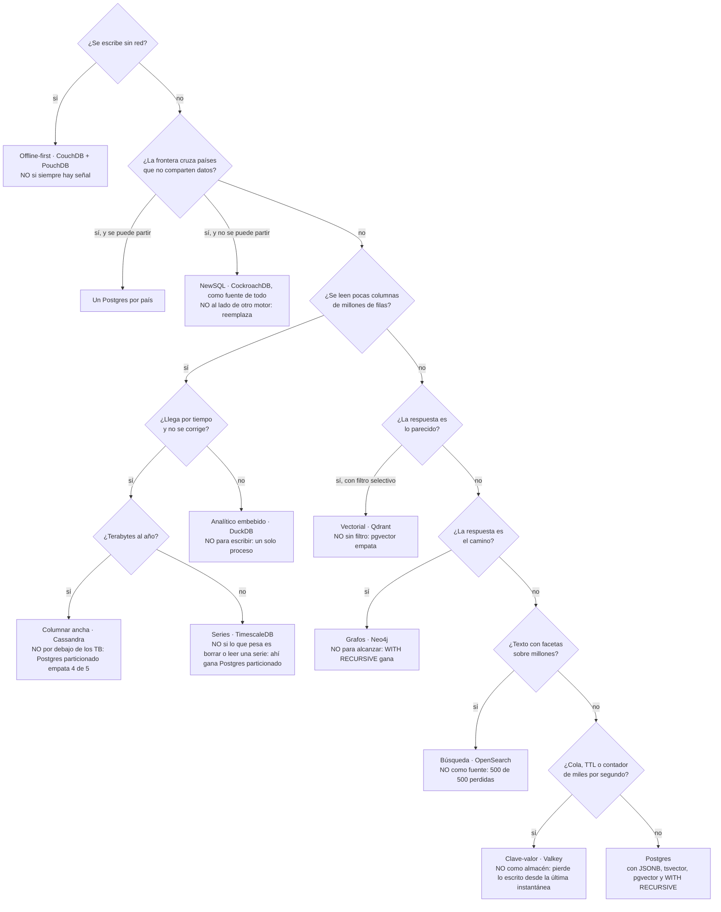

# ⚖️ Fase 25 — El capstone políglota: la factura, el veredicto, y cuándo bastaba Postgres

> **Curso:** Ruta NoSQL Lite · Fase 25 de 26 · Bloque V — El árbitro · **14 h**
> **Familia:** todas · **Motores:** PostgreSQL 18.6 `pgvector/pgvector@sha256:2ba9ca5f2e7d…`, TimescaleDB 2.30.1, MongoDB
> 8.0.20 `mongo@sha256:098862b1339f…` y Apache CouchDB 3.5.2; DuckDB 1.5.6 por las mediciones de la Fase 23
> **Línea base:** es Postgres, y aquí es también el veredicto
> **Entorno de ejecución:** TypeScript (`pg` 8.23.0, `mongodb` 7.7.0) y las herramientas de respaldo de cada imagen
> **Volumen:** lo que cada motor del diseño ya tiene cargado —`workOrder-1m` y los vectores de `pirep-1m` en la base
> `postgres`, `reading-5m` en TimescaleDB, `workOrder-1m` en CouchDB— y `camilo-10k` (`datasetSha256` `59cf902287e9…`)
> en MongoDB para el boss
> **Depende de:** todas las fases anteriores, en especial la [23](23-poliglota-el-diseno.md) y la
> [24](24-poliglota-la-costura.md) · **Habilita:** nada: cierra el curso
> **Apéndices de apoyo:** [`a02`](a02-compose-de-la-ruta.md), [`a04`](a04-el-arnes-de-medida.md),
> [`a05`](a05-el-dominio-de-flota.md), [`a07`](a07-postgres-linea-base.md), [`a10`](a10-licencias-y-riesgo.md)
> **Fecha de verificación ejecutada:** 12/10/2026, en macOS arm64
> **Objetivo:** ponerle número a lo que cuesta operar cada motor del diseño, escribir el árbol de veredicto de las
> diez familias con sus "cuándo NO", y decir con las mediciones del curso cuándo todo esto era innecesario.

---

## 🧭 1. Dónde estamos

Veinticuatro fases después, Cóndor tiene un diseño de cuatro motores ([Fase 23](23-poliglota-el-diseno.md)) y sabe
cómo coserlos sin perder escrituras ([Fase 24](24-poliglota-la-costura.md)). Falta la parte que ninguna demostración de
producto enseña: **lo que cuesta tenerlos**. Cada motor que entra se respalda, se recupera, se actualiza, se vigila y
necesita a alguien que sepa qué hacer a las tres de la mañana. Esa es la factura, y se paga todos los meses.

Esta fase la mide donde se puede medir y la declara donde no. Después escribe el veredicto que el curso debe desde la
primera página: el árbol de las diez familias, con lo que cada una gana y **cuándo no usarla**. Y termina con la
pregunta incómoda, contestada con números propios: **¿cuándo bastaba Postgres?**

> 📝 **La plantilla, adaptada.** Como en las Fases 23 y 24: la de fase A, con la sección 6 dedicada al veredicto. El
> 🪞 de la sección 7 no se copia a [`INSTINTOS.md`](INSTINTOS.md). El boss del Bloque V y el cierre de El Hangar van
> después del resultado de la fase, como los boss de los bloques anteriores.

---

## 🎯 2. Objetivos de esta fase

1. **Medir la factura** de cada motor del diseño en lo que se puede medir: cuánto tarda guardarlo y recuperarlo, lo
   que ocupa, lo que pide en reposo, y su licencia.
2. Distinguir **respaldar** de **rearmar**: la fuente se respalda; un derivado se reconstruye desde ella.
3. Escribir **el árbol de veredicto** de las diez familias, con un "cuándo NO" para cada una.
4. Contestar **cuándo bastaba Postgres**, familia por familia, con la apuesta de cada una.
5. Resolver el boss del Bloque V: las dos verdades de Cóndor, reconciliadas.

---

## 🚫 3. Qué queda fuera del curso

- **La operación en la nube**: los servicios administrados cambian la factura —se paga al proveedor en lugar de a
  la gente—, y sus precios cambian cada trimestre. El método de esta fase sirve igual; los números, no.
- **Alta disponibilidad de cada motor**: réplicas, conmutación y quórum se vieron donde eran el tema (Fases 17, 18, 21
  y 22). Aquí la factura es la de un nodo por motor, que es la de Cóndor.
- **Las otras familias**: columnar de columnas puras, motores de colas, almacenes de objetos. El método de las cinco
  preguntas las cubre; las mediciones de este curso, no.

---

## 🏗️ 4. Levantar lo que se mide

`base`, `documental`, `offline` y `series`, con lo que dejaron las fases que los cargaron. Los cuatro caben juntos en
8 GB ([`a02`](a02-compose-de-la-ruta.md)). Desde `src/`:

```bash
docker compose -f lab/compose.yaml --profile base --profile documental --profile offline --profile series up -d --wait
node 25-poliglota-la-factura/boss/setup.ts      # carga camilo-10k en MongoDB (lo usa la factura y el boss)
node 25-poliglota-la-factura/factura.ts         # 6.1: respaldar, restaurar, rearmar y lo que ocupa cada uno
```

`camilo-10k` se genera con `node src/diverge.ts` en `lab/generator/` ([`a05`](a05-el-dominio-de-flota.md)). La factura
deja todo como estaba: borra la base restaurada, la colección restaurada y la tabla rearmada al terminar.

---

## 📖 5. El diccionario del bloque

| Lo que ya sabías | En la factura | Dónde se rompe el paralelo |
|---|---|---|
| el respaldo de la base | **respaldo**: una copia de la fuente que se puede restaurar | hay que hacerlo una vez por motor que sea fuente, con su herramienta |
| volver a cargar un índice | **rearmado**: el derivado reconstruido desde la fuente | no se respalda: su respaldo es la fuente |
| cuánto se tarda en volver | **tiempo de recuperación**: del desastre a que el motor contesta otra vez | es el máximo de los motores que la pantalla necesita, no el promedio |
| el DBA | **la gente que sepa**: alguien que conoce cada motor por dentro | se multiplica por motor, y no se mide en ningún laboratorio |
| `CREATE EXTENSION` | **ficha de innovación**: lo que gasta una empresa cada vez que adopta una tecnología | Postgres ya la gastó; cada motor nuevo gasta otra |

Y de vuelta: una factura es **el costo de operación que el diseño no muestra**, y un veredicto es **la decisión con
su condición de cambio escrita**. Las dos direcciones, en [`a08`](a08-diccionario-y-glosario.md).

> 🩻 **Esto sí funciona igual.** Lo que un DBA hace con Postgres —respaldar, probar que el respaldo se restaura,
> vigilar el disco, planear la actualización— es exactamente lo que pide cada motor del diseño. Lo nuevo es que se
> hace cuatro veces, con cuatro herramientas y cuatro manuales.

---

## ⚖️ 6. El veredicto

### 6.1 La factura que se mide

`factura.ts` respalda y restaura lo que es fuente de verdad, y rearma lo que no:

> 📐 **Medición — respaldar la fuente, rearmar los derivados** · el volumen que cada motor tiene en el laboratorio ·
> verificado el 12/10/2026 · M-81
>
> | Motor | Qué es | Cómo se recupera | Tiempo | Tamaño | Imagen | RAM en reposo | Licencia |
> |---|---|---|---|---|---|---|---|
> | PostgreSQL | la fuente | `pg_dump` / `pg_restore` | **253 s / 768 s** | 5897 MiB → 1890 MiB | 620 MiB | 29 MiB | PostgreSQL |
> | TimescaleDB | derivado de la descarga | rearmar `reading-5m` | 52 s | 5 M de lecturas | 1344 MiB | 84 MiB | Apache 2.0 y TSL |
> | CouchDB | derivado de Postgres | rearmar el millón (M-79) | 132 s + 169 s de comparación | 582 MiB | 460 MiB | 97 MiB | Apache 2.0 |
> | DuckDB | derivado de Postgres | rearmar el tablero (M-73) | 6,5 s | un archivo | una librería | la del proceso | MIT |
> | MongoDB | la segunda verdad, mientras viva | `mongodump` / `mongorestore` | 0,1 s / 0,4 s | 326 KiB | 1195 MiB | 242 MiB | SSPL |
>
> Reproducir: `node 25-poliglota-la-factura/factura.ts`. La restauración, en una base nueva, dio las mismas órdenes,
> movimientos, piezas y vectores (1 000 000 · 1 247 472 · 740 741 · 1 000 000); Mongo, los mismos 7407 componentes. La
> RAM en reposo es la de [`a02`](a02-compose-de-la-ruta.md) y la licencia, la de [`a10`](a10-licencias-y-riesgo.md).

Tres cosas salen de la tabla antes que de cualquier opinión.

**La fuente es la que más cuesta recuperar, y por una razón que no es de datos.** Respaldarla tarda 253 s y deja 1890 MiB;
restaurarla, 768 s, y **715 de esos segundos son índices**: los datos entran en 53 s. La mayor parte de esos 715 son los dos
índices HNSW de los vectores de la Fase 15: con la memoria de fábrica, cada uno tardaría 2246 s en construirse, frente a 299 s con 2 GB (M-14). El
tiempo de recuperación de la fuente lo deciden sus derivados internos: un índice también es un derivado, vive dentro
de Postgres, y también se rearma.

**Los derivados no se respaldan.** CouchDB, DuckDB y TimescaleDB se rearman desde su fuente en minutos o segundos, y
su copia de respaldo sería una segunda verdad más que mantener. Es la regla de la [Fase 23](23-poliglota-el-diseno.md)
cobrando por fin: **un motor reconstruible es un motor que no hay que respaldar**.

Rearmar tampoco es gratis, y tiene su procedimiento. TimescaleDB se rearmó en una tabla nueva, al lado de la que
sirve, y no encima: `reading` no tiene clave en la Fase 09, y cargar el mismo archivo dos veces sobre ella duplicaría
cada lectura sin un solo error. Es el mismo patrón que la reconstrucción de CouchDB en la Fase 24 —armar al lado,
comparar, cambiar el puntero—, y es la única forma de que un rearmado no deje la pantalla vacía o duplicada mientras
corre. El procedimiento se escribe una vez por derivado, y se prueba como se prueba un respaldo: corriéndolo.

**La segunda verdad cuesta poco en disco y mucho en todo lo demás.** El MongoDB de Camilo se respalda en
0,1 s y se restaura en 0,4 s: son 326 KiB. Lo caro es que, mientras sea fuente de algo, necesita su propio respaldo, su propia prueba de
restauración y su propia persona, para 7407 documentos.

### 6.2 La factura que no se mide

Lo que el laboratorio no puede cronometrar se declara, motor por motor, como estimación y no como medición:

| Motor | Vigilar | Actualizar | Quién tiene que saber |
|---|---|---|---|
| **PostgreSQL** | disco, réplica, *slots* lógicos (Fase 24), `pg_stat_statements` | mayor por año, con `pg_upgrade` y las extensiones (`pgvector`) | el equipo que ya existe |
| **TimescaleDB** | *chunks*, compresión y trabajos de fondo | la extensión, base por base, y su licencia TSL ([`a10`](a10-licencias-y-riesgo.md)) | quien sepa Postgres, más la extensión |
| **CouchDB** | el `_changes`, la compactación y los conflictos | Erlang por dentro; la versión de la tableta (PouchDB) va aparte | alguien nuevo |
| **DuckDB** | nada en servidor: es un archivo | la librería en cada máquina que la usa | quien escribe el tablero |
| **MongoDB**, mientras viva | conjunto de réplicas, *oplog*, memoria | versión y `featureCompatibilityVersion`, en dos pasos; licencia SSPL | Camilo, y nadie más hoy |

La tabla es una estimación, pero no sale de la nada: **el laboratorio de este curso ya pagó una parte de esa
factura**, y está escrita en [`a02`](a02-compose-de-la-ruta.md) y [`a09`](a09-catalogo-de-errores.md). MongoDB quedó
fijado en la 8.0.20 exacta porque desde la 8.0.21 se niega a arrancar sobre el kernel de Docker Desktop: una
actualización menor que deja el motor sin arrancar. Cassandra, sin el heap fijado, ocupó 4,63 GiB en reposo, y
OpenSearch con 600 MB de límite murió sin decir nada. CouchDB repite un aviso cada cinco segundos hasta que alguien
crea `_users`, y TimescaleDB da un error en su primer arranque que no es un error. Cada uno se resolvió en una tarde,
con el manual abierto. **Esa tarde es la factura**, y se paga otra vez con cada versión nueva, por cada motor.

La última columna es la más cara y la que menos aparece en un design review. Postgres no suma una persona: suma
horas a un equipo que ya existe. CouchDB suma alguien que entienda revisiones y conflictos. MongoDB, hoy, depende de
**una sola persona**, y ese es el riesgo operativo que el boss pone sobre la mesa.

### 6.3 El árbol de veredicto

Las cinco preguntas de la [Fase 02](02-las-cinco-preguntas.md), en el orden en que más descartan, con lo que cada
familia midió en este curso:



Cada hoja lleva el número que la puso ahí. La columnar ancha entra solo con terabytes, porque a 50 millones de
lecturas Postgres particionado empató cuatro de cinco medidas (apuesta 9); la serie temporal entra antes, porque a
ese mismo volumen Postgres perdió el tamaño por 7,0× y el resumen por 46,5× (apuesta 6), aunque ganó la retención.
La búsqueda se queda en Postgres mientras no haya facetas sobre millones: 19 de 20 búsquedas con `tsvector`, y una
petición contra 34 169 páginas cuando las hay. El grafo entra para devolver el camino, no para alcanzar: 1061 *db
hits* contra 1,7 M filas en lo primero, y detrás de `WITH RECURSIVE` en lo segundo. Y el vectorial con filtro
selectivo es la única hoja donde Postgres no llega por configuración: 0,10 de recall contra 0,995, con el mismo
índice que empata sin filtro.

El orden no es el de las familias en el curso: es **el de las preguntas que más descartan primero**. Trabajar sin
red y cruzar países son condiciones que ningún índice resuelve, y por eso van arriba. Las demás preguntas tienen una
respuesta en Postgres que alcanza hasta un número, y el árbol pone ese número en la rama.

Falta una familia en las hojas: **la documental**. No tiene rama porque en este curso **ninguna pregunta la eligió**.
La ficha cupo en JSONB a 1,00× (apuesta 1), y lo único que Mongo ganó fue la ficha entera en un documento contra 50
filas. Su "cuándo NO" es el árbol entero: **cuando un agregado acotado cabe en
una columna JSONB**, que en Cóndor fue siempre.

### 6.4 Cuándo bastaba Postgres

La pregunta que el curso debe desde la primera página, contestada con las once apuestas:

| Familia | Lo que Postgres hizo, bien jugado | ¿Bastaba? |
|---|---|---|
| documental | JSONB con GIN: 1,00× en la consulta polimórfica (M-04) | **sí** |
| clave-valor | `UNLOGGED`: los mismos viajes, 0,74× los bytes (M-09) | **sí**, salvo colas y TTL |
| analítico embebido | el costo por hora, leyendo 446,8 MiB contra 23,8 (Fase 08) | **no**, para el tablero |
| series temporales | particionado: 2 de 5; 7,0× el tamaño, 46,5× el resumen (M-25) | **no** |
| búsqueda | `tsvector`: 19 de 20 búsquedas (M-31); facetas, 34 169 páginas contra 1 | **sí**, sin facetas |
| grafos | `WITH RECURSIVE`: 100 640 filas contra 257 487 *db hits* (M-37) | **sí**, salvo el camino |
| vectorial | `pgvector`: empate desde `ef` 80 sin filtro; 0,10 contra 0,995 con filtro (M-12, M-13) | **sí**, sin filtro |
| columnar ancha | particionado: 4 de 5 a 50 M; 4,59× el disco (M-47) | **sí**, hasta el contrato a 1 Hz |
| offline-first | la tableta no corre Postgres; como servidor, la restricción del dominio rechaza solo el desacuerdo real (M-55) | **no**, en la tableta |
| NewSQL | con réplica: 0,02, 0,14 y 0,00× la latencia, 2 nodos contra 9 (M-67) | **sí**, con un Postgres por país |

**Siete de diez.** En siete familias, Postgres bien jugado hizo lo que Cóndor necesitaba, con su número. En las tres
restantes —el tablero, los parámetros de la flota y la tableta sin señal— perdió por una forma de acceso que ningún
índice cambia: leer pocas columnas de millones de filas, guardar una serie que solo crece, y escribir sin red.

Y aun en esas tres, el diseño las pone **al lado** de Postgres, no en su lugar. Cóndor hoy, con el diseño de la Fase
23, sería: Postgres para todo lo que tiene frontera, más tres motores que se rearman desde él o desde la descarga.
**Si el contrato a 1 Hz no llega, la tableta no se compra y el tablero se conforma con una vista materializada
nocturna, Cóndor necesita un solo motor.** Esa frase no es una derrota del curso: es su resultado.

Dicho con la pregunta que abrió la ruta, *¿qué modelo de acceso tiene mi dominio?*: el de Cóndor es relacional, con
frontera transaccional, y tiene **tres excepciones con nombre y número**. Un diseño que no puede nombrar sus
excepciones así, con la medición al lado, todavía no está listo para un design review.

### 6.5 Lo que Cóndor opera de verdad

Con todo junto, la factura del diseño —cuatro motores, el MongoDB de Camilo aparte— queda así:

| | El diseño: 4 motores | Con el MongoDB de Camilo | Solo Postgres |
|---|---|---|---|
| RAM en reposo ([`a02`](a02-compose-de-la-ruta.md)) | 210 MiB | 452 MiB | 29 MiB |
| imágenes que mantener al día | 2424 MiB, tres | 3619 MiB, cuatro | 620 MiB, una |
| respaldos que hacer y probar | **1** | 2 | 1 |
| volver de perder todo | 768 s de Postgres, y después 301 s de CouchDB: unos 18 min | lo mismo, más Mongo | 768 s |
| licencias que leer con legal | TSL | TSL y SSPL | ninguna |
| personas (estimación, sección 6.2) | el equipo de Postgres y alguien de CouchDB | más Camilo, solo | el equipo de Postgres |

Lo que cambiaría esta factura está escrito en las condiciones de la Fase 23. Si el contrato a 1 Hz llega, entra
Cassandra, con su anillo de tres nodos y su heap fijado. Si Freddy deja de trabajar sin señal, sale CouchDB, y con él
la costura de vuelta de la Fase 24. Si Lucía acepta un tablero de la mañana anterior, DuckDB se vuelve una vista
materializada nocturna en Postgres. Ninguna de esas decisiones es técnica, y por eso el informe del boss las pone
delante de quien las firma.

El tiempo de volver es aritmética sobre la tabla de la sección 6.1, no una medición: Postgres primero, porque todo lo
demás se rearma desde él, y TimescaleDB en paralelo desde la descarga. La fila que más pesa no es ninguna de las
medidas. Es la de **una sola persona**: el día que Camilo no esté, el MongoDB no tiene quien lo restaure, y su
respaldo de 326 KiB no sirve de nada.

---

## 🪞 7. Tu instinto relacional dice… y esta vez se equivoca

*"Postgres alcanza para todo."* Es el instinto con que el lector llegó al curso, y después de veinticuatro fases tiene
más razón de la que el mercado admite: siete de diez familias, con números. **Se equivoca en las otras tres**, y se
equivoca por la forma, no por la escala: 46,5× en el resumen de una serie, 23,8 contra 446,8 MiB leídos en el
tablero, y una tableta que no puede tener un servidor adentro.

La segunda forma en que se equivoca es más sutil: *"alcanza"* no es *"es gratis"*. Postgres alcanzó para el
expediente con réplica, y perdió lo único que el contrato pedía, la residencia. Alcanzó para el inventario, y la
[Fase 23](23-poliglota-el-diseno.md) encontró 135 557 piezas sin un hecho detrás. **Postgres no te salva de no
preguntar.**

La pregunta que lo ordena es la de siempre: **¿qué forma de acceso tiene esta parte?** Si es una de las tres, el
instinto pierde; si no, gana, y la factura de la sección 6.1 dice cuánto.

---

## ⚰️ 8. El hype, a escala: el diseño de diez motores

**La decisión, con su mejor argumento.** Cada familia ganó en algo. *"Si cada motor es el mejor en su parte, el
sistema con todos es el mejor en todo."* El argumento suena a ingeniería, y el laboratorio de este curso es su
prueba: diez familias, cada una medida en su terreno.

**Qué pasa, con número.** Las diez familias a la vez piden **3,43 GiB** en reposo; los cuatro motores del diseño,
unos **210 MiB**; Postgres solo, **29 MiB** ([`a02`](a02-compose-de-la-ruta.md)). Diez motores son diez
procedimientos de respaldo, diez caminos de actualización y, en el mejor caso, diez personas que sepan. En seis de
las once apuestas ganó Postgres (1, 2, 7, 8, 9 y 11), y en una más empató en el fondo (3): más de la mitad de ese
sistema pagaría la factura por una ventaja que Cóndor no usa.

**Cuánto cuesta salir.** El MongoDB de Camilo es el caso real: un motor que entró por una razón correcta en 2019, que
en 2023 ya era una segunda verdad, y cuya salida es el boss de este bloque.

**Antes y después, con números:** diez motores, 3,43 GiB en reposo y diez respaldos; el diseño, cuatro motores y
**un solo respaldo**, el de Postgres, porque los otros tres se rearman (sección 6.1).

**La pregunta que lo habría evitado:** *¿qué pierdo si este motor no está?* Si la respuesta es "un número que
Postgres empata", no entra.

---

## ⚠️ 9. Errores comunes y diagnóstico

- **Medir el respaldo y no la restauración.** *Síntoma:* el respaldo tarda minutos y alguien lo da por resuelto.
  *Causa:* lo que importa es cuánto tarda en volver, y la restauración reconstruye índices. *Comprobación:* restaurar
  en una base aparte y contar, como `factura.ts`. *Salida:* el tiempo de recuperación es el de restaurar.
- **Restaurar con la memoria de fábrica.** *Síntoma:* el `pg_restore` de una base con índices HNSW tarda horas.
  *Causa:* `maintenance_work_mem` de 64 MB; cada índice tarda 2246 s en lugar de 299 (M-14). *Salida:* `PGOPTIONS=-c
  maintenance_work_mem=2GB` para la restauración, que es lo que hace `factura.ts`.
- **Restaurar en paralelo una base con índices HNSW.** *Mensaje:* `could not resize shared memory segment … to
  2144374272 bytes: No space left on device`, el de [E-35](a09-catalogo-de-errores.md#e-35--postgres-se-queda-sin-memoria-compartida-al-construir-un-índice).
  *Causa:* `pg_restore -j 4` construye los dos índices a la vez, y cada uno pide 2 GB de memoria compartida. *Salida:*
  los datos con `-j 4` y la sección `post-data` de a uno, como `factura.ts`. Se aprendió en esta fase: la primera
  restauración falló así.
- **Respaldar un derivado.** *Síntoma:* respaldos de CouchDB o de la hypertable que nadie sabe si están al día con la
  fuente. *Causa:* tratar un índice como una verdad. *Salida:* respaldar la fuente y rearmar el derivado; si no se
  puede rearmar, es que no es un derivado (Fase 23).
- **Contar los motores y no las personas.** *Síntoma:* la factura en GiB y en dólares de servidor, sin una línea para
  quién sabe operarlo. *Salida:* la columna de la sección 6.2, con un nombre por motor. Si el nombre se repite en
  todos, la factura está mal; si un motor no tiene nombre, el riesgo está ahí.

El de la restauración en paralelo es una aparición más de E-35, y así quedó en [`a09`](a09-catalogo-de-errores.md).

---

## 📋 10. Checklist de validación

```text
[ ] factura.ts: la base restaurada con las mismas filas, Mongo con los mismos documentos, la hypertable rearmada
[ ] La tabla de la sección 6.1 con tus números, y el tiempo de recuperación de cada motor
[ ] La tabla de la sección 6.2 con un nombre de persona por motor
[ ] El árbol de la sección 6.3 recorrido para tres partes de Cóndor, con la medición que sostiene cada rama
[ ] La tabla de la sección 6.4, y la frase que dice cuándo Cóndor necesita un solo motor
[ ] El boss del Bloque V entregado
```

---

## 🧪 11. Ejercicios (24)

Desde `src/`, con `base`, `documental`, `offline` y `series` arriba (sección 4), salvo donde se diga.

### 🟢 Fácil — reproducir y leer (1–6)

#### 🟢 Ejercicio 1 — Tu factura

Corre `factura.ts`.

**Objetivo:** tu tabla de la sección 6.1, y cuál de tus números se aleja más del de la fase.

#### 🟢 Ejercicio 2 — El respaldo de fábrica

Restaura el respaldo de Postgres sin `PGOPTIONS`.

**Objetivo:** cuánto tarda, y qué parte de ese tiempo son los dos índices HNSW.

#### 🟢 Ejercicio 3 — Recorrer el árbol

Recorre el árbol de la sección 6.3 para el costo por hora, el catálogo de partes y el trabajo de Freddy.

**Objetivo:** la hoja a la que llega cada uno, y la medición que sostiene cada rama que tomaste.

#### 🟢 Ejercicio 4 — Siete de diez

Elige una fila de la sección 6.4 que diga "sí" y busca su medición en la bitácora.

**Objetivo:** el número, y la condición que lo volvería un "no".

#### 🟢 Ejercicio 5 — Un solo motor

Lee la frase de la sección 6.4 sobre Cóndor con un solo motor.

**Objetivo:** las tres condiciones, y cuál te parece más probable que se rompa primero.

#### 🟢 Ejercicio 6 — El nombre

Llena la última columna de la sección 6.2 con personas de la historia de Cóndor.

**Objetivo:** cuántas personas distintas hacen falta, y qué motor queda sin nadie.

### 🟡 Intermedio — medir de otra forma (7–12)

#### 🟡 Ejercicio 7 — Un respaldo que se pueda restaurar

Restaura el `pg_dump` en un contenedor nuevo, no en la misma instancia.

**Objetivo:** el tiempo, y qué le faltó al contenedor nuevo para que la base sirviera.

#### 🟡 Ejercicio 8 — Respaldar la hypertable

Respalda la base `condor` de TimescaleDB con `pg_dump` y restáurala siguiendo la documentación de Timescale.

**Objetivo:** los pasos que pide la extensión, y el tiempo contra el del rearmado de la sección 6.1.

#### 🟡 Ejercicio 9 — CouchDB respaldado

Respalda `work_order_1m` replicándola a otra base de CouchDB.

**Objetivo:** el tiempo contra el rearmado de la Fase 24, y qué ganas o pierdes con cada uno.

#### 🟡 Ejercicio 10 — El respaldo incremental

Configura el archivado del WAL de `base` y restaura a un instante.

**Objetivo:** cuánto WAL archivó una hora de la carga de la Fase 24, y qué tiempo de recuperación logras.

#### 🟡 Ejercicio 11 — La memoria de cuatro motores

Mide con `docker stats` los cuatro motores del diseño con su carga, en lugar de en reposo.

**Objetivo:** el total, y si cabe en la máquina más chica que Cóndor tendría en una base.

#### 🟡 Ejercicio 12 — Actualizar uno

Actualiza CouchDB o TimescaleDB a la versión siguiente en el laboratorio.

**Objetivo:** los pasos, lo que se rompió, y cuánto tiempo estuvo fuera.

### 🟠 Difícil — decidir con la factura (13–18)

#### 🟠 Ejercicio 13 — Sin TimescaleDB

Saca TimescaleDB del diseño y pon las lecturas en Postgres particionado.

**Objetivo:** lo que pierdes con números de la Fase 10, y lo que ahorras en la factura de las secciones 6.1 y 6.2.

#### 🟠 Ejercicio 14 — Sin CouchDB

Rediseña el trabajo de Freddy sin tableta offline-first.

**Objetivo:** qué se pierde en la pista sin señal, y qué deja de pagarse.

#### 🟠 Ejercicio 15 — El tablero en una vista

Reemplaza DuckDB por una vista materializada nocturna en Postgres.

**Objetivo:** el tiempo de refresco, lo que lee la consulta del tablero, y si Lucía lo notaría.

#### 🟠 Ejercicio 16 — El tiempo de recuperación de una pantalla

Calcula cuánto tarda en volver la pantalla de firma de Hernán si se pierde la máquina de Postgres.

**Objetivo:** el número, motor por motor, y cuál lo domina.

#### 🟠 Ejercicio 17 — La rama que falta

Agrega al árbol de la sección 6.3 una rama para la familia documental que se pueda defender.

**Objetivo:** la pregunta, la condición y la medición que la haría entrar.

#### 🟠 Ejercicio 18 — Otro orden

Reordena las preguntas del árbol y recorre con él las once partes de Cóndor de la Fase 23.

**Objetivo:** si cambia algún resultado, y por qué el orden importa o no.

### 🔴 Muy difícil — el design review (19–24)

#### 🔴 Ejercicio 19 — Defender los diez

Escribe la defensa del diseño de diez motores para un comité, con la mejor medición de cada uno.

**Objetivo:** que cada argumento cite su número, y después la factura que lo tacha.

#### 🔴 Ejercicio 20 — El contrato a 1 Hz

El contrato llega. Rehaz el diseño, la factura y el árbol.

**Objetivo:** qué motor entra, qué sale, y cuánto sube la factura.

#### 🔴 Ejercicio 21 — Un operador más

Un tercer operador estatal, en Brasil, con residencia de datos.

**Objetivo:** cuántos Postgres, qué costura entre ellos, y en qué punto conviene CockroachDB.

#### 🔴 Ejercicio 22 — La nube

Traduce la factura de la sección 6.1 a servicios administrados de un proveedor que elijas.

**Objetivo:** el costo mensual con su fuente y su fecha, y qué columna de la sección 6.2 desaparece.

#### 🔴 Ejercicio 23 — El design review

Toma el diseño de un sistema real que conozcas con más de dos motores y pásalo por esta fase.

**Objetivo:** la factura, el árbol recorrido y **al menos un motor descartado con argumento**.

#### 🔴 Ejercicio 24 — La última página

Escribe, en una página, cuándo no hacía falta nada de este curso para tu sistema.

**Objetivo:** que cada frase cite una medición, tuya o de la bitácora.

### 🔥 Opcionales

- **Restaurar a ciegas**: pídele a alguien que no hizo el curso que restaure Cóndor con tus notas, y cronométralo.
- **La factura como código**: genera la tabla de la sección 6.1 desde `factura.ts` en formato de la bitácora.

---

## 📚 12. Referencias

> ⚠️ Las URLs y sus contenidos cambian. Esta fase se verificó con PostgreSQL 18.6, TimescaleDB 2.30.1, MongoDB 8.0.20 y
> CouchDB 3.5.2.

- **Dan McKinley, *Choose Boring Technology*** (2015) — https://mcfunley.com/choose-boring-technology — las fichas de
  innovación de la sección 5, y el argumento de toda la fase.
- **Martin Fowler, *PolyglotPersistence*** (2011) — https://martinfowler.com/bliki/PolyglotPersistence.html — la
  advertencia del principio, que esta fase pone en números.
- **PostgreSQL 18, *Backup and Restore*** — https://www.postgresql.org/docs/18/backup.html — `pg_dump`, el archivado del
  WAL y la recuperación a un instante del ejercicio 10.
- **Tiger Data (TimescaleDB), *Logical backup with pg_dump and pg_restore*** —
  https://www.tigerdata.com/docs/self-hosted/latest/backup-and-restore/logical-backup — `timescaledb_pre_restore()` y
  los demás pasos del ejercicio 8.
- **MongoDB, *Back Up and Restore with MongoDB Tools*** — https://www.mongodb.com/docs/manual/tutorial/backup-and-restore-tools/ — `mongodump` y `mongorestore`.
- **CouchDB, *Backing up CouchDB*** — https://docs.couchdb.org/en/stable/maintenance/backups.html — por qué en CouchDB
  replicar es respaldar, y el ejercicio 9.
- **Kleppmann, *Designing Data-Intensive Applications*** (O'Reilly, 2017) — capítulo 12, *"The Future of Data
  Systems"*: el sistema como una base de datos desarmada, y su factura.

**Orden sugerido:** McKinley antes de la sección 6; la documentación de respaldo de cada motor con los ejercicios 7 a
10; Kleppmann al cerrar el curso.

---

## 🏁 13. Resultado de la fase

```text
src/25-poliglota-la-factura/factura.ts        respaldar, restaurar y rearmar cada motor, y lo que ocupa
src/25-poliglota-la-factura/boss/setup.ts     SIGMA y el sistema de Camilo, como llegan al comité
```

Le pusiste número a la factura: la fuente se respalda en 253 s y se restaura en 768 s, y cada derivado se rearma
desde ella sin respaldo propio. Escribiste el árbol de las diez familias con sus "cuándo NO", y contestaste la
pregunta que el curso debía: **en siete de diez familias bastaba Postgres**, y en las tres restantes la razón es una
forma de acceso, no la moda.

> **La señal de que el curso quedó bien:** *"Puedo entrar a un design review y descartar motores con argumento: para
> cada uno sé qué forma de acceso lo justifica, qué número lo sostiene, y cuánto cuesta tenerlo. Y sé decir cuándo no
> hace falta ninguno."*

> 🏷️ **No cierres la fase sin el tag.** Con el checklist en verde y `git status` limpio:
>
> ```bash
> git tag -a fase-25-poliglota-la-factura -m "F25 cerrada: la factura medida (Postgres 253 s de pg_dump y 768 s de pg_restore, 715 de índices; TimescaleDB rearmado en 52 s; CouchDB 132 + 169 s; DuckDB 6,5 s; MongoDB 0,1 y 0,4 s) y la que no se mide, declarada; pg_restore -j 4 con dos HNSW agota la memoria compartida (E-35); el árbol de veredicto de las diez familias con su cuándo NO; bastaba Postgres en siete de diez; el diseño a 210 MiB en reposo contra 3,43 GiB de las diez familias; boss V con camilo-10k; El Hangar cerrado"
> ```
>
> Commits de la fase con prefijo `f25:`, los de ejercicio `f25 ej19: …`.

---

### 💀 Boss del Bloque V — "Las dos verdades"

> *"El comité se reúne el jueves para decidir si el sistema de Camilo se retira. Quiero llegar con algo que no sea
> una opinión. Cuántas piezas no cuadran entre los dos sistemas, por qué no cuadra cada una, cuál de los dos tiene
> razón, y cuánto nos cuesta cada opción. Camilo va a estar en la mesa, y tiene derecho a defender su sistema: si los
> números le dan la razón, quiero que el informe lo diga."*
>
> — Lucía Arango, gerente

**Los dos sistemas, como llegan.** `SIGMA` es la base `expediente` de Postgres (`workOrder-10k`). El sistema de
componentes de Camilo es la colección `component` de la base `camilo` en MongoDB, ya divergido: `boss/setup.ts` lo
carga desde `camilo-10k` ([`a05`](a05-el-dominio-de-flota.md)) y comprueba su hash. Los dos tienen las mismas 7407
piezas. **No coinciden en todas**, y no todas las diferencias vienen del mismo lugar.

```bash
node 25-poliglota-la-factura/boss/setup.ts     # base y documental arriba
```

> ⚠️ **Una diferencia con la historia.** En la historia (§3), `SIGMA` decía que el actuador de marzo estaba instalado
> y Camilo, que en almacén. En estos datos, `SIGMA` lo tiene donde de verdad está, en el taller aliado, y Camilo lo
> sigue viendo en almacén. Es la misma contradicción, con el error de un solo lado; el boss se resuelve con los datos.

**Qué hay que entregar.** Un informe de reconciliación para el comité, con sus comandos:

1. **Las discrepancias**, pieza por pieza, y **de qué costura sale cada una**: un hecho que `SIGMA` cambió sin orden,
   una escritura que no llegó, dos que llegaron al revés, un dato que se tocó en un solo lado. Las Fases 23 y 24
   tienen el vocabulario y las herramientas.
2. **La fuente de verdad** de cada dato de la pieza —estado, ubicación, horas, historia—, y por qué.
3. **El veredicto sobre el sistema de Camilo**: se retira, o se queda como índice reconstruible desde `SIGMA`. Con la
   condición que lo haría cambiar, y sin descartar que Camilo tenga razón en algo.
4. **La costura** que lo mantendría al día si se queda —*outbox* o CDC— y su ventana, medida.
5. **La factura** de cada opción, con los números de la sección 6.

**Criterios de aceptación.**

```text
[ ] Cada pieza en que los dos sistemas difieren está encontrada y clasificada por su costura
[ ] La clasificación se sostiene con la historia de movimientos de SIGMA, no con answers.json
[ ] El informe dice cuál de los dos tiene razón en cada clase, y en qué clases no la tiene ninguno
[ ] El veredicto tiene su condición de cambio escrita
[ ] La costura elegida está montada y su ventana medida
[ ] La factura de retirar y la de quedarse están lado a lado
```

Al terminar, y solo entonces, compara tu clasificación con `lab/data/camilo-10k/answers.json`.

**Pistas, si te atascas**, de la más suave a la más directa: la sección 6.4 de la Fase 23, sobre lo que una orden no
registra; la sección 6.1 de la Fase 24, sobre las dos formas en que falla una doble escritura; el campo `history` de
cada componente; y el cuaderno de Yamile, que en el curso es el `answers.json` de `workOrder-10k`.

> 🏷️ **Tag del boss:** `boss-bloque-5` · la solución no se publica.

---

### El Hangar, cerrado

🏆 Si lo viniste construyendo, aquí está entero. Cada bloque le sumó algo, y una regla:

| Bloque | Lo que le sumó | La regla que le dejó |
|---|---|---|
| I | la ficha de aeronave y la coordinación de puestos y candados | cada pieza con su veredicto: su motor o Postgres |
| II | el tablero de flota: horas desde la serie, costo desde el analítico, catálogo buscable | cada número dice de qué fuente sale |
| III | la directiva que llega un jueves y "esto ya lo vimos" | ninguna escrita: el bloque no dejó nota de El Hangar |
| IV | la geografía: parámetros por tiempo, el formulario sin señal, el expediente con su autoridad | cada dato dice en qué país puede vivir |
| V | la fuente de verdad, la costura y la factura | todo lo que no es fuente se rearma desde ella |

Hernán pidió una sola cosa en marzo de 2026: *"que cuando yo vaya a firmar, la pantalla me diga de dónde salió cada
cosa que está en ese avión. Y si no lo sabe, que me lo diga."* El Hangar terminado lo cumple con una condición que no
es de ningún motor: **que cada hecho tenga dónde escribirse**. La [Fase 23](23-poliglota-el-diseno.md) encontró
135 557 piezas sin un hecho detrás, y la [Fase 24](24-poliglota-la-costura.md), 18 hechos de la tableta sin columna.
Esa es la pantalla que dice *"no lo sé"*, y es la que Hernán pidió.

Quien no lo siguió no ha perdido nada del curso. Quien sí, tiene el portafolio que la historia prometía: un sistema
políglota, medido, y un documento que dice **por qué cada motor está ahí y qué pasaría si no estuviera**.
