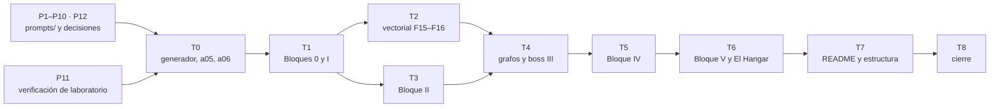

# 🗓️ Plan de producción: tandas, estado y checklist
## Ruta NoSQL Lite

Este documento dice **en qué orden se prepara y se escribe el curso, cuándo una tanda está terminada
y dónde va la producción**. Hay dos fases: la **preparación** (tandas `P1`–`P12`), que solo toca
`prompts/` y el laboratorio de verificación y no escribe ni una fase, y la **escritura** (tandas
`T0`–`T8`), que arranca cuando está cerrada la parte de la preparación que cada tanda necesita
(regla 6). Es operativo: se actualiza al cerrar cada sesión, y **cualquier sesión que retome el curso
empieza leyendo §3 (estado), §6 (deuda), §7 (bitácora) y §8 (checklist).**

- El qué lo manda [`alcance-del-proyecto.md`](alcance-del-proyecto.md).
- La forma la manda [`guia-de-estilo-y-convenciones.md`](guia-de-estilo-y-convenciones.md).
- Los nombres, [`contrato-de-nombres.md`](contrato-de-nombres.md) y
  [`diccionario-de-terminos.md`](diccionario-de-terminos.md).
- La ficha de cada fase, [`propuesta-fases-y-alcance.md`](propuesta-fases-y-alcance.md), y la de cada
  apéndice, [`propuesta-apendices-y-alcance.md`](propuesta-apendices-y-alcance.md).
- Los documentos vivos y los miniproyectos, [`formato-bitacora-de-medicion.md`](formato-bitacora-de-medicion.md)
  y [`formato-de-miniproyectos.md`](formato-de-miniproyectos.md).
- La entrada de cada tanda es su prompt: [`prompts-de-fase.md`](prompts-de-fase.md) y
  [`prompts-de-apendice.md`](prompts-de-apendice.md).
- **El orden lo manda este documento.**

> **Caducidad:** es un documento de producción. Al cerrar T8 se conserva en `prompts/` como
> referencia —`prompts/` no viaja al repositorio público—, salvo que Oskar pida borrarlo. **No se
> cita desde ninguna fase, apéndice ni README.**
>
> **Historia del archivo:** creado el 29/09/2026 como `_desechable-plan-de-tandas.md`, que sustituyó a
> `_desechable-checklist-pendientes.md` (borrado el 06/10/2026 con permiso de Oskar); renombrado el
> 06/10/2026 y reescrito el 07/10/2026 sobre la plantilla de los lineamientos (`zz-instrucciones/`).
> Las Tandas 0–7 conservan su número, porque la guía, el alcance y los prompts las citan así.
>
> **Vigencia:** 2026-10-14.

**Salto rápido:** [1](#1--las-reglas-de-orden) · [2](#2--qué-es-una-tanda) · [3](#3--estado) · [4](#4--las-verificaciones) · [5](#5--las-tandas-una-por-una) · [6](#6--deuda-de-enlaces-abierta) · [7](#7--bitácora) · [8](#8--checklist-final) · [9](#9--directorios-de-zz-code)

---

## 1. 🧭 Las reglas de orden

Son veintiséis fases en seis bloques, diez apéndices, diez miniproyectos de familia, cinco boss de
bloque con el boss global de El Hangar, y tres documentos vivos. Escritos en orden de carpeta, el
curso tendría la mitad de los enlaces rotos durante semanas y la bitácora, el catálogo de errores y
los apéndices que crecen irían siempre atrasados. Las tandas van por **dependencia**, y cada una deja
el curso coherente y publicable hasta donde llega.

1. **Ninguna tanda se cierra con un documento que crece atrasado**: las mediciones de la tanda entran
   en `bitacora-de-medicion.md`, los errores en `a09-catalogo-de-errores.md` y los instintos en
   `INSTINTOS.md`; `a03`, `a04` y `a08` reciben la sección de cada motor nuevo, y los miniproyectos
   del bloque se revisan contra lo que las fases terminaron enseñando. Todo en la misma tanda. No hay
   solucionario (D-05).
2. **Ningún enlace interno apunta a un documento que no existe.** La referencia va en prosa y se
   anota en §6; la tanda que escribe el destino la convierte en enlace.
3. **El `README.md` y `0-ESTRUCTURA-CURSO.md` se escriben en una tanda final y aparte (T7), y ninguna
   otra tanda los toca** (D-10, ajuste del 30/09/2026). Hasta entonces describen la Tanda 1, y eso se
   acepta a sabiendas. Lo que una tanda querría decir en uno de ellos se anota en §6.
4. **Nada se nombra sin comprobarlo en la misma sesión**: imagen y digest, versión, driver, flag, URL
   por código de estado, libro con edición y año.
5. **Una fase no se cierra sin haberse corrido entera en macOS arm64** (D-06), con la salida literal
   y fechada. Lo que no se puede correr lleva el marcador de la guía y su casilla "corrida" ⬜. Linux y
   WSL2 quedan declarados sin verificar hasta la pasada transversal (§5).
6. **Ninguna tanda de escritura empieza con su preparación abierta.** Cada una exige lo suyo:
   - **T0** exigió P1–P4 y la verificación de laboratorio (P11, la sesión que los documentos llaman
     "T10"). ✅ desde el 29/09/2026.
   - **T1–T6** exigen además P10. La única decisión abierta, la excepción de D-05 (ejercicios sin
     solución publicada), se escribe con su valor por defecto y se confirma antes de T8.
   - **T7** exige que T1–T6 estén cerradas: es el primer momento en que todo el contenido existe.
7. **Todo en el hilo principal, secuencial y sin agentes.** Desde el 07/10/2026, **cada fase se abre
   con el paso 1 de su prompt y se para**: preguntas con su valor por defecto, lectura del alcance,
   esbozo y contradicciones, y se redacta solo después de la respuesta de Oskar. La sesión se para
   también al cerrar cada tanda, y Oskar decide cuándo empieza la siguiente.
8. **Git lo hace Oskar.** Se borra con `rm`, archivo por archivo, nunca con `git rm` ni borrando
   directorios. `00-convencion-de-git-y-tags.md` es la convención **del lector**; los tags que una
   tanda proponga para el repositorio van en la bitácora, y hasta hoy ninguna dejó.
9. **La máquina de Oskar no se toca sin permiso**: nada se instala ni genera cargos. Las mediciones
   usan el laboratorio del curso (proyecto compose `condor-lab`, con los puertos desplazados de
   `a02`, nunca los de por defecto); un contenedor de prueba suelto lleva la etiqueta
   `curso=ruta-no-sql-lite`, usa **puertos altos y aleatorios** y se borra **con sus volúmenes** al
   terminar, comparando contra el inventario inicial que se guarda en `salidas/`. Nada que ya existía
   se borra. Los vectores del millón (`src/lab/data/pirep-1m/*.f32`, 30 min cada uno en CPU) **no se
   regeneran**.
10. **Todo el código de las sesiones va a `zz-code/`**: un directorio por sesión
    (`python3 zz-code/nuevo.py ruta-no-sql-lite`), registrado en §9 con su estado. Lo efímero (logs,
    salidas, copias) va a su `salidas/`; nada en el scratchpad ni en `/tmp`. Los comandos sueltos que
    producen algo citable se copian a un archivo, y el `README.md` de cada directorio dice cómo correr
    y medir cada prueba, con los comandos y los intermedios que amasan la salida. El código que el
    lector ejecuta va a `src/` (D-09). Ningún documento del curso cita `zz-code/` (guía §18.5).

Las dependencias, en un vistazo:



**Prioridad si el tiempo aprieta:** T1 (Bloque 0 y Bloque I con su boss: un curso utilizable por sí
solo) → T2 (vectorial, adelantado por el arrastre de RAG) → T3 → T4. Las tandas 2 a 5 son minicursos
casi independientes; lo que falte de las saltadas va en prosa y a §6. **La única atadura al orden
canónico es el boss global**, y por eso es opcional.

---

## 2. 📦 Qué es una tanda

### 2.0 Una tanda de preparación

Un documento de `prompts/`, o un paso que lo deja coherente con los demás: una decisión, una
verificación, un traslado. **No crea nada fuera de `prompts/`**, salvo `00-convencion-de-git-y-tags.md`
(P7), que se publica, y la verificación de laboratorio (P11), que dejó sus scripts y registros en
`prompts/verificacion-de-laboratorio/` (excepción declarada en la guía §18.5). Terminada cuando sus
enlaces pasan §4 y los documentos que la citan están al día.

### 2.1 Una tanda de escritura

Un bloque de fases que se enlazan entre sí, con los apéndices que esas fases necesitan, su boss, sus
miniproyectos revisados y su laboratorio corrido. Una tanda no cruza bloques, salvo la excepción
declarada del boss III (§5, T2 y T4). La rutina, igual en todas:

1. Pegar el prompt de cada documento y seguir su protocolo de tres pasos: **preguntas** (y parar,
   regla 7), **redacción**, **autoverificación** reportada en lista corta. Si el prompt quedó desfasado
   respecto de una decisión posterior, se corrige el prompt antes de usarlo; por encima de los prompts
   mandan el alcance, la guía y las dos propuestas.
2. Tener delante el checklist de la guía §15, que se recorre **al cerrar cada archivo**.
3. Releer la ficha de la propuesta: el "Entra" es el piso; la apuesta y la rotura, candidatas.
4. Comprobar versiones, drivers, URL y libros **antes** de escribirlos.
5. Partir del laboratorio en el estado que dejó la tanda anterior; abrir el directorio de `zz-code/`
   de la tanda; ejecutar y anotar —el error antes de arreglarlo, literal—; después escribir.
6. Escribir en el orden en que los documentos se enlazan; la fase A antes que la B.
7. Alimentar lo que crece: bitácora, `a09`, `INSTINTOS.md`, `a03`, `a04`, `a08`, y los hashes y focos
   de `a05` si la tanda pide un dataset nuevo.
8. Resolver la deuda de §6 que la tanda cierra.
9. Correr las verificaciones de §4.
10. Actualizar §3, §6, §7, §8 y §9, y dejar en la bitácora las trampas y los recursos que quedan
    levantados.

### 2.2 Peso de cada tanda

```text
ligera   T7 · T8                    README y estructura, o cierre
normal   T1 · T4 · T6               una capa nueva sobre lo ya probado
densa    T0 · T2 · T3 · T5          generador y datasets, vectores del millón, tres motores nuevos
                                    (DuckDB, TimescaleDB, OpenSearch), Cassandra y newsql-global
```

Las **densas** llevan verificación de imagen, digest y memoria antes de escribir una línea, anotada
con fecha en el documento.

---

## 3. 📊 Estado

Leyenda: ⬜ pendiente · 🟡 en curso · ✅ terminada y verificada.

| Tanda | Entrega | Docs nuevos | Peso | Estado |
|---|---|---|---|---|
| **P1** | Alcance del proyecto | 1 | — | ✅ |
| **P2** | Propuestas de fases y de apéndices, con el análisis de modelos y las historias candidatas | 4 | — | ✅ |
| **P3** | Este plan | 1 | — | ✅ |
| **P4** | Guía de estilo y convenciones | 1 | — | ✅ |
| **P5** | Diccionario de términos | 1 | — | ✅ |
| **P6** | Contrato de nombres | 1 | — | ✅ |
| **P7** | Convención de git y tags (`00-convencion-de-git-y-tags.md`, raíz del curso) | 1 | — | ✅ |
| **P8** | Plantillas de capítulo (fase A, fase B, Bloque 0, apéndice) y los dos formatos propios | 3 | — | ✅ |
| **P9** | Prompts de fase y de apéndice | 2 | — | ✅ |
| **P10** | Decisiones 1–20 (alcance §12) y D-01–D-13 (§12.1) cerradas por Oskar | — | — | ✅ |
| **P11** | Verificación de laboratorio ("T10"): hallazgos H1–H13, en macOS arm64 | 1 | densa | ✅ |
| **P12** | Alineación con los lineamientos: README de `prompts/`, verificador, guía §16 y §18 | 3 | — | ✅ |
| **T0** | Cerrar lo que bloquea la primera fase: generador, `a05`, `a06`, `src/lab/check/` | 2 | densa | ✅ |
| **T1** | Bloques 0 y I: F00–F06, boss I, `a07`, `a09`, `a10`, esqueletos de `a03`/`a04`/`a08`, documentos vivos y temario | 16 | normal | ✅ |
| **T2** | Vectorial, adelantado: F15–F16 y `h-mini-07` (sin el boss III) | 2 | densa | ✅ |
| **T3** | Bloque II: F07–F12, boss II, `h-mini-03`–`05` | 6 | densa | ✅ |
| **T4** | Bloque III completo: F13–F14, boss III, `h-mini-06` | 2 | normal | ✅ |
| **T5** | Bloque IV: F17–F22, boss IV, `h-mini-08`–`10` | 6 | densa | ✅ |
| **T6** | Bloque V y cierre del contenido: F23–F25, boss V, El Hangar, apéndices cerrados | 3 | normal | ✅ |
| **T7** | Los README y la estructura, aparte | — | ligera | ✅ |
| **T8** | Cierre: verificación global, revisión total, limpieza de `prompts/` y de `zz-code/` | — | ligera | ✅ |

> 🚦 **Dónde está la producción (14/10/2026, cuarta sesión).** P1–P12 y T0–T8 cerradas. Lista para E9 salvo la
> lectura final de Oskar. Se publica con **Linux y WSL2 declarados sin verificar** (decisión de Oskar, D-06; `a01` y
> `a02` lo dicen), con Mongo fijado en 8.0.20 (kernel 7.0.12, umbral 7.0.14), Colima sin instalar y Podman sin máquina.
> Cerrado hoy: las cifras de RAM y del `_reindex`, la licencia CC BY-SA 4.0 y la nota de la contraseña de laboratorio.
> Borrados los regenerables de `src/lab/data/` (§7, 14/10). El plan desechable se borra después de E9.

**Total: 53 documentos del curso** (26 fases, 10 apéndices, 10 miniproyectos más su índice
`miniproyectos.md`, los 2 documentos vivos de raíz —`INSTINTOS.md` y `bitacora-de-medicion.md`—, la
historia, la convención de git, `0-ESTRUCTURA-CURSO.md` y el README), más el código de `src/` y los 15
documentos de `prompts/` que existen durante la producción. Los boss viven dentro de la fase B que
cierra su bloque, y El Hangar dentro de F25.

**Por qué vectorial va antes que el Bloque II:** por el arrastre de RAG y por su conexión con el
tutorial de RAG del repositorio (decisión 14 del alcance). El curso puede permitírselo porque los
minicursos son casi independientes, y el README declara los dos órdenes, el de aprender y el de
publicar.

---

## 4. 🔍 Las verificaciones

Se corren al cerrar cada tanda, y todas en T8, desde la raíz del curso (guía §18.4).

**El verificador del curso** (`prompts/verificar-corpus.py`, subclase de `prompts/verificador_base.py`):

```bash
python3 prompts/verificar-corpus.py                 # enlaces, anclas, restos, ejercicios, palabras, diagramas
python3 prompts/verificar-corpus.py --publicacion   # además, prompts/ y material privado (etapa E9)
```

- La base: enlaces y anclas (con el U+FE0F que GitHub conserva), enlaces fuera del curso, restos de
  plantilla, codificación rota, emoji en `###` y callouts. Lo propio del curso: ejercicios contra la
  propuesta §9, numeración sin saltos, la banda de palabras de la guía §15 y el aviso `DIAGRAMA`.
- Al 07/10/2026, al cerrar T3, los dos modos salen en 0/0: la deuda de `verificar-lab.sh` quedó saldada
  y la convención de git ya no se cuenta como fase.

**Ningún documento publicado cita `prompts/` ni un desechable:**

```bash
grep -rln "_desechable-\|prompts/" --include='*.md' . | grep -v '^./prompts/'   # vacío
```

**Ningún otro curso del repositorio enlazado** (D-03 editorial: se nombran solo en prosa; lo vigila el
verificador, que marca todo enlace que sale de la carpeta del curso).

**Ningún README ni el temario cambió fuera de su tanda** (solo lectura: git lo maneja Oskar):

```bash
git status --short -- README.md 0-ESTRUCTURA-CURSO.md ':(glob)src/**/README.md'   # fuera de T7, vacío
```

**Cantidades contra la propuesta §9:**

```bash
for f in [0-9][0-9]-*.md; do
  n=$(grep -cE '^#### (🟢|🟡|🟠|🔴) Ejercicio [0-9]+' "$f")
  printf '%-50s %s\n' "$f" "$n"
done
```

**Longitud del cuerpo**, cortando por el encabezado de 🧪 (fases A y B en 4.000–5.000 palabras; F00 y
F02 en 2.000–3.000; F01 en 3.000–4.000):

```bash
for f in [0-9][0-9]-*.md; do
  printf '%-50s %6s\n' "$f" "$(sed '/^## 🧪/,$d' "$f" | wc -w)"
done
```

**Codificación sana** (después de cualquier sustitución masiva):

```bash
grep -rl "Ã\|â€" --include='*.md' .    # vacío
```

**El código compila:** `npx tsc --noEmit` desde `src/`, limpio.

**Diagramas:** cada bloque `mermaid` nuevo se dibuja con `mmdc` antes de publicarlo (guía §18.1).

**URL externas**, por código de estado y sin seguir a ciegas las redirecciones: aterrizar en la
portada de la documentación cuenta como roto.

**A mano**, lo que el verificador no ve: que las cifras citadas coincidan con la bitácora, que cada
error de `a09` tenga su mensaje literal, y que cada dataset nuevo tenga su hash en `a05`.

---

## 5. 📦 Las tandas, una por una

Lo que cada documento escribe y arriesga está en su ficha y en su prompt. Aquí va solo lo que no
cubren: **por qué la tanda va en ese lugar, qué se decidió para ella y cuándo está terminada.**

### P1 a P10 — Los documentos de `prompts/`

El curso es anterior a los lineamientos, así que la preparación no siguió el orden de la plantilla:
el alcance, las dos propuestas y el formato de la bitácora son del 10/09/2026; la guía, del 12/09;
el análisis de modelos y las historias candidatas, del 14/09; el alcance y la propuesta de fases se
revisaron el 29/09, el mismo día en que nació este plan. El diccionario, el contrato de nombres y el
formato de miniproyectos son del 06/10, y la convención de git está vigente al 07/10. La numeración
P de §3 es la de la plantilla, no la cronológica. Si un documento cambia, se corrigen después los que
cuelgan de él, nunca al revés.

**P10 ✅** desde el 12/10/2026: Oskar confirmó D-05, "sin solución publicada" (guía §16, excepción 6). Las decisiones del curso conservan su numeración 1–20, y la tabla
D-01–D-13 del alcance §12.1 dice cuál es cuál.

### P11 — Verificación de laboratorio (la "T10")

**Entrega:** [`verificacion-de-laboratorio/hallazgos.md`](verificacion-de-laboratorio/hallazgos.md)
(H1–H13), con `medir.sh`, `verificar-lab.sh`, `combinaciones.sh`, la prueba de carga de Mongo y sus
registros, el 29/09/2026 en macOS arm64. Los hallazgos, la guía y el alcance la llaman **T10**, su nombre
en el plan original; se conserva así. **Qué se verificó:** que los diez motores levantan, su RAM, qué
cabe a la vez en 8 GB (H13), las imágenes que fallan (Mongo 8.0 en Docker Desktop, H1), lo que exige
licencia (TimescaleDB con TSL, CockroachDB en varias regiones) y la paridad de e5-small (H8).
**Decisiones que dejó:** Cassandra con heap fijado, `iovalkey`, e5-small, `cockroach demo --global`
para F22, TimescaleDB con TSL (alcance §12, 16–20) y Mongo fijado en 8.0.20.

### P12 — Alineación con los lineamientos (06/10/2026)

El traslado de lo decidido y lo verificado, más lo que pedían los lineamientos: diccionario, contrato
de nombres, `prompts/README.md`, verificador, guía §16 (excepciones 5–7) y §18, alcance §12.1. El
detalle está en la bitácora.

### T0 — Cerrar lo que bloquea la primera fase ✅

Terminar las piezas que el plan original ponía antes de F01 y dejar coherente lo que tocó la
verificación de laboratorio. No publicó fases: es el suelo sobre el que se escriben todas las demás.
En este orden, y por qué:

1. **Revisar el generador antes de documentarlo.** Se quitó el foco `aircraft`: 10 k aeronaves
   tardaban 30 s, ocupaban 1,7 GB y ninguna familia mide aeronaves (documental mide `part`). Después
   se regeneraron los datasets y se compararon los hashes en las tres plataformas.
2. **`a05`** con lo ya medido: las diez entidades y su diagrama, la escala por entidad principal con
   el tope ×25, el determinismo (PRNG propio, fecha ancla, hash por archivo, los mismos hashes en
   macOS arm64, Linux arm64 y Linux amd64), tiempos y memoria de cada volumen, los casos plantados de
   `answers.json` y el 15 % de pireps duplicados a 1 M, declarado.
3. **`a06`**: Node 24 con TypeScript sin compilar (y la regla de sintaxis "borrable"), Python con su
   entorno, un driver por motor con versión, `iovalkey` y su 0.x, e5-small en la revisión
   `614241f6…`, la guarda `__main__` de `multiprocessing` (H6) y los puertos desplazados de `a02`.
4. **La coherencia de lo tocado en la verificación:** enlaces de `a01` y `a02` hacia `a05`, `a06` y
   `a09`; la línea vieja de la guía §17 sobre la paridad de e5.

**Terminada cuando** los diez motores se conectan desde TypeScript con los scripts de
`src/lab/check/` y los hashes coinciden.

### T1 — Bloques 0 y I: "lo básico, bien hecho" ✅

F00 a F06 (52 h), el boss del Bloque I *"La orden que entró dos veces"*, `h-mini-01` y `h-mini-02`, y
todo lo que esas fases necesitan alrededor. Es la tanda que el análisis de modelos identificó como la
primera natural: **cierra con su boss y deja al lector con criterio utilizable**, aunque no haga nada
más del curso. Se publicó completa (no por minicurso). El orden: F00 (sin laboratorio, en paralelo con
T0) → esqueletos de los documentos vivos y de `a03`, `a04` y `a08` → F01 → F02 → `a07` con F03–F04
(la primera vez que Postgres compite, y tiene que ir bien jugado) → `a10` con F05 → F05 y F06 →
revisión de los dos miniproyectos → `0-ESTRUCTURA-CURSO.md` y el README (antes de que D-10 los
mandara a T7). Plantilla propia del Bloque 0.

### T2 — Vectorial, adelantado a propósito ✅

F15, F16 y `h-mini-07`. Es la tanda que más se apoya en el generador: mide recall contra la verdad de
`pirep-labels.ndjson` y publica la apuesta de los prefijos `query:`/`passage:` (H8). **El boss del
Bloque III cruza grafos y vectores, así que no sale aquí**: queda marcado 🚧 al final de F16 y se
escribe en T4. Dejó los vectores del millón en `src/lab/data/pirep-1m/` y `shm_size` de 2560m en el
servicio `base`.

### T3 — Bloque II: leer de otra forma 🟡

F07 a F12 (analítico embebido, series temporales y búsqueda), el boss *"El tablero que nadie puede
reconstruir"* y la revisión de `h-mini-03`, `h-mini-04` y `h-mini-05`. Es el primer bloque con Python
(DuckDB, F07–F08); F09–F10 usan la imagen de TimescaleDB con TSL, y el veredicto de F10 lo declara; y
el boss II es el primero que junta dos familias JVM en la misma máquina, así que la advertencia de RAM
de `a02` se pone a prueba. Cierra la deuda de F11 y F12 (§6) y la de `verificar-lab.sh`, por ser la
primera tanda con laboratorio después de la alineación.

**Decisiones del paso 1 de la tanda, 30/09/2026:**

1. **Apuesta de F08** (`ALTER TABLE` un orden de magnitud más caro que la columna nueva en
   columnar): se publica aunque en Postgres 11+ el `ADD COLUMN` con default sea solo metadatos; se
   mide la columna sola y la calculada para todas las filas.
2. **Volúmenes de F07 y F09–F10:** la medición estructural va con los datasets de 1 M; el volumen
   grande se amplía dentro del motor (unos 50 M de lecturas), declarado como ampliación sintética y
   fuera de la tabla de hashes de `a05`.
3. **"La cardinalidad que mata" (F10):** comprimir por una columna de cardinalidad altísima
   (aeronave × parámetro × vuelo) y chunks diminutos, con lo que cuestan al planificador.
4. **Disco lleno de OpenSearch (F12):** se provoca bajando los umbrales de disco (watermarks), no
   llenando el disco, y se declara así.
5. **Relevancia de F12:** la verdad son los alternos y las formas de escribir un número de parte que
   ya trae el catálogo del generador.
6. **Boss II, las tres cifras distintas:** depende. Si una opción del generador lo simplifica, se
   usa; el encargo presenta **las dos opciones** —tres definiciones legítimas (horas por lecturas u
   órdenes, corte UTC u hora de Colombia, duplicados tras un reindexado) y discrepancias sembradas por
   el generador— y se elige al escribirlo.

**Decisiones de F07 (paso 1, 07/10/2026):**

- **Dataset del analítico: `reading-5m`** (`--focus reading --volume 5m`, `datasetSha256`
  `8dc486dea089…`): 80 aeronaves, 17 con grabador, 5 M de lecturas, 30 822 órdenes. Reemplaza a
  `workOrder` en la tabla de focos de `a05`, con su hash publicado.
- **Ampliación ×10 dentro de DuckDB**, sin azar, matrícula marcada como sintética; Parquet y CSV
  exportados, y Postgres carga el mismo CSV comprobado por hash. **Se mide a 50 M**; los 200 M del
  prompt, solo como aritmética.
- **Horas voladas = minutos de lectura / 60**, solo aeronaves con grabador.
- **DuckDB se mide desde Python** (perfilador JSON y `pragma_storage_info`); Postgres con el arnés
  TypeScript. Sin dependencia nueva de npm.
- **Línea base:** recorrido secuencial paralelo, índice cubriente (*index-only*) y BRIN.
- **Base DuckDB en `src/lab/data/analitico/condor.duckdb`** (ignorada), con instrucciones para
  regenerarla.
- **⚰️ F07** = varios escritores en el mismo proceso, fila a fila (conflictos); **💥 F08** = el
  candado entre procesos.
- **Lecturas fuera de la ventana** (defecto del generador: `reading-1m` 109 940, `reading-5m`
  70 108): no se toca el generador, se declara en `a05`, se filtra en las fases y queda un
  **ejercicio con pista para el boss II**. En `h-mini-03`, "perfil `analitico`" pasa a embebido.

**Decisiones de F08 (paso 1, 07/10/2026, todas por defecto):** la apuesta del `ALTER TABLE` se
**mantiene** y se mide en bytes escritos y tamaño final, en cuatro formas en Postgres (constante,
`ADD COLUMN` + `UPDATE`, generada `STORED`, generada `VIRTUAL` de PG18) y las equivalentes en DuckDB;
tabla ancha = `reading_x10`; *spilling* con `memory_limit` bajo (`GROUP BY flight_id`, `ORDER BY`)
contra `work_mem`; rotura = dos procesos escritores, y un escritor más un lector; §4 cita la
concurrencia de F07 y §5 mide la de procesos.

**Decisiones de F09 (paso 1, 07/10/2026, todas por defecto):** `reading-5m` ampliado ×10 a 50 M en
cada motor (misma huella); Timescale en `series`, línea base en `base` (base `series_base`, tabla
normal con índice `(aircraft, ts)`; el particionado declarativo es de F10); 🪞 = `DELETE` del primer
año contra `drop_chunks` (WAL, filas, espacio); chunks de 7 días con comparación corta a 1 mes;
agregados continuos hora → día sobre `egtTrend`; F09 presenta la compresión como modelo y la usa en la
⚰️ (corrección retroactiva sobre chunk comprimido); F10 mide tamaños contra el particionado; lecturas
del futuro en un ejercicio.

**Decisiones de F10 (paso 1, 07/10/2026, todas por defecto):** el "80 %" se mide con una tarjeta de
cinco medidas de forma (páginas flota/mes, páginas aeronave/60 días, WAL de borrar el primer año, tamaño
de los cinco años, lecturas para mantener el diario); la apuesta se gana si Postgres queda a ≤ 1,25× en 4
de 5. Particiones mensuales con `DEFAULT` (atrapa las lecturas del futuro); compresión por año de
antigüedad y variante `segmentby (aircraft, flight_id)`; cardinalidad en la fase = `segmentby` por vuelo
y chunks diminutos, el modelo estrecho solo como ejercicio 🔴; rotura = chunks cada vez más chicos hasta
el error literal; *backfill* de dos meses sobre chunks comprimidos; veredicto con TSL y `h-mini-04`
revisado.

**Decisiones de F11 (paso 1, 07/10/2026, todas por defecto):** `partCatalog-10k` para ejemplos y
`partCatalog-1m` para medir; analizador español (stemming, `asciifolding`, sinónimos en el `mapping`) y
otro para números de parte sin separadores; verdad = alternos y grafías de proveedor, más cinco búsquedas
"como Sandra"; línea base solo `LIKE`/`ILIKE` (el FTS es de F12); facetas contra `GROUP BY`; ⚰️ ediciones
de precio solo en OpenSearch perdidas al reindexar; `series` detenido mientras corre `busqueda`.

**Decisiones de F12 (paso 1, 07/10/2026, todas por defecto):** apuesta = batería de 20 búsquedas (10 de
descripción, 10 de número) con verdad del catálogo; "cubierta" si los 10 primeros de Postgres traen tantos
aciertos como los de OpenSearch; se gana con ≥ 18 de 20. Postgres bien jugado: `tsvector` `spanish` +
`unaccent` con GIN, sinónimos con `ts_rewrite` sobre una tabla, números con índice de expresión y
subconsulta de alternos. Reindexado del millón con cambio de alias; disco lleno bajando los watermarks;
visibilidad con `refresh_interval` 1 s y 30 s. **Boss II** sin tocar el generador: tres definiciones
legítimas (DuckDB, horas en UTC con las lecturas del futuro; Timescale, horas del diario cortadas en hora
de Colombia; OpenSearch, partes al precio actual del catálogo con correcciones solo en el buscador);
modelo, operador y período elegidos al escribirlo y verificados; sin solución publicada; RAM medida.

**Terminada cuando** las seis fases están escritas y corridas, el boss II escrito con su opción
elegida, los tres miniproyectos revisados, `verificar-lab.sh` movido y corrido, y §4 limpia.

### T4 — Bloque III completo: grafos ✅

F13 y F14, el boss *"Freddy ya vio esto"* —que ya puede salir porque vectorial está publicado— y
`h-mini-06`. F14 es la fase más importante del curso, la de la apuesta que se espera perder; se apoya
en el lote de la directiva que planta el generador (`answers.json`), la respuesta conocida contra la
que se mide la consulta de patrón. **Decisiones de F13 (paso 1, 07/10/2026):** **opción A**: F13–F14 sobre `workOrder-1m` (comparable con
`a07`), y el boss III con un grafo aparte de `pirep-1m`. Por defecto: nodos `Aircraft`, `Part`, `WorkOrder`
(solo con movimientos), `Assembly`, `Supplier`; la estadía como relación `INSTALLED {from, to, …}`;
carga con el driver en lotes `UNWIND` de 5000; medida = cardinalidad de travesía (`PROFILE`) contra filas
del CTE; línea base F01 + `trace_edge` de `a07`; ⚰️ nodos genéricos sin fechas y el producto cartesiano;
Neo4j con la memoria del compose (si no cabe, a la rotura de F14).

**Decisiones de F14 (paso 1, 07/10/2026, todas por defecto):** escalera 1–8 desde tres piezas (la de `a07`,
una del lote, una por hash); Neo4j en *db hits* contra filas del CTE; se gana con ≥ 5× desde el cuarto salto;
línea base bien jugada = `UNION` (no `UNION ALL` + `CYCLE`, que se publica como la que pierde y obliga a
corregir `a07`). Subir la apuesta: camino más corto devolviendo el camino, y contagio en orden de tiempo
(medido o declarado). Rotura: caminos sin límite en un grafo con ciclos. Memoria: caché de páginas de 256 y
64 MB con un override del compose. Boss III con el grafo de `pirep-1m` reemplazando al de `workOrder-1m`.

**Terminada cuando** el 🚧 de F16 se convierte en el boss III y la
deuda de F01 hacia F13–F14 está saldada.

### T5 — Bloque IV: cuando el dato no cabe en un nodo ✅

F17 a F22 (columnar ancha, offline-first y NewSQL), el boss *"La estación del Coca"* y la revisión de
`h-mini-08`, `h-mini-09` y `h-mini-10`. Usa las dos piezas raras del laboratorio: Cassandra con el heap
fijado y `newsql-global` con su sidecar. El boss IV no puede levantar `newsql-global` junto con todo lo
demás en 8 GB (H13), y el encargo tiene que tenerlo en cuenta. Cierra la deuda de F06 hacia F22.

**Decisiones de F17 (paso 1, 10/10/2026, todas por defecto):** `reading-5m` para modelar y su ampliación ×10
(170 matrículas, 50 M) solo en la tabla de la consulta 1, para medir contra `reading_part`; tres consultas
(aeronave en un rango, vuelo completo, excedencias de EGT ≥ 720 °C de la flota por día) y una cuarta que
llega después (últimos diez vuelos) con backfill medido; partition key `((aircraft, month), ts)` con la
aritmética del bucket horario a 1 Hz; quórum **ejecutado** en un anillo de tres nodos
(`src/lab/compose.anillo.yaml`, con el laboratorio detenido) con lectura vieja provocada; medida = traza
(particiones, SSTables, filas vivas) contra particiones, examinadas y páginas de Postgres particionado
(`reading_part5`, un índice por consulta); ⚰️ = entidad con `uuid` y `ALLOW FILTERING` a 10 k, 1 M y 5 M. El
mensaje literal de `ALLOW FILTERING` entró en F17 (E-59, por la partition key a medias); F18 se queda con su
costo a escala.

**Decisiones de F18 (paso 1, 10/10/2026, Oskar: *"default"*):** la apuesta como tarjeta de cinco medidas a 50 M
(consultas 1, 2 y 3, disco, amplificación de escritura al cargar), ganada si Postgres queda a ≤ 1,25× en 4 de 5;
el "más allá" (140 aeronaves a 1 Hz) como aritmética declarada; Postgres bien jugado lleva una segunda copia
partida por hash del vuelo para la consulta 2; *hot spot* en el anillo con partición por mes para toda la flota;
STCS contra TWCS; tombstones hasta el umbral de 100 000 con su error literal; `ALLOW FILTERING` sobre 50 M hasta
el timeout; 💥 partición por aeronave sin cota crecida a 1 Hz hasta que el nodo cae, con plan B en el
*guardrail* de tamaño declarado como tal.

**Decisiones de F19 (paso 1, 11/10/2026, Oskar: *"default"*):** la tableta es PouchDB en Node (LevelDB, en
`lab/data/tablets/`) y "sin señal" es no replicar; el viaje usa cuatro órdenes reales de Freddy (`T-004`) de
`workOrder-10k`, reabiertas, y Jairo (`T-009`) en dos de ellas, los dos sin señal; se miden las formas de documento
(una orden, un documento por cosa) con la misma edición concurrente; el CRDT se escribe a mano (OR-Set, G-Counter,
MV-Register), sin dependencia nueva, con Automerge y Yjs en referencias; Postgres aparece como servidor que recibe
las colas (bloqueo optimista y fila por cosa con `UNIQUE`), declarado como contraste y no como línea base.

**Decisiones de F20 (paso 1, 11/10/2026, Oskar: *"default"*):** la apuesta con las últimas cien órdenes de Freddy en
`workOrder-1m`, el trabajo de cada orden repartido entre sus `technicianIds` (Freddy sin señal, los demás con
señal), incompatibilidad solo si dos registran un cambio en la misma posición, e intervención manual = disputa o
conflicto sin resolver; servidor con el millón; historial de revisiones por guardados y `_revs_limit`; conflicto
masivo con dos tabletas; compactación de servidor y tableta; tamaño de la tableta sin adjuntos, con filtros cada vez
más anchos; rotura con dos resolvedores que se pisan. La predicción se escribió con hora antes de generar el
escenario (`zz-code/…b0dc/salidas/f20-apuesta.txt`).

**Decisiones de F21 (paso 1, 11/10/2026, Oskar: *"default"*):** el expediente de `HC-2157` (OP-EST, Ecuador) sobre
`workOrder-10k`, con dos órdenes de escenario (`WO-F21-*`: la rutina en el Coca y la inspección mayor en Bogotá),
declaradas porque el generador nunca manda una aeronave fuera de su país (0 de 10 000); `newsql` de un nodo con
`base` para el SQL y el aislamiento, y `newsql-global` (solo) para rangos, localidad y reloj; cada región del demo
hace de un país (`us-east1` Colombia, `us-west1` Ecuador, `europe-west1` Perú); la medida es `EXPLAIN ANALYZE` en el
servidor (filas del almacén, nodos, regiones) más `SHOW RANGE … FOR ROW` para lo que el plan no dice de las
escrituras; el ⚰️ es el esquema de la Fase 01 copiado. **Cambios al laboratorio:** el sidecar publica una puerta por
región (26259, 26260, 26261) y el demo lleva `--cache=32MiB` y `GOMEMLIMIT=3GiB` (sin ellos, dos bases de
`workOrder-10k` lo llevaron a 5,9 GiB y al OOM; con `--max-sql-memory=64MiB` el *backfill* de un índice esperaba
para siempre; con `GOMEMLIMIT=4500MiB` murieron dos corridas de once; con 3 GiB la fase entera pasó con 3,6 GiB). Una base a la vez en `newsql-global`, en un demo recién creado. **Ajustes durante la redacción:** la
región por fila con la clave de la Fase 01 no basta (cada `INSERT` comprueba unicidad en las tres regiones), así que
la fase mide tres esquemas (copiado, región por fila, la autoridad en la clave); la documentación de CockroachDB no
recomienda `PLACEMENT RESTRICTED` y sí las super regiones, así que se midieron las dos (43 de 1990 en ambas, y las dos
chocan con `SURVIVE REGION FAILURE`); apagar las series internas de métricas se probó y no evitó el OOM, así que no
quedó.

**Decisiones de F22 (paso 1, 11/10/2026, Oskar: *"default"*):** la apuesta se juzga con Postgres bien jugado
(primario en Bogotá, réplica de lectura en Quito, cada escritura en un viaje) contra el diseño final de F21
(la autoridad en la clave, ubicación restringida); latencia de Postgres = servidor + viajes × RTT medido en el demo,
la de CockroachDB, en el servidor sentencia por sentencia; ganada si Postgres ≤ 0,5× en 2 de 3 trabajos y ≤ 1/3 de
los nodos; la residencia aparte. Predicción escrita con hora (`zz-code/…b0dc/salidas/f22-apuesta.txt`). Contención
sobre la fila de `HC-2157` desde dos y tres regiones con concurrencia creciente; reintento con `withRetry`; costo como
aritmética de nodos con fuentes y fecha; boss con las tres roturas en secuencia (H13), solución privada (D-05);
revisión de `h-mini-10`.

### T6 — Bloque V y cierre del contenido ✅

F23 a F25, el boss *"Las dos verdades"* y el cierre de El Hangar. El boss V necesita una opción nueva
del generador —dos sistemas ya divergidos con discrepancias sembradas—, y conviene diseñarla al
escribir F24, no antes. Después se dan por terminados `a03`, `a04`, `a08` y `a09`, y se consolidan los
documentos vivos (el catálogo en 50 entradas, `INSTINTOS.md` con los diez 🪞). Cierra la deuda que
apunta a F24.

**Decisiones de F23 (paso 1, 12/10/2026, Oskar: *"default"*):** Postgres como fuente de verdad; F23 no mide ningún motor
y cada decisión cita su medición de la bitácora; lo único que se corre es la comprobación de reconstrucción (cada motor
que entra, rearmado desde su fuente y comparado con el que cargó su fase); un diagrama Mermaid con `mmdc`; la plantilla
de fase A adaptada y declarada, 12 h y 22 ejercicios. **Ajustes durante la redacción:** la fuente de verdad es por
entidad, así que las lecturas tienen la suya (el archivo de la descarga) y la tableta es fuente provisional; entran
cuatro motores (Postgres, TimescaleDB, DuckDB, CouchDB) y Cassandra queda fuera (apuesta 9); el 🪞 de la fase no va a
`INSTINTOS.md` (uno por familia). **Hallazgo que cambió el diseño:** el inventario de piezas (`part`) no se reconstruye
desde las órdenes: 135 557 de 740 741 piezas tienen un estado sin hecho (regresos del taller, intercambios, sustitutos y
el actuador de marzo), y por eso el expediente del operador estatal va a un Postgres en Ecuador **solo si** esos
eventos se vuelven filas; si no, CockroachDB como fuente de todo. Las clases de ese hallazgo son las discrepancias
naturales para la opción del generador del boss V (F24).

**Decisiones de F24 (paso 1, 12/10/2026, Oskar: *"default"*):** las tres costuras (doble escritura, *outbox*, CDC) de
Postgres a CouchDB sobre las mismas órdenes; la ventana del `COMMIT` a la visibilidad, con la carga corriendo; el 💥 con
CouchDB detenido a mitad de la carga y la divergencia contada con la comparación de F23; la reconstrucción completa y
el motor caído medidos solo sobre CouchDB; la vuelta con las cuatro órdenes de Freddy; la opción del generador del boss
V hecha en F24, con su hash en `a05`. **Ajustes durante la redacción:** `wal_level=logical` no va en `compose.yaml` sino
en `lab/compose.costura.yaml`, sumado al de siempre, para no cambiar la reproducibilidad del WAL de F10 y F18 (desvío
del valor por defecto de la pregunta 1, reportado a Oskar); además de la falla parcial, una segunda rotura sin falla
(dos procesos, la misma orden: `race.ts`); la opción del boss V es un guion aparte (`diverge.ts`) que lee un dataset
generado y no toca `generate.ts`, así que ningún hash publicado cambió; el CDC con `test_decoding` (viene con Postgres)
y Debezium a los ejercicios. **Corrección a F23:** `rebuild-couch.ts` emparejaba páginas por `startkey` y contaba
ausentes de más cuando faltaban documentos; ahora pide las mismas claves. M-74 se repitió con la versión nueva: los
mismos resultados (1 000 000 en 149 s; 9996 y 4).

**Decisiones de F25 (paso 1, 12/10/2026, Oskar: *"default"*):** la factura mide respaldo y restauración donde hay una
fuente (Postgres, el MongoDB de Camilo) y el rearmado donde hay un derivado; memoria, disco y licencia salen de `a02`
y `a10`; monitoreo, actualizaciones y personas, declarados como estimación; el árbol de veredicto en Mermaid con las
once apuestas; "cuándo bastaba Postgres" por familia (siete de diez); boss V sobre `camilo-10k` y `expediente`, con la
solución privada en `zz-code/…-90fb/boss-v/` (verificada: 1794 de 1794 clasificadas; costura por trigger p50 18 ms);
El Hangar cerrado sin código; el 🪞 no va a `INSTINTOS`; `a09` se consolida sin recortar a 50. **Ajustes durante la
redacción:** la primera restauración con `pg_restore -j 4` falló por memoria compartida (dos HNSW a la vez): quedó
como otra aparición de E-35, no como entrada nueva; la autopsia es "el hype, a escala" (situación 1 del alcance); la
familia documental no tiene rama propia en el árbol (ninguna pregunta la eligió en Cóndor); la contradicción del
actuador (historia contra datos) quedó declarada en el boss.

### T7 — Los README y la estructura, aparte ✅

Desde el 30/09/2026 ninguna otra tanda toca los índices: actualizarlos en cada tanda obliga a
reescribir el mismo índice cinco veces y deja estados intermedios que envejecen. En este orden: primero
`0-ESTRUCTURA-CURSO.md`, que es el inventario (estado de cada fase, apéndice, boss y miniproyecto);
después el `README.md` del curso, que se apoya en él (el orden de publicación que de verdad ocurrió, la
organización de archivos, sin describir `prompts/` y nombrando los otros cursos solo en prosa); el de
`src/` si el código lo pide; y al final una pasada de enlaces rotos por todo el curso, porque es el
primer momento en que todas las fases existen.

### T8 — Cierre 🟡

Las verificaciones de §4 sobre todo el curso, la revisión total (continuidad, referencias, omisiones,
autocontención), la confirmación de D-05, la limpieza del laboratorio y de `zz-code/`, y los
desechables. **Terminada cuando** el checklist de T8 está entero; después viene E9.

### Fuera de las tandas — la pasada transversal

No pertenece a ninguna tanda y no bloquea ninguna, pero sí la publicación (D-06):

- **Linux** (equipo de Oskar): `medir.sh`, `verificar-lab.sh`, `combinaciones.sh` y la prueba de carga
  de Mongo, y las secciones de Linux de `a01` y `a02`.
- **Windows 11 con WSL2** (equipo de Oskar): lo mismo, y las secciones de WSL2.
- **Mongo 8.0.20:** volver a la 8.0 vigente cuando Docker Desktop traiga un kernel 7.0.14 o posterior
  (H1).
- **Colima y Podman:** siguen declarados sin verificar en `a01`.
- **`a04`:** la amplificación de escritura quedó medida (F08–F09 y, entre motores, F18); el *fan-out* entre
  motores, en la ventana de inconsistencia de F24 (cerrado el 12/10).

Las verificaciones nuevas van a `zz-code/`, no a `prompts/verificacion-de-laboratorio/`.

---

## 6. 🧾 Deuda de enlaces abierta

Cada mención en prosa que espera a que exista su destino, y lo que bloquea la publicación. Formato:
origen → destino → tanda que la cierra.

**Sin deuda abierta desde el 12/10/2026:** las dos últimas filas (el README y `0-ESTRUCTURA-CURSO.md`) las saldó
T7, y la pasada de enlaces de T7 y T8 dio 0/0 en los dos modos del verificador.

---

## 7. 📓 Bitácora

Una entrada por sesión, **la más reciente arriba**: qué se cerró, qué quedó a medias y por qué, qué se
comprobó y cómo, **las trampas que la próxima sesión debe conocer**, los recursos que quedan
levantados, el directorio de `zz-code/`, los tags para el autor y qué sigue. Las Tandas 0–2 se
registraron solo en el checklist; la bitácora empieza el 06/10/2026.

**2026-10-14 · Decisiones de `analitico/` y `tablets/` (sexta sesión).** Decisión de Oskar: borrar `alter-probe.duckdb`
(767 MB, sin cita en ningún documento) y `condor-rebuilt.duckdb` (72 MB, F23 dice que se borra sin perder nada y lo
regenera `rebuild_duckdb.py`), con `rm`. **Conservado:** `condor.duckdb`, `reading.parquet`, `reading.csv` (con su
`.sha256`, verificado: coincide) y `writers.duckdb`, porque los comandos de `a03` y F07 los usan; se regeneran desde
`reading-5m` con `build.py`, que ya no está en `src/lab/data/`. `tablets/` (422 MB) se conserva: F19, F20 y el literal
del LOCK de `a09` citan sus rutas. Todo `src/lab/data/` es gitignored: no entra en el repositorio público.

**2026-10-14 · E9 (quinta sesión).** Pedido de Oskar: *"termina E9"*. **Hecho:** copia de publicación en el scratchpad
(sin `prompts/` ni `src/lab/data/`, 601 archivos): 0 enlaces relativos rotos y ninguna referencia a material privado;
verificador `--publicacion` 0/0; README leído entero y dado por bueno. **Decisión de Oskar:** conservar el plan hasta
que copie la carpeta. **Falta solo de Oskar:** copiar la carpeta a su repositorio público, con su `.gitignore` de raíz, y
después decidir si borra este plan. No se ha subido nada ni tocado git.

**2026-10-14 · Cierre para publicación (cuarta sesión).** Pedido de Oskar: *"Cierra todo lo necesario para que el
curso quede listo. Haz preguntas interactivas si es necesario"*. Sin subagentes. **Decisiones de Oskar:** licencia CC BY-SA
4.0 (texto y código de `src/`); contraseña `condor` mantenida y declarada; medición autorizada con borrado después;
borrar lo regenerable y conservar los `.f32`; publicar con Linux y WSL2 declarados sin verificar. **Medido hoy** con el
compose de la ruta (proyecto `condor-lab`, puertos de `.env.example` en un fichero fuera del árbol), en reposo, `docker
stats --no-stream` tras estabilizarse: búsqueda **920 MiB** (3 muestras, 920,4–920,6), grafos **487 MiB** (474–490, 8
muestras), columnar **1,11 GiB** (1,10–1,11), NewSQL **420 MiB** (398–442, últimas 8 de 13). Se corrigieron `a01` y `a02`:
antes decían 1020/944, 529/429, 1,16 GiB y 318/344 MiB. **`reindex-alias.ts` reproducido:** «Reaso a 0» es la salida
literal, porque el script corta cada mensaje a 60 caracteres (`slice(0, 60)`); F12 §4.4 lo explica ahora. Con la carga
de `partCatalog-1m` (verificada por `verifyDataset`, 41,6 s) el reindex dio 187 búsquedas y 40,3 s; F12 mantiene su corrida
(174, 36,3 s) y lo dice. **Otras cifras:** F18 cabecera WAL 34 505 (como el desglose y la bitácora); F10 «en esa corrida»
(223 en F09); `a03` con la nota de segmentos fusionados y F11 §6.6. **La contraseña `condor`:** `a06` lo declara como
credencial de laboratorio local. **Licencia:** `LICENSE.md` con enlaces a CC BY-SA 4.0 (no incluye el texto legal completo)
y sección en el README. **Borrado:** `src/lab/data/` de 12 GB a 7,2 GB: `part-1m`, `partCatalog-1m`, `reading-5m`,
`workOrder-1m` y `reading-1m`, todos con hash en `a05`, borrados archivo por archivo con `rm` (las carpetas vacías, con
`rmdir`). **Conservado:** los tres `.f32` de `pirep` (3,1 GB), `analitico/` (1,9 GB) y `tablets/` (422 MB), que no tienen
hash en `a05` ni se pueden regenerar sin probarlo; los datasets de 10k y `verificar-lab-darwin-arm64.tsv`; `prompts/`.
`prompts/__pycache__` borrado. **Recursos:** ninguno levantado; el laboratorio se borró con sus volúmenes tras cada familia
y no quedan contenedores ni volúmenes de `condor-lab`. **Verificador:** 0/0 en los dos modos; 12 bloques Mermaid de los
documentos publicados renderizan. **Pendiente de Oskar:** la lectura final del README, copiar la carpeta sin `prompts/`
al repositorio público (E9), decidir si `analitico/` y `tablets/` se regeneran, y borrar el plan después de E9.

**2026-10-14 · Verificación previa a borrar (tercera sesión, sin borrar nada).** Pedido de Oskar: *"verifica que todo
está completo y la producción está lista ANTES de borrar desechables y librerías y generados intermedios"*. Sin
subagentes. **Resultado: no está lista.** **Comprobado:** verificador 0/0 en los dos modos; `tsc --noEmit` sin errores
(copia); los 12 bloques Mermaid de los documentos publicados renderizan con `mmdc`; ningún documento publicado cita
`zz-code/` ni `zz-instrucciones/`; sin correos ni rutas personales en el código; `src/.gitignore` cubre `node_modules/`,
`.venv/`, `lab/data/` y `lab/.env`. **Bloqueantes de texto, abiertos desde el 13/10:** (1) `a01` y `a02` dan RAM en reposo
distinta para columnar, búsqueda, grafos y NewSQL; la bitácora no recoge esas cifras, así que solo se resuelven con una
medición nueva; (2) F12 §4.4, línea 203, «Reaso a 0» cortada: el registro estaba en `zz-code/…-b41c/salidas/`, liberado el
14/10, así que hace falta medir de nuevo; (3) F18: la cabecera da 34 459 MiB de WAL y el desglose 34 505; la tabla de la
bitácora (línea 916) da 34 505, así que la cabecera es la que cambia; (4) F09 dice 223 chunks y F10 222: corridas
distintas, falta decir «en esa corrida»; (5) `a03` da 166,5 MB y F11 170,2 MB: dos salidas literales de corridas
distintas, falta la misma aclaración. **E9, de Oskar:** licencia (el curso no tiene archivo LICENSE; `a10` es un documento
del curso) y la contraseña `condor` de los ejemplos de `src/` y de `a06` (credencial de laboratorio en localhost; decidir si
se mantiene y se declara). **Qué no borrar todavía:** `src/lab/data/pirep-1m/*.f32` (tres archivos, ~3,1 GB), que la regla 9
prohíbe regenerar; el resto de `src/lab/data` (~9 GB) es regenerable con `a05`, pero su hash no se ha comprobado hoy;
`prompts/` se conserva hasta E9. `node_modules/` y `.venv/` ya no están en `src/`. **Recursos:** ninguno levantado.
**Siguiente:** decidir si se re-miden (1) y (2) con el compose de la ruta (es el único caso en que hace falta regenerar
contenedores) y resolver los puntos de E9.

**2026-10-14 · T8, segunda sesión: comprobación de lo ya dicho y transversal.** Pedido de Oskar: *"Completa T8 y
transversal, si es necesario regenera contenedores y no me mientas"*. Sin subagentes, en secuencia. **Comprobado
hoy:** en Docker (kernel 7.0.12-linuxkit) no queda ningún contenedor, volumen ni imagen de `condor-lab` ni de
`condor-replica`; los cuatro volúmenes anónimos sin dueño son los de 11 y 12/10 que cita la entrada anterior; los
tres anónimos de hoy están en uso por contenedores activos que no son de la ruta; ninguno de los cuatro directorios
de `zz-code/` conserva `salidas/`; el verificador sale 0/0 en los dos modos; el `grep` de §4 se repitió filtrando
`prompts/` (cero menciones fuera); `tsc --noEmit` sale con código 0 y sin líneas de error, en una copia de `src/`
con el lockfile, fuera del árbol de Oskar (su `node_modules` se borró el 14/10 y no se reinstaló). **No se
regeneró ningún contenedor:** ningún punto abierto lo necesita. **Sin cerrar, y por qué:** Linux y WSL2 (otros
equipos); Mongo sigue en 8.0.20 (kernel 7.0.12 frente a 7.0.14); Colima no está instalado y no se instala sin
permiso; Podman no tiene máquina; no existe el inventario inicial de contenedores, así que no hay con qué comparar;
el plan desechable espera un "sí". **Pendiente de Oskar:** ¿borro los cuatro volúmenes anónimos sin dueño? ¿Borro
este plan (E9)? **Recursos levantados:** ninguno. **Scratchpad:** la copia de `src/` usada para `tsc` vive ahí.

**2026-10-14 · T8: limpieza destructiva y recuperación del plan.** Pedido de Oskar: *"Termina el borrado de
_desechables y transversal"*, con *"limpieza de bibliotecas"* y *"detén y borra las imágenes docker y podman usadas y
los volúmenes asociados, solo las usadas aquí"*. **Hecho:** `prompts/_desechable-plan-de-produccion.md` borrado; en
`src/` se borraron `node_modules` (1,0 GB), `.venv` (988 MB) y `prompts/__pycache__`; en `zz-code/` se liberó
`salidas/` de los cuatro directorios del curso con `limpiar.py --borrar` (8 MB), sin tocar `ruta-sql-20261012-88f6`
(en uso por la otra sesión). Docker: 12 contenedores del laboratorio (`condor-lab`, `condor-replica`), 11 volúmenes
con nombre, el volumen anónimo de grafos y 9 imágenes por ID; **no** se tocaron `alameda-lab`, el contenedor de
`uv`, `fgapp-*`, `mdm-lab` ni los volúmenes `bd-lab_*`, `gfapp-*`, `mongodb-fasttrack-*`. Quedan cuatro volúmenes
anónimos sin dueño (creados el 11 y 12/10), no atribuidos. Podman: sin máquina, nada que borrar. Verificador 0/0
en los dos modos. **Recuperación:** el plan se borró por error de este paso y se restauró el 14/10 desde la
transcripción de la sesión (lecturas completas y cuatro ediciones posteriores; 1.243 líneas, como antes del
borrado). Los 43 renglones de la entrada del 07/10 «Plan reescrito» y las dos filas de §9 se tomaron de copias
de la misma sesión. Git tiene solo la versión del 07/10 (`a3a0b4e`); el índice no se tocó. **Recursos levantados:**
ninguno del curso. **`zz-code/`:** solo los cuatro directorios de la ruta, con `salidas/` liberado. **Siguiente:**
Linux y WSL2, y E9 (de Oskar); las cinco cifras abiertas de la revisión de texto (§7, 13/10) siguen sin decidir.

**2026-10-13 · T8: revisión de lectura de los 53 documentos.** Pedido de Oskar: *"Termina las tandas faltantes"*. Sin
subagentes, en secuencia. **Hecho:** los 26 fases, los 10 apéndices, los 10 miniproyectos, `miniproyectos.md`,
`INSTINTOS.md`, la bitácora (numeración y tabla de apuestas), el README, `0-ESTRUCTURA-CURSO.md`, la historia y la
convención. Cada fase, con sus cifras contra la tabla, la bitácora y el registro de `zz-code` cuando lo había.
`a09` y la bitácora, solo estructuralmente (ver §8). **Correcciones, todas de texto o de cifra, sin cambiar ninguna
medición:** cabeceras de las 26 fases «de 25» → «de 26» (y las plantillas de `prompts/`); F04 §4.7, el total de
índices no «queda parecido» (131 MB frente a 201); F05, errata y celda de la tabla de §8 (1 000 000 → 100 000, lo que
midió `a07`); F08, fecha en vez de «hace una semana»; F10, chunks de una hora ~45 000, no 30 000; F11 y `INSTINTOS` #6,
«siete de cada diez» → «al menos 62 198 no son la pieza»; F13, frase del `ORDER BY` reescrita; F14, la referencia a
«lo que este curso declara» se cambia por la escalera que sí lo muestra; F17 §13, las 945 y 63 252 particiones son
estimaciones de `tablestats`; F21, «538 técnicos por orden» → «asignaciones de técnico» y la aclaración de las cinco
réplicas; F23, la apuesta 9 cuenta como ganada por Postgres; F24, «41 hechos» → 44 (la tabla y `back.log` suman 19 +
18 + 7 y 4+3+4+1+8+5+1+5+5+8 = 44), «6024 órdenes» → 6299 filas en el pico; F25, la restauración se respalda en 253 s
y se restaura en 768 s, E-35 con 2144374272 bytes (como `a09`), y «según M-14, 480 de 715» sin respaldo → solo lo que
M-14 mide; `a01`, la fila de RAM en reposo de documental y vectorial (223 y 242 MiB, como `a02` y F25) y su suma;
`a02`, el boss del Bloque II tiene una sola familia JVM, como dice F12; `a03`, «diez» → «once» motores; `a04`, «las
cuatro apuestas» → «algunas»; `a07`, nota de `unaccent` (F12 la deja en `es_unaccent` sin cambiar la medición); h-mini-07,
112 000 notas quedan muy por encima del umbral de indexado; h-mini-08, la frase del anti-patrón remite a F18; h-mini-10,
«cinco meses» quitado; `miniproyectos.md` §4, dos familias (no tres) usan el driver de Postgres contra otro motor; la
historia, «mismo el mismo día»; el README, la frase del orden de escritura. **Quitados los «📌 Pendientes sugeridos»**
de F10, F23 y F24: eran notas para el autor, no contenido. La pendiente de `shm_size` en `series` sigue aquí, como
decisión de Oskar. **Verificadores:** `verificar-corpus.py` 0/0 y `--publicacion` 0/0, sin avisos de palabras.
**Cifras que no he podido cerrar (para Oskar):** (1) `a01` y `a02` dan RAM en reposo distinta para columnar (1,16 frente
a 1,11 GiB), búsqueda (1020 frente a 944 MiB), grafos (529 frente a 429 MiB) y NewSQL (318 frente a 344 MiB), todas
«medidas el 29/09»; no sé cuál es la buena. (2) F12 §4.4 tiene una línea del `_reindex` cortada («Reaso a 0»): el
registro no está en `zz-code`, y hace falta el texto literal. (3) F18 §4.1: WAL de 34 459 MiB en la cabecera del resumen
y 34 505 MiB en el desglose. (4) F09 y F10 dan 223 chunks comprimidos (49,5 s) y 222 (49,4 s): corridas distintas, no es
error, pero conviene decir «en esa corrida». Además, `a03` da 166,5 MB para el catálogo de OpenSearch y F11 170,2 MB:
otra corrida. **Trampa:** la revisión no repite mediciones; ninguna cifra cambió de valor, solo de texto o de sitio.
**Estado de T8:** revisión de lectura cerrada; siguen abiertos lo destructivo (con tu «sí»), la pasada transversal
de Linux y WSL2, y E9. **Siguiente:** tu respuesta sobre las cuatro cifras y, si quieres, el «sí» para borrar
laboratorio, `zz-code/` y `_desechable-*`.

**2026-10-13 · Cierre de sesión.** Pedido de Oskar: dejar el checklist al día. Se puso al día lo que había quedado
atrás: P10 a ✅ en §3 (D-05 era lo único abierto), §6 sin deuda, el 🚦 y la vigencia, el *fan-out* de `a04` en la
pasada transversal y en el checklist, y la nota de D-05 en la solución privada del boss V. **Estado de los recursos:**
laboratorio `condor-lab` detenido, con sus volúmenes (`base` 40,7 GB), `base` con el compose de siempre (`replica`,
sin slots: si se vuelve a `compose.costura.yaml`, borrar los slots antes de bajar, E-81); `zz-code/…-90fb/` archivado.
**Trampas para la próxima sesión:** la revisión de lectura no reescribe mediciones —una cifra que no se sostenga se
vuelve a correr con el laboratorio arriba y su log va a `zz-code/` nuevo—; T2–T6 ya no tocan índices, pero una
corrección de la revisión que cambie el estado sí actualiza `0-ESTRUCTURA-CURSO.md` y el README. **Siguiente:** la
revisión de lectura, en el orden de las fases y después apéndices, miniproyectos y documentos vivos; después, lo
destructivo de T8 con permiso explícito; después, E9.

**2026-10-12 · T8: respuesta de Oskar.** *"default"* a las cinco preguntas, que no tenían valor por defecto marcado;
se tomó el conservador y se le dijo así: D-05 confirmada y trasladada a la guía y al alcance; **no se borra nada** por
ahora —el laboratorio con sus volúmenes queda para la pasada de Linux y WSL2, las `salidas/` de `zz-code` y los
`_desechable-*` hasta la publicación—; la revisión de lectura, documento por documento, en la próxima sesión.
**Siguiente:** esa revisión; después, lo destructivo de T8 con permiso explícito.

**2026-10-12 · T6 cerrada, T7 cerrada, T8 a medias.** Pedido de Oskar: *"Cierra T6 y sigue con las otras tandas"*.
**T6:** `a03` (tabla del plan y la salida de los once motores, 10 ejercicios), `a04` (8 ejercicios; la ventana de F24
declarada como única latencia), `a08` (el `JOIN` en las diez familias, glosario consolidado, 6 ejercicios), `a09`
(83 entradas, cerrado), la bitácora (81 mediciones; seis apuestas ganadas, tres perdidas, dos a medias) e
`INSTINTOS.md` (los diez; los 🪞 del capstone en sus fases). **T7:** `0-ESTRUCTURA-CURSO.md` con las 26 fases ✅, los
cinco boss enlazados y el orden real de escritura; `README.md` con el estado final, "siete de diez", sin `prompts/`
y con los otros cursos en prosa; `a03` dejó de nombrar `ruta-no-sql/`. Se tocó por error `0-ESTRUCTURA` durante F25
y se revirtió antes de T7. **T8 hecho:** verificador 0/0 en los dos modos; 196 URL externas (4 con 403, explicadas
en el checklist); los cuatro directorios de `zz-code/` archivados y la vista previa de `limpiar.py` corrida. **T8
pendiente de Oskar:** D-05; borrar contenedores y volúmenes del laboratorio (base 40,7 GB) y comparar con el
inventario; `limpiar.py --borrar`; borrar los `_desechable-*`; y la revisión total de lectura (continuidad), que no
se hizo documento por documento en esta sesión.

**2026-10-12 · T6: F25 cerrada, con el boss V y El Hangar.** Respuesta de Oskar al paso 1: *"default"*. F25 escrita y
corrida (M-81; una aparición más de E-35). **Hallazgos:** restaurar la fuente tarda 768 s y 715 son índices (los HNSW,
la mayor parte); `pg_dump` 253 s → 1890 MiB; TimescaleDB se rearma en 52 s; Mongo de Camilo, 0,1 y 0,4 s; bastaba
Postgres en siete de diez familias; el diseño pide 210 MiB en reposo contra 3,43 GiB de las diez. Boss V: la solución
privada clasifica las 1794 discrepancias sin `answers.json` (las naturales con la proyección de movimientos; perdida e
invertida solo se separan por `history`; sustituto y regreso del taller, solo con el cuaderno de Yamile).
**Trampas:** `pg_restore -j 4` con dos HNSW agota `shm_size` (datos en paralelo, `post-data` de a uno); un relevo de
prueba hacia la colección del boss la "arregla" y borra discrepancias: `seam.ts` escribe en una copia; `pg` no acepta
varias sentencias con parámetros (la primera limpieza de `seam.ts` falló y se repuso a mano). **Cambios fuera de la
fase:** `a08` (la factura), `a09` (E-35), la bitácora (M-81 e índice), enlaces a F25 en F23, F24, `a08` y `a09`.
**Estado del laboratorio:** `base`, `documental`, `offline` y `series` detenidos; `camilo.component` cargado en Mongo;
`expediente` intacto (horas comprobadas contra el dataset). **Zz-code:** `ruta-no-sql-lite-20261012-90fb` (logs
`f25-*`, `boss-v/`). **Tags para el autor:** `fase-25-poliglota-la-factura` y `boss-bloque-5`. **Siguiente:** cierre
de T6 (cerrar `a03`, `a04`, `a08`, `a09`; consolidar la bitácora con su tabla de apuestas, el catálogo e `INSTINTOS`),
después T7.

**2026-10-12 · T6: F24 cerrada.** Respuesta de Oskar al paso 1: *"default"*. F24 escrita y corrida (M-76–M-80; E-80 a
E-83 en `a09`). **Hallazgos:** con CouchDB caído 30 s, la doble escritura pierde 6761 órdenes (y una de las 6762 que dio
por fallidas quedó guardada); *outbox* y CDC, 0, con 6299 filas o 8,7 MiB de WAL pendientes y al día en 9,9 s; sin
ninguna falla, la doble escritura deja 115 de 500 rondas concurrentes al revés; el millón se rearma en 132 s y se
compara en 169 s; la vuelta de Freddy es idempotente (4 informes en tres pasadas), pero 18 de 44 hechos no tienen
columna en la fuente y 7 la contradicen (`closed_at NOT NULL`). **Trampas:** con un slot lógico vivo, `base` no arranca
con el compose de siempre (E-81): `setup.ts --drop` antes; un slot tiene un solo consumidor (E-80); el `fetch` de Node
tumba el proceso con CouchDB detenido (E-82): `node:http`; `reading` de TimescaleDB no tiene clave, recargar duplica.
**Cambios fuera de la fase:** `src/lab/compose.costura.yaml` (nuevo) y `a02`; `src/lab/generator/src/diverge.ts`
(nuevo, script `diverge`) y `a05` (dataset `camilo-10k`, `59cf902287e9…`); `a04` (la ventana; la huella corregida);
`a08` (la costura); `a09` (E-80–E-83, 83 entradas); la bitácora (M-76–M-80 e índice); `rebuild-couch.ts` de F23
(claves en vez de rango); enlaces a F24 en F02, F04, F06, F11, F12, F14, F16, F23 y `h-mini-03`. **Estado del
laboratorio:** `base` vuelto a `wal_level=replica` y sin slots; bases `costura` y `costura_vuelta` borradas en Postgres;
`costura` y `work_order_1m_v2` borradas en CouchDB; `lab/data/camilo-10k/` nuevo (ignorado). **Zz-code:**
`ruta-no-sql-lite-20261012-90fb` (logs `f24-*`). **Tags para el autor:** `fase-24-poliglota-la-costura`. **Siguiente:**
T6, paso 1 de F25 (con el boss V y El Hangar).

**2026-10-12 · T6: F23 cerrada.** Respuesta de Oskar al paso 1: *"default"*. F23 escrita y corrida (M-72–M-75; ni
apuesta ni errores nuevos para `a09`). **Hallazgos:** DuckDB, CouchDB (1 000 000 de 1 000 000) y TimescaleDB (17 de 17)
se rearman idénticos desde su fuente; en la base `work_order` de CouchDB, las cuatro órdenes del viaje de Freddy (F19)
viven solo ahí; el inventario de piezas es una segunda verdad dentro de Postgres (26,1 % reconstruible, 55,6 % saldo
inicial, 135 557 sin hecho, 78 743 con rastro solo en `answers.json`). **Trampas:** el generador fecha los movimientos a
la apertura de la orden: proyectar por el cierre pone 4093 piezas desguazadas como instaladas; Postgres no guarda el
orden de las piezas de una orden, y el documento sí (se normaliza al comparar); DuckDB no tiene la extensión de Postgres
instalada, así que el rearmado va por `COPY … TO STDOUT` y `read_csv` (sin instalar nada). **Cambios fuera de la fase:**
`a04` (la huella de un derivado), `a08` (sección políglota), la bitácora (M-72–M-75 y el índice), F22 (enlace a F23).
**Estado del laboratorio:** `base`, `offline` y `series` detenidos al cerrar; `lab/data/analitico/condor-rebuilt.duckdb`
nuevo (ignorado por git). **Zz-code:** `ruta-no-sql-lite-20261012-90fb`. **Tags para el autor:**
`fase-23-poliglota-el-diseno`. **Siguiente:** T6, paso 1 de F24.

**2026-10-12 · T5 cerrada: F22 y el boss IV.** Respuesta de Oskar al paso 1: *"default"*. Predicción escrita con hora
antes de medir (`zz-code/…b0dc/salidas/f22-apuesta.txt`): ganarla 3 de 3; acertó. F22 escrita y corrida (M-66–M-71,
E-75–E-79, apuesta 11). **Hallazgos:** el costo de CockroachDB está dentro del clúster (en un viaje tarda lo mismo);
Postgres sentencia por sentencia desde el Coca pierde (543 ms); la réplica corta sirve datos viejos sin error y dice
`streaming` 59 s; bajo contención entre regiones el lejano espera segundos (`WriteTooOldError`) y el total varía
mucho entre corridas (29 y 155/s en el mismo escalón); la fila partida por país lo resuelve; Postgres en `READ
COMMITTED` pierde casi todas las sumas de leer-y-escribir. **Trampas:** el demo se mata con `clock synchronization
error` tras pausas (dos veces, sin OOM; `demo` no acepta `--disable-max-offset-check`, que es de `start`); `cockroach
node drain` no llega a los nodos del demo, así que la región caída quedó sin verificar (ejercicio 24); el `INT` de
CockroachDB llega como texto y `"4731" + 1` dejó la fila en 4731111111111111000; `SHOW LAST QUERY STATISTICS` da la
latencia del `COMMIT`; al reconectar un contenedor a una red de compose hay que pasar `--alias`; una tabla `REGIONAL BY
ROW` con la clave sin el país deja una sola fila (la primera corrida de la forma partida, descartada). **Cambios fuera
de la fase:** `compose.replica.yaml` y `replica/`, `.env.example`, `db.ts` (destinos primario y réplica),
`crdb-explain.ts` (`lastStatement`); `a02`, `a04`, `a08`, `a09`; F21 (el reloj, enlaces); `h-mini-10`; enlaces a F22 en
F06, F21 y `a09` (deuda cerrada). **Estado del laboratorio:** todo detenido; `condor-replica` con el expediente en
el primario (volúmenes propios); `columnar` con F18 (la tabla de la rotura borrada); `offline` con `f20_pingpong`.
**Tags para el autor:** `fase-22-newsql-romper-y-medir` y `boss-bloque-4`. **Siguiente:** T6, paso 1 de F23.

**2026-10-11 · T5: F21 cerrada.** Respuesta de Oskar al paso 1: *"default"*. F21 escrita y corrida (cifras en M-61–M-65).
**Hallazgos:** el generador nunca manda una aeronave fuera de su país (0 de 10 000), así que las dos órdenes del
expediente son de escenario (`WO-F21-*`); CockroachDB en `READ COMMITTED` deja pasar el mismo *write skew* que
Postgres; el leaseholder de la copia cae donde quiere (Perú, Colombia); `REGIONAL BY ROW` deja dos copias no
votantes fuera del país (5 réplicas) y una lectura de seguidor las lee en Perú; con la clave de F01, cada `INSERT`
regional comprueba unicidad en las tres regiones; la documentación prefiere super regiones a `PLACEMENT RESTRICTED`
y advierte que las claves indexadas pueden filtrarse a rangos del sistema. **Trampas:** `cockroach demo` con datos
se come la VM: dos bases → 5,9 GiB y OOM; con `--max-sql-memory=64MiB` el *backfill* de un índice espera para siempre
sin error; con `GOMEMLIMIT=4500MiB` murieron dos de once corridas (una con las series de métricas apagadas, así que
no son la causa); quedó `--cache=32MiB` y `GOMEMLIMIT=3GiB`, con el que la fase entera pasó en 674 s y 3,6 GiB de
pico (`salidas/f21-mem-final.txt`). `EXPLAIN` y
`SHOW RANGE … FOR ROW` no aceptan parámetros (`inline()` en `crdb-explain.ts`). Recién cargado, el clúster tarda en
llevar los leaseholders a su región: medir antes da cifras falsas (`placement.ts` espera). Un `INSERT` por el *fast
path* no lista en el plan la región donde escribe (`SHOW RANGE … FOR ROW` después del `COMMIT`). `SHOW RANGE … FOR ROW`
tarda ~0,35 s por fila en tres regiones: contar por rangos y comprobar con una muestra. **Cambios fuera de la fase:**
`compose.yaml` (tres puertas en el sidecar, memoria del demo) y `.env.example`; `lab/harness/explain.ts` (cuenta las
claves foráneas) y `lab/harness/crdb-explain.ts` nuevo; `a02`, `a03`, `a04`, `a08`, `a09` (E-69–E-74), `a10`;
bitácora M-61–M-65; `INSTINTOS` 🪞 10. **Estado del laboratorio:** `newsql` con `condor` y `base` con `expediente`,
detenidos; `newsql-global` sin volumen (en memoria). **Tags para el autor:** `fase-21-newsql-levantar-y-modelar`.
**Siguiente:** paso 1 de F22.

**2026-10-11 · T5: F20 cerrada.** Respuesta de Oskar al paso 1: *"default"*. Predicción escrita con hora antes de
generar el escenario (`zz-code/…b0dc/salidas/f20-apuesta.txt`): perder la apuesta con 1–5 disputas. F20 escrita y
corrida (cifras en §8 y M-56–M-60). **Hallazgos:** la apuesta la gana el generador (0 posiciones repetidas en las
1214 órdenes de Freddy), y se dice; la ganadora de CouchDB esconde el 37 % y LWW pierde el 44 % del mismo viaje;
mil guardados de una orden pesan 9,5 MiB en la tableta; compactar no resuelve conflictos y borra el antepasado; el
`selector` de la primera bajada recorre todo `_changes`; **PouchDB y CouchDB calculan el `_rev` con algoritmos
distintos**, y dos resolvedores en motores distintos no convergen nunca. **Trampas:** el *unsettled top-level await*
de F19 era el contador del arnés: `res.clone()` a veces no terminaba (2 de 6 corridas); ahora se lee el cuerpo una
vez y se devuelve una `Response` nueva (8 de 8; E-68), y las cifras de F19 no cambiaron; LevelDB devuelve el espacio
cuando quiere (medir la tableta cerrada, y no creer que `compact()` baja el `du` en el acto); `Bash` en primer plano
no acepta `sleep` largos: esperar con un bucle en segundo plano. **Cambios fuera de la fase:** `couch.ts` (sin
`clone()`, `openTablet`, `tabletBytes`); E-67 en CouchDB y E-68 en Node de `a09`; `a04`; enlaces a F20 en F19 (deuda
cerrada). **Estado del laboratorio:** `offline` con `work_order_1m` (578 MiB) y las bases `f19_*`/`f20_*` (volumen
671 MB), **detenido**; tabletas en `src/lab/data/tablets/` (430 MB, ignorado por git; se regeneran). **Tags para el
autor:** `fase-20-offline-romper-y-medir`. **Siguiente:** paso 1 de F21.

**2026-10-11 · T5: F19 cerrada.** Respuesta de Oskar al paso 1: *"default"* (el CRDT a mano). F19 escrita y corrida
(cifras en §8 y M-53–M-55). **Hallazgos:** la primera subida de una tableta pregunta por todo lo que bajó (55
peticiones para 4 documentos); la ganadora de CouchDB es la rama más larga, no la última, y la perdedora no da
ningún aviso; "el último que escribe gana" borra el lunes entero de Freddy (9 de 19); la unión a mano reabre un
pendiente cerrado porque no mira al antepasado; el bloqueo optimista con versión calculada en la tableta deja pasar
un guardado viejo cuando el número coincide (por eso el `_rev` lleva hash). **Trampas:** `wire.down += await …` se
pisa con peticiones en paralelo (el arnés contaba 423 KiB donde eran 1520; corregido en `couch.ts`); en zsh,
`$C/ruta` con `C="curl …"` no se parte en palabras (usar una función); una corrida de `sync.ts` terminó con
*unsettled top-level await* en la bajada completa y no se repitió en las cuatro corridas siguientes; la tableta en LevelDB no
se abre desde dos procesos (E-65). **Cambios fuera de la fase:** `lab/harness/couch.ts` nuevo; secciones de CouchDB
en `a03`, `a04` y `a08`; E-64/E-65 en CouchDB y E-66 en PostgreSQL de `a09`; enlaces a F19 en `a02`, `a09` y
`h-mini-09`. **Estado del laboratorio:** `offline` con `work_order`, `work_order_vvc`, `f19_trip` y el documento
`vvc` en `_replicator`; `base` con el esquema `offline`; los dos **detenidos**; tabletas en `src/lab/data/tablets/`
(ignorado por git). **Tags para el autor:** `fase-19-offline-levantar-y-modelar`. **Siguiente:** paso 1 de F20.

**2026-10-11 · T5: F18 cerrada.** Respuesta de Oskar al paso 1: *"default"*. F18 escrita y corrida (cifras en §8
y M-46–M-52). **Hallazgos:** apuesta 9 ganada 4 de 5 —Cassandra y Postgres escriben lo mismo por caminos
opuestos (45,7 GB de compactación contra WAL y VACUUM)—; la configuración de ingesta de Postgres empeoró el total
por `wal_init_zero`; el límite que corta `ALLOW FILTERING` es la cancelación local a 5 s, no los 10 s del rango
(**corregido en F17 §8 y en M-45**); la partición sin cota deja un nodo zombi: `OutOfMemoryError` en el hilo del
transporte nativo, `nodetool` dice "activo" y Docker lo marca sano 14 min. **Trampas:** `sync` dentro de un
contenedor vacía las páginas sucias de toda la VM (el primer `containerWrites` tras una carga grande tarda
minutos); `docker compose exec` dentro de un `while read` se come la entrada (`</dev/null`); bash 3 de macOS sin
arreglos asociativos; `USING TIMESTAMP` pide `Long` en el driver, no `bigint`; tras el OOM hay que reiniciar
`columnar` y borrar el `.hprof` de `/var/log/cassandra`. **Cambios fuera de la fase:** `lab/harness/io.ts` nuevo;
enlaces a F18 en F17 y `a03`. **Estado del laboratorio:** `columnar` con las tablas ×10 de F18 (3,4 GB más) y
`base` con `reading_part` (ahora con índice parcial) y `reading_part_flight` (7 GB); los dos **detenidos**; anillo
borrado con sus volúmenes. `filtering.ts` se cortó a mano a 10 M (ya roto); el guion ahora para solo. **Tags
para el autor:** `fase-18-columnar-romper-y-medir`. **Siguiente:** paso 1 de F19.

**2026-10-10 · T5: F17 cerrada.** Respuesta de Oskar al paso 1: *"todo por default, sigue"*. F17 escrita y
corrida (cifras en §8 y M-41–M-45). **Hallazgos:** Postgres particionado iguala la forma de la consulta 1 (la
apuesta de F18 llega con ese antecedente); la diferencia es la consulta que no sigue la clave de partición
(61 contra 1). **Cambios fuera de la fase:** `10-…/partition.ts` no se podía volver a correr después de
`scorecard.ts` (la vista `reading_part_daily_mv` depende de `reading_part`): ahora `DROP … CASCADE`;
`lab/harness/cassandra-trace.ts` nuevo, con `writeAll` (reintentos); `lab/compose.anillo.yaml` nuevo.
**Trampas:** no cargar Cassandra con otra carga al lado (E-57), y aun sola la carga de 50 M pide reintentos;
`TRUNCATE`/`DROP` dejan instantáneas (875 MiB en una; `nodetool clearsnapshot --all`); en `quorum.sh`, con
`pipefail`, `grep -q` en tubería miente; la lectura vieja depende de qué réplica elija el coordinador (se
repite hasta que conteste `c3`). Los contenedores `gfapp-repo-*` de otro proyecto de Oskar se recrearon
durante la sesión (no son del curso). **Estado del laboratorio:** `columnar` con el keyspace `condor` (las
tablas de F17, 1,9 GB), `base` con `reading_part5` y `reading_part` regenerada; los dos **detenidos**; el
anillo, borrado con sus volúmenes. **`zz-code/`:** `…b0dc/` (logs `f17-*`, diagrama). **Tags para el
autor:** `fase-17-columnar-levantar-y-modelar`. **Siguiente:** paso 1 de F18.

**2026-10-10 · T4 verificada y T5 abierta.** Pedido de Oskar: *"verifica completado de T4 y sigamos con
T5-T7"*. **Comprobado:** verificador 0/0 en los dos modos, `tsc` limpio, F13–F14 dentro de banda (4050 y
4039 palabras; 24 y 28 ejercicios), boss III en F16 sin 🚧, `a09` en 56 entradas, bitácora en M-40, deuda de
F01 hacia F13–F14 saldada; nada publicado cita `prompts/` salvo el README (deuda de T7); README y temario sin
tocar. **Sondeo para F17:** un anillo de tres nodos de Cassandra 5.0.9 con heap 512M cabe en la VM de
7,75 GiB (≈3,5 GiB, 206 s en serie) con el laboratorio detenido; `QUORUM` responde con un nodo caído y falla
con dos (`Cannot achieve consistency level QUORUM`, literal para `a09`); borrado con sus volúmenes,
inventario igual. **Trampa:** los contenedores que la entrada anterior dejaba arriba (`base`, `grafos`,
`vectorial`) aparecen detenidos desde hace 20 h; los volúmenes siguen. **Recursos levantados:** ninguno.
**`zz-code/`:** `ruta-no-sql-lite-20261010-b0dc/` (vigente, T5). **Tags para el autor:** ninguno.
**Siguiente:** respuesta de Oskar al paso 1 de F17.

**2026-10-07 · T4 cerrada.** F13 y F14 escritas y corridas sobre `workOrder-1m`; boss III escrito al final
de F16 con `src/16-vectorial-romper-y-medir/boss/setup.ts`; `h-mini-06` revisado. **La apuesta 8 se perdió**,
como esperaba el curso, y con una consecuencia que no estaba prevista: `a07` publicaba como bien escrita la
versión de `WITH RECURSIVE` que enumera caminos (`UNION ALL` + `CYCLE`); con `UNION` Postgres no pierde el
alcance, y `a07` lleva ahora una corrección. Donde el grafo gana es en devolver el camino (M-38). Documentos
vivos: M-37–M-40, apuesta 8, E-55 y E-56 (a09 en 56 entradas), `a04` con la medida de caché por cgroup.
Deuda de F01, F13 y F16 saldada. **Comprobado:** verificador 0/0 en los dos modos, `tsc` limpio, el Mermaid
de F14 dibuja; `setup.ts` del boss corrido (`salidas/boss3-setup.log`). **Trampas:** Neo4j tiene ahora el
grafo de `pirep-1m` (los ejercicios de F13–F14 piden recargar `workOrder-1m`); el `PROFILE` de Community no
da aciertos de caché (se mide por cgroup, vaciando antes la caché de la VM con un contenedor privilegiado de
la imagen de base); `0-ESTRUCTURA-CURSO.md` todavía marca el boss III con 🚧 (es de T7). **Recursos
levantados:** `base`, `grafos` (con `pirep-1m`) y `vectorial`. **`zz-code/`:** `…b41c/` (README y manifiesto
cubren T3–T4). **Tags para el autor:** `fase-13-grafos-levantar-y-modelar`, `fase-14-grafos-romper-y-medir`.
**Siguiente:** T5, paso 1 de F17, cuando Oskar lo indique.

**2026-10-07 · Laboratorio listo para T4–T6.** Pedido de Oskar: *"vuelve a levantar imágenes y
contenedores para pruebas de lo que falta"*. `pull` de los perfiles de T4–T6 (CouchDB descargó capas
nuevas; el resto ya estaba). Probados por grupos, por memoria: **T5** —`columnar` (Cassandra 5.0.9, 1,13 GiB
de 1,56), `offline` (CouchDB 3.5.2), `newsql` (CockroachDB v26.3.2)— sanos y conectados desde TypeScript;
**`newsql-global`** sano en 6 s, 1,19 GiB, tres regiones (`europe-west1`, `us-east1`, `us-west1`) y alcanzable
desde el host por el 26259; detenido (sus datos viven en memoria). **Quedan arriba para T4:** `base`
(con los vectores del millón en `pirep_embedding`), `grafos` (Neo4j 2026.09.0, 654 MiB de 1 GiB) y
`vectorial` (Qdrant con `pirep` de 1 M, indexada, verde). Trampa: `conectar.ts` no termina si falta Valkey,
porque `iovalkey` reintenta para siempre (se corta con `timeout`). Inventario previo en `salidas/` de
`…b41c`. **Siguiente:** paso 1 de F13.

**2026-10-07 · T3 cerrada y revisión de T0–T3.** F10, F11 y F12 (con el boss II) escritas y corridas;
`h-mini-04` y `h-mini-05` revisados; `verificar-lab.sh` en `src/lab/check/` (proyecto `condor-lab-check`,
diez familias persisten, sin tocar `condor-lab`). **Revisión pedida por Oskar** (*"haz una revisión de las
tandas hasta T3"*): verificador 0/0 en los dos modos; `tsc` limpio; los 7 diagramas Mermaid dibujan;
codificación limpia; README y temario sin tocar. **URL externas:** 104 en 200; 16 redirecciones corregidas
(Qdrant reorganizó su documentación; la de Timescale se mudó de dominio y se enlazan sus fuentes en GitHub;
CockroachDB, MongoDB y Microsoft); 3 artículos (ACM, BM25) responden 403 a clientes automáticos y se dejan;
las de `localhost` son del laboratorio apagado. **Coherencia:** `a07` enlaza ahora F09–F12; `a08` y `a04` al
día (amplificación de escritura con cifras de F08–F09, pendiente transversal cerrado); guía §18.4–§18.5 y §4
de este plan, actualizados. **Decisiones para Oskar:** `shm_size` en `series` (📌 de F10); D-05; si se
liberan las bases `analitico` y `series_base` (el volumen `condor-lab_base-data` ocupa 29,2 GB; se
regeneran con los scripts de F07 y F09–F10). **Recursos levantados:** ninguno (laboratorio detenido, volúmenes
conservados). **`zz-code/`:** `…20261007-b41c/` (vigente; solución privada del boss II en
`boss2-solucion-privada.md`). **Tags para el autor:** ninguno. **Siguiente:** T4, cuando Oskar lo indique.

**2026-10-07 · T3: F09 cerrada.** Retomada tras la reescritura del plan (*"revisa actualizaciones … sigue
con tanda 3 y haz una revisión de las tandas hasta T3 cuando la termines"*). **Hecho:** F09 escrita y
corrida (cifras en §8 y M-21–M-24); el verificador excluye `00-convencion-de-git-y-tags.md` (palabra
`convencion` en `NO_CAPITULO`) y su callout 🔑 pasó a 🧠: vuelve a 0/0. `lab/harness/explain.ts` ya no
cuenta los nodos `Custom Scan` (sin efecto en lo medido antes, que no los tenía). **Trampas:** el driver
`pg` muestra los `timestamp` sin zona corridos 5 h (sección 9 de F09); los chunks de `reading_x10` son
`_hyper_2_*`; `retention.ts` es destructivo. **Recursos levantados:** `condor-lab-base` (bases
`analitico` y `series_base`) y `condor-lab-series` (base `condor`, con el primer año borrado y chunks
comprimidos). **`zz-code/`:** `ruta-no-sql-lite-20261007-b41c/` (vigente). **Siguiente:** paso 1 de F10;
al cerrar T3, la revisión de T0–T3 que pidió Oskar.

**2026-10-07 · Plan reescrito al formato de los lineamientos.** Pedido de Oskar: *"reescribe … con el
formato de @zz-instrucciones/"*, con la sesión de F09 detenida mientras tanto. El plan pasa a las
nueve secciones de la plantilla: reglas de orden (las de siempre más la del paso 1 por fase), qué es
una tanda, estado con las tandas P de preparación, verificaciones, tandas una por una, deuda,
bitácora, checklist con casillas "escrita" y "corrida", y `zz-code/`. **Cambios de fondo:** ninguno en
el orden ni en las decisiones; se agregaron la tanda **T8 (cierre)**, que la plantilla exige y el plan
no tenía, y la pasada transversal dentro de §5; la verificación de laboratorio "T10" queda como P11
sin cambiar de nombre en los demás documentos. **Comprobado:** solo `prompts/`; nada del laboratorio. `verificar-corpus.py` ya no sale en 0/0: da
un error `EJERCICIOS` porque cuenta `00-convencion-de-git-y-tags.md` como si fuera la fase 00 (0
ejercicios contra 12), y dos avisos sobre el mismo archivo; no lo causa este plan, y hay que excluir
el archivo en el verificador. **Trampa para la próxima sesión:** la sesión de F09 estaba a medias (paso 1 respondido, cargador y
esquemas en `src/09-series-levantar-y-modelar/`, contenedor `condor-lab-series` arriba); al retomarla,
releer este plan antes de editarlo. **Recursos que quedan levantados:** `condor-lab-base` y
`condor-lab-series`, de la sesión de F09. **`zz-code/`:** nada. **Tags para el autor:** ninguno.
**Siguiente:** retomar F09.

**2026-10-07 · T3: F07 y F08 cerradas** (entrada reconstruida desde el checklist y las decisiones de
§5). Pedido de Oskar: *"trabaja de la T03 hasta la última T"*, parando en el paso 1 de cada fase.
Escritas **F07** (≈4.990 palabras de cuerpo, 24 ejercicios) y **F08** (≈4.060, 26 ejercicios).
**Comprobado:** `reading-5m` y su ampliación ×10 con huella idéntica en los dos motores; las cifras de
§8. **Trampas para la próxima sesión:** las lecturas fuera de la ventana (109 940 en `reading-1m`,
70 108 en `reading-5m`) se filtran en las fases y no se corrigen en el generador; la base DuckDB está
en `src/lab/data/analitico/` (ignorada). **`zz-code/`:** `ruta-no-sql-lite-20261007-b41c/` (vigente).
**Tags para el autor:** ninguno. **Siguiente:** F09.

**2026-10-06 · Revisión contra los lineamientos de producción.** Pedido de Oskar: *"revisión final de
que ruta-no-sql-lite y ruta-sql se pliegan a la estructura de zz-instrucciones, y los ajustes en sus
directorios prompts, nombres de archivos de historia, contenido…"*. **Decisiones de Oskar:** D-03
editorial sin enlaces, D-12 Mermaid obligatorio, renombrar el temario, partir el documento de
miniproyectos, borrar el checklist obsoleto y unificar el `.gitignore` (alcance §12.1). **Por defecto,
a revisar:** que los ejercicios no traigan solución publicada (guía §16, excepción 6). **Hecho:**
`0-programa-del-curso.md` → `0-ESTRUCTURA-CURSO.md`; `_desechable-plan-de-tandas.md` → este archivo;
`propuestas-mini-proyectos.md` → `miniproyectos.md` + `prompts/formato-de-miniproyectos.md`;
`src/lab/.gitignore` fundido en `src/.gitignore`; 8 anclas `ANCLA-FE0F` corregidas; 10 enlaces a fases
futuras pasados a prosa (deuda en §6); 14 enlaces a otros cursos pasados a prosa; unas 40 citas a
`prompts/` en lo publicado reescritas; el diagrama de `a05` a Mermaid; la historia con su `Vigencia`;
nuevos el diccionario, el contrato de nombres, `prompts/README.md`, el verificador y la guía §16
(excepciones 5–7) y §18. **Comprobado:** `verificar-corpus.py` 0/0; `--publicacion`, solo el error
de `verificar-lab.sh` (deuda); los diagramas, con `mmdc` 12.0.0. **No se ejecutó** nada del
laboratorio. **Trampas para la próxima sesión:** el README y `0-ESTRUCTURA-CURSO.md` se tocaron solo
para cambiar dos nombres de archivo; lo publicado no puede volver a citar `prompts/` ("alcance §9" se
escribe como "la regla de `a06`"). **Recursos levantados:** ninguno. **`zz-code/`:**
`ruta-no-sql-lite-20261006-8b0f/` (archivado). **Tags para el autor:** ninguno. **Siguiente:** T3,
cuando Oskar lo indique.

---

## 8. ✅ Checklist final

Se marca `[x]` al cerrar cada punto. Una tanda se marca terminada en §3 solo cuando todos sus puntos lo
están. **Cada fase lleva dos casillas: escrita y corrida** (en macOS arm64, regla 5).

### Preparación (`prompts/`)

- [x] P1 · `prompts/alcance-del-proyecto.md` (10/09/2026, revisado el 29/09)
- [x] P2 · `prompts/propuesta-fases-y-alcance.md` y `propuesta-apendices-y-alcance.md` (10/09), con
  `analisis-modelos-no-sql.md` y `propuestas-historias.md` (14/09)
- [x] P3 · este plan (29/09; reescrito el 07/10)
- [x] P4 · `prompts/guia-de-estilo-y-convenciones.md` (12/09)
- [x] P5 · `prompts/diccionario-de-terminos.md` (06/10)
- [x] P6 · `prompts/contrato-de-nombres.md` (06/10)
- [x] P7 · `00-convencion-de-git-y-tags.md` (raíz del curso: se publica)
- [x] P8 · `prompts/plantillas-de-capitulo.md`, `formato-bitacora-de-medicion.md` y
  `formato-de-miniproyectos.md`
- [x] P9 · `prompts/prompts-de-fase.md` y `prompts-de-apendice.md`
- [x] P10 · Decisiones 1–20 cerradas (alcance §12) y mapeadas a D-01–D-13 (§12.1)
- [x] P10 · Oskar confirma la excepción de D-05 (guía §16, excepción 6: ejercicios sin solución publicada)
- [x] P11 · Laboratorio levantado en macOS arm64 y hallazgos H1–H13 con fecha (29/09)
- [x] P11 · Lo que no funciona, con alternativa decidida (Mongo 8.0.20, TimescaleDB con TSL,
  `cockroach demo --global`, heap de Cassandra)
- [x] P12 · Diccionario, contrato de nombres, `prompts/README.md`, verificador y guía §16 y §18
- [x] P12 · Lo publicado sin enlaces a otros cursos ni citas a `prompts/` (salvo la deuda de `a02`)
- [x] P12 · Diagramas a Mermaid, dibujados con `mmdc`

### T0 — Cerrar lo que bloquea la primera fase

- [x] Quitar el foco `aircraft` del generador
- [x] Regenerar los datasets y comprobar hashes en macOS arm64, Linux arm64 y Linux amd64 (10 k y
  `reading-1m`; los demás 1 M, solo macOS)
- [x] Lote de la directiva repartido en aeronaves distintas (antes, a 10 k, estaba en una sola)
- [x] `a05-el-dominio-de-flota.md`
- [x] `a06-lenguajes-y-drivers.md` + entorno de `src/` (`package.json`, `uv.lock`, `tsconfig.json`) y
  los tres scripts de `src/lab/check/`: diez motores conectados desde TypeScript
- [x] Enlaces entre apéndices resueltos (los de `a03`, `a04` y `a09`, al crear sus esqueletos)
- [x] Guía §17: actualizar la línea de la paridad de e5
- [x] README: mencionar `src/`

### T1 — Bloques 0 y I

- [x] Plantilla del Bloque 0 (F00–F02) en `plantillas-de-capitulo.md`; F00 y F02 en 2.000–3.000
  palabras
- [x] Decidido: la Tanda 1 se publica **completa**
- [x] Apuesta de F06 reformulada a forma (viajes, memoria por sesión, pérdida al reiniciar)
- [x] F00 · `00-la-decision-que-se-hereda.md` — escrita (2.505 palabras, 12 ejercicios; autopsia doble
  de Cóndor); sin laboratorio
- [x] `a09-catalogo-de-errores.md` sembrado: 15 entradas, todas con mensaje literal ejecutado
- [x] Esqueletos de `bitacora-de-medicion.md` e `INSTINTOS.md`
- [x] Esqueletos de `a03`, `a04` y `a08` (en `a08`, las convenciones de nombrado ya escritas)
- [x] F01 · `01-el-dominio-de-flota-y-el-arnes.md` — escrita (3.021 palabras, 22 ejercicios): esquema
  de referencia, cargador y arnés en `src/lab/harness/`
- [x] F01 — corrida: prueba de fuego verificada tres veces (1000081 · 145 · 122 · 66). Alimentó M-01,
  `a03` (psql), `a04` (viajes y Postgres) y `a09` (E-16 a E-19)
- [x] F02 · `02-las-cinco-preguntas.md` — escrita (≈2.550 palabras, 12 ejercicios; triaje sobre
  escenario declarado, que remite al boss V); sin laboratorio
- [x] `a07-postgres-linea-base.md`: siete técnicas medidas sobre Cóndor; scripts en
  `src/a07-postgres-linea-base/`. Hallazgos: `->>` no usa GIN, `unaccent` no hizo falta, IVFFlat con 1
  sonda pierde 2 de 10, el `OR` en el JOIN recursivo no termina, *skip scan* de PG18
- [x] F03 · `03-documental-levantar-y-modelar.md` — escrita (4.008 palabras, 26 ejercicios)
- [x] F03 — corrida: cargador en dos formas, ficha 1 viaje contra 25, `$lookup` 22 contra 1 000 000,
  trampa `apu`, fechas como texto
- [x] F04 · `04-documental-romper-y-medir.md` — escrita (4.012 palabras, 28 ejercicios)
- [x] F04 — corrida: apuesta ganada 1,00×, ficha 1 doc contra 50 filas, rotura a las 90 344 lecturas,
  WriteConflict, espacio 83 contra 159 MB. Alimentó M-02 a M-06, INSTINTOS n.º 1, E-20 a E-25,
  `a03`/`a04`/`a08` de Mongo; índice `assembly_aircraft` añadido a la línea base de F01
- [x] `a10-licencias-y-riesgo.md`: licencias leídas en cada repositorio; Redis 8 y Elasticsearch
  ofrecen hoy AGPLv3, así que el argumento pasa a ser permisiva contra copyleft de red
- [x] F05 · `05-clave-valor-levantar-y-modelar.md` — escrita (4.988 palabras, 24 ejercicios)
- [x] F05 — corrida: 100 k sesiones en 100 viajes y 206 B; el índice a mano (202 contra 2 viajes, 1000
  fantasmas); situación 3, 0 de 1 M; `trips.ts` nuevo (escrituras al socket)
- [x] F06 · `06-clave-valor-romper-y-medir.md`, con el boss del Bloque I — escrita (4.092 palabras, 26
  ejercicios)
- [x] F06 — corrida: apuesta ganada, 1 contra 1 viajes y 0,74× los bytes; `extra.ts` nuevo (reserva y
  candado en Postgres); OOM, evicción silenciosa de 100 187 claves, RDB 0 / AOF 50 000; el boss duplica
  91–98 de 200 y su solución no se publica
- [x] Documentos vivos de F05–F06: M-07 a M-10 y la apuesta 2 en la bitácora, E-26 a E-31 en `a09`, el
  🪞 2 en `INSTINTOS.md`; secciones de Valkey en `a03`, `a04` y `a08`
- [x] Revisar `h-mini-01` y `h-mini-02`: a cada uno se le añadió el matiz medido que su veredicto tiene
  que resistir (JSONB 1,00× en Barlovento; sesión `UNLOGGED` y candado consultivo en Nodo Sur)
- [x] `0-ESTRUCTURA-CURSO.md` y README con la Tanda 1 publicada (antes de D-10)
- [x] Auditoría del 30/09/2026: faltaba en `a04` el protocolo de la apuesta falsable (marcado 🚧 Fase
  04 con F04 publicada); escrito. Índice de `a08` al día con lo que ya tenía

### T2 — Vectorial

- [x] F15 · `15-vectorial-levantar-y-modelar.md` — escrita (4.340 palabras, 24 ejercicios)
- [x] F15 — corrida: Qdrant sin HNSW bajo el umbral con 10 k; `ILIKE` contra vectores (728 de 1258);
  situación 3, 4 de 186. `ingest.py`, `search.ts`, `compare.ts`
- [x] F16 · `16-vectorial-romper-y-medir.md` — escrita (4.845 palabras, 26 ejercicios); **el boss III
  queda marcado 🚧 en su sitio: se escribe en T4**
- [x] F16 — corrida: apuesta 3 perdida en su letra y ganada en su fondo, apuesta 4 perdida (métrica
  saturada), filtro 0,995 contra 0,10, memoria del cgroup contra `docker stats`, rotura de Qdrant (se
  vuelve disco; int8 muere antes) y de `pgvector` (64 MB: 2246 s contra 299 s; `halfvec` 957 MB sin
  perder recall). `load_pgvector.py`, `measure.ts`, `rotura.py`
- [x] `shm_size` en el servicio `base` del compose (E-35), documentado en `a02`
- [x] Revisar `h-mini-07`: tres matices medidos añadidos
- [x] Documentos vivos y apéndices: `a03` (Qdrant), `a04` (recall en sus dos sentidos), `a08`
  (vectorial), `a09` (E-32 a E-37), bitácora (M-11 a M-14, apuestas 3 y 4), `INSTINTOS.md` (n.º 3)
- [x] Recargar la colección `pirep` del millón en el laboratorio

### T3 — Bloque II

- [x] F07 · `07-analitico-levantar-y-modelar.md` — escrita (07/10/2026; ≈4.990 palabras, 24 ejercicios)
- [x] F07 — corrida: `reading-5m` y ampliación ×10 con huella idéntica; costo por hora en 15 filas
  iguales; tres columnas sobre 50 M, 203 contra 4439 MiB (cubriente 1884,5, no elegido); contador
  DuckDB pierde 272–403 de 8000. M-15–M-17, E-38–E-40, 🪞 4; `a03`/`a04`/`a05`/`a08` al día;
  `h-mini-03` revisado (embebido, matiz de escritores)
- [x] F08 · `08-analitico-romper-y-medir.md` — escrita (07/10/2026; ≈4.060 palabras, 26 ejercicios)
- [x] F08 — corrida: apuesta 5 ganada para la métrica guardada (13 992 MiB de WAL contra 51,8 MiB) y
  perdida para la calculada (virtual de PG18; E-41 en DuckDB); Lucía 23,8 contra 446,8 MiB; volcado
  (M-19); un lector no abre con un escritor (M-20). M-18–M-20, E-41–E-43, E-08 ampliada; `a04` al día
- [x] F09 · `09-series-levantar-y-modelar.md` — escrita (07/10/2026; 26 ejercicios)
- [x] F09 — corrida: huella igual en Timescale y `series_base`; leer por tiempo empata (155 contra 218
  páginas; flota un mes 11 040 forzado contra 10 733); refresco incremental 2420 contra 50 000 090;
  `drop_chunks` 52 chunks y 3,1 MiB contra `DELETE` de 8,8 M filas y 1254 MiB; E-44 al corregir chunks
  comprimidos (654 contra 393 MiB sin límite). M-21–M-24, E-44, 🪞 5; `a03`/`a04`/`a08` al día; el
  arnés `explain.ts` ya no cuenta los `Custom Scan`. **Estado del laboratorio:** `retention.ts` borró el
  primer año en las dos bases: F10 vuelve a correr `load.ts`
- [x] F10 · `10-series-romper-y-medir.md` — escrita (07/10/2026; 26 ejercicios)
- [x] F10 — corrida: apuesta 6 perdida, Postgres particionado llega en 2 de 5 (gana retención 0,13× y una
  serie 0,47×; pierde tamaño 7,0×, resumen 46,5× y flota 2,42×); *backfill* barato; `segmentby` por vuelo
  7× lotes; rotura a 7573 chunks (E-45 en `INSERT` y `DROP TABLE`; E-35 por `/dev/shm` en `series`); E-46
  al crear una partición sobre la `DEFAULT`. M-25–M-27; `h-mini-04` revisado. **Pendiente para `a02`:**
  `series` sin `shm_size` (📌 de F10)
- [x] F11 · `11-busqueda-levantar-y-modelar.md` — escrita (07/10/2026; 26 ejercicios)
- [x] F11 — corrida: millón en 200 viajes de `_bulk`; Sandra 10 287 de 10 287 contra 0 con `LIKE`; el
  alterno inverso (`alternateOf`) modelado al cargar (sin él, 1 de 2; 100 048 de 100 152 alternos en una
  dirección); faceta de proveedores aproximada (error 3521) y exacta con `shard_size`; 500 correcciones
  perdidas al reconstruir desde la fuente. M-28–M-30, E-47–E-50 (**el catálogo llega a 50**), 🪞 6;
  `a03`/`a04`/`a08`; deuda de F05 y F15 hacia F11 cerrada
- [x] F12 · `12-busqueda-romper-y-medir.md`, con el boss del Bloque II — escrita (07/10/2026; 28 ejercicios)
- [x] F12 — corrida: apuesta 7 **ganada**, 19 de 20 (falla *helice tripala* por orden; `ts_rank(…, 1)` la
  arregla, medido después); facetas con GIN 34 169 páginas; reconstrucción con alias 36,3 s y 174 de 174
  búsquedas intactas; visibilidad ~1 s (30 s con refresco de carga) contra 5 de 5 en Postgres; disco lleno
  E-51 (429) y E-52. **Boss II** armado y corrido: 797,96 / 905,16 / 1059,20 USD/h; solución privada en
  `zz-code/…b41c/boss2-solucion-privada.md` (cifra defendible 1548,73 sin HK-5178). M-31–M-33, apuesta 7
- [x] Revisar `h-mini-03`, `h-mini-04` y `h-mini-05` (matices medidos añadidos; `h-mini-03` y `miniproyectos.md`: DuckDB embebido)
- [x] `verificar-lab.sh` a `src/lab/check/`, adaptado a un proyecto de compose aparte (`condor-lab-check`) para que su `down -v` no borre el laboratorio, corrido el 07/10/2026, y `a02` enlazándolo ahí; `--publicacion` en 0/0
- [x] Apéndices y documentos vivos al día · deuda de §6 de T3 saldada · §4 limpia
- [x] `README.md` de `zz-code/ruta-no-sql-lite-20261007-b41c/` al día: cada prueba con sus comandos, su
  medición y sus intermedios
- [x] Revisión de T0–T3 pedida por Oskar (bitácora del 07/10/2026)

### T4 — Bloque III completo

- [x] F13 · `13-grafos-levantar-y-modelar.md` — escrita (07/10/2026; 24 ejercicios)
- [x] F13 — corrida: grafo de 1 131 932 nodos y 2 653 164 relaciones (673 010 estadías armadas al cargar);
  directiva 351 y 350 como `answers.json` en los dos motores; saltos conocidos, Postgres 1413/1801 filas
  contra 2655/5952 *db hits*; estadías derivadas 4,9 M filas contra 94 761 con `part_stint`; modelo genérico
  351 donde son 22; E-53 (borrado que agota memoria) y E-54 (cartesiano). M-34–M-36, 🪞 7; `a03`/`a04`/`a08`;
  F01 enlaza F13
- [x] F14 · `14-grafos-romper-y-medir.md` — escrita (07/10/2026; 28 ejercicios)
- [x] F14 — corrida: escalera 1–8 desde tres piezas; **apuesta 8 perdida** (a 4 saltos, Neo4j 257 487 *db
  hits* contra 100 640 filas de `UNION`; solo gana a `UNION ALL` + `CYCLE`, 13×); camino más corto 1061 *db
  hits* contra 1,7 M filas y 8 viajes; caminos sin límite E-55 (Neo4j, 3,6 s) y E-56 (Postgres, 120 s); caché
  de 64 MB, 25,7 MiB leídos en caliente contra 7,5. M-37–M-40; `a07` corregido (`UNION` para nodos)
- [x] Boss del Bloque III, *"Freddy ya vio esto"*, en lugar del 🚧 de F16: `src/16-…/boss/setup.ts`
  comprueba el grafo de `pirep-1m` (201 228 órdenes con reporte) y la colección `pirep` (1 M); solución privada
  en `zz-code/…b41c/boss3_solucion.ts`
- [x] Revisar `h-mini-06` (bien jugada = `UNION` para nodos, `CYCLE` para caminos; puente a F13–F14)
- [x] Apéndices y documentos vivos al día · deuda de §6 de T4 saldada · §4 limpia
- [x] `README.md` del directorio de `zz-code/` de la tanda al día (`…b41c`, T3–T4)

### T5 — Bloque IV

- [x] F17 · `17-columnar-levantar-y-modelar.md` — escrita (10/10/2026; 4.912 palabras, 28 ejercicios)
- [x] F17 — corrida: tres tablas de lo mismo (10 048 539 filas para 5 M); consulta 1 igual en los dos motores a
  5 y 50 M (3 particiones, 9666 filas), consulta 2 1 contra 61 particiones, 3b 3807 filas para 78; backfill
  5 M leídas para 62 486; lote con registro 2 filas de sistema por lote; anillo: matriz ONE/QUORUM/ALL y lectura
  vieja (700 en vez de 745) reparada por QUORUM; entidad lee la tabla entera (5 M para 9666, 9,4 s). E-57
  (*write timeout*, dos veces: el arnés reintenta), E-58, E-59; M-41–M-45, 🪞 8; `a02` (anillo), `a03`
  (`cqlsh`), `a04` (traza), `a05` (foco), `a08` (columnar, sharding, consistencia eventual)
- [x] F18 · `18-columnar-romper-y-medir.md` — escrita (11/10/2026; 4.991 palabras, 28 ejercicios)
- [x] F18 — corrida: apuesta 9 **ganada**, 4 de 5 (empata las tres consultas y los bytes escritos, ~70 GB cada
  uno; pierde el disco, 4,59×); Postgres configurado para ingesta escribió más (15 GB de ceros de
  `wal_init_zero`); hot spot por mes: un nodo con las 111 863 filas; STCS 2422 MiB contra TWCS 167; tombstones:
  5040 marcas para 0 filas, cancelación a 100 001; `ALLOW FILTERING` muere a 10 M (cancelación local a 5 s,
  corregido en F17 y M-45); partición sin cota: OOM a 2 M filas (35 MiB) y nodo zombi, dos corridas. E-60–E-63,
  M-46–M-52; `a04` (bytes del contenedor), `a08` (compactación, tombstone, hot spot), 🪞 8 ampliado; `h-mini-08`
  revisado sin cambios (su veredicto cae del lado "más allá" de la sección 4.4)
- [x] F19 · `19-offline-levantar-y-modelar.md` — escrita (11/10/2026; 4.995 palabras, 24 ejercicios)
- [x] F19 — corrida: viaje de 19 + 7 ediciones sin señal; servidor con 7 ids y 3 cuerpos de `WO-0009941`; bajada con
  `selector` 1686 órdenes y 1520 KiB contra 10 000 y 8977; primera subida 55 peticiones para 4 docs (17
  `_revs_diff`); cinco resoluciones: ganadora de CouchDB esconde 6 de Jairo, el último que escribe gana pierde 9 de
  Freddy, la unión a mano reabre un pendiente, un documento por cosa 3 conflictos reales, CRDT 0 perdidas y la
  bomba en disputa; Postgres: versión calculada en la tableta coincide y pisa a Jairo, una subida por orden
  rechaza 2, `UNIQUE` rechaza solo la bomba. E-64–E-66, M-53–M-55, 🪞 9; `a03` (CouchDB por HTTP), `a04`
  (`lab/harness/couch.ts`), `a08` (offline-first); enlaces a F19 en `a02`, `a09` y `h-mini-09`
- [x] F20 · `20-offline-romper-y-medir.md` — escrita (11/10/2026; 4.194 palabras, 24 ejercicios)
- [x] F20 — corrida: apuesta 10 **ganada** (100 órdenes de `workOrder-1m`, 89 conflictos, 0 intervenciones con la
  forma CRDT) y la predicción escrita antes, perdida: el generador nunca pone dos cambios en la misma posición; con
  la forma de siempre, 205 escondidas o 242 perdidas; historia: 1000 guardados = 9,5 MiB en la tableta y 35 KiB en
  la subida, `_revs_limit` 1000 en los dos lados; conflicto masivo +1 hoja por ronda (11 a la décima); compactar
  deja las hojas y borra el antepasado (E-67); tableta: el millón en 341 MiB, el `selector` cuesta lo que hay en el
  servidor (93 s para 34 k y 90 s para 151 k); rotura: servidor y tableta resolviendo lo mismo no convergen (el `_rev`
  se calcula distinto en cada motor), dos tabletas sí salvo que firmen. E-67, E-68, M-56–M-60, apuesta 10; `a04`
  (sin `clone()`, `tabletBytes`); enlaces a F20 en F19. `h-mini-09` revisado sin cambios
- [x] F21 · `21-newsql-levantar-y-modelar.md` — escrita (11/10/2026; 4.993 palabras, 26 ejercicios)
- [x] F21 — corrida: el esquema de F01 entra en CockroachDB con 2 líneas menos; mismas sentencias medidas en los dos
  motores (780 filas del almacén = índice + fila); *write skew*: 2 llantas con `READ COMMITTED` en los dos motores,
  `40001` con `SERIALIZABLE` en los dos; 1 rango para 12 tablas, y en nueve nodos un votante por país con el
  leaseholder al azar (Perú en una carga); filas de OP-EST con copia fuera de Ecuador 1990 → 1990 (región por fila,
  dos no votantes) → 43 (`PLACEMENT RESTRICTED` o super región: las piezas, por diseño), y las dos incompatibles con
  `SURVIVE REGION FAILURE`; la autoridad en la clave deja el expediente 1 de 5 sentencias fuera; *follower read* desde
  Perú servida en Perú; reinicio por incertidumbre 5 de 5 a +500 ms. E-69–E-74, M-61–M-65, 🪞 10; `a02` (tres puertas,
  memoria del demo), `a03` (`cockroach sql`), `a04` (`crdb-explain.ts`), `a08` (NewSQL), `a10`; `compose.yaml` y
  `.env.example`
- [x] F22 · `22-newsql-romper-y-medir.md`, con el boss del Bloque IV — escrita (12/10/2026; 4.603 palabras, 26
  ejercicios; boss "La estación del Coca" con solución privada en `zz-code/…b0dc/boss-iv/`)
- [x] F22 — corrida: apuesta 11 ganada y predicha (Postgres con réplica a 0,02/0,14/0,00× y 2 nodos contra 9);
  RTT del demo 67/149 ms; trabajos 167/486/565 ms con la autoridad en la clave (copia: 650/1019/124, rápida en
  Bogotá porque incumple); CockroachDB en un viaje tarda lo mismo; la réplica sirve 73 lecturas viejas sin error en
  un corte; contención: máximo 44/s, a 48 trabajadores 29/s (154,8 en otra corrida) con 4,32 reintentos y remotos a
  7–13 s; atómica sin reintentos pero 7,4/s; partida por país 1296–1920/s sin reintentos; Postgres READ COMMITTED
  pierde 7654 de 7832 horas; un nodo se mata por `clock synchronization error`; la región caída no se pudo provocar
  (`node drain` no llega al demo). E-75–E-79, M-66–M-71, apuesta 11; `compose.replica.yaml`; `a02`, `a04`, `a08`
- [x] Revisar `h-mini-08`, `h-mini-09` y `h-mini-10` (10: perfil `newsql-global`, línea base `compose.replica.yaml`,
  Toxiproxy fuera del laboratorio, sin cita a `prompts/`)
- [x] Apéndices y documentos vivos al día · deuda de §6 de T5 saldada · §4 limpia (12/10/2026: verificador 0/0 en los dos modos, `tsc` limpio)
- [x] `README.md` del directorio de `zz-code/` de la tanda al día

### T6 — Bloque V y cierre del contenido

- [x] Opción del generador para dos sistemas divergidos (boss V), con su hash en `a05` — `diverge.ts`, `camilo-10k`
- [x] F23 · `23-poliglota-el-diseno.md` — escrita
- [x] F23 — corrida
- [x] F24 · `24-poliglota-la-costura.md` — escrita
- [x] F24 — corrida
- [x] F25 · `25-poliglota-la-factura.md`, con el boss V y el cierre de El Hangar — escrita
- [x] F25 — corrida
- [x] Cerrar `a03`, `a04`, `a08` y `a09` — `a03` con la tabla del plan y la salida y 10 ejercicios; `a04` con 8; `a08`
  con el `JOIN` en las diez familias, el glosario y 6; `a09` en 83 entradas
- [x] Consolidar la bitácora (81 mediciones, once apuestas), el catálogo (83 entradas, sin recortar a 50: decisión
  de F25) e `INSTINTOS.md` (los diez 🪞; los del capstone, en sus fases)
- [x] Deuda de §6 de T6 saldada · §4 limpia (0/0 en los dos modos)
- [x] `README.md` del directorio de `zz-code/` de la tanda al día

### T7 — Los README y la estructura

- [x] `0-ESTRUCTURA-CURSO.md`: estado final de fases, apéndices, boss y miniproyectos, y el orden real de escritura
- [x] `README.md` del curso con el orden de publicación real y la organización final, sin describir
  `prompts/` y nombrando los otros cursos solo en prosa (D-03); `a03` también nombraba `ruta-no-sql/`
- [x] README de `src/`, si el código lo necesita — no lo necesita: `a06` cubre el entorno y cada carpeta lleva el
  nombre de su documento
- [x] Pasada de enlaces rotos por todo el curso — 0/0 en los dos modos del verificador
- [x] Deuda de §6 dirigida a esta tanda, saldada

### T8 — Cierre

- [x] §4 limpia en todo el curso; URL externas verificadas — 196 URL: 192 con 200; dl.acm.org, nowpublishers y
  pracrand dan 403 a `curl` (bloqueo de clientes automáticos, a revisar en navegador); la de Docker es un ejemplo
  truncado a propósito. **Repetida el 14/10:** verificador 0/0 en los dos modos; ejercicios, longitud de cuerpo y
  codificación dentro de lo previsto; `tsc --noEmit` sin errores en una copia de `src/` (ver §7). Las URL no se
  volvieron a pedir.
- [x] Revisión total (continuidad, referencias, omisiones, autocontención) el 13/10/2026: los 53 documentos leídos,
  con las correcciones de §7. **Con dos excepciones declaradas:** `a09` y la bitácora se revisaron de forma
  estructural (83 entradas con referencias, 81 mediciones con numeración, tabla de apuestas), no línea a línea.
  Quedan cuatro cifras sin cerrar, en §7.
- [x] D-05 confirmada por Oskar (12/10) y trasladada (guía §16, alcance §12.1, solución privada del boss V)
- [x] Contenedores del curso borrados con sus volúmenes. El inventario inicial no existe; la comprobación se hizo
  contra cero recursos del curso, y la configuración de la máquina restaurada (cuarta sesión, 14/10). **Borrado comprobado el 14/10** (`docker ps -a`, `docker volume ls`,
  `docker images`): no queda ningún contenedor, volumen ni imagen de `condor-lab` ni de `condor-replica`.
  **Nota del 14/10:** no existe ningún inventario inicial en `zz-code/`; la configuración de la máquina no se
  ha comparado con nada. Quedan 4 volúmenes anónimos sin dueño, creados el 11 y 12/10
  (`60b4…`, `218a…`, `774e…`, `0976…`), no atribuidos al curso: no se borran sin el "sí" de Oskar. Los otros 3
  anónimos (creados el 14/10) están en uso por contenedores activos que no son de la ruta.
- [x] `zz-code/`: ningún directorio del curso *vigente* en §9 (los cuatro, archivados el 12/10); lo regenerable
  liberado (comprobado el 14/10: ninguno de los cuatro conserva `salidas/`)
- [x] Ninguna prueba ni script quedó fuera de `zz-code/` (salvo la excepción de P11); cada directorio
  con su `README.md` completo; las `salidas/` liberadas con `limpiar.py` o listadas para Oskar (listadas)
- [ ] `_desechable-*` borrados con permiso de Oskar, menciones limpias; `prompts/` conservado como
  referencia — se conservan hasta la publicación (respuesta del 12/10). **Estado del 14/10:** los demás
  `_desechable-*` ya no están en `prompts/`; queda este plan. La caducidad lo conserva hasta E9, y no se borra sin
  un "sí" explícito de Oskar. Menciones: el `grep` de §4 da solo archivos dentro de `prompts/`, ninguno fuera.

### Transversal

Revisada el 14/10/2026 desde macOS. **Decisión de Oskar (14/10): se publica con Linux y WSL2 declarados sin
verificar**; las casillas siguen sin marcar a propósito, y la pasada queda como tarea posterior de Oskar. Kernel de Docker 7.0.12
(umbral de Mongo 7.0.14, `docker info`); Colima no está instalado; `podman machine list` no tiene máquina y el
socket no existe.

- [ ] Verificación completa en Linux y secciones de Linux de `a01`/`a02`
- [ ] Verificación completa en Windows 11 (WSL2) y secciones de WSL2
- [ ] Volver de Mongo 8.0.20 a la 8.0 vigente cuando el kernel lo permita
- [ ] Colima y Podman: verificar o dejar declarados
- [x] `a04`: amplificación de escritura, con las cifras de F08–F09 y F18; el *fan-out* entre motores, con la
  ventana de inconsistencia de F24

### E9 — Publicación

- [x] `python3 prompts/verificar-corpus.py --publicacion` sin errores (14/10: 0/0)
- [x] Licencia: `LICENSE.md` (CC BY-SA 4.0) y sección en el README; `src/.gitignore` cubre lo generado. El
  `.gitignore` del repositorio público lo pone Oskar al copiar
- [x] README que se sostiene solo: leído entero el 14/10. En la copia de publicación (sin `prompts/` ni
  `src/lab/data/`, 601 archivos) hay 0 enlaces relativos rotos y ninguna referencia a `prompts/`, `zz-code/`,
  `zz-instrucciones/` ni a material privado
- [x] Ningún secreto ni dato personal en el código ni en los ejemplos: la contraseña `condor` es de laboratorio
  local y está declarada en `a06`; sin correos ni rutas personales (14/10)
- [ ] Oskar copió la carpeta sin `prompts/` a su repositorio público

---

## 9. 🧪 Directorios de `zz-code/`

Cada directorio de código intermedio que crearon las sesiones de este curso, con su estado. El detalle
de cada uno está en su `MANIFIESTO.md`, y cómo se corren sus pruebas, en su `README.md`; las reglas, en
`zz-code/README.md`. Las sesiones de la verificación de laboratorio y de T0–T2 son anteriores a
`zz-code/`: sus pruebas quedaron en `prompts/verificacion-de-laboratorio/` y en `src/` (guía §18.5).

Estados: *vigente* (se sigue usando) · *extraído* (lo útil ya pasó al curso, a `prompts/` o a
`zz-instrucciones/herramientas/`) · *archivado* (se conserva como referencia).

| Directorio | Tanda | Qué se probó | Estado | README completo | Regenerable liberado |
|---|---|---|---|---|---|
| `zz-code/ruta-no-sql-lite-20261012-90fb/` | T6 | F23: la proyección del inventario por apertura y por cierre (`f23-proyeccion-por-*.sql`), logs de las cuatro comprobaciones de reconstrucción (`salidas/f23-*`) y el diagrama dibujado; F24: logs de las costuras, la carrera, la reconstrucción y la vuelta (`salidas/f24-*`) y el diagrama de secuencia; F25: la factura y el árbol (`salidas/f25-*`) y la solución privada del boss V (`boss-v/`, con `node_modules` enlazado al del curso) | archivado (12/10, T8) | sí (F23) | no hace falta (solo `salidas/` pequeñas; `condor-rebuilt.duckdb` vive en `src/lab/data/`, ignorado) |
| `zz-code/ruta-no-sql-lite-20261010-b0dc/` | T5 | sondeo del anillo de tres nodos de Cassandra (RAM y `QUORUM`) para el paso 1 de F17; logs y diagrama de F17; logs de F18 (`f18-*.log`); logs y diagrama de F19 (`f19-*`); apuesta registrada y logs de F20 (`f20-*`); logs, guiones de `newsql-global` y diagrama de F21 (`f21-*`); apuesta, logs y guiones de F22 (`f22-*`) y la solución privada del boss IV (`boss-iv/`) | archivado (12/10, T8) | sí (sondeo y F17) | no hace falta (solo `salidas/` pequeñas) |
| `zz-code/ruta-no-sql-lite-20261007-b41c/` | T3 | F07–F12, boss II y la revisión de T0–T3: sondeos del perfilador de DuckDB, Parquet, escritores, zona horaria, `ALTER`, *spilling* y dos procesos; logs de cada medición | archivado (12/10, T8) | sí (F07–F12) | no hace falta (datos en `src/lab/data/`, ignorado) |
| `zz-code/ruta-no-sql-lite-20261006-8b0f/` | P12 | el `.gitignore` unificado (listas idénticas antes y después), el dibujo de los dos diagramas Mermaid con `mmdc`, y el script que quitó las citas a `prompts/` de lo publicado | archivado | sí | no hace falta (solo `salidas/` pequeñas) |
