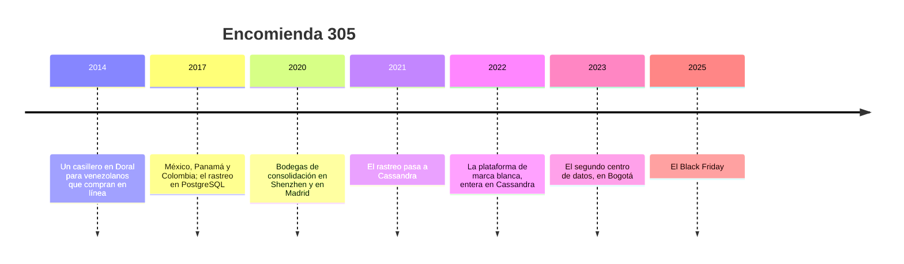

# 📦 Encomienda 305: la historia

> **Qué es este documento:** la fuente de verdad de todo lo narrativo de Rastro: la empresa, su gente, sus
> sistemas, sus cifras y sus reglas de negocio. **Ninguna fase inventa un dato**: si lo necesita y no está
> aquí, se agrega aquí primero.
> **Vigencia:** 2026-10-07 · **primera versión, en discusión con el autor.** Los dolores de §4 van por tema;
> cuando exista la propuesta de fases, cada uno se ata a su fase. Las cifras de §5 son ficticias y los
> volúmenes del laboratorio se fijan en la propuesta de fases. Los transportistas, los couriers aliados, las
> autoridades y los casos son inventados: ninguna entidad ni persona real.

---

## 1. 📅 Cómo llegó hasta aquí

Encomienda 305 es un courier de Miami que vende casilleros virtuales: una dirección en Doral a la que el
cliente hace llegar lo que compra en tiendas de Estados Unidos, y desde 2020 también en China y en Europa,
para recibirlo en México, Panamá, Venezuela, Colombia, Ecuador, Perú o Chile. El nombre viene del código de
área de Miami. Desde 2022 vende además su plataforma, con la marca de cada uno, a ciento cuarenta couriers
más pequeños de la región. Cada paquete que pasa por cualquiera de ellos deja un rastro de unos veintiocho
eventos, y ese rastro vive en Cassandra desde 2021. Ahí está bien puesto. El problema es todo lo que se
mudó con él.

**2014 · El casillero.** Marisol Echeverría trabajaba en una agencia de carga de Doral y veía a sus amigos de
Caracas pedirle que les recibiera compras en línea en su casa. Alquiló una bodega pequeña, le dio a cada
cliente un número de suite y lanzó Encomienda 305 con dos camiones, una báscula y una hoja de cálculo.
Gustavo Larrea, un ingeniero ecuatoriano que había conocido en la agencia, le escribió la primera aplicación:
Node, PostgreSQL, un casillero por cliente y una tabla de escaneos.

**2017 · Siete países.** México, Panamá y Colombia llegaron en el mismo año; Ecuador, Perú y Chile, en los dos
siguientes. El rastreo seguía en una tabla de PostgreSQL, particionada por mes, que el equipo de Gustavo
mantenía bien. **Fue la decisión correcta**: cabía, y no había nada nuevo que operar.

**2020 · Shenzhen y Madrid.** En la pandemia la gente compró como nunca, y empezó a comprar en tiendas chinas y
europeas. Encomienda 305 abrió bodegas de consolidación en Shenzhen y en Madrid, conectó los eventos de los
transportistas de origen y de los agentes de aduana de cada país, y el rastreo pasó de cuatro eventos por
paquete a más de veinte.

**2021 · El rastreo a Cassandra.** Con los eventos de los transportistas llegando en ráfagas y la tabla de
escaneos creciendo cien millones de filas al mes, Gustavo llevó el rastreo a un clúster de Cassandra de seis
nodos: una tabla por consulta (por guía, por casillero, por bodega y día), retención con TTL y escritura sin
coordinador. Su argumento: *"el rastreo es un río: se escribe una vez, nadie lo corrige, y siempre se lee por
la misma puerta"*. Tenía razón, y el curso lo mide.

**2022 · La marca blanca.** Rodrigo Salinas, que llegó de una empresa de comercio electrónico de Santiago, armó
la plataforma que Encomienda 305 vende a otros couriers: casilleros, tarifas, cotizador, facturación, saldo
prepago, reclamos y el rastreo, todo con la marca de cada courier aliado. Para salir rápido, y con el aval de
Gustavo, la puso **entera en el mismo clúster de Cassandra**. Su argumento: *"ya operamos Cassandra, ya
escala, y no quiero que la plataforma tenga dos bases que se desincronicen"*. Era un buen argumento para el
rastreo. Para un saldo, un consecutivo de factura y nueve mil cuatrocientas tarifas, no se discutió.

**2023 · Bogotá.** Una tormenta tropical dejó al centro de datos de Doral nueve horas con planta eléctrica y
con la conexión intermitente. Gustavo abrió un segundo centro de datos en Bogotá y extendió el clúster a doce
nodos, seis en cada lado, con tres réplicas por centro. **Fue otra decisión correcta**, y el Black Friday la
puso a prueba.

**2025 · El Black Friday.** Lo que pasó entre el 28 de noviembre y el 1 de diciembre abre el curso (§4).

| Año | Qué pasó | Quién lo decidió | Lo que dejó |
|---|---|---|---|
| 2014 | El casillero en Doral, sobre PostgreSQL | Marisol y Gustavo | la empresa |
| 2017 | Siete países; el rastreo en PostgreSQL particionado | Gustavo | una tabla que aguantó cuatro años |
| 2020 | Shenzhen, Madrid y los eventos de terceros | Marisol | veinte eventos por paquete |
| 2021 | El rastreo a Cassandra | Gustavo | el rastreo, bien puesto |
| 2022 | La marca blanca entera en Cassandra | Rodrigo, con aval de Gustavo | el villano, con su mejor argumento |
| 2023 | El segundo centro de datos | Gustavo | la disponibilidad que el rastreo necesitaba |
| 2025 | El Black Friday | — | el incidente que abre el curso |

## 2. 👥 La gente

| Personaje | Rol | Cómo habla | Qué quiere | Aparece en |
|---|---|---|---|---|
| **Marisol Echeverría** | Fundadora y directora general, de Caracas | Rápida y afectuosa: *"chévere, pero ¿cuánto nos costó?"* | que los couriers aliados no se vayan | la apertura, el veredicto |
| **Gustavo Larrea** | Director técnico, de Cuenca | Pausado y preciso: *"el rastreo lo puse yo en Cassandra, y lo volvería a poner"* | medir antes de mover un byte | casi todas; es el interlocutor del lector |
| **Rodrigo Salinas** | Líder de la plataforma de marca blanca, de Santiago | Entusiasta, de producto: todo lo quiere *"al tiro"* | que la plataforma siga vendiéndose | las tarifas, el saldo, el veredicto |
| **Lorena Quispe** | Contralora, de Lima | Formal, de libro: todo termina en un comprobante | que ningún consecutivo salte | la facturación, el saldo |
| **Diana Mejía** | Jefa de atención al cliente, de Medellín | Cálida y práctica; un *"¡qué pena!"* por cada cliente que espera | contestar *"¿dónde está mi paquete?"* sin abrir un ticket | los reportes, el rastreo |
| **Yamileth Rojas** | Jefa de la bodega de Doral, de Ciudad de Panamá | Directa, de turno de noche: *"ajá, ¿y el escáner?"* | que la pistola no se quede esperando | la ingesta, el casillero del revendedor |
| **Héctor Villalobos** | Ingeniero de plataforma, de guardia, de Monterrey | Coloquial: *"aguas"* antes de cada comando que asusta | dormir en noviembre | la operación, los motores por dentro |
| **Tú** | Ingeniero senior recién contratado | — | — | todas: Gustavo te contrató para medir, no para opinar |

El encargo de Gustavo, el día que entras: *"No te traje para que me digas que Cassandra es mala ni que es
buena. Sin ella el rastreo del Black Friday no habría sobrevivido a Doral. Quiero saber qué tiene que vivir
en Cassandra, qué no, si Scylla nos cambia la cuenta, y cuánto nos cuesta cada cosa. Y si la plataforma de
Rodrigo está bien donde está, también quiero saberlo."*

## 3. 🏚️ Lo que hay (el patrimonio)

| Sistema | Stack y edad | Quién lo mantiene | Sus mañas |
|---|---|---|---|
| **El rastreo** | Cassandra, doce nodos en dos centros de datos, desde 2021 | Gustavo y Héctor | sano en lo esencial; las tablas por guía, por casillero y por bodega y día; **el casillero sin cubetas de tiempo** |
| **La ingesta** | servicio en Node que recibe pistolas, transportistas, aduanas y última milla | Héctor | los transportistas mandan eventos dos veces y en desorden; las ráfagas llegan cuando quieren |
| **La plataforma de marca blanca** | Node con Cassandra, desde 2022 | Rodrigo | clientes, casilleros, tarifas en seis tablas, saldo prepago con contadores, consecutivos de factura con transacciones ligeras, reclamos |
| **Los reportes de atención** | consultas con `ALLOW FILTERING` que corren cada hora | Diana | sobre el mismo clúster que contesta el rastreo |
| **La API de rastreo** | Express sobre Cassandra, la que consultan los couriers aliados y sus clientes | Rodrigo y Héctor | el sitio de cada courier aliado la consulta cada pocos segundos |
| **La facturación** | dentro de la plataforma | Lorena | un consecutivo por país que no puede saltar |
| **El núcleo contable** | PostgreSQL, desde 2014 | Lorena y Gustavo | sano; lo que nunca se mudó |

**El laboratorio del curso levanta** el rastreo y la plataforma sobre Cassandra (y sobre ScyllaDB para
comparar), PostgreSQL como control y como destino de lo que no debía estar en Cassandra, un generador que
conoce la trayectoria verdadera de cada paquete, y un simulador de la ingesta con transportistas que
duplican y desordenan. Bigtable y los servicios gestionados compatibles con Cassandra se tratan solo desde su
documentación.

## 4. 🔥 El incidente que lo empezó todo

El Black Friday de 2025 cayó el 28 de noviembre, y Encomienda 305 lo esperaba desde agosto: el volumen de la
semana, entre la plataforma propia y los couriers aliados, fue cuatro veces y media el de una semana normal.
Durante cuarenta minutos del sábado, una falla del proveedor de red cortó Doral de Bogotá. **El rastreo siguió
escribiendo** en los dos lados, con quórum local, y se reconcilió solo cuando volvió el enlace. Eso salió bien,
y Gustavo lo cuenta con razón. Lo demás no.

**El jueves en la noche**, Rodrigo actualizó las tarifas de Venezuela con el recargo de combustible de
diciembre. Las tarifas viven en seis tablas desnormalizadas, y el script las escribió en un lote sin registro.
Un nodo se atrasó, dos de las seis tablas quedaron con la tarifa nueva y cuatro con la vieja, y durante tres
días el cotizador mostró un precio y la factura cobró otro: dieciocho mil seiscientos paquetes.

**El sábado**, con la API de la plataforma respondiendo lento, las aplicaciones de los couriers aliados
reintentaron los débitos del saldo prepago. El saldo es un contador de Cassandra, y un contador no sabe si ya
sumó: tres mil ochocientos setenta saldos quedaron descuadrados, unos de más y otros de menos.

**El domingo**, el consecutivo de factura, que se asigna con una transacción ligera por país, empezó a tardar
cuatro segundos en el percentil 99. La plataforma, al vencer el tiempo, pedía un consecutivo nuevo: mil ciento
cuarenta números quedaron saltados, y Lorena pasó diciembre explicándolos con notas.

**El lunes**, el reporte de Diana —*"paquetes retenidos en aduana, por país y por valor declarado"*—, que corre
cada hora con `ALLOW FILTERING`, coincidió con una cola de compactaciones que venía creciendo desde el viernes.
La lectura del rastreo pasó de 40 ms a 2,8 s en el percentil 99, la API de rastreo empezó a vencer, los sitios
de los couriers aliados mostraron *"sin información"*, y llegaron cincuenta y dos mil mensajes de clientes
preguntando dónde estaba su paquete. Uno de los nodos de Doral, además, tenía la partición del casillero de un
revendedor de Valencia que recibió treinta y un mil paquetes esa semana, y pasó la mañana en pausas de
recolección de basura.

El martes, Marisol preguntó: *"¿Tenemos que salirnos de Cassandra?"*. Gustavo dijo que del rastreo no, y que
de todo lo demás creía saber la respuesta pero no quería creerla: quería medirla. Esa semana abrió la vacante
que vas a ocupar.

### Los dolores, por tema

Cada uno abre una o más fases cuando la propuesta exista. Ninguno se inventa en la fase: sale de aquí.

1. **El río de eventos.** Veintiocho eventos por paquete, en ráfagas: qué hace Cassandra con cada escritura
   (registro de cambios, tabla en memoria, volcado, archivos inmutables) y dónde se acaba el caudal.
2. **¿Dónde está mi paquete?** La consulta que más se hace, por guía y por casillero, contra la misma pregunta
   en PostgreSQL particionado.
3. **El casillero del revendedor.** Treinta y un mil paquetes en una partición: cubetas de tiempo, el tamaño
   de partición que el motor avisa y el nodo que paga por él.
4. **El estado actual.** La última posición de cada paquete sin leer su historia entera, y el borrar y volver
   a insertar que siembra lápidas.
5. **Los transportistas que mandan todo dos veces.** Eventos duplicados y en desorden, la marca de tiempo de
   la escritura, el último que escribe gana y los relojes que no coinciden.
6. **Las seis tablas de tarifas.** Desnormalizar un dato que sí cambia: lotes con y sin registro, vistas
   materializadas, y lo que nadie garantiza entre tablas.
7. **El saldo prepago.** Los contadores, por qué un reintento suma dos veces, y dónde vive un saldo.
8. **El consecutivo de factura.** Las transacciones ligeras: Paxos por dentro, cuánto cuesta cada una y por
   qué un consecutivo sin saltos no es un problema de Cassandra.
9. **El reporte de Diana.** `ALLOW FILTERING`, los índices secundarios y SAI, medidos; y dónde va la pregunta
   que nadie previó.
10. **Doral y Bogotá.** Dos centros de datos: quórum local y global, los avisos guardados para el nodo caído,
    la reparación en lectura, y los cuarenta minutos sin enlace.
11. **La reparación que nadie corre.** La reparación completa, el periodo de gracia de las lápidas y el dato
    borrado que resucita.
12. **Veinticinco meses de rastro.** Retención con TTL, ventanas de compactación por tiempo, y las lápidas
    que el TTL también deja.
13. **La cola de compactaciones.** Las estrategias de compactación, la amplificación de escritura, de lectura
    y de espacio, y la cola que crece en un pico.
14. **La lectura por dentro.** Filtros de Bloom, índice de partición, cachés y cuántos archivos toca una
    lectura.
15. **El nodo trece.** Agregar un nodo: el anillo de tokens, los nodos virtuales, el traspaso de datos, la
    limpieza; y las tabletas de ScyllaDB.
16. **Scylla.** El mismo rastreo en un motor que promete lo mismo con menos máquina, medido; y su licencia.
17. **El clúster que hay que operar.** Copias, actualizaciones, la máquina virtual de Java y su recolector,
    `nodetool`; y lo que costaría no operarlo.
18. **El villano en la mesa.** La plataforma de marca blanca en Cassandra contra PostgreSQL, con el Black
    Friday reproducido.
19. **Lo que sí necesita Cassandra.** El rastreo medido contra lo mejor de PostgreSQL: dónde está la frontera
    de verdad.

## 5. 💰 Las cifras

Todas ficticias, coherentes entre sí, y con los volúmenes del laboratorio por fijar en la propuesta de fases.

| Cifra | Valor | Fuente o supuesto |
|---|---|---|
| Casilleros propios activos | ≈ 380.000, en siete países | ficticia |
| Couriers aliados de marca blanca | 140; ≈ 2,1 M casilleros entre todos | ficticia |
| Paquetes por día | ≈ 260.000 entre todos; ×4,5 en la semana del Black Friday | ficticia |
| Eventos de rastreo por paquete | ≈ 28 (pistolas, transportistas de origen, aduanas, última milla) | ficticia |
| Eventos por día | ≈ 7,3 M; ≈ 33 M el día pico | ficticia |
| Caudal de escritura | ≈ 1.500 eventos/s en hora pico normal; ráfagas de 25.000/s cuando un transportista vuelca su lote | ficticia |
| Consultas de rastreo | ≈ 120 M por día, casi todas de los sitios de los couriers aliados | ficticia |
| Retención del rastro | 25 meses | ficticia |
| El clúster | 12 nodos: 6 en Doral y 6 en Bogotá, 3 réplicas por centro de datos | ficticia |
| Tarifas | ≈ 9.400 filas, escritas en 6 tablas | ficticia |
| Facturas | ≈ 1,1 M por mes, con un consecutivo por país | ficticia |
| El incidente: tarifas | 18.600 paquetes cotizados con una tarifa y facturados con otra, durante 3 días | ficticia |
| El incidente: saldo | 3.870 saldos descuadrados | ficticia |
| El incidente: consecutivos | 1.140 consecutivos saltados; p99 de 4 s en la asignación | ficticia |
| El incidente: rastreo | p99 de 40 ms a 2,8 s; 52.000 mensajes de clientes | ficticia |
| El casillero del revendedor | 31.000 paquetes en una semana, en una sola partición | ficticia |
| El corte de red | 40 minutos entre Doral y Bogotá, sin eventos perdidos | ficticia |

## 6. 📏 Las reglas de negocio

- **El casillero.** Cada cliente tiene un número de casillero y una dirección en Doral; los clientes de un
  courier aliado tienen el suyo, con la marca del aliado. Un revendedor es un cliente más, con mucho volumen.
- **La guía.** Cada paquete recibe una guía al llegar a una bodega de origen (Doral, Shenzhen o Madrid). La
  guía no cambia en todo el recorrido.
- **El rastro.** Cada evento lleva la guía, el momento en que ocurrió, el lugar, el tipo (recibido, pesado,
  consolidado, en vuelo, en aduana, liberado, en reparto, entregado, novedad) y quién lo reportó. **Un evento
  no se corrige nunca**: si estuvo mal, se reporta otro.
- **El estado actual** de un paquete es su último evento por momento de ocurrencia, no por momento de llegada.
- **La tarifa.** Por país de destino, servicio y franja de peso, con recargos que cambian cada mes. La tarifa
  que se cotiza es la que se cobra.
- **El saldo prepago.** Los couriers aliados y los clientes grandes pagan por adelantado; cada paquete
  despachado descuenta su costo. **El saldo no puede quedar descuadrado.**
- **El consecutivo de factura.** Uno por país, sin saltos y sin repetidos; un salto se justifica con una nota.
- **La retención.** El rastro se conserva veinticinco meses; después se borra.
- **La base de verdad** del rastro es Cassandra; la de la contabilidad es PostgreSQL. La de la plataforma de
  marca blanca es, hoy, Cassandra, y esa es la pregunta del curso.

## 7. 🗣️ Cómo hablan

La narración y las instrucciones al lector van en tuteo neutro. Las voces se reservan para los diálogos, una
expresión por escena:

- **Marisol** (Caracas): *"chévere"*.
- **Rodrigo** (Santiago): *"al tiro"*.
- **Diana** (Medellín): *"¡qué pena!"*.
- **Yamileth** (Ciudad de Panamá): *"ajá"*.
- **Héctor** (Monterrey): *"aguas"*.
- **Gustavo** habla de **la puerta** (por dónde se lee una tabla) y **el río** (el rastro); **Lorena**, de
  **el consecutivo** y **el comprobante**; **Rodrigo**, de **los aliados** y **salir rápido**.

En la casa se dice **el rastro**, **la guía**, **el casillero**, **los aliados** (los couriers de marca
blanca), **la plataforma** (la de marca blanca), **Doral** y **Bogotá** (los centros de datos), **el
revendedor** y **el Black Friday**.
