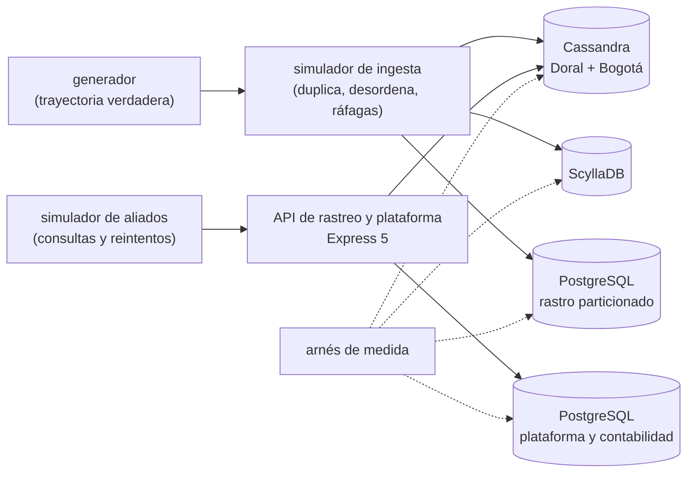

# 🎯 Alcance del proyecto
## Rastro — el modelo de columnar ancha a fondo

> **Qué es este documento:** la fuente de verdad de **qué** enseña el curso, a quién y con qué límites. Lo
> que no esté aquí no está en el curso.
> **Fecha de esta versión:** 7 de octubre de 2026. Consolida la semilla de agosto (`_desechable-semilla.md`),
> el alcance de agosto (`_desechable-alcance-v1.md`), la ficha de arranque, las reglas de la ruta y los
> precedentes de los cursos anteriores. **Lo único preliminar es §9**: la cantidad de fases y su orden salen
> de la propuesta de fases.
> **Precedencia:** manda este documento. Después viene
> [`guia-de-estilo-y-convenciones.md`](guia-de-estilo-y-convenciones.md), que decide **cómo** se escribe;
> después el contrato de nombres y el diccionario de términos (por escribir), y las propuestas. Las
> plantillas y los prompts se actualizan siempre al final. Por encima de todos está el `CLAUDE.md` del
> repositorio, en lo que este curso no haya declarado como excepción (§12).
> **Estado de las decisiones:** 36 cerradas, ninguna abierta (§12). Solo faltan la propuesta de fases y la
> versión final de la historia.

---

## 1. 🧭 En una frase

**Un curso que enseña el modelo de columnar ancha a fondo reconstruyendo y midiendo el rastreo de paquetes de
un courier de siete países, para que el lector pueda decidir —y defender con números propios— qué datos son
un río que Cassandra debe llevar, cuáles son un libro que nunca debió llevar, qué le pasa al motor por dentro
cuando lo aprietan, y dónde está de verdad la frontera con PostgreSQL.**

No forma administradores de Cassandra ni prepara una certificación. No enseña columnar ancha desde cero: el
lector ya hizo el minicurso de Ruta NoSQL Lite. Forma la capacidad de decir *"el rastro va en Cassandra, con
estas tablas, esta compactación y este quórum; el saldo, las tarifas y el consecutivo vuelven a PostgreSQL;
por esta razón y con este número"*.

---

## 2. 🔥 El problema que resuelve

El lector salió de lite sabiendo modelar por consulta, elegir partición y agrupamiento, desnormalizar a
propósito, que el quórum se ajusta, que una partición caliente tumba un nodo y que borrar cuesta. Le falta lo
que viene después: saber qué hace el motor con cada escritura y cada lectura, elegir la compactación por
tabla, sobrevivir a la reparación y a las lápidas, operar dos centros de datos, decidir cuándo un lote, un
contador o una transacción ligera sirven y cuándo son una trampa, medir si ScyllaDB cambia la cuenta, y
encontrar con números propios la frontera con PostgreSQL. Hoy eso se aprende el Black Friday en que el saldo
se descuadra, o en tutoriales que demuestran Cassandra con una tabla de usuarios.

El villano es uno solo, **el motor de río puesto a llevar un libro**, y tiene tres caras:

- **"Ya operamos Cassandra: todo a Cassandra."** El rastro sí; las tarifas que cambian, el saldo que no
  puede descuadrarse, el consecutivo sin saltos y la pregunta que nadie previó, no.
- **"Cassandra escala sola."** La compactación, la reparación, las lápidas, la partición del revendedor y la
  recolección de basura no se operan solas.
- **"Sin Cassandra no se puede."** El reverso, que el curso también mide: hasta dónde llega PostgreSQL
  particionado con el mismo rastro.

> ⚠️ **El antagonista no es ninguna herramienta.** Cassandra le dio a Encomienda 305 un rastreo que sobrevivió
> a cuarenta minutos sin enlace entre centros de datos; ScyllaDB gana donde gana y el curso lo publica;
> PostgreSQL es la contabilidad desde 2014; y el curso cierra con el veredicto de cuándo la columnar ancha no
> hacía falta.

---

## 3. 🎓 Objetivo pedagógico

Al terminar, el lector puede hacer seis cosas que antes no podía:

1. **Separar el río del libro** en un sistema real: decidir por inmutabilidad, por forma de la consulta y por
   las garantías que pide cada dato dónde vive.
2. **Modelar el rastro para el pico**: cubetas de tiempo, estado actual sin lápidas, eventos duplicados y en
   desorden, retención con TTL y la compactación que le corresponde.
3. **Leer el motor por dentro**: camino de escritura y de lectura, compactación y sus amplificaciones,
   lápidas, reparación y periodo de gracia, contadores, lotes y Paxos.
4. **Operar la distribución**: dos centros de datos, niveles de consistencia por consulta, nodos que se caen
   y vuelven, nodos que se agregan, y el dato que resucita.
5. **Comparar dentro de la familia**: Cassandra contra ScyllaDB con la misma carga, y el costo de cada uno.
6. **Encontrar la frontera**: el rastro en PostgreSQL particionado contra Cassandra, con caudal, retención y
   disponibilidad medidos, y la plataforma devuelta a PostgreSQL con números antes y después.

Lo que **no** es objetivo: construir un producto de logística, administrar un clúster en producción
corporativa, ni la analítica sobre el rastro.

---

## 4. 👥 Perfil del lector

Ingeniero senior que **ya hizo Ruta NoSQL Lite**, o que sabe lo equivalente: SQL y modelado relacional de
oficio, particionado declarativo de PostgreSQL sin miedo, TypeScript con soltura, contenedores sin ayuda, y el
minicurso de columnar ancha de lite. Se le explica el modelo en profundidad y los motores por dentro; no se le
explica a programar, Docker, SQL ni lo que lite ya enseñó.

**Lo que se da por sabido y no se explica jamás:** SQL, índices, transacciones, particionado declarativo;
TypeScript y Node; Docker Compose; las cinco preguntas, el arnés y la apuesta antes de medir; de lite,
keyspaces y tablas, CQL básico, clave de partición contra agrupamiento, modelar por consulta, desnormalizar en
varias tablas, quórum en lo básico, la partición caliente, que borrar deja lápidas, que compactar amplifica la
escritura, `ALLOW FILTERING` como olor, y que operar un motor más cuesta.

**Lo que se explica con cero ambigüedad**, aunque el lector sea senior: qué hace el motor entre que llega una
escritura y que está en disco, cuántos archivos toca una lectura y por qué, qué amplifica cada estrategia de
compactación, cuándo una lápida se puede purgar y qué pasa si se purga antes de reparar, qué garantiza un lote
con registro y qué no, por qué un contador no es idempotente, cuántas idas y vueltas cuesta una transacción
ligera, qué cambia entre `LOCAL_QUORUM` y `EACH_QUORUM`, cómo se reparten los tokens y qué cambia con las
tabletas de ScyllaDB.

> 🧭 **Ninguna caja negra prematura, no menos profundidad.**

**Requisitos de entrada:** un equipo con 16 GB de memoria (D-20), Docker Desktop o Podman, y Node 24. **No hace
falta** ninguna cuenta en la nube ni nada instalado fuera de contenedores.

---

## 5. 🧭 La pregunta que ordena el curso

> *¿Este dato es un río o un libro, y qué le cuesta al sistema —y a la empresa— guardarlo donde se guarda?*

Se presenta en la primera fase, con el Black Friday, y reaparece en el veredicto de cada fase:

- **La primera parte** responde *qué es un río*: el rastro, la consulta por guía y por casillero, el
  revendedor, el estado actual, los transportistas que duplican.
- **La segunda parte** responde *qué es un libro*: las tarifas, el saldo, el consecutivo y la pregunta que
  nadie previó, en Cassandra y fuera de ella.
- **La tercera parte** responde *qué le cuesta al motor*: escritura y lectura por dentro, compactación,
  retención, lápidas y reparación.
- **La cuarta parte** responde *qué le cuesta distribuirse*: dos centros de datos, agregar un nodo, ScyllaDB.
- **El cierre** responde la pregunta entera: la operación, la autopsia de la plataforma y la frontera del
  rastro con PostgreSQL.

---

## 6. 📏 Cómo se mide

**Todo "mejor que" lleva un número**, medido con el arnés del curso y consolidado en `BENCHMARKS.md`. Se mide
primero **lo leído contra lo escrito**: eventos perdidos, duplicados, fuera de orden y lecturas obsoletas
contra la trayectoria verdadera que conoce el generador, y saldos y consecutivos contra el libro (D-31).
Después **la forma**: SSTables tocadas por lectura, tamaño de partición, lápidas leídas, compactaciones
pendientes, amplificación de escritura, de lectura y de espacio, disco por réplica. **Los tiempos sí
aparecen**, siempre con su dispersión (mediana, p95 y p99), calentamiento, repeticiones y máquina declarados,
**y siempre con el nivel de consistencia, el factor de réplica, los nodos y el caudal ofrecido** al lado,
porque en este modelo el veredicto depende de ellos (D-19).

Las reglas de honestidad no se negocian: se publica lo que salió · el empate se llama empate · nada de números
redondos sin dispersión · cada motor se configura bien y según su documentación (la memoria y el recolector
de Cassandra, los núcleos y la memoria de ScyllaDB, la memoria de PostgreSQL, la compactación de cada tabla) ·
**PostgreSQL juega con lo mejor que tiene**: particionado declarativo, índices BRIN y B-tree donde
correspondan, escritura por lotes, autovacuum ajustado · se declara lo que no se midió · los costos de la nube
llevan ☁️, fuente y fecha · y **nunca se extrapola de un portátil a producción**: un clúster de cuatro nodos en
un portátil no es uno de doce en dos centros de datos, y se dice así.

Dos anclas por fase, cuando la fase las admite: 🪞 **una apuesta** escrita antes de ejecutar y 💥 **una rotura
provocada**, con el síntoma literal y lo que costó salir.

---

## 7. 🧪 El sistema del curso

### 7.1 El dominio

El rastreo y la plataforma de marca blanca de **Encomienda 305**, un courier de casilleros virtuales de Miami:
casilleros, guías, eventos de rastreo de las bodegas de Doral, Shenzhen y Madrid, de los transportistas, de las
aduanas y de la última milla; el estado actual de cada paquete; y la plataforma con tarifas, cotizador, saldo
prepago, facturas con su consecutivo por país y reclamos. PostgreSQL es la contabilidad. La historia está en
[`../00-historia-de-encomienda-305.md`](../00-historia-de-encomienda-305.md).

**Queda fuera a propósito:** dinero, aduanas y transportistas reales, la autenticación de los sitios de los
aliados, el cálculo de impuestos de cada país, y la analítica sobre el rastro.

### 7.2 El stack, y qué compra cada pieza

| Pieza | Elección | Qué compra | Qué cuesta |
|---|---|---|---|
| Motor principal | Apache Cassandra, varios nodos (D-16) | el río sin coordinador, en dos centros de datos | memoria, la máquina virtual de Java, y una operación que no se hace sola |
| Rival de la familia | ScyllaDB (D-16, D-24) | el mismo CQL con otra arquitectura, en menos máquina | su licencia y sus condiciones, por verificar |
| Control y destino | PostgreSQL con particionado declarativo (D-33) | el rastro hasta donde aguante, y la plataforma donde debía estar | — es lo que ya existe en la empresa |
| Servicios gestionados | Bigtable, Amazon Keyspaces y Astra, solo desde documentación ☁️ (D-22) | la respuesta a "¿y si no queremos operar nada?" | cuestan dinero |
| API de rastreo y plataforma | Express 5 mínima (D-32) | las preguntas de extremo a extremo, con los reintentos de los aliados | una capa que el arnés evita cuando mide el motor |
| Ingesta | simulada, con transportistas que duplican y desordenan (D-30) | el río con sus ráfagas, medible | — |
| Arnés, generador y simuladores | TypeScript nativo en Node 24 (D-17, D-27) | la misma carga y la misma verdad contra cada motor | — |

### 7.3 Cómo se construye el código

A mano, en un solo proyecto en `src/` que crece por fases (D-09). El generador conoce la trayectoria verdadera
de cada paquete; el simulador de ingesta la convierte en eventos con duplicados, desorden y ráfagas, y la
manda a cada motor.

### 7.4 El tamaño mínimo

Todo cabe en **16 GB** con perfiles de Compose: PostgreSQL, el servicio y el arnés siempre; **un motor de la
familia a la vez**; Cassandra en tres nodos para un centro de datos y en dos más dos para dos centros, con la
memoria dimensionada en la verificación previa (D-20, D-28).

---

## 8. 🧰 Herramientas y plataformas

**Versiones:** última estable a la fecha de la verificación previa, por digest para las imágenes y con archivo
de bloqueo para las librerías, en el apéndice del laboratorio (D-07). **Plataformas:** macOS en Apple Silicon,
Linux y Windows con WSL2; el autor verifica en macOS arm64 y lo demás se marca no verificado (D-06).

---

## 9. 🪜 La forma del curso

**Tipo:** curso completo. **Unas 100 horas en 10 a 12 fases** de unas 10 h. **Preliminar:** el arco, los nombres
y las fichas salen de la propuesta de fases. El borrador de partida son las doce fases de la semilla, menos lo
que lite ya dio (el marco antes de modelar, la clave de partición en lo básico, la tabla por consulta, el
agrupamiento, la consistencia con quórum en lo básico) y menos los roll-ups de telemetría, más lo que pide la
profundidad: los caminos de escritura y lectura, la reparación, los contadores, los lotes, Paxos, los dos
centros de datos, el nodo nuevo y la frontera medida con PostgreSQL.

| Bloque (tentativo) | Qué hace | Temas de la historia (§4 de ella) |
|---|---|---|
| **I · El río** | el rastro, sus consultas, el revendedor, el estado actual, los duplicados | 1, 2, 3, 4, 5 |
| **II · El libro** | las tarifas, el saldo, el consecutivo, el reporte de Diana | 6, 7, 8, 9 |
| **III · El motor por dentro** | lectura, compactación, retención, lápidas y reparación | 14, 13, 12, 11 |
| **IV · La distribución** | Doral y Bogotá, el nodo trece, ScyllaDB | 10, 15, 16 |
| **V · Operación y veredicto** | operar el clúster y los gestionados, la autopsia, la frontera | 17, 18, 19 |

---

## 10. ✅ Lo que está dentro del alcance

- El camino de escritura: registro de cambios, tabla en memoria, volcado, SSTables; el caudal y dónde se
  acaba.
- El rastro modelado para el pico: cubetas de tiempo, tamaño de partición y sus avisos, el estado actual sin
  borrar e insertar, `PER PARTITION LIMIT`, orden de agrupamiento descendente.
- Eventos duplicados y en desorden: idempotencia, `USING TIMESTAMP`, el último que escribe gana, relojes
  desfasados.
- Lotes con y sin registro, vistas materializadas con su advertencia, y lo que no se garantiza entre tablas.
- Contadores: cómo funcionan y por qué un reintento suma dos veces.
- Transacciones ligeras: Paxos, idas y vueltas, contención, `SERIAL` y `LOCAL_SERIAL`; Accord si la versión
  estable lo trae (D-26).
- Índices secundarios y SAI, medidos contra `ALLOW FILTERING` y contra llevar la pregunta a PostgreSQL.
- El camino de lectura: filtros de Bloom, índice y resumen de partición, cachés, SSTables por lectura.
- Compactación: por tamaño, por niveles, por ventanas de tiempo y unificada; sus amplificaciones y la cola de
  pendientes (D-25).
- TTL, lápidas, periodo de gracia, reparación completa e incremental, y el dato que resucita.
- Dos centros de datos: estrategia de réplica por centro, `LOCAL_QUORUM` contra `EACH_QUORUM`, avisos
  guardados, reparación en lectura, el corte de enlace provocado.
- El anillo de tokens, los nodos virtuales, agregar y retirar un nodo, la limpieza; las tabletas de ScyllaDB.
- ScyllaDB por dentro y contra Cassandra con la misma carga.
- Operación: copias e instantáneas, actualizaciones, la máquina virtual de Java y su recolector, `nodetool`;
  los gestionados desde su documentación.
- La autopsia de la plataforma en Cassandra, con el Black Friday reproducido, y su migración a PostgreSQL.
- La frontera del rastro: PostgreSQL particionado contra Cassandra con el mismo caudal y la misma retención.
- El árbol de cuándo no usar columnar ancha.

## 11. 🚫 Lo que está fuera del alcance

Se declara y el texto se detiene: **no se dice dónde estaría ese material.**

- Lo que Ruta NoSQL Lite ya enseñó de columnar ancha: se usa, no se explica.
- Roll-ups y agregación escalonada de telemetría.
- La analítica sobre el rastro y el conector de Spark.
- HBase, Bigtable operado de verdad y los gestionados medidos de verdad (D-22).
- PostgreSQL distribuido (Citus y similares) (D-33).
- La búsqueda vectorial de Cassandra.
- Kafka y CDC reales: la ingesta se simula (D-30).
- Kubernetes y los operadores de Cassandra.
- Seguridad del clúster más allá de nombrar lo que hay que activar.

---

## 12. ⚖️ Decisiones

Si una sesión futura quiere cambiar una, primero la cambia aquí y después en todo lo demás, nunca al revés. ✅
cerrada · ⏳ abierta · 🔄 reabierta. Las que llevan *(ruta)* o el nombre de un curso siguen la regla de la ruta
o el precedente de ese curso; las que llevan *(por defecto)* las cerró la sesión con el valor propuesto y se le
listaron al autor.

| ID | Decisión | Valor | Estado |
|---|---|---|---|
| D-01 | Idioma | Español latinoamericano neutro con tuteo; código, comandos, identificadores y salida de terminal en inglés; comentarios de código en español | ✅ |
| D-02 | Tipo de curso | Curso completo | ✅ |
| D-03 | Autocontención | Lo publicado nombra Ruta NoSQL Lite **solo como requisito de entrada**: no usa su contenido, no remite a sus fases ni reutiliza sus ejemplos, datos o mediciones. `prompts/` puede citarla *(ruta, R-07)* | ✅ |
| D-04 | Promesa de esfuerzo | ~100 h en 10–12 fases de ~10 h *(Proteo)* | ✅ |
| D-05 | Aparato de evaluación | 20–30 ejercicios por fase, 🟢🟡🟠🔴 + 🔥, un tercio de diagnóstico o medición, cada uno con su criterio; **sin solución publicada**. Taller global: el rastreo y la plataforma en `src/`. Un 💀 boss por bloque cuando el bloque lo admita, y el proyecto final de §13 *(Proteo)* | ✅ |
| D-06 | Plataformas | macOS arm64, Linux, Windows con WSL2; el autor verifica en macOS arm64 | ✅ |
| D-07 | Política de versiones | Última estable a la fecha de la verificación previa; imágenes por digest y librerías con archivo de bloqueo, en el apéndice del laboratorio | ✅ |
| D-08 | Ejecución | Nada se publica sin haberse ejecutado | ✅ |
| D-09 | Código | Un solo proyecto en `src/` que crece por fases, con tags `fase-NN-<slug>` *(Proteo)* | ✅ |
| D-10 | README y temario | Se escriben al final, en una tanda propia | ✅ |
| D-11 | Historia | Encomienda 305, en `00-historia-de-encomienda-305.md` | ✅ |
| D-12 | Diagramas | Mermaid | ✅ |
| D-13 | Publicación | Repositorio público propio del curso, sin `prompts/` | ✅ |
| D-14 | Prerrequisito | Ruta NoSQL Lite, o lo equivalente de §4 | ✅ |
| D-15 | Profundidad | Full geek: caminos de escritura y lectura, compactación y amplificaciones, lápidas, reparación, avisos guardados, anillo de tokens, Paxos, contadores, lotes, SAI, la máquina virtual de Java, ScyllaDB por dentro *(por defecto)* | ✅ |
| D-16 | Rivales | Apache Cassandra como principal; ScyllaDB como rival de la familia; PostgreSQL con particionado declarativo como control del rastro y destino de la plataforma *(semilla)* | ✅ |
| D-17 | Lenguaje | TypeScript nativo en Node 24 para todo; sin codas en otros lenguajes *(semilla y Portalón)* | ✅ |
| D-18 | Clientes | El driver de Node para Cassandra contra Cassandra y ScyllaDB (cuál, y bajo qué proyecto, lo fija la verificación previa); `pg` contra PostgreSQL. Las diferencias de CQL entre Cassandra y ScyllaDB se verifican antes de comparar *(semilla)* | ✅ |
| D-19 | Mediciones | Lo leído contra lo escrito primero, después forma, después tiempos con mediana, p95 y p99; siempre con nivel de consistencia, factor de réplica, nodos y caudal ofrecido. Documento vivo: `BENCHMARKS.md` *(Proteo, Telaraña)* | ✅ |
| D-20 | Memoria del laboratorio | Todo dentro de 16 GB con perfiles de Compose: un motor de la familia a la vez; Cassandra en 3 nodos (un centro) o 2 + 2 (dos centros), con la memoria por nodo dimensionada en la verificación previa; si dos más dos no cabe, se declara y se mide con lo que cabe *(Portalón)* | ✅ |
| D-21 | Datos | Sintéticos con semilla fija y la forma de Encomienda 305: casilleros de siete países, guías con su trayectoria verdadera, revendedores, transportistas que duplican y desordenan, tarifas con recargos mensuales, saldos y facturas; el Black Friday como perfil de carga | ✅ |
| D-22 | Servicios gestionados | Bigtable (con su paper como lectura), Amazon Keyspaces y Astra, solo desde su documentación y sus precios públicos, citados con fecha y marcados ☁️; nunca en la misma tabla que lo medido sin esa marca *(Proteo, con DocumentDB)* | ✅ |
| D-23 | El villano | Implementado de verdad, lo justo para medirlo: la plataforma en Cassandra (tarifas en seis tablas con lote sin registro, saldo con contadores, consecutivo con transacción ligera, reporte con `ALLOW FILTERING`) frente a la misma plataforma en PostgreSQL. El Black Friday, reproducido con los simuladores | ✅ |
| D-24 | Licencia de ScyllaDB | Se verifica en la verificación previa y se cita con fecha; se mide con la edición que se pueda usar sin costo y se dice cuál y con qué condiciones; si sus condiciones impiden publicar mediciones, se declara y queda solo desde documentación ☁️ *(por defecto)* | ✅ |
| D-25 | Compactación | Por tamaño, por niveles, por ventanas de tiempo y la unificada, medidas en la fase que las compara con el rastro; el resto del curso usa por tabla la que gane, y lo dice *(por defecto, como D-27 de Telaraña)* | ✅ |
| D-26 | Transacciones | Las transacciones ligeras (Paxos) se miden en la fase del consecutivo. Accord se explica y se mide ahí solo si la versión estable de la verificación previa lo trae; si no, queda nombrado y se dice *(por defecto, como D-26 de Telaraña)* | ✅ |
| D-27 | Generación de carga | El generador propio en TypeScript para todo; si en la verificación previa no alcanza el caudal de las ráfagas, se suma `cassandra-stress` solo para el caudal bruto, declarado *(semilla)* | ✅ |
| D-28 | Dos centros de datos | Dos centros lógicos en la misma máquina, con la latencia entre ellos y el corte de enlace provocados por red; se declara que es una simulación *(por defecto)* | ✅ |
| D-29 | Imágenes en arm64 | Si una imagen no corre nativa en arm64, se declara y se mide emulada con esa advertencia, o se marca no verificado *(Portalón)* | ✅ |
| D-30 | La ingesta | Simulada en TypeScript, con duplicados, desorden y ráfagas parametrizables; ningún Kafka ni CDC real *(Telaraña, D-30)* | ✅ |
| D-31 | La verdad del generador | El generador conoce la trayectoria verdadera de cada paquete y el libro de cada saldo y consecutivo; toda medición de corrección se publica contra ella, además del tiempo *(Telaraña, D-31)* | ✅ |
| D-32 | API | Express 5 mínima para el rastreo y la plataforma; el arnés mide los motores directamente salvo en las preguntas de extremo a extremo *(Proteo)* | ✅ |
| D-33 | PostgreSQL como rival | Una sola instancia con particionado declarativo, con la mejor configuración documentada; PostgreSQL distribuido queda fuera *(por defecto)* | ✅ |
| D-34 | Nombre del curso | **Rastro**; el directorio pasa de `05-centinela-de-flota/` a `05-rastro/` (07/10/2026) | ✅ |
| D-35 | Vistas materializadas | Se explican y se miden solo en la fase de las tarifas, con la advertencia de la documentación citada; el núcleo no las usa *(por defecto)* | ✅ |
| D-36 | La pregunta que nadie previó | El reporte de Diana se resuelve llevando una copia derivada a PostgreSQL; SAI se mide como alternativa; ningún motor analítico aparte *(por defecto)* | ✅ |

**Excepciones declaradas al `CLAUDE.md` del repositorio**, con su porqué (el detalle en la guía §13):

- **Ruta NoSQL Lite como prerrequisito** (D-14) → no se explican los fundamentos de columnar ancha → los da lite.
- **Los ejercicios no traen solución publicada** (D-05) → el lector apuesta y mide antes de mirar.

---

## 13. 🏁 El proyecto final

Gustavo tiene que presentarles a los ciento cuarenta aliados, antes del próximo Black Friday, cómo queda la
plataforma: qué vive en Cassandra y con qué tablas, compactación y quórum; qué volvió a PostgreSQL y cómo se
migró; qué pasa si Doral se corta de Bogotá; si conviene ScyllaDB; y qué habría pasado con el Black Friday de
2025 en la arquitectura nueva. Se entrega como un informe con las mediciones del curso, la autopsia de la
plataforma con números antes y después, el Black Friday reproducido en las dos arquitecturas, la frontera del
rastro con PostgreSQL, y el árbol de decisión de cuándo **no** usar columnar ancha aplicado a cada pieza.

---

## 14. 🎯 Criterios de éxito

El curso está bien si:

- Cada fase abre con un dolor de Encomienda 305 y cierra con algo que se apostó, se midió y, cuando tocaba, se
  rompió a propósito.
- Ninguna fase repite lo que lite ya enseñó de columnar ancha.
- PostgreSQL gana la plataforma con el número delante; Cassandra gana el rastro donde lo gana, y la frontera
  del rastro se publica con el caudal y la retención en que PostgreSQL deja de alcanzar, o con el empate si no
  deja.
- Toda medición de corrección se publica contra la verdad del generador, no solo con su tiempo.
- Un lector que solo hace los bloques I y II sale separando ríos de libros y modelando el rastro para el pico;
  uno que sigue hasta el IV sabe leer el motor por dentro y operar dos centros de datos.
- El veredicto final no es "Cassandra para todo" ni "Cassandra para nada".

---

## 15. 📌 Extensión futura, fuera de este curso

El diseño deja preparado, sin prometerlo, el rastro compartido con los transportistas en tiempo real y la
analítica de tiempos de tránsito por ruta.
