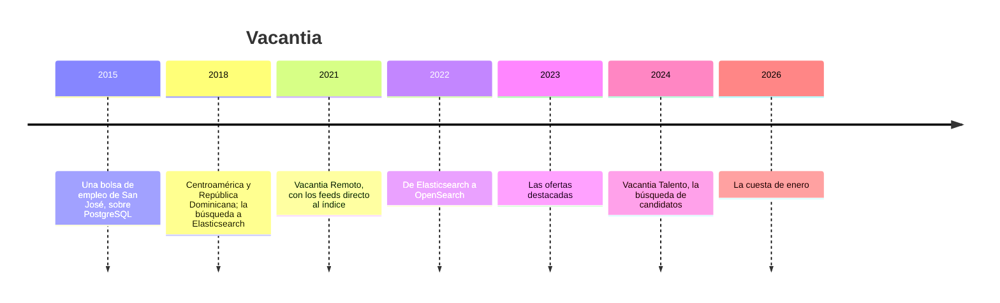

# 💼 Vacantia: la historia

> **Qué es este documento:** la fuente de verdad de todo lo narrativo de Buscafino: la empresa, su gente, sus
> sistemas, sus cifras y sus reglas de negocio. **Ninguna fase inventa un dato**: si lo necesita y no está
> aquí, se agrega aquí primero.
> **Vigencia:** 2026-10-07 · **primera versión, en discusión con el autor.** Los dolores de §4 van por tema;
> cuando exista la propuesta de fases, cada uno se ata a su fase. Las cifras de §5 son ficticias y los
> volúmenes del laboratorio se fijan en la propuesta de fases. Las empresas, los sistemas de reclutamiento,
> las autoridades y los casos son inventados: ninguna entidad ni persona real.

---

## 1. 📅 Cómo llegó hasta aquí

Vacantia es un portal de empleo de San José de Costa Rica: ofertas de trabajo en nueve países —Costa Rica,
Panamá, Guatemala, El Salvador, Honduras, República Dominicana, Colombia, Ecuador y Perú— y, desde 2021, ofertas
remotas de empresas de Estados Unidos, Canadá, España, Portugal y Brasil para cualquiera de la región. La gente
busca trabajo; las empresas buscan candidatos; las dos búsquedas pasan por OpenSearch. El buscador es bueno.
También guarda cosas que no están en ningún otro sitio.

**2015 · La bolsa.** Gabriela Solano dirigía recursos humanos en una empresa de servicios de San José y
publicaba cada vacante en cuatro sitios distintos. Con Mauricio Peralta, un desarrollador dominicano que vivía
en Heredia, lanzó Vacantia: empresas, ofertas, candidatos y postulaciones en PostgreSQL, y una búsqueda con
`ILIKE` sobre el título que alcanzó para los primeros dos años.

**2018 · La búsqueda a Elasticsearch.** Con Panamá, Guatemala, El Salvador, Honduras y República Dominicana, el
`ILIKE` dejó de alcanzar: no encontraba "contadora" buscando "contador", ni "auxiliar" escrito con un dedo de
más. Mauricio montó Elasticsearch, alimentado cada noche desde PostgreSQL y después con un proceso que copia
cada cambio. **Fue la decisión correcta**: el índice era un espejo y PostgreSQL seguía siendo la verdad.

**2021 · Vacantia Remoto.** El trabajo remoto abrió un mercado nuevo: empresas de fuera que contratan en la
región. Javier Montalvo, que llegó de una empresa de comercio electrónico de Quito, conectó los feeds de los
sistemas de reclutamiento de seiscientas cuarenta empresas extranjeras. Eran casi un millón de ofertas que
cambian todos los días, y cargarlas en PostgreSQL tomaba seis horas cada noche. Javier las escribió **directo
al índice**, con el aval de Mauricio. Su argumento: *"son solo para buscar; si las meto a PostgreSQL, las tengo
dos veces y llegan seis horas tarde"*. Era un buen argumento para la velocidad. Lo que no se discutió fue qué
pasaba el día que hubiera que reconstruir el índice.

**2022 · OpenSearch.** Después del cambio de licencia de Elasticsearch, Mauricio migró a OpenSearch, el fork
con licencia Apache. La migración salió bien y nadie la recuerda, que es lo mejor que se puede decir de una
migración.

**2023 · Los destacados.** Daniela Ruiz, de ventas a empresas, lanzó las ofertas destacadas: la empresa paga y
su oferta sube en las búsquedas que ya coinciden con ella. El cobro quedó en el procesador de pagos; **qué
oferta estaba destacada, desde cuándo y hasta cuándo quedó solo en el índice**, como un campo del documento.
El contador de postulaciones de cada oferta, que se muestra junto al título, también.

**2024 · Vacantia Talento.** Las empresas empezaron a pagar por buscar candidatos. Los currículos se indexaron
desde PostgreSQL, como corresponde, con la regla de que un candidato que pide la supresión de sus datos
desaparece de toda búsqueda en setenta y dos horas.

**2026 · La cuesta de enero.** Lo que pasó el 12 de enero abre el curso (§4).

| Año | Qué pasó | Quién lo decidió | Lo que dejó |
|---|---|---|---|
| 2015 | La bolsa sobre PostgreSQL | Gabriela y Mauricio | la base de verdad, que sigue sana |
| 2018 | La búsqueda a Elasticsearch, como espejo | Mauricio | un buscador que encuentra |
| 2021 | Los feeds de las ofertas remotas, directo al índice | Javier, con aval de Mauricio | el villano, con su mejor argumento |
| 2022 | De Elasticsearch a OpenSearch | Mauricio | la licencia abierta |
| 2023 | Los destacados y el contador de postulaciones, solo en el índice | Daniela, con aval de Mauricio | la segunda cara del villano |
| 2024 | La búsqueda de candidatos | Gabriela | la promesa de suprimir en 72 horas |
| 2026 | La cuesta de enero | — | el incidente que abre el curso |

## 2. 👥 La gente

| Personaje | Rol | Cómo habla | Qué quiere | Aparece en |
|---|---|---|---|---|
| **Gabriela Solano** | Fundadora y directora general, de San José | Cálida y ejecutiva: *"pura vida, pero ¿cuánto devolvimos?"* | que las empresas sigan pagando por publicar | la apertura, el veredicto |
| **Mauricio Peralta** | Director técnico, de Santo Domingo | Franco: *"el buscador lo monté yo, y encuentra mejor que cualquier cosa que tuvimos"* | medir antes de tocar el índice | casi todas; es el interlocutor del lector |
| **Javier Montalvo** | Líder de Vacantia Remoto, de Quito | Rápido, de integraciones: *"chuta"* cuando un feed llega roto | que los feeds no se atrasen | los feeds, los idiomas, el veredicto |
| **Daniela Ruiz** | Ventas a empresas y destacados, de Lima | Directa, de cliente: *"¡qué roche!"* cada vez que devuelve un pago | que el destacado se vea y no se pierda | los destacados, la frescura, las facetas |
| **Silvia Henríquez** | Protección de datos y asuntos legales, de San Salvador | Formal, de expediente: todo termina en una solicitud | que una supresión sea una supresión | los candidatos, las instantáneas |
| **Kenneth Mora** | Ingeniero de plataforma, de guardia, de Cartago | Coloquial: empieza cada respuesta con *"diay"* | dormir en enero | la operación, Lucene por dentro |
| **Tú** | Ingeniero senior recién contratado | — | — | todas: Mauricio te contrató para medir, no para opinar |

El encargo de Mauricio, el día que entras: *"No quiero que me digas que OpenSearch es malo; sin él la gente
todavía estaría buscando 'contador' y no encontrando 'contadora'. Quiero saber qué tiene que vivir en el índice,
qué no, si nos alcanzaría con PostgreSQL o con algo más liviano, y qué nos cuesta cada cosa. Y si el índice se
puede tirar y reconstruir un martes cualquiera, quiero verlo."*

## 3. 🏚️ Lo que hay (el patrimonio)

| Sistema | Stack y edad | Quién lo mantiene | Sus mañas |
|---|---|---|---|
| **El núcleo** | Node con PostgreSQL, desde 2015 | Mauricio | sano; empresas, ofertas locales, candidatos, currículos, postulaciones, pagos; **es la base de verdad** de todo eso |
| **La copia al índice** | un proceso que lleva cada cambio de PostgreSQL a OpenSearch | Kenneth | va con atraso en los picos; las bajas a veces no llegan |
| **El buscador** | OpenSearch, seis nodos de datos, desde 2022 | Kenneth y Mauricio | un analizador en español para todo, también para las ofertas en inglés y en portugués |
| **Los feeds de Vacantia Remoto** | importador de seiscientos cuarenta feeds, desde 2021 | Javier | escribe directo al índice; doscientos treinta feeds solo mandan cambios, nunca el catálogo entero |
| **Los destacados** | campos del documento en el índice, desde 2023 | Daniela y Javier | el cobro está en el procesador de pagos; la oferta, la fecha y la posición, solo en el índice |
| **El contador de postulaciones** | un campo del documento que se actualiza en cada postulación | Javier | seiscientas mil actualizaciones al día sobre documentos que no cambiaron |
| **Los sinónimos** | un archivo de texto en el repositorio | nadie | "dev", "programador", "desarrollador" y "developer", si alguien se acordó |
| **Vacantia Talento** | el índice de currículos | Mauricio y Silvia | suprimir en 72 horas, salvo en las instantáneas |

**El laboratorio del curso levanta** el núcleo en PostgreSQL y el buscador sobre OpenSearch (y sobre
Elasticsearch, Meilisearch, Typesense y ParadeDB para comparar), con un generador que siembra ofertas en tres
idiomas, empresas, candidatos y consultas con su respuesta esperada. Los feeds y la copia al índice se simulan;
los servicios gestionados se tratan solo desde su documentación.

## 4. 🔥 El incidente que lo empezó todo

En Vacantia, enero es el mes del año: la gente vuelve de vacaciones decidida a cambiar de trabajo, y las
búsquedas se triplican. Para el lunes 12 de enero de 2026, Mauricio había preparado un cambio que venía
posponiendo: analizadores en inglés y en portugués para las ofertas que no están en español, y el salario como
número en dólares para poder filtrarlo. El cambio de mapeo exigía un índice nuevo, y el procedimiento escrito
decía lo que todos creían: *"el índice se reconstruye desde PostgreSQL"*.

**El domingo en la noche**, Kenneth corrió la reconstrucción desde PostgreSQL en el mismo clúster que atendía
las búsquedas, cambió el alias al índice nuevo a las 2:00 y, con el disco al 82 %, borró el viejo a las 6:00.

**El lunes a las 8:30** llegaron los primeros mensajes. Las ofertas remotas habían desaparecido: ciento ochenta
mil que nunca estuvieron en PostgreSQL. Los feeds que mandan el catálogo entero las devolvieron en el día; los
doscientos treinta que solo mandan cambios no, y treinta y ocho mil ofertas no volvieron hasta que cada empresa
las publicó otra vez. Las dos mil trescientas ofertas destacadas quedaron como ofertas comunes durante tres
días, porque lo único que decía que lo eran estaba en el índice borrado; Daniela devolvió sesenta y un mil
cuatrocientos dólares. Los contadores de postulaciones volvieron a cero. Y mientras tanto, con la reconstrucción
de las ofertas remotas corriendo encima del tráfico de enero, la búsqueda pasó de 300 ms a 4,1 s en el
percentil 99 durante cinco horas.

**El martes**, para recuperar los destacados, Kenneth restauró la instantánea del 20 de diciembre en el mismo clúster.
La instantánea traía también el índice de currículos de esa fecha, y por un alias mal apuntado Vacantia Talento buscó
sobre él nueve días. Mil doscientos cuarenta candidatos que habían pedido la supresión de sus datos volvieron a
aparecer ante los reclutadores, y Silvia pasó febrero con la autoridad de protección de datos.

El lunes siguiente, Gabriela preguntó en la reunión: *"¿Dónde vive una oferta en esta empresa?"*. Nadie pudo
contestar en una frase. Mauricio dijo que creía saber qué había que mover, y que también quería saber si
necesitaban OpenSearch para todo lo que hacía: quería medirlo. Esa semana abrió la vacante que vas a ocupar.

### Los dolores, por tema

Cada uno abre una o más fases cuando la propuesta exista. Ninguno se inventa en la fase: sale de aquí.

1. **Developer, desarrollador, desenvolvedor.** Ofertas en tres idiomas con un solo analizador: analizadores
   por idioma, campos múltiples, y qué idioma tiene una oferta.
2. **Dev, programador, ingeniero de software.** Los sinónimos: de una palabra y de varias, al indexar o al
   buscar, y quién los mantiene.
3. **¿Por qué esta primero?** BM25 por dentro, la explicación de una puntuación, y medir la relevancia con
   juicios en lugar de con opiniones.
4. **Los destacados y la frescura.** Señales de negocio en la puntuación, la oferta de ayer contra la de hace
   un mes, y dónde termina la relevancia y empieza lo pagado.
5. **Las facetas que no suman.** Conteos por país, modalidad y empresa que no coinciden con los resultados:
   agregaciones repartidas en fragmentos, conteos aproximados, y las facetas de los demás filtros.
6. **El salario en siete monedas.** Normalizar al indexar, rangos como faceta, y el tipo de cambio que vive en
   PostgreSQL.
7. **Cerca de mí, o en mi zona horaria.** Ofertas por distancia y ofertas remotas por horas de solapamiento.
8. **Teclear con prisa.** El autocompletado en cada tecla, el error de tecleo y el percentil 99.
9. **La oferta que ya no existe.** Mantener el espejo al día desde PostgreSQL: cambios, bajas, la ventana en
   que el índice va detrás.
10. **Los feeds de las empresas.** Catálogos completos y feeds de solo cambios: por dónde entran sin que el
    índice sea su única casa.
11. **Reindexar sin apagar.** Alias, índices con versión, cambios de mapeo y la reconstrucción que no compite
    con el tráfico.
12. **Lucene por dentro.** Segmentos, refresco, registro de transacciones, fusiones y documentos borrados; y lo
    que cuesta el contador de postulaciones.
13. **Fragmentos y réplicas.** Cuántos, de qué tamaño, la memoria del nodo, los cortacircuitos y el disco que
    llega a su marca.
14. **La búsqueda de candidatos.** Currículos con experiencias anidadas, datos personales, y una supresión que
    alcance también a las instantáneas.
15. **Los livianos.** Meilisearch y Typesense con las mismas consultas y los mismos juicios.
16. **Buscar dentro de PostgreSQL.** Búsqueda de texto, trigramas y BM25 con ParadeDB, sin un motor más.
17. **Elasticsearch y OpenSearch.** Qué cambió desde la separación, medido, y sus licencias.
18. **El buscador que hay que operar.** Instantáneas, actualizaciones, monitoreo; y lo que costaría no operarlo.
19. **El villano en la mesa.** El índice como fuente de verdad contra el índice como espejo, con la cuesta de
    enero reproducida.
20. **Lo que sí necesita el motor.** Relevancia, idiomas, facetas y autocompletado medidos contra lo mejor de
    PostgreSQL: dónde está la frontera.

## 5. 💰 Las cifras

Todas ficticias, coherentes entre sí, y con los volúmenes del laboratorio por fijar en la propuesta de fases.

| Cifra | Valor | Fuente o supuesto |
|---|---|---|
| Ofertas activas | ≈ 1,4 M: ≈ 420.000 locales en nueve países y ≈ 980.000 remotas | ficticia |
| Idiomas de las ofertas | ≈ 64 % español, 27 % inglés, 9 % portugués | ficticia |
| Ofertas nuevas por día | ≈ 85.000; ≈ 80.000 vencen o se retiran | ficticia |
| Empresas | ≈ 41.000 que publican; 640 con feed, de las cuales 230 solo mandan cambios | ficticia |
| Candidatos | ≈ 6,2 M registrados; ≈ 3,1 M currículos buscables | ficticia |
| Búsquedas | ≈ 9 M por día; ×3 en enero | ficticia |
| Autocompletado | ≈ 40 M peticiones por día | ficticia |
| Postulaciones | ≈ 600.000 por día | ficticia |
| Destacados | ≈ 2.300 activos; de US$ 25 a US$ 90 por 30 días | ficticia |
| Presupuesto de latencia | búsqueda, p95 de 300 ms; autocompletado, p99 de 80 ms | ficticia |
| El clúster | OpenSearch, 6 nodos de datos, ≈ 1,8 TB con réplicas | ficticia |
| El incidente: búsqueda | p99 de 300 ms a 4,1 s durante 5 horas | ficticia |
| El incidente: ofertas remotas | 180.000 desaparecidas; 38.000 no volvieron por feed | ficticia |
| El incidente: destacados | 2.300 sin destacar durante 3 días; US$ 61.400 devueltos | ficticia |
| El incidente: candidatos | 1.240 currículos suprimidos, visibles 9 días | ficticia |

## 6. 📏 Las reglas de negocio

- **La oferta.** Pertenece a una empresa; es presencial, híbrida o remota; tiene país y ciudad, o, si es
  remota, el país de la empresa, los países elegibles y las horas mínimas de solapamiento con su zona horaria.
  Tiene un idioma, un salario opcional en su moneda, y vence a los treinta días si no se renueva.
- **El destacado.** La empresa lo paga por treinta días. Sube la oferta en las búsquedas que ya coinciden con
  ella y la marca como *Destacada*; **nunca muestra una oferta que no coincide**.
- **La postulación.** Un candidato se postula una sola vez a cada oferta. Junto al título se muestra cuántas
  postulaciones tiene.
- **El currículo.** El candidato decide si es visible para los reclutadores. **Una solicitud de supresión lo
  saca de toda búsqueda en 72 horas**, incluidas las instantáneas que se restauren.
- **Los feeds.** Cada empresa con feed manda, según su sistema de reclutamiento, el catálogo entero cada día o
  solo los cambios.
- **El salario** se muestra en la moneda de la oferta y se filtra en dólares, con el tipo de cambio del día.
- **La base de verdad** de empresas, ofertas locales, candidatos, currículos, postulaciones y pagos es
  PostgreSQL. La de las ofertas remotas y los destacados es, hoy, el índice, y esa es la pregunta del curso.

## 7. 🗣️ Cómo hablan

La narración y las instrucciones al lector van en tuteo neutro. Las voces se reservan para los diálogos, una
expresión por escena:

- **Gabriela** (San José): *"pura vida"*.
- **Javier** (Quito): *"chuta"*.
- **Daniela** (Lima): *"¡qué roche!"*.
- **Kenneth** (Cartago): *"diay"*.
- **Mauricio** habla de **el espejo** (el índice) y **la verdad** (PostgreSQL); **Silvia**, de **la
  solicitud** y **el plazo**; **Daniela**, de **el cliente** y **lo que pagó**.

En la casa se dice **el buscador**, **el índice**, **la copia** (la que lleva cada cambio al índice), **los
feeds**, **Remoto** y **Talento**, **los destacados**, **la cuesta de enero** y **el alias**.
