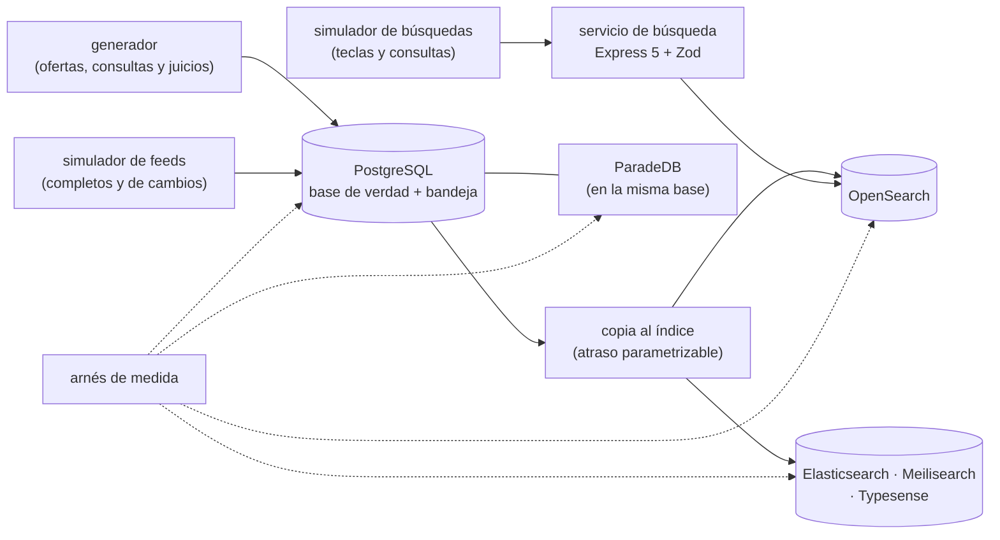

# 🎯 Alcance del proyecto
## Buscafino — el modelo de búsqueda a fondo

> **Qué es este documento:** la fuente de verdad de **qué** enseña el curso, a quién y con qué límites. Lo
> que no esté aquí no está en el curso.
> **Fecha de esta versión:** 7 de octubre de 2026. Consolida la semilla de agosto (`_desechable-semilla.md`),
> el alcance de agosto (`_desechable-alcance-v1.md`), la ficha de arranque, las reglas de la ruta y los
> precedentes de los cursos anteriores. **Lo único preliminar es §9**: la cantidad de fases y su orden salen
> de la propuesta de fases.
> **Precedencia:** manda este documento. Después viene
> [`guia-de-estilo-y-convenciones.md`](guia-de-estilo-y-convenciones.md), que decide **cómo** se escribe;
> después el contrato de nombres y el diccionario de términos (por escribir), y las propuestas. Las
> plantillas y los prompts se actualizan siempre al final. Por encima de todos está el `CLAUDE.md` del
> repositorio, en lo que este curso no haya declarado como excepción (§12).
> **Estado de las decisiones:** 36 cerradas, ninguna abierta (§12). Solo faltan la propuesta de fases y la
> versión final de la historia.

---

## 1. 🧭 En una frase

**Un curso que enseña el modelo de búsqueda a fondo reconstruyendo y midiendo el buscador de un portal de
empleo multipaís, para que el lector pueda decidir —y defender con números propios— cómo se encuentra, se
ordena, se filtra y se cuenta en tres idiomas, qué le pasa a Lucene por dentro cuando lo aprietan, por dónde
entra cada dato sin que el índice sea su única casa, y cuándo PostgreSQL o un motor liviano alcanzaban.**

No forma administradores de OpenSearch ni ingenieros de relevancia de tiempo completo, ni prepara una
certificación. No enseña búsqueda desde cero: el lector ya hizo el minicurso de Ruta NoSQL Lite. Forma la
capacidad de decir *"las ofertas, los destacados y los feeds entran por PostgreSQL; el índice se reconstruye
en tantas horas sin tocar el tráfico; la relevancia sube tanto con estos analizadores y estos sinónimos, medida
con juicios; y para Talento nos alcanzaría con menos; por esta razón y con este número"*.

---

## 2. 🔥 El problema que resuelve

El lector salió de lite sabiendo qué es un índice invertido, que los analizadores y los sinónimos existen, que
las facetas son agregaciones, que PostgreSQL busca con `tsvector`, que el disco lleno pone el índice en solo
lectura y que el buscador es un índice y no una fuente de verdad. Le falta lo que viene después: medir la
relevancia en lugar de opinar sobre ella, buscar en tres idiomas a la vez, saber por qué una faceta no suma,
qué hace Lucene con cada documento y cada actualización, cuántos fragmentos y de qué tamaño, cómo se
reconstruye un índice sin competir con el tráfico, cómo entran los datos que vienen de fuera sin que el índice
sea su casa, y cuándo un motor liviano o PostgreSQL alcanzan. Hoy eso se aprende la mañana en que una
reconstrucción "desde PostgreSQL" pierde lo que nunca estuvo en PostgreSQL, o en tutoriales que demuestran un
buscador con cien productos en inglés.

El villano es uno solo, **el índice que guarda lo que no está en ningún otro sitio**, y tiene tres caras:

- **"Son solo para buscar: directo al índice."** Los feeds de las ofertas remotas, que llegan más rápido así y
  desaparecen el día que se reconstruye.
- **"Es un campo más del documento."** Los destacados pagados y el contador de postulaciones, que viven donde
  se muestran y no donde se cobran; y lo que le cuesta a Lucene actualizarlos.
- **"Sin un motor de búsqueda no se puede."** El reverso, que el curso también mide: lo que PostgreSQL con
  ParadeDB, Meilisearch o Typesense sí resuelven.

> ⚠️ **El antagonista no es ninguna herramienta.** OpenSearch le dio a Vacantia un buscador que encuentra
> "contadora" cuando alguien escribe "contadr"; Elasticsearch, Meilisearch y Typesense ganan donde ganan y el
> curso lo publica; PostgreSQL es la base de verdad desde 2015; y el curso cierra con el veredicto de cuándo el
> motor de búsqueda no hacía falta.

---

## 3. 🎓 Objetivo pedagógico

Al terminar, el lector puede hacer seis cosas que antes no podía:

1. **Medir la relevancia**: armar juicios, calcular nDCG, exhaustividad y rango recíproco, leer la explicación
   de una puntuación y decidir un cambio por el número, no por la demo.
2. **Buscar en varios idiomas**: analizadores por idioma, campos múltiples, sinónimos de una y de varias
   palabras, y el error de tecleo sin perder precisión.
3. **Filtrar y contar bien**: facetas que coinciden con los resultados, conteos aproximados y su error, rangos
   en varias monedas, distancia y zona horaria, y autocompletado dentro de su presupuesto.
4. **Leer el motor por dentro**: segmentos, refresco, fusiones, documentos borrados, fragmentos, réplicas,
   memoria, y lo que cuesta cada actualización.
5. **Arquitecturar el espejo**: por dónde entra cada dato, cómo llega al índice, cuánto va detrás, cómo se
   reconstruye sin apagar y cómo se olvida lo que hay que olvidar.
6. **Elegir el motor** entre OpenSearch, Elasticsearch, Meilisearch, Typesense, PostgreSQL con ParadeDB y un
   servicio gestionado, con una medición propia y el costo de operarlo.

Lo que **no** es objetivo: construir un producto de reclutamiento, recomendación de empleos o búsqueda
semántica, ni administrar un clúster en producción corporativa.

---

## 4. 👥 Perfil del lector

Ingeniero senior que **ya hizo Ruta NoSQL Lite**, o que sabe lo equivalente: SQL y modelado relacional de
oficio, la búsqueda de texto de PostgreSQL en lo básico, TypeScript con soltura, contenedores sin ayuda, y el
minicurso de búsqueda de lite. Se le explica el modelo en profundidad y los motores por dentro; no se le explica
a programar, Docker, SQL ni lo que lite ya enseñó.

**Lo que se da por sabido y no se explica jamás:** SQL, índices, transacciones; TypeScript y Node; Docker
Compose; las cinco preguntas, el arnés y la apuesta antes de medir; de lite, el índice invertido, los
analizadores, los tokens y el stemming en lo básico, los sinónimos y la tolerancia a errores en lo básico, las
facetas y las agregaciones en lo básico, el mapeo como esquema, `tsvector` y GIN, la duración de un reindexado
completo, el índice en solo lectura por disco lleno, el tiempo hasta que un documento se ve, y que el buscador
es un índice y no una fuente de verdad.

**Lo que se explica con cero ambigüedad**, aunque el lector sea senior: qué calcula BM25 y qué hacen sus
parámetros, qué mide cada métrica de relevancia y qué no, cómo se expande un sinónimo de varias palabras, por
qué una agregación repartida en fragmentos puede equivocarse y cuánto, qué pasa entre que se indexa un documento
y que se puede buscar, por qué una actualización es un borrado más una inserción, qué decide el tamaño de un
fragmento, cómo funciona un alias, y qué guarda una instantánea.

> 🧭 **Ninguna caja negra prematura, no menos profundidad.**

**Requisitos de entrada:** un equipo con 16 GB de memoria (D-20), Docker Desktop o Podman, y Node 24. **No hace
falta** ninguna cuenta en la nube ni nada instalado fuera de contenedores.

---

## 5. 🧭 La pregunta que ordena el curso

> *¿Dónde vive este dato, cómo llega al índice, y qué le cuesta al sistema —y a la empresa— encontrarlo, ordenarlo
> y contarlo ahí?*

Se presenta en la primera fase, con la cuesta de enero, y reaparece en el veredicto de cada fase:

- **La primera parte** responde *qué es encontrar bien*: idiomas, sinónimos, relevancia medida, destacados y
  frescura.
- **La segunda parte** responde *qué es filtrar y contar bien*: facetas, salarios, distancia y zona horaria,
  autocompletado.
- **La tercera parte** responde *dónde vive cada dato*: la copia al índice, los feeds, la reconstrucción sin
  apagar, los currículos y su supresión.
- **La cuarta parte** responde *qué le cuesta al motor*: Lucene por dentro, fragmentos y memoria, y los rivales
  con la misma carga.
- **El cierre** responde la pregunta entera: la operación, la autopsia del índice como fuente de verdad y la
  frontera con PostgreSQL.

---

## 6. 📏 Cómo se mide

**Todo "mejor que" lleva un número**, medido con el arnés del curso y consolidado en `BENCHMARKS.md`. Se mide
primero **lo encontrado**: la relevancia contra los juicios que siembra el generador (nDCG@10, exhaustividad en
los primeros cien y rango recíproco medio), los conteos de cada faceta contra el conteo exacto de PostgreSQL, y
las ofertas vencidas, borradas o suprimidas que todavía aparecen (D-27, D-31). Después **la forma**: tamaño del
índice, segmentos, documentos borrados, fusiones, memoria del nodo, atraso del índice frente a PostgreSQL.
**Los tiempos sí aparecen**, siempre con su dispersión (mediana, p95 y p99), calentamiento, repeticiones y
máquina declarados, **y siempre con el tamaño del corpus, la mezcla de idiomas y las consultas por segundo
ofrecidas** al lado, porque en este modelo el veredicto depende de ellos (D-19).

Las reglas de honestidad no se negocian: se publica lo que salió · el empate se llama empate · nada de números
redondos sin dispersión · cada motor se configura bien y según su documentación (la memoria de la máquina
virtual de Java en OpenSearch y Elasticsearch, la memoria de Meilisearch y Typesense, la de PostgreSQL, los
analizadores de cada uno) · **PostgreSQL juega con lo mejor que tiene**: configuraciones de texto por idioma,
pesos, trigramas, GIN y BM25 con ParadeDB · **la misma consulta y los mismos juicios para todos** · se declara lo
que no se midió · los costos de la nube llevan ☁️, fuente y fecha · y **nunca se extrapola de un portátil a
producción**: lo que se mide en un portátil con Docker se dice así.

Dos anclas por fase, cuando la fase las admite: 🪞 **una apuesta** escrita antes de ejecutar y 💥 **una rotura
provocada**, con el síntoma literal y lo que costó salir.

---

## 7. 🧪 El sistema del curso

### 7.1 El dominio

El buscador de **Vacantia**, un portal de empleo de San José de Costa Rica: empresas, ofertas locales en nueve
países y remotas de empresas extranjeras, en español, inglés y portugués, con salario en su moneda, modalidad,
ubicación o zona horaria; los feeds de los sistemas de reclutamiento; los destacados; las postulaciones; y los
currículos de Vacantia Talento con su regla de supresión. PostgreSQL es la base de verdad. La historia está en
[`../00-historia-de-vacantia.md`](../00-historia-de-vacantia.md).

**Queda fuera a propósito:** contratos y pagos reales, la autenticación del portal, la recomendación de empleos,
la búsqueda semántica, y el portal como producto visual.

### 7.2 El stack, y qué compra cada pieza

| Pieza | Elección | Qué compra | Qué cuesta |
|---|---|---|---|
| Motor principal | OpenSearch (D-16), con los complementos de análisis de D-33 | Lucene completo, con licencia Apache | la máquina virtual de Java, fragmentos que dimensionar y una operación que no se hace sola |
| Rival del mismo linaje | Elasticsearch, medido donde difiere (D-35) | el original, con lo que agregó desde la separación | su licencia, por citar con fecha; memoria del laboratorio |
| Rivales livianos | Meilisearch y Typesense (D-16) | relevancia y tolerancia a errores de fábrica, poca operación | lo que no traen, medido |
| Control y base de verdad | PostgreSQL con búsqueda de texto, trigramas y ParadeDB (D-16) | buscar sin un motor más, donde ya vive el dato | una extensión más, con su licencia |
| Servicios gestionados | Amazon OpenSearch Service, Elastic Cloud y Algolia, solo desde documentación ☁️ (D-22) | la respuesta a "¿y si no queremos operar nada?" | cuestan dinero |
| Servicio de búsqueda | Express 5 mínima con Zod en la frontera (D-32) | búsqueda, facetas y autocompletado de extremo a extremo | una capa que el arnés evita cuando mide el motor |
| Copia al índice y feeds | simulados, con bandeja de salida en PostgreSQL (D-26, D-30) | la costura entre la verdad y el espejo, medible | — |
| Arnés, generador y simuladores | TypeScript nativo en Node 24 (D-17) | el mismo corpus, las mismas consultas y los mismos juicios contra cada motor | — |

### 7.3 Cómo se construye el código

A mano, en un solo proyecto en `src/` que crece por fases (D-09). El generador siembra en PostgreSQL ofertas,
empresas, candidatos y consultas con sus juicios; el simulador de feeds manda catálogos completos y de solo
cambios; la copia lleva cada cambio a cada motor.

### 7.4 El tamaño mínimo

Todo cabe en **16 GB** con perfiles de Compose: PostgreSQL con ParadeDB, el servicio y el arnés siempre; **un
motor de la máquina virtual de Java a la vez** (OpenSearch o Elasticsearch); los livianos, juntos; OpenSearch en
tres nodos solo en la fase de fragmentos; los volúmenes, dimensionados en la verificación previa (D-20).

---

## 8. 🧰 Herramientas y plataformas

**Versiones:** última estable a la fecha de la verificación previa, por digest para las imágenes y con archivo de
bloqueo para las librerías y los complementos, en el apéndice del laboratorio (D-07). **Plataformas:** macOS en
Apple Silicon, Linux y Windows con WSL2; el autor verifica en macOS arm64 y lo demás se marca no verificado
(D-06).

---

## 9. 🪜 La forma del curso

**Tipo:** curso completo. **Unas 100 horas en 10 a 12 fases** de unas 10 h. **Preliminar:** el arco, los nombres y
las fichas salen de la propuesta de fases. El borrador de partida son las doce fases de la semilla, menos lo que
lite ya dio (el índice invertido y los analizadores en lo básico, las facetas en lo básico, la tolerancia a
errores en lo básico, la medición contra `tsvector`, el reindexado completo, el disco lleno, el índice como
derivado) y con OpenSearch en lugar de Meilisearch como titular, más lo que pide la profundidad: la relevancia
medida con juicios, los tres idiomas, Lucene por dentro, los fragmentos, los feeds, la supresión y ParadeDB.

| Bloque (tentativo) | Qué hace | Temas de la historia (§4 de ella) |
|---|---|---|
| **I · Encontrar** | idiomas, sinónimos, relevancia medida, destacados y frescura | 1, 2, 3, 4 |
| **II · Filtrar y contar** | facetas, salarios, distancia y zona horaria, autocompletado | 5, 6, 7, 8 |
| **III · El espejo** | la copia, los feeds, reconstruir sin apagar, los currículos | 9, 10, 11, 14 |
| **IV · Los motores por dentro** | Lucene, fragmentos y memoria; Elasticsearch, los livianos y ParadeDB | 12, 13, 17, 15, 16 |
| **V · Operación y veredicto** | operar el buscador y los gestionados, la autopsia, la frontera | 18, 19, 20 |

---

## 10. ✅ Lo que está dentro del alcance

- La relevancia medida: juicios sembrados, nDCG, exhaustividad y rango recíproco; la evaluación de rango del
  motor donde exista; la explicación de una puntuación.
- BM25 por dentro: frecuencias, normas de campo, sus parámetros y cuándo tocarlos.
- Analizadores por idioma (español, inglés, portugués), campos múltiples, plegado de acentos, y la detección del
  idioma de una oferta.
- Sinónimos de una y de varias palabras, en grafo, al indexar o al buscar, y su mantenimiento.
- Señales de negocio en la puntuación: frescura con decaimiento, destacados, y la frontera entre relevancia y
  lo pagado.
- Facetas: agregaciones por fragmento y su error, conteos aproximados de cardinalidad, el filtro posterior para
  las facetas de los demás filtros, rangos.
- Salarios en varias monedas normalizados al indexar; búsqueda por distancia; filtro por horas de solapamiento.
- Autocompletado: sugeridor de completado, búsqueda mientras se escribe y n-gramas de borde, con tolerancia a
  errores y medido en el percentil 99.
- La copia al índice desde PostgreSQL con bandeja de salida: cambios, bajas, atraso, idempotencia.
- Los feeds de terceros por PostgreSQL, completos y de solo cambios.
- Reconstruir sin apagar: alias, índices con versión, cambios de mapeo, y la reconstrucción que no compite con el
  tráfico.
- Lucene por dentro: segmentos, refresco, registro de transacciones, fusiones, documentos borrados, *doc
  values*; el costo de actualizar un contador.
- Fragmentos y réplicas: tamaño, enrutamiento, estado del clúster, memoria, cortacircuitos, marcas de disco.
- Los currículos: documentos anidados, datos personales, supresión que alcanza a las instantáneas.
- Elasticsearch contra OpenSearch donde difieren, con sus licencias.
- Meilisearch y Typesense con las mismas consultas y los mismos juicios.
- PostgreSQL: configuraciones de texto por idioma, pesos, trigramas y BM25 con ParadeDB.
- Operación: instantáneas, actualizaciones, monitoreo; los gestionados desde su documentación.
- La autopsia del índice como fuente de verdad, con la cuesta de enero reproducida.
- El árbol de cuándo no usar un motor de búsqueda dedicado.

## 11. 🚫 Lo que está fuera del alcance

Se declara y el texto se detiene: **no se dice dónde estaría ese material.**

- Lo que Ruta NoSQL Lite ya enseñó de búsqueda: se usa, no se explica.
- Búsqueda semántica, vectorial e híbrida, y modelos de aprendizaje para ordenar (D-28).
- Recomendación de empleos y emparejamiento de candidatos con ofertas.
- Observabilidad y registros sobre OpenSearch o Elasticsearch (su otro gran uso).
- Solr, Vespa, Manticore, Quickwit y otros motores.
- Kafka, Debezium y CDC reales: la copia y los feeds se simulan (D-26, D-30).
- Los gestionados medidos de verdad (D-22).
- Kubernetes y los operadores de los motores.
- El portal como producto visual.

---

## 12. ⚖️ Decisiones

Si una sesión futura quiere cambiar una, primero la cambia aquí y después en todo lo demás, nunca al revés. ✅
cerrada · ⏳ abierta · 🔄 reabierta. Las que llevan *(ruta)* o el nombre de un curso siguen la regla de la ruta o
el precedente de ese curso; las que llevan *(por defecto)* las cerró la sesión con el valor propuesto y se le
listaron al autor.

| ID | Decisión | Valor | Estado |
|---|---|---|---|
| D-01 | Idioma | Español latinoamericano neutro con tuteo; código, comandos, identificadores y salida de terminal en inglés; comentarios de código en español | ✅ |
| D-02 | Tipo de curso | Curso completo | ✅ |
| D-03 | Autocontención | Lo publicado nombra Ruta NoSQL Lite **solo como requisito de entrada**: no usa su contenido, no remite a sus fases ni reutiliza sus ejemplos, datos o mediciones. `prompts/` puede citarla *(ruta, R-07)* | ✅ |
| D-04 | Promesa de esfuerzo | ~100 h en 10–12 fases de ~10 h *(Proteo)* | ✅ |
| D-05 | Aparato de evaluación | 20–30 ejercicios por fase, 🟢🟡🟠🔴 + 🔥, un tercio de diagnóstico o medición, cada uno con su criterio; **sin solución publicada**. Taller global: el buscador en `src/`. Un 💀 boss por bloque cuando el bloque lo admita, y el proyecto final de §13 *(Proteo)* | ✅ |
| D-06 | Plataformas | macOS arm64, Linux, Windows con WSL2; el autor verifica en macOS arm64 | ✅ |
| D-07 | Política de versiones | Última estable a la fecha de la verificación previa; imágenes por digest, librerías y complementos con archivo de bloqueo, en el apéndice del laboratorio | ✅ |
| D-08 | Ejecución | Nada se publica sin haberse ejecutado | ✅ |
| D-09 | Código | Un solo proyecto en `src/` que crece por fases, con tags `fase-NN-<slug>` *(Proteo)* | ✅ |
| D-10 | README y temario | Se escriben al final, en una tanda propia | ✅ |
| D-11 | Historia | Vacantia, en `00-historia-de-vacantia.md` | ✅ |
| D-12 | Diagramas | Mermaid | ✅ |
| D-13 | Publicación | Repositorio público propio del curso, sin `prompts/` | ✅ |
| D-14 | Prerrequisito | Ruta NoSQL Lite, o lo equivalente de §4 | ✅ |
| D-15 | Profundidad | Full geek: Lucene por dentro, BM25, relevancia medida, analizadores y sinónimos en grafo, agregaciones por fragmento, autocompletado, fragmentos y memoria, y los rivales por dentro *(por defecto)* | ✅ |
| D-16 | Rivales | **OpenSearch como titular** (autor, 07/10/2026); Elasticsearch donde difiere (D-35); Meilisearch y Typesense como livianos; PostgreSQL con búsqueda de texto, trigramas y ParadeDB como base de verdad y control | ✅ |
| D-17 | Lenguaje | TypeScript nativo en Node 24 para todo; sin codas en otros lenguajes *(semilla y Portalón)* | ✅ |
| D-18 | Clientes | El cliente oficial de JavaScript de cada motor y `pg` contra PostgreSQL. Las diferencias de consulta entre motores se verifican antes de comparar, y cada comparación usa la consulta más fiel que permite cada uno, declarada *(semilla)* | ✅ |
| D-19 | Mediciones | Lo encontrado primero (relevancia contra juicios, facetas contra el conteo exacto, documentos que no debían aparecer), después forma, después tiempos con mediana, p95 y p99; siempre con tamaño del corpus, mezcla de idiomas y consultas por segundo. Documento vivo: `BENCHMARKS.md` *(Proteo, Telaraña)* | ✅ |
| D-20 | Memoria del laboratorio | Todo dentro de 16 GB con perfiles de Compose: un motor de la máquina virtual de Java a la vez; OpenSearch en tres nodos solo en la fase de fragmentos; los volúmenes, dimensionados en la verificación previa *(Portalón)* | ✅ |
| D-21 | Datos | Sintéticos con semilla fija y la forma de Vacantia: ofertas en tres idiomas con la mezcla de la historia, cargos con sus sinónimos, errores de tecleo sembrados, salarios en siete monedas, ciudades de nueve países y zonas horarias; currículos sintéticos sin ningún dato personal real | ✅ |
| D-22 | Servicios gestionados | Amazon OpenSearch Service, Elastic Cloud y Algolia, solo desde su documentación y sus precios públicos, citados con fecha y marcados ☁️; nunca en la misma tabla que lo medido sin esa marca *(Proteo, con DocumentDB)* | ✅ |
| D-23 | El villano | Implementado de verdad, lo justo para medirlo: los feeds escritos directo al índice, los destacados y el contador de postulaciones como campos del documento, y la reconstrucción "desde PostgreSQL"; frente a la entrada por PostgreSQL con bandeja de salida. La cuesta de enero, reproducida con los simuladores, incluida la instantánea restaurada | ✅ |
| D-24 | Licencias | Las de OpenSearch, Elasticsearch, Meilisearch, Typesense y ParadeDB se verifican y se citan con fecha en la verificación previa; la elección de licencia de Elasticsearch que use el laboratorio se declara; el repositorio público no redistribuye imágenes *(por defecto)* | ✅ |
| D-25 | Seguridad del motor | Desactivada en el laboratorio salvo en la fase de los currículos, donde se activa lo necesario para restringir el acceso por documento, si la edición libre lo trae; si no, se declara *(por defecto)* | ✅ |
| D-26 | La copia al índice | Bandeja de salida en PostgreSQL y un trabajador en TypeScript con atraso, desorden y reintentos parametrizables; Debezium y Kafka solo se nombran *(semilla, Telaraña D-30)* | ✅ |
| D-27 | Juicios de relevancia | Sembrados por el generador: cada consulta del conjunto de prueba trae los documentos que deben aparecer y su grado; las mismas consultas y juicios para todos los motores; nDCG@10, exhaustividad en los primeros 100 y rango recíproco medio *(por defecto, como D-31 de Oráculo de Bolsillo)* | ✅ |
| D-28 | Semántica y vectores | Fuera: ni vectores, ni búsqueda híbrida, ni modelos para ordenar; el veredicto los nombra como lo que no se midió *(por defecto)* | ✅ |
| D-29 | Imágenes en arm64 | Si una imagen no corre nativa en arm64, se declara y se mide emulada con esa advertencia, o se marca no verificado *(Portalón)* | ✅ |
| D-30 | Los feeds | Simulados en TypeScript: catálogos completos y de solo cambios, con errores y duplicados parametrizables; ningún sistema de reclutamiento real *(por defecto)* | ✅ |
| D-31 | La verdad sembrada | El generador conoce qué documentos debe devolver cada consulta, el conteo exacto de cada faceta, y qué ofertas están vencidas, borradas o suprimidas; toda medición de calidad se publica contra ella, además del tiempo *(Telaraña, D-31)* | ✅ |
| D-32 | API | Express 5 mínima con Zod en la frontera; el arnés mide los motores directamente salvo en las preguntas de extremo a extremo *(semilla y Proteo)* | ✅ |
| D-33 | Complementos de análisis | En OpenSearch y Elasticsearch, solo el de ICU y el fonético, instalados en la imagen del laboratorio si la verificación confirma que se pueden instalar; ningún otro *(por defecto, como D-33 de Telaraña)* | ✅ |
| D-34 | Nombre del curso | **Buscafino** se mantiene: no choca con lite ni con otro curso *(por defecto)* | ✅ |
| D-35 | Elasticsearch | Se mide solo en la fase que compara con OpenSearch, en lo que difieren, con la licencia citada; no acompaña cada medición del curso *(por defecto)* | ✅ |
| D-36 | La supresión | Se mide el tiempo hasta olvidar: desde la solicitud hasta que el currículo no aparece en ninguna búsqueda, incluida la restauración de una instantánea anterior *(por defecto)* | ✅ |

**Excepciones declaradas al `CLAUDE.md` del repositorio**, con su porqué (el detalle en la guía §13):

- **Ruta NoSQL Lite como prerrequisito** (D-14) → no se explican los fundamentos de búsqueda → los da lite.
- **Los ejercicios no traen solución publicada** (D-05) → el lector apuesta y mide antes de mirar.

---

## 13. 🏁 El proyecto final

Mauricio tiene que presentarle a Gabriela, antes de la próxima cuesta de enero, cómo queda el buscador: por dónde
entra cada dato y dónde vive, cuánto va el índice detrás de la verdad, cuánto tarda una reconstrucción y por qué
no compite con el tráfico, cuánto subió la relevancia con los tres idiomas y los sinónimos, qué motor atiende
Remoto, Talento y el autocompletado, y qué habría pasado el 12 de enero de 2026 en la arquitectura nueva. Se
entrega como un informe con las mediciones del curso, la autopsia del índice como fuente de verdad con números
antes y después, la cuesta de enero reproducida en las dos arquitecturas, la frontera con PostgreSQL y ParadeDB,
y el árbol de decisión de cuándo **no** usar un motor de búsqueda dedicado aplicado a cada pieza.

---

## 14. 🎯 Criterios de éxito

El curso está bien si:

- Cada fase abre con un dolor de Vacantia y cierra con algo que se apostó, se midió y, cuando tocaba, se rompió a
  propósito.
- Ninguna fase repite lo que lite ya enseñó de búsqueda, empezando por "el índice no es fuente de verdad".
- Ningún cambio de relevancia se publica sin su número contra los juicios; ninguna faceta, sin su conteo contra
  el exacto.
- PostgreSQL o un liviano gana al menos una pieza de Vacantia con el número delante, y OpenSearch gana al menos
  una que los demás no resuelven bien.
- Un lector que solo hace los bloques I y II sale midiendo la relevancia y contando bien; uno que sigue hasta el
  IV sabe leer Lucene por dentro y elegir el motor.
- El veredicto final no es "OpenSearch para todo" ni "PostgreSQL alcanza siempre".

---

## 15. 📌 Extensión futura, fuera de este curso

El diseño deja preparado, sin prometerlo, el emparejamiento de candidatos con ofertas y la búsqueda semántica
sobre currículos.
