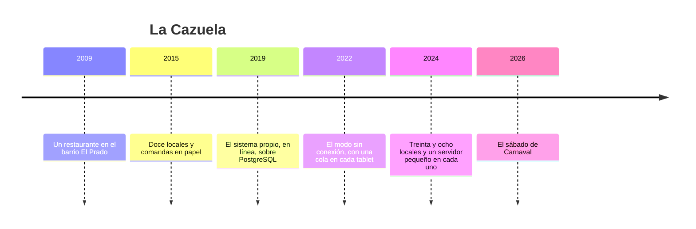

# 🍲 La Cazuela: la historia

> **Qué es este documento:** la fuente de verdad de todo lo narrativo de Comanda: la empresa, su gente, sus
> sistemas, sus cifras y sus reglas de negocio. **Ninguna fase inventa un dato**: si lo necesita y no está
> aquí, se agrega aquí primero.
> **Vigencia:** 2026-10-07 · **primera versión, en discusión con el autor.** Los dolores de §4 van por tema;
> cuando exista la propuesta de fases, cada uno se ata a su fase. Las cifras de §5 son ficticias y los
> volúmenes del laboratorio se fijan en la propuesta de fases. Los proveedores, las autoridades y los casos
> son inventados: ninguna entidad ni persona real.

---

## 1. 📅 Cómo llegó hasta aquí

La Cazuela es una cadena de restaurantes de comida costeña de Barranquilla: treinta y ocho locales en
Barranquilla, Cartagena, Santa Marta y Valledupar, con mesas, barra, domicilios y un menú que cambia según lo
que llegue del mercado. Cada local tiene entre seis y veinte tablets de meseros, una o dos pantallas de cocina
y una caja. Todas escriben sobre las mismas mesas al mismo tiempo, y desde 2022 lo hacen aunque no haya
internet. Ese modo sin conexión salvó muchas noches. El sábado de Carnaval mostró lo que hacía con las demás.

**2009 · El Prado.** Rosalba Mendoza cocinaba para eventos y abrió un restaurante en una casa de El Prado: arroz
con coco, posta negra, mojarra frita y un sancocho de los sábados que llenaba la cuadra. Las comandas eran de
papel, en tres copias de colores.

**2015 · Doce locales.** Con Cartagena y Santa Marta llegó un sistema de caja comprado a un proveedor, que solo
cobraba. Las comandas seguían en papel y la cocina las colgaba de un alambre.

**2019 · El sistema propio.** Andrés Pacheco, un ingeniero cartagenero que había trabajado en un banco, le
construyó a La Cazuela su propio sistema: tablets para los meseros, pantallas en la cocina y la caja, todo
contra una API y un PostgreSQL en la nube. Mesas, cuentas, líneas de pedido, modificadores, pagos y comandas en
seis tablas bien normalizadas. **Fue la decisión correcta**: la cocina dejó de perder papelitos, y el sistema
funcionó mientras hubo internet.

**2022 · Sin conexión.** Los cortes de fibra, los aguaceros de octubre y los centros comerciales con señal de
sótano dejaban locales enteros sin vender. Julián Rocha, que llegó de una empresa de domicilios de Bogotá, le
agregó a la app un modo sin conexión: cada tablet guarda en una cola las operaciones que no pudo enviar y las
reproduce cuando vuelve la red; si dos operaciones chocan, gana la de `updated_at` más reciente, según el
reloj de la tablet. Su argumento, con el aval de Andrés: *"no vamos a reescribir el sistema por una hora de
corte al mes; con una cola salimos el lunes"*. Salieron el lunes. **Fue una decisión razonable**, y durante
dos años los cortes fueron cortos.

**2024 · El servidor del local.** Con treinta y ocho locales, Andrés puso un computador pequeño en cada uno para
que las tablets se hablaran entre sí por la red del local aunque no hubiera internet. La cola siguió siendo la
misma: el servidor del local la recibía y la reenviaba a la nube.

**2026 · El sábado de Carnaval.** Lo que pasó el 14 de febrero abre el curso (§4).

| Año | Qué pasó | Quién lo decidió | Lo que dejó |
|---|---|---|---|
| 2009 | El restaurante de El Prado | Rosalba | la empresa y la cocina |
| 2015 | Doce locales con caja comprada | Rosalba | las comandas en papel |
| 2019 | El sistema propio, en línea, sobre PostgreSQL | Andrés | la base de verdad, que sigue sana |
| 2022 | La cola en cada tablet, gana el reloj de la tablet | Julián, con aval de Andrés | el villano, con su mejor argumento |
| 2024 | El servidor pequeño en cada local | Andrés | la red del local sin internet |
| 2026 | El sábado de Carnaval | — | el incidente que abre el curso |

## 2. 👥 La gente

| Personaje | Rol | Cómo habla | Qué quiere | Aparece en |
|---|---|---|---|---|
| **Rosalba Mendoza** | Fundadora y directora general, de Barranquilla | Cálida y de cocina: *"¡qué nota!"* cuando algo sale bien, y pregunta por la plata cuando no | que ningún cliente se vaya sin comer ni sin pagar | la apertura, el veredicto |
| **Andrés Pacheco** | Director de tecnología, de Cartagena | Tranquilo y exacto: *"el sistema lo hice yo, y sin él la cocina seguiría con el alambre"* | medir antes de cambiar una línea | casi todas; es el interlocutor del lector |
| **Julián Rocha** | Líder de la app de meseros, de Bogotá | Práctico, de producto: todo lo resuelve *"de una"* | que la tablet nunca se quede esperando | la cola, los relojes, el veredicto |
| **Yuleidis Charris** | Gerente de operación de los locales, de Barranquilla | Directa, de turno: *"¡ombe!"* cada vez que un local llama | que el mesero no tenga que pensar en la red | las mesas, los agotados, el servidor del local |
| **Manuel De la Hoz** | Chef ejecutivo, de Santa Marta | Seco, de cocina: todo es *"¡marchando!"* o no es | que la cocina reciba cada plato una vez | la cocina, el menú |
| **Liliana Estrada** | Contadora y jefa de caja, de Medellín | Formal, de cuadre: todo termina en el cierre de caja | que la caja cuadre y la factura salga con su número | el cobro, la factura |
| **Brayan Polo** | Soporte de guardia, de Soledad | Coloquial: todo está *"fresco"* hasta que no | dormir en Carnaval | la operación, el protocolo por dentro |
| **Tú** | Ingeniero senior recién contratado | — | — | todas: Andrés te contrató para medir, no para opinar |

El encargo de Andrés, el día que entras: *"No quiero que me digas que la cola de Julián es mala; sin ella
habríamos cerrado locales cada vez que se cae la fibra. Quiero saber qué tiene que poder escribirse sin
internet, cómo se juntan dos tablets que escribieron lo mismo, qué no se puede juntar nunca, y qué motor nos
lo resuelve sin escribirlo a mano. Y si alguna parte del sistema no necesitaba nada de esto, también quiero
saberlo."*

## 3. 🏚️ Lo que hay (el patrimonio)

| Sistema | Stack y edad | Quién lo mantiene | Sus mañas |
|---|---|---|---|
| **La base central** | PostgreSQL en la nube, desde 2019 | Andrés | sana; mesas, cuentas, líneas, modificadores, pagos, comandas, menú, inventario; **es la base de verdad** |
| **La app de meseros** | web en las tablets, con la cola sin conexión desde 2022 | Julián | reproduce operaciones en orden de llegada; **gana el `updated_at` del reloj de la tablet** |
| **El servidor del local** | un computador pequeño por local, desde 2024 | Brayan | recibe la cola de las tablets y la reenvía a la nube; si se reinicia, reenvía otra vez |
| **La pantalla de cocina** | web, conectada al servidor del local | Manuel y Brayan | muestra cada comanda que le llega, las veces que le llegue |
| **La caja** | app de escritorio con el datáfono al lado | Liliana | el pago se registra en la cola como cualquier otra operación |
| **La facturación** | facturación electrónica desde la caja | Liliana | sin internet entra en contingencia y factura con números que hay que reportar después |
| **El menú y los agotados** | se cambian en la nube y bajan a las tablets | Manuel y Yuleidis | un plato agotado no se entera la tablet que está sin red |

**El laboratorio del curso levanta** la base central en PostgreSQL, CouchDB en la nube y en cada local, tablets
simuladas con PouchDB que se desconectan a voluntad, la misma mesa con un CRDT para comparar, y los rivales
(Firestore en su emulador y ElectricSQL), con un generador que conoce cada pedido verdadero. El costo de
Firestore se trata solo desde su documentación.

## 4. 🔥 El incidente que lo empezó todo

El sábado 14 de febrero de 2026 fue el de la Batalla de Flores. Los tres locales de la Vía 40 y el de la
Carrera 54 abrieron a las diez de la mañana con reservas de comparsas enteras, mesas de veinte que se juntaban
y se separaban, y cuatro meseros por mesa grande.

A las 12:40 una obra cortó la fibra que alimenta a los cuatro locales. La red celular, con medio millón de
personas en la calle, tampoco servía. Las tablets siguieron funcionando contra el servidor de cada local, como
estaba previsto, y la cocina siguió recibiendo comandas. Durante cuatro horas y cuarenta minutos los locales
vendieron sin internet. Eso salió bien, y Julián lo cuenta con razón. Lo que pasó al volver la red, no.

**Las mesas grandes.** Cuando dos meseros agregaban platos a la misma cuenta, la cola reprodujo las dos
operaciones y la segunda pisó a la primera, porque cada una reescribía la cuenta entera. En la Vía 40, una
tablet que se había quedado sin batería volvió con el reloj en 2025, y sus cambios perdieron contra todo lo
demás. Dos mil trescientas diez líneas de pedido servidas desaparecieron de las cuentas: cuarenta y un millones
de pesos que nadie cobró.

**La cocina.** El servidor del local de la Carrera 54 se reinició a las 15:10 y volvió a enviar la cola que ya
había enviado. La pantalla de cocina mostró cada comanda dos veces, y en la tarde más llena del año se cocinaron
trescientos ochenta platos de más.

**El pargo.** A las 13:30 se acabó el pargo rojo. Manuel lo marcó agotado en la nube, y las tablets sin red
siguieron ofreciéndolo: ciento sesenta pedidos de un plato que no había, que los meseros tuvieron que
devolver a la mesa.

**La caja.** Los pagos registrados sin conexión se reprodujeron al volver la red, y cuarenta y siete quedaron
registrados dos veces. El datáfono había cobrado una sola vez cada uno, pero la caja no cuadró en ninguno de los
cuatro locales, y Liliana pasó el miércoles de Ceniza reconstruyendo cierres a mano y reportando mil novecientas
facturas de contingencia.

El lunes siguiente Rosalba preguntó: *"¿Necesitamos internet para vender?"*. Andrés dijo que no, que ese era
justamente el punto, y que la pregunta de verdad era otra: qué pasa con lo que se vende mientras tanto. Dijo que
creía saber la respuesta, y que no quería creerla: quería medirla. Esa semana abrió la vacante que vas a ocupar.

### Los dolores, por tema

Cada uno abre una o más fases cuando la propuesta exista. Ninguno se inventa en la fase: sale de aquí.

1. **La tablet que no espera.** Escribir en el dispositivo primero: dónde guarda PouchDB, cuánto cabe, qué
   sobrevive a una tablet sin batería.
2. **La mesa como documento.** La cuenta entera en un documento, o una línea por documento: el tamaño de la
   unidad decide cuántos conflictos habrá.
3. **Dos meseros, una mesa.** Revisiones en conflicto, el árbol de revisiones y la ganadora determinista que nadie
   eligió.
4. **El reloj de la tablet.** Por qué el reloj de pared miente, relojes lógicos e híbridos, y el último que
   escribe gana, hecho con honestidad.
5. **Sumar sin pisar.** Fusionar por campo y por línea, y los CRDT: conjuntos donde gana agregar, contadores, y
   lo que cuesta llevarlos.
6. **Cancelar contra servir.** El borrado contra la edición, las lápidas de un documento borrado, y purgar.
7. **El pargo agotado.** El dato que tiene que llegar primero: cuánto tarda en propagarse un cambio y qué se hace
   mientras no llega.
8. **La cocina que recibe dos veces.** Idempotencia, puntos de control de la replicación, y el "exactamente una
   vez" que no existe.
9. **El servidor del local.** La topología en tres niveles —tablet, local, nube—, la replicación filtrada por
   local y una base por local.
10. **El protocolo por dentro.** El feed de cambios, los puntos de control, las diferencias de revisiones, los
    pedidos por lote: qué viaja por la red y cuánto.
11. **El menú con fotos.** Los adjuntos binarios: replicarlos, deduplicarlos, y la foto que llega sin su
    documento.
12. **La tablet con la versión vieja.** Cambiar la forma de un documento cuando hay tablets que llevan días sin
    actualizar la app; la validación en el servidor.
13. **Quién puede qué.** Usuarios, bases y validación en el protocolo: el mesero que no puede borrar una línea
    pagada.
14. **El cobro y la factura.** Lo que no se puede fusionar nunca: el pago, el cierre de caja y el número de
    factura sin conexión.
15. **La base que crece.** El historial de revisiones, la compactación, el límite de revisiones y el espacio de la
    tablet.
16. **Firestore.** La misma mesa con el modo sin conexión de un servicio gestionado: su resolución por defecto,
    sus reglas y su factura.
17. **ElectricSQL.** Sincronizar PostgreSQL hacia las tablets: lo que resuelve en la lectura y lo que deja a la
    escritura.
18. **El villano en la mesa.** La cola con el reloj de la tablet contra la replicación con conflictos de primera
    clase, con el sábado de Carnaval reproducido.
19. **Lo que no necesitaba nada de esto.** La caja con cable, los reportes de la nube, el menú de la semana:
    cuándo no hace falta escribir sin conexión.

## 5. 💰 Las cifras

Todas ficticias, coherentes entre sí, y con los volúmenes del laboratorio por fijar en la propuesta de fases.

| Cifra | Valor | Fuente o supuesto |
|---|---|---|
| Locales | 38: Barranquilla, Cartagena, Santa Marta y Valledupar | ficticia |
| Dispositivos por local | de 6 a 20 tablets de meseros, 1 o 2 pantallas de cocina, 1 caja; ≈ 520 en total | ficticia |
| Cuentas por día | ≈ 21.000 en toda la cadena; ×2,5 los sábados de Carnaval | ficticia |
| Líneas de pedido por cuenta | ≈ 7; hasta 120 en una mesa de comparsa | ficticia |
| Cortes de internet | ≈ 3 por local al mes, de 20 minutos de mediana; el más largo del año, 6 h | ficticia |
| Menú | ≈ 140 platos y bebidas por local, con foto; cambia cada día | ficticia |
| El incidente: duración | 4 h 40 min sin internet en 4 locales | ficticia |
| El incidente: líneas perdidas | 2.310 líneas servidas que desaparecieron de las cuentas; ≈ COP 41 M | ficticia |
| El incidente: cocina | 380 platos cocinados dos veces | ficticia |
| El incidente: agotado | 160 pedidos de pargo rojo después de agotado | ficticia |
| El incidente: caja | 47 pagos registrados dos veces; 1.900 facturas de contingencia | ficticia |
| El reloj de la tablet | una tablet volvió con la fecha de 2025 después de quedarse sin batería | ficticia |

## 6. 📏 Las reglas de negocio

- **La mesa y la cuenta.** Una mesa tiene una cuenta abierta a la vez; las mesas se pueden juntar y separar, y una
  cuenta se puede dividir. Varios meseros pueden atender la misma mesa.
- **La línea de pedido.** Un plato o bebida, con cantidad y modificadores (*"sin cebolla"*, *"término medio"*).
  Una línea enviada a cocina no se borra: se anula, con motivo y con quién la anuló.
- **La comanda.** Lo que recibe la cocina. **Cada línea se cocina una vez.**
- **El agotado.** La cocina marca un plato agotado; desde ese momento no se puede pedir en ese local.
- **El pago.** Lo cobra el datáfono o la caja, una sola vez. **Una cuenta pagada no admite líneas nuevas**:
  lo que se pida después va a otra cuenta.
- **La factura.** Electrónica, con numeración autorizada por caja. Sin internet se emite en contingencia, con su
  propia numeración, y se reporta al volver la conexión.
- **El cierre de caja.** Al final del turno, lo cobrado tiene que cuadrar con lo registrado.
- **La base de verdad** de cuentas, pagos, facturas, menú e inventario es PostgreSQL. Lo que se escribe en una
  tablet sin conexión es, hasta que se reconcilia, una versión de la verdad: esa es la pregunta del curso.

## 7. 🗣️ Cómo hablan

La narración y las instrucciones al lector van en tuteo neutro. Las voces se reservan para los diálogos, una
expresión por escena:

- **Rosalba** (Barranquilla): *"¡qué nota!"*.
- **Julián** (Bogotá): *"de una"*.
- **Yuleidis** (Barranquilla): *"¡ombe!"*.
- **Manuel** (Santa Marta): *"¡marchando!"*.
- **Brayan** (Soledad): *"fresco"*, hasta que no.
- **Andrés** habla de **la tablet** y **la verdad** (la base central); **Liliana**, de **el cierre** y **el
  cuadre**; **Julián**, de **la cola** y **salir el lunes**.

En la casa se dice **la cola**, **el servidor del local**, **la nube**, **la cuenta**, **la comanda**, **el
agotado**, **la contingencia** y **el sábado de Carnaval**.
