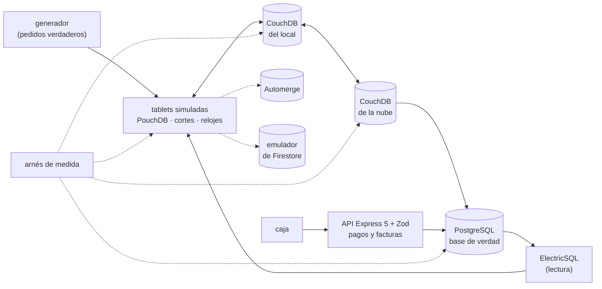

# 🎯 Alcance del proyecto
## Comanda — el modelo offline-first a fondo

> **Qué es este documento:** la fuente de verdad de **qué** enseña el curso, a quién y con qué límites. Lo
> que no esté aquí no está en el curso.
> **Fecha de esta versión:** 7 de octubre de 2026. Consolida la semilla de agosto (`_desechable-semilla.md`),
> el alcance de agosto (`_desechable-alcance-v1.md`), la ficha de arranque, las reglas de la ruta y los
> precedentes de los cursos anteriores. **Lo único preliminar es §9**: la cantidad de fases y su orden salen
> de la propuesta de fases.
> **Precedencia:** manda este documento. Después viene
> [`guia-de-estilo-y-convenciones.md`](guia-de-estilo-y-convenciones.md), que decide **cómo** se escribe;
> después el contrato de nombres y el diccionario de términos (por escribir), y las propuestas. Las plantillas
> y los prompts se actualizan siempre al final. Por encima de todos está el `CLAUDE.md` del repositorio, en lo
> que este curso no haya declarado como excepción (§12).
> **Estado de las decisiones:** 36 cerradas, ninguna abierta (§12). Solo faltan la propuesta de fases y la
> versión final de la historia.

---

## 1. 🧭 En una frase

**Un curso que enseña el modelo offline-first a fondo reconstruyendo y midiendo el sistema de mesas de una
cadena de restaurantes que vende sin internet, para que el lector pueda decidir —y defender con números
propios— qué se escribe en el dispositivo, cómo se juntan dos dispositivos que escribieron lo mismo, qué no se
puede juntar nunca, qué hace el motor de replicación por dentro, y cuándo nada de esto hacía falta.**

No forma administradores de CouchDB ni desarrolladores móviles, ni prepara una certificación. No enseña
offline-first desde cero: el lector ya hizo el minicurso de Ruta NoSQL Lite. Forma la capacidad de decir *"la
cuenta se parte en una línea por documento, las cantidades son contadores, gana la revisión con este reloj, el
agotado viaja primero, el pago y la factura no se fusionan nunca, y la caja con cable no necesitaba nada de esto;
por esta razón y con este número"*.

---

## 2. 🔥 El problema que resuelve

El lector salió de lite sabiendo replicar en las dos direcciones, que la revisión es historia, que el conflicto es
el caso normal y que existe algo llamado CRDT. Le falta lo que viene después: decidir el tamaño del documento para
que haya menos conflictos, saber qué revisión gana y por qué, ordenar con un reloj que no mienta, fusionar sin
perder, propagar primero lo urgente, no repetir lo que ya se aplicó, operar una topología de tres niveles,
cambiar la forma del documento con dispositivos atrasados, y separar lo que se puede fusionar de lo que no. Hoy
eso se aprende la tarde en que una mesa de veinte pierde la mitad de su cuenta, o en tutoriales que demuestran la
sincronización con una lista de tareas de un solo usuario.

El villano es uno solo, **la sincronización atornillada que trata el conflicto como un accidente**, y tiene tres
caras:

- **"Con una cola salimos el lunes."** Operaciones reproducidas en orden de llegada, con el reloj de la tablet
  como árbitro y la cuenta entera como unidad: pierde, duplica y no deja rastro.
- **"Todo se puede fusionar."** El reverso ingenuo: el pago, el cierre de caja y el número de factura no se
  fusionan, y querer que la replicación los resuelva es otra forma del mismo error.
- **"Sin sincronización no se puede vender."** El reverso que el curso también mide: la caja con cable, los
  reportes y el menú de la semana no necesitaban escribir sin conexión.

> ⚠️ **El antagonista no es ninguna herramienta.** La cola de Julián le permitió a La Cazuela vender durante cada
> corte de fibra desde 2022; PostgreSQL es la base de verdad desde 2019; Firestore y ElectricSQL ganan donde
> ganan y el curso lo publica; y el curso cierra con el veredicto de cuándo el offline-first no hacía falta.

---

## 3. 🎓 Objetivo pedagógico

Al terminar, el lector puede hacer seis cosas que antes no podía:

1. **Diseñar la unidad que viaja**: decidir el tamaño del documento por la forma de los conflictos que va a
   producir, y medirlo.
2. **Resolver con criterio**: saber qué revisión gana y por qué, usar relojes lógicos e híbridos, fusionar por
   campo y por línea, y elegir cuándo un CRDT paga su costo.
3. **Leer el protocolo por dentro**: el feed de cambios, los puntos de control, las diferencias de revisiones, los
   adjuntos, la compactación y la purga, y lo que viaja por la red.
4. **Operar la topología**: tablet, local y nube; replicación filtrada o una base por local; validación y permisos
   en el protocolo; dispositivos con versiones viejas.
5. **Separar lo fusionable de lo que no**: el pago, el cierre y la factura, con su propio diseño sin conexión.
6. **Elegir el motor** entre CouchDB con PouchDB, un CRDT, un servicio gestionado y la sincronización de
   PostgreSQL, con una medición propia y el costo de operarlo.

Lo que **no** es objetivo: construir un sistema de restaurantes, una app móvil nativa, ni la facturación
electrónica de ningún país.

---

## 4. 👥 Perfil del lector

Ingeniero senior que **ya hizo Ruta NoSQL Lite**, o que sabe lo equivalente: SQL y modelado relacional de oficio,
concurrencia optimista con una columna de versión, TypeScript con soltura, contenedores sin ayuda, y el minicurso
offline-first de lite. Se le explica el modelo en profundidad y los motores por dentro; no se le explica a
programar, Docker, SQL ni lo que lite ya enseñó.

**Lo que se da por sabido y no se explica jamás:** SQL, índices, transacciones, concurrencia optimista;
TypeScript y Node; Docker Compose; las cinco preguntas, el arnés y la apuesta antes de medir; de lite, la
replicación bidireccional, `_rev` como historia, detectar y resolver un conflicto en lo básico, qué es un CRDT en
una frase, el volumen de sincronización, el historial de revisiones, la compactación y el límite de la base local.

**Lo que se explica con cero ambigüedad**, aunque el lector sea senior: cómo elige CouchDB la revisión ganadora y
por qué todas las réplicas eligen la misma, qué guarda un punto de control y qué pasa si se pierde, qué viaja en
cada paso de una replicación, cómo funciona un reloj lógico híbrido, qué garantiza un CRDT y cuánto metadato
arrastra, qué diferencia hay entre borrar y purgar, y qué hace la validación del servidor con una revisión que
viene de otra réplica.

> 🧭 **Ninguna caja negra prematura, no menos profundidad.**

**Requisitos de entrada:** un equipo con 16 GB de memoria (D-20), Docker Desktop o Podman, y Node 24. **No hace
falta** ninguna cuenta en la nube ni una tablet física.

---

## 5. 🧭 La pregunta que ordena el curso

> *¿Quién escribe este dato, dónde, y qué pasa cuando dos lo escriben sin verse —y qué le cuesta al sistema, y a
> la empresa, resolverlo?*

Se presenta en la primera fase, con el sábado de Carnaval, y reaparece en el veredicto de cada fase:

- **La primera parte** responde *qué se escribe en la tablet*: la tablet que no espera, la mesa como documento,
  dos meseros en una mesa.
- **La segunda parte** responde *cómo se junta*: el reloj, sumar sin pisar, cancelar contra servir, el agotado,
  la cocina que recibe dos veces.
- **La tercera parte** responde *qué le cuesta al motor y a la red*: el protocolo por dentro, el servidor del
  local, el menú con fotos, la tablet vieja, quién puede qué, la base que crece.
- **La cuarta parte** responde *qué no se junta*: el cobro y la factura; y los rivales con la misma mesa.
- **El cierre** responde la pregunta entera: la autopsia de la cola y lo que no necesitaba nada de esto.

---

## 6. 📏 Cómo se mide

**Todo "mejor que" lleva un número**, medido con el arnés del curso y consolidado en `BENCHMARKS.md`. Se mide
primero **lo escrito contra lo que quedó**: líneas perdidas, duplicadas, mal resueltas o en conflicto sin
resolver, contra los pedidos verdaderos que conoce el generador, y si las réplicas convergen al mismo estado
(D-31). Después **la forma**: bytes por la red por replicación, revisiones por documento, tamaño de la base en la
tablet y en el servidor, tiempo hasta converger, atraso de un dato urgente. **Los tiempos sí aparecen**, siempre
con su dispersión (mediana, p95 y p99), calentamiento, repeticiones y máquina declarados, **y siempre con los
dispositivos, la duración del corte y las ediciones concurrentes por documento** al lado, porque en este modelo
el veredicto depende de ellos (D-19).

Las reglas de honestidad no se negocian: se publica lo que salió · el empate se llama empate · nada de números
redondos sin dispersión · cada motor se configura bien y según su documentación · **PostgreSQL juega con lo mejor
que tiene** en lo suyo (la base de verdad, el pago, la factura) · **el emulador de Firestore mide comportamiento,
nunca rendimiento ni costo** (D-24) · se declara lo que no se midió · los costos de la nube llevan ☁️, fuente y
fecha · y **nunca se extrapola de un portátil a producción**: veinte tablets simuladas en contenedores no son
veinte tablets en un local con wifi de verdad, y se dice así.

Dos anclas por fase, cuando la fase las admite: 🪞 **una apuesta** escrita antes de ejecutar y 💥 **una rotura
provocada**, con el síntoma literal y lo que costó salir.

---

## 7. 🧪 El sistema del curso

### 7.1 El dominio

El sistema de mesas de **La Cazuela**, una cadena de restaurantes de Barranquilla: mesas que se juntan y se
separan, cuentas con líneas de pedido y modificadores, comandas a la cocina, agotados, menú con fotos, pagos,
facturas con numeración por caja y cierres de caja; tablets de meseros, pantallas de cocina y cajas en cada
local. PostgreSQL es la base de verdad. La historia está en
[`../00-historia-de-la-cazuela.md`](../00-historia-de-la-cazuela.md).

**Queda fuera a propósito:** dinero y datáfonos reales, la facturación electrónica de verdad, inventario de
cocina y recetas, domicilios, y la app como producto visual.

### 7.2 El stack, y qué compra cada pieza

| Pieza | Elección | Qué compra | Qué cuesta |
|---|---|---|---|
| Motor principal | CouchDB en la nube y en cada local, PouchDB en cada tablet (D-16) | replicación y conflicto como primitivas del motor, el mismo protocolo en los tres niveles | un motor que operar en cada local, y razonar con varias verdades |
| CRDT | Automerge con su servidor de sincronización (D-25) | fusión sin conflicto para la mesa compartida | metadatos que crecen, y otra forma de pensar el documento |
| Servicio gestionado | Firestore, en su emulador para el comportamiento; costo solo desde documentación ☁️ (D-24) | la respuesta a "¿y si no queremos operar nada?" | cuesta dinero y decide por ti cómo se resuelve |
| Sincronización de PostgreSQL | ElectricSQL (D-33) | lecturas siempre frescas desde la base de verdad | no resuelve la escritura sin conexión concurrente |
| Base de verdad y villano | PostgreSQL, con `comanda_v1` (D-23) | el pago, la factura, el cierre y la contabilidad donde siempre estuvieron | — es lo que ya existe en la empresa |
| API de lo que no es sincronización | Express 5 con Zod (D-32) | pagos, facturas, cierres y permisos de extremo a extremo | una capa que el arnés evita cuando mide la replicación |
| Arnés, generador y simuladores | TypeScript nativo en Node 24, con cortes y relojes desfasados (D-17, D-26, D-27) | la misma noche de servicio contra cada motor | — |

### 7.3 Cómo se construye el código

A mano, en un solo proyecto en `src/` que crece por fases (D-09). El generador produce una noche de servicio con
sus pedidos verdaderos; las tablets simuladas la escriben, se desconectan, se desfasan de reloj y vuelven; el
arnés compara lo que quedó con lo que debía quedar.

### 7.4 El tamaño mínimo

Todo cabe en **16 GB** con perfiles de Compose: PostgreSQL, CouchDB de la nube, dos o tres locales con su
CouchDB y sus tablets simuladas como procesos livianos; **un rival a la vez**; los volúmenes, dimensionados en la
verificación previa (D-20).

---

## 8. 🧰 Herramientas y plataformas

**Versiones:** última estable a la fecha de la verificación previa, por digest para las imágenes y con archivo de
bloqueo para las librerías, en el apéndice del laboratorio (D-07). **Plataformas:** macOS en Apple Silicon, Linux
y Windows con WSL2; el autor verifica en macOS arm64 y lo demás se marca no verificado (D-06).

---

## 9. 🪜 La forma del curso

**Tipo:** curso completo. **Unas 100 horas en 10 a 12 fases** de unas 10 h. **Preliminar:** el arco, los nombres y
las fichas salen de la propuesta de fases. El borrador de partida son las doce fases de la semilla, menos lo que
lite ya dio (el marco antes de modelar, la replicación 101, el conflicto visible en lo básico, la compactación y
el tamaño de la base) y con restaurantes en lugar de inspecciones, más lo que pide la profundidad: el tamaño del
documento, los relojes, los CRDT, la topología de tres niveles, el protocolo por dentro, las versiones viejas y lo
que no se fusiona.

| Bloque (tentativo) | Qué hace | Temas de la historia (§4 de ella) |
|---|---|---|
| **I · La tablet** | escribir primero en el dispositivo, la mesa como documento, dos meseros | 1, 2, 3 |
| **II · Juntar** | el reloj, sumar sin pisar, cancelar contra servir, el agotado, la cocina | 4, 5, 6, 7, 8 |
| **III · El protocolo y la topología** | el protocolo por dentro, el servidor del local, fotos, versiones, permisos, la base que crece | 10, 9, 11, 12, 13, 15 |
| **IV · Lo que no se junta, y los rivales** | el cobro y la factura; Firestore y ElectricSQL | 14, 16, 17 |
| **V · Veredicto** | la autopsia de la cola y lo que no necesitaba nada de esto | 18, 19 |

---

## 10. ✅ Lo que está dentro del alcance

- Escribir primero en el dispositivo: los adaptadores de almacenamiento de PouchDB, su durabilidad y su espacio.
- El tamaño del documento: la cuenta entera contra una línea por documento, medido por conflictos y por bytes.
- El árbol de revisiones, la ganadora determinista, `_conflicts`, y resolver escribiendo una revisión nueva.
- Relojes de pared, lógicos e híbridos; el último que escribe gana, hecho con un reloj que no miente.
- Fusión por campo y por línea; CRDT con Automerge: conjuntos donde gana agregar, contadores, listas; su costo en
  metadatos, medido.
- El borrado contra la edición, `_deleted`, la purga y lo que deja cada uno.
- Propagar primero lo urgente: el agotado, el feed de cambios en vivo y su atraso.
- Idempotencia de la cocina, los puntos de control de la replicación y lo que pasa al perderlos.
- El protocolo de replicación por dentro: feed de cambios, puntos de control, diferencias de revisiones, pedidos
  por lote, y lo que viaja por la red.
- La topología tablet–local–nube, una base por local contra la replicación filtrada, medidas.
- Adjuntos: replicación, deduplicación por contenido, y el adjunto que llega sin su documento.
- Cambiar la forma del documento con dispositivos atrasados; `validate_doc_update`.
- Usuarios, roles y bases por local; lo que el protocolo puede y no puede impedir.
- El pago, el cierre y la factura sin conexión: rangos de numeración por caja, idempotencia del pago, y por qué no
  se fusionan.
- Compactación, `_revs_limit` y espacio en la tablet.
- Firestore con su modo sin conexión, en el emulador: resolución, reglas y comportamiento; su factura desde la
  documentación.
- ElectricSQL: formas de lectura sobre PostgreSQL, escrituras por la API, medido.
- La autopsia de `comanda_v1`, con el sábado de Carnaval reproducido.
- El árbol de cuándo no usar offline-first.

## 11. 🚫 Lo que está fuera del alcance

Se declara y el texto se detiene: **no se dice dónde estaría ese material.**

- Lo que Ruta NoSQL Lite ya enseñó de offline-first: se usa, no se explica.
- Apps móviles nativas y el almacenamiento propio de iOS y Android.
- Yjs, PowerSync, Couchbase Lite y otros motores de sincronización: se nombran, no se miden (D-36).
- Firestore medido de verdad en la nube (D-24).
- La facturación electrónica real de Colombia: se simula (D-30).
- Datáfonos, pagos y bancos reales.
- Clústeres de CouchDB más allá de un nodo por nivel.
- La app como producto visual.

---

## 12. ⚖️ Decisiones

Si una sesión futura quiere cambiar una, primero la cambia aquí y después en todo lo demás, nunca al revés. ✅
cerrada · ⏳ abierta · 🔄 reabierta. Las que llevan *(ruta)* o el nombre de un curso siguen la regla de la ruta o
el precedente de ese curso; las que llevan *(por defecto)* las cerró la sesión con el valor propuesto y se le
listaron al autor.

| ID | Decisión | Valor | Estado |
|---|---|---|---|
| D-01 | Idioma | Español latinoamericano neutro con tuteo; código, comandos, identificadores y salida de terminal en inglés; comentarios de código en español | ✅ |
| D-02 | Tipo de curso | Curso completo | ✅ |
| D-03 | Autocontención | Lo publicado nombra Ruta NoSQL Lite **solo como requisito de entrada**: no usa su contenido, no remite a sus fases ni reutiliza sus ejemplos, datos o mediciones. `prompts/` puede citarla *(ruta, R-07)* | ✅ |
| D-04 | Promesa de esfuerzo | ~100 h en 10–12 fases de ~10 h *(Proteo)* | ✅ |
| D-05 | Aparato de evaluación | 20–30 ejercicios por fase, 🟢🟡🟠🔴 + 🔥, un tercio de diagnóstico o medición, cada uno con su criterio; **sin solución publicada**. Taller global: el sistema de mesas en `src/`. Un 💀 boss por bloque cuando el bloque lo admita, y el proyecto final de §13 *(Proteo)* | ✅ |
| D-06 | Plataformas | macOS arm64, Linux, Windows con WSL2; el autor verifica en macOS arm64 | ✅ |
| D-07 | Política de versiones | Última estable a la fecha de la verificación previa; imágenes por digest y librerías con archivo de bloqueo, en el apéndice del laboratorio | ✅ |
| D-08 | Ejecución | Nada se publica sin haberse ejecutado | ✅ |
| D-09 | Código | Un solo proyecto en `src/` que crece por fases, con tags `fase-NN-<slug>` *(Proteo)* | ✅ |
| D-10 | README y temario | Se escriben al final, en una tanda propia | ✅ |
| D-11 | Historia | La Cazuela, en `00-historia-de-la-cazuela.md` | ✅ |
| D-12 | Diagramas | Mermaid | ✅ |
| D-13 | Publicación | Repositorio público propio del curso, sin `prompts/` | ✅ |
| D-14 | Prerrequisito | Ruta NoSQL Lite, o lo equivalente de §4 | ✅ |
| D-15 | Profundidad | Full geek: protocolo de replicación por dentro, árbol de revisiones y ganadora determinista, relojes híbridos, CRDT por dentro, topología de tres niveles, adjuntos, validación, borrado y purga, compactación, almacenamiento del dispositivo *(por defecto)* | ✅ |
| D-16 | Rivales | CouchDB con PouchDB como principal; Automerge como CRDT (D-25); Firestore en su emulador (D-24); ElectricSQL (D-33); PostgreSQL como base de verdad y villano *(semilla, con Automerge agregado)* | ✅ |
| D-17 | Lenguaje | TypeScript nativo en Node 24 para todo; sin codas en otros lenguajes *(semilla y Portalón)* | ✅ |
| D-18 | Clientes | PouchDB en las tablets simuladas (el adaptador lo fija la verificación previa), HTTP directo contra CouchDB, el SDK de JavaScript de Firebase contra el emulador, el cliente de ElectricSQL y `pg` *(semilla)* | ✅ |
| D-19 | Mediciones | Lo escrito contra lo que quedó primero (perdido, duplicado, mal resuelto, en conflicto, convergencia), después forma, después tiempos con mediana, p95 y p99; siempre con dispositivos, duración del corte y ediciones concurrentes. Documento vivo: `BENCHMARKS.md` *(Proteo, Telaraña)* | ✅ |
| D-20 | Memoria del laboratorio | Todo dentro de 16 GB con perfiles de Compose: la nube, dos o tres locales y sus tablets como procesos livianos; un rival a la vez *(Portalón)* | ✅ |
| D-21 | Datos | Sintéticos con semilla fija y la forma de La Cazuela: noches de servicio con mesas grandes que se juntan y se separan, varios meseros por mesa, anulaciones, agotados, pagos y cierres; el sábado de Carnaval como perfil | ✅ |
| D-22 | Servicios gestionados | El costo de Firestore y de cualquier servicio de sincronización gestionado, solo desde su documentación y sus precios públicos, citados con fecha y marcados ☁️ *(Proteo)* | ✅ |
| D-23 | El villano | Implementado de verdad, lo justo para medirlo: `comanda_v1` con la cola de operaciones, el `updated_at` del reloj de la tablet como árbitro y la cuenta reescrita entera, sobre las seis tablas de PostgreSQL; frente a CouchDB con PouchDB. El sábado de Carnaval, reproducido con cortes, relojes desfasados y el reinicio del servidor del local | ✅ |
| D-24 | Firestore | En su emulador, solo para comportamiento (resolución, reglas, modo sin conexión del SDK); nunca para rendimiento ni costo, que van desde documentación ☁️ *(por defecto)* | ✅ |
| D-25 | CRDT | Automerge con su servidor de sincronización, medido contra CouchDB en la mesa compartida; Yjs solo se nombra *(por defecto)* | ✅ |
| D-26 | Relojes | Reloj lógico híbrido implementado en TypeScript; el desfase de reloj se inyecta en las tablets simuladas *(por defecto)* | ✅ |
| D-27 | La red | Cortes, latencia y pérdida provocados por red sobre los contenedores, con la primitiva `disconnect()` de la semilla; se declara que es una simulación *(semilla)* | ✅ |
| D-28 | Topología | Tres niveles: tablet, CouchDB del local y CouchDB de la nube; una base por local contra replicación filtrada, medidas en la fase de la topología; el resto del curso usa la que gane, y lo dice *(por defecto)* | ✅ |
| D-29 | Imágenes en arm64 | Si una imagen no corre nativa en arm64, se declara y se mide emulada con esa advertencia, o se marca no verificado *(Portalón)* | ✅ |
| D-30 | Pago y factura | Simulados: datáfono que cobra una vez, facturación con rangos de numeración por caja y contingencia sin conexión; ningún proveedor ni autoridad real *(por defecto)* | ✅ |
| D-31 | La verdad del generador | El generador conoce cada pedido, anulación y pago verdadero; toda medición de corrección se publica contra él, además del tiempo *(Telaraña, D-31)* | ✅ |
| D-32 | API | Express 5 con Zod para lo que no es sincronización (pagos, facturas, cierres, permisos); el arnés mide la replicación directamente *(semilla)* | ✅ |
| D-33 | ElectricSQL | Implementado lo mínimo para medir su lectura (el menú y los agotados) con escrituras por la API; se dice qué no resuelve *(semilla)* | ✅ |
| D-34 | Nombre del curso | **Comanda**; el directorio pasa de `07-bitacora-de-campo/` a `07-comanda/` (07/10/2026), a confirmar por el autor | ✅ |
| D-35 | Navegador | Las tablets se simulan sin navegador en contenedores; una demo de la tablet en el navegador es 🔥, fuera de las mediciones *(semilla)* | ✅ |
| D-36 | Otros motores de sincronización | Yjs, PowerSync y Couchbase Lite se nombran en el veredicto como lo que no se midió; ninguno entra al laboratorio *(por defecto)* | ✅ |

**Excepciones declaradas al `CLAUDE.md` del repositorio**, con su porqué (el detalle en la guía §13):

- **Ruta NoSQL Lite como prerrequisito** (D-14) → no se explican los fundamentos de offline-first → los da lite.
- **Los ejercicios no traen solución publicada** (D-05) → el lector apuesta y mide antes de mirar.

---

## 13. 🏁 El proyecto final

Andrés tiene que presentarle a Rosalba, antes del próximo Carnaval, cómo queda el sistema de mesas: qué se escribe
en la tablet y con qué forma, cómo se juntan dos meseros en una mesa, qué reloj decide, cómo llega primero un
agotado, por qué la cocina no recibe dos veces, cómo se cobra y se factura sin internet, qué motor usa cada pieza,
y qué habría pasado el 14 de febrero de 2026 en la arquitectura nueva. Se entrega como un informe con las
mediciones del curso, la autopsia de la cola con números antes y después, el sábado de Carnaval reproducido en las
dos arquitecturas, y el árbol de decisión de cuándo **no** usar offline-first aplicado a cada pieza.

---

## 14. 🎯 Criterios de éxito

El curso está bien si:

- Cada fase abre con un dolor de La Cazuela y cierra con algo que se apostó, se midió y, cuando tocaba, se rompió
  a propósito.
- Ninguna fase repite lo que lite ya enseñó de offline-first.
- Toda medición de corrección se publica contra los pedidos verdaderos, no solo con su tiempo.
- El pago y la factura quedan fuera de la fusión con un diseño medido, y al menos una pieza de La Cazuela se
  declara, con número, como una que no necesitaba escribir sin conexión.
- Un lector que solo hace los bloques I y II sale diseñando el documento y resolviendo conflictos; uno que sigue
  hasta el IV sabe leer el protocolo por dentro y elegir el motor.
- El veredicto final no es "offline-first para todo" ni "una cola alcanza".

---

## 15. 📌 Extensión futura, fuera de este curso

El diseño deja preparado, sin prometerlo, el pedido desde la mesa por el propio cliente y la sincronización entre
locales para mover mesas y reservas.
