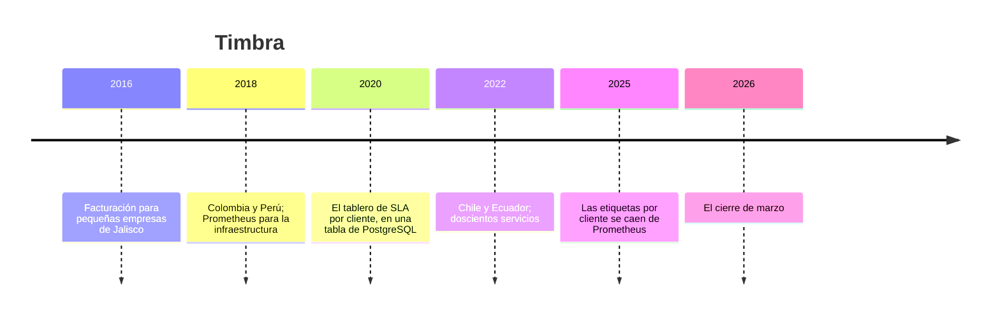

# 🧾 Timbra: la historia

> **Qué es este documento:** la fuente de verdad de todo lo narrativo de El Vigía: la empresa, su gente, sus
> sistemas, sus cifras y sus reglas de negocio. **Ninguna fase inventa un dato**: si lo necesita y no está
> aquí, se agrega aquí primero.
> **Vigencia:** 2026-10-07 · **primera versión, en discusión con el autor.** Los dolores de §4 van por tema;
> cuando exista la propuesta de fases, cada uno se ata a su fase. Las cifras de §5 son ficticias y los
> volúmenes del laboratorio se fijan en la propuesta de fases. Los clientes, los proveedores de certificación y
> los casos son inventados: ninguna entidad ni persona real.

---

## 1. 📅 Cómo llegó hasta aquí

Timbra es un servicio de facturación electrónica de Guadalajara: cuarenta y ocho mil empresas de México,
Colombia, Perú, Chile y Ecuador emiten por su API las facturas, las notas de crédito y los recibos de nómina que
cada país exige validar ante su autoridad tributaria. En México el paso se llama *timbrar*, y de ahí el nombre.
Lo que Timbra vende, más que facturas, es que la factura salga a tiempo. Para saber si sale a tiempo mide todo,
y una parte de lo que mide vive en una tabla que ya no da más.

**2016 · Jalisco.** Ernesto Villaseñor llevaba la contabilidad de veinte pequeñas empresas y perdía los cierres
de mes peleando con portales. Con Paola Cervantes, una ingeniera poblana que había trabajado en un proveedor de
certificación, lanzó Timbra: una API que recibe la factura, la valida, la manda a timbrar y la devuelve sellada.
Node, PostgreSQL y una cola.

**2018 · Prometheus.** Con Colombia y Perú, Paola partió la API en servicios y montó Prometheus y Grafana para la
infraestructura: CPU, memoria, latencia por servicio, quince días de retención. **Fue la decisión correcta**, y
sigue siendo lo que mira la guardia.

**2020 · El tablero de SLA.** Los clientes grandes empezaron a firmar contratos con nivel de servicio: el 99,5 %
de las facturas timbradas en menos de 3 segundos, medido por cliente y por mes, con créditos si no se cumple.
Prometheus no podía llevar una serie por cliente sin reventar, así que Diego Salazar, un ingeniero de datos que
llegó de Lima, hizo lo que cualquiera con PostgreSQL a mano habría hecho: un middleware en la API que escribe
**una fila por petición** en `request_metrics` —instante, servicio, cliente, país, identificador de la petición,
duración y resultado—, con un índice por instante y otro por cliente, y el reporte mensual como una consulta. Su
argumento, con el aval de Paola: *"ya tenemos PostgreSQL, ya sabemos SQL, y el reporte de SLA es un `GROUP BY`"*.
Durante dos años fue exactamente eso.

**2022 · Doscientos servicios.** Chile y Ecuador sumaron conectores, y la API pasó a ciento ochenta servicios
en doscientos nodos. `request_metrics` pasó de trescientos millones de filas a dos mil millones. Diego agregó un
trabajo nocturno que borra lo de más de dos años.

**2025 · Las etiquetas por cliente.** En enero, alguien agregó la etiqueta de cliente a la métrica de latencia
del proveedor de certificación en Prometheus, para ver qué clientes sufrían. La memoria de Prometheus se
triplicó en una semana, se cayó dos veces, y la etiqueta se quitó. Con ella se fue la única alerta sobre esa
latencia, y nadie la volvió a escribir.

**2026 · El cierre de marzo.** Lo que pasó el 31 de marzo abre el curso (§4).

| Año | Qué pasó | Quién lo decidió | Lo que dejó |
|---|---|---|---|
| 2016 | La API de facturación sobre PostgreSQL | Ernesto y Paola | la base de verdad, que sigue sana |
| 2018 | Prometheus y Grafana para la infraestructura | Paola | la guardia que sí ve los servicios |
| 2020 | Una fila por petición en `request_metrics` | Diego, con aval de Paola | el villano, con su mejor argumento |
| 2022 | Doscientos nodos y el borrado nocturno | Diego | dos mil millones de filas |
| 2025 | La etiqueta de cliente, puesta y quitada de Prometheus | — | una alerta que nadie volvió a escribir |
| 2026 | El cierre de marzo | — | el incidente que abre el curso |

## 2. 👥 La gente

| Personaje | Rol | Cómo habla | Qué quiere | Aparece en |
|---|---|---|---|---|
| **Ernesto Villaseñor** | Fundador y director general, de Guadalajara | Cálido y comercial: *"¡qué padre!"*, y después la pregunta por los créditos | que los clientes grandes renueven | la apertura, el veredicto |
| **Paola Cervantes** | Directora de tecnología, de Puebla | Precisa y franca: *"Prometheus lo monté yo, y la guardia vive gracias a él"* | medir antes de cambiar un servicio | casi todas; es la interlocutora del lector |
| **Diego Salazar** | Ingeniero de datos, de Lima | Tranquilo, de SQL: *"es un `GROUP BY`, pe"* | que el reporte de SLA salga | la tabla, los roll-ups, el veredicto |
| **Mariana Robles** | Éxito de clientes, de Ciudad de México | Directa, de contrato: *"¡no manches!"* cuando un cliente reclama | defender cada número del reporte de SLA | el SLA, los percentiles, el tablero |
| **Iván Ramírez** | Ingeniero de confiabilidad, de guardia, de Guadalajara | Coloquial: *"¡ándale!"* cuando algo por fin carga | dormir en los cierres de mes | la ingesta, la operación, los motores por dentro |
| **Ana Lucía Paredes** | Líder de los conectores con las autoridades, de Quito | Metódica, de integración: todo depende del país | saber cuándo un conector se degrada antes que el cliente | el dato que llega tarde, la alerta |
| **Tú** | Ingeniero senior recién contratado | — | — | todas: Paola te contrató para medir, no para opinar |

El encargo de Paola, el día que entras: *"No quiero que me digas que la tabla de Diego es mala; sin ella no
habríamos firmado un solo contrato con SLA. Quiero saber dónde deben vivir nuestras métricas, cuánto detalle
podemos guardar y por cuánto tiempo, cómo se calcula un percentil del mes sin mentir, y si necesitamos un motor
nuevo o el que ya tenemos alcanza. Y si alguna de nuestras tablas no es una serie de tiempo aunque lo parezca,
también quiero saberlo."*

## 3. 🏚️ Lo que hay (el patrimonio)

| Sistema | Stack y edad | Quién lo mantiene | Sus mañas |
|---|---|---|---|
| **La API de facturación** | ciento ochenta servicios en Node, con PostgreSQL, desde 2016 | Paola | sana; facturas, clientes, certificados, conectores; **es la base de verdad del negocio** |
| **Prometheus y Grafana** | desde 2018, quince días de retención | Iván | la infraestructura bien vista; sin nada por cliente desde enero de 2025 |
| **`request_metrics`** | una tabla de PostgreSQL, desde 2020 | Diego | una fila por petición, escrita **dentro** de la petición; dos mil millones de filas |
| **El borrado nocturno** | `DELETE` de lo de más de dos años | Diego | lleva cinco meses fallando por tiempo de espera y nadie lo vio |
| **El reporte de SLA** | una consulta mensual por cliente | Diego y Mariana | el percentil 99,5 del mes, calculado sobre los crudos; cada mes tarda más |
| **Los conectores** | un servicio por país y por proveedor de certificación | Ana Lucía | la autoridad o el proveedor se degradan sin avisar; algunos confirman con horas de atraso |
| **La tabla de facturas** | `invoices` en PostgreSQL, con `created_at` | Paola | Diego propuso en 2025 llevarla a un motor de series "para contar más rápido" |

**El laboratorio del curso levanta** la API de facturación mínima con su carga simulada, la tabla del villano en
PostgreSQL, y los motores de series para comparar —InfluxDB 3, TimescaleDB, Prometheus y las colecciones de
series de MongoDB—, con un generador que sabe exactamente qué emitió cada servicio y para cada cliente. Los
servicios gestionados se tratan solo desde su documentación.

## 4. 🔥 El incidente que lo empezó todo

El martes 31 de marzo de 2026 fue cierre de mes, cierre de trimestre y día de pago de nómina, en plena Semana
Santa, con media empresa de vacaciones. El volumen de timbrado fue cuatro veces el de un día normal.

**A las 11:00**, la escritura en `request_metrics` empezó a tardar: el índice por instante ya no cabía en memoria
y el disco estaba al 91 %, porque el borrado nocturno llevaba cinco meses sin terminar. Como el middleware escribe
dentro de la petición, la latencia de la API subió con él. A las 13:10, Iván desactivó el middleware para salvar
la API. La API se recuperó, y Timbra se quedó sin métricas por cliente.

**A las 18:05**, el proveedor de certificación de México se degradó. Las facturas empezaron a acumularse en la
cola de timbrado. Prometheus veía la cola de los servicios crecer, pero la alerta de la latencia del proveedor se
había ido con la etiqueta de cliente en 2025, y la de la cola tenía un umbral pensado para un día normal. Durante
seis horas y veinte minutos nadie se enteró. A las 00:25 se habían acumulado doscientas doce mil facturas sin
timbrar, y tres mil cuatrocientas empresas no timbraron su nómina a tiempo.

**En abril**, el reporte de SLA no se pudo calcular: la consulta del percentil del mes por cliente, sobre dos mil
millones de filas y con cinco horas sin datos, no terminó nunca. Mariana negoció créditos a ciegas con los
clientes que reclamaron, ochenta y cuatro mil dólares, y el cliente más grande aplazó su renovación hasta ver el
reporte. Y cuando Diego quiso calcularlo a partir de los promedios por hora que guardaba aparte, descubrió que el
promedio de los percentiles de cada hora no es el percentil del mes.

En la reunión del lunes, Ernesto preguntó: *"¿Cómo es que medimos todo y no vimos nada?"*. Paola dijo que creía
saber qué había que cambiar, y que no quería creerlo: quería medirlo. Esa semana abrió la vacante que vas a ocupar.

### Los dolores, por tema

Cada uno abre una o más fases cuando la propuesta exista. Ninguno se inventa en la fase: sale de aquí.

1. **El middleware que escribe cada petición.** La escritura de métricas dentro del camino del negocio: lotes,
   asincronía, protocolos de ingesta y lo que se pierde si el motor se cae.
2. **La tabla de dos mil millones de filas.** El tiempo como eje físico: particiones por tiempo, archivos por
   tiempo, y lo que cada motor hace para no leer lo que no pidió.
3. **Cuarenta y ocho mil clientes como etiqueta.** La cardinalidad de series: cuánto cuesta cada combinación de
   etiquetas en cada motor, medido.
4. **El identificador de la petición.** Lo que nunca debe ser etiqueta: campos de alta cardinalidad, ejemplares,
   y la frontera entre una métrica y un registro.
5. **El disco al 91 %.** La compresión del dato temporal por dentro: diferencias de diferencias, XOR de punto
   flotante, diccionarios y formatos columnares; bytes por punto, medidos.
6. **El percentil del mes.** Por qué no se promedian percentiles: histogramas, bocetos de cuantiles, y cuánto se
   equivoca cada uno contra el percentil exacto.
7. **El reporte de SLA que no termina.** Agregados continuos, reducción de resolución y su atraso; servir el mes
   sin leer los crudos.
8. **Dos años de detalle.** Retención por resolución, borrar por partición contra borrar por fila, y el borrado
   que lleva cinco meses fallando.
9. **El conector que confirma tarde.** Datos fuera de orden y que llegan tarde: aceptarlos, reescribir lo ya
   comprimido, y lo que eso cuesta.
10. **El contador que se reinicia.** Contadores, medidores e histogramas; la tasa cuando un servicio se reinicia;
    PromQL contra SQL.
11. **Marzo contra febrero.** Consultas de ventana: cubetas de tiempo, huecos, el último valor conocido, y la
    comparación de una ventana con otra.
12. **La alerta que no existía.** Reglas de alerta y de registro: cuánto cuesta evaluarlas y por qué una alerta
    no puede depender de una etiqueta que no cabe.
13. **Prometheus por dentro.** El modelo de extracción, la cabeza en memoria, el registro de escritura, los
    bloques y su compactación; y la escritura remota.
14. **InfluxDB 3 por dentro.** El registro de escritura, los archivos Parquet, el catálogo, el almacenamiento de
    objetos y el motor de consultas SQL; y lo que trae y no trae la edición Core.
15. **TimescaleDB por dentro.** Hypertables, fragmentos, el almacenamiento columnar y sus licencias.
16. **La cubeta a mano.** El patrón de cubetas en MongoDB escrito a mano contra sus colecciones de series nativas.
17. **El tablero.** Lo reciente punto a punto, lo histórico agregado y la ventana contra ventana, servidos desde
    cada motor.
18. **El motor que hay que operar.** Copias, actualizaciones, almacenamiento por niveles; y los servicios
    gestionados.
19. **El villano en la mesa.** La tabla genérica contra los motores de series, con el cierre de marzo reproducido.
20. **La tabla que no es una serie.** Las facturas con `created_at`: por qué no van a un motor de series, aunque lo
    parezcan.

## 5. 💰 Las cifras

Todas ficticias, coherentes entre sí, y con los volúmenes del laboratorio por fijar en la propuesta de fases.

| Cifra | Valor | Fuente o supuesto |
|---|---|---|
| Empresas clientes | ≈ 48.000 en cinco países; ≈ 1.200 con contrato de SLA | ficticia |
| Documentos por día | ≈ 2,6 M; ×4 en cierre de mes con nómina | ficticia |
| Peticiones a la API por día | ≈ 9 M | ficticia |
| Servicios y nodos | ≈ 180 servicios en ≈ 200 nodos | ficticia |
| Series activas en Prometheus | ≈ 1,4 M; ≈ 4,3 M la semana que tuvo la etiqueta de cliente | ficticia |
| `request_metrics` | ≈ 2.000 M filas, ≈ 1,1 TB con índices | ficticia |
| El SLA | 99,5 % de los documentos timbrados en menos de 3 s, por cliente y por mes | ficticia |
| Retención | Prometheus 15 días; `request_metrics` 2 años (en teoría) | ficticia |
| El incidente: sin métricas por cliente | desde las 13:10 | ficticia |
| El incidente: proveedor degradado sin alerta | 6 h 20 min | ficticia |
| El incidente: acumulado | 212.000 documentos sin timbrar; 3.400 empresas con la nómina tarde | ficticia |
| El incidente: créditos | US$ 84.000 | ficticia |
| El disco | 91 %; el borrado nocturno, cinco meses sin terminar | ficticia |

## 6. 📏 Las reglas de negocio

- **El documento.** Factura, nota de crédito o recibo de nómina; lo emite un cliente por la API, se valida y se
  manda a timbrar ante la autoridad o su proveedor de certificación.
- **El SLA.** Para los clientes con contrato: el 99,5 % de sus documentos del mes timbrados en menos de 3 s, desde
  que entran a la API hasta que salen sellados. Si no se cumple, el cliente recibe un crédito según su contrato.
- **El reporte de SLA.** Uno por cliente y por mes, con el percentil y el porcentaje cumplido. **Tiene que poder
  defenderse**: calculado sobre lo que pasó, no sobre una aproximación sin declarar.
- **La guardia.** Recibe una alerta cuando un servicio, una cola o un conector se degradan, antes de que el cliente
  lo note.
- **La retención.** Detalle por petición de los últimos treinta días; agregados por hora de dos años; el reporte de
  SLA, para siempre.
- **El dato tardío.** Algunos conectores confirman el timbrado con horas de atraso; la confirmación cuenta para el
  mes en que ocurrió, no para el mes en que llegó.
- **La base de verdad** de clientes, documentos y contratos es PostgreSQL. Las métricas son derivadas del
  funcionamiento, pero el reporte de SLA tiene efectos contractuales: esa es la pregunta del curso.

## 7. 🗣️ Cómo hablan

La narración y las instrucciones al lector van en tuteo neutro. Las voces se reservan para los diálogos, una
expresión por escena:

- **Ernesto** (Guadalajara): *"¡qué padre!"*.
- **Diego** (Lima): *"pe"*, al final de una frase que le parece obvia.
- **Mariana** (Ciudad de México): *"¡no manches!"*.
- **Iván** (Guadalajara): *"¡ándale!"*.
- **Paola** habla de **la guardia** y **la serie**; **Mariana**, de **el contrato** y **el crédito**; **Ana Lucía**,
  de **el conector** y **el país**.

En la casa se dice **timbrar**, **el cierre** (de mes), **la cola de timbrado**, **el proveedor** (de
certificación), **la tabla de Diego**, **el reporte de SLA**, **la guardia** y **el cierre de marzo**.
