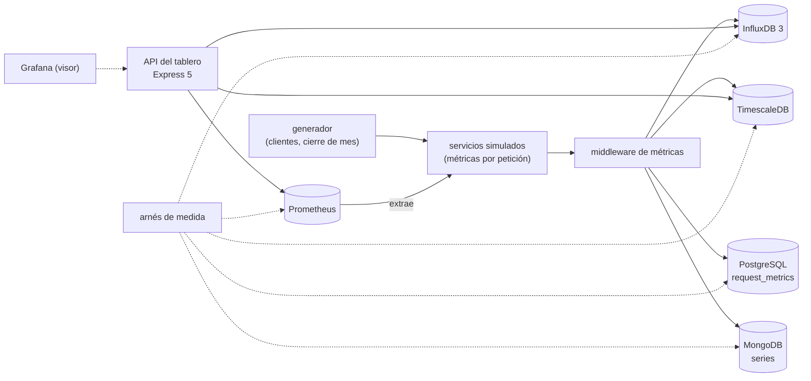

# 🎯 Alcance del proyecto
## El Vigía — el modelo de series temporales a fondo

> **Qué es este documento:** la fuente de verdad de **qué** enseña el curso, a quién y con qué límites. Lo
> que no esté aquí no está en el curso.
> **Fecha de esta versión:** 7 de octubre de 2026. Consolida la semilla de agosto (`_desechable-semilla.md`),
> el alcance de agosto (`_desechable-alcance-v1.md`), la ficha de arranque, las reglas de la ruta y los
> precedentes de los cursos anteriores. **Lo único preliminar es §9**: la cantidad de fases y su orden salen
> de la propuesta de fases.
> **Precedencia:** manda este documento. Después viene
> [`guia-de-estilo-y-convenciones.md`](guia-de-estilo-y-convenciones.md), que decide **cómo** se escribe;
> después el contrato de nombres y el diccionario de términos (por escribir), y las propuestas. Las plantillas
> y los prompts se actualizan siempre al final. Por encima de todos está el `CLAUDE.md` del repositorio, en lo
> que este curso no haya declarado como excepción (§12).
> **Estado de las decisiones:** 36 cerradas, ninguna abierta (§12). Solo faltan la propuesta de fases y la
> versión final de la historia.

---

## 1. 🧭 En una frase

**Un curso que enseña el modelo de series temporales a fondo reconstruyendo y midiendo la observabilidad de un
servicio de facturación electrónica de cinco países, para que el lector pueda decidir —y defender con números
propios— qué se guarda como serie y con qué etiquetas, cuánto detalle y por cuánto tiempo, cómo se agrega sin
mentir, qué hace cada motor por dentro, y qué tabla no era una serie aunque lo pareciera.**

No forma administradores de Prometheus ni de InfluxDB, ni ingenieros de observabilidad de tiempo completo, ni
prepara una certificación. No enseña series temporales desde cero: el lector ya hizo el minicurso de Ruta NoSQL
Lite. Forma la capacidad de decir *"el detalle por petición vive treinta días en este motor, sin el cliente como
etiqueta; el SLA se sirve de histogramas por cliente y por hora que dan el percentil del mes con este error; la
guardia mira Prometheus; y las facturas se quedan en PostgreSQL; por esta razón y con este número"*.

---

## 2. 🔥 El problema que resuelve

El lector salió de lite sabiendo particionar por tiempo, comprimir, hacer roll-ups continuos, retener por
partición, que la cardinalidad explota, y que PostgreSQL particionado llega lejos. Le falta lo que viene después:
saber qué hace un motor dedicado con cada punto, cuánto le cuesta cada etiqueta en cada motor, calcular un
percentil sobre un mes sin leer los crudos y sin promediar percentiles, aceptar el dato que llega tarde, leer un
contador que se reinicia, escribir una alerta que no dependa de lo que no cabe, sacar las métricas del camino del
negocio, y distinguir una serie de una tabla con fecha. Hoy eso se aprende el cierre de mes en que las métricas
frenan la API, o en tutoriales que demuestran un motor de series con la CPU de un portátil.

El villano es uno solo, **el tiempo tratado como una columna más**, y tiene tres caras:

- **"Ya tenemos PostgreSQL: una fila por petición."** Una tabla genérica, escrita dentro de la petición, con
  índices que ya no caben y un borrado por filas que no termina.
- **"Pongamos el cliente como etiqueta."** La cardinalidad que tumba a Prometheus, y la alerta que se va con ella.
- **"Todo lo que tiene fecha es una serie."** El reverso, que el curso también mide: las facturas con
  `created_at` no van a un motor de series.

> ⚠️ **El antagonista no es ninguna herramienta.** La tabla de Diego permitió firmar cada contrato con SLA desde
> 2020; Prometheus es lo que mantiene viva a la guardia; TimescaleDB y PostgreSQL ganan donde ganan y el curso lo
> publica; y el curso cierra con el veredicto de cuándo un motor de series no hacía falta.

---

## 3. 🎓 Objetivo pedagógico

Al terminar, el lector puede hacer seis cosas que antes no podía:

1. **Diseñar la serie**: elegir etiquetas y campos por su cardinalidad, medida en cada motor, y sacar la
   escritura de métricas del camino del negocio.
2. **Agregar sin mentir**: histogramas y bocetos de cuantiles, agregados continuos y reducción de resolución, con
   el error de cada uno contra el valor exacto.
3. **Retener con criterio**: resoluciones por edad, borrado por partición, almacenamiento por niveles, y el dato
   tardío que reescribe lo comprimido.
4. **Leer los motores por dentro**: InfluxDB 3, Prometheus, TimescaleDB y las colecciones de series de MongoDB,
   cada uno con su camino de escritura, su compresión y su consulta.
5. **Consultar el tiempo**: contadores, tasas, cubetas, huecos, ventana contra ventana, en SQL y en PromQL, y las
   alertas que se evalúan sobre ellas.
6. **Elegir el motor** entre los cuatro, PostgreSQL a secas y un servicio gestionado, con una medición propia y el
   costo de operarlo; y reconocer la tabla que no es una serie.

Lo que **no** es objetivo: construir una plataforma de observabilidad, trazas o registros, ni administrar un
clúster de métricas en producción corporativa.

---

## 4. 👥 Perfil del lector

Ingeniero senior que **ya hizo Ruta NoSQL Lite**, o que sabe lo equivalente: SQL y modelado relacional de oficio,
funciones de ventana sin miedo, TypeScript con soltura, contenedores sin ayuda, nociones de lo que es una métrica
de infraestructura, y el minicurso de series temporales de lite. Se le explica el modelo en profundidad y los
motores por dentro; no se le explica a programar, Docker, SQL ni lo que lite ya enseñó.

**Lo que se da por sabido y no se explica jamás:** SQL, índices, transacciones, funciones de ventana; TypeScript y
Node; Docker Compose; las cinco preguntas, el arnés y la apuesta antes de medir; de lite, hypertables,
particionado por tiempo, roll-ups continuos, retención y compresión como modelo, `DELETE` contra `DROP` de
partición, la explosión de cardinalidad, el backfill contra lo comprimido, y las licencias de TimescaleDB.

**Lo que se explica con cero ambigüedad**, aunque el lector sea senior: qué es una serie en cada motor y cuánta
memoria cuesta, cómo comprime cada algoritmo y por qué funciona con el dato temporal, por qué no se promedian
percentiles y cuánto se equivoca cada aproximación, qué hace `rate()` con un reinicio, qué pasa con un punto que
llega fuera de orden en cada motor, y qué es exactamente lo que guarda un agregado continuo y cuándo se refresca.

> 🧭 **Ninguna caja negra prematura, no menos profundidad.**

**Requisitos de entrada:** un equipo con 16 GB de memoria (D-20), Docker Desktop o Podman, y Node 24. **No hace
falta** ninguna cuenta en la nube ni nada instalado fuera de contenedores.

---

## 5. 🧭 La pregunta que ordena el curso

> *¿Esto es una serie, con qué etiquetas, a qué resolución y por cuánto tiempo —y qué le cuesta al sistema, y a
> la empresa, guardarlo y agregarlo así?*

Se presenta en la primera fase, con el cierre de marzo, y reaparece en el veredicto de cada fase:

- **La primera parte** responde *qué es la serie*: el middleware, la tabla de dos mil millones, el cliente como
  etiqueta, el identificador de la petición.
- **La segunda parte** responde *cómo se guarda y se agrega*: la compresión, el percentil del mes, el reporte de
  SLA, la retención, el dato tardío.
- **La tercera parte** responde *cómo se consulta y se vigila*: contadores, ventanas, alertas, el tablero.
- **La cuarta parte** responde *qué hace cada motor por dentro*: Prometheus, InfluxDB 3, TimescaleDB, la cubeta a
  mano.
- **El cierre** responde la pregunta entera: la operación, la autopsia de la tabla genérica y la tabla que no era
  una serie.

---

## 6. 📏 Cómo se mide

**Todo "mejor que" lleva un número**, medido con el arnés del curso y consolidado en `BENCHMARKS.md`. Se mide
primero **lo guardado contra lo emitido**: puntos perdidos, duplicados o descartados por llegar tarde, contra lo
que el generador sabe que emitió cada servicio; y **lo agregado contra lo exacto**: el percentil y el promedio de
cada roll-up, histograma o boceto contra el valor calculado sobre los crudos (D-26, D-31). Después **la forma**:
series activas, bytes por punto, tamaño en disco, memoria del motor, atraso de un agregado. **Los tiempos sí
aparecen**, siempre con su dispersión (mediana, p95 y p99), calentamiento, repeticiones y máquina declarados, **y
siempre con las series activas, los puntos por segundo y la ventana consultada** al lado, porque en este modelo
el veredicto depende de ellos (D-19).

Las reglas de honestidad no se negocian: se publica lo que salió · el empate se llama empate · nada de números
redondos sin dispersión · cada motor se configura bien y según su documentación · **PostgreSQL juega con lo mejor
que tiene**: particionado declarativo, BRIN, índices parciales, y TimescaleDB como su mejor extensión · cada
función con licencia distinta de la del motor se marca (D-25) · se declara lo que no se midió · los costos de la
nube llevan ☁️, fuente y fecha · y **nunca se extrapola de un portátil a producción**: lo que se mide en un
portátil con Docker se dice así.

Dos anclas por fase, cuando la fase las admite: 🪞 **una apuesta** escrita antes de ejecutar y 💥 **una rotura
provocada**, con el síntoma literal y lo que costó salir.

---

## 7. 🧪 El sistema del curso

### 7.1 El dominio

La observabilidad de **Timbra**, un servicio de facturación electrónica de Guadalajara: servicios y nodos con sus
métricas de infraestructura, peticiones con su duración por cliente y por país, la cola de timbrado, los
conectores con las autoridades y los proveedores de certificación, el SLA por cliente y por mes, las alertas de la
guardia y el tablero. PostgreSQL es la base de verdad del negocio. La historia está en
[`../00-historia-de-timbra.md`](../00-historia-de-timbra.md).

**Queda fuera a propósito:** la facturación electrónica real de cualquier país, trazas distribuidas y registros,
la autenticación de la API, y el tablero como producto visual.

### 7.2 El stack, y qué compra cada pieza

| Pieza | Elección | Qué compra | Qué cuesta |
|---|---|---|---|
| Motor principal | InfluxDB 3 Core (D-16, D-24) | el motor dedicado: columnar sobre Parquet, SQL, sin límite declarado de cardinalidad | un motor más, y lo que la edición Core no trae |
| Rival dentro de PostgreSQL | TimescaleDB (D-16, D-25) | series sin salir de SQL ni de PostgreSQL | funciones con licencia propia |
| Rival de la observabilidad | Prometheus (D-16) | el estándar de la guardia, PromQL y el modelo de extracción | memoria por serie, retención corta |
| Rival generalista | MongoDB con colecciones de series y con cubetas a mano (D-16) | cuánto acorta la brecha un motor generalista | su licencia, y otro lenguaje de consulta |
| Base de verdad y villano | PostgreSQL con `request_metrics` (D-23) | el negocio donde siempre estuvo, y la tabla genérica medida | — es lo que ya existe en la empresa |
| Visor | Grafana (D-28) | el tablero para mirar, no para medir | un servicio más en el laboratorio |
| Servicios gestionados | solo desde documentación ☁️ (D-22) | la respuesta a "¿y si no queremos operar nada?" | cuestan dinero |
| Simulador, arnés, generador y API del tablero | TypeScript nativo en Node 24, Express 5 (D-17, D-30, D-32) | la misma carga y la misma verdad contra cada motor | — |

### 7.3 Cómo se construye el código

A mano, en un solo proyecto en `src/` que crece por fases (D-09). El simulador levanta servicios livianos que
reciben peticiones de clientes sintéticos y emiten sus métricas; el generador sabe cada punto emitido; el arnés
compara lo guardado y lo agregado contra él.

### 7.4 El tamaño mínimo

Todo cabe en **16 GB** con perfiles de Compose: PostgreSQL, el simulador y el arnés siempre; **un motor de series
a la vez**, salvo Prometheus, que es liviano; los volúmenes, dimensionados en la verificación previa (D-20).

---

## 8. 🧰 Herramientas y plataformas

**Versiones:** última estable a la fecha de la verificación previa, por digest para las imágenes y con archivo de
bloqueo para las librerías, en el apéndice del laboratorio (D-07). **Plataformas:** macOS en Apple Silicon, Linux
y Windows con WSL2; el autor verifica en macOS arm64 y lo demás se marca no verificado (D-06).

---

## 9. 🪜 La forma del curso

**Tipo:** curso completo. **Unas 100 horas en 10 a 12 fases** de unas 10 h. **Preliminar:** el arco, los nombres y
las fichas salen de la propuesta de fases. El borrador de partida son las doce fases de la semilla, menos lo que
lite ya dio (el particionado por tiempo, la compresión y los roll-ups en lo básico, la retención como modelo, la
cardinalidad que explota, PostgreSQL particionado contra TimescaleDB), más lo que pide la profundidad:
Prometheus, los percentiles agregados, el dato tardío, los contadores, las alertas y los motores por dentro.

| Bloque (tentativo) | Qué hace | Temas de la historia (§4 de ella) |
|---|---|---|
| **I · La serie** | sacar las métricas del negocio, el tiempo como eje, la cardinalidad, lo que no es etiqueta | 1, 2, 3, 4 |
| **II · Guardar y agregar** | compresión, el percentil del mes, el reporte de SLA, la retención, el dato tardío | 5, 6, 7, 8, 9 |
| **III · Consultar y vigilar** | contadores, ventanas, alertas, el tablero | 10, 11, 12, 17 |
| **IV · Los motores por dentro** | Prometheus, InfluxDB 3, TimescaleDB, la cubeta a mano | 13, 14, 15, 16 |
| **V · Operación y veredicto** | operar y los gestionados, la autopsia, la tabla que no es una serie | 18, 19, 20 |

---

## 10. ✅ Lo que está dentro del alcance

- Sacar la escritura de métricas del camino del negocio: lotes, asincronía, protocolos de ingesta de cada motor, y
  lo que se pierde cuando el motor no está.
- El tiempo como eje físico en cada motor: archivos y particiones de InfluxDB 3, fragmentos de TimescaleDB,
  bloques de Prometheus, cubetas de MongoDB.
- La cardinalidad: series activas y su costo en memoria y en disco, medido en cada motor; etiquetas contra campos;
  ejemplares.
- La compresión por dentro: diferencias de diferencias, XOR de punto flotante, diccionarios, codificaciones de
  Parquet; bytes por punto.
- Percentiles: histogramas clásicos y nativos de Prometheus, bocetos de cuantiles, y su error contra el exacto.
- Agregados continuos y reducción de resolución en cada motor, con su atraso y su refresco.
- Retención por resolución, borrado por partición, almacenamiento por niveles.
- Datos tardíos y fuera de orden: qué acepta cada motor y qué cuesta reescribir lo comprimido.
- Contadores, medidores e histogramas; `rate()` e `increase()` con reinicios; PromQL frente a SQL.
- Consultas de ventana: cubetas, rellenar huecos, último valor conocido, ventana contra ventana.
- Reglas de alerta y de registro, y su costo de evaluación.
- Prometheus por dentro y su escritura remota.
- InfluxDB 3 por dentro, y lo que trae y no trae la edición Core.
- TimescaleDB por dentro y sus licencias por función.
- El patrón de cubetas a mano en MongoDB contra sus colecciones de series.
- El tablero de las tres consultas, servido desde cada motor.
- Operación: copias, actualizaciones, espacio; los gestionados desde su documentación.
- La autopsia de `request_metrics`, con el cierre de marzo reproducido.
- La tabla que no es una serie, medida, y el árbol de cuándo no usar un motor de series.

## 11. 🚫 Lo que está fuera del alcance

Se declara y el texto se detiene: **no se dice dónde estaría ese material.**

- Lo que Ruta NoSQL Lite ya enseñó de series temporales: se usa, no se explica.
- Trazas distribuidas, registros y la plataforma de observabilidad completa.
- OpenTelemetry más allá de nombrarlo como la tubería habitual (D-27).
- VictoriaMetrics, QuestDB, ClickHouse, Thanos, Mimir y otros motores: se nombran, no se miden (D-33).
- Clústeres y alta disponibilidad de cualquiera de los motores.
- Los gestionados medidos de verdad (D-22).
- Detección de anomalías y pronósticos.
- El tablero como producto visual.

---

## 12. ⚖️ Decisiones

Si una sesión futura quiere cambiar una, primero la cambia aquí y después en todo lo demás, nunca al revés. ✅
cerrada · ⏳ abierta · 🔄 reabierta. Las que llevan *(ruta)* o el nombre de un curso siguen la regla de la ruta o
el precedente de ese curso; las que llevan *(por defecto)* las cerró la sesión con el valor propuesto y se le
listaron al autor.

| ID | Decisión | Valor | Estado |
|---|---|---|---|
| D-01 | Idioma | Español latinoamericano neutro con tuteo; código, comandos, identificadores y salida de terminal en inglés; comentarios de código en español | ✅ |
| D-02 | Tipo de curso | Curso completo | ✅ |
| D-03 | Autocontención | Lo publicado nombra Ruta NoSQL Lite **solo como requisito de entrada**: no usa su contenido, no remite a sus fases ni reutiliza sus ejemplos, datos o mediciones. `prompts/` puede citarla *(ruta, R-07)* | ✅ |
| D-04 | Promesa de esfuerzo | ~100 h en 10–12 fases de ~10 h *(Proteo)* | ✅ |
| D-05 | Aparato de evaluación | 20–30 ejercicios por fase, 🟢🟡🟠🔴 + 🔥, un tercio de diagnóstico o medición, cada uno con su criterio; **sin solución publicada**. Taller global: la observabilidad en `src/`. Un 💀 boss por bloque cuando el bloque lo admita, y el proyecto final de §13 *(Proteo)* | ✅ |
| D-06 | Plataformas | macOS arm64, Linux, Windows con WSL2; el autor verifica en macOS arm64 | ✅ |
| D-07 | Política de versiones | Última estable a la fecha de la verificación previa; imágenes por digest y librerías con archivo de bloqueo, en el apéndice del laboratorio | ✅ |
| D-08 | Ejecución | Nada se publica sin haberse ejecutado | ✅ |
| D-09 | Código | Un solo proyecto en `src/` que crece por fases, con tags `fase-NN-<slug>` *(Proteo)* | ✅ |
| D-10 | README y temario | Se escriben al final, en una tanda propia | ✅ |
| D-11 | Historia | Timbra, en `00-historia-de-timbra.md` | ✅ |
| D-12 | Diagramas | Mermaid | ✅ |
| D-13 | Publicación | Repositorio público propio del curso, sin `prompts/` | ✅ |
| D-14 | Prerrequisito | Ruta NoSQL Lite, o lo equivalente de §4 | ✅ |
| D-15 | Profundidad | Full geek: compresión por dentro, los cuatro motores por dentro, cardinalidad medida, histogramas y bocetos con su error, contadores y tasas, datos tardíos, consultas de ventana *(por defecto)* | ✅ |
| D-16 | Rivales | InfluxDB 3 Core como principal (D-24); TimescaleDB; Prometheus; MongoDB con colecciones de series y con cubetas a mano; PostgreSQL como base de verdad y villano *(semilla, con Prometheus agregado por el dominio)* | ✅ |
| D-17 | Lenguaje | TypeScript nativo en Node 24 para todo; sin codas en otros lenguajes *(semilla y Portalón)* | ✅ |
| D-18 | Clientes | El cliente oficial de cada motor o su API HTTP (protocolo de líneas y SQL en InfluxDB 3, `pg` en TimescaleDB y PostgreSQL, la API de consultas de Prometheus, el driver de MongoDB); la exposición de métricas de los servicios, con la librería de cliente de Prometheus para Node *(semilla)* | ✅ |
| D-19 | Mediciones | Lo guardado contra lo emitido y lo agregado contra lo exacto primero, después forma, después tiempos con mediana, p95 y p99; siempre con series activas, puntos por segundo y ventana consultada. Documento vivo: `BENCHMARKS.md` *(Proteo, Telaraña)* | ✅ |
| D-20 | Memoria del laboratorio | Todo dentro de 16 GB con perfiles de Compose: un motor de series a la vez, salvo Prometheus; los volúmenes, dimensionados en la verificación previa *(Portalón)* | ✅ |
| D-21 | Datos | Sintéticos con semilla fija y la forma de Timbra: ≈ 200 nodos y 180 servicios, clientes con una distribución de cola larga, cinco países, cierres de mes con nómina, conectores que se degradan y confirman tarde | ✅ |
| D-22 | Servicios gestionados | InfluxDB Cloud, Amazon Timestream para InfluxDB, Timescale Cloud, Amazon Managed Service for Prometheus y Grafana Cloud, solo desde su documentación y sus precios públicos, citados con fecha y marcados ☁️ *(Proteo)* | ✅ |
| D-23 | El villano | Implementado de verdad, lo justo para medirlo: el middleware que escribe una fila por petición en `request_metrics` dentro de la petición, el borrado nocturno por filas y el percentil del mes sobre los crudos; frente a los motores de series. El cierre de marzo, reproducido con el simulador | ✅ |
| D-24 | InfluxDB 3 Core como principal | Principal si la verificación previa confirma que la edición Core sirve las consultas históricas del curso; si sus límites lo impiden, TimescaleDB pasa a principal, InfluxDB 3 Core queda como rival y se declara por qué. Lo que solo trae la edición Enterprise se nombra con su licencia citada *(semilla, con la nota de verificación)* | ✅ |
| D-25 | Licencias por función | Cada función de TimescaleDB y de MongoDB que vaya bajo licencia distinta de la del núcleo se marca donde se usa, con la licencia citada con fecha *(lite y Proteo)* | ✅ |
| D-26 | Cuantiles | La verdad es el percentil exacto sobre los crudos; se comparan los histogramas de Prometheus, los bocetos que traiga cada motor y uno implementado en TypeScript; siempre con su error *(por defecto)* | ✅ |
| D-27 | OpenTelemetry | Se nombra como la tubería habitual de la industria; los servicios escriben por el protocolo nativo de cada motor y Prometheus los extrae *(por defecto)* | ✅ |
| D-28 | Grafana | En el laboratorio como visor del tablero; nunca se mide *(semilla)* | ✅ |
| D-29 | Imágenes en arm64 | Si una imagen no corre nativa en arm64, se declara y se mide emulada con esa advertencia, o se marca no verificado *(Portalón)* | ✅ |
| D-30 | El simulador | Servicios livianos en TypeScript con procesos en paralelo; si no alcanza la cadencia del cierre de mes, se calibra al equipo y se declara, sin cambiar de lenguaje *(semilla)* | ✅ |
| D-31 | La verdad del generador | El generador conoce cada punto emitido; toda medición de pérdida y de exactitud se publica contra él, además del tiempo *(Telaraña, D-31)* | ✅ |
| D-32 | API del tablero | Express 5 mínima; el arnés mide los motores directamente salvo en las preguntas de extremo a extremo *(Proteo)* | ✅ |
| D-33 | Otros motores | VictoriaMetrics, QuestDB, ClickHouse, Thanos y Mimir se nombran en el veredicto como lo que no se midió *(por defecto)* | ✅ |
| D-34 | Nombre del curso | **El Vigía** se mantiene: encaja con la observabilidad y no choca con otro curso *(por defecto)* | ✅ |
| D-35 | Escritura remota | La escritura remota de Prometheus se mide hacia el motor que gane el largo plazo en la fase de Prometheus *(por defecto)* | ✅ |
| D-36 | La tabla que no es una serie | La propuesta de llevar `invoices` a un motor de series se implementa y se mide en el veredicto, contra PostgreSQL *(por defecto)* | ✅ |

**Excepciones declaradas al `CLAUDE.md` del repositorio**, con su porqué (el detalle en la guía §13):

- **Ruta NoSQL Lite como prerrequisito** (D-14) → no se explican los fundamentos de series temporales → los da lite.
- **Los ejercicios no traen solución publicada** (D-05) → el lector apuesta y mide antes de mirar.

---

## 13. 🏁 El proyecto final

Paola tiene que presentarle a Ernesto, antes del próximo cierre de trimestre, cómo queda la observabilidad: qué se
mide y con qué etiquetas, dónde vive cada serie y por cuánto tiempo, cómo se calcula el SLA de cada cliente y con
qué error, qué alertas tiene la guardia y por qué no se pueden caer con una etiqueta, cuánto cuesta en disco y en
memoria, y qué habría pasado el 31 de marzo de 2026 en la arquitectura nueva. Se entrega como un informe con las
mediciones del curso, la autopsia de la tabla genérica con números antes y después, el cierre de marzo reproducido
en las dos arquitecturas, y el árbol de decisión de cuándo **no** usar un motor de series aplicado a cada pieza,
incluida la tabla de facturas.

---

## 14. 🎯 Criterios de éxito

El curso está bien si:

- Cada fase abre con un dolor de Timbra y cierra con algo que se apostó, se midió y, cuando tocaba, se rompió a
  propósito.
- Ninguna fase repite lo que lite ya enseñó de series temporales.
- Ningún agregado se publica sin su error contra el exacto; ninguna pérdida, sin lo guardado contra lo emitido.
- PostgreSQL o TimescaleDB gana al menos una pieza de Timbra con el número delante, y un motor dedicado gana al
  menos una que PostgreSQL no resuelve bien; la tabla de facturas se queda en PostgreSQL con su número.
- Un lector que solo hace los bloques I y II sale diseñando series y agregando sin mentir; uno que sigue hasta el IV
  sabe leer los motores por dentro y elegir.
- El veredicto final no es "un motor de series para todo" ni "PostgreSQL alcanza siempre".

---

## 15. 📌 Extensión futura, fuera de este curso

El diseño deja preparado, sin prometerlo, las trazas distribuidas con sus ejemplares y la detección de anomalías
sobre las series de los conectores.
