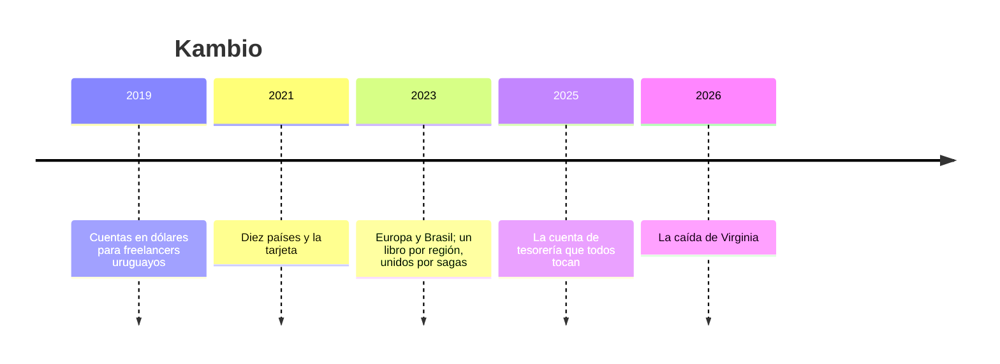

# 💱 Kambio: la historia

> **Qué es este documento:** la fuente de verdad de todo lo narrativo de Libro Mayor: la empresa, su gente, sus
> sistemas, sus cifras y sus reglas de negocio. **Ninguna fase inventa un dato**: si lo necesita y no está aquí,
> se agrega aquí primero.
> **Vigencia:** 2026-10-07 · **primera versión, en discusión con el autor.** Los dolores de §4 van por tema;
> cuando exista la propuesta de fases, cada uno se ata a su fase. Las cifras de §5 son ficticias y los volúmenes
> del laboratorio se fijan en la propuesta de fases. Los bancos aliados, los reguladores, el proveedor de nube y
> los casos son inventados: ninguna entidad ni persona real.

---

## 1. 📅 Cómo llegó hasta aquí

Kambio es una fintech de Montevideo que da cuentas en dólares, euros y reales a trabajadores independientes de
América Latina: desarrolladores, diseñadoras, traductores y consultores que cobran de clientes de Estados Unidos,
Europa y Brasil, cambian entre monedas y retiran a su banco en doce países. Debajo de cada saldo hay un libro mayor
de partida doble en el que nada se borra. Ese libro vive hoy en tres bases de datos, en tres regiones, unidas por
sagas. Cada una es impecable. Lo que pasa entre ellas, no tanto.

**2019 · Dólares.** Valentina Ferreira era desarrolladora independiente en Montevideo y perdía casi un ocho por
ciento de cada pago entre comisiones y cambio. Con Federico Sosa, un ingeniero que venía de un procesador de
pagos, lanzó Kambio: una cuenta en dólares en un banco aliado de Estados Unidos, con un libro mayor propio de
partida doble en PostgreSQL. Lo pusieron en la región de Virginia del proveedor de nube, con una réplica
asíncrona en São Paulo para leer más cerca y un procedimiento de conmutación por error escrito en la wiki. **Fue
la decisión correcta**: un nodo grande aguantaba todo, y la partida doble se cuidaba sola dentro de una
transacción.

**2021 · La tarjeta.** Diez países, una tarjeta de débito en dólares y retiros a bancos locales. El libro creció,
la máquina también.

**2023 · Europa y Brasil.** Para abrir cuentas en euros, Kambio constituyó una entidad en Lisboa, y el regulador
exigió que los datos de los clientes europeos se quedaran en la Unión Europea. Para las cuentas en reales, la
entidad de São Paulo recibió la misma exigencia para los clientes brasileños. Thiago Alves, que llegó de un banco
digital de São Paulo, partió el libro en tres: un PostgreSQL por región, cada uno con sus cuentas, y las
operaciones entre regiones —un cliente europeo que paga a un freelancer de Bogotá, un cambio de reales a
dólares— como **sagas**: débito en una región, mensaje, crédito en la otra, compensación si algo falla, y una
conciliación nocturna que revisa que todo cuadre. Su argumento, con el aval de Federico: *"cada libro es ACID en
su región; entre regiones no hay transacción que no cueste un océano de latencia, así que coordinamos con
mensajes, como todos"*. Funcionó, y la conciliación casi nunca encontraba nada.

**2025 · La tesorería.** Cada cambio de moneda toca la cuenta de tesorería de su par de monedas, y cada operación
toca la cuenta de comisiones. Con trescientos mil cambios diarios, esas pocas filas se volvieron las más
disputadas del sistema, y Graciela Núñez, de tesorería, empezó a ver bloqueos en sus cierres.

**2026 · La caída de Virginia.** Lo que pasó el 4 de junio abre el curso (§4).

| Año | Qué pasó | Quién lo decidió | Lo que dejó |
|---|---|---|---|
| 2019 | Un PostgreSQL en Virginia, réplica asíncrona en São Paulo | Valentina y Federico | la cara B del villano, con su mejor argumento |
| 2021 | Diez países y la tarjeta | Valentina | un nodo más grande |
| 2023 | Un libro por región, unidos por sagas | Thiago, con aval de Federico | la cara A del villano, con su mejor argumento |
| 2025 | La cuenta de tesorería disputada | — | las filas calientes |
| 2026 | La caída de Virginia | — | el incidente que abre el curso |

## 2. 👥 La gente

| Personaje | Rol | Cómo habla | Qué quiere | Aparece en |
|---|---|---|---|---|
| **Valentina Ferreira** | Cofundadora y directora general, de Montevideo | Directa y rápida: *"ta"* cuando algo queda claro | que ningún cliente pierda un centavo ni espere | la apertura, el veredicto |
| **Federico Sosa** | Cofundador y director técnico, de Montevideo | Calmo y riguroso: *"el libro lo diseñé yo, y la partida doble no se negocia"* | medir antes de mover un asiento | casi todas; es el interlocutor del lector |
| **Thiago Alves** | Líder de plataforma, de São Paulo | Entusiasta, de sistemas distribuidos; un *"beleza"* cuando algo funciona | que las regiones no dependan unas de otras | las sagas, el domicilio del dato, el veredicto |
| **Graciela Núñez** | Jefa de tesorería y conciliación, de Asunción | Formal, de libro: todo termina en una conciliación | que el libro cuadre todos los días | la tesorería, las cuentas calientes, el limbo |
| **Inês Carvalho** | Cumplimiento y protección de datos, de Lisboa | Precisa, de expediente: *"¿dónde está físicamente esa fila?"* | poder demostrar la residencia de cada dato | el domicilio del dato, la operación |
| **Nicolás Píriz** | Ingeniero de confiabilidad, de guardia, de Salto | Coloquial: *"¡qué macana!"* cuando algo se rompe | dormir el día que se cae una región | la conmutación, la operación, los motores por dentro |
| **Tú** | Ingeniero senior recién contratado | — | — | todas: Federico te contrató para medir, no para opinar |

El encargo de Federico, el día que entras: *"No quiero que me digas que las sagas de Thiago son malas; sin ellas no
habríamos abierto Europa ni Brasil. Quiero saber si podemos tener el libro entero con transacciones de verdad entre
regiones sin pagar un océano en cada operación, qué nos cuesta, qué motor, y qué pasa la próxima vez que se caiga
una región. Y si para algún país nos alcanza con un PostgreSQL, también quiero saberlo."*

## 3. 🏚️ Lo que hay (el patrimonio)

| Sistema | Stack y edad | Quién lo mantiene | Sus mañas |
|---|---|---|---|
| **El libro de Estados Unidos** | PostgreSQL en Virginia, desde 2019, con réplica asíncrona en São Paulo | Federico | el más grande; la conmutación es manual y está en la wiki |
| **El libro de Europa** | PostgreSQL en Fráncfort, desde 2023 | Thiago e Inês | solo clientes europeos; sano por dentro |
| **El libro de Brasil** | PostgreSQL en São Paulo, desde 2023 | Thiago | solo cuentas en reales; sano por dentro |
| **Las sagas** | un servicio que orquesta débitos, mensajes, créditos y compensaciones entre regiones | Thiago | casi nunca falla; cuando falla, la compensación también puede fallar |
| **La conciliación nocturna** | un proceso que suma cada libro y compara con las sagas | Graciela | encuentra lo que se perdió, al día siguiente |
| **La tesorería y las comisiones** | una cuenta por par de monedas y una de comisiones por región | Graciela | todas las operaciones las tocan |
| **Los retiros** | el banco aliado de cada país paga contra una instrucción del libro | Graciela y Nicolás | un retiro pagado no se puede deshacer |

**El laboratorio del curso levanta** el libro en PostgreSQL de un nodo, con su réplica asíncrona, y en tres
regiones simuladas con latencia y cortes provocados, sobre CockroachDB, YugabyteDB y TiDB, con un generador que
conoce cada operación verdadera y el saldo que debe tener cada cuenta. Los servicios gestionados se tratan solo
desde su documentación.

## 4. 🔥 El incidente que lo empezó todo

El jueves 4 de junio de 2026, a las 10:12 de Montevideo, la región de Virginia del proveedor de nube empezó a
fallar. Durante tres horas y cuarenta minutos, el libro de Estados Unidos no respondió.

**La conmutación.** El procedimiento de la wiki era de 2021 y mencionaba un servidor que ya no existía. Nicolás
promovió la réplica de São Paulo a los cincuenta y dos minutos. La réplica iba seis minutos y diez segundos atrás:
cuatro mil ciento ochenta transacciones confirmadas a los clientes no estaban en ella. Seiscientos diez eran
retiros que el banco aliado ya había pagado.

**El limbo.** Dos mil ochocientas setenta operaciones entre regiones habían debitado en Europa o en Brasil y no
habían acreditado en Estados Unidos. Las sagas reintentaron, después compensaron, y doscientas catorce
compensaciones se cruzaron con reintentos que finalmente pasaron: doscientos catorce clientes recibieron el dinero
dos veces, noventa y seis mil dólares. Durante treinta y una horas, un millón novecientos mil dólares estuvieron en
ninguna parte que un cliente pudiera ver, hasta que el equipo de Graciela terminó la conciliación a mano.

**La vuelta.** Cuando Virginia volvió, los mensajes acumulados se descargaron juntos sobre las cuentas de tesorería
y de comisiones. Los bloqueos sobre esas filas acumularon nueve horas de operaciones en espera, y los cambios de
moneda quedaron suspendidos hasta la noche.

**Europa.** Para atender a los clientes europeos mientras tanto, alguien propuso leer sus saldos desde la réplica
de São Paulo. Inês lo frenó: esos datos no podían salir de la Unión Europea, y una réplica en Brasil no era una
respuesta.

El lunes, Valentina preguntó en la reunión: *"¿Tenemos que elegir entre no perder plata y no caernos?"*. Federico
dijo que creía que no, que esa era una elección falsa, y que no quería creerlo: quería medirlo. Esa semana abrió la
vacante que vas a ocupar.

### Los dolores, por tema

Cada uno abre una o más fases cuando la propuesta exista. Ninguno se inventa en la fase: sale de aquí.

1. **El falso dilema.** Un nodo con réplica asíncrona, tres libros con sagas, o un libro distribuido: el mismo
   cambio de moneda en las tres arquitecturas, medido.
2. **La partida doble distribuida.** El esquema del libro —cuentas, operaciones, asientos— y sus invariantes
   declaradas, en cada motor.
3. **La clave que decide la escala.** Secuencias, identificadores aleatorios u ordenados en el tiempo e índices
   repartidos por hash: el punto caliente de escritura.
4. **Serializable y el reintento.** Conflictos de serialización, el reintento como parte del código, y los
   niveles de aislamiento que cada motor ofrece.
5. **El domicilio del dato.** La fila que vive en su región por ley: ubicación por fila, tablas globales, y cómo
   se demuestra dónde está.
6. **La factura del consenso.** Raft por dentro: líderes, arrendamientos, réplicas y cuántas idas y vueltas cuesta
   cada confirmación según la distancia.
7. **El reloj.** Relojes lógicos híbridos, el intervalo de incertidumbre, el desfase máximo y lo que pasa cuando un
   reloj se va.
8. **La cuenta de tesorería.** La fila que todos tocan: contención medida, saldos repartidos, lotes y colas.
9. **El saldo y el extracto.** Leer el pasado sin bloquear el presente: lecturas en un instante, lecturas de
   seguidor y su frescura.
10. **El limbo.** Las sagas por dentro: compensaciones, reintentos que se cruzan, idempotencia, y cuánto dinero
    queda en ninguna parte durante una falla.
11. **Seis minutos y diez segundos.** La réplica asíncrona y la conmutación manual: lo que se pierde (RPO) y cuánto
    se tarda (RTO), medidos.
12. **Matar un nodo, una zona, una región.** Metas de supervivencia, qué ve la aplicación durante la falla y cuánto
    tarda en volver.
13. **La moneda nueva.** Cambiar el esquema con el negocio encendido: columnas, índices y rellenos en línea.
14. **Por dentro de los tres.** CockroachDB, YugabyteDB y TiDB: rangos, tabletas y regiones; tres arquitecturas
    para la misma promesa.
15. **El libro que hay que operar.** Copias, restauración a un instante, rangos calientes, planes distribuidos y
    actualizaciones; y los servicios gestionados.
16. **Licencias.** Qué se puede usar, cómo y con qué condiciones, en cada motor.
17. **El villano en la mesa.** Las sagas y el nodo con réplica contra el libro distribuido, con la caída de Virginia
    reproducida.
18. **El país que no necesitaba esto.** Una sola región que cabe en un nodo: cuándo PostgreSQL gana, y por cuánto.

## 5. 💰 Las cifras

Todas ficticias, coherentes entre sí, y con los volúmenes del laboratorio por fijar en la propuesta de fases.

| Cifra | Valor | Fuente o supuesto |
|---|---|---|
| Clientes | ≈ 410.000 activos, en 12 países de retiro | ficticia |
| Cuentas | ≈ 900.000: dólares, euros y reales | ficticia |
| Operaciones por día | ≈ 1,1 M, de las cuales ≈ 300.000 son cambios de moneda | ficticia |
| Asientos por operación | de 2 a 6 | ficticia |
| Operaciones entre regiones | ≈ 18 % del total | ficticia |
| Regiones | Estados Unidos (Virginia), Unión Europea (Fráncfort), Brasil (São Paulo) | ficticia |
| Latencia de ida y vuelta | ≈ 80 ms EE. UU.–UE, ≈ 120 ms EE. UU.–Brasil, ≈ 160 ms UE–Brasil | ficticia, la de la semilla |
| Cuentas calientes | 6 cuentas de tesorería (una por par) y 3 de comisiones | ficticia |
| El incidente: Virginia | 3 h 40 min sin responder | ficticia |
| El incidente: conmutación | 52 min; réplica 6 min 10 s atrás; 4.180 transacciones confirmadas perdidas, 610 retiros ya pagados | ficticia |
| El incidente: limbo | 2.870 operaciones a medio camino; US$ 1,9 M durante 31 h | ficticia |
| El incidente: doble crédito | 214 clientes, US$ 96.000 | ficticia |
| El incidente: la vuelta | 9 h de operaciones en espera sobre la tesorería | ficticia |

## 6. 📏 Las reglas de negocio

- **La cuenta.** Pertenece a un cliente, tiene una moneda y una región de origen, la del cliente. Su saldo no puede
  bajar de cero, salvo las cuentas internas con límite propio.
- **La operación y sus asientos.** Toda operación genera de dos a seis asientos que **suman cero** por moneda. Nada
  se borra ni se edita: una corrección es otra operación.
- **El cambio de moneda.** Toca la cuenta del cliente en cada moneda, la de tesorería del par y la de comisiones,
  al tipo de cambio cotizado y vigente durante treinta segundos.
- **La residencia.** Los datos de un cliente europeo se quedan en la Unión Europea; los de una cuenta en reales,
  en Brasil; los demás, en Estados Unidos. **Inês tiene que poder demostrarlo.**
- **El retiro.** Una instrucción al banco aliado del país; una vez pagado, no se deshace.
- **La confirmación.** Lo que se le confirma a un cliente no se puede perder.
- **La conciliación.** Cada día, la suma de los asientos de cada libro tiene que cuadrar con los saldos y con los
  bancos aliados.
- **La base de verdad** es el libro. Hoy son tres libros y unas sagas entre ellos: esa es la pregunta del curso.

## 7. 🗣️ Cómo hablan

La narración y las instrucciones al lector van en tuteo neutro. Las voces se reservan para los diálogos, una
expresión por escena:

- **Valentina** (Montevideo): *"ta"*.
- **Thiago** (São Paulo): *"beleza"*.
- **Nicolás** (Salto): *"¡qué macana!"*.
- **Federico** habla de **el libro** y **los asientos**; **Graciela**, de **la conciliación** y **el cuadre**;
  **Inês**, de **la residencia** y **la región**.

En la casa se dice **el libro** (o los libros), **los asientos**, **la tesorería**, **las sagas**, **el limbo**, **la
conciliación**, **la región** y **la caída de Virginia**.
