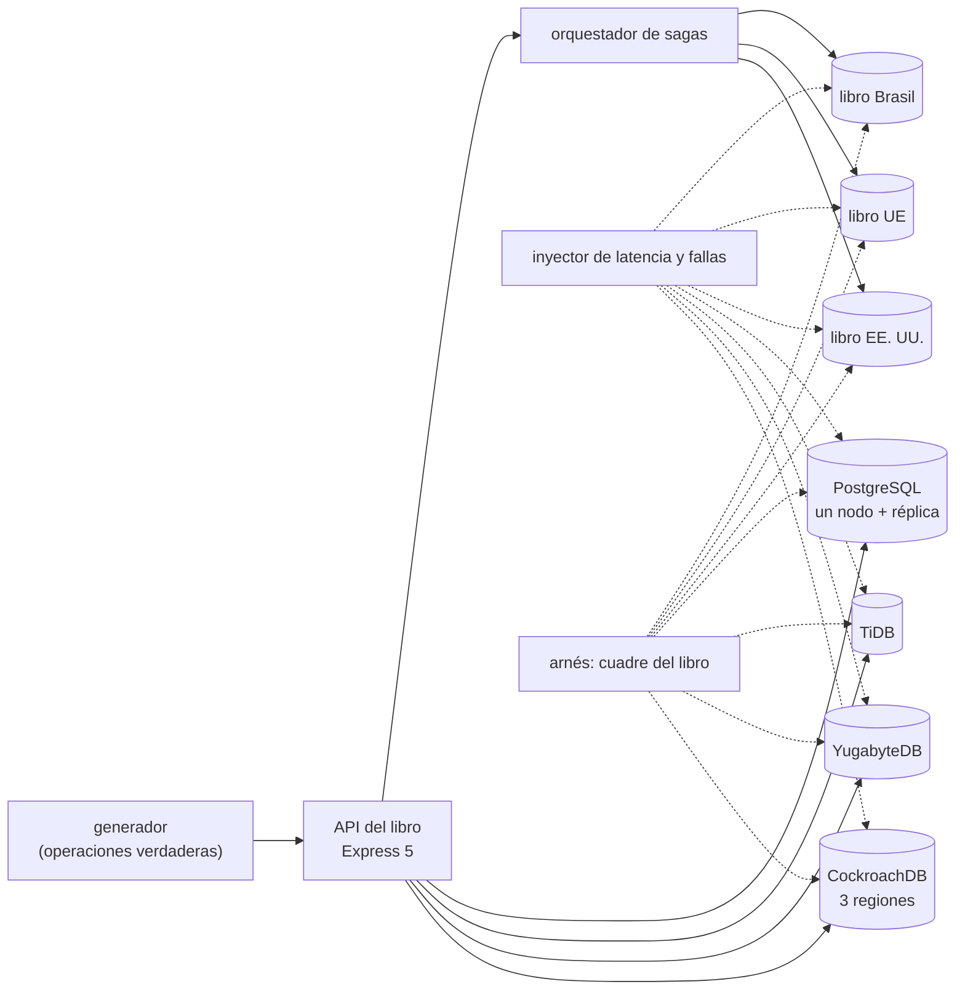

# 🎯 Alcance del proyecto
## Libro Mayor — el modelo NewSQL distribuido a fondo

> **Qué es este documento:** la fuente de verdad de **qué** enseña el curso, a quién y con qué límites. Lo
> que no esté aquí no está en el curso.
> **Fecha de esta versión:** 7 de octubre de 2026. Consolida la semilla de agosto (`_desechable-semilla.md`),
> el alcance de agosto (`_desechable-alcance-v1.md`), la ficha de arranque, las reglas de la ruta y los
> precedentes de los cursos anteriores. **Lo único preliminar es §9**: la cantidad de fases y su orden salen
> de la propuesta de fases.
> **Precedencia:** manda este documento. Después viene
> [`guia-de-estilo-y-convenciones.md`](guia-de-estilo-y-convenciones.md), que decide **cómo** se escribe;
> después el contrato de nombres y el diccionario de términos (por escribir), y las propuestas. Las plantillas
> y los prompts se actualizan siempre al final. Por encima de todos está el `CLAUDE.md` del repositorio, en lo
> que este curso no haya declarado como excepción (§12).
> **Estado de las decisiones:** 36 cerradas, ninguna abierta (§12). Solo faltan la propuesta de fases y la
> versión final de la historia.

---

## 1. 🧭 En una frase

**Un curso que enseña el modelo NewSQL distribuido a fondo reconstruyendo y midiendo el libro de partida doble de
una fintech de tres regiones, para que el lector pueda decidir —y defender con números propios— cuándo una
transacción de verdad entre regiones vale lo que cuesta, cómo se cuida una invariante de dinero sobre filas
repartidas por ley, qué hace el motor por dentro con cada confirmación, y cuándo un PostgreSQL de un nodo era la
respuesta.**

No forma administradores de CockroachDB ni prepara una certificación. No enseña NewSQL desde cero: el lector ya
hizo el minicurso de Ruta NoSQL Lite. Forma la capacidad de decir *"las cuentas viven en la región del cliente, la
tesorería se reparte en diez filas, el cambio entre regiones es una transacción que cuesta tantos milisegundos, la
región puede caerse sin perder una confirmación, y para el país que cabe en un nodo nos quedamos con PostgreSQL;
por esta razón y con este número"*.

---

## 2. 🔥 El problema que resuelve

El lector salió de lite sabiendo que existe SQL con ACID sobre varios nodos, que la geografía entra al esquema, que
la latencia de confirmación depende de la distancia, que la contención entre regiones duele, que el reintento es
parte del modelo y que, si una región basta, PostgreSQL gana. Le falta lo que viene después: construir y romper las
dos alternativas que la gente elige por miedo, entender qué hace el consenso con cada confirmación, qué hace el
reloj con cada lectura, diseñar la partida doble para que no se vuelva una fila caliente, mover un dato a su región
por ley y demostrarlo, cambiar el esquema sin apagar, sobrevivir a la pérdida de una región, y comparar tres
arquitecturas que prometen lo mismo. Hoy eso se aprende el día que se cae una región y hay dinero en ninguna
parte, o en tutoriales que demuestran un clúster distribuido con una tabla de usuarios en una sola región.

El villano es uno solo, **el falso dilema entre corrección y escala**, y tiene tres caras:

- **Renunciar a ACID por miedo a distribuir:** tres libros unidos por sagas, compensaciones y una conciliación
  nocturna, que pierden de vista el dinero mientras una región no responde.
- **Renunciar a distribuir por miedo a ACID:** un nodo grande con réplica asíncrona y conmutación manual, que pierde
  lo confirmado cuando la región se va.
- **Distribuir donde no hacía falta:** el reverso, que el curso también mide: un país que cabe en un nodo paga
  consenso en cada confirmación a cambio de nada.

> ⚠️ **El antagonista no es ninguna herramienta.** El PostgreSQL de Federico sostuvo Kambio cuatro años; las sagas
> de Thiago abrieron Europa y Brasil; YugabyteDB, TiDB y PostgreSQL ganan donde ganan y el curso lo publica; y el
> curso cierra con el veredicto de cuándo el NewSQL no hacía falta.

---

## 3. 🎓 Objetivo pedagógico

Al terminar, el lector puede hacer seis cosas que antes no podía:

1. **Medir el dilema**: el mismo libro en un nodo con réplica, en tres nodos con sagas y en un clúster distribuido,
   con lo que pierde, lo que deja en el limbo y lo que tarda cada uno.
2. **Diseñar el libro distribuido**: partida doble con invariantes declaradas, claves que no crean puntos calientes,
   cuentas calientes repartidas, datos en su región por ley.
3. **Leer el consenso y el reloj por dentro**: líderes y arrendamientos, idas y vueltas por confirmación,
   intenciones de escritura, relojes híbridos e incertidumbre, lecturas de seguidor.
4. **Sobrevivir a la falla**: metas de supervivencia, qué ve la aplicación mientras un nodo, una zona o una región
   no están, y cuánto tarda en volver, medido.
5. **Operar sin apagar**: cambios de esquema en línea, copias y restauración a un instante, rangos calientes.
6. **Elegir el motor** entre CockroachDB, YugabyteDB, TiDB, PostgreSQL y un servicio gestionado, con una medición
   propia, sus licencias y el costo de operarlo.

Lo que **no** es objetivo: construir un banco ni un sistema de pagos, cumplir la regulación de ningún país, ni
administrar un clúster en producción corporativa.

---

## 4. 👥 Perfil del lector

Ingeniero senior que **ya hizo Ruta NoSQL Lite**, o que sabe lo equivalente: SQL y modelado relacional de oficio,
niveles de aislamiento y bloqueos sin miedo, replicación de PostgreSQL, TypeScript con soltura, contenedores sin
ayuda, y el minicurso de NewSQL de lite. Se le explica el modelo en profundidad y los motores por dentro; no se le
explica a programar, Docker, SQL ni lo que lite ya enseñó.

**Lo que se da por sabido y no se explica jamás:** SQL, índices, transacciones, niveles de aislamiento, replicación
física y lógica de PostgreSQL; TypeScript y Node; Docker Compose; las cinco preguntas, el arnés y la apuesta antes
de medir; de lite, rangos, réplicas y consenso en lo básico, la localidad en el esquema, la residencia por
autoridad, la latencia de confirmación por localidad, la contención entre regiones, el reintento como modelo, y que
una región cabe en PostgreSQL.

**Lo que se explica con cero ambigüedad**, aunque el lector sea senior: cuántas idas y vueltas cuesta una
confirmación según dónde estén el líder y las réplicas, qué es un arrendamiento y por qué importa para leer, qué es
el intervalo de incertidumbre y por qué provoca reintentos, qué hace una confirmación en paralelo, qué garantiza una
lectura de seguidor y con qué atraso, qué hace una saga cuando la compensación falla, y cómo se mide un RPO de
verdad.

> 🧭 **Ninguna caja negra prematura, no menos profundidad.**

**Requisitos de entrada:** un equipo con 16 GB de memoria (D-20), Docker Desktop o Podman, y Node 24. **No hace
falta** ninguna cuenta en la nube ni licencia comercial.

---

## 5. 🧭 La pregunta que ordena el curso

> *¿Esta invariante tiene que cumplirse entre filas que viven lejos, y qué le cuesta al sistema —y a la empresa—
> cumplirla, o no cumplirla?*

Se presenta en la primera fase, con la caída de Virginia, y reaparece en el veredicto de cada fase:

- **La primera parte** responde *qué es el libro*: el falso dilema medido, la partida doble, la clave, serializable
  y el reintento.
- **La segunda parte** responde *dónde vive y cuánto cuesta*: el domicilio del dato, el consenso, el reloj, la
  tesorería, el saldo y el extracto.
- **La tercera parte** responde *qué pasa cuando falla*: el limbo de las sagas, la réplica que pierde, matar una
  región, la moneda nueva sin apagar.
- **La cuarta parte** responde *qué hace cada motor por dentro*: los tres, su operación y sus licencias.
- **El cierre** responde la pregunta entera: la autopsia del falso dilema y el país que no necesitaba esto.

---

## 6. 📏 Cómo se mide

**Todo "mejor que" lleva un número**, medido con el arnés del curso y consolidado en `BENCHMARKS.md`. Se mide
primero **el dinero contra el libro**: que cada operación sume cero, que ninguna cuenta baje de su límite,
transacciones confirmadas perdidas, dinero en el limbo y por cuánto tiempo, dobles créditos, contra las operaciones
verdaderas que conoce el generador (D-31). Después **la forma**: idas y vueltas por confirmación, reintentos y
conflictos, rangos y líderes por región, contención por fila, atraso de las lecturas de seguidor. **Los tiempos son
argumento en este curso, porque la distancia es física**, siempre con su dispersión (mediana, p95 y p99),
calentamiento, repeticiones y máquina declarados, **y siempre con las regiones, la latencia entre ellas, la meta de
supervivencia y la contención** al lado (D-19).

Las reglas de honestidad no se negocian: se publica lo que salió · el empate se llama empate · nada de números
redondos sin dispersión · cada motor se configura bien y según su documentación, con la misma topología y la misma
latencia inyectada · **PostgreSQL juega con lo mejor que tiene**: un nodo bien dimensionado, réplica síncrona donde
corresponda, y la saga bien escrita, no un hombre de paja · se declara lo que no se midió · los costos de la nube
llevan ☁️, fuente y fecha · y **nunca se extrapola de un portátil a producción**: tres regiones simuladas con latencia
inyectada en un portátil no son tres regiones de verdad, y se dice así.

Dos anclas por fase, cuando la fase las admite: 🪞 **una apuesta** escrita antes de ejecutar y 💥 **una rotura
provocada**, con el síntoma literal y lo que costó salir.

---

## 7. 🧪 El sistema del curso

### 7.1 El dominio

El libro mayor de **Kambio**, una fintech de Montevideo: clientes con región de origen, cuentas en dólares, euros y
reales, operaciones con sus asientos de partida doble, cambios de moneda con tesorería y comisiones, pagos entre
clientes de distintas regiones, retiros a bancos aliados, saldos y extractos, y la conciliación diaria. La historia
está en [`../00-historia-de-kambio.md`](../00-historia-de-kambio.md).

**Queda fuera a propósito:** dinero y bancos reales, la autenticación de la app, el cumplimiento regulatorio real de
cualquier país, la tarjeta, y la app como producto visual.

### 7.2 El stack, y qué compra cada pieza

| Pieza | Elección | Qué compra | Qué cuesta |
|---|---|---|---|
| Motor principal | CockroachDB (D-16, D-24) | SQL con protocolo de PostgreSQL, ubicación por fila y supervivencia declaradas en el esquema | consenso en cada confirmación, y una licencia que no es libre |
| Rival con la capa de PostgreSQL | YugabyteDB (D-16) | el SQL de PostgreSQL literal sobre un almacén distribuido | otra arquitectura que aprender debajo del mismo SQL |
| Rival desagregado | TiDB (D-16) | cómputo, almacenamiento y marcas de tiempo separados, con protocolo de MySQL | más piezas que operar y otro protocolo |
| Testigo y villano | PostgreSQL de un nodo, con réplica asíncrona; y tres PostgreSQL con sagas (D-23) | la línea base contra la que todo se compara, y las dos caras del dilema | — es lo que ya existe en la empresa |
| Servicios gestionados | Spanner, Aurora DSQL y los gestionados de los tres motores, solo desde documentación ☁️ (D-22) | la respuesta a "¿y si no queremos operar nada?" | cuestan dinero |
| Inyección de latencia y fallas | Toxiproxy y la red de los contenedores (D-27) | tres regiones y sus cortes, reproducibles | una simulación, y se dice |
| API, sagas, arnés y generador | TypeScript nativo en Node 24, Express 5 (D-17, D-32) | la misma carga y la misma verdad contra cada arquitectura | — |

### 7.3 Cómo se construye el código

A mano, en un solo proyecto en `src/` que crece por fases (D-09). El generador produce clientes, cuentas y
operaciones con su región y su resultado verdadero; el arnés las lanza contra cada arquitectura mientras el inyector
corta y retrasa la red, y después cuadra el libro contra la verdad.

### 7.4 El tamaño mínimo

Todo cabe en **16 GB** con perfiles de Compose: **una arquitectura a la vez**; los motores distribuidos con un nodo
por región, y tres por región solo en la fase de fallas, con el modo de demostración en memoria si el motor lo trae
y se declara; los volúmenes, dimensionados en la verificación previa (D-20).

---

## 8. 🧰 Herramientas y plataformas

**Versiones:** la última versión con soporte extendido de cada motor a la fecha de la verificación previa, por digest
para las imágenes y con archivo de bloqueo para las librerías, en el apéndice del laboratorio (D-07).
**Plataformas:** macOS en Apple Silicon, Linux y Windows con WSL2; el autor verifica en macOS arm64 y lo demás se
marca no verificado (D-06).

---

## 9. 🪜 La forma del curso

**Tipo:** curso completo. **Unas 100 horas en 10 a 12 fases** de unas 10 h. **Preliminar:** el arco, los nombres y
las fichas salen de la propuesta de fases. El borrador de partida son las trece fases de la semilla, menos lo que
lite ya dio (la síntesis de SQL y ACID distribuido, la localidad en lo básico, la latencia de confirmación por
localidad, la contención entre regiones), más lo que pide la profundidad: las dos caras del villano construidas y
rotas, el reloj y la incertidumbre, las sagas por dentro y los tres motores por dentro.

| Bloque (tentativo) | Qué hace | Temas de la historia (§4 de ella) |
|---|---|---|
| **I · El libro** | el dilema medido, la partida doble, la clave, serializable y el reintento | 1, 2, 3, 4 |
| **II · Dónde vive y cuánto cuesta** | el domicilio, el consenso, el reloj, la tesorería, el saldo y el extracto | 5, 6, 7, 8, 9 |
| **III · Cuando falla** | el limbo, la réplica que pierde, matar una región, la moneda nueva | 10, 11, 12, 13 |
| **IV · Los motores por dentro** | los tres, su operación y sus licencias | 14, 15, 16 |
| **V · Veredicto** | la autopsia del falso dilema, el país que no necesitaba esto | 17, 18 |

---

## 10. ✅ Lo que está dentro del alcance

- Las dos caras del villano construidas de verdad y rotas con la misma falla: PostgreSQL con réplica asíncrona y
  conmutación manual, y tres PostgreSQL con sagas, compensaciones y conciliación.
- La partida doble con invariantes declaradas (`CHECK`, restricciones, disparadores donde el motor los tiene) en
  cada motor, y lo que cada uno acepta del mismo DDL.
- Claves primarias: secuencias, UUID aleatorios y ordenados en el tiempo, índices repartidos por hash; el punto
  caliente de escritura medido.
- Aislamiento serializable y lectura confirmada donde existe; conflictos, reintentos con espera, puntos de guardado.
- Ubicación por fila, tablas globales y por región, metas de supervivencia; cómo se demuestra la residencia.
- Raft por dentro: líderes, arrendamientos, traslado de arrendamientos, marcas de tiempo cerradas; las idas y vueltas
  de una confirmación según la topología.
- Relojes lógicos híbridos, intervalo de incertidumbre, desfase máximo, y el reloj que se va provocado.
- Confirmaciones en paralelo, intenciones de escritura y registros de transacción.
- La cuenta caliente: contención medida, saldos repartidos, lotes y colas.
- Lecturas de un instante pasado y de seguidor, con su frescura.
- Fallas: nodo, zona y región; qué ve la aplicación, RPO y RTO medidos.
- Cambios de esquema en línea: columnas, índices y rellenos.
- CockroachDB, YugabyteDB y TiDB por dentro: rangos, tabletas, el oráculo de marcas de tiempo, Percolator.
- Operación: copias, restauración a un instante, rangos calientes, planes distribuidos, actualizaciones; los
  gestionados desde su documentación.
- Licencias y condiciones de uso de cada motor, con fecha.
- La autopsia del falso dilema, con la caída de Virginia reproducida.
- El árbol de cuándo no usar NewSQL.

## 11. 🚫 Lo que está fuera del alcance

Se declara y el texto se detiene: **no se dice dónde estaría ese material.**

- Lo que Ruta NoSQL Lite ya enseñó de NewSQL: se usa, no se explica.
- Spanner, Aurora DSQL y los gestionados medidos de verdad (D-22).
- PostgreSQL distribuido con extensiones (Citus y similares) (D-33).
- Kafka y el CDC de los motores hacia otros sistemas.
- Kubernetes y los operadores de los motores.
- La regulación financiera real de cualquier país.
- La app como producto visual.

---

## 12. ⚖️ Decisiones

Si una sesión futura quiere cambiar una, primero la cambia aquí y después en todo lo demás, nunca al revés. ✅
cerrada · ⏳ abierta · 🔄 reabierta. Las que llevan *(ruta)* o el nombre de un curso siguen la regla de la ruta o
el precedente de ese curso; las que llevan *(por defecto)* las cerró la sesión con el valor propuesto y se le
listaron al autor.

| ID | Decisión | Valor | Estado |
|---|---|---|---|
| D-01 | Idioma | Español latinoamericano neutro con tuteo; código, comandos, identificadores y salida de terminal en inglés; comentarios de código en español | ✅ |
| D-02 | Tipo de curso | Curso completo | ✅ |
| D-03 | Autocontención | Lo publicado nombra Ruta NoSQL Lite **solo como requisito de entrada**: no usa su contenido, no remite a sus fases ni reutiliza sus ejemplos, datos o mediciones. `prompts/` puede citarla *(ruta, R-07)* | ✅ |
| D-04 | Promesa de esfuerzo | ~100 h en 10–12 fases de ~10 h *(Proteo)* | ✅ |
| D-05 | Aparato de evaluación | 20–30 ejercicios por fase, 🟢🟡🟠🔴 + 🔥, un tercio de diagnóstico o medición, cada uno con su criterio; **sin solución publicada**. Taller global: el libro en `src/`. Un 💀 boss por bloque cuando el bloque lo admita, y el proyecto final de §13 *(Proteo)* | ✅ |
| D-06 | Plataformas | macOS arm64, Linux, Windows con WSL2; el autor verifica en macOS arm64 | ✅ |
| D-07 | Política de versiones | La última con soporte extendido de cada motor a la fecha de la verificación previa; imágenes por digest y librerías con archivo de bloqueo, en el apéndice del laboratorio *(semilla)* | ✅ |
| D-08 | Ejecución | Nada se publica sin haberse ejecutado | ✅ |
| D-09 | Código | Un solo proyecto en `src/` que crece por fases, con tags `fase-NN-<slug>` *(Proteo)* | ✅ |
| D-10 | README y temario | Se escriben al final, en una tanda propia | ✅ |
| D-11 | Historia | Kambio, en `00-historia-de-kambio.md` | ✅ |
| D-12 | Diagramas | Mermaid | ✅ |
| D-13 | Publicación | Repositorio público propio del curso, sin `prompts/` | ✅ |
| D-14 | Prerrequisito | Ruta NoSQL Lite, o lo equivalente de §4 | ✅ |
| D-15 | Profundidad | Full geek: Raft y arrendamientos, relojes híbridos e incertidumbre, confirmaciones en paralelo, lecturas de seguidor, supervivencia, ubicación por fila, rangos calientes, esquema en línea, los tres motores por dentro, las sagas por dentro *(por defecto)* | ✅ |
| D-16 | Rivales | CockroachDB como principal; YugabyteDB y TiDB como las otras dos arquitecturas; PostgreSQL de un nodo como testigo *(semilla)* | ✅ |
| D-17 | Lenguaje | TypeScript nativo en Node 24 para todo; sin codas en otros lenguajes *(semilla y Portalón)* | ✅ |
| D-18 | Clientes | `pg` contra CockroachDB, YugabyteDB y PostgreSQL; el cliente de MySQL contra TiDB. Las diferencias de SQL entre motores se verifican antes de comparar *(semilla)* | ✅ |
| D-19 | Mediciones | El dinero contra el libro primero (suma cero, límites, confirmadas perdidas, limbo, dobles créditos), después forma, después tiempos con mediana, p95 y p99; siempre con regiones, latencia entre ellas, meta de supervivencia y contención. Documento vivo: `BENCHMARKS.md` *(Proteo, Telaraña)* | ✅ |
| D-20 | Memoria del laboratorio | Todo dentro de 16 GB con perfiles de Compose: una arquitectura a la vez; un nodo por región por defecto, tres por región solo en la fase de fallas y declarado; si TiDB no cabe con su topología mínima, se declara y se mide con lo que cabe *(Portalón, semilla)* | ✅ |
| D-21 | Datos | Sintéticos con semilla fija y la forma de Kambio: clientes por región, cuentas en tres monedas, operaciones de dos a seis asientos, un 18 % entre regiones, cambios que tocan la tesorería; la caída de Virginia como perfil | ✅ |
| D-22 | Servicios gestionados | Spanner, Aurora DSQL y los gestionados de CockroachDB, YugabyteDB y TiDB, solo desde su documentación y sus precios públicos, citados con fecha y marcados ☁️ *(Proteo)* | ✅ |
| D-23 | El villano | Implementado de verdad, lo justo para medirlo: PostgreSQL con réplica asíncrona y la conmutación manual de la wiki; y tres PostgreSQL con el orquestador de sagas, compensaciones, reintentos y la conciliación nocturna. La caída de Virginia, reproducida con el inyector sobre las dos y sobre los motores distribuidos | ✅ |
| D-24 | Licencias | La de CockroachDB, que no es libre, y las de YugabyteDB y TiDB se verifican y se citan con fecha; el laboratorio usa lo que se puede usar sin costo para aprender, y se dice con qué condiciones *(semilla)* | ✅ |
| D-25 | Aislamiento | Serializable como punto de partida en los tres; lectura confirmada donde el motor la ofrece, medida y con lo que deja de garantizar *(por defecto)* | ✅ |
| D-26 | Topología canónica | Tres regiones con ≈ 80 ms EE. UU.–UE, ≈ 120 ms EE. UU.–Brasil y ≈ 160 ms UE–Brasil de ida y vuelta, fijadas en el apéndice del laboratorio para que todos los números sean comparables *(semilla)* | ✅ |
| D-27 | Inyección de fallas | Toxiproxy y la red de los contenedores: latencia, cortes, particiones y desfase de reloj; se declara que es una simulación *(semilla)* | ✅ |
| D-28 | Las sagas | Orquestadas en TypeScript con mensajes por una tabla de bandeja de salida en cada PostgreSQL; ningún bus de mensajes real *(por defecto)* | ✅ |
| D-29 | Imágenes en arm64 | Si una imagen no corre nativa en arm64, se declara y se mide emulada con esa advertencia, o se marca no verificado *(Portalón)* | ✅ |
| D-30 | Métricas de los motores | Prometheus y Grafana solo en la fase de operación, como visores de las métricas que exporta cada motor; nunca entran a una medición *(semilla)* | ✅ |
| D-31 | La verdad del generador | El generador conoce cada operación verdadera y el saldo que debe tener cada cuenta; todo cuadre se publica contra él, además del tiempo *(Telaraña, D-31)* | ✅ |
| D-32 | API | Express 5 mínima, por coherencia con la ruta, en lugar del Fastify de la semilla; el arnés mide los motores directamente salvo en las preguntas de extremo a extremo *(Proteo)* | ✅ |
| D-33 | PostgreSQL distribuido | Citus y similares quedan fuera; PostgreSQL es siempre de un nodo, con o sin réplica *(Rastro, D-33)* | ✅ |
| D-34 | Nombre del curso | **Libro Mayor** se mantiene: describe el dominio y la empresa no es Barlovento *(por defecto)* | ✅ |
| D-35 | Pruebas de invariantes | Las invariantes del libro se comprueban con pruebas automáticas después de cada medición, no solo con el arnés *(semilla)* | ✅ |
| D-36 | El reloj que se va | El desfase de reloj se provoca en un nodo y se mide qué hace cada motor; si un motor no permite provocarlo en contenedor, se declara *(por defecto)* | ✅ |

**Excepciones declaradas al `CLAUDE.md` del repositorio**, con su porqué (el detalle en la guía §13):

- **Ruta NoSQL Lite como prerrequisito** (D-14) → no se explican los fundamentos de NewSQL → los da lite.
- **Los ejercicios no traen solución publicada** (D-05) → el lector apuesta y mide antes de mirar.

---

## 13. 🏁 El proyecto final

Federico tiene que presentarle al directorio de Kambio, antes de abrir un cuarto país con regulador propio, cómo
queda el libro: dónde vive cada cuenta y cómo se demuestra, qué operaciones son transacciones entre regiones y
cuánto cuestan, cómo se repartió la tesorería, qué pasa si se cae una región, qué motor y bajo qué licencia, y qué
habría pasado el 4 de junio de 2026 en la arquitectura nueva. Se entrega como un informe con las mediciones del
curso, la autopsia de las dos caras del falso dilema con números antes y después, la caída de Virginia reproducida en
las tres arquitecturas, y el árbol de decisión de cuándo **no** usar NewSQL aplicado a cada país.

---

## 14. 🎯 Criterios de éxito

El curso está bien si:

- Cada fase abre con un dolor de Kambio y cierra con algo que se apostó, se midió y, cuando tocaba, se rompió a
  propósito.
- Ninguna fase repite lo que lite ya enseñó de NewSQL.
- Todo cuadre se publica contra la verdad del generador, no solo con su tiempo.
- Las dos caras del villano se construyen bien escritas y se rompen con la misma falla; PostgreSQL gana al menos un
  país con el número delante.
- Un lector que solo hace los bloques I y II sale diseñando el libro distribuido y midiendo su costo; uno que sigue
  hasta el IV sabe leer el consenso y el reloj por dentro y elegir el motor.
- El veredicto final no es "NewSQL para todo" ni "PostgreSQL alcanza siempre".

---

## 15. 📌 Extensión futura, fuera de este curso

El diseño deja preparado, sin prometerlo, la apertura de un cuarto país con su regulador y la consolidación contable
entre entidades.
