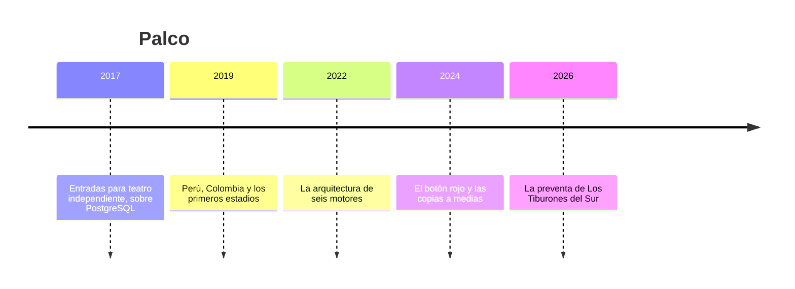

# 🎟️ Palco: la historia

> **Qué es este documento:** la fuente de verdad de todo lo narrativo de El Árbitro: la empresa, su gente, sus
> sistemas, sus cifras y sus reglas de negocio. **Ninguna fase inventa un dato**: si lo necesita y no está aquí,
> se agrega aquí primero.
> **Vigencia:** 2026-10-07 · **primera versión, en discusión con el autor.** Los dolores de §4 van por tema;
> cuando exista la propuesta de fases, cada uno se ata a su fase. Las cifras de §5 son ficticias y los volúmenes
> del laboratorio se fijan en la propuesta de fases. Los artistas, los productores, los recintos y los casos son
> inventados: ninguna entidad ni persona real.

---

## 1. 📅 Cómo llegó hasta aquí

Palco es una boletería de Santiago de Chile: vende entradas para conciertos, teatro, deporte y ferias en Chile,
Perú y Colombia. Los productores publican sus eventos, el público busca y compra, alguien escanea el código en la
puerta y, a fin de mes, Palco le liquida a cada productor lo que vendió con un detalle que resista una auditoría.
Para hacer todo eso, desde 2022 Palco usa seis motores de base de datos y una tubería de eventos. El diagrama se ve
impecable. La preventa de abril mostró lo que no estaba en el diagrama.

**2017 · El teatro.** Francisca Undurraga producía obras de teatro independiente y pagaba comisiones de
boletería que se comían el margen de la función. Con Josefina Araya, una ingeniera de Valparaíso que había
trabajado en un banco, lanzó Palco: eventos, funciones, ubicaciones, compras, pagos y liquidaciones en un solo
PostgreSQL, con una aplicación en Node. **Fue la decisión correcta**: todo cabía, todo era transaccional y una
sola persona sabía operarlo todo.

**2019 · Los estadios.** Con Perú, Colombia y los primeros conciertos de estadio llegaron las preventas: cien mil
personas intentando comprar en los mismos diez minutos. El monolito sufrió dos cosas a la vez: los bloqueos sobre
las ubicaciones disputadas, y los reportes de los productores, que barrían las tablas de compras mientras otros
intentaban comprar.

**2022 · Seis motores.** Bruno Castellanos llegó de una empresa grande de comercio electrónico de Ciudad de México
como vicepresidente de ingeniería, con un diagrama: la ficha del evento en MongoDB, el aforo y las reservas
temporales en Redis, la búsqueda en OpenSearch, las recomendaciones *"quien fue a esto también fue a aquello"* en
Neo4j, los escaneos de la puerta en InfluxDB, y Kafka para mover cambios entre ellos. PostgreSQL quedó para las
compras y los pagos. Su argumento, con el aval de Josefina: *"cada carga en el motor que la hace bien; el monolito
no aguanta la próxima preventa"*. Tenía razón en el diagnóstico. En la mitad de los lugares, la aplicación escribe
en PostgreSQL y en el otro motor una tras otra, sin tubería; Kafka llegó solo a algunos. Y los reportes de los
productores siguieron corriendo contra el PostgreSQL principal.

**2024 · El botón rojo.** Después de dos descuadres de búsqueda, Bruno escribió un script que reconstruye el índice
de OpenSearch desde PostgreSQL: el botón rojo. Las copias quedaron así: PostgreSQL con restauración a un instante,
MongoDB con una copia nocturna, Redis sin persistencia, y los demás sin copia. En noviembre se fue la única persona
que sabía operar Neo4j.

**2026 · La preventa.** Lo que pasó el 21 de abril abre el curso (§4).

| Año | Qué pasó | Quién lo decidió | Lo que dejó |
|---|---|---|---|
| 2017 | Todo en un PostgreSQL | Francisca y Josefina | la base de verdad, que sigue sana |
| 2019 | Estadios y preventas sobre el monolito | Francisca | la interferencia: bloqueos y reportes |
| 2022 | Seis motores, escrituras dobles y Kafka a medias | Bruno, con aval de Josefina | el villano, con su mejor argumento |
| 2024 | El botón rojo y las copias desparejas | Bruno | una reconstrucción y cinco motores sin ensayo |
| 2026 | La preventa de Los Tiburones del Sur | — | el incidente que abre el curso |

## 2. 👥 La gente

| Personaje | Rol | Cómo habla | Qué quiere | Aparece en |
|---|---|---|---|---|
| **Francisca Undurraga** | Cofundadora y directora general, de Santiago | Rápida y de productora: *"¡bacán!"* cuando algo sale, y la pregunta por la plata cuando no | que los productores no se vayan a otra boletería | la apertura, el veredicto |
| **Josefina Araya** | Cofundadora y directora de tecnología, de Valparaíso | Serena y franca: *"el monolito lo hice yo, y para el teatro lo volvería a hacer"* | saber cuántos motores necesitan de verdad, con números | casi todas; es la interlocutora del lector |
| **Bruno Castellanos** | Vicepresidente de ingeniería, de Ciudad de México | Seguro y de pizarra: dibuja antes de hablar | que la próxima preventa no tumbe nada | los motores, la costura, el veredicto |
| **Rosa Huamán** | Jefa de liquidaciones, de Lima | Formal, de cuadre: todo termina en la liquidación al productor | que la liquidación cuadre el día cinco | el libro, la analítica, el restore |
| **Felipe Gómez** | Jefe de operación de eventos, de Medellín | Práctico, de puerta: *"¡uy, no!"* cuando algo falla con gente en la fila | que la puerta abra a tiempo | el aforo, la puerta |
| **Joaquín Muñoz** | Ingeniero de plataforma, de guardia, de Concepción | Coloquial: *"¡la embarramos!"* antes de explicar qué pasó | dormir en las preventas, y no ser el único que sabe | la operación, el restore, la factura |
| **Tú** | Ingeniero senior recién contratado | — | — | todas: Josefina te contrató para medir, no para opinar |

El encargo de Josefina, el día que entras: *"No quiero que me digas que el diagrama de Bruno está mal; el monolito
no aguantaba los estadios, y en eso él tenía razón. Quiero saber cuántos motores necesitamos de verdad, cuál es la
verdad de cada dato, cómo viaja cada cambio, qué pasa cuando uno se atrasa o se cae, cuánto nos cuesta cada motor
cada semana, y si podemos restaurar todo junto. Y si alguno sobra, quiero saber cuál y por qué."*

## 3. 🏚️ Lo que hay (el patrimonio)

| Sistema | Stack y edad | Quién lo mantiene | Sus mañas |
|---|---|---|---|
| **El núcleo** | Node con PostgreSQL, desde 2017 | Josefina | sano; compras, pagos, liquidaciones, ubicaciones vendidas; **es la base de verdad** |
| **La ficha del evento** | MongoDB, desde 2022 | Bruno | la aplicación escribe aquí y en PostgreSQL, una tras otra |
| **El aforo y las reservas** | Redis sin persistencia, desde 2022 | Bruno y Joaquín | el contador de ubicaciones libres y la reserva de diez minutos; si se cae, se pierde |
| **La búsqueda** | OpenSearch, desde 2022 | Bruno | alimentado en parte por Kafka y en parte por escrituras dobles; el botón rojo lo reconstruye |
| **Las recomendaciones** | Neo4j, desde 2022 | nadie desde noviembre de 2025 | quien fue a esto también fue a aquello: dos saltos |
| **La puerta** | InfluxDB, desde 2022 | Felipe y Joaquín | escaneos por minuto y por acceso |
| **La tubería** | Kafka, desde 2022 | Joaquín | lleva algunos cambios; el atraso de los consumidores nadie lo mira |
| **Los reportes de los productores** | consultas contra el PostgreSQL principal | Rosa | siguen barriendo las compras en plena preventa |

**El laboratorio del curso levanta** la plataforma completa en tres arquitecturas —todo en PostgreSQL, la reducida
que la medición defienda, y la de seis motores—, con la costura por bandeja de salida y por captura de cambios, un
simulador de preventa y un generador que conoce cada compra verdadera. Los servicios gestionados se tratan solo
desde su documentación.

## 4. 🔥 El incidente que lo empezó todo

El martes 21 de abril de 2026 a las 10:00 empezó la preventa del regreso de Los Tiburones del Sur: dos funciones en
el estadio más grande de Santiago, ciento veinte mil entradas, y doscientas mil personas en la fila virtual.

**A las 10:07**, el nodo principal de Redis se reinició por memoria y su réplica tomó el control sin las reservas
de los últimos segundos. El contador de ubicaciones libres quedó por encima de la realidad, y durante once minutos
Redis reservó ubicaciones que PostgreSQL ya había vendido. Mil cuatrocientas treinta entradas quedaron vendidas
dos veces.

**A las 10:40** se agotó la primera función. OpenSearch la siguió mostrando disponible cuarenta minutos más, porque
el consumidor de Kafka que actualiza la búsqueda iba tres horas atrasado desde la mañana. Dieciocho mil personas
entraron a una compra que no podía terminar.

**A las 11:15** se descubrió que el cambio de precio de la platea, hecho la noche anterior, había quedado escrito en
PostgreSQL pero no en MongoDB, porque la segunda escritura falló y nadie la reintentó. La ficha mostró el precio
viejo y la compra cobró el viejo: dos mil cien entradas, sesenta y un millones de pesos chilenos menos para el
productor.

**En mayo**, la liquidación de Rosa, que cruza PostgreSQL con MongoDB, no cuadró, y el productor recibió su pago
nueve días tarde. Para entender qué había pasado, Joaquín intentó restaurar todo al momento de las 10:00: PostgreSQL
volvió al instante pedido, MongoDB a la copia de la noche anterior, Redis a nada, y los demás no tenían copia.
Nunca hubo un momento en que todos dijeran lo mismo.

En la reunión del lunes, Francisca preguntó: *"¿Cuántos motores necesitamos de verdad?"*. Bruno dijo que seis, y
Josefina dijo que no lo sabía, y que no quería saberlo por opinión: quería medirlo. Esa semana abrió la vacante que
vas a ocupar.

### Los dolores, por tema

Cada uno abre una o más fases cuando la propuesta exista. Ninguno se inventa en la fase: sale de aquí.

1. **Siete patrones, un sistema.** La ficha, el aforo, la búsqueda, el libro, la analítica, la puerta y las
   recomendaciones, pasados por las cinco preguntas antes de elegir un motor.
2. **El monolito, bien hecho.** Toda la plataforma en PostgreSQL, sin hombre de paja: dónde duele de verdad y qué es
   interferencia y no falta de capacidad.
3. **La verdad y el libro.** Las invariantes que viven en un solo lugar: no vender dos veces, no cobrar dos veces,
   la liquidación que cuadra.
4. **La ficha del evento.** Un motor documental derivado contra JSONB, en lectura y en evolución de la forma.
5. **El aforo de la preventa.** Reservas con expiración en Valkey contra PostgreSQL con `SKIP LOCKED`, con la
   durabilidad declarada antes de medir; la sobreventa, medida.
6. **La búsqueda que vendía lo agotado.** El índice derivado y su atraso, contra la búsqueda de PostgreSQL.
7. **La costura.** Escrituras dobles contra bandeja de salida contra captura de cambios sobre el registro de
   PostgreSQL: orden, duplicados, consumidores idempotentes y mensajes que no se pueden procesar.
8. **El consumidor que se quedó atrás.** El atraso medido, la contrapresión, y el registro de PostgreSQL que crece
   cuando la captura no avanza.
9. **El evento que cambia de forma.** Contratos de eventos y su evolución sin romper a los consumidores.
10. **El botón rojo.** Detectar que un derivado miente, reconciliar por rangos, y reconstruirlo desde cero, medido.
11. **La liquidación que no cuadraba.** La analítica fuera de producción: exportar a Parquet y consultar con DuckDB.
12. **Quien fue también fue.** La recomendación de dos saltos en SQL, contra el motor de grafos que nadie opera.
13. **La puerta.** Escaneos por minuto sin un motor de series, y cuándo haría falta uno.
14. **El restore coherente.** Restaurar cada motor, cronometrado, y restaurarlos todos al mismo instante.
15. **La factura.** Lo que cuesta cada motor cada semana: versiones, copias, restauración, fallas, alertas,
    manuales de guardia, aprendizaje; con un método declarado.
16. **El que se fue.** El motor que solo una persona sabía operar, y el manual de guardia que nadie escribió.
17. **El villano en la mesa.** Seis motores contra la arquitectura reducida, con la preventa reproducida y la factura
    completa.
18. **El veredicto con las dos manos.** Cuándo no sumar un motor, y cuándo negarse a sumarlo es el mismo error.

## 5. 💰 Las cifras

Todas ficticias, coherentes entre sí, y con los volúmenes del laboratorio por fijar en la propuesta de fases.

| Cifra | Valor | Fuente o supuesto |
|---|---|---|
| Países | Chile, Perú y Colombia | ficticia |
| Eventos activos | ≈ 6.500 al mes | ficticia |
| Entradas vendidas | ≈ 1,9 M al mes | ficticia |
| Productores | ≈ 2.400 | ficticia |
| Preventa grande | hasta 200.000 personas en fila, 120.000 entradas, 10 min de reserva | ficticia |
| Motores en producción | 6 (PostgreSQL, MongoDB, Redis, OpenSearch, Neo4j, InfluxDB) más Kafka | ficticia |
| Copias | PostgreSQL a un instante; MongoDB nocturna; los demás, nada | ficticia |
| Personas de plataforma | 4 | ficticia |
| El incidente: sobreventa | 1.430 entradas vendidas dos veces en 11 min | ficticia |
| El incidente: búsqueda | 40 min mostrando disponible lo agotado; 18.000 compras sin terminar; consumidor 3 h atrasado | ficticia |
| El incidente: precio | 2.100 entradas al precio viejo; CLP 61 M | ficticia |
| El incidente: liquidación | 9 días tarde | ficticia |
| El incidente: restore | ningún instante común entre los motores | ficticia |

## 6. 📏 Las reglas de negocio

- **El evento.** Lo publica un productor, con funciones, recinto, sectores y precios; su ficha cambia de forma según
  el tipo de evento.
- **La ubicación.** Numerada o de sector; **una ubicación se vende una sola vez**.
- **La reserva.** Al elegir, la ubicación queda reservada diez minutos; si no se paga, vuelve a estar libre.
- **La compra y el pago.** Se cobra una sola vez, al precio vigente al reservar.
- **La puerta.** Cada entrada entra una sola vez; el escaneo dice en segundos si es válida.
- **La liquidación.** El día cinco de cada mes, cada productor recibe lo vendido menos la comisión, con el detalle por
  función y por sector.
- **La base de verdad** de compras, pagos, ubicaciones vendidas y liquidaciones es PostgreSQL. Todo lo demás debería
  ser derivado y reconstruible desde ella: esa es la pregunta del curso.

## 7. 🗣️ Cómo hablan

La narración y las instrucciones al lector van en tuteo neutro. Las voces se reservan para los diálogos, una
expresión por escena:

- **Francisca** (Santiago): *"¡bacán!"*.
- **Felipe** (Medellín): *"¡uy, no!"*.
- **Joaquín** (Concepción): *"¡la embarramos!"*.
- **Josefina** habla de **la verdad** y **la factura**; **Bruno**, de **la carga** y **el motor**; **Rosa**, de **la
  liquidación** y **el cuadre**.

En la casa se dice **la preventa**, **la fila**, **la reserva**, **la ficha**, **el botón rojo**, **la tubería**, **la
liquidación** y **los seis motores**.
