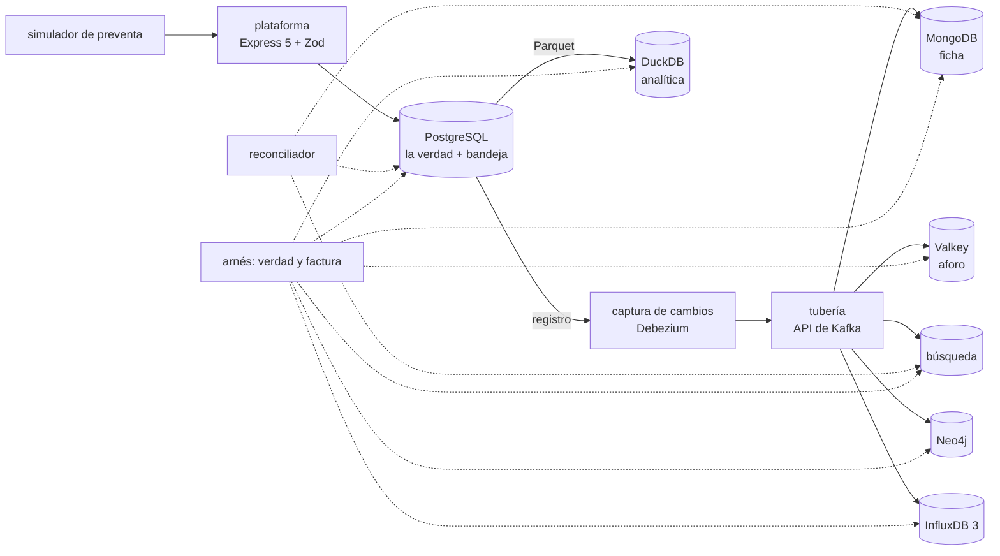

# 🎯 Alcance del proyecto
## El Árbitro — la persistencia políglota a fondo

> **Qué es este documento:** la fuente de verdad de **qué** enseña el curso, a quién y con qué límites. Lo
> que no esté aquí no está en el curso.
> **Fecha de esta versión:** 7 de octubre de 2026. Consolida la semilla de agosto (`_desechable-semilla.md`),
> el alcance de agosto (`_desechable-alcance-v1.md`), la ficha de arranque, las reglas de la ruta y los
> precedentes de los cursos anteriores. **Lo único preliminar es §9**: la cantidad de fases y su orden salen
> de la propuesta de fases.
> **Precedencia:** manda este documento. Después viene
> [`guia-de-estilo-y-convenciones.md`](guia-de-estilo-y-convenciones.md), que decide **cómo** se escribe;
> después el contrato de nombres y el diccionario de términos (por escribir), y las propuestas. Las plantillas
> y los prompts se actualizan siempre al final. Por encima de todos está el `CLAUDE.md` del repositorio, en lo
> que este curso no haya declarado como excepción (§12).
> **Estado de las decisiones:** 36 cerradas, ninguna abierta (§12). Solo faltan la propuesta de fases y la
> versión final de la historia.

---

## 1. 🧭 En una frase

**Un curso que enseña la persistencia políglota a fondo reconstruyendo y midiendo la plataforma de una boletería
de tres países en tres arquitecturas, para que el lector pueda decidir —y defender con números propios— cuántos
motores necesita un sistema, cuál es la verdad de cada dato, cómo viaja cada cambio y qué pasa cuando no llega,
cómo se restaura todo junto, y cuánto cuesta cada motor cada semana.**

No forma administradores de seis motores ni ingenieros de plataformas de datos, ni prepara una certificación. No
enseña persistencia políglota desde cero: el lector ya hizo Ruta NoSQL Lite, cuyo bloque final es un cierre
políglota. Forma la capacidad de decir *"PostgreSQL es la verdad; el aforo va en Valkey y la búsqueda en un derivado
alimentado por captura de cambios con este atraso; la analítica sale a Parquet; el grafo y las series sobran; esto
es lo que cuesta cada motor por semana y así se restaura todo al mismo instante; por esta razón y con este
número"*.

---

## 2. 🔥 El problema que resuelve

El lector salió de lite sabiendo pasar un sistema por las cinco preguntas, elegir la fuente de verdad, exigir que
todo derivado se reconstruya, preferir la bandeja de salida o la captura de cambios a la escritura doble, medir la
ventana de inconsistencia, y que cada motor tiene una factura. Le falta lo que viene después: operar la captura de
cambios de verdad sobre el registro de PostgreSQL, saber qué garantiza una tubería de eventos y qué no, escribir
consumidores que soporten duplicados y desorden, cambiar la forma de un evento sin romper a nadie, detectar que un
derivado miente antes que el cliente, restaurar varios motores al mismo instante, medir la factura con un método que
se pueda defender, y decidir con todo eso cuántos motores entran. Hoy eso se aprende la mañana de una preventa, o en
diagramas de arquitectura con flechas sin etiqueta.

El villano es uno solo, **sumar motores por su mejor caso sin nombrar la factura**, y tiene tres caras:

- **"Cada carga en su motor."** Seis motores elegidos por lo que hacen bien, unidos por escrituras dobles y una
  tubería a medias, con copias desparejas y un motor que nadie sabe operar.
- **"La costura es una flecha."** El atraso que nadie mira, el duplicado que se cobra, el restore que no tiene un
  instante común.
- **"Un solo motor alcanza para todo."** El reverso, que el curso también mide: negarse a sumar el segundo motor
  cuando la interferencia ya lo pide es el mismo error, con mejor reputación.

> ⚠️ **El antagonista no es ninguna herramienta.** El monolito de Josefina sostuvo Palco hasta los estadios; Bruno
> tenía razón en que el monolito no aguantaba las preventas; cada motor de los seis gana donde gana y el curso lo
> publica; y el curso cierra con el veredicto de cuándo un motor más no hacía falta y cuándo sí.

---

## 3. 🎓 Objetivo pedagógico

Al terminar, el lector puede hacer seis cosas que antes no podía:

1. **Inventariar los patrones**: separar los de un sistema real, medir la interferencia entre ellos en un solo
   motor, y distinguirla de la falta de capacidad.
2. **Operar la costura**: bandeja de salida y captura de cambios sobre el registro de PostgreSQL, tubería de
   eventos, orden, duplicados, consumidores idempotentes, mensajes que no se pueden procesar, atraso y
   contrapresión.
3. **Mantener la verdad**: invariantes en un solo lugar, contratos de eventos que evolucionan, reconciliación por
   rangos, reconstrucción desde cero, medida.
4. **Restaurar todo junto**: restauración a un instante del ancla y reconstrucción coordinada de los derivados, con
   el tiempo cronometrado.
5. **Medir la factura**: versiones, copias, restauración, fallas, alertas, manuales de guardia y aprendizaje, con un
   método declarado y aplicado igual a toda arquitectura.
6. **Decidir cuántos motores**, con las dos manos: descartar con argumento y sumar con argumento.

Lo que **no** es objetivo: construir una boletería, operar cada motor a fondo, ni administrar una plataforma de
datos en producción corporativa.

---

## 4. 👥 Perfil del lector

Ingeniero senior que **ya hizo Ruta NoSQL Lite**, o que sabe lo equivalente: SQL y modelado relacional de oficio,
replicación de PostgreSQL, TypeScript con soltura, contenedores sin ayuda, y lite completo, incluido su cierre
políglota. Se le explica la costura en profundidad y cada motor en lo que la decisión necesita; no se le explica a
programar, Docker, SQL ni lo que lite ya enseñó.

**Lo que se da por sabido y no se explica jamás:** SQL, índices, transacciones, replicación de PostgreSQL;
TypeScript y Node; Docker Compose; las cinco preguntas, el arnés y la apuesta antes de medir; de lite, las diez
familias y su veredicto, la fuente de verdad, los derivados reconstruibles, la escritura doble contra la bandeja de
salida y la captura de cambios en lo básico, la ventana de inconsistencia, la reconstrucción de un índice y el costo
operativo de varios motores.

**Lo que se explica con cero ambigüedad**, aunque el lector sea senior: qué es una ranura de replicación y qué pasa
con el disco cuando nadie la consume, qué garantiza la tubería con el orden y la entrega, por qué "exactamente una
vez" casi nunca es lo que parece, qué hace un consumidor idempotente con un duplicado, cómo se compara un derivado
con la verdad sin leerlo entero, qué instante se puede restaurar en cada motor, y cómo se calcula una factura que
resista una discusión.

> 🧭 **Ninguna caja negra prematura, no menos profundidad.**

**Requisitos de entrada:** un equipo con 16 GB de memoria (D-20), Docker Desktop o Podman, y Node 24. **No hace
falta** ninguna cuenta en la nube.

---

## 5. 🧭 La pregunta que ordena el curso

> *¿Este motor se gana su lugar, cuál es la verdad de lo que guarda, cómo le llega cada cambio —y qué le cuesta a la
> empresa tenerlo, cada semana y el día que falla?*

Se presenta en la primera fase, con la preventa, y reaparece en el veredicto de cada fase:

- **La primera parte** responde *qué patrones hay*: el inventario, el monolito bien hecho, la verdad y el libro.
- **La segunda parte** responde *quién se gana un motor*: la ficha, el aforo, la búsqueda, la analítica, las
  recomendaciones, la puerta.
- **La tercera parte** responde *cómo viaja cada cambio*: la costura, el consumidor atrasado, el evento que cambia,
  el botón rojo.
- **La cuarta parte** responde *qué pasa cuando falla y cuánto cuesta*: el restore coherente, la factura, el que se
  fue.
- **El cierre** responde la pregunta entera: la autopsia del exceso y el veredicto con las dos manos.

---

## 6. 📏 Cómo se mide

**Todo "mejor que" lleva un número**, medido con el arnés del curso y consolidado en `BENCHMARKS.md`. Se mide
primero **la verdad contra cada derivado**: ubicaciones vendidas dos veces, cobros dobles, precios distintos entre
motores, documentos de más o de menos en cada derivado, y cuánto tarda cada uno en converger, contra las compras
verdaderas que conoce el generador (D-31). Después **la forma**: atraso de cada consumidor, registro retenido por la
ranura, disco y memoria por motor, tiempo de reconstrucción y de restauración. Después **los tiempos por patrón**,
siempre con su dispersión (mediana, p95 y p99), calentamiento, repeticiones y máquina declarados, **y siempre con la
arquitectura, la carga de la preventa y el atraso de la costura** al lado (D-19). Y en cada arquitectura, **la
factura**, con el método de D-27.

Las reglas de honestidad no se negocian: se publica lo que salió · el empate se llama empate · nada de números
redondos sin dispersión · cada motor se configura bien y según su documentación · **el monolito juega con lo mejor
que tiene**: índices, `SKIP LOCKED`, JSONB, búsqueda de texto, réplica de lectura · **la arquitectura de seis motores
también juega bien escrita**, no como hombre de paja, salvo en lo que la historia declara roto · se declara lo que no
se midió · los costos de la nube llevan ☁️, fuente y fecha · y **nunca se extrapola de un portátil a producción**.

Dos anclas por fase, cuando la fase las admite: 🪞 **una apuesta** escrita antes de ejecutar y 💥 **una rotura
provocada**, con el síntoma literal y lo que costó salir.

---

## 7. 🧪 El sistema del curso

### 7.1 El dominio

La plataforma de **Palco**, una boletería de Santiago de Chile: eventos con su ficha, funciones, recintos y
sectores, ubicaciones y aforo, reservas de diez minutos, búsqueda, compras y pagos, escaneos en la puerta,
recomendaciones, reportes de los productores y liquidaciones mensuales. PostgreSQL es la base de verdad. La historia
está en [`../00-historia-de-palco.md`](../00-historia-de-palco.md).

**Queda fuera a propósito:** dinero y pasarelas de pago reales, la fila virtual como producto, la antirreventa, la
autenticación, y el sitio como producto visual.

### 7.2 Las tres arquitecturas, y qué compra cada pieza

| Pieza | Elección | Qué compra | Qué cuesta |
|---|---|---|---|
| La verdad | PostgreSQL, en las tres arquitecturas (D-16) | las invariantes en un solo lugar y el ancla del restore | — es lo que ya existe en la empresa |
| Arquitectura A | todo en PostgreSQL, bien hecho (D-16) | un solo motor que operar | la interferencia entre cargas |
| Arquitectura B | la reducida que la medición defienda; candidatos: MongoDB, Valkey, Meilisearch y DuckDB al lado de PostgreSQL (D-16) | aislamiento de las cargas que lo necesiten | cada motor con su factura |
| Arquitectura C | la de 2022: MongoDB, Valkey en lugar de Redis, OpenSearch, Neo4j e InfluxDB 3 al lado de PostgreSQL (D-16, D-33) | lo que prometía el diagrama | la factura completa y la costura a medias |
| La costura | bandeja de salida, y captura de cambios con Debezium sobre una tubería con API de Kafka (D-24, D-25) | cada cambio sale de la verdad por un solo camino | dos piezas más que operar |
| La analítica | exportación a Parquet y DuckDB (D-28) | los reportes fuera de producción | un proceso más y su atraso |
| Servicios gestionados | solo desde documentación ☁️ (D-22) | la respuesta a "¿y si no queremos operar nada?" | cuestan dinero |
| Plataforma, simulador, reconciliador, arnés y generador | TypeScript nativo en Node 24, Express 5 con Zod (D-17, D-30, D-32) | la misma preventa y la misma verdad contra cada arquitectura | — |

### 7.3 Cómo se construye el código

A mano, en un solo proyecto en `src/` que crece por fases (D-09). La plataforma es la misma en las tres
arquitecturas; cambia dónde lee cada patrón y cómo le llega cada cambio. El generador conoce cada compra verdadera;
el reconciliador y el arnés comparan cada derivado con ella.

### 7.4 El tamaño mínimo

Todo cabe en **16 GB** con perfiles de Compose: **una arquitectura a la vez**; la de seis motores con memoria mínima
por motor, dimensionada en la verificación previa; si no cabe entera, se corre por partes y se declara (D-20).

---

## 8. 🧰 Herramientas y plataformas

**Versiones:** última estable a la fecha de la verificación previa, por digest para las imágenes y con archivo de
bloqueo para las librerías y los conectores, en el apéndice del laboratorio (D-07). **Plataformas:** macOS en Apple
Silicon, Linux y Windows con WSL2; el autor verifica en macOS arm64 y lo demás se marca no verificado (D-06).

---

## 9. 🪜 La forma del curso

**Tipo:** curso completo. **Unas 100 horas en 10 a 12 fases** de unas 10 h. **Preliminar:** el arco, los nombres y
las fichas salen de la propuesta de fases. El borrador de partida son las trece fases de la semilla, menos lo que lite
ya dio (el diseño de qué motor para qué parte, la costura en lo básico, la factura en lo básico, el árbol de las diez
familias), más lo que pide la profundidad: la captura de cambios real, la tubería con sus garantías, los contratos de
eventos, la reconciliación por rangos, el restore coherente y la factura con método.

| Bloque (tentativo) | Qué hace | Temas de la historia (§4 de ella) |
|---|---|---|
| **I · Los patrones** | el inventario, el monolito bien hecho, la verdad y el libro | 1, 2, 3 |
| **II · Quién se gana un motor** | la ficha, el aforo, la búsqueda, la analítica, las recomendaciones, la puerta | 4, 5, 6, 11, 12, 13 |
| **III · La costura** | escrituras dobles, bandeja y captura; el consumidor atrasado; el evento que cambia; el botón rojo | 7, 8, 9, 10 |
| **IV · Cuando falla y cuánto cuesta** | el restore coherente, la factura, el que se fue | 14, 15, 16 |
| **V · Veredicto** | la autopsia del exceso, el veredicto con las dos manos | 17, 18 |

---

## 10. ✅ Lo que está dentro del alcance

- El inventario de los siete patrones con las cinco preguntas, y la interferencia entre ellos en un solo motor,
  medida.
- La plataforma entera en PostgreSQL bien hecha: `SKIP LOCKED`, JSONB, búsqueda de texto, réplica de lectura.
- Invariantes en un solo lugar: no vender dos veces, no cobrar dos veces, la liquidación que cuadra; la bandeja de
  salida en la misma transacción.
- La ficha en MongoDB derivada, contra JSONB; el aforo en Valkey con expiración, contra `SKIP LOCKED`, con la
  durabilidad declarada (D-26); la búsqueda derivada contra la de PostgreSQL.
- La analítica fuera de producción: Parquet y DuckDB, con su atraso.
- Las recomendaciones de dos saltos en SQL contra Neo4j; la puerta sin motor de series contra InfluxDB 3.
- Escrituras dobles, bandeja de salida y captura de cambios, medidas con la misma falla.
- Ranuras de replicación y decodificación lógica de PostgreSQL; el registro retenido cuando la captura no avanza.
- La tubería: particiones, orden por clave, desplazamientos, entrega al menos una vez, consumidores idempotentes,
  mensajes que no se pueden procesar, contrapresión.
- Contratos de eventos y su evolución compatible.
- Reconciliación por sumas de control sobre rangos, y reconstrucción desde cero de cada derivado, medida.
- Restauración de cada motor cronometrada, y el restore coherente anclado en la restauración a un instante de
  PostgreSQL (D-36).
- La factura de cada arquitectura con el método de D-27; manuales de guardia y el factor de la persona que se va.
- La autopsia de la arquitectura de seis motores, con la preventa reproducida.
- El árbol de cuándo no sumar un motor, y cuándo negarse a sumarlo es el error.

## 11. 🚫 Lo que está fuera del alcance

Se declara y el texto se detiene: **no se dice dónde estaría ese material.**

- Lo que Ruta NoSQL Lite ya enseñó de persistencia políglota y de cada familia: se usa, no se explica.
- Cada motor a fondo: entra con la profundidad que pide la decisión (D-35).
- Malla de servicios, transacciones distribuidas entre motores y el patrón de sagas a fondo.
- Procesamiento de flujos (Flink y similares) más allá de consumir eventos.
- Kubernetes y los operadores de los motores.
- Los gestionados medidos de verdad (D-22).
- La fila virtual, la antirreventa y los pagos reales.

---

## 12. ⚖️ Decisiones

Si una sesión futura quiere cambiar una, primero la cambia aquí y después en todo lo demás, nunca al revés. ✅
cerrada · ⏳ abierta · 🔄 reabierta. Las que llevan *(ruta)* o el nombre de un curso siguen la regla de la ruta o el
precedente de ese curso; las que llevan *(por defecto)* las cerró la sesión con el valor propuesto y se le listaron
al autor.

| ID | Decisión | Valor | Estado |
|---|---|---|---|
| D-01 | Idioma | Español latinoamericano neutro con tuteo; código, comandos, identificadores y salida de terminal en inglés; comentarios de código en español | ✅ |
| D-02 | Tipo de curso | Curso completo | ✅ |
| D-03 | Autocontención | Lo publicado nombra Ruta NoSQL Lite **solo como requisito de entrada**: no usa su contenido, no remite a sus fases ni reutiliza sus ejemplos, datos o mediciones. `prompts/` puede citarla *(ruta, R-07)* | ✅ |
| D-04 | Promesa de esfuerzo | ~100 h en 10–12 fases de ~10 h *(Proteo)* | ✅ |
| D-05 | Aparato de evaluación | 20–30 ejercicios por fase, 🟢🟡🟠🔴 + 🔥, un tercio de diagnóstico o medición, cada uno con su criterio; **sin solución publicada**. Taller global: la plataforma en `src/`. Un 💀 boss por bloque cuando el bloque lo admita, y el proyecto final de §13 *(Proteo)* | ✅ |
| D-06 | Plataformas | macOS arm64, Linux, Windows con WSL2; el autor verifica en macOS arm64 | ✅ |
| D-07 | Política de versiones | Última estable a la fecha de la verificación previa; imágenes por digest, librerías y conectores con archivo de bloqueo, en el apéndice del laboratorio | ✅ |
| D-08 | Ejecución | Nada se publica sin haberse ejecutado | ✅ |
| D-09 | Código | Un solo proyecto en `src/` que crece por fases, con tags `fase-NN-<slug>` *(Proteo)* | ✅ |
| D-10 | README y temario | Se escriben al final, en una tanda propia | ✅ |
| D-11 | Historia | Palco, en `00-historia-de-palco.md` | ✅ |
| D-12 | Diagramas | Mermaid | ✅ |
| D-13 | Publicación | Repositorio público propio del curso, sin `prompts/` | ✅ |
| D-14 | Prerrequisito | Ruta NoSQL Lite completa, incluido su cierre políglota, o lo equivalente de §4 | ✅ |
| D-15 | Profundidad | Full geek en la costura: ranuras y decodificación lógica, Debezium, la tubería y sus garantías, contratos de eventos, reconciliación por rangos, restore coherente, factura con método *(por defecto)* | ✅ |
| D-16 | Arquitecturas | Tres, con la misma plataforma: A, todo en PostgreSQL; B, la reducida que la medición defienda; C, la de seis motores de 2022. El "vs" es de arquitecturas, no de productos *(semilla)* | ✅ |
| D-17 | Lenguaje | TypeScript nativo en Node 24 para todo; sin codas en otros lenguajes *(semilla y Portalón)* | ✅ |
| D-18 | Clientes | El cliente oficial de cada motor y de la tubería, y `pg` contra PostgreSQL *(semilla)* | ✅ |
| D-19 | Mediciones | La verdad contra cada derivado primero, después forma, después tiempos por patrón con mediana, p95 y p99; siempre con la arquitectura, la carga de la preventa y el atraso de la costura; y la factura de cada arquitectura. Documento vivo: `BENCHMARKS.md` *(Proteo, Telaraña)* | ✅ |
| D-20 | Memoria del laboratorio | Todo dentro de 16 GB con perfiles de Compose: una arquitectura a la vez; la de seis motores con memoria mínima por motor; si no cabe entera, se corre por partes y se declara *(Portalón)* | ✅ |
| D-21 | Datos | Sintéticos con semilla fija y la forma de Palco: eventos de varios tipos, funciones, recintos con sectores y ubicaciones, productores, una preventa de estadio como perfil, cambios de precio, escaneos de puerta | ✅ |
| D-22 | Servicios gestionados | Los gestionados de cada motor y de la tubería, solo desde su documentación y sus precios públicos, citados con fecha y marcados ☁️ *(Proteo)* | ✅ |
| D-23 | El villano | Implementado de verdad, lo justo para medirlo: la arquitectura C con escrituras dobles donde la historia las declara, la tubería a medias, las copias desparejas y los reportes contra el principal; la preventa del 21 de abril, reproducida con el simulador | ✅ |
| D-24 | La costura | Primero la bandeja de salida con un publicador; después la captura de cambios con Debezium sobre el registro de PostgreSQL; las dos medidas contra la escritura doble con la misma falla *(semilla)* | ✅ |
| D-25 | La tubería | Redpanda si la verificación previa confirma que su licencia permite el uso del curso; si no, Apache Kafka en modo KRaft; en los dos casos, por su API de Kafka *(semilla, con condición)* | ✅ |
| D-26 | Durabilidad de las reservas | Se declara antes de medir: una reserva en Valkey se puede perder ante una caída y el usuario reintenta; **la venta se confirma solo en PostgreSQL**, así que perder una reserva nunca puede producir una sobreventa *(semilla)* | ✅ |
| D-27 | Método de la factura | Inventario de tareas por motor (versión, copia, restauración, fallas, alertas, manual de guardia, aprendizaje) con tiempo y frecuencia; lo que se pueda cronometrar en el laboratorio se cronometra; el mismo método para las tres arquitecturas *(semilla)* | ✅ |
| D-28 | La analítica | Implementada: exportación a Parquet y DuckDB, contra los reportes sobre el principal y sobre una réplica de lectura *(semilla)* | ✅ |
| D-29 | Imágenes en arm64 | Si una imagen no corre nativa en arm64, se declara y se mide emulada con esa advertencia, o se marca no verificado *(Portalón)* | ✅ |
| D-30 | El simulador de preventa | En TypeScript: fila, reservas, abandonos, pagos y cambios de precio, con la forma de la preventa de la historia *(por defecto)* | ✅ |
| D-31 | La verdad del generador | El generador conoce cada compra, pago y precio verdadero; toda medición de divergencia se publica contra él, además del tiempo *(Telaraña, D-31)* | ✅ |
| D-32 | API | Express 5 con Zod en la frontera *(semilla y Proteo)* | ✅ |
| D-33 | Los motores del exceso | En la arquitectura C: Neo4j para las recomendaciones e InfluxDB 3 Core para la puerta; ningún segundo motor documental. Redis se reemplaza por Valkey en el laboratorio, con la equivalencia declarada; la búsqueda del villano es OpenSearch y la de la arquitectura B, la que gane entre Meilisearch y PostgreSQL *(por defecto)* | ✅ |
| D-34 | Relación con la ruta | Lo publicado puede decir que el curso cierra la Ruta NoSQL, sin citar, enlazar ni exigir los otros diez cursos; el requisito sigue siendo lite *(ruta, R-07, con esta precisión)* | ✅ |
| D-35 | Profundidad de cada motor | Cada motor entra con la profundidad que pide la decisión de sumarlo, nunca como tutorial del motor; cuando una fase deriva hacia el tutorial, se salió del carril *(semilla)* | ✅ |
| D-36 | Restore coherente | El ancla es la restauración a un instante de PostgreSQL; cada derivado se reconstruye desde ella o se repone hasta el desplazamiento correspondiente de la tubería; se cronometra *(por defecto)* | ✅ |

**Excepciones declaradas al `CLAUDE.md` del repositorio**, con su porqué (el detalle en la guía §13):

- **Ruta NoSQL Lite como prerrequisito** (D-14) → no se explican las familias ni lo básico de la costura → los da
  lite.
- **Los ejercicios no traen solución publicada** (D-05) → el lector apuesta y mide antes de mirar.
- **Cada motor no se enseña a fondo** (D-35) → el objeto del curso es la integración, no los motores.

---

## 13. 🏁 El proyecto final

Josefina tiene que presentarle a Francisca, antes de la próxima preventa de estadio, cuántos motores tiene Palco y por
qué: qué patrón se ganó un motor y cuál no, cuál es la verdad de cada dato, cómo viaja cada cambio y con qué atraso,
qué pasa si un consumidor se atrasa o un motor se cae, cómo se restaura todo al mismo instante, cuánto cuesta cada
motor cada semana, y qué habría pasado el 21 de abril de 2026 en la arquitectura nueva. Se entrega como un informe con
las mediciones del curso, la autopsia de la arquitectura de seis motores con números antes y después, la preventa
reproducida en las tres arquitecturas, la factura de cada una, y el árbol de decisión de cuándo **no** sumar un motor
aplicado a cada patrón.

---

## 14. 🎯 Criterios de éxito

El curso está bien si:

- Cada fase abre con un dolor de Palco y cierra con algo que se apostó, se midió y, cuando tocaba, se rompió a
  propósito.
- Ninguna fase repite lo que lite ya enseñó, y ninguna se vuelve el tutorial de un motor.
- Toda divergencia se publica contra la verdad del generador, y toda arquitectura con su factura.
- Al menos un motor de la arquitectura de seis se descarta con su número, y al menos uno se defiende con el suyo.
- Un lector que solo hace los bloques I y II sale decidiendo qué patrón se gana un motor; uno que sigue hasta el IV
  sabe operar la costura y restaurar todo junto.
- El veredicto final no es "un motor para todo" ni "un motor por patrón".

---

## 15. 📌 Extensión futura, fuera de este curso

El diseño deja preparado, sin prometerlo, la antirreventa sobre la tubería de eventos y la plataforma de datos para los
productores.
