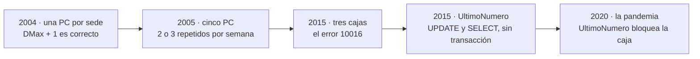

# 📜 Fase 00 — La base que nadie diseñó: el mismo error, visto desde las dos orillas

> **Curso:** Ruta SQL · Fase 00 de 27 · Bloque 0 — El instrumento · **4 h**
> **Motores:** ninguno: esta fase se lee
> **Entorno de ejecución:** ninguno
> **Depende de:** nada · **Habilita:** Fase 01
> **Apéndices de apoyo:** ninguno
> **Fecha de verificación ejecutada:** no aplica: esta fase no ejecuta nada
> **Objetivo:** que puedas reconocer en una decisión de base de datos qué pregunta faltó debajo, y
> explicar por qué `DMax + 1` fue correcto en 2004 y caro en 2015.

---

## 🧭 1. Dónde estamos

Este curso existe para ganarse una frase que otros cursos dan por sentada: **"casi siempre gana
Postgres"**. La Ruta NoSQL Lite la dice en su primera fase y pasa el resto del curso buscando los
casos donde no alcanza. Aquí se hace lo contrario: se toma un sistema relacional real, sucio, que
sostuvo un negocio durante treinta años, y se demuestra con mediciones propias qué le da un motor
relacional cuando se lo usa sabiendo lo que es, y dónde deja de alcanzar.

Le habla a un ingeniero que usa bases relacionales todos los días, casi siempre a través de un ORM.
Sabes qué es un índice y qué es una transacción. Lo que este curso te va a enseñar es **lo que
cuestan**: cuánto escribe un índice en cada `INSERT`, qué anomalía deja pasar tu nivel de
aislamiento, por qué el optimizador eligió ese plan.

Y empieza un lunes de 2026, en Córdoba. Te contrataron como arquitecto de datos para el laboratorio
central de una red de clínicas, y lo primero que recibes no es acceso a producción: es una carpeta.

---

## 🎯 2. Objetivos de esta fase

1. Explicar el villano del curso en sus dos caras, y por qué son la misma decisión.
2. Contar la historia de Alameda en cinco hitos, sabiendo qué tabla dejó cada uno.
3. Presentar las tres propuestas sobre la mesa con su mejor argumento, sin elegir todavía.
4. Leer una autopsia en cinco pasos y escribir la tuya.
5. Nombrar la pregunta que faltó debajo de cada decisión de la fase.

---

## 🚫 3. Qué NO entra todavía

- **Ningún motor y ninguna medición.** El laboratorio llega con la [Fase 01](01-la-caja-y-el-arnes.md).
- **Las cinco preguntas, desarrolladas.** Aquí se nombran; la Fase 02 las contesta desde el lado
  relacional.
- **La solución a `DMax + 1`.** Esta fase la entiende; el Bloque III la mide.

---

## ⚰️ 4. La base que nadie diseñó

### 4.1 La tesis

Un motor relacional no es un lugar donde se guardan tablas. Es un programa que **hace cumplir
reglas**: que una columna tenga un tipo, que una fila tenga a quién apuntar, que dos escrituras
ocurran juntas o ninguna. Cada regla que el esquema no declara la tiene que cumplir alguien más: un
parser, un formulario, una persona que se acuerda. **Este curso mide lo que cuesta esa diferencia**,
en tres motores, sobre el mismo material.

> 🧠 **El modelo mental del curso:** cada regla de negocio vive en un sitio. Si ese sitio es el
> esquema, el motor la defiende, el optimizador la usa y el siguiente desarrollador la lee. Si es el
> código, cada una de esas tres cosas depende de que alguien se acuerde.

### 4.2 El villano doble

El enemigo de este curso es el mismo que el de la Ruta NoSQL Lite: **elegir sin entender el modelo
de acceso**. Tiene dos caras, y lo interesante es que son la misma.

**"Mongo por moda"** es descartar lo relacional sin saber lo que ofrece. Es la cara que todo el mundo
reconoce, y la que se critica en las charlas.

**"La base es un pote donde creo tablas"** es usar lo relacional sin saber lo que ofrece. Es la cara
más frecuente entre los *seniors*, y la más cara, porque se disfraza de experiencia. Veinte años de
`SELECT *` desde un ORM no enseñan qué nivel de aislamiento tiene la conexión, ni que un `text`
acepta cualquier cosa porque no defiende nada.

Las dos se toman por el mismo motivo: lo que se usó para decidir fue *qué me resulta familiar*, y no
*qué modelo de acceso tiene este dominio*. Alameda agrega una tercera variante, la más común en la
pequeña empresa: **nadie decidió nada**. Y funcionó durante veinticinco años.

### 4.3 Alameda en una página

La historia completa está en [Laboratorio Alameda, la empresa del curso](00-historia-de-alameda.md),
y conviene leerla antes de la Fase 01. Lo que esta fase necesita son cinco hitos, cada uno con la
tabla que dejó:

| Año | Qué pasó | Qué quedó en la base |
|---|---|---|
| 1997 | Rubén, el contador socio, hace un recibo en Access un fin de semana | `Recibos`, y después `Pacientes`, con un campo `Nombre` donde la recepción escribe el DNI |
| 2002 | La devaluación: un precio pisado ya no se puede recuperar | `Precios_2002_09`, la primera de 280 copias mensuales |
| 2004 | La segunda sede y la replicación de Access | números de protocolo negativos, y `DMax + 1` para el visible |
| 2008 | Matías conecta los equipos y crea una tabla genérica | `ResultadoItem`, con el valor como texto, al lado de 71 tablas anchas |
| 2015 | La factura electrónica exige números correlativos | `UltimoNumero`, sin transacción |

En 2026, la base `ALAMEDA` tiene **unas 420 tablas** en un SQL Server, un frontal Access de 1997, un
portal PHP con MySQL y una interfaz frágil hacia el sistema de la red, que corre en Oracle. El
laboratorio procesa unos **3.000 protocolos por día**, y la condición del encargo es que **no pare ni
un día**.

> 📝 **Ninguno de esos motores lo eligió nadie.** Access venía en el CD de Office, SQL Server lo trajo
> la clínica que compró el laboratorio, MySQL la agencia del portal, Oracle la red. Este curso es la
> primera vez que alguien en Alameda va a elegir uno.

### 4.4 Las tres propuestas sobre la mesa

**🏛️ Verónica Colombo**, gerenta de datos de la red, quiere que el laboratorio sea **un módulo más
del sistema de la red, sobre Oracle**. Su mejor argumento: una sola fuente de verdad para pacientes y
órdenes, el fin de la interfaz que más incidentes genera, y un equipo de DBA, respaldos y licencias
que ya existen. Es la propuesta más fácil de defender en un comité. Su costo: meter treinta años de
datos sucios en el sistema que sostiene la internación de catorce clínicas, y un equipo que tarda
seis semanas en aprobar una columna.

**🍃 Florencia Marchetti**, líder del equipo que hizo la app, propone que **cada protocolo sea un
documento en MongoDB**. Su mejor argumento es real: hay unos 1.100 tipos de determinación, cada
examen tiene otra forma, y el EAV de Matías es la prueba de que el modelo relacional no les calzó. Un
informe de laboratorio *es* una unidad de lectura evidente. Su costo está en todo lo que no es leer:
la facturación a obras sociales, los precios con vigencia, los folios fiscales correlativos.

**🐘 La tercera no tiene dueño todavía**: Postgres, con un modelo relacional pensado de verdad,
`jsonb` donde la forma varía de verdad, historia temporal y una API generada desde el esquema. **El
curso no la presenta como la respuesta.** La presenta como la hipótesis que hay que defender contra
las otras dos, con mediciones, y con el veredicto de dónde pierde.

> 🧭 Si terminas esta sección sabiendo quién gana, la leíste mal. Las tres las defiende gente
> competente, y el Bloque VI las pone frente a un comité con los números de todo el curso.

### 4.5 Cómo se lee una autopsia

Una autopsia se escribe sobre **una decisión**, nunca sobre una persona, y siempre en el mismo
orden:

1. **La decisión**, en la voz de quien la tomó y con su mejor argumento.
2. **Por qué era razonable** en ese momento, con esa información y esas herramientas.
3. **Qué pasó después**, con número.
4. **Cuánto costó salir**, o cuánto va a costar, con número.
5. **Qué pregunta**, o qué restricción del modelo, habría cambiado el resultado.

El orden importa. Si el paso 1 suena a burla, el lector que hizo exactamente lo mismo en 2009 deja
de leer, y tiene razón.

### 4.6 La autopsia central: `DMax + 1`, de 2004 a 2015

**1. La decisión.** En 2004, la replicación de Access convierte los autonuméricos en aleatorios, y
los informes salen con protocolos como `-1847263541`. Rubén necesita un número que un médico pueda
leer por teléfono. Lo resuelve con un campo calculado en el formulario:

```text
NroProtocolo = prefijo de la sede & DMax("NroProtocolo", "Protocolos") + 1
```

*"El número más alto que hay, más uno. Con la letra de la sede adelante, para que no choquen."*

**2. Por qué era razonable.** Cada sede tenía **una PC**, con su réplica. En una PC, una sola persona
carga un protocolo a la vez, y `DMax + 1` es exactamente correcto: lee el máximo, suma uno, guarda.
No había nada que coordinar. La alternativa que un manual habría sugerido, un autonumérico, era
justo lo que la replicación acababa de romper.

**3. Qué pasó después.** En 2005, la base del central pasa a una carpeta compartida y la usan
**cinco PC**. Dos recepcionistas cargan a la vez, las dos leen el mismo máximo y las dos escriben el
mismo número. **Pasa dos o tres veces por semana**, y la regla de la recepción pasa a ser *"si sale
repetido, bórralo y cárgalo de nuevo"*. El dolor es pequeño, se absorbe con trabajo, y nadie lo
anota.

En **2015** el mismo patrón llega a la facturación. El web service fiscal exige que cada comprobante
sea **exactamente el último autorizado más uno**, y rechaza el que no lo es con el error 10016. El
`DMax + 1` de 2004, que ahora corre en **tres cajas** contra el mismo SQL Server, emite dos
comprobantes con el mismo número una tarde de julio. El segundo se rechaza. **La caja queda trabada
con cuarenta pacientes en la sala de espera**, y un contador externo tarda **dos días** en entender
qué pasó.



**4. Cuánto costó salir.** No se salió. Matías agrega una tabla `UltimoNumero` con un `UPDATE` y un
`SELECT`, en ese orden y **sin transacción**, y los rechazos bajan **a uno por mes**. Es una mejora
real, y por eso el problema dejó de ser urgente. En 2020, con 2.600 protocolos diarios, esa misma tabla
pasa a bloquear la caja. Lo que costó hasta hoy no está en ninguna planilla: un rechazo por mes desde
2015, cada uno con su comprobante a rehacer, y los números repetidos de protocolo que la caja todavía
guarda, que la Fase 01 te va a mostrar.

**5. La pregunta que faltó.** *¿Dónde está la frontera transaccional?* "Leer el máximo y escribir el
siguiente" son **dos pasos que tienen que ocurrir juntos o ninguno**, y con una sola PC eso venía
gratis. El día que hubo dos, la frontera se rompió sin que nada cambiara en el código. Un motor
relacional tiene tres formas de defender esa regla —una secuencia, un bloqueo o una restricción de
unicidad—, y cada una tiene un costo distinto que el Bloque III mide. Ninguna depende de que alguien
se acuerde.

> 🧭 **La lección no es "Rubén se equivocó".** Es que una decisión correcta para un volumen y una
> concurrencia se vuelve incorrecta sin que nadie la toque, y que **la regla que no está en el
> esquema no avisa cuando deja de cumplirse**.

### 4.7 Cuatro autopsias de la industria

> 📝 **Escenarios declarados.** Estas cuatro no son casos reales con nombre: son la forma típica de
> cuatro decisiones que el curso retoma, con cifras de escenario y no medidas. Cada una vuelve, medida,
> en la fase que la nombra.

**"Todo `text`, porque no da error."** *"Si lo hago `int`, el formulario se rompe con el primer
'45 años'."* Es la decisión de Rubén en 1997, y la de cualquier esquema que se diseña a partir de
lo que el usuario escribe. Era razonable: el texto acepta todo, y no aceptar algo parecía peor. Lo
que pasa después es que **la validación se muda a cada lector del dato**: el informe, la presentación
a la obra social, el portal, cada uno con su versión del parser. Salir cuesta una limpieza que, en
Alameda, tiene treinta años de variantes. Pregunta que faltó: *¿qué valores son válidos?*, que un tipo
y un `CHECK` contestan en el esquema. Vuelve en el Bloque I.

**"UUID porque es moderno."** *"Así no hay que coordinar nada y nadie adivina el siguiente."* Es
razonable, y la segunda mitad del argumento es la que Alameda aprendió en 2018, cuando un estudiante
restó uno a la URL de su resultado y descargó catorce mil informes. Lo que no se dice es que un UUID
al azar como clave de un índice ordenado **reparte las inserciones por todo el índice**. Cuánto cuesta
eso en cada motor, y qué hace un UUIDv7, lo mide la [Fase 10](10-identificadores.md). Pregunta que faltó: *¿qué hace esta clave
en cada escritura?*

**"El ORM se encarga."** *"Escribo objetos, el ORM escribe SQL, y el SQL que escribe es correcto."*
Lo es, casi siempre. Lo que el ORM no decide por ti es **cuántas veces** lo escribe: el formulario
de Alameda que en 2011 traía por la red tablas enteras con cada apertura es la versión en Access del
mismo problema. La respuesta oficial durante dos años fue *"la base está lenta"*. **La base no estaba
lenta.** Vuelve en el Bloque II. Pregunta que faltó: *¿conoces tus consultas de antemano?*

**"Nos fuimos a Mongo por un `ALTER TABLE`."** *"Agregar una columna nos bloqueó la tabla en
producción; con documentos no hay migraciones."* El dolor es real: un `ALTER TABLE` mal elegido puede
bloquear una tabla grande. Pero la migración no desaparece: se muda al código, que ahora tiene que
leer documentos con tres formas distintas, para siempre. Qué `ALTER` bloquea y cuál no, en cada motor,
es de la [Fase 18](18-bloqueos-deadlocks-y-ddl.md). Pregunta que faltó: *¿cuál es la unidad de lectura, y es también la de escritura?*

> 🪞 **Tu instinto dice que estas cuatro decisiones son errores de principiante.** Las cuatro las
> toman *seniors* con buenas razones, y las cuatro funcionan hasta que cambia el volumen o la
> concurrencia. Por eso el curso no enseña a no tomarlas: enseña a medir cuándo dejan de servir.

---

## 🐘 5. Lo que el motor relacional ya te daba

Esto es un aviso, no un argumento todavía: **el curso existe para ganarse "casi siempre gana
Postgres", no para suponerlo.** Cada fase pone el diseño relacional contra una alternativa real
—el Oracle de Verónica, el Mongo de Florencia, la propia base de Rubén—, y publica la medición aunque
la pierda.

Lo que sí se puede decir desde ahora es qué traía el motor y nadie usó. SQL Server, desde 2011, podía
defender cada una de las reglas de esta fase: un tipo para el DNI, una clave foránea para cada
protocolo, una transacción para el folio. La base `ALAMEDA` no tiene casi ninguna, y no porque el
motor no pudiera, sino porque **las reglas nunca se escribieron en el esquema**. Esa es la diferencia
entre tener un motor relacional y usarlo.

---

## ⚠️ 6. Errores comunes y diagnóstico

- **Leer la historia como una lista de errores.** Cada tabla rara tuvo un año y una razón que ese año
  era correcta. Si tu resumen de Alameda suena a "hicieron todo mal", vuelve al paso 2 de la autopsia.
- **Elegir propuesta en la Fase 00.** Ninguna de las tres tiene todavía un número a favor ni en contra.
  Elegir ahora es exactamente el villano del curso.
- **Confundir la persona con la decisión.** "Rubén no sabía" no explica nada; "con una PC no había
  concurrencia" lo explica todo.
- **Pensar que "ya está en producción" cierra la discusión.** Alameda está en producción hace treinta
  años, y el encargo es cambiarla sin pararla. La Fase 02 trae el triaje para eso.

---

## 📋 7. Checklist de validación

- [ ] Puedo explicar las dos caras del villano y por qué son la misma decisión.
- [ ] Puedo contar los cinco hitos de Alameda con la tabla que dejó cada uno.
- [ ] Puedo dar el mejor argumento de Verónica y el de Florencia sin caricaturizarlos.
- [ ] Puedo escribir una autopsia en los cinco pasos, sin juzgar a nadie.
- [ ] Puedo nombrar la pregunta que faltó debajo de `DMax + 1`.

---

## 🧪 8. Ejercicios (12)

Ninguno se ejecuta: son de lectura y de decisión. Las soluciones traen una respuesta de referencia y,
desde los 🟠, una rúbrica.

## 🟢 Fácil — leer una autopsia (1–4)

### 🟢 Ejercicio 1 — Los cinco pasos

Toma la autopsia de `DMax + 1` y marca, en una línea cada uno, dónde está cada uno de los cinco pasos.

**Objetivo:** los cinco pasos identificados, con la cita de la frase que corresponde a cada uno.

[Solución](soluciones/00-la-base-que-nadie-diseno.md#ejercicio-1)

### 🟢 Ejercicio 2 — La tabla que dejó cada año

Sin mirar la tabla de la sección 4.3, escribe qué tabla dejó en la base cada uno de estos años: 1997,
2002, 2004, 2008 y 2015.

**Objetivo:** las cinco tablas o campos, y el problema que cada uno resolvía ese año.

[Solución](soluciones/00-la-base-que-nadie-diseno.md#ejercicio-2)

### 🟢 Ejercicio 3 — Las dos caras

Clasifica estas frases como "Mongo por moda", "la base como pote" o ninguna de las dos: *"usamos
`varchar(255)` en todo, por las dudas"*; *"MongoDB porque no tiene esquema"*; *"el nivel de aislamiento
es el que viene por defecto"*; *"medimos y la unidad de lectura es el documento"*.

**Objetivo:** las cuatro clasificadas, con la razón.

[Solución](soluciones/00-la-base-que-nadie-diseno.md#ejercicio-3)

### 🟢 Ejercicio 4 — El mejor argumento

Escribe en dos líneas el mejor argumento de Verónica y en dos el de Florencia, en su voz.

**Objetivo:** dos argumentos que ellas firmarían, sin ninguna palabra que los debilite.

[Solución](soluciones/00-la-base-que-nadie-diseno.md#ejercicio-4)

## 🟡 Intermedio — tu propia decisión (5–8)

### 🟡 Ejercicio 5 — La autopsia de `Precios_2002_09`

Con la historia de 2002, escribe la autopsia de las 280 tablas de precios en los cinco pasos.

**Objetivo:** cinco párrafos cortos, con los números de la historia y la pregunta que faltó.

[Solución](soluciones/00-la-base-que-nadie-diseno.md#ejercicio-5)

### 🟡 Ejercicio 6 — Tu `DMax + 1`

Busca en un sistema que conozcas una decisión que fue correcta con un volumen o una concurrencia y
dejó de serlo sin que nadie la tocara.

**Objetivo:** la decisión, el cambio de contexto que la rompió y la regla que no estaba en el esquema.

[Solución](soluciones/00-la-base-que-nadie-diseno.md#ejercicio-6)

### 🟡 Ejercicio 7 — `UltimoNumero`

La tabla de 2015 hace un `UPDATE` y después un `SELECT`, sin transacción, y los rechazos bajan a uno
por mes.

**Pregunta:** ¿por qué bajan, y por qué no llegan a cero? Contesta con dos sesiones intercaladas
escritas a mano, sin ejecutar nada.

[Solución](soluciones/00-la-base-que-nadie-diseno.md#ejercicio-7)

### 🟡 Ejercicio 8 — El LIS de 2012

La historia dice que el LIS que se compró en 2012 se abandonó por tres razones, y que las tres eran
de datos.

**Pregunta:** ¿cuáles son, y qué pregunta de diseño faltó en cada una?

[Solución](soluciones/00-la-base-que-nadie-diseno.md#ejercicio-8)

## 🟠 Difícil — diagnosticar una decisión (9–11)

### 🟠 Ejercicio 9 — La propuesta de Verónica, en una autopsia futura

Escribe la autopsia que alguien podría escribir en 2031 si se adopta la propuesta de Verónica y sale
mal. Después, la que podría escribir si sale bien.

**Objetivo:** dos autopsias de cinco pasos cada una, con la misma decisión de partida, que muestren
qué la haría correcta o incorrecta.

[Solución](soluciones/00-la-base-que-nadie-diseno.md#ejercicio-9)

### 🟠 Ejercicio 10 — Lo que Florencia tiene de razón

Con la historia en la mano, lista las partes de Alameda donde el argumento de Florencia es fuerte y
las partes donde es débil.

**Objetivo:** al menos tres de cada lado, cada una con el dato de la historia que la sostiene.

[Solución](soluciones/00-la-base-que-nadie-diseno.md#ejercicio-10)

### 🟠 Ejercicio 11 — La regla escondida

El parser de Rubén pasó de cuarenta líneas en 1998 a casi trescientas en 2026. Elige tres de sus
parches y di, para cada uno, qué regla de negocio estaba codificando sin declararla.

**Objetivo:** tres reglas escritas como se escribiría una restricción, no como código.

[Solución](soluciones/00-la-base-que-nadie-diseno.md#ejercicio-11)

## 🔴 Muy difícil — el comité (12)

### 🔴 Ejercicio 12 — Cinco minutos ante el comité

Tienes cinco minutos ante la dirección de la red para explicar por qué todavía no recomiendas ninguna
de las tres propuestas, y qué vas a medir para poder hacerlo.

**Objetivo:** un guion de no más de una página que no descalifique ninguna propuesta, nombre tres
mediciones concretas y diga qué resultado cambiaría tu recomendación.

[Solución](soluciones/00-la-base-que-nadie-diseno.md#ejercicio-12)

---

## 📚 9. Referencias

> ⚠️ Las URL y sus contenidos cambian. Se consultaron el 12/10/2026.

- **[Laboratorio Alameda, la empresa del curso](00-historia-de-alameda.md)** — la historia completa,
  con su nota de verosimilitud y sus fuentes.
- **C. J. Date, *SQL and Relational Theory*, 3.ª ed., O'Reilly, 2015** — el argumento de fondo de la
  tesis: el modelo relacional como un conjunto de reglas que el motor hace cumplir.
- **Bill Karwin, *SQL Antipatterns, Volume 1*, Pragmatic Bookshelf, 2022** —
  https://pragprog.com/titles/bksap1/sql-antipatterns-volume-1/ — el catálogo de decisiones razonables
  que salen caras, con el mismo tono de esta fase.
- **Martin Kleppmann y Chris Riccomini, *Designing Data-Intensive Applications*, 2.ª ed., O'Reilly,
  2026** — el capítulo de modelos de datos, para la discusión entre documentos y relaciones.
- **Manual del desarrollador del WSFEv1** — https://www.afip.gob.ar/fe/ayuda/documentos/wsfev1-COMPG.pdf
  — el web service fiscal y su error 10016.

**Orden sugerido:** la historia de Alameda primero, entera; después esta fase; Karwin cuando quieras
más autopsias.

---

## 🏁 10. Resultado de la fase

Sabes quién es quién en Alameda, qué tabla dejó cada año y qué proponen Verónica y Florencia. Sabes
leer una autopsia sin juzgar a nadie, y sabes que debajo de `DMax + 1` faltaba una pregunta. Lo que no
tienes todavía es un solo número, y eso es exactamente lo que trae la
[Fase 01](01-la-caja-y-el-arnes.md).

> **La señal de que quedó bien:** *"Puedo explicar por qué `DMax + 1` era correcto en 2004 sin que
> suene a excusa, y por qué es caro en 2015 sin que suene a burla."*

> 🏷️ **Tag:** `fase-00-la-base-que-nadie-diseno` · prefijo de commit `f00:`
