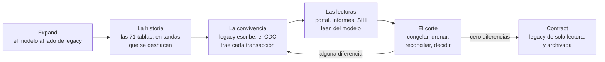

# 🚚 Fase 25 — La migración sin parar: las 71 tablas, la convivencia con legacy y un corte que se puede deshacer

> **Curso:** Ruta SQL · Fase 25 de 27 · Bloque VI — El árbitro · **10 h**
> **Motores:** PostgreSQL `pgvector/pgvector@sha256:2358fcba361e…` (18.6), con `legacy` y el modelo en la misma instancia · Oracle, solo como estructura (🔒, D20) · SQL Server, en el track
> **Entorno de ejecución:** SQL y Python en `src/25-la-migracion-sin-parar/`
> **Perfil de volumen:** M, con el modelo de la Fase 08 y lo que le agregaron las Fases 09 a 23
> **Evidencia:** bitácora de medición, entradas M-07, M-08, M-11, M-13, M-33, M-42 a M-46, y las nuevas M-52 a M-56
> **Depende de:** Fase 24 · **Habilita:** Fase 26
> **Fecha de verificación ejecutada:** 15/10/2026
> **Objetivo:** migrar la historia que quedó afuera, hacer convivir el modelo con legacy mientras el laboratorio trabaja, reconciliar contra el SIH y ensayar un corte con su vuelta atrás, midiendo cada paso.

---

## 🧭 1. Dónde estamos

En 2012 Alameda ya intentó migrar, y la historia lo cuenta con detalle. El proveedor del LIS migró los pacientes y los resultados desde 2008. **Las 71 tablas anchas quedaron para "una segunda etapa"** que costaba otra vez por hora, y Norma se negó a firmar informes de pacientes crónicos sin sus antecedentes. El importador creó un paciente por cada variante del nombre, y la facturación, que no entendía los convenios, triplicó los débitos del primer mes. De ahí sale la convicción de toda la empresa: *"migrar es imposible"*.

El documento de diseño de la [Fase 24](24-el-diseno.md) dice qué base construir. Esta fase dice **cómo se llega a ella sin que el laboratorio pare un día**, que es la condición del encargo de 2026. Y tiene que responderle a la frase de 2012 con mediciones, no con optimismo. La frase tiene algo de razón: lo que la hizo verdadera en 2012 sigue en la caja, y esta fase lo encuentra.

La fase no enseña ningún mecanismo nuevo. Usa la decodificación lógica de la [Fase 22](22-la-exportacion-de-las-9-40.md), el *expand/contract* de la [Fase 18](18-bloqueos-deadlocks-y-ddl.md), las claves foráneas con período de la [Fase 07](07-el-tiempo-en-el-modelo.md), la tabla de rechazos de la [Fase 04](04-un-valor-un-hecho.md) y el maestro de pacientes de la [Fase 05](05-una-persona-no-es-su-documento.md). Lo nuevo es el orden en que se usan, y las cinco cosas que salieron mal al usarlos juntos.

---

## 🎯 2. Objetivos de esta fase

1. Migrar las 71 tablas anchas al modelo tipado con una tanda que se pueda deshacer.
2. Reconciliar la migración de tres formas que no dependen una de otra: conteos, sumas de control y la verdad del generador.
3. Encontrar con la reconciliación lo que el modelo dejó afuera, y arreglarlo con *expand*.
4. Hacer convivir legacy y el modelo con un aplicador de CDC que sobrevive a su propia caída.
5. Cruzar el maestro de pacientes con el del SIH, y reconciliar dos copias en dos motores sin un `JOIN` entre ellos.
6. Ensayar el corte con un criterio de vuelta atrás medido, y desmontar *"migrar es imposible"* sin negarle lo que tiene de cierto.

---

## 🗂️ 3. La evidencia

Esta fase cita la bitácora para decidir el orden, y agrega cinco entradas propias: lo que se mide aquí es la migración, no un mecanismo.

| Decisión de esta fase | La sostiene |
|---|---|
| Los resultados van al modelo tipado, no a un EAV ni a un documento | [M-13](bitacora-de-medicion.md#m-13--f08--el-eav-contra-el-modelo-tipado) (el EAV lee 1,5 veces lo del tipado y estima 6,3 veces mal) y [M-38](bitacora-de-medicion.md#m-38--f20--las-cinco-operaciones-en-tres-diseños) |
| El paciente de cada resultado es el que sobrevivió a las fusiones | [M-07](bitacora-de-medicion.md#m-07--f04--el-90--del-parser-de-rubén) y [M-08](bitacora-de-medicion.md#m-08--f05--el-matcher-de-trigramas-no-llega-al-90-) |
| Los precios se parten como rangos, en una sola sentencia | [M-11](bitacora-de-medicion.md#m-11--f07--la-consulta-as-of-sobre-los-precios-en-rangos) |
| Un `ALTER` sobre una tabla con lectores va con `lock_timeout` | [M-33](bitacora-de-medicion.md#m-33--f18--la-cola-detrás-de-un-alter-de-dos-milisegundos) |
| La convivencia es por CDC, no por marca de agua | [M-42](bitacora-de-medicion.md#m-42--f22--la-exportación-por-marca-de-agua-con-transacciones-concurrentes), [M-43](bitacora-de-medicion.md#m-43--f22--la-fila-perdida-con-el-intercalado-determinista) y [M-46](bitacora-de-medicion.md#m-46--f22--la-decodificación-lógica-con-test_decoding) |
| El aplicador registra su posición en la misma transacción que los cambios | [M-44](bitacora-de-medicion.md#m-44--f22--la-cola-con-skip-locked-la-entrega-al-menos-una-vez-y-el-veneno) y [M-45](bitacora-de-medicion.md#m-45--f22--el-outbox-frente-a-la-doble-escritura-y-las-correcciones-con-versión) |

**Lo que falta, dicho:** la reconciliación con el SIH no tiene número en Oracle (🔒, D20). En el laboratorio, el SIH es un esquema de Postgres armado desde la verdad. Y el CDC de legacy en Alameda sale de un SQL Server, no de un Postgres: su forma se ve en el track (`ss01`), y aquí se mide la de Postgres.

---

## ⚔️ 4. Las propuestas, con su mejor argumento

**Verónica migra al Oracle del SIH**, y su mejor argumento para esta fase es que **el maestro de pacientes deja de ser un problema de dos bases**. Si el laboratorio es un esquema del SIH, el cruce de la sección 5.4 se hace una vez, adentro de un motor, con el equipo de DBA que ya conoce esos datos. Pierde en el otro extremo. Los treinta años de suciedad del laboratorio entran al sistema que sostiene la internación, y la convivencia con legacy tiene que hacerse desde un SQL Server hacia un Oracle, con un aplicador que el equipo saturado de Verónica tiene que mantener. La sección 5.5 mide cuánta de esa suciedad hay: de las 78.032 fichas vivas del laboratorio cuya persona está en el SIH, **9.922 no aparecen en el cruce porque no tienen documento**, una de cada ocho, y la culpa no es del SIH.

**Florencia migra a documentos**, y su mejor argumento también es real: una tabla ancha **ya es casi un documento**. Una fila de `Hemograma` es el hemograma de un protocolo, completo, y llevarla a un documento no exige decidir qué es cada columna. La migración de las 56 tablas que Rubén fue sumando de a una, con columnas `Resultado`, `Valor` y `Metodo` sin más significado, es más honesta como documento que como 177 analitos nuevos. Pierde en lo que las tablas anchas no tienen y la facturación necesita: la cantidad de cada práctica, el convenio, el coseguro. Eso no está en un documento de resultados, y la sección 5.3 muestra que tampoco estaba en el modelo.

**La del lector**, Postgres con el modelo tipado, gana donde la reconciliación necesita relaciones: el resultado cuelga del protocolo, el protocolo del paciente fusionado y la práctica del precio vigente, y cada una de esas uniones se puede contar contra legacy. Pierde en lo que la sección 5.2 deja en texto. **177 de los 210 analitos que tiene el modelo después de la sección 5.1 son texto sin tipo**: la migración los conserva, pero no los entiende.

---

## 🚚 5. La migración, paso a paso



Es el *expand/contract* de la [Fase 18](18-bloqueos-deadlocks-y-ddl.md) a escala de sistema: allá eran una columna y su relleno, y aquí son una base entera y su historia. La forma es la misma. Lo nuevo convive con lo viejo hasta que una reconciliación dice que son iguales, y solo entonces lo viejo se apaga. **Cada flecha se puede recorrer al revés** hasta el corte, y el corte mismo tiene su vuelta atrás medida.

### 5.1 Las 71 tablas anchas

Hasta 2008 Rubén anotaba cada examen en su propia tabla, con una columna por parámetro. Hay 71 tablas con **230.944 filas** en el perfil M. Quince son las prácticas de siempre (`Hemograma`, `Quimica`, `Lipidograma`…), y sus 33 columnas son parámetros que el modelo ya conoce como analitos. Las otras 56 son exámenes que se fueron sumando, con columnas como `Resultado`, `Valor`, `Metodo` o `Germen`, y cuatro columnas `Otro1`–`Otro4` desde 1999.

`01_anchas.sql` hace la migración en cuatro pasos. Primero arma **el mapa de columnas**: las 33 tipadas se escriben a mano, como las diría Norma, y las 177 de las otras 56 tablas pasan a ser analitos nuevos de texto. Después *despivota* las celdas con valor (vacío y `NULL` no son un resultado) y manda a rechazos lo que no entra. Por último inserta los resultados con **claves de una secuencia propia** y deja anotado de qué celda salió cada uno.

```text
              Destino               | Filas
------------------------------------+--------
 celdas con valor                   | 592358
 resultados nuevos                  | 578005
 rechazos: anchas.valor_no_numerico |  14353
 sin analito (Obs y Otro1–4)        |  38720
 analitos nuevos                    |    177
```

Tarda **12 a 14 s**. Los 14.353 rechazos son dos valores: `-` (7.219) y `VER OBS` (7.134). De los `VER OBS`, **6.078 apuntan a una observación vacía**, porque Rubén escribió que el valor estaba en `Obs` y `Obs` quedó en blanco. Eso no se migra mal ni bien: es un dato que no existe, y la tabla de rechazos lo dice con su celda de origen. Las 38.720 celdas de `Obs` y `Otro1`–`Otro4` no son de ningún analito, y van enteras a `staging.wide_unmapped`, con su protocolo.

> 🧭 **Una migración que no se puede deshacer no es una tanda: es una apuesta.** El mapa `staging.wide_result` (resultado → tabla, protocolo y columna) es lo que deja contar en las dos direcciones, y es lo que usa `08_deshacer.sql` para borrar exactamente lo que trajo, ni una fila más.

### 5.2 Tres reconciliaciones que no dependen una de otra

`02_reconciliacion.sql` cuenta de tres formas, porque cada una ve un error que las otras dos no ven.

**R1 · Conteos, en las dos direcciones.** Cada celda con valor es un resultado o un rechazo, y cada resultado nuevo viene de una celda. Las 592.358 celdas dan **0 de diferencia** en las 71 tablas, y los resultados sin celda de origen son **0**. El conteo ve una fila perdida, pero no ve un valor que cambió.

**R2 · Sumas de control.** Por cada una de las 209 columnas con resultados, se compara la suma del número leído de la celda con la suma de `value_numeric` en el destino, y en las de texto una huella `md5` de los valores ordenados. **0 sumas distintas y 0 huellas distintas**, con una suma de control total de 137.103.580.929,61. La suma ve una columna corrida, un decimal perdido o un texto cortado, pero no ve un resultado colgado del protocolo equivocado.

**R3 · La verdad del generador.** La verdad sabe de qué persona es cada protocolo. El modelo llega a la persona por el paciente que sobrevivió a las fusiones de la Fase 05. De los 578.005 resultados migrados, **0 quedaron en la persona equivocada**. Sobre los 1.327.622 protocolos del modelo, solo 1 no coincide: el modelo heredó la precisión del nivel automático de la Fase 05 ([M-08](bitacora-de-medicion.md#m-08--f05--el-matcher-de-trigramas-no-llega-al-90-), 0 falsos en 19.620 pares).

Y el resultado que le importa a Norma: **la señora que es tres pacientes**, la del boss I, tenía 295 resultados desde 2008. Ahora tiene además **152 anteriores**, desde el 12 de abril de 1999. Son los antecedentes que en 2012 no llegaron.

### 5.3 La reconciliación que no cerró

Lo facturado del modelo se reconcilió contra `ProtocoloPracticas` de la misma forma, y **no cerró**. Desde 2025 legacy tiene 1.746.067 prácticas con 1.781.167 unidades, y el modelo, 1.636.571 filas. La diferencia de filas es la que la Fase 07 mandó a rechazos (las prácticas sin precio vigente). La de unidades no tenía destino: **la Fase 07 trajo una fila por práctica y se olvidó de la cantidad**. Hay 35.100 prácticas con `Cantidad` distinta de 1, y al modelo le faltaban **32.866 unidades**, que son plata que nadie le iba a cobrar a ninguna obra social.

`03_cantidad.sql` lo arregla con *expand*. Agrega `quantity integer NOT NULL DEFAULT 1` (en Postgres, una columna con un valor constante no reescribe la tabla, [M-33](bitacora-de-medicion.md#m-33--f18--la-cola-detrás-de-un-alter-de-dos-milisegundos)), la rellena desde legacy y le pone `CHECK (quantity > 0)`. Después, cada práctica tiene un destino:

```text
            Destino            | Prácticas | Unidades en legacy | Unidades en el modelo | Cantidad distinta
-------------------------------+-----------+--------------------+-----------------------+-------------------
 en el modelo                  |   1636571 |            1669437 |               1669437 |                 0
 rechazada: sin precio vigente |    109496 |             111730 |                       |                 0
```

> ⚠️ **La primera versión de esa consulta no terminó.** Cuatro subconsultas con *hash joins* en paralelo llenaron los 64 MB de `/dev/shm` que Docker le da al contenedor por defecto: `could not resize shared memory segment … No space left on device` ([a08](a08-catalogo-de-errores.md), E-69). Se reescribió en una sola pasada. La salida de fondo es darle más memoria compartida al contenedor (`shm_size` en el compose, [a02](a02-compose-de-la-ruta.md)), y queda propuesta para la tanda que lo revise.

### 5.4 La convivencia: legacy sigue escribiendo

Mientras la historia se migra, recepción sigue cargando protocolos en el frontal Access, que escribe en legacy. El modelo lo sigue por **decodificación lógica**, con el mismo `test_decoding` de la [Fase 22](22-la-exportacion-de-las-9-40.md): un slot sobre la base, y un aplicador (`cdc.py`) que lee cada transacción confirmada de legacy y la aplica en el modelo.

El aplicador tiene una regla que viene de las Fases 22 y 23: **la posición se guarda en la misma transacción que los cambios**. Cada transacción de legacy se aplica en una transacción del modelo que además escribe el LSN de su `COMMIT` en `staging.f25_cdc_position`. Recién después se avanza el slot. Si el proceso se cae entre las dos cosas, al volver relee esas transacciones y saltea las que la posición ya tiene. La entrega es al menos una vez y el efecto, una sola.

`04_cdc_setup.sql` crea el rol del frontal (`access_frontend`), el slot y las funciones que aplican cada tabla; el aplicador les pasa la fila entera de legacy como `jsonb`. `05_convivencia.py` juega un día comprimido en 60 s: tres sedes cargan unos 600 protocolos con sus prácticas, los resultados llegan después en otra transacción, como los trae `ImportarEquipos`, el 3 % se corrige y el 1 % de las prácticas se borra. A mitad del día, el aplicador se cae una vez entre confirmar y avanzar.

**La primera corrida salió mal de dos maneras**, y las dos merecen la autopsia.

**⚰️ La clave que ya tenía dueño.** Los resultados de las anchas tomaban sus claves de una secuencia que arrancaba justo después del último `IdItem`. Pero mientras legacy viva, ese espacio es de legacy: la identidad de `ResultadoItem` sigue contando desde ahí. Los **3.321 resultados nuevos del día cayeron sobre 3.321 claves de resultados migrados**. El aplicador usaba `INSERT … ON CONFLICT (result_id) DO UPDATE`, que no da error: pisó el valor de un resultado de 1999 con uno de 2026 y dejó el protocolo de 1999. La reconciliación del día dio **0 resultados iguales de 3.321**, y sin ella no se habría visto nunca.

Dos arreglos, porque cada uno tapa un agujero distinto. La secuencia de las anchas arranca en **mil millones**, un rango que legacy no alcanza mientras viva. Y el `ON CONFLICT` del aplicador solo actualiza **si la clave es del mismo protocolo y el mismo analito**. Si no lo es, la fila va a rechazos como `cdc.clave_ocupada` y no se toca nada (ejercicio 11).

> 🧠 **Un *upsert* sin condición es un `UPDATE` sobre cualquier fila que tenga esa clave.** En una carga de una sola fuente eso es idempotencia. Con dos fuentes que numeran en el mismo espacio, es corrupción silenciosa.

**⚰️ La práctica que se descartaba sin avisar.** La carga de la Fase 07 trae lo facturado con un `JOIN` a las obras sociales, y en la caja no había ninguna práctica que se cayera por ahí. Por CDC sí llegó una, y la función de la primera versión hacía `RETURN` sin dejar rastro: **73 prácticas del día quedaron sin destino**. Ahora una práctica sin obra social o sin código conocido va a rechazos con su regla.

Y una trampa de la que el lector no tenía cómo enterarse: el frontal de prueba numeraba sus protocolos con el máximo de `IdProtocolo`, y ese máximo es **2.147.413.574**. Es un número aleatorio de la replicación de 2004 ([Fase 10](10-identificadores.md)), a 70.073 del límite de un entero. Desde 2012, SQL Server numera con su identidad desde diez millones, y el último es 11.233.733. El simulador ahora numera como la identidad.

Con los arreglos, tres corridas con semillas distintas (los hilos se intercalan distinto cada vez):

```text
día comprimido en 60 s · semilla 1992 · protocolos desde 11233734
transacciones de legacy aplicadas: 1017 · releídas tras la caída y salteadas: 7
atraso legacy → modelo (ms): mediana 269 · p95 496 · máximo 578 · 1017 transacciones
protocolos: legacy 597 · modelo 597
prácticas: legacy 2033 · facturadas 1998 · rechazadas 35 · sin destino 0
prácticas borradas en legacy que siguen facturadas en el modelo: 0
resultados: legacy 3508 · iguales en el modelo 3508 · distintos o faltantes 0
resultados nuevos con una clave de las anchas: 0 · claves ocupadas rechazadas: 0
```

En las corridas de verificación hubo entre 584 y 597 protocolos y entre 3.448 y 3.687 resultados, siempre con **0 diferencias**. Tras la caída se releyeron y saltearon entre 4 y 10 transacciones, y el atraso tuvo una mediana de 234 a 269 ms y un p95 de 478 a 525 ms. Casi todo ese atraso es el sondeo del aplicador cada medio segundo, no el trabajo de aplicar.

### 5.5 El maestro de pacientes, contra el del SIH

Unificar el maestro de pacientes con el del SIH es parte del encargo de 2026, y el SIH vive en el Oracle de Horizonte. En el laboratorio, `06_sih.sql` arma un esquema `sih` desde la verdad del generador, con una regla declarada que no está en la caja. El 35 % de las personas pasó por alguna clínica de la red. El SIH identifica por DNI, y quien tenía libreta figura con el DNI que sacó después. Hay 20.000 personas del SIH que nunca vinieron a Alameda, y errores de carga del propio SIH: 0,5 % con día y mes invertidos y 0,3 % con un dígito cambiado en el documento.

El cruce es el más simple que se puede defender: **mismo tipo y número de documento**. Si además coinciden la fecha y el sexo, es automático; si no, va a revisar.

```text
   Estado   | Pares | Correctos según la verdad | Incorrectos
------------+-------+---------------------------+-------------
 automatico | 62612 |                     62612 |           0
 revisar    |  3140 |                      3056 |          84
```

El nivel automático no se equivoca nunca. Lo interesante es **por qué casa o no casa el resto**, y la verdad lo dice:

| Lo que pasó | Pacientes | De quién es el problema |
|---|---:|---|
| A revisar: la ficha del laboratorio no tiene sexo | 1.952 | laboratorio |
| A revisar: la ficha no tiene fecha de nacimiento | 777 | laboratorio |
| A revisar: otra fecha en el SIH (día y mes invertidos, u otra persona) | 364 | SIH |
| A revisar: el mismo DNI con otro sexo (otra persona) | 47 | uno de los dos |
| En el SIH y sin pareja: la ficha del laboratorio no tiene documento | 9.922 | laboratorio |
| En el SIH y sin pareja: pasaporte | 1.273 | ninguno: el cruce no los mira |
| En el SIH y sin pareja: número distinto | 693 | SIH |
| En el SIH y sin pareja: libreta en el laboratorio, DNI en el SIH | 476 | el tiempo |

De las 12.364 fichas cuya persona está en el SIH y el cruce no encontró, **9.922 no tienen documento**. Y en el modelo siguen vivas **22.671 personas con más de una ficha**, los duplicados que la Fase 05 dejó para revisión humana. El maestro unificado no es un problema del SIH: es el problema de la Fase 05, con un segundo sistema mirando.

**🔒 La reconciliación entre motores.** El cruce se copia al SIH, a una tabla que lee la internación, y desde ese momento hay dos copias que pueden divergir en dos motores que no se pueden unir con un `JOIN`. Cada lado calcula por su cuenta **una huella por cubeta**: los dos últimos dígitos del id del SIH, con un `md5` de las filas ordenadas. Solo se comparan las 100 huellas, y una cubeta distinta se baja a filas. En el laboratorio, alguien de la internación "corrigió" tres filas del lado del SIH:

```text
 Cubetas | Cubetas distintas | Filas detrás de las cubetas | Filas que hay que bajar
---------+-------------------+-----------------------------+-------------------------
     100 |                 3 |                       65752 |                    1946
```

Se bajan 1.946 filas de 65.752 y aparecen las tres. Con mil cubetas, 197 (ejercicio 15). En Oracle, la huella del lado del SIH se calcula con `STANDARD_HASH` sobre un `LISTAGG` ordenado, o con `ORA_HASH` sumado por cubeta. La forma está en el ejercicio 22 y **no se publica ningún número**: es una apuesta que puedes resolver en tu máquina.

### 5.6 El corte, y la vuelta atrás

El corte tiene cuatro pasos, y `07_corte.py` los ensaya con el frontal escribiendo al mismo ritmo de la convivencia:

1. **Congelar.** Se le quita la escritura al rol del frontal y se cortan sus sesiones. Lo que ve recepción son dos errores: `terminating connection due to administrator command`, y si intenta de nuevo, `permission denied for table Protocolos`.
2. **Drenar.** El aplicador trae todo lo confirmado hasta el congelamiento.
3. **Reconciliar.** El día, legacy contra el modelo: protocolos, prácticas con su cantidad o su rechazo, y resultados con su valor.
4. **Decidir.** Con cero diferencias, el corte sigue: legacy queda de solo lectura y el modelo manda. Con alguna, **vuelta atrás**: el frontal recupera la escritura y legacy sigue mandando.

```text
frontal escribiendo 20 s · sesiones cortadas al congelar: 3
congelar 81 ms · drenar 117 ms (27 transacciones) · reconciliar 151 ms
diferencias (protocolos, prácticas, resultados): (0, 0, 0)
decisión: el corte sigue: legacy queda de solo lectura y el modelo manda · ventana sin escritura: 0.3 s
```

Con `--romper`, el simulacro borra del modelo una práctica del día antes de reconciliar. La reconciliación da `(0, 1, 0)`, el frontal vuelve a escribir y **la ventana sin escritura es de 1,0 s**. En las corridas de verificación, el corte limpio dejó de 0,3 a 0,5 s sin escritura.

> ⚠️ **La primera reconciliación del corte tardó 97 s**, y en un corte esos 97 s son 97 s de recepción sin poder cargar. Buscaba los resultados del día en `ResultadoItem` por `IdProtocolo`, que en la caja no tiene índice. Por el rango de la clave tarda 151 a 775 ms. Una reconciliación de corte se diseña para correr en la ventana, y se mide antes del día.

Esos números son **el piso técnico**, no la ventana real. En Alameda, entre congelar y decidir hay personas: alguien mira la reconciliación, alguien llama a las sedes, alguien cambia el acceso directo del frontal. Lo que el simulacro sí demuestra es que la decisión puede ser mecánica: un criterio de cero diferencias, escrito antes, que no depende de que nadie tenga ganas de volver atrás a las seis de la tarde.

> 🧭 **La vuelta atrás después del corte es otra cosa.** Antes de decidir, volver atrás es devolver un permiso. Después de que el modelo empezó a recibir escrituras, volver atrás exige llevar esas escrituras a legacy, con un flujo al revés que hay que construir y probar antes del día (ejercicio 18). Sin ese flujo, el corte no tiene vuelta atrás: tiene una fecha.

### 5.7 *"Migrar es imposible"*, con cuidado

La frase de 2012 tiene tres razones verdaderas, y las tres siguen en la caja:

- **Lo que no se sabía qué era.** El proveedor dejó afuera las 71 tablas porque nadie podía decir qué significaba `Otro3` en `Toxoplasmosis`. Sigue sin saberse: hay 38.720 celdas sin analito y 177 analitos que son texto. La diferencia es que hoy están **migradas con su origen y contadas**, y no abandonadas.
- **Lo que se veía bien y estaba mal.** El importador de 2012 no reconciliaba. En esta fase, sin la reconciliación, el modelo habría perdido 32.866 unidades facturables y habría pisado 3.321 resultados de 1999, **y todos los conteos de filas habrían dado bien**.
- **La convivencia.** En 2012 la implantación duró siete meses y se abandonó entera: no había forma de que el LIS y la base corrieran juntos, así que se volvió a la base sin nada a medio camino. La convivencia de esta fase deja que el modelo y legacy corran juntos el tiempo que haga falta, con un corte que se decide por un número.

Lo que la frase tiene de falso es la palabra *imposible*. Migrar es caro, lento y lleno de cosas que salen mal, y **cada una de las que salieron mal en esta fase la encontró una reconciliación**, no un ojo atento. La versión honesta de la frase es otra: *"migrar sin reconciliar es imposible"*.

---

## ⚖️ 6. Veredicto honesto: cuándo NO

- **Cuando la historia no se va a consultar.** Si nadie va a leer los resultados de 1999, migrarlos con tres reconciliaciones es un costo sin cliente. Archivar legacy como base de solo lectura, con su motor, es más barato y más honesto. Norma sí los lee: por eso se migran.
- **Cuando la convivencia dura más que lo que vale.** Cada día de convivencia es un aplicador que mantener, un slot que vigilar ([M-46](bitacora-de-medicion.md#m-46--f22--la-decodificación-lógica-con-test_decoding): un slot sin consumidor retiene WAL) y dos bases que respaldar. Si la convivencia se estira porque nadie se anima a cortar, el problema no es técnico.
- **Cuando no se puede reconciliar.** Si legacy no tiene claves estables (filas sin clave, números que se reutilizan), no hay contra qué contar. Antes de migrar, se les pone una clave en legacy, como el asistente de 2011 hizo a las apuradas con 23 tablas.
- **Cuando el corte no tiene vuelta atrás y el negocio no tolera un error.** Entonces el corte se hace por partes (una sede, una obra social), y cada parte tiene su propia vuelta atrás.

---

## ⚠️ 7. Errores comunes

- **Reconciliar solo con conteos.** El conteo de filas dio bien en las dos autopsias de la sección 5.4: la colisión no cambió cuántas filas había. Hacen falta las sumas de control y, si existe, una verdad independiente.
- **Numerar lo nuevo en el espacio de claves de lo viejo** mientras lo viejo sigue vivo.
- **Un *upsert* sin condición en un aplicador.** Convierte una colisión en una corrupción silenciosa.
- **Una regla que descarta sin dejar rastro.** Toda fila que no entra va a rechazos, con su regla y su origen.
- **Una reconciliación de corte que nadie midió.** Si tarda 97 s, la ventana es de 97 s.
- **Un slot que queda creado** después del ensayo: al terminar, `SELECT pg_drop_replication_slot('f25_legacy')`.
- **Un corte sin criterio escrito.** La decisión de volver atrás no se toma mirando la reconciliación; se toma antes, escribiendo qué número la dispara.

---

## 📋 8. Checklist de validación

- [ ] `01_anchas.sql` migra las 71 tablas: 592.358 celdas, 578.005 resultados, 14.353 rechazos, 177 analitos nuevos.
- [ ] `02_reconciliacion.sql` da 0 en R1, R2 y R3, y la señora tiene 152 resultados anteriores a 2008.
- [ ] `03_cantidad.sql` deja cada práctica desde 2025 con un destino, y las unidades del modelo iguales a las de legacy.
- [ ] `05_convivencia.py` termina con 0 diferencias en protocolos, prácticas y resultados, y con la caída salteada.
- [ ] `06_sih.sql` da 0 incorrectos en el nivel automático, y las huellas encuentran las tres filas cambiadas.
- [ ] `07_corte.py` sigue con 0 diferencias y vuelve atrás con `--romper`.
- [ ] El slot `f25_legacy` está borrado al terminar.
- [ ] `08_deshacer.sql` deja el modelo como estaba (12.132.303 resultados y 33 analitos).

---

## 🧪 9. Ejercicios (24)

Cada ejercicio tiene su solución en `soluciones/25-la-migracion-sin-parar.md`. Los 1 a 16 se corren con `09_ejercicios.sql`, justo después de `05_convivencia.py`; los 17 a 24 se resuelven con su rúbrica.

### 🟢 Ejercicio 1 — El mapa

¿Cuántas columnas de las anchas quedaron tipadas, cuántas como texto, y de cuántas tablas cada una?

*Solución:* [soluciones/25-la-migracion-sin-parar.md#ejercicio-1](soluciones/25-la-migracion-sin-parar.md#ejercicio-1)

### 🟢 Ejercicio 2 — Lo que no entró

¿Qué valores rechazó la migración de las anchas, y cuántas veces cada uno?

*Solución:* [soluciones/25-la-migracion-sin-parar.md#ejercicio-2](soluciones/25-la-migracion-sin-parar.md#ejercicio-2)

### 🟢 Ejercicio 3 — El hemograma

¿Cuántos resultados trajo cada columna de `Hemograma`?

*Solución:* [soluciones/25-la-migracion-sin-parar.md#ejercicio-3](soluciones/25-la-migracion-sin-parar.md#ejercicio-3)

### 🟢 Ejercicio 4 — Las unidades

¿Cuántas prácticas facturadas tienen una cantidad distinta de 1, y cuántas unidades de más suman?

*Solución:* [soluciones/25-la-migracion-sin-parar.md#ejercicio-4](soluciones/25-la-migracion-sin-parar.md#ejercicio-4)

### 🟢 Ejercicio 5 — El slot

Muestra el slot de la convivencia: su *plugin*, su tipo y si tiene un consumidor activo.

*Solución:* [soluciones/25-la-migracion-sin-parar.md#ejercicio-5](soluciones/25-la-migracion-sin-parar.md#ejercicio-5)

### 🟢 Ejercicio 6 — El frontal

¿Qué puede hacer `access_frontend` en cada tabla de legacy?

*Solución:* [soluciones/25-la-migracion-sin-parar.md#ejercicio-6](soluciones/25-la-migracion-sin-parar.md#ejercicio-6)

### 🟢 Ejercicio 7 — Los antecedentes

¿Cuántos resultados anteriores a 2008 tiene ahora la señora del boss I, y desde cuándo?

*Solución:* [soluciones/25-la-migracion-sin-parar.md#ejercicio-7](soluciones/25-la-migracion-sin-parar.md#ejercicio-7)

### 🟡 Ejercicio 8 — Ver observación

¿Cuántas celdas `VER OBS` apuntan a una observación que no existe?

*Solución:* [soluciones/25-la-migracion-sin-parar.md#ejercicio-8](soluciones/25-la-migracion-sin-parar.md#ejercicio-8)

### 🟡 Ejercicio 9 — Una suma de control

Calcula la suma de control de la hemoglobina en el origen y en el destino.

*Solución:* [soluciones/25-la-migracion-sin-parar.md#ejercicio-9](soluciones/25-la-migracion-sin-parar.md#ejercicio-9)

### 🟡 Ejercicio 10 — Deshacer una tabla

¿Qué borraría deshacer solo la migración de `Ferritina`? Cuéntalo sin borrar.

*Solución:* [soluciones/25-la-migracion-sin-parar.md#ejercicio-10](soluciones/25-la-migracion-sin-parar.md#ejercicio-10)

### 🟡 Ejercicio 11 — La clave ocupada

Aplica, dentro de una transacción que se revierte, un resultado de CDC con la clave de un resultado migrado. ¿Qué pasa con el migrado?

*Solución:* [soluciones/25-la-migracion-sin-parar.md#ejercicio-11](soluciones/25-la-migracion-sin-parar.md#ejercicio-11)

### 🟡 Ejercicio 12 — La posición y el slot

Compara la posición aplicada con la del slot. ¿El slot está al día?

*Solución:* [soluciones/25-la-migracion-sin-parar.md#ejercicio-12](soluciones/25-la-migracion-sin-parar.md#ejercicio-12)

### 🟡 Ejercicio 13 — El atraso

Calcula la mediana y el p95 del atraso de legacy al modelo desde `staging.f25_cdc_log`.

*Solución:* [soluciones/25-la-migracion-sin-parar.md#ejercicio-13](soluciones/25-la-migracion-sin-parar.md#ejercicio-13)

### 🟡 Ejercicio 14 — A revisar

De los pares a revisar con el SIH, ¿cuántos son la misma persona según la verdad?

*Solución:* [soluciones/25-la-migracion-sin-parar.md#ejercicio-14](soluciones/25-la-migracion-sin-parar.md#ejercicio-14)

### 🟠 Ejercicio 15 — Mil cubetas

Repite las huellas con mil cubetas. ¿Cuántas filas hay que bajar, y qué cuesta tener más cubetas?

*Solución:* [soluciones/25-la-migracion-sin-parar.md#ejercicio-15](soluciones/25-la-migracion-sin-parar.md#ejercicio-15)

### 🟠 Ejercicio 16 — El próximo choque

La identidad de SQL Server sigue contando desde 11.233.733. ¿Cuándo choca con un número aleatorio de 2004?

*Solución:* [soluciones/25-la-migracion-sin-parar.md#ejercicio-16](soluciones/25-la-migracion-sin-parar.md#ejercicio-16)

### 🟠 Ejercicio 17 — El paciente nuevo

Un protocolo llega por CDC con un paciente que el modelo no conoce. Diseña qué hace el aplicador y quién lo resuelve.

*Solución:* [soluciones/25-la-migracion-sin-parar.md#ejercicio-17](soluciones/25-la-migracion-sin-parar.md#ejercicio-17)

**Rúbrica (sobre 4 puntos):** 1 punto por no inventar el paciente; 1 por el destino del protocolo y sus prácticas mientras se espera; 1 por quién lo resuelve y con qué herramienta (Fase 05); 1 por cómo se reaplica después sin duplicar.

### 🟠 Ejercicio 18 — La vuelta atrás después del corte

Diseña el flujo que lleva a legacy lo que el modelo recibe después del corte, para poder volver atrás durante una semana.

*Solución:* [soluciones/25-la-migracion-sin-parar.md#ejercicio-18](soluciones/25-la-migracion-sin-parar.md#ejercicio-18)

**Rúbrica (sobre 4 puntos):** 1 punto por la fuente (outbox o CDC del modelo); 1 por la traducción al formato de legacy; 1 por el espacio de claves; 1 por cuándo se apaga.

### 🟠 Ejercicio 19 — Los informes viejos

Hay reportes que leen `Hemograma` directamente. Diseña cómo siguen funcionando mientras las anchas se apagan.

*Solución:* [soluciones/25-la-migracion-sin-parar.md#ejercicio-19](soluciones/25-la-migracion-sin-parar.md#ejercicio-19)

**Rúbrica (sobre 3 puntos):** 1 punto por la vista de compatibilidad sobre el modelo; 1 por la reconciliación de la vista contra la tabla; 1 por el orden en que se apaga.

### 🟠 Ejercicio 20 — Las prácticas sin precio

Hay 109.496 prácticas desde 2025 sin precio vigente. ¿De quién es ese problema y qué hace la migración con él?

*Solución:* [soluciones/25-la-migracion-sin-parar.md#ejercicio-20](soluciones/25-la-migracion-sin-parar.md#ejercicio-20)

**Rúbrica (sobre 3 puntos):** 1 punto por separar lo que es de la migración y lo que es del negocio; 1 por la causa (vigencias duplicadas y huecos, Fase 07); 1 por quién decide.

### 🔴 Ejercicio 21 — La carta a Norma

Escríbele a Norma, en una página, por qué esta vez sus antecedentes llegan y qué no llega.

*Solución:* [soluciones/25-la-migracion-sin-parar.md#ejercicio-21](soluciones/25-la-migracion-sin-parar.md#ejercicio-21)

**Rúbrica (sobre 4 puntos):** 1 punto por los números de la señora; 1 por lo que queda como texto o sin analito, dicho sin esconderlo; 1 por las tres reconciliaciones en lenguaje de laboratorio; 1 por el tono (ni triunfal ni técnico).

### 🔴 Ejercicio 22 — Las huellas en Oracle

Escribe la consulta de huellas por cubeta del lado del SIH en Oracle, y cómo compararla con la de Postgres sin unir los motores. Sin números.

*Solución:* [soluciones/25-la-migracion-sin-parar.md#ejercicio-22](soluciones/25-la-migracion-sin-parar.md#ejercicio-22)

**Rúbrica (sobre 4 puntos):** 1 punto por la función de huella de Oracle; 1 por la misma serialización en los dos lados (formato de números, fechas y `NULL`); 1 por la comparación fuera de los motores; 1 por no publicar números (D20).

### 🔴 Ejercicio 23 — El día del corte

Escribe el plan del día del corte de Alameda: horario, quién hace qué, el criterio de vuelta atrás y qué pasa si se dispara.

*Solución:* [soluciones/25-la-migracion-sin-parar.md#ejercicio-23](soluciones/25-la-migracion-sin-parar.md#ejercicio-23)

**Rúbrica (sobre 5 puntos):** 1 punto por el horario (no un martes); 1 por los roles; 1 por el criterio escrito antes; 1 por la ventana medida; 1 por lo que se comunica a las sedes.

### 🔴 Ejercicio 24 — Lo que nadie sabe qué es

Decide qué hacer con las 38.720 celdas de `Obs` y `Otro1`–`Otro4`, y con los 177 analitos de texto.

*Solución:* [soluciones/25-la-migracion-sin-parar.md#ejercicio-24](soluciones/25-la-migracion-sin-parar.md#ejercicio-24)

**Rúbrica (sobre 3 puntos):** 1 punto por separar lo que se puede tipar de lo que no; 1 por quién decide (bioquímica, no sistemas); 1 por cómo se ve en el informe mientras tanto.

---

## 📚 10. Referencias

**Documentación oficial**

- **Decodificación lógica y `test_decoding`** — https://www.postgresql.org/docs/18/test-decoding.html
- **Funciones de los slots de replicación** (`pg_logical_slot_peek_changes`, `pg_replication_slot_advance`) — https://www.postgresql.org/docs/18/functions-admin.html
- **`INSERT … ON CONFLICT`**, con la cláusula `WHERE` del `DO UPDATE` — https://www.postgresql.org/docs/18/sql-insert.html
- **`ALTER TABLE`**, y cuándo una columna nueva no reescribe la tabla — https://www.postgresql.org/docs/18/sql-altertable.html
- **`shm_size` en Compose** — https://docs.docker.com/reference/compose-file/services/#shm_size
- **Change Data Capture de SQL Server**, la fuente del CDC de Alameda — https://learn.microsoft.com/en-us/sql/relational-databases/track-changes/about-change-data-capture-sql-server?view=sql-server-ver17
- **`STANDARD_HASH` de Oracle** — https://docs.oracle.com/en/database/oracle/oracle-database/26/sqlrf/STANDARD_HASH.html

**Ensayos y libros**

- **Martin Fowler, "Strangler Fig Application"** — https://martinfowler.com/bliki/StranglerFigApplication.html — lo nuevo crece alrededor de lo viejo hasta reemplazarlo.
- **Danilo Sato, "Parallel Change"** — https://martinfowler.com/bliki/ParallelChange.html — el *expand/contract* con nombre.
- **Martin Kleppmann, *Designing Data-Intensive Applications*, 2.ª ed., O'Reilly, 2026** — los capítulos de flujos derivados y de captura de cambios.

---

## 🏁 11. Resultado de la fase

- **Las 71 tablas, migradas y reconciliadas:** 578.005 resultados, 0 de diferencia en conteos, sumas y verdad; 14.353 rechazos y 38.720 celdas sin analito, con su origen. La señora tiene sus 152 antecedentes desde 1999.
- **La reconciliación encontró lo que el modelo no tenía:** 32.866 unidades facturables, arregladas con *expand*.
- **La convivencia, con 0 diferencias** en cada corrida, después de dos autopsias: 3.321 resultados pisados por una clave compartida, y 73 prácticas descartadas sin rastro.
- **El SIH:** el nivel automático no se equivoca; lo que no casa es, sobre todo, la suciedad del propio laboratorio.
- **El corte:** 0,3 a 0,5 s sin escritura con cero diferencias, y la vuelta atrás en 1,0 s cuando falta una práctica.

> **La señal de que quedó bien:** *"Puedo decir cuántas filas, cuánta plata y cuántas personas tiene cada lado, por qué no son iguales cuando no lo son, y qué número me hace volver atrás."*

> 🏷️ **No cierres la fase sin el tag.** Con el checklist en verde y `git status` limpio:
>
> ```bash
> git tag -a fase-25-la-migracion-sin-parar -m "F25 cerrada: las 71 tablas reconciliadas, la convivencia por CDC, el SIH y el corte con vuelta atrás"
> ```
>
> Commits de la fase con prefijo `f25:`, los de ejercicio `f25 ej24: …`.
