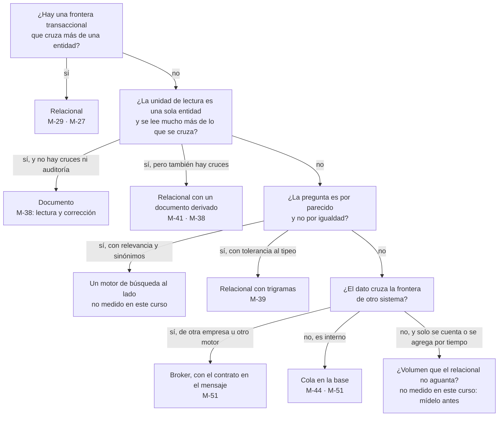

# 🏛️ Fase 26 — El comité: la factura, el árbol de veredicto y un martes

> **Curso:** Ruta SQL · Fase 26 de 27 · Bloque VI — El árbitro · **10 h** · cierra el curso: lleva el cierre del 🏆 boss global "Un martes"
> **Motores:** PostgreSQL `pgvector/pgvector@sha256:2358fcba361e…` (18.6), para el boss global · Oracle y MongoDB, solo en la factura
> **Entorno de ejecución:** Python en `src/26-el-comite/`; el boss global en `src/26-el-comite/martes/`
> **Perfil de volumen:** M, con la Fase 25 corrida
> **Evidencia:** bitácora de medición, entradas M-29, M-38, M-46, M-51, M-52 a M-57, y la lista de precios de Oracle del 15/09/2026
> **Depende de:** Fase 25 · **Habilita:** el cierre del curso
> **Fecha de verificación ejecutada:** 15/10/2026
> **Objetivo:** llevar la decisión al comité con su factura (licencias, personas y riesgo), dejar entero el árbol de cuándo no usar un motor relacional, y cerrar el boss global con la facturación de un martes corriendo sobre la base nueva.

---

## 🧭 1. Dónde estamos

El comité de Horizonte se reúne un jueves, porque los martes Matías no atiende. En la mesa están la dirección, Verónica por la gerencia de datos, Florencia por la app, Norma por el laboratorio y Matías, que va a tener que operar lo que se decida. Tienen el documento de diseño de la [Fase 24](24-el-diseno.md) y el plan de migración de la [Fase 25](25-la-migracion-sin-parar.md). Ninguno de los dos contesta lo que el comité va a preguntar primero: **cuánto cuesta, quién lo sostiene y qué pasa si sale mal**.

Esta fase contesta esas tres cosas, cada una con lo que el curso puede sostener. Las licencias salen de una lista de precios pública y fechada; las personas, de lo que cada parte del diseño exige saber; el riesgo, de los ciclos de vida publicados. Después deja el **árbol de veredicto entero**, porque un curso que enseña a defender un motor relacional tiene que terminar diciendo cuándo no usarlo. Y cierra el encargo que empezó en el `LEEME.txt`: *"cualquier cosa me llaman, pero no los martes que es día de facturación"*.

---

## 🎯 2. Objetivos de esta fase

1. Calcular la factura de licencias de cada propuesta a cinco años, con precios de lista y su fecha, y decir qué no sabe esa cuenta.
2. Poner las personas en la factura: qué tiene que saber Matías para operar cada parte.
3. Medir el riesgo con los ciclos de vida publicados, incluido quién mantiene MySQL dentro de cinco años.
4. Usar el árbol de veredicto entero para decidir dónde Alameda no necesita un motor relacional.
5. Cerrar el 🏆 "Un martes": la presentación semanal a las obras sociales, corriendo sobre la base nueva mientras legacy sigue viva.

---

## 🗂️ 3. La evidencia

La factura no se mide en el laboratorio, y la evidencia es de otra clase: documentos fechados.

- **La lista de precios de Oracle**, *Oracle Technology Global Price List* del **15 de septiembre de 2026**, sección I, descargada y leída el 15/10/2026. Enterprise Edition cuesta **USD 47.500 por procesador**, más **10.450** de soporte anual, que es el 22 %. Standard Edition 2 cuesta 17.500 por procesador. Partitioning, 11.500; Diagnostics Pack, 7.500; Tuning Pack, 5.000; Active Data Guard, 11.500.
- **La tabla de factores de núcleo de Oracle**, actualizada el 28 de enero de 2026: Intel Xeon y AMD EPYC cuentan **0,5** por núcleo.
- **El ciclo de vida de MySQL**, en el manual de la 9.7: una serie LTS tiene **cinco años de soporte *premier* y tres de extendido**. La 9.7.0 salió el **21 de abril de 2026**, y la 9.7 es la última serie con la numeración vieja: las siguientes usan año y mes (`26.7`).
- **El ciclo de vida de Postgres**: la versión 18 tiene soporte hasta el **14 de noviembre de 2030**.

Y el boss global, que sí se mide, agrega las entradas M-57 y la tabla de reconciliación de la sección 5.5.

> 📝 **Los precios de lista no son lo que paga Horizonte**, y la cuenta de esta fase no sabe qué descuento tiene. Los núcleos sí los sabe: el SIH corre en **dos servidores Xeon de 16 núcleos**, el primario y un *standby*, y el primario pasa del 70 % de CPU en los picos de la mañana ([la historia](00-historia-de-alameda.md), 2022). Esos son los valores por defecto de `01_factura.py`, que los recibe como parámetro para probar otros. Lo que sí sabe es la forma de la cuenta: cuántas licencias por núcleo, cuánto soporte por año y qué opciones suma cada decisión del diseño.

---

## ⚔️ 4. Las propuestas, con su mejor argumento

Al comité llegan las tres con su factura completa.

**Verónica**, con un esquema en el Oracle del SIH, tiene el argumento más fuerte de la mesa: **la licencia ya se paga**. Si el laboratorio cabe en los núcleos que el SIH ya tiene licenciados, el costo incremental de licencia es cero, y la cuenta de la sección 5.1 no aplica. Es su mejor carta, y es verdad hasta que el laboratorio necesita más núcleos. Ahí cada uno cuesta lo que dice la lista, y cuesta dos veces, porque el *standby* también se licencia. El margen no es grande: el primario del SIH ya pasa del 70 % de CPU en los picos de internación de la mañana, que es también la hora de las extracciones del laboratorio. El equipo de DBA ya existe, pero tarda **seis semanas en aprobar una columna**, y en la Fase 25 la migración necesitó tres columnas nuevas solo para facturar.

**Florencia**, con MongoDB, llega con una factura de licencia de cero en Community y una app que lee el informe como lo muestra. Su costo está en otro lado. La auditoría y el cruce pierden por uno o dos órdenes de magnitud ([M-38](bitacora-de-medicion.md#m-38--f20--las-cinco-operaciones-en-tres-diseños)), y **la presentación de un martes** necesita convenios, vigencias, cantidades y coseguros, que son relaciones. Alameda tendría dos bases: la de los documentos y otra para facturar.

**La del lector**, con Postgres, tiene una licencia de cero y un costo que no está en ninguna lista: **todo lo que se operaba en el SIH lo opera Alameda**. Esa factura es de personas, y la sección 5.2 la escribe.

---

## 🧾 5. La factura, el árbol y el martes

### 5.1 Las licencias

`01_factura.py` hace la cuenta a cinco años con la lista del 15/09/2026. El escenario por defecto son **dos servidores de 16 núcleos x86**, como los del SIH (el primario y un *standby*, que en Oracle también se licencia), si el laboratorio tuviera los suyos:

```text
2 servidores de 16 núcleos x86 · factor 0.5 · 16 licencias de procesador
escenario                                               licencias  soporte/año       5 años
EE sola                                                   760,000      167,200    1,596,000
EE + particionado                                         944,000      207,680    1,982,400
EE + particionado + packs de diagnóstico y tuning       1,144,000      251,680    2,402,400
EE + particionado + packs + standby legible             1,328,000      292,160    2,788,800
PostgreSQL (soporte comercial: sin lista pública)               0            —            0
```

Con un solo servidor de 8 núcleos, EE sola cuesta **USD 399.000** a cinco años; con dos de 32, **3.192.000**. La cuenta escala lineal con los núcleos, y cada opción se suma por procesador. Por eso las opciones importan: **el particionado del diseño** (sección 5.10 de la Fase 24, todavía sin medir) cuesta en Oracle un 24 % más sobre la EE. Y los packs que hacen falta para usar el AWR que un DBA de Oracle espera tener suman otro 26 % del precio de la EE.

Tres cosas que la cuenta no dice, y que el comité tiene que saber:

- **Para Verónica la cuenta es incremental.** Si el SIH tiene núcleos licenciados que no usa, el laboratorio no paga licencia. Lo que paga es la capacidad que le quita al SIH.
- **Standard Edition 2 cuesta 17.500 por procesador**, que en SE2 se cuenta por *socket*, y no incluye las opciones de EE: sin particionado y con su propio límite de *sockets*. Para el volumen de Alameda puede alcanzar, y el ejercicio 16 lo plantea.
- **Postgres no tiene costo de licencia, y su soporte comercial no tiene lista pública.** Un contrato de soporte es un número que el comité tiene que pedir, no uno que este curso pueda publicar.

### 5.2 Las personas: Matías tiene que poder operarlo

La [Fase 24](24-el-diseno.md) dejó en su sección 5.9 qué tiene que saber quien opera cada parte. Puesto en la factura, el número que importa no es de dinero: es **cuántas de esas tareas Alameda ya sabe hacer**.

Alameda ya escribe SQL contra SQL Server desde 2011, ya tiene una bandeja de fusiones (`Pacientes_Fusionar`), ya concilia a mano la planilla de los martes. Lo nuevo es **la operación de la convivencia y de la red**: un slot que no puede quedar sin consumidor ([M-46](bitacora-de-medicion.md#m-46--f22--la-decodificación-lógica-con-test_decoding)), un aplicador con su posición, PostgREST y un *broker* ([M-51](bitacora-de-medicion.md#m-51--f23--el-boss-del-puente-punto-de-partida-solución-y-hacía-falta-un-broker)). Esto último es lo único que no es Postgres. Cada una de esas tareas tiene una fase del curso detrás, y la formación de Matías es, literalmente, el temario.

Para Verónica, las personas ya están: el equipo de DBA del SIH. Su costo es **la cola de ese equipo**. Para Florencia, la persona que opere MongoDB no existe todavía en la red.

> 🧭 **Una propuesta que nadie de Alameda puede operar no es más barata: traslada el costo a un proveedor**, que es lo que la red evita por doctrina desde 2010. La pregunta del comité a cada propuesta es *"¿quién la opera un martes a las dos de la mañana?"*, y cada respuesta tiene un nombre.

### 5.3 El riesgo, incluido quién mantiene MySQL dentro de cinco años

El portal de 2013 corre en PHP con MySQL, y el diseño de la Fase 24 lo reemplaza por la API de la [Fase 23](23-la-base-como-producto.md). Pero el reemplazo no es inmediato, y el comité pregunta qué pasa con MySQL mientras tanto.

La serie que el laboratorio usa es la **9.7 LTS**, con disponibilidad general el 21/04/2026. Con la política de cinco años de soporte *premier* y tres de extendido del manual, eso lleva el soporte *premier* hasta abril de 2031 y el extendido hasta abril de 2034. Es un cálculo hecho con la política publicada, no una fecha que Oracle haya puesto en una página que este curso pudiera leer. El riesgo de MySQL dentro de cinco años no es el motor, que va a tener soporte. Es **el portal**: un PHP de una agencia de Rosario que nadie de Alameda mantiene, encima de un MySQL que nadie de Alameda opera. El diseño lo retira, y el riesgo se apaga con él.

Postgres 18 tiene soporte hasta el 14/11/2030, cinco años desde su salida, y la convivencia de la Fase 25 es la forma de pasar a la versión siguiente sin parar: es el mismo procedimiento. El riesgo de Oracle no es de soporte sino de costo: **cada núcleo nuevo** cuesta lo que dice la sección 5.1, todos los años.

| Riesgo | Verónica | Florencia | El lector |
|---|---|---|---|
| Soporte del motor | el del SIH, ya contratado | Community, sin contrato | comunidad, o contrato a pedir |
| Costo que crece | por núcleo, cada año | por servidores y personas | por personas |
| Dependencia de un equipo ajeno | el de DBA del SIH (seis semanas por columna) | un perfil que no existe en la red | ninguna, si Matías lo opera |
| La suciedad del laboratorio | entra al sistema de internación | entra a la app | queda en Alameda, en su cola de rechazos |
| El portal y MySQL | se reemplaza igual | se reemplaza igual | se reemplaza por la API (Fase 23) |

### 5.4 El árbol de veredicto: cuándo no usar un motor relacional

Este es el árbol del curso, entero. Cada hoja que dice *no* tiene detrás una medición del curso, o dice que no la tiene.



Leído para Alameda, el árbol dice dónde **no** hace falta Postgres. El SIH es de otra empresa y otro motor, y la interfaz va por un *broker*. La app puede recibir el informe como documento, derivado de la fuente. La búsqueda de pacientes no necesita un motor de búsqueda, porque la tolerancia al tipeo alcanza ([M-39](bitacora-de-medicion.md#m-39--f21--la-búsqueda-de-nombres-like-texto-completo-prefijo-y-trigramas)). Y en Alameda **no hay ninguna parte con volumen de series de tiempo o de eventos** que el árbol mande afuera: el curso no midió esa rama, y la deja dicha para tu dominio.

> 💡 **El árbol no pregunta "¿esquema fijo?" ni "¿necesito escalar?"**, porque son las dos preguntas que la [Fase 02](02-las-cinco-preguntas-desde-el-otro-lado.md) mostró que no predicen nada. Pregunta por la frontera transaccional, la unidad de lectura, la exactitud y la frontera entre sistemas, que son las que cambian el diseño.

### 5.5 Un martes, el boss global

El boss global empezó en el Bloque I y cerró una nota al final de cada bloque. Termina aquí: **la facturación de un martes corre entera sobre la base nueva, mientras la vieja sigue viva al lado**.

**Lo que se factura.** Cada martes, Alameda arma la presentación a las obras sociales de la semana anterior, de lunes a domingo. Es la planilla de Matías, con las reglas que el LIS de 2012 no entendió: el precio del convenio vigente el día de la práctica, la cantidad, el coseguro que ya pagó el paciente, el tope mensual por afiliado y las prácticas que se facturan juntas. `martes/00_base.sql` declara lo que la caja no trae: el aumento del 1 de octubre (un 4 %), el tope de 12 unidades por mes para PAMI y APROSS, y la composición de paneles de la [Fase 21](21-hasta-donde-llega-el-motor.md). También crea las tablas de la presentación y el rol `facturacion`, que **no ve legacy**.

**El martes.** El arnés juega el martes 6 de octubre de 2026 con la semana del 28/09 al 04/10, que tiene 15.270 prácticas. A la mañana, recepción todavía escribe en legacy: agrega cuatro prácticas olvidadas, corrige una cantidad, borra una práctica cargada por error y agrega un panel con uno de sus componentes. El CDC de la Fase 25 lo trae. Al mediodía se emite la presentación, y a la tarde llegan dos prácticas más de esa semana, que tienen que quedar para la próxima. Cinco criterios:

1. **C1** · Cada práctica presentada lleva el precio de su obra social vigente el día de la práctica.
2. **C2** · No se presenta lo que la obra social no paga (sin precio, fuera de convenio, incluida en su panel, por encima del tope), y se presenta todo lo demás.
3. **C3** · La cantidad de cada práctica, y el coseguro descontado por protocolo, sin pasar de lo presentado.
4. **C4** · La reconciliación con la planilla de legacy cierra al centavo: cada práctica tiene un destino, y los totales por obra social son los esperados.
5. **C5** · Legacy sigue viva: lo de la mañana entra, lo borrado no, la corrección sí, lo de la tarde queda para la próxima, y volver a emitir no cambia nada.

**El punto de partida pasa 0 de 5.** Es la planilla de los martes pasada a SQL tal como estaba. Pone el precio de hoy a toda la semana (6.652 de 14.942 líneas con otro precio) y presenta 7.250 prácticas de más (todo lo fuera de convenio, el componente del panel). Cuenta una unidad por práctica (282 líneas con otra cantidad), no descuenta coseguro, deja 330 prácticas sin destino y rehace la presentación cada vez que se la llama, así que lo de la tarde se mete en una presentación ya emitida.

**La solución pasa 5 de 5**, y no se publica (D42). Lo que se puede decir es lo que tuvo que agregarle a la base nueva, porque es lo que el boss enseña: **la base que se diseñó bloque a bloque no tenía todo lo que la facturación necesita**. Lo facturado no sabía de qué protocolo era cada práctica, el protocolo no tenía el coseguro, y el aplicador del CDC no traía ninguna de las dos cosas. La seguridad por fila de la Fase 23 no dejaba que facturación viera un solo protocolo hasta que la base le dio su política. Y el aumento de octubre tuvo que partir cada rango de precios **en una sola sentencia**, porque con dos la clave foránea con período de la Fase 07 ve el hueco y la rechaza ([a08](a08-catalogo-de-errores.md), E-70).

La tabla que el arnés le imprime a Matías es la reconciliación con su planilla, por obra social, y cierra al centavo:

| Concepto, semana del 28/09 al 04/10 | Pesos |
|---|---:|
| La planilla de legacy (precio de la tabla de Matías × cantidad) | 434.511.876,15 |
| − sin precio vigente en el modelo | 19.567.269,93 |
| − fuera de convenio | 205.339.165,78 |
| − incluida en su panel | 103.779,72 |
| − por encima del tope del afiliado | 174.721,69 |
| **= presentado** | **209.326.939,03** |
| − coseguro que ya pagaron los pacientes | 9.437.714,80 |
| **= neto a cobrar a las obras sociales** | **199.889.224,23** |

> ⚠️ **La línea de "fuera de convenio" es un artefacto de la caja, y hay que decirlo.** El generador asignó prácticas a los protocolos sin mirar la planilla de convenios de 2026 (D50), y por eso casi la mitad cae fuera. En Alameda esa proporción sería chica. **El arnés mide la forma**: que nada fuera de convenio se presente y que todo lo demás sí. No mide la proporción.

**Cómo sabe el arnés lo que se esperaba.** El arnés no confía en lo facturado del modelo, que es justo lo que se está evaluando. Calcula su propia presentación con otra fuente para cada cosa. Lo que pasó (las prácticas, sus cantidades, el protocolo, el coseguro, la sede) sale de **legacy**, tal como quedó a la hora del corte. Lo que se decidió (los precios con sus rangos, el convenio en tres tablas, la composición, los topes, el paciente que sobrevivió a las fusiones) sale **del modelo**, porque es el modelo el que lo decidió. Y aplica las reglas en un orden fijo: sin precio, fuera de convenio, incluida en su panel y por encima del tope, en orden de fecha y de clave. Una solución que lee lo facturado y se olvida de una práctica no coincide con un cálculo que parte de `ProtocoloPracticas`, y eso es lo que mide C4.

Esa es también la forma de la reconciliación que Matías va a necesitar cada martes del primer año de convivencia, cuando todavía no confíe en la base nueva. Va a correr las dos presentaciones, la suya y la del modelo, y va a mirar la columna de diferencias. El arnés la deja escrita.

Lo de PAMI merece una línea aparte. **17,96 millones de su planilla no tienen precio vigente en el modelo**, porque la [Fase 07](07-el-tiempo-en-el-modelo.md) rechazó las vigencias duplicadas: dos precios para la misma práctica que empiezan el mismo día. La planilla de Matías elige uno, el último que cargó, y lo factura. El modelo no elige: lo manda a la cola de rechazos para que alguien decida cuál es el precio acordado. Es la diferencia entre una planilla que siempre da un número y una base que a veces dice *no sé*. **Un débito de la obra social es el precio de no decirlo.**

### 5.6 Lo que decide el comité, y lo que no

El comité no decide un motor. Decide **cuatro cosas**, y la fase le lleva una recomendación para cada una, con lo que la sostiene y lo que la contradice:

1. **Dónde vive la base del laboratorio.** La recomendación del curso es la base propia en Postgres, con el modelo de la Fase 24. La sostienen la auditoría y el cruce ([M-38](bitacora-de-medicion.md#m-38--f20--las-cinco-operaciones-en-tres-diseños)), la factura de licencias y el martes que corre. La contradice la mejor carta de Verónica: si el SIH tiene núcleos libres, su licencia no cuesta nada más, y el cruce de pacientes se hace en un solo motor.
2. **Cómo se sale de legacy.** Con la convivencia de la Fase 25 y un corte por criterio, no por fecha. No lo contradice ninguna medición. Lo contradice la tentación de cortar un viernes porque ya se dijo que se cortaba.
3. **Quién lo opera.** Matías, con la formación que es el temario de este curso, y con una segunda persona, porque una sola es un riesgo que ninguna medición cubre.
4. **Qué se mide dentro de un año.** La cola de rechazos (si crece, el negocio no está decidiendo), las fichas vivas duplicadas (22.671 al salir de la Fase 25), los débitos de las obras sociales mes a mes, y el atraso del CDC mientras la convivencia dure.

Lo que el comité **no** decide, y la fase lo dice para que nadie lo intente: los precios de las prácticas sin vigencia, qué significan los 177 analitos de texto, y el umbral de la búsqueda. Son decisiones de quien negocia los convenios, de bioquímica y de recepción. Una base nueva que las toma por ellos repite el error del LIS de 2012, que facturaba con un precio por obra social porque nadie le explicó los convenios.

---

## ⚖️ 6. Veredicto honesto: cuándo NO

El curso termina con el veredicto de su propia tesis.

- **No uses un motor relacional cuando no hay una frontera transaccional que cruce entidades** y la lectura es siempre de una sola: el documento lo lee y lo corrige más barato ([M-38](bitacora-de-medicion.md#m-38--f20--las-cinco-operaciones-en-tres-diseños)). En Alameda no hay una parte así sola. La app es así y por eso recibe un documento derivado.
- **No lo uses como motor de búsqueda con relevancia.** Los trigramas toleran el tipeo, pero no ordenan por lo que el usuario quiso decir ([M-40](bitacora-de-medicion.md#m-40--f21--la-recursión-contra-el-informe-fijo-y-el-vector-léxico)).
- **No lo uses como contrato entre empresas.** Su esquema es el de una de ellas, y el *broker* hace que el contrato sea el mensaje ([M-51](bitacora-de-medicion.md#m-51--f23--el-boss-del-puente-punto-de-partida-solución-y-hacía-falta-un-broker)).
- **No elijas Postgres porque no cuesta licencia**, si nadie de tu empresa lo va a operar. La factura es de personas.
- **No elijas el motor por el comité.** Si Horizonte decide por Verónica por doctrina, el diseño de la Fase 24 sobrevive casi entero en Oracle, y la migración de la Fase 25 se hace igual. Lo que cambia es la factura, no el modelo de datos. Y el modelo de datos era el problema de 2012.

---

## ⚠️ 7. Errores comunes

- **Llevar al comité un precio de lista como si fuera el costo.** Es la forma de la cuenta; el número lo pone el contrato.
- **Comparar licencias sin comparar personas.** La licencia de cero tiene una factura en otra columna.
- **Un riesgo sin fecha.** "MySQL es un riesgo" no se discute; "la 9.7 tiene soporte *premier* hasta abril de 2031, según su política" sí.
- **Cerrar el árbol de veredicto en la hoja que conviene.** Cada hoja que manda afuera del relacional tiene una medición o dice que no la tiene.
- **Una presentación que se rehace cada vez que se la llama.** Una presentación emitida no cambia; lo que llega después es de la próxima.
- **Leer la reconciliación solo por el total.** El total de PAMI cierra; los 17,96 millones sin precio, no, y esos son el débito del mes que viene.

---

## 📋 8. Checklist de validación

- [ ] `01_factura.py` da USD 1.596.000 a cinco años para EE sola con dos servidores de 16 núcleos.
- [ ] Las fechas de soporte de MySQL 9.7 y de Postgres 18 están citadas con su fuente.
- [ ] El árbol de veredicto dibuja con `mmdc`, y cada hoja que manda afuera cita una medición o dice que no la tiene.
- [ ] `martes/arnes.py` da 0 de 5 con el punto de partida.
- [ ] Tu solución del martes da 5 de 5, y la reconciliación imprime "sin explicar" en ninguna obra social.
- [ ] El slot `f25_legacy` está borrado al terminar (el arnés lo borra).

---

## 🧪 9. Ejercicios (20)

Cada ejercicio tiene su solución en `soluciones/26-el-comite.md`. Los 1 a 10 se resuelven con `01_factura.py`, la salida del arnés del martes y las fuentes de la sección 3; los 11 a 20, con su rúbrica.

### 🟢 Ejercicio 1 — La factura por defecto

Corre `01_factura.py` sin argumentos. ¿Cuánto cuesta EE sola a cinco años, y cuánto de eso es soporte?

*Solución:* [soluciones/26-el-comite.md#ejercicio-1](soluciones/26-el-comite.md#ejercicio-1)

### 🟢 Ejercicio 2 — Los núcleos

¿Cuántas licencias de procesador son 8 núcleos Xeon? ¿Y 8 núcleos de un ARM que no es Ampere?

*Solución:* [soluciones/26-el-comite.md#ejercicio-2](soluciones/26-el-comite.md#ejercicio-2)

### 🟢 Ejercicio 3 — El soporte

¿Qué porcentaje del precio de licencia es el soporte anual en la lista?

*Solución:* [soluciones/26-el-comite.md#ejercicio-3](soluciones/26-el-comite.md#ejercicio-3)

### 🟢 Ejercicio 4 — El punto de partida

Corre el arnés del martes sobre el punto de partida. ¿Cuántos criterios pasa, y cuál es el error más grande en pesos?

*Solución:* [soluciones/26-el-comite.md#ejercicio-4](soluciones/26-el-comite.md#ejercicio-4)

### 🟢 Ejercicio 5 — Lo esperado

Según el arnés, ¿cuántas prácticas de la semana se presentan, y cuántas quedan afuera por cada motivo?

*Solución:* [soluciones/26-el-comite.md#ejercicio-5](soluciones/26-el-comite.md#ejercicio-5)

### 🟡 Ejercicio 6 — Lo que PAMI no cobra

¿Por qué PAMI tiene 17,96 millones sin precio vigente, y qué haría Matías con eso un martes?

*Solución:* [soluciones/26-el-comite.md#ejercicio-6](soluciones/26-el-comite.md#ejercicio-6)

### 🟡 Ejercicio 7 — El tope

¿Cuántas prácticas exceden el tope, de qué obra social, y por qué el tope necesita las prácticas de septiembre anteriores a la semana?

*Solución:* [soluciones/26-el-comite.md#ejercicio-7](soluciones/26-el-comite.md#ejercicio-7)

### 🟡 Ejercicio 8 — MySQL en 2031

¿Hasta cuándo tiene soporte la serie 9.7 de MySQL, y de dónde sale esa fecha?

*Solución:* [soluciones/26-el-comite.md#ejercicio-8](soluciones/26-el-comite.md#ejercicio-8)

### 🟡 Ejercicio 9 — La versión de Postgres

Postgres 18 tiene soporte hasta noviembre de 2030. ¿Cómo pasa Alameda a la versión siguiente sin parar?

*Solución:* [soluciones/26-el-comite.md#ejercicio-9](soluciones/26-el-comite.md#ejercicio-9)

### 🟡 Ejercicio 10 — El coseguro

¿Cuánto coseguro descuenta la presentación de la semana, y por qué se descuenta por protocolo y no por práctica?

*Solución:* [soluciones/26-el-comite.md#ejercicio-10](soluciones/26-el-comite.md#ejercicio-10)

### 🟠 Ejercicio 11 — Las opciones

¿Cuándo se justifican los packs de diagnóstico y el standby legible en la propuesta de Verónica?

*Solución:* [soluciones/26-el-comite.md#ejercicio-11](soluciones/26-el-comite.md#ejercicio-11)

**Rúbrica (sobre 3 puntos):** 1 punto por lo que da cada opción; 1 por su costo a cinco años con la lista; 1 por el equivalente en Postgres y su costo (personas, no licencia).

### 🟠 Ejercicio 12 — La formación de Matías

Ordena lo que Matías tiene que aprender para operar el diseño, de lo más urgente a lo menos, con la fase del curso que lo enseña.

*Solución:* [soluciones/26-el-comite.md#ejercicio-12](soluciones/26-el-comite.md#ejercicio-12)

**Rúbrica (sobre 3 puntos):** 1 punto por empezar por lo que puede parar el laboratorio (slots, esperas); 1 por la fase de cada punto; 1 por separar lo que ya sabe.

### 🟠 Ejercicio 13 — MySQL dentro de cinco años

Escribe el párrafo del riesgo de MySQL para el comité, con fechas y sin alarmismo.

*Solución:* [soluciones/26-el-comite.md#ejercicio-13](soluciones/26-el-comite.md#ejercicio-13)

**Rúbrica (sobre 3 puntos):** 1 punto por las fechas con su fuente; 1 por separar el motor del portal; 1 por la salida (la API de la Fase 23).

### 🟠 Ejercicio 14 — Los turnos

Pasa el `.accdb` de turnos de recepción por el árbol de veredicto. ¿Dónde termina?

*Solución:* [soluciones/26-el-comite.md#ejercicio-14](soluciones/26-el-comite.md#ejercicio-14)

**Rúbrica (sobre 3 puntos):** 1 punto por la frontera transaccional (el turno y el protocolo); 1 por los exámenes separados por punto y coma; 1 por la hoja y su medición.

### 🟠 Ejercicio 15 — Un criterio más

Agrega un sexto criterio al arnés del martes que una obra social real haría cumplir, y escríbelo con su verificación.

*Solución:* [soluciones/26-el-comite.md#ejercicio-15](soluciones/26-el-comite.md#ejercicio-15)

**Rúbrica (sobre 3 puntos):** 1 punto por un criterio de débito real (la orden firmada, el número de afiliado); 1 por cómo se verifica contra legacy; 1 por lo que el modelo necesitaría agregar.

### 🟠 Ejercicio 16 — Standard Edition 2

¿Alcanza SE2 para Alameda? Decide con lo que la lista dice que no trae.

*Solución:* [soluciones/26-el-comite.md#ejercicio-16](soluciones/26-el-comite.md#ejercicio-16)

**Rúbrica (sobre 3 puntos):** 1 punto por el costo con la lista; 1 por lo que se pierde (opciones como el particionado); 1 por decidir con el volumen de Alameda.

### 🔴 Ejercicio 17 — Un martes

Resuelve el boss global: tu `01_setup.sql` y tu `flujo.py` tienen que pasar los cinco criterios.

*Solución:* [soluciones/26-el-comite.md#ejercicio-17](soluciones/26-el-comite.md#ejercicio-17)

**Rúbrica (sobre 5 puntos):** 1 punto por cada criterio del arnés en verde. El boss no publica su solución.

### 🔴 Ejercicio 18 — Diez minutos

Prepara la presentación al comité en diez minutos: qué se dice, en qué orden y qué número queda en la memoria de cada uno.

*Solución:* [soluciones/26-el-comite.md#ejercicio-18](soluciones/26-el-comite.md#ejercicio-18)

**Rúbrica (sobre 4 puntos):** 1 punto por empezar por el problema (la condición de no parar); 1 por una medición en contra dicha por ti; 1 por la factura entera; 1 por lo que le pides al comité que decida.

### 🔴 Ejercicio 19 — La parte que no es relacional

Elige una parte de Alameda que, según el árbol, no necesita un motor relacional, y diseña su reemplazo.

*Solución:* [soluciones/26-el-comite.md#ejercicio-19](soluciones/26-el-comite.md#ejercicio-19)

**Rúbrica (sobre 4 puntos):** 1 punto por la parte y la rama del árbol; 1 por la medición que lo sostiene; 1 por cómo se mantiene coherente con la fuente; 1 por lo que se pierde.

### 🔴 Ejercicio 20 — El veredicto

Escribe el veredicto final del comité, con la decisión, su factura y lo que se va a medir dentro de un año para saber si fue la correcta.

*Solución:* [soluciones/26-el-comite.md#ejercicio-20](soluciones/26-el-comite.md#ejercicio-20)

**Rúbrica (sobre 4 puntos):** 1 punto por la decisión con su mejor contraargumento; 1 por la factura de licencias, personas y riesgo; 1 por las métricas de dentro de un año; 1 por el criterio de dar marcha atrás.

---

## 📚 10. Referencias

**Fuentes de la factura**

- **Oracle Technology Global Price List, 15/09/2026** — https://www.oracle.com/a/ocom/docs/corporate/pricing/technology-price-list-070617.pdf
- **Oracle Processor Core Factor Table, actualizada el 28/01/2026** — https://www.oracle.com/contracts/docs/processor-core-factor-table-070634.pdf
- **El modelo de versiones de MySQL** (LTS e Innovation, y la numeración por año y mes) — https://dev.mysql.com/doc/refman/9.7/en/mysql-releases.html
- **Las notas de MySQL 9.7.0** — https://dev.mysql.com/doc/relnotes/mysql/9.7/en/news-9-7-0.html
- **La política de versiones de Postgres** — https://www.postgresql.org/support/versioning/

**Ensayos y libros**

- **Martin Kleppmann, *Designing Data-Intensive Applications*, 2.ª ed., O'Reilly, 2026** — el capítulo final, sobre cómo se combinan sistemas distintos alrededor de una fuente de verdad.

---

## 🏁 11. Resultado de la fase

- **La factura de licencias**, con la lista del 15/09/2026: USD 1,6 millones a cinco años para EE sola con dos servidores de 16 núcleos como los del SIH, y cero de licencia para Postgres, con su costo en personas.
- **El riesgo, con fechas:** MySQL 9.7 con soporte *premier* hasta abril de 2031 según su política, Postgres 18 hasta noviembre de 2030, y el portal como el riesgo de verdad.
- **El árbol de veredicto, entero**: en Alameda, el SIH va por un *broker* y la app recibe un documento derivado. La búsqueda se queda con trigramas, y ninguna parte necesita un motor de series de tiempo.
- **🏆 Un martes, cerrado:** la presentación de la semana del 28/09 corre sobre la base nueva mientras legacy sigue escribiendo, y se reconcilia con la planilla al centavo. El punto de partida pasa 0 de 5 y la solución, 5 de 5.

**Y el curso termina aquí.** Empezó con una base que nadie diseñó y una pregunta que no era técnica: *¿por qué no compran un LIS?* La respuesta que deja no es Postgres. Es que **el problema de Alameda era un modelo de datos**, que ningún proveedor resuelve por hora, y que ahora tiene un diseño medido, una migración que se reconcilia, una factura y una lista de lo que no se sabe. Matías puede atender el teléfono un martes.

> **La señal de que quedó bien:** *"Puedo llevar una decisión de base de datos a un comité con su costo, su riesgo y su medición, decir dónde no usaría lo que propongo, y correr la facturación de un martes sobre la base nueva sin que nadie se entere."*

> 🏷️ **No cierres la fase sin el tag.** Con el checklist en verde y `git status` limpio:
>
> ```bash
> git tag -a fase-26-el-comite -m "F26 cerrada: la factura, el árbol de veredicto y el boss global Un martes"
> ```
>
> Commits de la fase con prefijo `f26:`, los de ejercicio `f26 ej20: …`.
