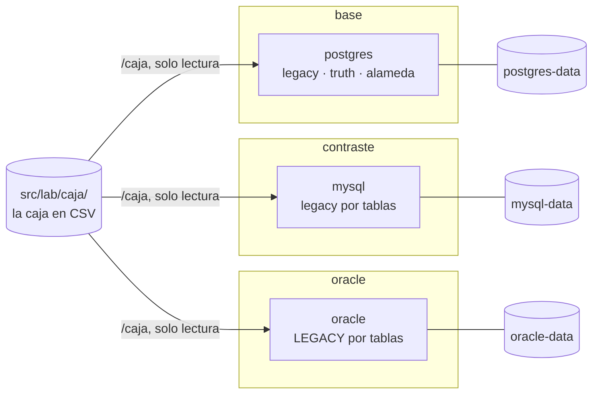

# 📎 Apéndice a02 — El `compose.yaml` de la ruta: perfiles, digests y memoria

> **Curso:** Ruta SQL · Consulta rápida · **2 h**
> **Usado por:** todas las fases · **Versiones cubiertas:** las cinco imágenes de abajo, con Docker
> Desktop 29.8.0 y Docker Compose v5.5.1 en macOS arm64
> **Fecha de verificación ejecutada:** 12/10/2026. Los digests se resolvieron ese día contra Docker
> Hub y MCR, y no cambiaron respecto de la verificación de laboratorio del 11/10/2026.

**Esto no se lee de corrido.** Se entra por el índice buscando algo concreto y se sale. Este es
**el único sitio del curso donde vive una versión**: si una fase necesita decir qué Postgres corre,
apunta aquí. El archivo que describe es [`src/lab/compose.yaml`](src/lab/compose.yaml).

**Qué queda fuera:** cómo funciona Compose por dentro, orquestación, secretos y despliegue. Cómo
instalar Docker y el ciclo de `up` y `down` están en [`a01`](a01-laboratorio-contenerizado.md); qué
se monta en `/caja` y cómo se carga, en [`a05`](a05-la-caja-y-el-generador.md).

---

## Índice

- [Los perfiles](#-los-perfiles)
- [Las versiones del curso](#-las-versiones-del-curso)
- [Puertos y variables](#-puertos-y-variables)
- [*Healthchecks* y cuánto tarda cada uno](#-healthchecks-y-cuánto-tarda-cada-uno)
- [Memoria por servicio](#-memoria-por-servicio)
- [La tabla de RAM](#-la-tabla-de-ram)
- [Lo que cada motor trae encendido](#️-lo-que-cada-motor-trae-encendido)
- [Volúmenes y la caja](#-volúmenes-y-la-caja)
- [Tus ajustes sin tocar el del curso](#-tus-ajustes-sin-tocar-el-del-curso)
- [Actualizar una versión](#-actualizar-una-versión)
- [Cuándo usar qué](#-cuándo-usar-qué)
- [Advertencias](#️-advertencias)
- [Referencias](#-referencias)
- [Ejercicios](#-ejercicios-6)

---

## 🧭 Los perfiles

Cada servicio pertenece a un perfil, y `uv run lab up` levanta los que le pidas (`base` si no pides
ninguno). El servicio se llama por el motor, porque en este curso el motor *es* el rol; el perfil, por
el papel que cumple en el curso.

| Perfil | Servicio | Para qué | Cuándo |
|---|---|---|---|
| `base` | `postgres` | el motor principal, donde vive todo | siempre |
| `contraste` | `mysql` | el contraste, donde su mecanismo cambia la decisión | según la fase |
| `oracle` | `oracle` | el caso de estudio, con la apuesta sin resolver | según la fase |
| `mongo` | `mongo` | el invitado del duelo | [Fase 20](20-la-propuesta-de-florencia.md) |
| `sqlserver` | `sqlserver` | el track opcional | `ss01`–`ss05` |
| `api` | `api` | PostgREST sobre el esquema `api`, con RLS | [Fase 23](23-la-base-como-producto.md) |
| `puente` | `artemis` | el *broker* del boss del puente | [Fase 23](23-la-base-como-producto.md#-16b-boss-del-puente--el-puente) |
| `dab` | `dab` | Data API builder sobre la base `ss05` de SQL Server | [ss05](ss05-data-api-builder-y-json.md) |



Los perfiles `api` y `puente` llegaron con la [Fase 23](23-la-base-como-producto.md), y cada uno trae el arreglo que
se encontró al verificarlo. **`api`** (PostgREST v16.4) necesita el servidor de administración en `localhost`
(`PGRST_ADMIN_SERVER_HOST`), porque `postgrest --ready` no acepta el host por defecto; se levanta con
`uv run lab up base api`, después de crear los roles de la fase, y firma los JWT con un secreto **de laboratorio**,
publicado a propósito en el compose. **`puente`** (Apache Artemis 2.57.0, el proyecto que se separó de ActiveMQ en
2025) arranca con `--no-autotune`: sin esa opción, la primera vez mide el disco durante unos ocho minutos. El
servicio Java del boss no es un servicio del compose: corre en el contenedor de Java 25 de este apéndice, en la red
`alameda-lab_default`, con las dependencias que Maven baja a `lib/`.

---

## 📌 Las versiones del curso

**Digest, no tag**: el tag se puede mover de imagen, el digest no. El tag legible va en el comentario
de cada servicio, junto a la fecha de verificación.

| Servicio | Tag | Qué trae |
|---|---|---|
| `postgres` | `pgvector/pgvector:0.8.7-pg18` | PostgreSQL 18.6 con pgvector 0.8.7 |
| `mysql` | `mysql:9.7.2` | MySQL 9.7.2, la LTS de la serie 9 |
| `oracle` | `gvenzl/oracle-free:23.26.3-slim-faststart` | Oracle AI Database 26ai Free 23.26.3 |
| `mongo` | `mongo:8.0.20` | MongoDB 8.0.20, **no la última** (ver abajo) |
| `sqlserver` | `mcr.microsoft.com/mssql/server:2025-CU9-ubuntu-24.04` | SQL Server 2025 CU9 (17.0.5005.3), Enterprise Developer |
| `api` | `postgrest/postgrest:v16.4` | PostgREST 16.4 |
| `artemis` | `apache/artemis:2.57.0` | Apache Artemis 2.57.0, el proyecto que se separó de ActiveMQ en 2025 |
| `dab` | `mcr.microsoft.com/azure-databases/data-api-builder:2.1.5` | Data API builder 2.1.5; solo amd64, emulado en Apple Silicon como SQL Server |

Los digests, tal como están en el `compose.yaml`:

```text
pgvector/pgvector@sha256:2358fcba361ed2233a5ed81b5fe4ca779ccb304120ce531a3bf51c0ed7e2bc11
mysql@sha256:e2bde46db6563855d7177adb5f0b57b9dc663f5a20927a90f4259d3312068497
gvenzl/oracle-free@sha256:f5ff19033860d662c821cb04eb10483fa94f14f78eae252d054291ea07028093
mongo@sha256:098862b1339f031900ca66cf8fef799e616d6324fa41b9a263f2ec899552c1ef
mcr.microsoft.com/mssql/server@sha256:2b5b581621126574f3d1f75e78d3eebe8d05aedb59ad0cfdf9aa42cb0634d726
postgrest/postgrest@sha256:d155c6718ed9a9f990d159a2ab7c0a3f16944dbb6d0a0344557421042acfe0df
apache/artemis@sha256:0f32b054e1f4adc45fc64824ebb0586579ffd563ce37d75b5a10d27db19a3889
mcr.microsoft.com/azure-databases/data-api-builder@sha256:d07e3e1ce53bdf84d3a4a0a4ce12e44f0b902e7316c782a3d682fbe074509c0b
```

**Por qué estas y no otras.** La regla del curso es la última estable, o la última LTS donde el
fabricante tiene esa línea. Tres casos piden una línea más:

- **Postgres viene de la imagen de pgvector**, que es la oficial de Postgres con la extensión
  `vector` ya instalada. La [Fase 21](21-hasta-donde-llega-el-motor.md) la usa; las demás no la notan.
- **Oracle viene de la imagen de Gerald Venzl** y no de la de Oracle: las dos traen la misma
  versión, nativa en `arm64`, pero la de Venzl ocupa 6 GB contra 13 y crea el usuario de la
  aplicación por variable (`APP_USER`). La variante `slim` no pierde nada que el curso use.
- **MongoDB está fijado en 8.0.20 a propósito.** Desde la 8.0.21, y en toda la 9, MongoDB se niega a
  arrancar sobre los kernels Linux 6.19 a 7.0.13, que es justo el de Docker Desktop 29.8.0
  (`7.0.12-linuxkit`):

  ```text
  {"t":{"$date":"2026-10-11T22:57:24.123+00:00"},"s":"F",  "c":"CONTROL",  "id":12257600,"ctx":"main","msg":"MongoDB cannot start: Linux kernel versions 6.19 and newer has a known incompatibility with this version of MongoDB. See https://jira.mongodb.org/browse/SERVER-121912 for more information."}
  ```

  La 8.0.20 es anterior a esa protección: **no tiene arreglado el fallo de fondo**, solo no lo
  vigila. La [Fase 20](20-la-propuesta-de-florencia.md) la carga poco, y en reposo no se dispara. Se vuelve a la versión vigente cuando
  Docker Desktop traiga un kernel 7.0.14 o posterior.

**Fuera del `compose.yaml`** hay una sola imagen, la de Java 25 con Maven, que
[`a06`](a06-python-java-y-drivers.md#-java-25-un-archivo-y-un-driver) usa para correr un archivo suelto y
bajar un driver JDBC sin instalar Java en tu máquina:

```text
maven:3.10.0-eclipse-temurin-25-noble   (Maven 3.10.0, Java 25.0.4.1 LTS)
maven@sha256:a291659c5ffddf142e5174df5bfc3f3dcb48706e44868f341ef7914b39a254c9
```

Las versiones de Python y de sus drivers no viven aquí: las fija `src/uv.lock` (`a06`).

> 📝 **SQL Server se presenta como "Enterprise Developer Edition"**, no "Developer": en 2025
> Microsoft partió Developer en Enterprise Developer y Standard Developer, y `MSSQL_PID=Developer`
> elige la primera.

---

## 🔌 Puertos y variables

Todos los puertos se publican **solo en `127.0.0.1`** y **desplazados a `2xxxx`**, para no chocar con
el Postgres o el MySQL que ya tengas en tu máquina. Cada uno se cambia con su variable.

| Variable | Por defecto | Para qué |
|---|---|---|
| `POSTGRES_PORT` · `MYSQL_PORT` · `ORACLE_PORT` | `25432` · `23306` · `21521` | el puerto en tu máquina |
| `MONGO_PORT` · `SQLSERVER_PORT` | `27027` · `21433` | ídem |
| `POSTGRES_MEMORY` · `MYSQL_MEMORY` · `ORACLE_MEMORY` | `2g` · `2g` · `3g` | el `mem_limit` del servicio |
| `POSTGRES_SHM` | `512m` | el `/dev/shm` de Postgres (abajo, en la memoria por servicio) |
| `MONGO_MEMORY` · `SQLSERVER_MEMORY` | `1g` · `2g` | ídem |
| `API_PORT` · `ARTEMIS_PORT` · `ARTEMIS_CONSOLE_PORT` · `DAB_PORT` | `23000` · `26161` · `28161` · `25000` | los de PostgREST, Artemis (y su consola) y DAB |
| `API_MEMORY` · `ARTEMIS_MEMORY` · `DAB_MEMORY` | `256m` · `1g` · `512m` | ídem |
| `DAB_PASSWORD` | `Dab-API-2026-lab` | la del *login* `dab_api`, que crea `ss05-…/02_api.sql` |
| `API_JWT_SECRET` | un secreto de laboratorio, publicado a propósito | la firma de los JWT de la Fase 23; no es para producción |
| `LAB_PASSWORD` | `lab` | la clave de `postgres`, `root`, `system` y `alameda` en los tres motores |
| `SQLSERVER_PASSWORD` | `Lab-2026-pass` | la de `sa`, aparte porque SQL Server exige una clave compleja |
| `LAB_CAJA` | `./caja` | qué directorio se monta en `/caja` |
| `LAB_COMPOSE` | `docker compose` | `podman compose` para Podman ([`a01`](a01-laboratorio-contenerizado.md#-podman-al-lado)) |

Las variables se leen del entorno o de **`src/lab/.env`**, que leen igual Compose y el CLI del curso,
y que git ignora. Una línea por variable:

```text
POSTGRES_PORT=25433
ORACLE_MEMORY=4g
```

> ⚠️ **Las claves son de laboratorio**, y por eso son `lab`. Los puertos solo escuchan en
> `127.0.0.1` justamente por eso: nada de esto debe quedar expuesto en una red.

---

## 🩺 *Healthchecks* y cuánto tarda cada uno

`lab up` usa `up -d --wait`, que no devuelve hasta que cada servicio pasa su *healthcheck*. Lo que
mide cada uno y cuánto tardó en esta máquina **con un volumen nuevo y la imagen ya descargada**, más
la memoria un minuto después, en reposo:

| Servicio | Qué comprueba | *Healthy* en | RAM en reposo |
|---|---|---|---|
| `postgres` | `pg_isready` | 3 s | 93 MiB |
| `mysql` | `mysqladmin ping` | 9 s | 544 MiB |
| `oracle` | `healthcheck.sh` de la imagen, cada 5 s | 16 s | 2,03 GiB |
| `mongo` | `mongosh` con `ping` | 4 s | 421 MiB |
| `sqlserver` | `sqlcmd` con `select 1`, cada 5 s | 12 s | 755 MiB (emulado) |

Los perfiles `api`, `puente` y `dab` llegaron después de esta medición (con las fases 23 y ss05). Sus
*healthchecks* están en el `compose.yaml` (`postgrest --ready` y una conexión al puerto en los otros dos) y no se
midieron con un volumen nuevo.

> 📐 **Medición de dimensionamiento** · 12/10/2026 · macOS 26.7.1, Apple M1 Pro, VM de 7,75 GiB ·
> los digests de arriba · reproducir: `uv run lab down -v`, y para cada perfil, `time uv run lab up
> PERFIL` y `docker stats --no-stream` al minuto.

**Oracle no se colgó.** Sus 16 s son lo normal, y el *healthcheck* le da hasta diez minutos (120
intentos cada 5 s). Si a los dos minutos sigue en `health: starting`, mira la memoria ([`a01`](a01-laboratorio-contenerizado.md#-memoria-oracle-decide-qué-cabe)).

> 📝 **Por qué aquí sí hay números de Oracle y de SQL Server.** El curso no publica ningún número
> propio de esos dos motores ([`a09`](a09-licencias-publicacion-y-riesgo.md)), con una sola excepción: el dimensionamiento del laboratorio,
> porque sin él no sabes si te entra en la máquina. No es un resultado del motor sobre una carga, y
> ningún otro documento lo repite.

---

## 🧠 Memoria por servicio

Cada servicio tiene su `mem_limit`. **No es un adorno:** en Linux, sin VM, es lo único que impide que
un motor se coma la máquina, y en macOS es lo que hace que el laboratorio entero entre en la VM.

| Servicio | `mem_limit` | Por qué ese |
|---|---|---|
| `postgres` | 2 GB | `shared_buffers` de 512 MB más los procesos de cada conexión |
| `mysql` | 2 GB | el *buffer pool* de 512 MB más lo demás de InnoDB |
| `oracle` | 3 GB | **con 512 MB, el kernel lo mata**; el piso cambia con lo que haya alrededor ([`a01`](a01-laboratorio-contenerizado.md#-memoria-oracle-decide-qué-cabe)) |
| `mongo` | 1 GB | la [Fase 20](20-la-propuesta-de-florencia.md) lo usa poco |
| `sqlserver` | 2 GB | SQL Server pide 2 GB como mínimo en Linux |
| `api` | 256 MB | PostgREST es un proceso de Haskell sin estado |
| `artemis` | 1 GB | la JVM del *broker*; la [Fase 23](23-la-base-como-producto.md) lo usa poco |
| `dab` | 512 MB | un servicio de .NET sin estado; lee el esquema `api` de `ss05` |

**Postgres tiene además `shm_size: 512m`.** Docker le da a cada contenedor un `/dev/shm` de 64 MB, y
ahí viven los segmentos de memoria compartida dinámica con que los procesos de una consulta en
paralelo se reparten un *hash join*. Con 64 MB, la consulta de la primera versión de
`03_cantidad.sql` de la [Fase 25](25-la-migracion-sin-parar.md) falló con
`could not resize shared memory segment` ([`a08`](a08-catalogo-de-errores.md#e-69--la-memoria-compartida-del-contenedor-se-llena), E-69). Con cuatro procesos, 64 MB fallan ya con el `work_mem` de fábrica; 512 MB
aguantan hasta `work_mem = '32MB'` ([M-58](bitacora-de-medicion.md#m-58--a02--el-devshm-del-contenedor-de-postgres-y-el-hash-join-en-paralelo)). Lo que se usa de `/dev/shm` **cuenta dentro del
`mem_limit`**: no es memoria aparte.

Oracle Free tiene además su propio techo de licencia: 2 CPU, 2 GB de RAM para la instancia y 12 GB de
datos de usuario. El tercer GB del límite es para el sistema operativo del contenedor.

---

## 🧮 La tabla de RAM

Con el perfil M cargado (Postgres entero; MySQL y Oracle con `Pacientes`, `Protocolos`,
`ResultadoItem` y `Practicas`) y después de recorrer `ResultadoItem` completa en cada motor:

| Combinación | Medido, un minuto después | Pico durante la carga |
|---|---|---|
| `base` + `contraste` + `oracle` | 613 MiB + 878 MiB + 1,60 GiB ≈ **3,1 GiB** | 884 MiB + 911 MiB + 1,70 GiB ≈ 3,5 GiB |
| lo mismo + `sqlserver` | ≈ **3,8 GiB** (SQL Server, 705 MiB) | — |
| `base` sola, M cargado | 613 MiB | 884 MiB |

> 📐 **Medición de dimensionamiento** · 12/10/2026 · perfil M · macOS 26.7.1, Apple M1 Pro, VM de
> 7,75 GiB · reproducir: `uv run lab load --profile m` en cada motor, un `SELECT sum(length("Valor"))
> FROM legacy."ResultadoItem"` en cada uno y `docker stats --no-stream` al minuto.

**La lectura:** un Mac de 16 GB le da por defecto 8 GB a la VM de Docker Desktop, y en esa VM **entra
el laboratorio entero con M cargado, con unos 4 GB de margen**. Dos advertencias: `docker stats` no
cuenta la caché de archivos de la VM, y Oracle oscila mucho (2,03 GiB recién creado, 1,6 GiB con M
cargado y recorrido), así que esta tabla da el pico además del reposo.

---

## ⚙️ Lo que cada motor trae encendido

Tres servicios no arrancan con su configuración de fábrica. Cada cambio está en el `command` del
servicio, con su porqué en un comentario.

**`postgres`** arranca con tres parámetros:

- `shared_preload_libraries=pg_stat_statements`, porque [`a04`](a04-el-arnes-de-forma.md) lo usa para
  contar llamadas y filas por consulta, y esa biblioteca solo se carga al arrancar.
- `wal_level=logical`, porque la [Fase 22](22-la-exportacion-de-las-9-40.md) lee el WAL con decodificación lógica; el valor de fábrica,
  `replica`, no alcanza.
- `shared_buffers=512MB` en lugar de los 128 MB de fábrica: la cuarta parte de su `mem_limit`, que
  es el punto de partida que recomienda la documentación de Postgres.

**`mysql`** deja el binlog encendido, como viene de fábrica. Se dejó así para un contraste de captura de cambios
que la [Fase 22](22-la-exportacion-de-las-9-40.md) no terminó usando: midió el CDC solo en Postgres (D49). Lo que no va al binlog es la carga de la caja: `lab load` lo apaga
solo para su sesión (`SET SESSION sql_log_bin = 0`), porque cada carga de M le sumaba entre 1,1 y
1,6 GB, que MySQL guarda 30 días. Además arranca con `--secure-file-priv=` **vacío**, que le permite leer archivos de cualquier
directorio, y `--innodb-buffer-pool-size=512M`. Lo natural sería `--secure-file-priv=/caja`, y no
funciona: el *entrypoint* de la imagen hace un `chown` recursivo de ese directorio, la caja está
montada en solo lectura, y el contenedor muere en el arranque.

```text
chown: changing ownership of '/caja': Read-only file system
chown: changing ownership of '/caja/s': Read-only file system
```

En un laboratorio local, que solo escucha en `127.0.0.1`, la opción vacía no expone nada. Es el
ejercicio 5.

**`oracle`** crea al arrancar el usuario `alameda` (`APP_USER`), con la misma clave del laboratorio,
para el modelo nuevo. `lab load` crea aparte el usuario `LEGACY` para la caja.

---

## 💾 Volúmenes y la caja

Cada motor guarda sus datos en un **volumen nombrado** (`postgres-data`, `mysql-data`,
`oracle-data`, `mongo-data`, `sqlserver-data`), que Compose prefija con el nombre del proyecto:
`alameda-lab_postgres-data`. Sobreviven a `lab down` y se borran con `lab down -v`. Los volúmenes y la
red llevan la etiqueta `curso=ruta-sql`, como los contenedores, para que puedas listarlos sin adivinar
([`a01`](a01-laboratorio-contenerizado.md#-limpiar-y-recuperar-disco)).

**La caja se monta en `/caja` en solo lectura**, en los tres motores, desde `src/lab/caja/` (o lo que
diga `LAB_CAJA`). Así cada motor carga leyendo el archivo desde su propio disco: `COPY` en Postgres,
`LOAD DATA INFILE` en MySQL y tablas externas en Oracle, sin pasar los 2,2 GB de M por el driver. Que
sea de solo lectura garantiza que ninguna carga toca el original.

| Volumen | Con M cargado |
|---|---|
| `postgres-data` | 4,3 GB: 3,0 GB de base (`legacy` y `truth`) y 1 GB de WAL |
| `mysql-data` | 1,8 GB, con cuatro tablas de la caja |

El de Oracle no se publica: es un tamaño medido de ese motor. Mídelo en tu máquina con `docker system
df -v`.

---

## 🧩 Tus ajustes sin tocar el del curso

Si necesitas otro puerto u otra memoria para siempre, no edites `compose.yaml`: crea
**`src/lab/compose.override.yaml`**. Compose lo aplica encima cuando lo llamas sin `-f` desde
`src/lab/`, el CLI del curso hace lo mismo, y git lo ignora.

```yaml
# Mis ajustes locales: el compose del curso no se toca.
services:
  mysql:
    mem_limit: 1g
```

🩺 `docker compose config mysql` muestra el resultado de la mezcla, y es la forma de comprobar que tu
cambio entró:

```text
$ docker compose config mysql | grep -E 'image|mem_limit'
    image: mysql@sha256:e2bde46db6563855d7177adb5f0b57b9dc663f5a20927a90f4259d3312068497
    mem_limit: "1073741824"
```

Para un cambio de una sola vez, la variable alcanza (`MYSQL_MEMORY=1g uv run lab up contraste`).

---

## 🔄 Actualizar una versión

Las versiones del curso cambian aquí y en ningún otro sitio. El procedimiento, que es el que siguió
esta verificación:

1. **Resolver el tag a su digest**, sin descargar la imagen:

   ```bash
   docker buildx imagetools inspect mysql:9.7.2
   ```

   ```text
   Name:      docker.io/library/mysql:9.7.2
   MediaType: application/vnd.oci.image.index.v1+json
   Digest:    sha256:e2bde46db6563855d7177adb5f0b57b9dc663f5a20927a90f4259d3312068497
   ```

   El `Digest` de arriba es el del índice multiplataforma, que es el que va en el `compose.yaml`:
   cada máquina elige debajo su arquitectura.
2. **Compararlo con el del `compose.yaml`.** Si es igual, el tag no se movió y no hay nada que hacer.
3. **Si cambió**, reemplazar el digest, actualizar la fecha del comentario y correr `uv run lab up`
   con todos los perfiles: arranque, *healthcheck* y `lab load --profile s` en cada motor.
4. **Si cambió la versión** (no solo la imagen), anotarlo aquí, con lo que cambia para el curso.

---

## 🧭 Cuándo usar qué

| Situación | Haz esto | Por qué |
|---|---|---|
| Una fase pide un motor | `uv run lab up` con su perfil | solo arriba lo que se usa |
| Necesitas saber qué versión corre | este apéndice, y `docker image inspect` para confirmarlo | es el único sitio donde vive una versión |
| Otro puerto, una vez | la variable en la línea de comandos | no deja rastro |
| Otro puerto, siempre | `src/lab/.env` | lo leen Compose y el CLI |
| Otra memoria o cualquier otro cambio, siempre | `src/lab/compose.override.yaml` | no tocas el archivo del curso |
| Comprobar qué configuración queda | `docker compose config` | muestra la mezcla final |
| Quieres actualizar una imagen | el procedimiento de arriba | digest, fecha y prueba de carga |

---

## ⚠️ Advertencias

- **Nunca pongas un tag en lugar de un digest.** El tag `mysql:9.7.2` puede apuntar mañana a otra
  imagen, con otro parche de sistema operativo, y tus mediciones dejan de compararse con las del curso.
- **MongoDB 8.0.20 no está arreglado, está esquivado** (ver arriba). Si tu kernel no está entre 6.19
  y 7.0.13, ni siquiera lo notas.
- **El `--secure-file-priv=` vacío y las claves `lab` son de laboratorio.** Nada de esto se lleva a
  un servidor.

---

## 📚 Referencias

> ⚠️ Las URL y sus contenidos cambian. Este apéndice se verificó con Compose v5.5.1 el 12/10/2026.

- **Perfiles de Compose** — https://docs.docker.com/compose/how-tos/profiles/ — cómo se activan y qué
  pasa con los servicios sin perfil.
- **Mezclar archivos de Compose** — https://docs.docker.com/compose/how-tos/multiple-compose-files/merge/
  — el `compose.override.yaml` y sus reglas.
- **Variables en Compose** — https://docs.docker.com/compose/how-tos/environment-variables/variable-interpolation/
  — el archivo `.env` y la sintaxis `${VAR:-valor}`.
- **`docker buildx imagetools inspect`** — https://docs.docker.com/reference/cli/docker/buildx/imagetools/inspect/
  — resolver un tag sin descargarlo.
- **La imagen de Oracle de Gerald Venzl** — https://github.com/gvenzl/oci-oracle-free — variantes,
  `APP_USER` y el *healthcheck*.
- **La imagen de pgvector** — https://github.com/pgvector/pgvector — la extensión y sus imágenes.
- **SERVER-121912** — https://jira.mongodb.org/browse/SERVER-121912 — por qué MongoDB está fijado en
  8.0.20.
- **SQL Server en contenedores Linux** — https://learn.microsoft.com/en-us/sql/linux/sql-server-linux-docker-container-configure
  — las variables de entorno de la imagen.
- **Requisitos de SQL Server en Linux** — https://learn.microsoft.com/en-us/sql/linux/sql-server-linux-setup
  — los 2 GB de memoria mínimos para arrancar.
- **`shared_buffers` en Postgres 18** — https://www.postgresql.org/docs/18/runtime-config-resource.html
  — el 25 % de la memoria como punto de partida.

**Orden sugerido:** los perfiles y las versiones la primera vez; puertos y variables cuando algo
choque; la tabla de RAM antes de levantar todo a la vez; actualizar una versión solo si sabes por
qué.

---

## 🧪 Ejercicios (6)

## 🟢 Fácil — leer el archivo (1–2)

### 🟢 Ejercicio 1 — El digest que corre

Con el perfil `base` arriba, obtén el digest de la imagen con la que corre el contenedor de Postgres y
compáralo con el del `compose.yaml`.

**Objetivo:** que los dos digests coincidan carácter por carácter, y saber dónde mirar si un día no.

[Solución](soluciones/a02-compose-de-la-ruta.md#ejercicio-1)

### 🟢 Ejercicio 2 — Lo que Postgres trae encendido

Comprueba desde `psql` el valor de `wal_level` y de `shared_preload_libraries`. Después crea la
extensión `pg_stat_statements`, ejecuta dos veces el mismo `count(*)` sobre `legacy."Pacientes"` y
búscalo en la vista.

**Objetivo:** ver `logical`, `pg_stat_statements` y tu consulta con `calls = 2`.

[Solución](soluciones/a02-compose-de-la-ruta.md#ejercicio-2)

## 🟡 Intermedio — cambiarlo sin romperlo (3–4)

### 🟡 Ejercicio 3 — Tu override

Crea `src/lab/compose.override.yaml` que baje la memoria de `mysql` a 1 GB.

**Objetivo:** demostrar con `docker compose config mysql` que el cambio entró, y con `git
check-ignore -v` que git no lo va a subir.

[Solución](soluciones/a02-compose-de-la-ruta.md#ejercicio-3)

### 🟡 Ejercicio 4 — Tu tabla de arranque

Con `uv run lab down -v` y la imagen ya descargada, mide cuánto tarda en llegar a *healthy* cada
servicio del camino base, y su memoria un minuto después.

**Pregunta:** ¿cuál de tus números se aparta más de la tabla de *healthchecks*, y qué de tu máquina lo
explica?

[Solución](soluciones/a02-compose-de-la-ruta.md#ejercicio-4)

## 🟠 Difícil — por qué está así (5–6)

### 🟠 Ejercicio 5 — MySQL y la caja de solo lectura

Con un override de una sola vez, cambia el `command` de `mysql` a `--secure-file-priv=/caja` y
levanta el perfil `contraste` con un volumen nuevo. Predice antes qué va a pasar.

**Objetivo:** reproducir el fallo, encontrar la línea del log que lo explica y defender, en tres
líneas, por qué el curso prefiere `--secure-file-priv=` vacío a montar la caja con escritura.

[Solución](soluciones/a02-compose-de-la-ruta.md#ejercicio-5)

### 🟠 Ejercicio 6 — ¿Se movió el tag?

Resuelve hoy el digest de `mysql:9.7.2` y de `pgvector/pgvector:0.8.7-pg18` sin descargarlas.

**Pregunta:** ¿coinciden con los del `compose.yaml`? Si alguno no coincide, ¿qué harías antes de
reemplazarlo, y por qué no basta con cambiar el digest?

[Solución](soluciones/a02-compose-de-la-ruta.md#ejercicio-6)

---

> 🏷️ **Este apéndice deja archivos en el repositorio:** `src/lab/compose.yaml`. El commit que lo
> cierra se etiqueta `apendice-a02-compose`.
