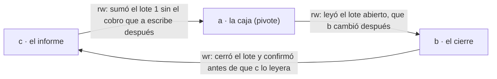

# ✅ Soluciones — Fase 15: Aislamiento comparado

> **Curso:** Ruta SQL · Solucionario de la [Fase 15](../15-aislamiento-comparado.md)
> **Ejercicios:** 26 · **Perfil:** M · **Motores:** Postgres y MySQL de
> [`a02`](../a02-compose-de-la-ruta.md#-las-versiones-del-curso)
> **Fecha de verificación ejecutada:** 14/10/2026

> ⚠️ **Intenta el ejercicio antes de leer su solución.** Leída antes, solo te enseña a reconocerla.

Todas las soluciones suponen `01_setup.sql` corrido en Postgres y `01_setup_mysql.sql` en MySQL, con `Protocolos` y `Deudores`
cargadas en MySQL (`uv run lab load --profile m --engine mysql --tables Protocolos,Deudores`). Los escenarios se corren desde
`src/` con `uv run lab race -f …`; los escenarios nuevos de las soluciones van en cualquier archivo `.race`. Las salidas omiten las
líneas `BEGIN`, `SET` y `START` cuando no dicen nada. Los conteos de `technicians.py` cambian entre corridas: se dan rangos.

---

## 🟢 Fácil (1–8)

### Ejercicio 1

**Enunciado (resumen):** la muestra en tres niveles.

**Solución.**

```text
🏁 lab race · postgres · permutación a1 b1 a2 b2 a3 b3 a4 b4 · read committed
 a2  1 fila  (11231555)
 b2  1 fila  (11231555)
 a3  INSERT 1
 b3  INSERT 1
 a4  COMMIT
 b4  COMMIT
comprobación: 1 fila  (2, 2)
```

`repeatable read` da la misma salida: dos tomas de dos técnicos. En `serializable`, los `INSERT` pasan y el error llega en el
`COMMIT` de b:

```text
 b4  ✗ 40001 could not serialize access due to read/write dependencies among transactions
comprobación: 1 fila  (1, 1)
```

**Rúbrica.** Una respuesta correcta tiene que:
- dar 2, 2 y 1 tomas;
- ubicar el error en el `COMMIT`, no en el `INSERT`.

[← Volver al ejercicio](../15-aislamiento-comparado.md#-ejercicio-1--la-muestra-en-tres-niveles)

### Ejercicio 2

**Enunciado (resumen):** la matriz.

**Solución.** `uv run python 15-aislamiento-comparado/matrix.py`, dos veces: las dos salidas son idénticas línea por línea
(`diff` sin diferencias), y son las tablas de las secciones 5.2 y 6. La lectura sucia no pasa en el `READ UNCOMMITTED` de Postgres
porque ese nivel no existe como tal. La documentación lo dice así: *"internally only three distinct isolation levels are
implemented, i.e., PostgreSQL's Read Uncommitted mode behaves like Read Committed"*.

**Rúbrica.** Una respuesta correcta tiene que:
- comprobar que las dos corridas coinciden;
- citar que Postgres implementa tres niveles, no cuatro.

[← Volver al ejercicio](../15-aislamiento-comparado.md#-ejercicio-2--la-matriz)

### Ejercicio 3

**Enunciado (resumen):** la caja que pisa a la otra.

**Solución.** En `read-committed`:

```text
 a2  1 fila  (28.00)
 b2  1 fila  (28.00)
 a3  UPDATE 1
 b3  ⏳ espera un bloqueo
 a4  COMMIT
   ↳ b3  UPDATE 1
comprobación: 1 fila  (23.00)
```

La segunda caja espera, y después escribe su 23,00 encima del 18,00: el pago de 10 se perdió. En `repeatable-read`, la segunda
caja recibe `40001 could not serialize access due to concurrent update` y el saldo queda en 18,00: el pago de 5 no se registró,
pero la caja lo sabe y puede reintentar.

**Rúbrica.** Una respuesta correcta tiene que:
- dar 23,00 y 18,00;
- distinguir "se perdió sin aviso" de "falló con aviso".

[← Volver al ejercicio](../15-aislamiento-comparado.md#-ejercicio-3--la-caja-que-pisa-a-la-otra)

### Ejercicio 4

**Enunciado (resumen):** la misma caja en MySQL.

**Solución.**

```text
 a3  1 fila  (28.00)
 b3  1 fila  (28.00)
 a4  UPDATE 1
 b4  ⏳ espera un bloqueo
 a5  COMMIT
   ↳ b4  UPDATE 1
 b5  COMMIT
comprobación: 1 fila  (23.00)
```

El `REPEATABLE READ` de MySQL no compara la versión de la fila con la foto: el `UPDATE` es una lectura bloqueante, lee lo
último confirmado y escribe. La foto solo vale para el `SELECT` común.

**Rúbrica.** Una respuesta correcta tiene que:
- dar 23,00 sin errores;
- explicar que el `UPDATE` de MySQL no usa la foto.

[← Volver al ejercicio](../15-aislamiento-comparado.md#-ejercicio-4--la-misma-caja-en-mysql)

### Ejercicio 5

**Enunciado (resumen):** dos verdades.

**Solución.** La salida de la sección 6: 28,00 (la foto, en `a3`), 28,00 (la foto, otra vez, en `a4`, después de que b
confirmó), 18,00 (`FOR UPDATE`, lo último confirmado, en `a5`) y 13,00 (`a7`, la lectura común después del `UPDATE` propio: una
transacción ve sus cambios, y su cambio se hizo sobre el 18).

**Rúbrica.** Una respuesta correcta tiene que:
- explicar por qué `a7` ya no muestra la foto.

[← Volver al ejercicio](../15-aislamiento-comparado.md#-ejercicio-5--dos-verdades)

### Ejercicio 6

**Enunciado (resumen):** la lectura sucia existe.

**Solución.**

```text
🏁 lab race · mysql · … · read uncommitted
 a3  UPDATE 1
 b3  1 fila  (18.00)
 a4  ROLLBACK
comprobación: 1 fila  (28.00)
🏁 lab race · mysql · … · read committed
 b3  1 fila  (28.00)
```

En `read-uncommitted`, b leyó un 18,00 que nunca existió confirmado.

**Rúbrica.** Una respuesta correcta tiene que:
- dar 18,00 y 28,00.

[← Volver al ejercicio](../15-aislamiento-comparado.md#-ejercicio-6--la-lectura-sucia-existe)

### Ejercicio 7

**Enunciado (resumen):** el fantasma.

**Solución.** En `read-committed`, a cuenta 0 y después 1; en `repeatable-read`, 0 y 0, aunque la toma ya está confirmada
(`comprobación: 1`). Cada sentencia de `READ COMMITTED` toma su propia foto; `REPEATABLE READ` usa la del comienzo para toda la
transacción.

**Rúbrica.** Una respuesta correcta tiene que:
- dar (0, 1) y (0, 0).

[← Volver al ejercicio](../15-aislamiento-comparado.md#-ejercicio-7--el-fantasma)

### Ejercicio 8

**Enunciado (resumen):** los códigos.

**Solución.**

| Código | Qué lo produce | ¿Reintentar la transacción entera? |
|---|---|---|
| `40001` (Postgres) | el SSI, o una escritura sobre una fila cambiada después de la foto (`REPEATABLE READ`, `SERIALIZABLE`) | sí: la documentación dice que la aplicación "must be prepared to retry transactions due to serialization failures" |
| `40P01` (Postgres) | un *deadlock* detectado | sí: una de las dos ya se deshizo |
| `23505` (Postgres) | una restricción `UNIQUE` | no igual: la misma toma volvería a chocar; se elige otra fila o se informa |
| `1213` (MySQL) | un *deadlock*; MySQL deshace la transacción entera | sí: el propio mensaje dice *try restarting transaction* |
| `1205` (MySQL) | se agotó `innodb_lock_wait_timeout` | depende: por defecto solo se deshace la sentencia, no la transacción ([Fase 18](../18-bloqueos-deadlocks-y-ddl.md)) |

Los mensajes literales están en [`a08`](../a08-catalogo-de-errores.md): `40001` en E-41 y E-42, `1213` en E-43, `23505` en E-31.

**Rúbrica.** Una respuesta correcta tiene que:
- separar los que se reintentan enteros de `23505` y de `1205`.

[← Volver al ejercicio](../15-aislamiento-comparado.md#-ejercicio-8--los-códigos)

---

## 🟡 Intermedio (9–15)

### Ejercicio 9

**Enunciado (resumen):** el cobro relativo.

**Solución.**

```text
-- @engine postgres
-- @isolation read committed
-- @setup UPDATE staging.debtor SET balance = 28.00 WHERE debtor_id = 1
-- @check SELECT balance FROM staging.debtor WHERE debtor_id = 1
a1: BEGIN ISOLATION LEVEL {isolation};
b1: BEGIN ISOLATION LEVEL {isolation};
a2: UPDATE staging.debtor SET balance = balance - 10 WHERE debtor_id = 1 RETURNING balance;
b2: UPDATE staging.debtor SET balance = balance - 5 WHERE debtor_id = 1 RETURNING balance;
a3: COMMIT;
b3: COMMIT;
```

```text
 a2  1 fila  (18.00)
 b2  ⏳ espera un bloqueo
 a3  COMMIT
   ↳ b2  1 fila  (13.00)
comprobación: 1 fila  (13.00)
```

`balance - 5` se evalúa sobre la versión confirmada de la fila, después de esperar: es la regla de `READ COMMITTED` que relee la
fila actualizada.

**Rúbrica.** Una respuesta correcta tiene que:
- dar 13,00 sin errores, y explicar por qué b ve el 18.

[← Volver al ejercicio](../15-aislamiento-comparado.md#-ejercicio-9--el-cobro-relativo)

### Ejercicio 10

**Enunciado (resumen):** bloquear antes de calcular.

**Solución.** `a2` y `b2` leen con `FOR UPDATE`; `a3` escribe 18,00 (28 − 10) y confirma; `b3` escribe 13,00 (lo que leyó menos 5).
Permutación `a1 b1 a2 b2 a3 a4 b3 b4`:

```text
 a2  1 fila  (28.00)
 b2  ⏳ espera un bloqueo
 a3  UPDATE 1
 a4  COMMIT
   ↳ b2  1 fila  (18.00)
 b3  UPDATE 1
comprobación: 1 fila  (13.00)
```

La segunda caja no lee hasta que la primera termina, y lee lo que la primera dejó.

**Rúbrica.** Una respuesta correcta tiene que:
- mostrar que b lee 18,00 después de esperar.

[← Volver al ejercicio](../15-aislamiento-comparado.md#-ejercicio-10--bloquear-antes-de-calcular)

### Ejercicio 11

**Enunciado (resumen):** bloquear antes de calcular, en MySQL.

**Solución.** El mismo escenario con `SET SESSION TRANSACTION ISOLATION LEVEL {isolation}` y `START TRANSACTION`:

```text
 a3  1 fila  (28.00)
 b3  ⏳ espera un bloqueo
 a4  UPDATE 1
 a5  COMMIT
   ↳ b3  1 fila  (18.00)
 b4  UPDATE 1
comprobación: 1 fila  (13.00)
```

b no hizo ninguna lectura común antes, y en MySQL la foto se toma en la primera; pero aunque la hubiera tomado, `FOR UPDATE` lee
lo último confirmado. Un `SELECT` común de b antes de `b3` habría dicho 28,00, y seguiría diciéndolo después.

**Rúbrica.** Una respuesta correcta tiene que:
- dar 18,00 en `b3` y 13,00 al final.

[← Volver al ejercicio](../15-aislamiento-comparado.md#-ejercicio-11--bloquear-antes-de-calcular-en-mysql)

### Ejercicio 12

**Enunciado (resumen):** el informe que lo cambia todo.

**Solución.** Con el informe, falla a, en su `INSERT`:

```text
 c3  1 fila  (1000.00)
 c4  COMMIT
 a3  ✗ 40001 could not serialize access due to read/write dependencies among transactions
comprobación: 1 fila  (1000.00)
```

Sin el informe (`a1 a2 b1 b2 b3 a3 a4`), no falla nadie y el lote 1 termina en 2.500: a antes que b es un orden en serie válido
(a leyó el lote 1 abierto y cobró en él; b lo cerró después). El informe confirmó que vio el lote 1 cerrado con 1.000, y eso
obliga a que a haya ido después de c, y c después de b, y b después de a: un ciclo. La única transacción que todavía se puede
abortar es a.

**Rúbrica.** Una respuesta correcta tiene que:
- dar el ciclo de tres;
- explicar que una transacción que solo lee puede ser la que vuelve imposible el orden.

[← Volver al ejercicio](../15-aislamiento-comparado.md#-ejercicio-12--el-informe-que-lo-cambia-todo)

### Ejercicio 13

**Enunciado (resumen):** una muestra, un técnico.

**Solución.**

```text
-- @setup TRUNCATE staging.specimen_take
-- @setup CREATE UNIQUE INDEX specimen_take_unique ON staging.specimen_take (specimen_id)
-- @check SELECT count(*), string_agg(technician, ',') FROM staging.specimen_take
-- @teardown DROP INDEX staging.specimen_take_unique
-- @teardown TRUNCATE staging.specimen_take
```

con los pasos de `write_skew.race`:

```text
 a3  INSERT 1
 b3  ⏳ espera un bloqueo
 a4  COMMIT
   ↳ b3  ✗ 23505 duplicate key value violates unique constraint "specimen_take_unique"
 b4  ROLLBACK
comprobación: 1 fila  (1, tecnico_a)
```

b espera a saber si a confirma; cuando confirma, falla. En `READ COMMITTED`, sin ningún nivel especial.

**Rúbrica.** Una respuesta correcta tiene que:
- ubicar el error en el `INSERT` de b, después de la espera;
- notar que funciona en el nivel por defecto.

[← Volver al ejercicio](../15-aislamiento-comparado.md#-ejercicio-13--una-muestra-un-técnico)

### Ejercicio 14

**Enunciado (resumen):** la misma línea, dos motores.

**Solución.** Postgres: dos tomas; el `FOR UPDATE` sobre una toma que no existe no bloquea nada. MySQL:

```text
 a2  1 fila  (0)
 b2  1 fila  (0)
 a3  ⏳ espera un bloqueo
 b3  ✗ 1213 Deadlock found when trying to get lock; try restarting transaction
   ↳ a3  INSERT 1
comprobación: 1 fila  (1)
```

El `INSERT` de b cierra el ciclo; MySQL lo deshace en el acto, y el de a, que esperaba, termina. Los dos `FOR UPDATE` toman un bloqueo
del **hueco** del índice `specimen_take_specimen_id_idx` donde iría la muestra 11231555; esos bloqueos son compatibles entre sí.
El `INSERT` de cada uno necesita insertar en ese hueco, y choca con el del otro: un ciclo.

**Rúbrica.** Una respuesta correcta tiene que:
- nombrar el *gap lock*;
- dar 2 tomas en Postgres y 1 en MySQL.

[← Volver al ejercicio](../15-aislamiento-comparado.md#-ejercicio-14--la-misma-línea-dos-motores)

### Ejercicio 15

**Enunciado (resumen):** dos técnicos y dieciséis.

**Solución.** `technicians.py --technicians N --takes 400/N`:

| Técnicos | `retry`: reintentos | por toma | `unique`: reintentos | por toma | `SERIALIZABLE` sin bucle: perdidas |
|---|---|---|---|---|---|
| 2 | 340 | 0,85 | 205 | 0,51 | 201 |
| 8 | 1.368 | 3,4 | 920 | 2,3 | 312 |
| 16 | 2.306 | 5,8 | 1.654 | 4,1 | 339 |

Con 4 técnicos, 2,5–2,9 y 1,7–1,9 por toma. Los dos crecen con la concurrencia, porque todos miran la misma primera muestra libre;
`unique` reintenta menos porque su intento es una sola sentencia, más corta. `skip-locked-row` dio 0 reintentos en los tres casos.

**Rúbrica.** Una respuesta correcta tiene que:
- dividir por 400;
- explicar por qué la contención está concentrada.

[← Volver al ejercicio](../15-aislamiento-comparado.md#-ejercicio-15--dos-técnicos-y-dieciséis)

---

## 🟠 Difícil (16–21)

### Ejercicio 16

**Enunciado (resumen):** un bucle de reintento de verdad.

**Solución de referencia.**

```python
def with_retry(conn, who, attempts=10, base=0.002):
    for attempt in range(attempts):
        try:
            take_once(conn, "serializable", who)
            return attempt
        except psycopg.Error as exc:
            if exc.sqlstate not in SERIALIZATION_FAILURE:
                raise
            time.sleep(random.uniform(0, base * 2 ** attempt))   # espera aleatoria, cada vez más larga
    raise RuntimeError(f"{who}: {attempts} intentos sin poder tomar una muestra")
```

Con ocho técnicos y 50 tomas cada uno:

| Espera base | Tomas | Reintentos | Abandonadas | Segundos |
|---|---|---|---|---|
| 0 ms | 372 | 933 | 28 | 1,2 |
| 2 ms | 400 | 108 | 0 | 0,4 |
| 10 ms | 400 | 39 | 0 | 0,9 |

Sin espera, los técnicos vuelven a chocar en el mismo instante y el tope de diez se agota en 28 tomas. Con 2 ms de base, los
reintentos bajan de 1.368 (sin tope ni espera, ejercicio 15) a 108 y el tiempo total es el más bajo. Con 10 ms se reintenta menos,
pero se espera más de lo necesario.

**Rúbrica.**
- **Aprobado:** reintenta solo `40001` y `40P01`, y la transacción entera.
- **Bien:** con espera aleatoria y tope, y lo medido en las tres esperas.
- **Excelente:** explica por qué sin aleatoriedad la espera no sirve (todos esperan lo mismo y vuelven a chocar).

[← Volver al ejercicio](../15-aislamiento-comparado.md#-ejercicio-16--un-bucle-de-reintento-de-verdad)

### Ejercicio 17

**Enunciado (resumen):** por qué `SKIP LOCKED` duplica.

**Solución de referencia.** El orden que duplica:

```text
a: SELECT … NOT EXISTS (toma) … FOR UPDATE SKIP LOCKED   → bloquea la 11231555
b: SELECT … NOT EXISTS (toma) …                          → su foto es de antes de la toma de a; la 11231555 está
                                                            bloqueada: la salta y mira la siguiente…
a: INSERT la toma de 11231555 · COMMIT                   → suelta el bloqueo
b: …o, si llegó a la 11231555 justo después del COMMIT, la bloquea sin problema: la fila de specimen no cambió,
   y el NOT EXISTS se evaluó con su foto, donde la toma no existía
b: INSERT la toma de 11231555                            → duplicada
```

La documentación de Postgres lo dice para `READ COMMITTED`: *"it is possible for an updating command to see an inconsistent
snapshot: it can see the effects of concurrent updating commands on the same rows it is trying to update, but it does not see
effects of those commands on other rows in the database"*. La toma de a es "otra fila": vive en `specimen_take`. Con el estado en
la misma fila (`specimen.taken_by`), la fila que b bloquea **sí** cambió, y Postgres vuelve a evaluar `taken_by IS NULL` sobre la
versión confirmada: ya no califica.

**Rúbrica.**
- **Aprobado:** el orden de los pasos.
- **Bien:** la cita, y por qué la toma es "otra fila".
- **Excelente:** la regla general: el bloqueo protege la fila que bloquea, no una condición sobre otra tabla.

[← Volver al ejercicio](../15-aislamiento-comparado.md#-ejercicio-17--por-qué-skip-locked-duplica)

### Ejercicio 18

**Enunciado (resumen):** los bloqueos del *deadlock*.

**Solución de referencia.**

```python
from lab.race import Race
LOCKS = ("SELECT t.PROCESSLIST_ID AS conn, l.LOCK_TYPE, l.LOCK_MODE, l.LOCK_STATUS, l.LOCK_DATA "
         "FROM performance_schema.data_locks l JOIN performance_schema.threads t ON t.THREAD_ID = l.THREAD_ID "
         "WHERE l.OBJECT_NAME = 'debtor' AND l.LOCK_TYPE = 'RECORD' ORDER BY conn, l.LOCK_STATUS")
def show(conn):
    with conn.cursor() as cur:
        cur.execute(LOCKS)
        return "\n      " + "\n      ".join(" ".join(str(x) for x in r) for r in cur.fetchall())
race = Race.from_file("15-aislamiento-comparado/lost_update_mysql.race")
race.isolation = "SERIALIZABLE"
race.step("c1", show).step("c2", show)
race.run("a1 a2 a3 b1 b2 b3 c1 a4 c2 b4 a5 b5".split())
```

```text
 c1
      8652 RECORD S,REC_NOT_GAP GRANTED 1
      8653 RECORD S,REC_NOT_GAP GRANTED 1
 a4  ⏳ espera un bloqueo
 c2
      8652 RECORD S,REC_NOT_GAP GRANTED 1
      8652 RECORD X,REC_NOT_GAP WAITING 1
      8653 RECORD S,REC_NOT_GAP GRANTED 1
 b4  ✗ 1213 Deadlock found when trying to get lock; try restarting transaction
   ↳ a4  UPDATE 1
```

Las dos lecturas de `SERIALIZABLE` tomaron un bloqueo compartido (`S`) sobre la fila 1 (sin hueco: la clave primaria es única).
El `UPDATE` de a pide el exclusivo (`X`) y espera al `S` de b. El `UPDATE` de b pide el `X` y esperaría al `S` de a: el ciclo.
MySQL deshace b, y a sigue.

**Rúbrica.**
- **Aprobado:** los dos `S` concedidos y el `X` en espera.
- **Bien:** el ciclo explicado.
- **Excelente:** nota que el mismo escenario en `REPEATABLE READ` no tiene los `S`, y por eso pierde la actualización.

[← Volver al ejercicio](../15-aislamiento-comparado.md#-ejercicio-18--los-bloqueos-del-deadlock)

### Ejercicio 19

**Enunciado (resumen):** las lecturas de predicado.

**Solución de referencia.** Con un paso `c1` que consulta `pg_locks WHERE mode = 'SIReadLock'` entre `b3` y `a4`:

```text
 c1
      pid a page staging.specimen_pkey página 1 tupla None SIReadLock True
      pid a relation staging.specimen página None tupla None SIReadLock True
      pid a relation staging.specimen_take página None tupla None SIReadLock True
      pid b page staging.specimen_pkey página 1 tupla None SIReadLock True
      pid b relation staging.specimen página None tupla None SIReadLock True
      pid b relation staging.specimen_take página None tupla None SIReadLock True
 a4  COMMIT
 b4  ✗ 40001 …
```

Cada sesión anotó lo que leyó: las dos tablas enteras (las recorrió sin índice) y una página del índice de `specimen`. Están todos
concedidos y no esperan a nadie: *"In PostgreSQL these locks do not cause any blocking and therefore can not play any part in
causing a deadlock"*. Sirven para que, cuando b escribe en `specimen_take`, Postgres sepa que a leyó esa tabla: es una de las
dos dependencias del ciclo.

**Rúbrica.**
- **Aprobado:** los `SIReadLock` de las dos sesiones.
- **Bien:** por qué están a nivel de tabla y no de fila.
- **Excelente:** que con un índice sobre `specimen_take (specimen_id)` usado en la lectura, el bloqueo podría ser más fino y
  generar menos falsos positivos.

[← Volver al ejercicio](../15-aislamiento-comparado.md#-ejercicio-19--las-lecturas-de-predicado)

### Ejercicio 20

**Enunciado (resumen):** la muestra con el estado en su fila.

**Solución.**

```text
a2: UPDATE staging.specimen SET taken_by = 'tecnico_a'
    WHERE specimen_id = (SELECT specimen_id FROM staging.specimen WHERE taken_by IS NULL
                         ORDER BY collected_at, specimen_id LIMIT 1 FOR UPDATE SKIP LOCKED)
    RETURNING specimen_id;
```

(y `b2` igual, con `tecnico_b`), con `@setup` y `@teardown` que dejan `taken_by` en `NULL`:

```text
 a2  1 fila  (11231555)
 b2  1 fila  (11231557)
comprobación: 2 filas  (11231555, tecnico_a), (11231557, tecnico_b)
```

b saltó la muestra bloqueada por a y tomó la siguiente, sin esperar.

**Rúbrica.** Una respuesta correcta tiene que:
- dar dos muestras distintas y ningún ⏳.

[← Volver al ejercicio](../15-aislamiento-comparado.md#-ejercicio-20--la-muestra-con-el-estado-en-su-fila)

### Ejercicio 21

**Enunciado (resumen):** el nivel por defecto.

**Solución.**

```text
a1: SET default_transaction_isolation = 'serializable';
a2: BEGIN;
a3: SHOW transaction_isolation;
a4: COMMIT;
b1: BEGIN;
b2: SHOW transaction_isolation;
b3: COMMIT;
```

```text
 a3  1 fila  (serializable)
 b2  1 fila  (read committed)
```

Para que valga para toda la aplicación, se fija en el rol (`ALTER ROLE … SET default_transaction_isolation`), que es justamente
la línea de la autopsia.

**Rúbrica.** Una respuesta correcta tiene que:
- mostrar los dos niveles distintos en dos sesiones.

[← Volver al ejercicio](../15-aislamiento-comparado.md#-ejercicio-21--el-nivel-por-defecto)

---

## 🔴 Muy difícil (22–26)

### Ejercicio 22

**Enunciado (resumen):** Oracle.

**Solución de referencia.** No se publica resultado (la regla está en [`a09`](../a09-licencias-publicacion-y-riesgo.md)). El
procedimiento: las tablas de `01_setup.sql` en el esquema de la aplicación, dos sesiones de `sqlplus` con `SET TRANSACTION
ISOLATION LEVEL SERIALIZABLE`, y los pasos de `write_skew.race` y de `lost_update.race` a mano, en el orden de su permutación.

**Rúbrica.**
- **Aprobado:** las dos carreras corridas en el orden exacto, con `COMMIT` explícito.
- **Bien:** el resultado explicado con la frase de la documentación (una transacción serializable ve los cambios confirmados
  cuando empezó, y `ORA-08177` cuando modifica datos que otra cambió después).
- **Excelente:** explica por qué la documentación no menciona el *write skew* y qué tendría que hacer la aplicación en Oracle para
  la regla de la muestra (una restricción, o `SELECT … FOR UPDATE` sobre la fila de la muestra).

[← Volver al ejercicio](../15-aislamiento-comparado.md#-ejercicio-22--oracle)

### Ejercicio 23

**Enunciado (resumen):** la política de Alameda.

**Solución de referencia.** `READ COMMITTED` por defecto, que es el de Postgres y el que menos sorprende. Las reglas entre filas
se escriben como restricciones (`UNIQUE`, `CHECK`, llaves foráneas, `EXCLUDE`), o como `UPDATE` relativos. Las colas de
trabajo se toman con `FOR UPDATE SKIP LOCKED` y con el estado en la fila. `SERIALIZABLE` solo en las transacciones que leen para
decidir y no se pueden expresar como restricción (el cierre de lote), siempre dentro de una función que reintenta `40001` y
`40P01` con espera aleatoria y tope, y nunca en una transacción que llama a algo de afuera.

**Rúbrica.**
- **Aprobado:** un nivel por defecto y un criterio para subirlo.
- **Bien:** cada parte con su número (la autopsia, los ejercicios 13, 15 y 16).
- **Excelente:** dice qué hacer con las transacciones que no se pueden repetir (la Fase 16 lo resuelve para el folio).

[← Volver al ejercicio](../15-aislamiento-comparado.md#-ejercicio-23--la-política-de-alameda)

### Ejercicio 24

**Enunciado (resumen):** ¿dónde deja de pagar el reintento?

**Solución de referencia.** En la planilla, nunca paga frente a la cola: `skip-locked-row` dio 0 reintentos y 0 duplicados con 2,
4, 8 y 16 técnicos, en el mismo tiempo que el `READ COMMITTED` roto (0,2 a 0,3 s), mientras `SERIALIZABLE` con reintento pasa
de 0,85 reintentos por toma con dos técnicos a 5,8 con dieciséis, y de 0,4 a 2,0 s. La espera aleatoria lo baja (0,27 por toma con
ocho), sin cambiar el orden. El reintento conviene cuando no hay una cola natural: cuando la regla no es "la siguiente libre",
sino una condición sobre varias filas.

Lo que no se midió: muestras de distinta prioridad (la cola por `collected_at` deja de ser justa si unas son urgentes), técnicos
que abandonan una muestra a la mitad, y la latencia de red de un técnico lejos del servidor, que estira cada transacción.

**Rúbrica.**
- **Aprobado:** la decisión, con los números del 15.
- **Bien:** separa los problemas de cola de los de regla entre filas.
- **Excelente:** lo que no se midió, y cómo cambiaría la decisión.

[← Volver al ejercicio](../15-aislamiento-comparado.md#-ejercicio-24--dónde-deja-de-pagar-el-reintento)

### Ejercicio 25

**Enunciado (resumen):** la planilla del sistema nuevo.

**Solución de referencia.**

```sql
CREATE TABLE alameda.specimen (
    specimen_id   integer     GENERATED ALWAYS AS IDENTITY PRIMARY KEY,
    lab_order_id  integer     NOT NULL REFERENCES alameda.lab_order,
    collected_at  timestamp   NOT NULL,
    taken_by      text,
    taken_at      timestamp,
    CHECK ((taken_by IS NULL) = (taken_at IS NULL))
);
-- La cola: solo las pendientes, en el orden en que se toman.
CREATE INDEX specimen_pending_idx ON alameda.specimen (collected_at, specimen_id) WHERE taken_by IS NULL;

UPDATE alameda.specimen SET taken_by = $1, taken_at = localtimestamp
WHERE specimen_id = (SELECT specimen_id FROM alameda.specimen WHERE taken_by IS NULL
                     ORDER BY collected_at, specimen_id LIMIT 1 FOR UPDATE SKIP LOCKED)
RETURNING specimen_id;
```

Probado dentro de una transacción que se deshizo, con las 2.179 órdenes desde el 07/10/2026 del modelo: el plan de la toma usa el
índice parcial, bloquea la fila con `LockRows` y actualiza por clave:

```text
 Update on specimen
   InitPlan 1
     ->  Limit
           ->  LockRows
                 ->  Index Scan using specimen_pending_idx on specimen specimen_1
                       Filter: (taken_by IS NULL)
   ->  Index Scan using specimen_pkey on specimen
         Index Cond: (specimen_id = (InitPlan 1).col1)
```

El estado vive en la fila que se bloquea, y por eso no hace falta ninguna restricción entre tablas: la muestra solo tiene un
`taken_by`. La medición es la de `skip-locked-row` (cero duplicados y cero reintentos con 16 técnicos), que tiene la misma forma.

**Rúbrica.**
- **Aprobado:** el estado en la fila de la muestra, y la toma con `SKIP LOCKED`.
- **Bien:** el `CHECK` que ata `taken_by` con `taken_at`, y el índice parcial.
- **Excelente:** qué pasa con la historia de quién tomó qué (si hace falta, una tabla de eventos aparte, que no decide nada:
  el estado sigue en la fila).

[← Volver al ejercicio](../15-aislamiento-comparado.md#-ejercicio-25--la-planilla-del-sistema-nuevo)

### Ejercicio 26

**Enunciado (resumen):** el pivote.

**Solución de referencia.**



Dos dependencias de lectura-escritura seguidas, `c → a → b`: a es el **pivote**, con una que entra y otra que sale. Es la
"estructura peligrosa" del SSI (Cahill y otros; Ports y Grittner). Postgres aborta cuando la encuentra y la transacción de salida
(b) ya confirmó primero. De las tres, solo a sigue viva cuando se completa el ciclo (en su `INSERT`): b y c ya confirmaron, y no se
puede deshacer una transacción confirmada.

**Rúbrica.**
- **Aprobado:** las tres dependencias con su dirección.
- **Bien:** el pivote nombrado, y por qué es a.
- **Excelente:** explica que el SSI puede abortar también sin un ciclo real (falsos positivos), porque mira estructuras de dos
  dependencias y no ciclos completos.

[← Volver al ejercicio](../15-aislamiento-comparado.md#-ejercicio-26--el-pivote)
