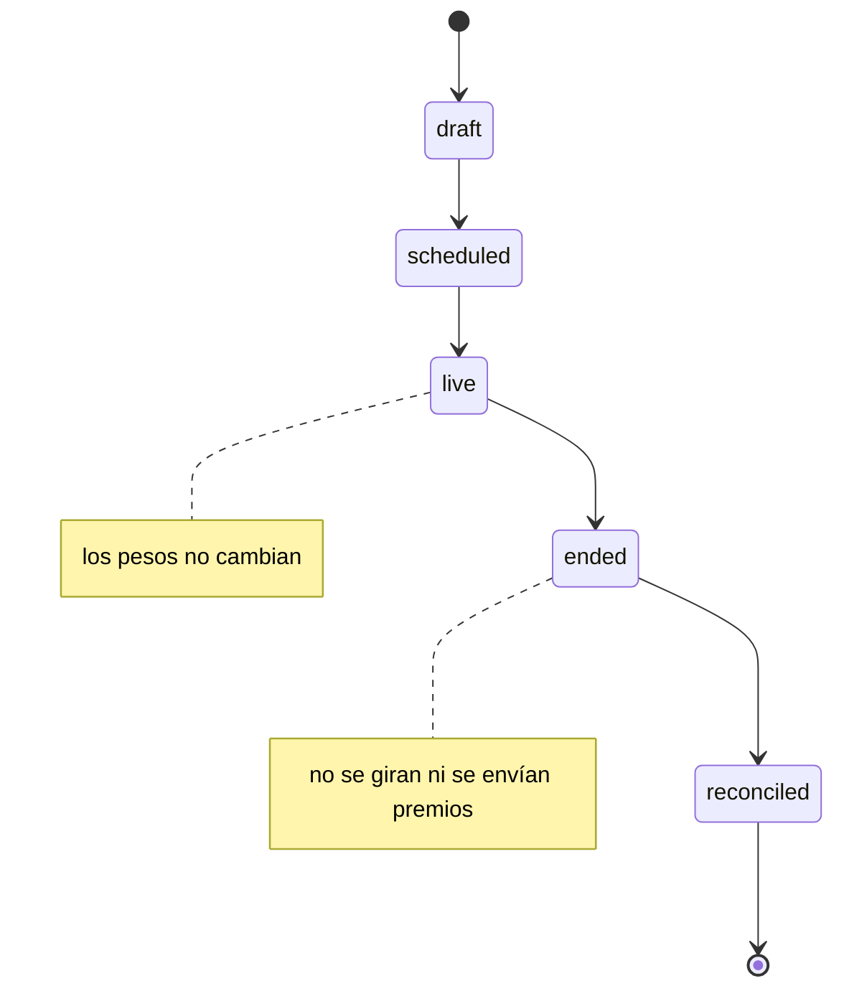

# 🎯 Alcance del proyecto
## Tutorial React 16 — La Esclusa, la consola de Jewel Locks

Documento de encuadre. Define qué es este proyecto, para quién, qué
produce y —tan importante— qué **no** hace. Se lee antes de escribir
cualquier fase.

---

## 1. En una frase

Un tutorial práctico y **autocontenido** de **98 horas** que prepara a
desarrolladores senior para **mantener, depurar y hacer hotfixes** en una
aplicación React 16 heredada — sin reescribirla y sin depender de ningún
sistema, repositorio ni instructor externo.

---

## 2. El problema que resuelve

Heredar un frontend que no escribiste y que evolucionó durante cuatro años
es una habilidad distinta de saber React, y no se entrena leyendo tutoriales
de apps nuevas. Este curso construye deliberadamente un sistema con las
cicatrices de un sistema viejo, para que se pueda practicar sobre ellas.

El sistema es **la Esclusa**, la consola con la que **Interoceanic Games**, un
estudio indie de Ciudad de Panamá, opera las ruedas de premios de **Jewel
Locks**. El estudio, el juego, la consola y el API son **ficticios**, inventados
enteros para este curso. Su historia completa —tres eras de desarrollo, quién
dejó cada cosa y por qué— está en `00-historia-del-sistema.md`. Que sea ficticio
es una ventaja, no una limitación: podemos documentar cada decisión mala con su
fecha y su motivo, cosa que ningún caso de estudio real permite.

Las características que lo hacen difícil, y que son el material del curso:

- Class components pre-16.8 conviviendo con hooks post-16.8.
- Redux Toolkit junto a `connect()` clásico.
- Epics de `redux-observable` con RxJS — la fuente de bugs más difícil.
- Bootstrap 4 + Sass con un mini design system propio.
- Create React App con Webpack oculto.

El estudiante no aprende a *escribir* React idiomático moderno. Aprende a
*leer, entender y arreglar* un producto existente.

---

## 3. Objetivo pedagógico (lo que el estudiante sabrá hacer)

Al terminar, el estudiante puede:

- Leer código legacy mezclado (clases + hooks) sin confundirse.
- Detectar y reproducir bugs en cualquier capa: componente, store, epic, backend.
- Depurar código productivo, incluso minificado, con source maps (`A13`).
- Comparar ambientes (desarrollo, UAT, producción) y explicar por qué algo "funciona en UAT pero no en PROD" (`A13`).
- Entender epics de `redux-observable`: cancelación, race conditions, memory leaks.
- Resolver hotfixes con el menor riesgo posible.
- Distinguir una corrección mínima de una refactorización.
- Escribir pruebas de regresión y post-mortems que sirvan.

Lo que **NO** es objetivo: formar arquitectos de React, promover patrones
modernos idealizados, ni migrar el sistema. La modernización aparece solo
como comparación o fase opcional 🔥.

---

## 4. Perfil del estudiante

Se asume un desarrollador **backend o full-stack senior**:

- Domina JavaScript, HTML, CSS, HTTP, JSON, autenticación, APIs REST.
- Puede conocer React moderno, pero no necesariamente class components.
- No domina necesariamente RxJS, Observables ni marble testing.
- Necesita mantener un producto, no reescribirlo.

No se gasta espacio explicando lo que este perfil ya sabe. El salto
conceptual real está en **RxJS/epics** y en **leer código de transición**.

---

## 5. El dominio: ruedas, jugadores y giros

La Esclusa administra **ruedas** de premios: cada rueda tiene **segmentos**, y
cada segmento tiene un premio y un **peso en puntos básicos**. Además maneja
**jugadores** con su saldo de giros y su inventario, **envíos manuales** de
premios desde la consola, **compras** de giros verificadas en Google Play, la
**conciliación** de compras y de probabilidades, y un dashboard.

**Flujo de estados de una rueda:**

**Reglas de negocio (que son también las fuentes de bug):**

- Un giro produce **un solo resultado**, aunque la petición llegue dos veces
  (clave de idempotencia).
- Un premio de **edición limitada** no se entrega por encima de su stock.
- Un envío manual tiene una **ventana de deshacer** de 10 segundos.
- No se gira ni se envía a una rueda `ended`, desde el instante del cierre
  (hora dura + zona horaria).
- Las fechas consideran timezone y cambios de día (medianoche). El proceso corre
  en UTC; la hora de Panamá es solo de presentación.
- Las compras pendientes (pago en efectivo en Google Play) se consultan por
  polling: minutos, y hasta 48 horas en la vida real.
- El polling debe detenerse al cerrar, desmontar o cerrar sesión.
- Los cálculos monetarios se hacen en centavos de dólar, enteros.
- Toda operación relevante conserva trazabilidad: cada giro deja una fila en la
  bitácora, que solo se agrega.

Este dominio se eligió porque cualquiera entiende una rueda de premios (curva de
dominio nula) y porque concentra concurrencia, tiempo, dinero y reactividad en un
espacio que cabe holgado en 98 horas.

---

## 6. Los entregables del curso

El curso son archivos `.md` autocontenidos, sin dependencias externas:

- **Encuadre:** `README.md`, este `00-alcance-del-proyecto.md`,
  `00-historia-del-sistema.md` y `00-convencion-de-git-y-tags.md` (cómo el
  estudiante versiona su código: repos, prefijos de commit y tags de fase, de
  ejercicio y de incidente).
- **12 fases** → `NN-slug.md` (`00-` a `11-`).
- **14 apéndices** de consulta rápida → `AN-slug.md` (`A1-` a `A14-`).
  Cuatro de ellos (A9 entornos, A10 dinero, A11 marbles, A12 deuda) salieron de
  dividir fases que habían crecido de más, y el A13 cubre los objetivos de §3
  sobre source maps y comparación de ambientes, que antes no tenían contenido en
  ninguna fase. El A14 es la estadística para auditar una rueda: la teoría que la
  Fase 8 usa y remite.
- **1 cuaderno de incidentes** → `cuaderno-incidentes.md` (archivo único:
  índice, enunciados, pistas y soluciones).
- **De consulta**, en la raíz: `00-decisiones-y-versiones.md` (versiones,
  `package.json` y `go.mod` de referencia, puertos y las decisiones D1–D37) y
  `00-convencion-de-git-y-tags.md` (ramas, tags y commits).

El track forense **no tiene archivos propios**: vive dentro de la §6 de cada
fase y del cuaderno de incidentes. Los smoke tests y los tests de regresión
tampoco: viven dentro de la Fase 10 y de la solución de cada incidente. Que
no existan como archivos sueltos es deliberado — un artefacto que se lee
lejos del código que explica no se lee.

---

## 7. Lo que está dentro del alcance

- 12 fases (0-11) que suman exactamente 98 horas.
- Track forense integrado en cada fase.
- 21 incidentes con post-mortem (mínimo 4 de RxJS/epics).
- 14 apéndices de consulta rápida (A1–A14).
- Convención de git y tags de progreso, con su recordatorio en el cierre de cada
  fase y apéndice.
- Testing mínimo: unitario (Jest/RTL), epics (marbles), smoke (Playwright/Cypress).
- Setup multiplataforma con workarounds reales (Windows, Linux, macOS Apple Silicon).
- 🔥 **Track BE opcional (be00–be09 y bea-01…bea-11): 86 horas aparte.** Un
  backend real en Go 1.19 contra PostgreSQL 13 que reemplaza al mock del puerto
  3001 sin que el frontend cambie una línea, y que paga las deudas 💸 que las
  fases 2, 5, 7 y 8 declararon y no podían saldar. Su cuaderno tiene 18
  incidentes. **No cuenta en las 98 horas y no es prerrequisito de nada**; se
  puede empezar al terminar la Fase 8. Su encuadre completo está en el README del
  curso (§Track BE) y en `be00`.

---

## 8. Lo que está fuera del alcance

- Reescritura o migración real del sistema.
- React 17/18, React Router 6, RTK moderno o RxJS 7 en el código principal (solo como comparación o fase opcional).
- Pasarela de pago real, BI real, e2e exhaustivo.
- Dependencias de material externo: repositorios de empresa, sistemas bajo
  acuerdo de confidencialidad, instructor o compañeros. El curso se completa
  solo, con lo que hay en este directorio.
- Roles y permisos avanzados, refresh tokens, i18n (a menos que se justifique).
  El refresh token sigue fuera **incluso con el track BE hecho**: el JWT real de
  `be04` expira, el frontend no renueva, y esa fricción se declara como deuda
  viva en vez de tocar el frontend.
- Backend real en el track base. Las fases 0-11 se completan contra el mock, y
  eso no cambia: el backend en Go vive en el track BE opcional (§7).

Si algo interesante aparece fuera de alcance, se registra como **pendiente**
y se recomienda ubicarlo en un apéndice, incidente, fase posterior o
ejercicio 🔥. No se infla la fase actual.

---

## 9. Restricciones de versiones

Todas las versiones están **congeladas y decididas** en
`00-decisiones-y-versiones.md`, que es la fuente de verdad única: el
`package.json` completo, qué instala cada fase, los tres puertos y el porqué
de cada decisión (D1–D13). El track BE opcional añade allí mismo sus decisiones
D14–D38, su `go.mod` y su cuarto puerto, en la §7 de ese archivo; cuatro de ellas
(D30, D32, D33 y D36) rigen también fases del track base.

El resumen, para orientarse: Node 14.21.3 con npm 6 · React 16.14.0 ·
react-scripts 4.0.3 · Redux 4.1.2 · Redux Toolkit 1.8.6 · React-Redux 7.2.9 ·
redux-observable 1.2.0 · RxJS 6.6.7 · React Router 5.3.4 · axios 0.21.4 ·
Bootstrap 4.6.2 · sass 1.32.5 · json-server 0.16.3 · chart.js 2.9.4 · Jest 26
y RTL 11 (los que trae CRA 4) · rxjs-marbles 6.0.1 · Cypress 10.11.0.

Ninguna versión queda "pendiente de confirmar". Si una fase necesita algo que
no está en esa lista, la decisión se toma y se registra allá antes de
escribir el código — nunca se difiere.

---

## 10. Criterios de éxito del proyecto

El tutorial funciona si un estudiante que lo completa puede:

1. Clonar el repo, levantar el ambiente (en su plataforma) y correr la app.
2. Recibir un ticket, reproducir el bug y localizar la capa responsable.
3. Escribir el post-mortem y el test de regresión antes del fix.
4. Aplicar el hotfix mínimo sin romper nada más.
5. Explicar por qué un epic tenía un memory leak y cómo lo corrigió.

Si el estudiante sale sabiendo *arreglar sin miedo*, el proyecto cumplió.
