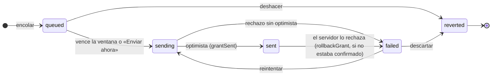

# ⚡ Fase 05 — Envíos manuales: concurrencia y UI optimista

> Tutorial React 16 — La Esclusa, la consola de Jewel Locks · Fase 5 de 11 · **12 horas**
> Depende de: Fase 4 — Ruedas CRUD · Habilita: Fase 6 — redux-observable a fondo

---

## 🎯 1. Propósito

La noche de la Esclusa de Oro, el feed de la consola se congeló a las 7:20 y Yariela se quedó sola en soporte, compensando jugadores a ciegas (`00-historia-del-sistema.md` §3, *Hoy*). A la mañana siguiente, el ticket que dejó es corto: *"a Juan lo compensé una vez; en el juego tiene dos"*.

Esta es la fase donde la consola **manda premios**. Un operador compensa a un jugador, o a una lista entera de afectados por una caída, desde la misma pantalla. Cada envío pasa por el servidor, tarda, y puede fallar; mientras tanto, la pantalla tiene que responder: el envío aparece ya en la lista, con su estado, con diez segundos para deshacerlo, y se pinta como enviado antes de que el servidor conteste.

Esa combinación es la fuente de los bugs más caros del sistema: un envío que sale dos veces, un envío confirmado que vuelve a "falló", un tablero de miles de filas que se pinta lento. Cada uno tiene una causa distinta, y los tres se entienden con las mismas herramientas: una **máquina de estados** por envío, con sus transiciones escritas en un solo lugar; una **guarda de origen** antes de cada transición; y Redux DevTools leyendo la secuencia de acciones como un extracto bancario.

---

## ✅ 2. Qué queda listo al terminar

- [ ] `grantSlice` con la máquina de estados de un envío (`queued → sending → sent | failed → reverted`), con las transiciones permitidas declaradas en una tabla (`ALLOWED_TRANSITIONS`).
- [ ] La **ventana de deshacer** de 10 s con `setTimeout` honesto: `openUndoWindow`, `closeUndoWindow` y `expireUndoWindow`, con los temporizadores **fuera** del store.
- [ ] El **envío optimista**: `grantSent` pinta el envío como enviado antes de que el servidor conteste, y `rollbackGrant` lo pasa a `failed` si el servidor lo rechaza; lo que el servidor confirmó no se revierte.
- [ ] La **guarda de origen** en el `condition` de `sendGrant`: solo sale lo que está en cola o falló.
- [ ] `GrantWizard` (hooks): compensar a un jugador o a una lista de afectados, con caso, premio y motivo obligatorio; los jugadores salen del API.
- [ ] `GrantList`: lo que se puede hacer con cada envío según su estado (enviar ahora, deshacer, reintentar, descartar), y «Enviar todos ahora».
- [ ] `GrantsPage` enrutada en `/grants`, con su entrada en el navbar.
- [ ] La ruta de envíos del mock, `POST /players/:id/grants`: `422` sin motivo, `404` si el jugador no existe, `409` si el caso ya se compensó para ese jugador.
- [ ] `toReadableError` con un tipo nuevo, `'conflict'`, para los `409`.
- [ ] El tablero del envío masivo (`GrantBoard`, 10.000 filas) con su render medido, sin y con `React.memo`.

---

## 🚫 3. Qué queda fuera por ahora

- **Los epics** → Fase 6. La ventana de deshacer con `setTimeout` se jubila con un epic (`undoWindowEpic`), y el doble clic se resuelve en el origen con `exhaustMap` (`sendGrantEpic`). Acá se sufre primero la versión sin epics, a propósito.
- **Los reintentos automáticos** → Fase 6 (`retryGrantEpic`). Acá reintentar es un botón.
- **La unicidad garantizada por el servidor** (que el mismo caso no se pueda registrar dos veces, ni con dos pedidos en el mismo milisegundo) → track BE. El mock hace el chequeo al estilo de 2019, en pasos separados, y esa ventana es parte de la lección.
- **Que la cola sobreviva a recargar la página** → no entra. Los envíos en cola viven en el store y sus temporizadores en memoria; un F5 los pierde (ejercicio 🔥).
- **El polling de compras y el cierre de la rueda a hora exacta** → Fase 7. Acá el envío no depende del reloj, salvo por su ventana.
- **El dinero** → Fase 8. Un envío manual no tiene precio: los premios de la consola no tienen valor en dinero (`00-historia-del-sistema.md` §9).

---

## 🧠 4. Conceptos mínimos

### Por qué un envío es un problema distinto al CRUD

El CRUD de la Fase 4 tenía una propiedad cómoda que no valoras hasta que la pierdes: **las operaciones eran independientes.** Crear la rueda A no compite con crear la rueda B; cada thunk vivía en su burbuja. Un envío rompe eso. Lo que está en disputa —la compensación del caso `C-2210` para Juan— es **una sola**. Dos envíos del mismo caso para el mismo jugador no son independientes: son rivales. Uno tiene que ganar y el otro tiene que perder de forma limpia, y el store no puede quedar mintiendo que los dos ganaron.

Esto es, con nombre y apellido, **contención sobre un recurso único**. Un caso de soporte es un asiento de avión o una entrada de concierto: hay uno solo y lo pueden pedir dos clics, dos pestañas o dos operadores. La regla del dominio —"un caso se compensa una vez por jugador"— es una restricción de unicidad, y hacerla cumplir desde un frontend contra un backend que también puede fallar es, sin dramatizar, de lo más difícil que vas a mantener en este sistema.

### La máquina de estados de un envío

Cada envío vive una máquina de estados chica pero estricta:



- **`queued`**: el envío existe en la consola y todavía no salió. Corre su ventana de deshacer.
- **`sending`**: el envío salió del store hacia el servidor. Dura un instante, porque el optimista lo pinta enseguida.
- **`sent`**: el operador lo ve enviado. Con `confirmed: false` es una promesa; con `confirmed: true`, el servidor ya lo registró, y desde ahí nada lo revierte.
- **`failed`**: el servidor lo rechazó, o no contestó. Se puede reintentar o descartar.
- **`reverted`**: deshecho o descartado. Estado terminal.

Las transiciones ilegales son la mitad del trabajo. No se manda lo que ya salió, no se deshace lo que ya salió, y `reverted` no vuelve a ningún lado. Un reducer que no chequea el estado de **origen** antes de transicionar es un reducer que permite mandar dos veces. Vuelve a esa frase cada vez que escribas un `case`; es literalmente el bug que esta fase existe para prevenir.

### La ventana de deshacer sin epics: el `setTimeout` honesto

El envío necesita **salir solo** pasados diez segundos, sin que nadie haga clic en nada, y tiene que poder cancelarse mientras tanto. Eso es una acción diferida en el tiempo y cancelable, y la forma canónica de resolverla en este stack es un epic de RxJS con `timer`. **No lo vamos a hacer así acá** —es Fase 6— y no por capricho: quiero que sufras primero la versión con `setTimeout`, para que cuando llegue el epic entiendas *exactamente qué problema te está resolviendo.*

La versión de esta fase: al encolar, `openUndoWindow` arranca un `setTimeout` que, al vencer, despacha `expireUndoWindow`, y eso manda el envío. Simple. Y con tres trampas que vas a pisar, porque son justo las que el epic resuelve gratis:

1. **Si el envío sale antes ("Enviar ahora"), hay que cancelar el temporizador.** Un `setTimeout` que sigue vivo después del envío va a disparar un segundo envío sobre algo que ya salió. Si el thunk no se protege, el jugador recibe dos premios. 💸
2. **Encolar dos veces el mismo envío pisa el temporizador del primero.** El `Map` guarda un id por envío; si se escribe dos veces, el primer `setTimeout` queda huérfano: sigue corriendo y nadie lo puede cancelar.
3. **El temporizador no sabe de pantallas.** Si el operador cambia de pantalla, el envío sale igual: es lo que se quiere, y por eso el temporizador vive en el thunk y no en un componente. Pero si cierra sesión, también sale. Esa es la trampa que la Fase 6 cierra con `takeUntil`.

Guardamos los ids de los temporizadores **fuera** del store (en un `Map` a nivel de módulo, porque un id de `setTimeout` no es serializable y no va en Redux 💸) y los cancelamos en cada transición que corresponda. Cuando en Fase 6 reemplaces todo esto por un epic, vas a entender en el cuerpo por qué existe `takeUntil`.

### Optimistic update y rollback: mentir rápido, corregir a tiempo

Un envío que se queda esperando la respuesta del servidor antes de pintarse se siente lento y roto, y con cientos de compensaciones por noche nadie quiere esperar el ida y vuelta de cada una. La técnica estándar es **optimista**: pintas `sent` de inmediato, asumiendo que va a salir bien, y mandas la petición en paralelo. Si el servidor confirma, no cambias nada visible —ya estaba pintado— y anotas que está confirmado. Si el servidor **rechaza** (un `503`, o un `409` porque ese caso ya se compensó), tienes que **revertir**: el envío pasa a `failed`, con el mensaje del servidor.

El rollback es la parte que todo el mundo olvida, y por la que aparecen los bugs "fantasma": la fila queda `sent` en la consola pero el servidor nunca registró nada. Y tiene su propia trampa, que es la de esta fase: **el rollback tiene que revertir este envío, y solo si nadie lo confirmó**. Un rollback que busca "el envío de este caso" en vez de "este envío", o que revierte sin preguntar si el servidor ya lo había confirmado, deshace el trabajo de otro. Por eso `rollbackGrant` busca por id y respeta `confirmed`.

> 📝 **De dónde viene esto en este sistema.** El envío optimista es de 2020, de Fiorella: *"la fila se marca como enviada al instante y se revierte si el servidor protesta"* (`00-historia-del-sistema.md` §3, era 2). Funciona casi siempre, y el "casi" es esta fase. No fue una mala decisión: fue la correcta con un caso límite mal cerrado.

### La forma del error legible se hereda, con un tipo nuevo

La Fase 4 fijó que el store nunca guarda el error crudo de axios, sino un objeto `{ message, type }` que arma `toReadableError`. Esta fase **reutiliza esa misma forma** y le suma un tipo: **`'conflict'`**, para cuando el backend responde `409` porque lo que mandas choca con lo que ya registró. Ese tipo es el que le permite a la lista decir "ese caso ya fue compensado para este jugador" en vez del genérico "ocurrió un error". Un tipo nuevo, mismo esquema: no inventamos otra forma.

> 📝 **El 401, igual que en Fase 4.** El interceptor global de `apiClient` (Fase 3) sigue cerrando la sesión ante cualquier 401. El slice de envíos **no** maneja 401: del 401 se encarga la capa de transporte, en un solo lugar.

### Convivencia class/hooks

La Fase 4 dejó `WheelTable` en clase y `WheelForm` en hooks. Esta fase es toda **funcional con hooks**: el asistente, la lista y el tablero se benefician de `useSelector`, `useCallback` y `React.memo` de una forma que en clase sería más verbosa. No fuerzo una clase donde no aporta. La regla del curso no es "usa clases siempre", es "sabe leer y escribir ambas". Acá tocó hooks por mérito propio.

---

## 💻 5. Implementación y código comentado

Trabajamos en `src/features/grants/`, con una ruta nueva en el mock y un tipo nuevo en el error legible. Esta fase no instala nada.

### 5.1 La ruta de envíos del mock — `mock/server.js`

El mock registra cada envío en la colección `grants` de `db.json`, que arranca vacía. La ruta es propia, como el giro de la Fase 3, porque tiene reglas: el motivo es obligatorio (`00-historia-del-sistema.md` §9), el jugador tiene que existir, y un caso se compensa una vez por jugador.

```javascript
const GRANT_DELIVERY_MS = Number(process.env.GRANT_DELIVERY_MS || 800); // lo que tarda el juego en entregar un premio
```

```javascript
// Envío manual (F05): registra la compensación de un jugador. Como el giro, sigue el estilo
// del API de 2019: comprueba, entrega el premio en el juego y recién después anota. Dos
// pedidos del mismo caso que llegan dentro de esa demora pasan los dos.
async function registerGrant(req, res) {
  const playerId = Number(req.params.id);
  const { grantId, caseId, prize, reason } = req.body || {};
  if (!reason || !String(reason).trim()) return res.status(422).json({ error: "El motivo es obligatorio." });
  if (!db.get("players").find({ id: playerId }).value()) return res.status(404).json({ error: `No existe el jugador ${playerId}.` });

  const already = db.get("grants").find({ playerId, caseId }).value(); // 1) comprobar
  if (already) return res.status(409).json({ error: "Ese caso ya fue compensado para este jugador." });
  await new Promise((resolve) => setTimeout(resolve, GRANT_DELIVERY_MS)); // 2) entregar en el juego

  const grant = { id: grantId, playerId, caseId, prize, reason, createdAt: new Date().toISOString() };
  db.get("grants").push(grant).write(); // 3) anotar
  return res.status(201).json(grant);
}
```

```javascript
server.post("/players/:id/grants", (req, res) => {
  registerGrant(req, res).catch((err) => res.status(500).json({ error: String(err.message) }));
});
```

Fíjate en el orden de `registerGrant`: **comprueba, entrega y recién después anota**. Es el estilo del API de 2019, el mismo del giro: entre el chequeo y la escritura pasan `GRANT_DELIVERY_MS` (800 ms por defecto), y dos pedidos del mismo caso que caen dentro de esa ventana pasan los dos. Un pedido que llega después ve el registro del primero y se lleva un `409`. El servidor se defiende bien de lo lento y mal de lo simultáneo, y esa es la mitad del incidente 11.

### 5.2 El error legible, con conflicto — `src/api/readableError.js`

```javascript
/**
 * Normaliza cualquier error de axios a un objeto legible y serializable.
 * El store nunca guarda el error crudo de axios (no es serializable y RTK
 * protesta). La UI decide qué mostrar según `type`.
 * Las keys van en inglés (message, type); el valor de message va en español
 * porque lo lee el operador.
 * @param {unknown} error - lo que rechazó axios
 * @returns {{ message: string, type: string }}
 */
export function toReadableError(error) {
  // Timeout: axios aborta y no hay response. Es el ECONNABORTED de Fase 3.
  if (error.code === "ECONNABORTED") {
    return { message: "El servidor tardó demasiado. Reintenta.", type: "timeout" };
  }
  // Error HTTP con respuesta. El 401 no llega acá como caso propio:
  // el interceptor global de Fase 3 ya cerró la sesión.
  if (error.response) {
    const { status, data } = error.response;
    if (status >= 500) {
      return { message: "El servidor tuvo un problema. Intenta de nuevo.", type: "http" };
    }
    // Fase 5: un 409 es un conflicto con lo que el servidor ya tiene (un caso ya compensado,
    // una rueda en vivo). Tipo propio, mismo esquema: la UI puede decir qué pasó.
    if (status === 409) {
      return { message: (data && data.error) || "Ese cambio choca con lo que ya registró el servidor.", type: "conflict" };
    }
    // Los otros 4xx del mock traen la regla que se rompió, en español: se muestra tal cual.
    return { message: (data && data.error) || `El servidor respondió ${status}.`, type: "http" };
  }
  // Malformado u otro: lo lanzamos nosotros desde el thunk con un Error normal.
  return { message: error.message || "Ocurrió un error inesperado.", type: "unknown" };
}
```

La rueda en vivo de la Fase 4 también responde `409`, así que su mensaje pasa a llegar con `type: 'conflict'`. El mensaje que ve el operador no cambia: es el del servidor.

### 5.3 El slice con su máquina de estados — `src/features/grants/grantSlice.js`

```javascript
import { createSlice, createAsyncThunk } from "@reduxjs/toolkit";
import apiClient from "../../api/apiClient";
import { toReadableError } from "../../api/readableError";

// Diez segundos entre el clic y el envío real: dentro de la ventana, deshacer es gratis.
export const UNDO_WINDOW_MS = 10000;

// Las transiciones permitidas de un envío, en un solo lugar. Lo que no está acá, no pasa.
// sent → failed existe solo para el rollback de un envío optimista que el servidor rechazó.
export const ALLOWED_TRANSITIONS = {
  queued: ["sending", "reverted"],
  sending: ["sent", "failed"],
  sent: ["failed"],
  failed: ["sending", "reverted"],
  reverted: [],
};

/**
 * Cambia el estado de un envío solo si la transición está permitida.
 * @returns {boolean} true si cambió
 */
function transition(grant, next) {
  if (!grant || !ALLOWED_TRANSITIONS[grant.status].includes(next)) return false;
  grant.status = next;
  return true;
}

// --- La ventana de deshacer, con setTimeout honesto ---
// Los ids de los temporizadores viven FUERA del store: un id de setTimeout no es
// serializable y no va en Redux 💸. La Fase 6 jubila todo esto con un epic.
const undoTimers = new Map();
let nextGrantNumber = 1;

export const openUndoWindow = (grantId) => (dispatch) => {
  undoTimers.set(grantId, setTimeout(() => dispatch(expireUndoWindow(grantId)), UNDO_WINDOW_MS));
};

export function closeUndoWindow(grantId) {
  clearTimeout(undoTimers.get(grantId));
  undoTimers.delete(grantId);
}

// Pasados los 10 s sin deshacer, el envío sale solo.
export const expireUndoWindow = (grantId) => (dispatch) => {
  undoTimers.delete(grantId);
  dispatch(sendGrant(grantId));
};

// --- Thunks ---

/**
 * Encola una compensación para un jugador y abre su ventana de deshacer.
 * Un envío masivo es esto mismo, una vez por cada jugador de la lista de afectados.
 */
export const queueGrant = ({ player, caseId, prize, reason }) => (dispatch) => {
  const grant = {
    id: `g-${nextGrantNumber++}`,
    playerId: player.id,
    playerName: player.name,
    caseId,
    prize,
    reason,
    status: "queued",
    confirmed: false, // true cuando el servidor respondió 201: desde ahí, nada lo revierte
    error: null,
  };
  dispatch(grantQueued(grant));
  dispatch(openUndoWindow(grant.id));
  return grant;
};

// Deshacer dentro de la ventana: el temporizador se cancela y el envío nunca sale.
export const undoGrant = (grantId) => (dispatch) => {
  closeUndoWindow(grantId);
  dispatch(grantReverted(grantId));
};

export const sendGrant = createAsyncThunk(
  "grants/send",
  async (grantId, { dispatch, getState, rejectWithValue }) => {
    closeUndoWindow(grantId); // «Enviar ahora» no espera a que venza la ventana
    // Optimista: el operador ve «Enviado» ya, antes de que el servidor conteste.
    dispatch(grantSent({ grantId }));
    const grant = getState().grants.byId[grantId];
    try {
      const { data } = await apiClient.post(`/players/${grant.playerId}/grants`, {
        grantId,
        caseId: grant.caseId,
        prize: grant.prize,
        reason: grant.reason,
      });
      return data;
    } catch (error) {
      const readable = toReadableError(error);
      // Rollback: se deshace la mentira optimista de ESTE envío.
      dispatch(rollbackGrant({ grantId, caseId: grant.caseId, playerId: grant.playerId, error: readable }));
      return rejectWithValue(readable);
    }
  },
  {
    // Guarda de origen: solo se envía lo que está en cola o falló. Un segundo clic
    // sobre un envío que ya salió no llega ni a crear la petición.
    condition: (grantId, { getState }) => {
      const grant = getState().grants.byId[grantId];
      return Boolean(grant) && (grant.status === "queued" || grant.status === "failed");
    },
  }
);

// «Enviar todos ahora»: lo que sigue en cola sale sin esperar su ventana.
export const sendAllQueued = () => (dispatch, getState) => {
  const { order, byId } = getState().grants;
  const queued = order.filter((id) => byId[id].status === "queued");
  return Promise.all(queued.map((id) => dispatch(sendGrant(id))));
};

const grantSlice = createSlice({
  name: "grants",
  initialState: { byId: {}, order: [] },
  reducers: {
    grantQueued(state, action) {
      const grant = action.payload;
      state.byId[grant.id] = grant;
      state.order.push(grant.id);
    },
    grantReverted(state, action) {
      transition(state.byId[action.payload], "reverted");
    },
    grantSent(state, action) {
      // Solo desde sending: el optimista no pinta encima de otra cosa.
      transition(state.byId[action.payload.grantId], "sent");
    },
    rollbackGrant(state, action) {
      const { grantId, error } = action.payload;
      const grant = state.byId[grantId]; // por id: el rollback es de este envío, no del caso
      if (!grant || grant.confirmed) return; // lo que el servidor confirmó no se revierte
      if (transition(grant, "failed")) grant.error = error;
    },
    discardGrant(state, action) {
      transition(state.byId[action.payload], "reverted");
    },
  },
  extraReducers: (builder) => {
    builder
      .addCase(sendGrant.pending, (state, action) => {
        const grant = state.byId[action.meta.arg];
        if (transition(grant, "sending")) grant.error = null;
      })
      .addCase(sendGrant.fulfilled, (state, action) => {
        const grant = state.byId[action.meta.arg];
        if (grant) grant.confirmed = true;
      });
  },
});

export const { grantQueued, grantReverted, grantSent, rollbackGrant, discardGrant } = grantSlice.actions;

export const selectGrants = (state) => state.grants.order.map((id) => state.grants.byId[id]);

/**
 * La etiqueta que ve el operador (español) para el estado interno (inglés).
 * @param {{ status: string, confirmed: boolean }} grant
 */
export function grantStatusLabel(grant) {
  switch (grant.status) {
    case "queued":
      return "En cola (se puede deshacer)";
    case "sending":
      return "Enviando…";
    case "sent":
      return grant.confirmed ? "Enviado" : "Enviado (sin confirmar)";
    case "failed":
      return "Falló";
    case "reverted":
      return "Deshecho";
    default:
      return grant.status;
  }
}

export default grantSlice.reducer;
```

> **Detalles con intención.**
> - `ALLOWED_TRANSITIONS` y `transition` son la máquina de estados entera. Ningún reducer asigna `status` a mano: todos piden la transición, y la tabla dice si se puede.
> - La guarda de origen está en el `condition` del thunk, **antes** de que exista la petición. Si el envío ya salió, `sendGrant` ni despacha `pending`: no hay nada que deshacer porque no pasó nada.
> - `grantSent` se despacha dentro del thunk, inmediatamente después de `pending`: es el optimista. `sendGrant.fulfilled` no cambia el estado: anota `confirmed`, y la etiqueta pasa de "Enviado (sin confirmar)" a "Enviado".
> - `rollbackGrant` lleva el `grantId` **y** el caso y el jugador. El reducer usa el id; los otros dos viajan para que DevTools muestre de qué caso se trata. La tentación de usarlos para buscar es el incidente 12.
> - `queueGrant`, `undoGrant` y `expireUndoWindow` son thunks de función, no `createAsyncThunk`: no hablan con la red, solo coordinan el temporizador y el store.

Registra el reducer en el store:

```javascript
export const store = configureStore({
  reducer: {
    auth: authReducer,
    wheels: wheelReducer, // Fase 4
    grants: grantReducer, // ← nuevo en Fase 5
  },
});
```

### 5.4 El asistente — `src/features/grants/GrantWizard.jsx`

```jsx
import React, { useEffect, useState } from "react";
import { useDispatch } from "react-redux";
import apiClient from "../../api/apiClient";
import { toReadableError } from "../../api/readableError";
import { queueGrant } from "./grantSlice";

// Los premios que la consola puede mandar a mano (historia §9: vidas, avatares, sets de gemas).
const PRIZES = [
  { value: "vidas-5", label: "5 vidas" },
  { value: "vidas-2", label: "2 vidas" },
  { value: "avatar-comun", label: "Avatar común" },
  { value: "set-gemas-basico", label: "Set de gemas básico" },
];

// Asistente de envío: elige a quién (uno o una lista de afectados), el caso, el premio
// y el motivo, y encola un envío por jugador. Funcional con hooks, como el formulario de Fase 4.
function GrantWizard() {
  const dispatch = useDispatch();
  const [players, setPlayers] = useState([]);
  const [loadError, setLoadError] = useState(null);
  const [selected, setSelected] = useState([]); // ids de los jugadores marcados
  const [caseId, setCaseId] = useState("");
  const [prize, setPrize] = useState(PRIZES[0].value);
  const [reason, setReason] = useState("");

  useEffect(() => {
    // Los jugadores salen del API. La pantalla de Jugadores de la Fase 1 sigue con sus
    // datos de demo: esa deuda 💸 queda declarada en A12.
    apiClient
      .get("/players")
      .then((res) => setPlayers(res.data))
      .catch((error) => setLoadError(toReadableError(error).message));
  }, []);

  const toggle = (id) => {
    setSelected((prev) => (prev.includes(id) ? prev.filter((x) => x !== id) : [...prev, id]));
  };

  const handleSubmit = (e) => {
    e.preventDefault();
    if (selected.length === 0 || !reason.trim()) return; // el motivo es obligatorio (historia §9)
    players
      .filter((player) => selected.includes(player.id))
      .forEach((player) => dispatch(queueGrant({ player, caseId: caseId.trim(), prize, reason: reason.trim() })));
    // El formulario no se limpia: el operador suele mandar el mismo caso a otra lista.
  };

  if (loadError) return <div className="alert alert-danger">{loadError}</div>;

  return (
    <form onSubmit={handleSubmit} className="card card-body mb-4">
      <h5>Compensar</h5>
      <fieldset className="form-group">
        <legend className="col-form-label pt-0">Jugadores ({selected.length} marcados)</legend>
        {players.map((player) => (
          <div key={player.id} className="form-check">
            <input
              id={`player-${player.id}`}
              type="checkbox"
              className="form-check-input"
              checked={selected.includes(player.id)}
              onChange={() => toggle(player.id)}
            />
            <label htmlFor={`player-${player.id}`} className="form-check-label">
              {player.name} ({player.country})
            </label>
          </div>
        ))}
      </fieldset>
      <div className="form-row">
        <div className="form-group col-md-3">
          <label htmlFor="caseId">Caso</label>
          <input id="caseId" className="form-control" placeholder="C-2210" value={caseId} onChange={(e) => setCaseId(e.target.value)} required />
        </div>
        <div className="form-group col-md-3">
          <label htmlFor="prize">Premio</label>
          <select id="prize" className="form-control" value={prize} onChange={(e) => setPrize(e.target.value)}>
            {PRIZES.map((p) => (
              <option key={p.value} value={p.value}>{p.label}</option>
            ))}
          </select>
        </div>
        <div className="form-group col-md-6">
          <label htmlFor="reason">Motivo</label>
          <input id="reason" className="form-control" placeholder="Caída del 14/10, 8:05 p. m." value={reason} onChange={(e) => setReason(e.target.value)} required />
        </div>
      </div>
      <div>
        <button type="submit" className="btn btn-primary" disabled={selected.length === 0}>
          Compensar
        </button>
      </div>
    </form>
  );
}

export default GrantWizard;
```

Un jugador o una lista de afectados es el mismo flujo: marcar a quién, poner el caso, el premio y el motivo, y encolar. El envío masivo no es otro código: es el mismo `queueGrant` una vez por jugador. Los jugadores salen del API (`GET /players`), y con eso se paga la parte de jugadores de la deuda de la Fase 1; la pantalla *Jugadores* sigue con sus datos de demo, y queda declarada en A12.

### 5.5 La lista — `src/features/grants/GrantList.jsx`

```jsx
import React from "react";
import { useDispatch, useSelector } from "react-redux";
import { selectGrants, sendGrant, undoGrant, discardGrant, sendAllQueued, grantStatusLabel } from "./grantSlice";

// La lista de envíos de la sesión, con lo que se puede hacer según el estado de cada uno.
function GrantList() {
  const dispatch = useDispatch();
  const grants = useSelector(selectGrants);

  if (grants.length === 0) {
    return <div className="alert alert-secondary">Todavía no hay envíos en esta sesión.</div>;
  }

  return (
    <div>
      <button className="btn btn-sm btn-outline-primary mb-2" onClick={() => dispatch(sendAllQueued())}>
        Enviar todos ahora
      </button>
      <table className="table table-sm">
        <thead>
          <tr>
            <th>Envío</th>
            <th>Jugador</th>
            <th>Caso</th>
            <th>Premio</th>
            <th>Estado</th>
            <th className="text-right">Acciones</th>
          </tr>
        </thead>
        <tbody>
          {grants.map((grant) => (
            <tr key={grant.id}>
              <td>{grant.id}</td>
              <td>{grant.playerName}</td>
              <td>{grant.caseId}</td>
              <td>{grant.prize}</td>
              <td>
                {grantStatusLabel(grant)}
                {grant.error && <div className="small text-danger">{grant.error.message}</div>}
              </td>
              <td className="text-right">
                {/* «Enviar ahora» sigue a mano hasta que el servidor confirma: si el envío
                    se cuelga, el operador puede insistir. La guarda la pone el thunk. */}
                {(grant.status === "queued" || !grant.confirmed) && grant.status !== "reverted" && grant.status !== "failed" && (
                  <button className="btn btn-sm btn-outline-primary mr-2" onClick={() => dispatch(sendGrant(grant.id))}>
                    Enviar ahora
                  </button>
                )}
                {grant.status === "queued" && (
                  <button className="btn btn-sm btn-outline-secondary" onClick={() => dispatch(undoGrant(grant.id))}>
                    Deshacer
                  </button>
                )}
                {grant.status === "failed" && (
                  <>
                    <button className="btn btn-sm btn-outline-primary mr-2" onClick={() => dispatch(sendGrant(grant.id))}>
                      Reintentar
                    </button>
                    <button className="btn btn-sm btn-outline-secondary" onClick={() => dispatch(discardGrant(grant.id))}>
                      Descartar
                    </button>
                  </>
                )}
              </td>
            </tr>
          ))}
        </tbody>
      </table>
    </div>
  );
}

export default GrantList;
```

«Enviar ahora» sigue a mano mientras el envío no está confirmado. Es una decisión de producto de la época —si un envío parece colgado, el operador puede insistir— y es la puerta por la que entra el doble clic. La protección no está en el botón: está en la guarda del thunk.

### 5.6 La página, la ruta y el navbar

```jsx
import React from "react";
import { Link } from "react-router-dom";
import GrantWizard from "./GrantWizard";
import GrantList from "./GrantList";

function GrantsPage() {
  return (
    <div className="container mt-4">
      <h2 className="mb-4">Envíos manuales</h2>
      <p className="text-muted">
        Cada envío espera 10 s antes de salir. <Link to="/grants/board">Previsualizar un envío masivo grande</Link>.
      </p>
      <GrantWizard />
      <GrantList />
    </div>
  );
}

export default GrantsPage;
```

En `src/AppRouter.jsx` se suman dos rutas. `/grants/board` va **antes** que `/grants`, con `exact`: si no, `/grants` la tapa (es el mismo orden que aprendiste en la Fase 1).

```jsx
import React from "react";
import { Router, Switch, Route, Redirect } from "react-router-dom";
import { history } from "./app/history";
import AppLayout from "./components/AppLayout";
import PrivateRoute from "./components/PrivateRoute";
import LoginPage from "./pages/LoginPage";
import WheelsPage from "./features/wheels/WheelsPage";
import GrantsPage from "./features/grants/GrantsPage";
import GrantBoard from "./features/grants/GrantBoard";
import WheelDetailPage from "./pages/WheelDetailPage";
import PlayersPage from "./pages/PlayersPage";
import SpinLogPage from "./pages/SpinLogPage";
import DashboardPage from "./pages/DashboardPage";
import NotFoundPage from "./pages/NotFoundPage";

function AppRouter() {
  return (
    <Router history={history}>
      <AppLayout>
        <Switch>
          {/* pública: sin esto, loop de redirección infinito */}
          <Route path="/login" component={LoginPage} />

          {/* protegidas: eran <Route> en Fase 1, ahora <PrivateRoute> */}
          <PrivateRoute exact path="/wheels" component={WheelsPage} />
          <PrivateRoute path="/wheels/:id" component={WheelDetailPage} />
          <PrivateRoute exact path="/grants/board" component={GrantBoard} />
          <PrivateRoute path="/grants" component={GrantsPage} />
          <PrivateRoute path="/players" component={PlayersPage} />
          <PrivateRoute path="/spin-log" component={SpinLogPage} />
          <PrivateRoute path="/dashboard" component={DashboardPage} />

          <Route exact path="/">
            <Redirect to="/wheels" />
          </Route>
          <Route component={NotFoundPage} />
        </Switch>
      </AppLayout>
    </Router>
  );
}

export default AppRouter;
```

Y el navbar gana su entrada, "Envíos":

```jsx
import React from "react";
import { NavLink, useHistory } from "react-router-dom";
import { useSelector, useDispatch } from "react-redux";
import { selectCurrentUser, logout } from "../features/auth/authSlice";

// Funcional: lee la sesión del store y despacha logout. No habla con axios.
// Los textos visibles van en español; las rutas (URLs) en inglés.
function Navbar() {
  const user = useSelector(selectCurrentUser);
  const dispatch = useDispatch();
  const history = useHistory();

  function handleLogout() {
    dispatch(logout()); // limpia el store → la próxima request sale sin token
    history.push("/login");
  }

  return (
    <nav className="navbar navbar-expand navbar-dark bg-dark">
      <NavLink className="navbar-brand" to="/wheels">
        🎡 Esclusa
      </NavLink>
      <div className="navbar-nav">
        <NavLink className="nav-item nav-link" to="/wheels">
          Ruedas
        </NavLink>
        <NavLink className="nav-item nav-link" to="/grants">
          Envíos
        </NavLink>
        <NavLink className="nav-item nav-link" to="/players">
          Jugadores
        </NavLink>
        <NavLink className="nav-item nav-link" to="/spin-log">
          Bitácora
        </NavLink>
        <NavLink className="nav-item nav-link" to="/dashboard">
          Dashboard
        </NavLink>
      </div>

      {/* Bloque de sesión: solo aparece con usuario logueado */}
      {user && (
        <div className="navbar-nav ml-auto">
          <span className="navbar-text mr-3">{user.name}</span>
          <button className="btn btn-outline-light btn-sm" onClick={handleLogout}>
            Cerrar sesión
          </button>
        </div>
      )}
    </nav>
  );
}

export default Navbar;
```

### 5.7 El tablero del envío masivo — `src/features/grants/GrantBoard.jsx`

Una caída afecta a miles de jugadores, y antes de compensarlos Yariela revisa la lista: incluye a unos, excluye a otros. Con 10.000 filas, cambiar **una** vuelve a pintar las 10.000, y eso se nota. El tablero conserva ese problema a propósito, y la corrección vive en el mismo archivo para medirla.

```jsx
import React, { memo, useCallback, useLayoutEffect, useRef, useState } from "react";

// Previsualización de un envío masivo: la lista de afectados de una caída, miles de filas,
// cada una con su casilla para incluirla o excluirla antes de compensar.
// ?n=10000 fija las filas; ?memo=1 cambia las filas a React.memo (la corrección del render).
// La medición vive aquí: window.__lastRender guarda los ms desde el clic hasta el DOM listo.

function createRows(n) {
  return Array.from({ length: n }, (_, i) => ({ id: i + 1, playerId: 1000 + i, included: true }));
}

function PlainRow({ row, onToggle }) {
  return (
    <tr>
      <td>{row.id}</td>
      <td>{row.playerId}</td>
      <td>{row.included ? "Incluido" : "Excluido"}</td>
      <td>
        <button onClick={() => onToggle(row.id)}>{row.included ? "Excluir" : "Incluir"}</button>
      </td>
    </tr>
  );
}

const MemoRow = memo(PlainRow);

function GrantBoard() {
  const params = new URLSearchParams(window.location.search);
  const n = Number(params.get("n") || 1000);
  const useMemoRows = params.get("memo") === "1";
  const [rows, setRows] = useState(() => createRows(n));
  const clickedAt = useRef(0);

  // useCallback: la misma función en cada render, para que React.memo no vea una prop nueva.
  const toggle = useCallback((id) => {
    clickedAt.current = performance.now();
    setRows((previous) => previous.map((row) => (row.id === id ? { ...row, included: !row.included } : row)));
  }, []);

  // useLayoutEffect corre después de tocar el DOM y antes de pintar: ahí se cierra la medición.
  useLayoutEffect(() => {
    if (clickedAt.current) {
      window.__lastRender = performance.now() - clickedAt.current;
      clickedAt.current = 0;
    }
  });

  const Row = useMemoRows ? MemoRow : PlainRow;
  return (
    <div>
      <h1 className="h4 mb-3">Envío masivo: {n} afectados</h1>
      <button id="toggle-first" className="btn btn-sm btn-outline-primary mb-2" onClick={() => toggle(1)}>
        Cambiar la fila 1
      </button>
      <table className="table table-sm">
        <thead>
          <tr><th>Fila</th><th>Jugador</th><th>Estado</th><th></th></tr>
        </thead>
        <tbody>
          {rows.map((row) => (
            <Row key={row.id} row={row} onToggle={toggle} />
          ))}
        </tbody>
      </table>
    </div>
  );
}

export default GrantBoard;
```

La corrección son dos piezas que solo funcionan juntas. `React.memo` hace que una fila no se vuelva a pintar si sus props son las mismas; `useCallback` hace que `onToggle` sea **la misma función** en cada render. Sin el segundo, cada render crea un `toggle` nuevo, `React.memo` ve una prop distinta en cada fila, y vuelve a pintar las 10.000 igual.

**La medición de la fase.** Corrida del 14/10/2026 con `cypress/included:10.11.0` (Electron, que es Chromium, headless) contra el servidor de desarrollo de la fase, 10.000 filas, cinco cambios de fila por variante:

| Variante | Cambios (ms) | Media (ms) |
|---|---|---|
| Sin `React.memo` (`?memo=0`) | 256, 247, 221, 222, 229 | 235 |
| Con `React.memo` (`?memo=1`) | 68, 54, 56, 51, 59 | 58 |

La cifra que el curso publica es esa: cuatro veces menos con las filas memorizadas, en un navegador de verdad y no en jsdom. No es comparable con cifras de otro navegador o de otra máquina: el número cambia, la forma de la diferencia no.

### 5.8 Corrección mínima vs refactorización

Un ejemplo concreto de la distinción que el curso repite hasta el cansancio. Supongamos que en producción aparece el doble envío (la trampa 1 de la §4: el temporizador que sigue vivo, o el segundo clic sobre un envío que ya salió).

**Corrección mínima (hotfix):** la guarda de origen en el `condition` de `sendGrant`: solo sale lo que está en `queued` o `failed`. Unas pocas líneas. Impide que un segundo intento llegue a crear la petición. Va a producción hoy, es segura, y no toca la arquitectura.

**Refactorización (con tiempo y pruebas):** mover la ventana a un epic de redux-observable con `timer` y `takeUntil`, y el envío a un epic con `exhaustMap`, que ignora los clics mientras hay un envío en vuelo. Es más correcto —el segundo intento ni siquiera existe— pero toca la arquitectura, necesita RxJS y pruebas con canicas, y es exactamente lo que hace la Fase 6. Y aun así no cierra la mitad del servidor: dos operadores, en dos consolas, en el mismo segundo, solo se frenan con una unicidad garantizada en la base, que es trabajo del track BE.

Saber cuál aplicar según el contexto —30 minutos con producción caída contra un sprint con pruebas— es la habilidad de mantenimiento que esta fase entrena. No hay una respuesta "correcta" universal; hay la correcta para el martes que te toca.

> **Prueba de fuego.** Con `npm run mock:api` arriba y `CHAOS_LEVEL=off`: entra a `/grants`, marca a Juan, caso `C-2210`, motivo "caída", y compensa. Deshaz antes de diez segundos: la fila queda "Deshecho" y en Network no sale nada. Compensa otra vez y espera: a los diez segundos sale solo, "Enviado (sin confirmar)" y al momento "Enviado". Compensa a Juan y a María con el mismo caso y toca «Enviar todos ahora»: el de Juan falla con "Ese caso ya fue compensado para este jugador." y el primero sigue "Enviado". Y en `/grants/board?n=10000&memo=1`, cambiar una fila se siente instantáneo; con `memo=0`, no.

### 💸 Deuda técnica declarada en esta fase

1. **Los temporizadores en un `Map` de módulo.** No son serializables, no se ven en DevTools y sobreviven al logout. Se paga en la Fase 6 con el epic de la ventana.
2. **«Enviar ahora» vivo hasta la confirmación.** La guarda del thunk cubre el doble clic; el `exhaustMap` de la Fase 6 lo cierra en el origen.
3. **El chequeo del caso en el mock no es atómico.** Dos pedidos simultáneos pasan los dos. Es del API heredado; lo paga el track BE con una restricción en la base.
4. **La pantalla *Jugadores* sigue con `demoPlayers`.** El asistente ya lee del API; la pantalla, no. Queda en A12 con su disparador.
5. **La cola no sobrevive a un F5.** Un envío en cola que el operador pierde al recargar no sale nunca, y nadie se entera.

---

## ⚠️ 6. Errores comunes y pieza forense

### Errores comunes

**1. El reducer que no chequea el estado de origen.**
*Síntoma:* un envío sale dos veces, o un envío deshecho sale igual. *Causa:* una transición (`grantSent`, el `pending` de `sendGrant`) que asigna el estado nuevo sin verificar el actual. *Fix mínimo:* la transición pasa por `ALLOWED_TRANSITIONS`, y el thunk tiene su `condition`. Es baratísimo y es la diferencia entre una máquina de estados y un `=` suelto.

**2. El rollback que revierte lo que no es suyo.**
*Síntoma:* un envío que ya figuraba "Enviado" pasa a "Falló" sin que nadie lo toque. *Causa:* el rollback busca el envío por caso (o por jugador) en vez de por id, o revierte sin mirar si el servidor ya lo había confirmado. *Fix:* buscar por id y respetar `confirmed`, como hace `rollbackGrant`.

**3. El temporizador que se queda huérfano.**
*Síntoma:* el operador manda un envío con «Enviar ahora» y a los diez segundos aparece en DevTools un segundo `grants/send` que nadie pidió. *Causa:* el temporizador de la ventana no se canceló, o su id se pisó al encolar dos veces. *Fix mínimo:* `closeUndoWindow` al principio de `sendGrant`, y la guarda de origen como red. *Refactor:* el epic de la Fase 6, que se limpia solo con `takeUntil`.

**4. El optimista sin rollback.**
*Síntoma:* la fila queda "Enviado" pero el servidor nunca registró el envío; al recargar, no está, y el jugador nunca recibió nada. *Causa:* se pinta `sent` optimista pero el `catch` del thunk no revierte. *Fix:* despachar `rollbackGrant` en el `catch`.

### Pieza forense de esta fase — La race de los envíos en el store

Esta es **la** pieza forense de la Fase 5: cómo se manifiesta una race de envíos **en el store**, y cómo cazarla con las herramientas que ya sabes usar desde la Fase 4 —Redux DevTools, time-travel, el panel Diff—. No reintroducimos DevTools; lo llevamos a su terreno natural.

La race canónica: el mismo envío disparado dos veces casi a la vez —un doble clic en «Enviar ahora» mientras el servidor no confirmó, o el clic y el temporizador de la ventana en el mismo segundo—. Sin la guarda de origen, la secuencia en el panel de DevTools se ve así:

```text
grants/send/pending     g-1      ← primer clic: queued → sending
grants/grantSent        g-1      ← el optimista: sending → sent
grants/send/pending     g-1      ← segundo clic: nadie preguntó el origen
grants/grantSent        g-1      ← otra vez "enviado"
grants/send/fulfilled   g-1      ← el servidor registró el primero…
grants/send/fulfilled   g-1      ← …y el segundo: el chequeo del caso no es atómico
```

Dos `fulfilled` para el mismo `grantId`: el jugador recibió dos premios, y la consola muestra **uno**. Eso se ve en el Diff: el segundo `grants/grantSent` no cambia nada visible (ya estaba `sent`), y por eso nadie lo nota en la pantalla. El time-travel te deja pararte justo antes del segundo `pending` y confirmar que, en ese instante, el envío ya había salido. No es magia: es leer la lista de acciones de arriba abajo, entera.

La otra cara es la del rollback. Un envío individual a Juan, confirmado, y un envío masivo que incluye a Juan con el mismo caso: el del masivo recibe un `409` y su rollback, si busca "el envío de Juan en este caso", encuentra el primero y lo pasa a `failed`. En DevTools, el `grants/rollbackGrant` lleva `grantId: "g-7"` en el payload, y el Diff muestra que el que cambió fue `g-1`. **Lo que dice la acción y lo que hace el reducer no coinciden**, y esa es la firma del bug.

Los ejercicios de "rompe a propósito y observa" (23 y 24) te hacen reproducir las dos secuencias, leerlas en DevTools y proponer el blindaje. La solución robusta —cancelar el intento perdedor en el origen— es territorio de epics (Fase 6), y la que cierra la ventana del servidor, del track BE. Acá el objetivo es **verla y nombrarla**, que es el 80 % de resolver un incidente de concurrencia. Un bug que sabes describir es un bug medio muerto.

> 📓 De esta fase salen los incidentes ⭐ **11** y **12** de `cuaderno-incidentes.md`. El 11 es la primera secuencia de arriba, llegando desde soporte con un jugador que tiene dos premios; el 12 es la segunda, con un envío confirmado que vuelve a "falló".

---

## 🧪 7. Ejercicios (28)

**🟢 Fácil (1–8)**

1. Compensa a Juan con el caso `C-1` y deshaz antes de diez segundos. Confirma en la pestaña Network que no salió ninguna petición.
2. Compensa a María y no toques nada. Mide con un reloj cuánto tarda en salir sola y compáralo con `UNDO_WINDOW_MS`.
3. Cambia la ventana a 5 s y verifica a mano (o con una prueba como la del ejercicio 10) que el envío sale solo a los 5 s.
4. En Redux DevTools, sigue un envío completo y anota la secuencia de acciones, desde `grants/grantQueued` hasta `grants/send/fulfilled`.
5. Agrega a la lista una columna con la hora en que se encoló cada envío.
6. Muestra en cada fila en cola cuántos segundos le quedan a su ventana.
7. Intenta compensar sin motivo y mira qué responde el mock (con `curl` o en Network). ¿Qué hace la consola para que eso no pase?
8. Lee `ALLOWED_TRANSITIONS` y dibuja a mano la máquina de estados. Compárala con el diagrama de la §4.

**🟡 Intermedio (9–17)**

9. Agrega un selector `selectGrantCounts` que devuelva cuántos envíos hay en cada estado, y muéstralo arriba de la lista.
10. Escribe una prueba que encole diez envíos, deshaga cinco, y verifique que salen cinco peticiones (con un adapter de axios que las cuente).
11. Haz que «Descartar» pida confirmación antes de pasar el envío a `reverted`.
12. Agrega un filtro por estado a la lista (todos, en cola, fallidos).
13. Con `CHAOS_LEVEL=high`, manda diez envíos y anota cuántos fallan y con qué mensaje. ¿Cuáles son `conflict` y cuáles `http`?
14. Haz que «Reintentar» esté deshabilitado mientras el envío está en `sending`. ¿Hace falta, si el thunk ya tiene su guarda?
15. Agrega al asistente un buscador de jugadores por nombre (filtro local sobre la lista que vino del API).
16. Escribe el JSDoc de `queueGrant`, con la forma de su parámetro.
17. En `GrantBoard`, quita `useCallback` y deja `React.memo`. Mide con el Profiler de React DevTools y explica el resultado.

**🟠 Difícil (18–24)**

18. Haz que encolar dos veces el mismo caso para el mismo jugador, en la misma sesión, se ignore en el store. ¿Dónde va la regla: en `queueGrant`, en el reducer o en el componente? Justifica.
19. Reproduce el temporizador huérfano en una prueba de Jest: despacha `openUndoWindow` dos veces para el mismo envío, espera la ventana y cuenta cuántas peticiones salen. ¿Qué evita que salgan dos?
20. Diagnóstico: un compañero propone poner el `setTimeout` de la ventana dentro de un `useEffect` de `GrantList`. Describe qué se rompe cuando el operador cambia de pantalla.
21. Con el mock arriba, manda con `curl` dos pedidos del mismo caso en el mismo segundo (`&` en la terminal) y otros dos con un segundo de diferencia. Explica las respuestas con el orden de `registerGrant`.
22. Haz que un `409` de tipo `conflict` deje el envío en `reverted` en vez de `failed`, con su mensaje. ¿Qué gana el operador y qué pierde?
23. **Rompe a propósito y observa:** quita el `condition` de `sendGrant`, pon `GRANT_DELIVERY_MS=3000` y haz doble clic en «Enviar ahora». Copia la secuencia de DevTools y cuenta los registros en `GET /grants`. Después restaura la guarda.
24. **Rompe a propósito y observa:** cambia `rollbackGrant` para que busque el envío por caso y jugador. Reproduce el envío individual confirmado y el masivo del mismo caso, y encuentra en el Diff el envío que cambió sin que su id esté en la acción.

**🔴 Muy difícil (25–28)**

25. Escribe una prueba de reducer puro que reproduzca la secuencia del incidente 12 (sin red, sin componentes) y falle si alguien vuelve a buscar por caso en `rollbackGrant`.
26. Diseña cómo sería un envío que sobrevive al cierre de la pestaña: qué guardas, dónde, y qué pasa con la ventana de deshacer al volver.
27. Mide el tablero con 20.000 filas, sin y con `React.memo`, con el mismo arnés de la fase. ¿Crece lineal? ¿Qué parte del tiempo no es de React?
28. Corrección mínima contra refactor: te dan 30 minutos para frenar el doble envío en producción. Escribe el hotfix y, aparte, describe el refactor con epics que harías con un sprint y pruebas. Marca qué queda como 💸 y quién la paga.

**🔥 Opcionales**

- 🔥 Reemplaza el `setTimeout` por una cola de trabajos en el servidor. ¿Qué gana el operador y qué pierde la ventana de deshacer?
- 🔥 Virtualiza el tablero (solo se pintan las filas visibles) sin librerías. Compara con `React.memo` en la misma medición.
- 🔥 Porta `GrantList` a un class component con `connect()` y compáralo línea a línea con la versión de hooks.

---

## 📚 8. Referencias

**Documentación oficial**

- https://redux-toolkit.js.org/api/createAsyncThunk — la opción `condition`, que cancela el thunk antes de `pending`. Fíjate en la versión: el proyecto usa RTK **1.8.x**.
- https://legacy.reactjs.org/docs/react-api.html#reactmemo — `React.memo` en React 16.
- https://legacy.reactjs.org/docs/hooks-reference.html#usecallback — `useCallback`, y por qué una función nueva rompe la memorización.
- https://legacy.reactjs.org/docs/hooks-reference.html#uselayouteffect — `useLayoutEffect`, que corre después de tocar el DOM y antes de pintar.
- https://developer.mozilla.org/es/docs/Web/API/setTimeout — `setTimeout` y `clearTimeout`, y por qué su id no es un dato serializable.
- https://github.com/reduxjs/redux-devtools — Redux DevTools: el panel Diff y el time-travel.

**Lectura de apoyo**

- Martin Fowler, *"Optimistic Offline Lock"*, en *Patterns of Enterprise Application Architecture* (2002) — el mismo problema del lado del servidor: qué hacer cuando dos actores escribieron sobre lo mismo.

**Orden de lectura sugerido:** la máquina de estados de la §4 → `grantSlice.js` en la §5.3 → la opción `condition` en la doc de `createAsyncThunk` → la pieza forense, con Redux DevTools abierto.

> ⚠️ Las URLs, títulos y números de sección pueden haber cambiado o apuntar a versiones más nuevas que las fijadas. Verifica siempre que lo que lees aplique a RTK 1.8 y React 16.14.

---

## 🚀 9. Cierre y conexión con la Fase 6

El operador manda premios con una ventana para deshacer, cada envío tiene su estado y sus transiciones están en una tabla, el envío se pinta antes de que el servidor conteste y se corrige si el servidor protesta, y el tablero de diez mil filas se pinta en una fracción de lo que tardaba. También viste, en DevTools, las dos races que este diseño deja abiertas, y cuál es la corrección mínima de cada una.

La **Fase 6 — redux-observable a fondo** jubila los temporizadores de esta fase. La ventana de deshacer pasa a un epic con `timer` y `takeUntil`, el doble clic se resuelve en el origen con `exhaustMap`, y el envío que sigue saliendo después del logout se corta con un epic que escucha el logout. Lo que esta fase hizo con guardas, la siguiente lo hace con operadores.

> **La señal de que quedó bien:** si un compañero abre la consola, manda un premio, lo deshace dentro de la ventana y ve la lista cambiar; hace doble clic en «Enviar ahora» y en `GET /grants` hay un solo registro; y manda el mismo caso dos veces y el primero sigue "Enviado" —la fase cumplió.

> 🏷️ **No cierres la fase sin el tag.** Con el checklist de la sección 2 en
> verde y `git status` limpio:
>
> ```bash
> git tag -a fase-05-envios-manuales -m "F5 cerrada: <el checklist, en una línea por ítem>"
> ```
>
> Los commits de la fase llevan su prefijo (`f05: …`) y los de ejercicio su
> número (`f05 ej23: …`). Si un ejercicio merece su propio marcador va en
> `ej/f05/23`, y un incidente resuelto en el par `inc/<ID>/<slug>-roto` /
> `-fix`, con el ID que le reserva `cuaderno-incidentes.md`. Todo eso está en
> [`00-convencion-de-git-y-tags.md`](00-convencion-de-git-y-tags.md).

---

## 📌 Pendientes sugeridos

> Material de autoría, no de lectura. Va acá abajo, fuera de la plantilla de nueve
> secciones, porque es lo que apareció al escribir la fase y no cabía adentro — y
> porque no debe competir con el cierre.

- **El tablero del envío masivo es de previsualización**: no está conectado a la cola. → Decidir en la Fase 9 si el dashboard lo reutiliza, o si queda como instrumento de medición.
- **La cola que se pierde con un F5** no tiene disparador escrito. → Agregarlo a A12: el día que un operador pierda un envío al recargar en un evento.

### Reservas para el cuaderno de incidentes

Los IDs quedan reservados en `cuaderno-incidentes.md`, donde el enunciado ya está redactado con sus pistas y su solución de referencia. El ID nunca se reasigna.

- **11** ⭐ — *Compensamos dos veces a la misma jugadora* · Concurrencia · 🔴. Sale de la guarda de origen que falta: el doble clic manda dos veces el mismo envío y el chequeo del caso en el servidor no es atómico.
- **12** — *Un envío que ya estaba enviado volvió a «falló»* · Concurrencia · 🟠. Sale del rollback que busca por caso: el `409` del envío masivo pisa el envío individual ya confirmado.
