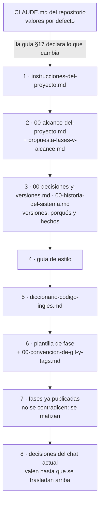

# 🧰 `prompts/` — la maquinaria del curso
## React 16 Legacy — La Esclusa, la consola de Jewel Locks

Este directorio no es material del curso: es **lo que se usó para escribirlo** y lo que hace falta
para tocarlo sin romperlo. No viaja cuando el curso se publica en su propio repositorio. Quien vaya
a editar una fase lo lee entero antes de teclear la primera línea.

> **Estado:** reescrito entero en octubre de 2026, del dominio de Rifas y Chances a la rueda de premios
> de Jewel Locks: 12 fases y 14 apéndices del track base, 10 fases y 11 apéndices del track BE
> opcional, y los dos cuadernos de incidentes (21 y 18). Cada documento se corrió en contenedor contra
> un repo de prueba al escribirse, y lo que solo se ve en un navegador quedó como verificación a mano.
> Los dos verificadores salen en cero. La licencia es CC BY-SA 4.0 (`LICENSE.md`), como la de los cursos hermanos.

---

## 📖 Qué hay aquí, y cuándo se lee

| Documento | Qué es | Cuándo se lee |
|---|---|---|
| [`instrucciones-del-proyecto.md`](instrucciones-del-proyecto.md) | el marco común, condensado para pegar al abrir una sesión | al abrir cualquier sesión |
| [`guia-de-estilo-y-convenciones.md`](guia-de-estilo-y-convenciones.md) | cómo se escribe; checklist en §14, track BE en §16, excepciones, Mermaid y la reescritura en §17 | en cada sesión, siempre |
| [`../00-decisiones-y-versiones.md`](../00-decisiones-y-versiones.md) | **publicado**, en la raíz del curso: las versiones congeladas y las decisiones D1–D38 con su porqué | cada vez que aparece una versión, un puerto o una `Dnn` |
| [`../00-historia-del-sistema.md`](../00-historia-del-sistema.md) | **publicado**: los hechos, las reglas, las cifras y la gente de la ficción | antes de escribir cualquier escena o cifra del dominio |
| [`propuesta-fases-y-alcance.md`](propuesta-fases-y-alcance.md) | el contrato de nombres (§2), el grado de cada documento, los renombres (§8.1) y las horas (§8.2) | antes de tocar un documento por primera vez |
| [`diccionario-codigo-ingles.md`](diccionario-codigo-ingles.md) | el dominio en español → los identificadores en inglés, con los nombres que fijó cada fase (§2.8 en adelante y §7bis) | cada vez que hace falta un nombre de código |
| [`propuesta-fases-backend.md`](propuesta-fases-backend.md) | el encuadre original del track BE, del dominio anterior; vale por qué deuda cobra cada fase | como fuente de concepto, nunca de hechos |
| [`plantilla-de-fase.md`](plantilla-de-fase.md) | el esqueleto de nueve secciones | al empezar y al cerrar una fase |
| [`plantilla-de-incidente.md`](plantilla-de-incidente.md) y [`plantilla-de-incidente-be.md`](plantilla-de-incidente-be.md) | el formato de un enunciado de cada cuaderno | al tocar un incidente |
| [`preparaciones-de-incidentes.md`](preparaciones-de-incidentes.md) y [`preparaciones-de-incidentes-be.md`](preparaciones-de-incidentes-be.md) | el estado roto de cada rama `incidente/NN`, confirmado contra el repo de prueba | al tocar un incidente; nunca se enlaza desde los cuadernos |
| [`prompts-de-reescritura.md`](prompts-de-reescritura.md) | el marco, el protocolo de tres pasos, las escenas por fase y el prompt de cada tanda de la reescritura | para repetir una tanda, o como registro |
| *(borrados al cerrar la reescritura)* | los prompts con que se escribió la versión anterior; sus originales siguen en la historia de git (`prompts-a-por-fase.md`, `prompts-b-por-fase.md`, `prompts-backend-fase.md` y sus pares `-por-apendice`/`-apendice`) | solo como registro: si contradicen a una fase publicada, gana la fase |
| [`verificar-corpus.py`](verificar-corpus.py) y [`verificador_base.py`](verificador_base.py) | las validaciones base de los lineamientos y las propias del curso | al cerrar cualquier edición |

**Orden de autoridad**, cuando dos se contradicen (guía §12):



> 🧭 **Si una contradicción aparece al editar, se arregla primero en el documento de arriba.**
> Parchear la fase y dejar la guía desactualizada es como empiezan las divergencias que nadie ve
> hasta que un lector las encuentra.

---

## 🚀 Cómo abrir una sesión de edición

El curso está escrito y bajo bloqueo de contenido: no se renombran fases ni se reestructuran
capítulos. Lo que sí se hace es corregir, matizar y agregar sin renumerar.

1. Pega `instrucciones-del-proyecto.md` y lee la guía entera, con especial atención a §4 (idioma del
   código), §8 (plantilla y tag), §9 (ejercicios), §16 si la edición es del track BE y §17 (lo que
   este curso hace distinto del repositorio).
2. Si la edición toca una versión o una decisión, lee primero su `Dnn` en `00-decisiones-y-versiones.md`.
   Si toca un hecho del dominio, la historia.
3. **Corre antes de escribir.** Un comando, una salida o una cifra que se publica sale de una corrida
   en contenedor, fechada. Lo que no se pudo correr lleva «no verificado por ejecución» (guía §17.5).
4. Edita. Todo diagrama nuevo va en Mermaid (guía §17.1).
5. Al cerrar, desde la raíz del curso:

   ```bash
   python3 prompts/verificar-corpus.py
   python3 prompts/verificar-corpus.py --publicacion
   ```

   - Los dos salen en **0 errores y 0 avisos**; un aviso `DIAGRAMA` es un bloque de texto que
     dibuja algo que va en Mermaid.
   - El segundo agrega lo que exige el repositorio público: nada que enlace ni nombre `prompts/`, ni
     que cite material privado. Las citas a «la guía» sin nombre de archivo no las ve: se buscan a
     mano (guía §17.3).

---

## 🪦 La reescritura de 2026

El curso nació con el dominio de **Rifas y Chances S.A.S.**, y se cerró así el 05/10/2026. El 06/10
el autor decidió cambiarlo: en Colombia el chance es un juego concesionado y la rifa con premio en
dinero está regulada, y un curso no debería enseñar sobre un negocio que no se puede montar sin
licencia. El dominio nuevo es la rueda de premios de Jewel Locks, sin dinero en los premios.

La reescritura se hizo por tandas, con un plan desechable que se borra al cerrar, con permiso del autor:

- **Preparación (P1–P8).** La historia v2, la propuesta con el contrato de nombres y sus seis
  decisiones (DR-01 a DR-06), la guía, el diccionario, las plantillas y las preparaciones al dominio
  nuevo, y una verificación previa en contenedor de las imágenes, las versiones y el giro ingenuo.
- **Escritura (T0–T12).** La raíz, las doce fases del track base con sus incidentes y apéndices, las
  diez del track BE con los suyos, los README y el cierre. Cada tanda empezó por un Paso 1 de
  preguntas al autor, corrió el código en contenedor antes de escribir y cerró con su
  autoverificación.

El resultado, lo que la reescritura obliga y lo que quedó como verificación a mano está en la
guía §17.5. Las decisiones que se tomaron por defecto se listaron en cada tanda para que el autor las
revisara.

- **05/10/2026, antes de la reescritura.** Revisión contra los lineamientos del repositorio: la guía
  ganó §17, `00-decisiones-y-versiones.md` salió de esta carpeta a la raíz del curso, y el curso dejó
  de citar `prompts/`.

---

## ⚠️ Las cinco cosas que más se rompen al editar

- **Citar `prompts/` desde el curso.** Pasó 81 veces en la primera versión, casi siempre en los 📌
  Pendientes y en los ejercicios de post-mortem. Esta carpeta no se publica (guía §11).
- **Publicar una cifra sin medirla.** La reescritura encontró varias afirmaciones heredadas que eran
  falsas al correrlas: la tasa de un χ², el error de un compose sin `healthcheck`, qué trae una imagen
  distroless. En este curso cada cifra se mide antes de escribirla.
- **Contradecir una versión congelada.** Una versión, un puerto o una librería que no coincide con
  `00-decisiones-y-versiones.md` rompe el `package.json` o el `go.mod` de referencia, y el lector lo
  descubre al hacer `npm ci` tres fases después. Nunca `latest`, nunca rangos.
- **Un identificador en español o un comentario en inglés.** La regla de §4 no tiene excepciones, ni
  en el código legacy más feo, y los nombres tienen que ser los mismos en todas las fases.
- **Tocar la consola desde el track BE.** El backend se adapta al contrato existente (guía §16.2);
  la única excepción registrada es D27.
