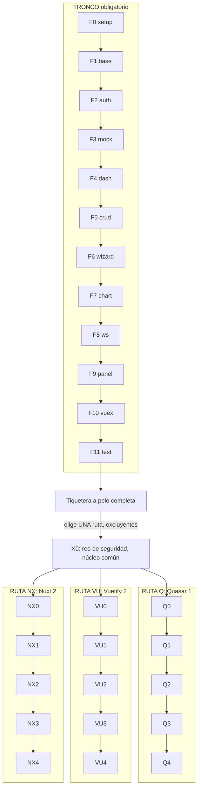
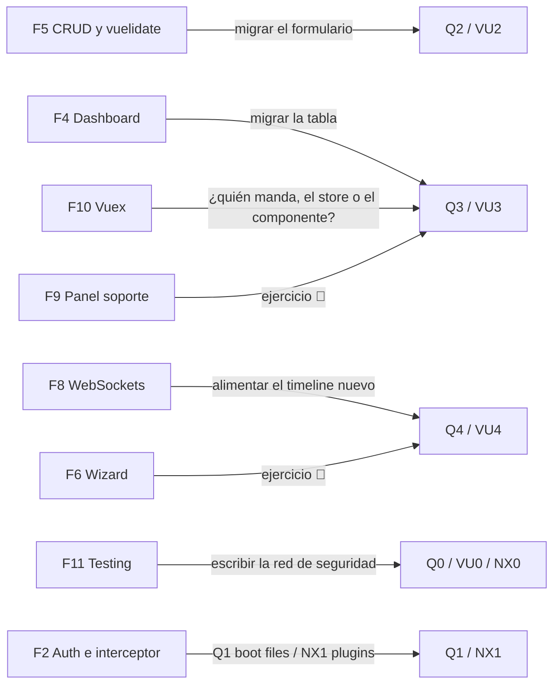

# 🗺️ Estructura del Curso Vue 2 Legacy — Tronco y Rutas Opcionales

Documento maestro de arquitectura del curso. Define **qué es obligatorio**, **qué
es opcional**, y **en qué orden se puede estudiar cada cosa**.

> 📌 Este documento es la fuente de verdad de la **estructura**. El contenido de
> cada fase vive en su propio archivo. Si algo aquí contradice al índice
> (`README.md`) o a `0-plan-del-curso.md`, hay que reconciliarlo — no
> ignorarlo.

---

## 🧭 La idea en una frase

> El **tronco** (F0–F11) enseña Vue 2 **a pelo**.
> Las **rutas** (Q, VU, NX) enseñan qué pasa cuando encima hay un framework.
> El tronco es obligatorio. Las rutas son **excluyentes entre sí**.

---

## 📊 Grafo de dependencias



### Lectura del grafo

- **Cada flecha** = dependencia dura. No puedes hacer F5 sin F3.
- **Bifurcación tras F11** = el dev elige **una** ruta. No se acumulan.
- **`X0` (red de seguridad)** = misma lección en las tres rutas, con puerta propia.
  Ver [nota de producción](#️-nota-de-producción-el-núcleo-común-de-x0).

---

## 🔒 Qué es obligatorio

### Tronco F0 → F11 (secuencial, sin saltos)

| Fase | Nombre | Por qué es obligatoria |
|---|---|---|
| **F0** | Setup + Hola Mundo | Sin ambiente no hay curso |
| **F1** | Estructura base legacy | Define la arquitectura que todo lo demás respeta |
| **F2** | Autenticación mínima | El interceptor de axios lo usa todo |
| **F3** | Mock API mínima | json-server es el backend del resto del curso |
| **F4** | Dashboard de tickets | Se migra en Q3 / VU3 |
| **F5** | CRUD de tickets | Se migra en Q2 / VU2. **Introduce vuelidate** |
| **F6** | Wizard mínimo | Ejercicio 🔴 de migración en Q4 / VU4 |
| **F7** | Métricas | chart.js — convive con el framework |
| **F8** | WebSockets | Alimenta el timeline nuevo de Q4 / VU4 |
| **F9** | Panel de soporte | Ejercicio 🔴 de migración |
| **F10** | Vuex a fondo | **Crítico**: el conflicto central de Q3/VU3 es Vuex vs el componente |
| **F11** | Testing mínimo | **Prerequisito duro de X0.** Sin saber testear no hay red de seguridad |

**Ninguna fase del tronco se puede saltar si vas a hacer una ruta.** F10 y F11 en
particular son los cimientos de las rutas: sin Vuex no entiendes la tensión con
`QTable`/`v-data-table`; sin testing no puedes escribir la red de seguridad.

### Apéndices (A1–A7) — consulta, no lectura

Opcionales y no secuenciales. Se leen cuando el tema aparece o algo suena flojo.
A6 y A7 son **por plataforma**: solo tocan a quien trabaja en un Mac con chip M.

---

## 🔀 Qué es opcional

### Las tres rutas

| Ruta | Framework | Naturaleza | Coste de producción |
|---|---|---|---|
| **Q** | Quasar 1.x | Framework de UI + CLI propio | Medio |
| **VU** | Vuetify 2 | Framework de UI (plugin Vue CLI) | **Bajo** (mismo molde que Q) |
| **NX** | Nuxt 2 | Meta-framework SSR | **Alto** (molde propio) |

### Regla de exclusión

> El dev elige **una ruta**. No se hacen dos.

Razón: Q y VU enseñan **la misma lección** con distinto vocabulario. Hacer las
dos es repetir. NX enseña otra cosa, pero requiere reconstruir el proyecto.

Excepción razonable: alguien que ya terminó Q **puede** hojear VU1 como
comparativa. Pero no es un camino, es curiosidad.

### Prioridad de producción sugerida

```
1. Q  (Quasar)   → el pedido original, define el molde
2. VU (Vuetify)  → reutiliza el molde, coste marginal bajo
3. NX (Nuxt)     → evaluar después; molde propio, es otro curso casi
```

---

## 🧩 Simetría entre rutas (y dónde se rompe)

Q y VU comparten el molde. **NX no, y forzarlo sería mentirle al alumno.**

| | **Q** Quasar | **VU** Vuetify | **NX** Nuxt |
|---|---|---|---|
| **X0** | Red de seguridad | Red de seguridad | Red de seguridad *(diverge: jsdom ≠ Node sin `window`)* |
| **X1** | Leer Quasar | Leer Vuetify | Leer Nuxt |
| **X2** | Migrar CRUD → `QForm` | Migrar CRUD → `v-form` | **Hidratación y `window is not defined`** |
| **X3** | Migrar dashboard → `QTable` | Migrar dashboard → `v-data-table` | **`asyncData` vs Vuex** |
| **X4** | Nuevo: `QTimeline` | Nuevo: `v-timeline` | **Nuevo: página SSR** |

**Dónde se rompe la simetría:** Nuxt no es un framework de UI. No tiene `NxTable`
ni `NxForm`. "Migrar el CRUD a Nuxt" no significa nada — el formulario se queda
igual. Lo que cambia es **dónde se ejecuta el código**. Por eso NX2/NX3 tienen
temas propios.

---

## 🔗 Cómo cada ruta engancha con el tronco

Cada fase de ruta **consume** una fase del tronco. Nada se inventa:



---

## 🧪 La migración total como hilo transversal

**No hay una "fase de migrar todo lo demás".** Sería una fase de deberes.

En su lugar: la migración del resto de la Tiquetera se distribuye como **ejercicios
graduados** a lo largo de la ruta. El dev migra el proyecto entero **si quiere**,
pero pieza a pieza y con dificultad creciente:

| Fase | Nivel | Ejercicio |
|---|---|---|
| **X2** | 🟡 | Migra el **login** (F2). Usa los tests de X0, no escribas nuevos. |
| **X3** | 🔴 | Migra el **panel de soporte** (F9). **Escribe tú** los tests de regresión primero. Documenta qué se rompió. |
| **X4** | 🔴 | Migra el **wizard** (F6) al stepper del framework, reutilizando los forms de X2. ¿Dónde vive ahora la validación por paso? |

**Lo que queda a pelo, se queda a pelo.** El proyecto final de una ruta es un
**híbrido real**: dashboard y CRUD en el framework, el resto en Bootstrap. Eso no
es una carencia — **es el estado de cualquier legacy a medio migrar**, y es donde
el dev de mantenimiento va a vivir.

---

## 🎓 Convivencia: la lección que nadie enseña

Consecuencia directa de lo anterior, y **debe ser contenido explícito de X3**:

- Bootstrap 4 y el framework cargados **a la vez** en el mismo proyecto.
- ¿Se pisan los estilos? **Sí** — `.row` existe en Bootstrap y en Quasar/Vuetify.
- El dashboard usa `QTable`/`v-data-table`, pero el modal de crear ticket sigue
  siendo `<b-modal>`. **Y funcionan juntos.**
- Un componente del framework emite un evento que consume un componente Bootstrap.
  El store no se entera de nada.

Esto es exactamente el estado de un legacy real a medio migrar.

---

## 🛠️ Nota de producción: el núcleo común de X0

**Q0, VU0 y NX0 son tres archivos**, pero el **~85% del cuerpo es común**. Se
escribe una vez y se adapta.

### Lo común (se escribe una vez)

- Qué es un test de **regresión** y en qué se diferencia de un test normal
- **Testear comportamiento observable, no estructura** (`data-testid` > selectores de clase)
- Testear el **contrato con el store**: la acción se despacha con el payload correcto
- Testear el **contrato con la API**: mock de `apiClient`, la petición sale igual
- **Qué NO testear**: estilos, clases de Bootstrap, orden del DOM — es lo que vas a cambiar
- Checklist pre-migración

### Lo que diverge por ruta

| | Qué se rompe al migrar |
|---|---|
| **Q0** | Tus tests buscan `.b-table` → `QTable` no la tiene |
| **VU0** | Idem, **y además** `v-app` obligatorio puede romper el `mount()` actual |
| **NX0** | **Caso aparte**: el test corre en jsdom, pero el código correrá en Node **sin `window`**. Tus tests actuales **no detectan eso.** |

> Que NX0 sea el que más diverge **es información**: confirma que Nuxt no es del
> mismo molde.

### Tabla comparativa clave de X0

| Test normal | Test de regresión pre-migración |
|---|---|
| Verifica que la feature funciona | Verifica que funciona **igual que antes** |
| Se escribe con la feature | Se escribe **contra el código que vas a borrar** |
| Muere si la feature cambia | **Debe sobrevivir** al cambio de implementación |
| Puede tocar implementación | **Nunca** puede tocar implementación |

---

## 📁 Convención de archivos

```
# Tronco (existente)
0-plan-del-curso.md
00-setup-hola-mundo.md
01-estructura-base-legacy.md
...
11-testing-minimo.md

# Apéndices (existentes)
a1-bootstrap.md  …  a5-webpack-babel.md
a6-arm64-m1.md  a7-docker-colima.md    (por plataforma: Apple Silicon)

# Rutas
q0-red-de-seguridad.md
q1-leer-quasar.md
q2-migrar-crud-qform.md
q3-migrar-dashboard-qtable.md
q4-timeline-actividad.md

vu0-red-de-seguridad.md
vu1-leer-vuetify.md
vu2-migrar-crud-vuetify.md
vu3-migrar-dashboard-vdatatable.md
vu4-timeline-vuetify.md

nx0-red-de-seguridad.md
nx1-leer-nuxt.md
nx2-hidratacion-window-not-defined.md
nx3-asyncdata-vs-vuex.md
nx4-pagina-ssr-nueva.md

# Historias de ruta (una por ruta; se leen antes de X0)
q00-historia-ruta-q.md · vu00-historia-ruta-vu.md · nx00-historia-ruta-nx.md

# Track forense (uno por fase, y uno por ruta)
forense-master.md
forense-fase-00.md  …  forense-fase-11.md
forense-ruta-q.md · forense-ruta-vu.md · forense-ruta-nx.md

# Cuaderno de incidentes (uno por curso, IDs propios)
cuaderno-incidentes.md
```

> 🧭 **Los nombres del track no son libres.** Se comparten con los cursos de
> Angular del repositorio para que los tres paquetes se lean igual:
> `forense-master.md`, `forense-fase-NN.md` y `cuaderno-incidentes.md`. Lo único
> propio de este curso es `forense-ruta-<código>.md`, que nace de que las rutas
> son excluyentes y cinco fases comparten una sola pieza.
> `<código>00-historia-ruta-<código>.md` sigue el mismo criterio: es la excepción a la ficha
> única del sistema, y la única.

---

## ✅ Reglas que toda fase de ruta debe cumplir

Heredadas del tronco, sin excepción:

1. **Plantilla de 9 puntos**: Propósito → Qué queda → Qué NO → Concepto → Código
   → Errores → Ejercicios → Referencias → Cierre.
2. **20–30 ejercicios** graduados 🟢 🟡 🟠 🔴.
3. **Options API siempre.** `function () {}`, nada de arrow. Sin TS/Composition/Pinia/Vite.
4. **Deudas 💸 explícitas** con la fase donde se pagan.
5. **Puentes fuertes**: cada fase prepara la siguiente.
6. **Tono**: informal, directo, sin condescendencia. Audiencia senior.
7. **Código de época.** Versiones exactas, sin features modernas.
8. **Pieza forense en el punto 6**: resumen, bloque 🧨 "Rompe a propósito" y la
   línea 📄 hacia `forense-ruta-q.md` / `-vu.md` / `-nx.md` — la de **su** ruta,
   que es una sola para las cinco fases. Las fases de ruta **no** reservan
   incidentes: el cuaderno no tiene ni una fila de ruta, porque un incidente de
   ruta sería material que dos tercios de los lectores no pueden preparar.

---

## ✅ Deuda del propio curso (saldada)

Al cerrar cada ruta había que **actualizar el tronco**. Ya está hecho:

- [x] `README.md` — índice del curso: tabla de contenido, diagrama de rutas y
      "el material en números" con las rutas incluidas
- [x] `0-plan-del-curso.md` — sección "tronco y rutas" tras el mapa de fases
- [x] `11-testing-minimo.md` — el cierre ya bifurca ("Aquí el curso se bifurca")
      y puentea hacia X0

Y al cerrar el **track forense** había que volver a tocar el tronco. También está
hecho:

- [x] Las **27 fases** (12 de tronco + 15 de ruta) — punto 6 con su pieza, y
      bloque 📌 de reservas en las de tronco
- [x] `README.md` — bloques "🕵️ Track forense" y "📓 Cuaderno de incidentes"
- [x] `0-plan-del-curso.md` — plantilla de capítulo actualizada y sección propia
      del track
- [x] Los **5 apéndices** de consulta — sin tocar, y es la decisión: explican lo
      que ya está ahí, no producen código de fase (a6 y a7, de plataforma, llegaron
      después y tampoco)

---

## 🚀 Estado

| Documento | Estado |
|---|---|
| `0-ESTRUCTURA-CURSO.md` | ✅ este documento |
| `README.md` (índice del curso, con las tres rutas) | ✅ terminado |
| `forense-master.md` + 12 piezas de fase + 3 de ruta | ✅ terminado |
| `cuaderno-incidentes.md` (13 incidentes) | ✅ terminado |
| Fases Q0–Q4 (contenido) | ✅ escritas |
| Fases VU0–VU4 (contenido) | ✅ escritas |
| Fases NX0–NX4 (contenido) | ✅ escritas |
| Actualizar tronco (`FASES`, `0-plan`, `README`, F11) | ✅ hecho |
| Validación por ejecución, tronco y rutas (14–18/10/2026) | ✅ hecha: el detalle está en el `README.md`, sección «Cómo se validó»; el navegador queda a mano |
