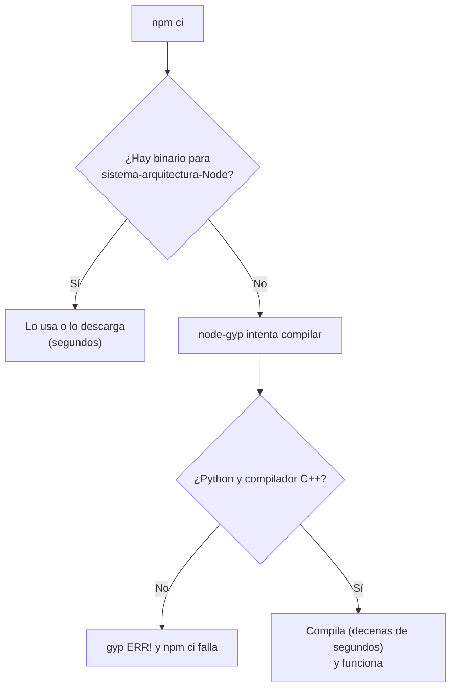

# 🍎 Apéndice 6 — Apple Silicon: dependencias nativas en arm64 (consulta por plataforma)

## 🎯 Para qué sirve este apéndice

🔥 **Opcional por plataforma.** El curso se completa sin abrirlo: Windows y Linux
x64 no pasan por nada de esto. Existe para que quien llegue con un Mac de chip M
(M1, M2, M3…) no se quede fuera, y resuelve un solo problema: **que el
`npm ci` de la Tiquetera termine en tu máquina**. No se lee de corrido; se entra
por la sección que nombra tu error y se sale.

La idea que ordena todo lo demás: **un `npm install` no solo descarga
JavaScript, también puede compilar C++**. Unos pocos paquetes del árbol traen
código nativo, y cuando no existe un binario ya compilado para tu combinación
exacta de sistema, arquitectura y versión de Node, npm intenta construirlo en
tu máquina. Ahí se rompe todo lo de este apéndice, y por eso los errores hablan
de Python, de `make` o de un compilador cuando tú solo querías levantar un
frontend.

**Qué queda fuera:** cómo se instala Node 14 x64 con nvm, que es la sección 🍎
de la [Fase 0](00-setup-hola-mundo.md); lo general de Node y de nvm, que es el
[Apéndice 2](a2-node.md); el lockfile y `npm ci`, que son el
[Apéndice 3](a3-npm.md); y Docker, Colima y el devcontainer, que son el
[Apéndice 7](a7-docker-colima.md) entero. Aquí se dice *cuándo* conviene cruzar
a un contenedor, no cómo montarlo.

---

## 📍 Dónde estás parado, en treinta segundos

En un Mac con chip M, **`node -v` no te dice la arquitectura**: un Node x64
bajo Rosetta y uno arm64 nativo dicen los dos `v14.21.3`. Cuatro comandos lo
resuelven:

```bash
# 1. La máquina. arm64 = chip M; x86_64 = Intel.
uname -m

# 2. El Node. En una máquina arm64 esto puede decir 'x64', y no es un error:
#    tu Node es de Intel y corre traducido por Rosetta. Es lo que pide la Fase 0.
node -p process.arch

# 3. La confirmación desde el binario.
file "$(which node)"
#   ... Mach-O 64-bit executable x86_64   → Node de Intel, bajo Rosetta
#   ... Mach-O 64-bit executable arm64    → Node nativo
#   (en Linux la salida empieza con ELF y dice x86-64 o ARM aarch64)

# 4. ¿Esta terminal entera corre traducida? 1 = sí, 0 = no. Se hereda a todo
#    lo que lances desde ella, y no se anuncia.
sysctl -n sysctl.proc_translated
```

En el Mac de chip M donde se escribió este apéndice, una terminal normal da
`arm64` y `0`; la misma consulta lanzada con `arch -x86_64` da `x86_64` y `1`.
Así se leen las combinaciones:

| `uname -m` / `process.arch` | Dónde estás | Qué esperar |
|---|---|---|
| `x86_64` / `x64` | Windows, Linux o Mac Intel | El caso normal del curso: los binarios existen |
| `arm64` / `x64` | Mac con chip M, Node bajo Rosetta | **Lo que pide la Fase 0.** Encuentra los binarios de Intel |
| `arm64` / `arm64` | Mac con chip M, Node nativo | Compila `deasync` (y `node-sass` en la ruta Q) |
| `aarch64` / `arm64` | Contenedor Linux arm64 en un Mac con chip M | Lo mismo: Linux llama `aarch64` a la misma arquitectura |

> 🧠 **Lo que decide si un paquete nativo encuentra su binario no es tu
> máquina, es tu Node.** Un Node x64 bajo Rosetta pide binarios de Intel, los
> encuentra y todo funciona aunque tu procesador sea otro. Por eso "estoy en un
> M1" no es un diagnóstico completo: la pregunta es *"¿tu Node es x64 o
> arm64?"*.

---

## 🧬 Por qué un `npm install` compila C++

Un paquete con código nativo se distribuye de dos formas a la vez: el código
fuente en C++ y una colección de **binarios ya compilados** para las
combinaciones más comunes. La instalación intenta lo fácil primero y cae en lo
difícil cuando no lo encuentra:



**Las tres coordenadas del binario** están escritas en la ruta donde el paquete
lo busca, y esa ruta es el mejor diagnóstico gratuito que existe. `node-sass`
busca `vendor/linux-arm64-83/binding.node`; `deasync`, `bin/darwin-x64-node-14/deasync.node`:

- `darwin` / `linux` / `win32` — el sistema (`darwin` es macOS).
- `x64` / `arm64` — la arquitectura **de tu Node**, no la de tu máquina.
- `83` o `node-14` — la versión de Node. El `83` es el *module version* de
  Node 14, el número que cambia cada vez que cambia la interfaz binaria.

> 💡 **Antes de buscar el error en internet, lee la ruta.** Si dice
> `darwin-arm64` y creías estar bajo Rosetta, tu Node no es el que pensabas.
> Si dice `node-16` o `93`, estás con un Node más nuevo que el del `.nvmrc`.

### Lo que trae la Tiquetera

La lista es corta, y eso quiere decir que tu superficie de riesgo también lo
es. Sale de los `package-lock.json` del curso:

| Árbol | Paquetes nativos | Por dónde llegan |
|---|---|---|
| Tronco (F0–F11) | `deasync` 0.1.32 · `fsevents` 1.2.13 y 2.3.3 | `deasync` por `vue-jest` (F11); `fsevents` por `webpack-dev-server`, `watchpack` y `sane` |
| Ruta Q | **`node-sass` 4.14.1** · `fsevents` | `node-sass` lo exige `@quasar/app` 1.9.6 |
| Rutas VU y NX | `deasync` · `fsevents` | Lo mismo que el tronco; el `sass` de VU es Dart Sass, JavaScript puro |
| Curso 02 (backend) | `fsevents` | `bcryptjs` es JavaScript puro |

Para verlo en tu árbol:

```bash
# Qué paquetes traen código nativo. node-gyp se excluye: es la herramienta,
# no un paquete que se compile.
find node_modules -name binding.gyp -not -path "*/node-gyp/*" | sort
```

Sobre el árbol de la Fase 11, en Linux, la salida son cuatro líneas:

```text
node_modules/deasync/binding.gyp
node_modules/sane/node_modules/fsevents/binding.gyp
node_modules/watchpack-chokidar2/node_modules/fsevents/binding.gyp
node_modules/webpack-dev-server/node_modules/fsevents/binding.gyp
```

**`fsevents`** es el vigilante de archivos nativo de macOS. En Linux se salta
solo (`Skipping 'fsevents' build as platform linux is not supported`) y en
Windows ni se instala: es una dependencia opcional. En el Mac es otra
historia, aunque termina igual de bien. La 2.3.3 trae su binario dentro; las
tres copias de la 1.2.13 se compilan, y con un Python 3.11 o más nuevo (el
que tiene cualquier Mac actualizado) la compilación falla antes de empezar:

```text
ValueError: invalid mode: 'rU' while trying to load binding.gyp
gyp ERR! configure error
...
gyp ERR! cwd …/node_modules/sane/node_modules/fsevents
gyp ERR! node-gyp -v v5.1.1
gyp ERR! not ok
```

Como es opcional, npm imprime el bloque de `gyp ERR!` y sigue: en el Mac con
chip M donde se probó, el `npm ci` de la Fase 11 terminó con
`added 1976 packages` y las pruebas pasaron 26/26. **Ese `gyp ERR!` de
`fsevents` no es tu problema**; el que importa es el de `deasync`, que
termina en `npm ERR!` y no deja instalar.

**`deasync`** es el caso que importa en el tronco, y tiene una particularidad
que explica la receta de la Fase 0: **trae sus binarios dentro del propio
paquete**, en `node_modules/deasync/bin/`, uno por combinación. Para Node 14
están `darwin-x64-node-14` y `linux-x64-node-14`, y **no** están
`darwin-arm64-node-14` ni `linux-arm64-node-14`. Con un Node x64 lo encuentra y
lo prueba:

```text
> deasync@0.1.32 install /w/node_modules/deasync
> node ./build.js

`linux-x64-node-14` exists; testing
Binary is fine; exiting
```

Con un Node arm64 no lo encuentra y compila: `CXX(target) Release/obj.target/deasync/src/deasync.o`,
y al final `Installed in /w/node_modules/deasync/bin/linux-arm64-node-14/deasync.node`.
Si tienes Python y compilador, funciona; si no, es el error de la sección 🔧.

---

## 🎨 `node-sass` en la ruta Q: las tres salidas

Solo aplica si haces la **ruta Q**: el tronco no tiene Sass. `@quasar/app`
1.9.6 exige `node-sass` 4.14.1, que es nativo y cuyas publicaciones traen
binarios `darwin-x64-83` y `linux-x64-83`, pero **no** `darwin-arm64-83` ni
`linux-arm64-83`. Con un Node arm64, el `npm ci` lo dice así antes de ponerse a
compilar:

```text
> node-sass@4.14.1 install /w/node_modules/node-sass
> node scripts/install.js

Downloading binary from https://github.com/sass/node-sass/releases/download/v4.14.1/linux-arm64-83_binding.node
Cannot download "https://github.com/sass/node-sass/releases/download/v4.14.1/linux-arm64-83_binding.node":

HTTP error 404 Not Found
```

Y si el `node_modules` quedó sin binario, el que se queja es `quasar build`:

```text
Error: Node Sass does not yet support your current environment: Linux Unsupported architecture (arm64) with Node.js 14.x
```

**Opción A — Node 14 x64 bajo Rosetta**

Qué es: lo que ya fija la Fase 0. Tu Node es x64, así que `node-sass` descarga
su `darwin-x64-83`, lo prueba (`Binary is fine`) y no compila nada.
Cuándo conviene: siempre que se pueda. Es la ruta corta y deja tu máquina igual
a la de tus compañeros de Windows y Linux.
El costo: todo Node corre traducido, y dependes de Rosetta (📌 al final de la
sección 🧹).
Veredicto: **es la recomendación del curso**, y la primera que hay que intentar.

**Opción B — El contenedor**

Qué es: trabajar dentro de un contenedor Linux, que es el
[Apéndice 7](a7-docker-colima.md).
Cuándo conviene: cuando la A no basta, o cuando quieres el mismo ambiente que
el resto del equipo.
El costo, y el matiz que sorprende: dentro de un contenedor **arm64** tu Node
es arm64 de verdad, así que `node-sass` **vuelve a no tener binario y compila**.
El devcontainer del Apéndice 7 trae lo necesario y la compilación funciona
(1 min 16 s el `npm ci` completo de la ruta Q en la prueba del curso), pero no
te escapaste del problema: lo moviste a un lugar donde está resuelto.
Veredicto: la salida sensata cuando la A se atasca.

**Opción C — Dart Sass en lugar de `node-sass`**

Qué es: decirle al `sass-loader` 8.0.2 que trae `@quasar/app` que use `sass`
(Dart Sass, compilado a JavaScript, sin arquitectura) en vez de `node-sass`.
`node-sass` sigue en el árbol, porque `@quasar/app` lo exige, pero nadie lo
carga. Se probó en un contenedor arm64 **sin** compilador ni Python, y
`quasar build` termina en verde con esto:

```bash
# node-sass no puede compilar aquí: se instala sin correr scripts de instalación
npm ci --ignore-scripts
npm install --save-dev --save-exact --ignore-scripts sass@1.32.13
```

```js
// quasar.conf.js, dentro de build: { … }
// node-sass no tiene binario arm64: Dart Sass compila en JavaScript
// y no conoce el estilo "nested" que Quasar 1 pone por defecto
scssLoaderOptions: { implementation: require("sass"), sassOptions: { outputStyle: "expanded" } },
sassLoaderOptions: { implementation: require("sass"), sassOptions: { outputStyle: "expanded" } },
```

Hacen falta las dos líneas: `app.scss` pasa por la primera regla y el
`quasar.sass` del framework, que usa la sintaxis indentada, por la segunda. Con
una sola, el error de `node-sass` sigue apareciendo, ahora desde el otro
archivo. Y sin el `outputStyle`, Dart Sass rechaza el valor por defecto de
Quasar 1: `SassError: Invalid argument(s): Unsupported output style "nested".`
(Quasar lo fija para el soporte RTL, que la Tiquetera no usa).

El costo: cambias el `package.json` y el `quasar.conf.js` del proyecto, que ya
no son los de la ruta, y `--ignore-scripts` se salta todos los scripts de
instalación, no solo el de `node-sass` (en la ruta Q, además, solo los avisos
de `core-js` y `ejs` y el `fsevents` que Linux ignora). El CSS que sale no es
idéntico byte a byte: comparado con el de `node-sass`, tiene las mismas 2.833
reglas, y difiere en un `@charset "UTF-8"` al principio, en un espacio duro
escrito tal cual donde `node-sass` pone `"\00a0"`, y en 15 bloques `@media`
para Internet Explorer 11 que `node-sass` agrupaba en 2.
Veredicto: **funciona y está medida, pero es un cambio al proyecto**, no una
configuración de tu máquina. Úsala en una rama, o cuando la ruta Q te toque en
un contenedor arm64 sin build tools. Cómo se ve en el navegador no se comparó.

> ⚠️ **Y el paso que se olvida siempre, sea cual sea la salida: borra
> `node_modules` antes.** El binario equivocado queda en
> `node_modules/node-sass/vendor/` y sobrevive a un `npm install` normal:
> sigues viendo el mismo error después de arreglar la causa y concluyes que el
> arreglo no sirvió. Es `rm -rf node_modules` y `npm ci` (sección 🧹).

---

## 🔧 `node-gyp`, Python y las build tools

Cuando no hay binario, `node-gyp` compila, y para eso necesita **tres cosas
que no vienen con Node**: Python, un compilador de C++ y `make`. Esto no es un
problema de arm64: en Windows aparece igual, y es lo que hay detrás de la
muralla de `gyp ERR!` que menciona la Fase 0.

Y un detalle propio de este árbol: hay **dos** `node-gyp`. El que usa npm 6
para `deasync` es el 5.1.1, que acepta Python 3 **hasta la 3.10**: su `gyp`
abre los archivos con el modo `'rU'`, que Python 3.11 eliminó. El que trae
`node-sass` para sí mismo es el 3.8.0, que **solo acepta Python 2**. Un
ambiente con Python 3.9 o 3.10, como el Debian 11 del Apéndice 7, compila el
tronco y falla en la ruta Q. Uno con Python 3.11 o más nuevo, como el de un
Mac actualizado o el de una distribución Linux reciente, falla también en el
tronco si tiene que compilar `deasync` (el `ValueError` de la sección 🧬).

**macOS** — las Command Line Tools de Xcode traen el compilador:

```bash
# Instala compilador y herramientas; si ya están, avisa y no hace nada
xcode-select --install
# Comprobar sin instalar nada
xcode-select -p
clang --version
```

macOS ya no trae Python 2, así que en un Mac con Node arm64 la ruta Q no
compila `node-sass` aunque tengas las Command Line Tools. Es otra razón para
el Node x64 de la Fase 0, que no necesita compilarlo.

**Linux (Debian y derivados)** — `python3`, `make` y `g++` para el tronco;
`python2` también, si haces la ruta Q. Es exactamente la lista del Dockerfile
del [Apéndice 7](a7-docker-colima.md).

**Windows** — Python en el `PATH` y las Visual Studio Build Tools con la carga
*Desktop development with C++*. Con Node 14 x64 casi nunca hacen falta, porque
los dos paquetes nativos tienen binario para `win32-x64`.

Los errores, literales, de un contenedor arm64 sin Python:

```text
gyp ERR! find Python Python is not set from command line or npm configuration
...
gyp ERR! stack Error: Could not find any Python installation to use
...
npm ERR! Failed at the deasync@0.1.32 install script.
```

```text
gyp verb `which` failed Error: not found: python2
...
gyp ERR! stack Error: Can't find Python executable "python", you can set the PYTHON env variable.
...
gyp ERR! cwd /w/node_modules/node-sass
gyp ERR! node-gyp -v v3.8.0
```

El primero es `deasync` con el `node-gyp` 5.1.1; el segundo, `node-sass` con su
`node-gyp` 3.8.0. Se reconocen por la última línea: `node-gyp -v`.

> 🧭 **La distinción que ahorra la tarde:** si el error dice que **falta una
> herramienta** (`find Python`, `not found: make`), instálala y sigue. Si es una
> **catarata de errores de C++** con archivos `.cc` y `.h`, el compilador está y
> compilando; lo que falla es el código del paquete contra tu Node. Eso no se
> arregla instalando nada: se arregla con el binario precompilado (Node x64) o
> con el contenedor.

---

## 📥 Las herramientas que bajan su propio binario

Hay una segunda familia, que no compila pero tropieza con lo mismo: paquetes
que, al instalarse o al arrancar, **descargan un ejecutable** para tu
plataforma. Si no existe para tu arquitectura, la instalación termina bien y el
error aparece después.

El caso del paquete es **mongodb-memory-server 6.9.6**, el que levanta un Mongo
efímero para las pruebas del Curso 02 (Fase 13). Arma la URL del `mongod`
4.4.18 con el sistema y la arquitectura **de tu Node**:

| Tu Node | Lo que pide | Existe |
|---|---|---|
| macOS, x64 (bajo Rosetta) | `osx/mongodb-macos-x86_64-4.4.18.tgz` | Sí |
| macOS, arm64 | `osx/mongodb-macos-arm64-4.4.18.tgz` | No (403) |
| Linux, arm64 (contenedor en un Mac M) | `linux/mongodb-linux-arm64-debian10-4.4.18.tgz` | No (403) |

Cuando no existe, falla en menos de un segundo, y el mensaje dice 403 aunque
quiera decir "no existe":

```text
Error: Status Code is 403 (MongoDB's 404)
This means that the requested version-platform combination doesn't exist
  Used Url: "https://fastdl.mongodb.org/linux/mongodb-linux-arm64-debian10-4.4.18.tgz"
```

Con el Node x64 de la Fase 0 la suite descarga el `mongod` de Intel y corre
bajo Rosetta. En un contenedor, la salida es `--platform linux/amd64`
([Apéndice 7](a7-docker-colima.md)): así se corrió la suite de la Fase 13 para
este curso, 6 pruebas en verde.

El otro nombre de la familia es **Cypress**, que la Fase 11 menciona y deja
fuera: al instalarse baja su propio binario, con su navegador. Si algún día lo
agregas, el síntoma posible es el mismo, y la comprobación también: `file`
sobre el ejecutable que descargó.

---

## 🧹 Higiene de arquitectura

El error más caro de esta familia aparece días después, y casi siempre porque
alguien compartió algo que no se comparte.

**`node_modules` no se comparte entre máquinas, nunca.** Contiene binarios
atados a un sistema, una arquitectura y una versión de Node: copiarlo de un
Windows a un Mac, o de tu Mac a un contenedor, produce errores que no
mencionan ni la copia ni la arquitectura. Se comparten `package.json` y
`package-lock.json`, y cada uno corre `npm ci`, que descarga lo que
corresponde **a su plataforma** y compila lo nativo si hace falta.

**El lockfile trae cosas de macOS, y está bien.** `fsevents` aparece en el
`package-lock.json` como opcional; en Linux y Windows npm lo salta. No lo
quites "para limpiar": se lo quitas a tus compañeros de Mac.

**El ritual cuando cambias de Node o de arquitectura:**

```bash
nvm use                 # lee el .nvmrc de la Fase 0
node -p process.arch    # en Apple Silicon: x64
rm -rf node_modules     # sin esto, el paso siguiente no sirve
npm ci                  # desde el lockfile, no desde el package.json
```

**¿Y por qué no un Node 16 nativo, si tiene binario arm64?** Por tres razones
que se comprobaron, no por nostalgia:

- **No te ahorra la compilación.** `deasync` tampoco trae `darwin-arm64-node-16`
  (de `darwin-arm64` solo trae Node 22, 24 y 26): con Node 16 nativo compila
  igual que con Node 14 nativo.
- **Cambia el npm.** Node 16.20.2 trae npm 8.19.4. Su `npm ci` respeta el
  lockfile del curso, pero el primer `npm install` lo reescribe del formato 1 al
  2: en el árbol de la Fase 11, 22.960 líneas nuevas en un archivo que tus
  compañeros con npm 6 van a ver cambiar sin haber tocado nada.
- **El `.nvmrc` dice 14.21.3**, y el curso entero se probó con ese número.

> 💡 **Antes de pedir ayuda, pega esto.** Cuatro respuestas que quien te ayude
> va a preguntar igual:
>
> ```bash
> uname -m ; node -v ; node -p process.arch ; npm -v
> ```

> 📌 **Rosetta tiene fecha.** Apple anunció que Rosetta 2 deja de estar completa
> a partir de **macOS 28**. La receta de la Fase 0 depende de ella. Cuando
> llegue, las salidas que quedan son el contenedor amd64 del
> [Apéndice 7](a7-docker-colima.md) o un Node nativo con todo compilado. No es
> urgente, pero conviene saberlo antes de montar el flujo del equipo encima.

---

## 🧭 Cuándo pelear y cuándo meterse en un contenedor

| Situación | Qué haces |
|---|---|
| Mac con chip M, empezando de cero | Node 14.21.3 x64 bajo Rosetta (Fase 0, 🍎) |
| `process.arch` dice `arm64` y no lo esperabas | Reinstala Node desde `arch -x86_64` (Fase 0) y el ritual de 🧹 |
| Falla un paquete nativo y el error nombra una herramienta | Instálala (🔧) y sigue |
| Falla con una catarata de errores de C++ | Deja de compilar: Node x64 o contenedor |
| Ruta Q en un contenedor arm64 | El devcontainer del Apéndice 7 (trae `python2`) o Dart Sass (opción C) |
| La suite del Curso 02 da `403 (MongoDB's 404)` | Node x64, o el contenedor con `--platform linux/amd64` |
| Un compañero te pasó su `node_modules` | Bórralo y `npm ci` |
| Llevas más de media mañana peleando | Contenedor ([Apéndice 7](a7-docker-colima.md)). El tiempo es un criterio legítimo |

---

## ⚠️ Diagnóstico rápido

| Lo que dice el error | Qué es |
|---|---|
| `gyp ERR! find Python` / `Could not find any Python installation to use` | Falta Python 3 para `deasync`: sección 🔧 |
| `Can't find Python executable "python"` con `node-gyp -v v3.8.0` | `node-sass` quiere Python 2: sección 🔧, o la opción A o C de 🎨 |
| `Cannot download "…/linux-arm64-83_binding.node"` / `HTTP error 404` | `node-sass` sin binario para arm64: va a compilar (🎨) |
| `Node Sass does not yet support your current environment: … (arm64)` | `node_modules` sin binario de `node-sass`: 🎨 y el ritual de 🧹 |
| `SassError: Invalid argument(s): Unsupported output style "nested".` | Dart Sass sin el `outputStyle` (opción C de 🎨) |
| `Failed at the deasync@0.1.32 install script.` | `deasync` compilando sin build tools: Node x64 o sección 🔧 |
| `ValueError: invalid mode: 'rU' while trying to load binding.gyp` | Python 3.11+ con el `node-gyp` 5.1.1. En `fsevents`, ignóralo (🧬); en `deasync`, Node x64 o Python ≤ 3.10 (🔧) |
| `Status Code is 403 (MongoDB's 404)` | mongodb-memory-server sin `mongod` para tu arquitectura (📥) |
| `npm ci` tarda mucho más de lo normal la primera vez | Está compilando (🧬). No está colgado |
| `node -v` dice `v14.21.3` y todo compila | Tu Node es arm64: `node -p process.arch` (📍) |
| Todo funcionaba y de golpe no | ¿Cambiaste de Node? ¿Copiaste `node_modules`? El ritual de 🧹 |

> ⚠️ **Verificado en parte en macOS.** Las salidas de error de este apéndice
> salieron de contenedores Linux arm64 y amd64 sobre un Mac con chip M; las de
> 📍 y las de `fsevents` (🧬), de ese Mac. En él se corrió el tronco con
> Node 14.21.3 x64: `deasync` usó su binario `darwin-x64-node-14` sin compilar
> y las pruebas de la Fase 11 pasaron 26/26. Lo demás de macOS con Node x64
> (que `node-sass` usa su binario `darwin-x64` en la ruta Q, y
> mongodb-memory-server el `mongod` de Intel) se deduce de lo que esos
> paquetes publican y de cómo arman sus rutas, y no se corrió en el Mac.

---

## 🧪 Ejercicios (15) — todos opcionales

> Los apéndices son material de consulta y práctica libre. Haz los que te
> sirvan, cuando te sirvan. Los marcados 🍎 necesitan un Mac con chip M; los
> demás sirven en cualquier máquina, porque un contenedor arm64 o amd64 hace
> de laboratorio.

**🟢 Fácil (1–4)**

1. Corre los cuatro comandos de 📍 en tu máquina y ubícate en la tabla. Escribe
   en una línea qué binarios va a pedir tu `npm ci`. Guarda la salida: es lo
   que pegas cuando pides ayuda.
2. Corre el `find` de 🧬 sobre tu proyecto de la Fase 11 y compara con las
   cuatro líneas publicadas. Si sale algo más, averigua qué paquete lo trajo con
   `npm ls <paquete>`.
3. Abre `node_modules/deasync/bin/` y lista las carpetas. Encuentra la que
   corresponde a tu máquina y explica por qué esa, con las tres coordenadas.
4. 🍎 Corre `sysctl -n sysctl.proc_translated` en tu terminal normal y dentro de
   `arch -x86_64 zsh`. Anota las dos respuestas y explica qué hereda un `npm ci`
   lanzado desde cada una.

**🟡 Intermedio (5–9)**

5. En un contenedor `node:14.21.3` arm64 y en otro con `--platform linux/amd64`,
   corre `npm ci` de la Fase 11 y busca en la salida la línea de `deasync`.
   Explica la diferencia con lo que dice esta página.
6. Repite el ejercicio 5 en `node:14.21.3-bullseye-slim` arm64, que no trae
   Python. Copia el error y ubica la línea que te dice qué falta y la que te
   dice qué `node-gyp` lo pidió.
7. **Diagnóstico.** Un compañero pega `Node Sass does not yet support your
   current environment: Linux Unsupported architecture (arm64) with Node.js 14.x`.
   Sin más datos, escribe las tres preguntas que le haces, en orden, y qué
   respuesta lleva a cada salida de 🎨.
8. **Diagnóstico.** Copia un `node_modules` instalado en un contenedor arm64 a
   uno amd64 (o al revés) y corre `npm run test:unit`. Anota el error exacto y
   di si alguien que no sabe de la copia podría llegar a la causa leyéndolo.
9. Ejecuta el ritual de 🧹 completo después del ejercicio 8 y confirma que la
   suite vuelve a verde.

**🟠 Difícil (10–13)**

10. Aplica la opción C de 🎨 a la ruta Q en una rama, en un contenedor arm64
    sin build tools. Confirma que `quasar build` sale en verde y que la red de
    seguridad de la Q0 sigue pasando.
11. **Diagnóstico.** Quita la línea `sassLoaderOptions` de la opción C y vuelve a
    construir. Explica por qué el error vuelve a ser de `node-sass` y qué archivo
    lo produce.
12. Compila la ruta Q con `node-sass` (amd64) y con Dart Sass (arm64) y compara
    los dos CSS. Encuentra al menos dos de las tres diferencias que menciona
    esta página y decide si alguna se ve en pantalla.
13. 🍎 Instala un Node 16 nativo arm64 en paralelo, cambia a él y corre `npm ci`
    sobre la Fase 11. Anota qué compila y comprueba cómo queda el
    `package-lock.json` después de un `npm install`. Vuelve al Node del `.nvmrc`
    con el ritual de 🧹.

**🔴 Muy difícil (14–15)**

14. 🍎 Corre la suite de la Fase 13 del Curso 02 con Node 14 x64 y con un Node
    arm64. Para cada uno, encuentra en `node_modules/.cache` qué `mongod` se
    descargó, y confirma su arquitectura con `file`.
15. 🍎 Cronometra `npm ci` y `npm run build` de la Fase 11 con Node x64 bajo
    Rosetta y luego dentro del devcontainer del Apéndice 7. Publica tus dos
    pares de cifras con las condiciones (modelo de Mac, memoria, runtime de
    contenedores): este apéndice no trae el costo de Rosetta porque no lo midió.

---

## 📚 Referencias

**Documentación oficial**

- nvm, instalación y uso en macOS: https://github.com/nvm-sh/nvm
- node-gyp, lo que hace falta en cada sistema para compilar: https://github.com/nodejs/node-gyp#installation
- node-sass 4.14.1, sus binarios publicados (busca los `_binding.node`):
  https://github.com/sass/node-sass/releases/tag/v4.14.1 — ⚠️ el proyecto está
  archivado: lo que ves es lo que hay.
- deasync, el paquete que trae sus binarios dentro: https://github.com/abbr/deasync
- Node.js, versiones anteriores y su *module version*: https://nodejs.org/en/about/previous-releases
- Rosetta 2, qué es y cómo se instala: https://support.apple.com/en-us/102527
- Quasar 1, las opciones de `build` de `quasar.conf.js` (incluidas
  `scssLoaderOptions` y `sassLoaderOptions`): https://v1.quasar.dev/quasar-cli/quasar-conf-js
- sass-loader 8, la opción `implementation`: https://github.com/webpack/sass-loader/tree/v8.0.2
- Dart Sass: https://sass-lang.com/dart-sass — ⚠️ documenta la versión actual,
  con `@use`; el proyecto usa `@import`.
- mongodb-memory-server, plataformas y binarios: https://github.com/typegoose/mongodb-memory-server
- npm 6, `npm ci`: https://docs.npmjs.com/cli/v6/commands/npm-ci

> ⚠️ Los enlaces pueden haber cambiado; verifícalos. Y un riesgo propio de este
> tema: buena parte de lo que vas a encontrar buscando estos errores es de
> 2021–2022, cuando el ecosistema se estaba adaptando a Apple Silicon, y
> propone trucos que hoy sobran. Desconfía de cualquier receta que no diga qué
> versión de Node asume.

**Orden de lectura sugerido:** si algo acaba de fallar, 📍 para saber dónde
estás y el diagnóstico rápido para identificar el mensaje. Si vas a montar el
ambiente por primera vez, la sección 🍎 de la Fase 0 y después 🧬. Si llevas
rato peleando, 🧭 y de ahí al [Apéndice 7](a7-docker-colima.md).
