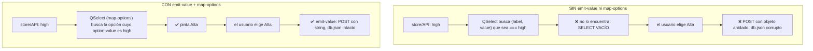

# 📝 Fase Q2 — Migrar el CRUD a QForm

> **Ruta Q · Quasar 1.22** · Migra: **F5 (CRUD de tickets)** · Consume: **Q0** (red de seguridad), **Q1** (leer Quasar)
> Los tests de Q0 corren **sin tocarlos**. Verde o rojo. Y esa es la lección.

---

## 🧷 Antes de empezar: el traslado

Q1 te dejó `tiquetera-q` recién creado (modo manual, sin ESLint) y Q0 te dejó la red
de regresión en el tronco. Esta fase empieza juntándolos: la Tiquetera de F11 entra
a Quasar **sin cambiar una línea de lógica**, y la red de Q0 tiene que pasar ahí,
en verde, **antes** de migrar nada. Si no pasa, el problema es el traslado, no
Quasar. No es burocracia: Q2 borra código y confía en que la red mida lo mismo
que medía en el tronco.

**1. Dependencias y código.** Desde la carpeta que contiene los dos proyectos:

```bash
cd tiquetera-q
npm install --save-exact axios@0.21.1 vuelidate@0.7.7 bootstrap@4.6.2 chart.js@2.9.4 socket.io-client@2.4.0 lodash@4.17.21
cp -R ../tiquetera-legacy/src/components ../tiquetera-legacy/src/views src/
cp -R ../tiquetera-legacy/src/services ../tiquetera-legacy/src/utils src/
mkdir -p src/store/modules src/store/plugins
cp ../tiquetera-legacy/src/store/modules/*.js src/store/modules/
cp ../tiquetera-legacy/src/store/plugins/*.js src/store/plugins/
rm -r src/store/module-example
cp ../tiquetera-legacy/db.json . && cp -R ../tiquetera-legacy/server .
npm install --save-dev --save-exact json-server@0.16.3 socket.io@2.4.1 concurrently@5.3.0
```

Las dos últimas líneas traen la Mock API de F3 y el servidor de sockets de F8 con sus
dependencias de desarrollo: sin ellas, `db.json` y `server/` son copias muertas. Y en el
`package.json`, los mismos tres scripts del tronco, con `quasar dev` en lugar de
`vue-cli-service serve`:

```json
{
  "scripts": {
    "mock": "json-server --watch db.json --port 3000",
    "sockets": "node server/socket-server.js",
    "dev": "concurrently \"npm run mock\" \"npm run sockets\" \"quasar dev\""
  }
}
```

El tronco importa todo con rutas relativas (`../services/…`), así que nada de lo
copiado choca con que Quasar no tenga el alias `@/` (Q1, 6.6). Y el interceptor
de F2 se queda donde estaba, en `services/apiClient.js`: funciona igual dentro de
Quasar. Pasarlo a un boot file, como muestra Q1 en 4.5, es una mejora, no un
requisito del traslado.

**2. Lo que hacía `main.js`, en boot files.** Cada línea de configuración del
`main.js` del tronco pasa a un archivo de `src/boot/`:

```js
// src/boot/bootstrap.js — el CSS de Bootstrap 4 (convive con Quasar: Q3)
import "bootstrap/dist/css/bootstrap.min.css";
```

```js
// src/boot/vuelidate.js — vive aquí hasta que esta misma fase lo saque
import Vue from "vue";
import Vuelidate from "vuelidate";
Vue.use(Vuelidate);
```

```js
// src/boot/filters.js — el filtro global de F3
import Vue from "vue";
Vue.filter("formatDate", function (value) {
  if (!value) return "";
  var d = new Date(value);
  return d.toLocaleDateString("es-CO", { year: "numeric", month: "short", day: "numeric" });
});
```

```js
// src/boot/auth-guard.js — el router.beforeEach de F2, copiado tal cual dentro de:
export default function ({ router }) {
  router.beforeEach(function (to, from, next) {
    // … el cuerpo del guard de src/router/index.js del tronco, sin tocar …
  });
}
```

```js
// quasar.conf.js
boot: ["axios", "bootstrap", "vuelidate", "filters", "auth-guard"],
build: { vueRouterMode: "history" /* , … */ },   // las URL de F1, sin #
framework: {
  // …
  plugins: ["Notify", "Dialog"]   // los $q.* que usan Q2 y Q3
}
```

**3. Store y rutas.** Los módulos de F10 entran sin tocarlos; lo único que cambia
es que Quasar espera una **fábrica** (Q1, 4.7):

```js
// src/store/index.js
import Vue from "vue";
import Vuex from "vuex";
import auth from "./modules/auth";
import tickets from "./modules/tickets";
import ui from "./modules/ui";
import socketPlugin from "./plugins/socketPlugin";

Vue.use(Vuex);

export default function () {
  return new Vuex.Store({
    modules: { auth: auth, tickets: tickets, ui: ui },
    plugins: [socketPlugin],
    strict: process.env.DEV
  });
}
```

En `src/router/routes.js`, las rutas de F1 pasan a ser hijas del `MainLayout` de
Q1 (con sus `meta`, que el guard sigue leyendo), salvo `/login`, que queda fuera
para no llevar navbar, y el `*` de `NotFoundView`. Al `MainLayout` de Q1 súmale lo
que hacía el `App.vue` del tronco: el `<live-toast />` de F8 y el `watch` de
`isAuthenticated` que conecta y desconecta el socket.

**4. La red de Q0, dentro de Quasar.** Quasar 1 no trae Jest. Se instala el mismo
plugin del tronco y se corre `jest` a pelo:

```bash
npm install --save-dev --save-exact @vue/cli-plugin-unit-jest@3.12.1 @vue/test-utils@1.3.6 babel-core@7.0.0-bridge.0
cp -R ../tiquetera-legacy/tests . && cp ../tiquetera-legacy/jest.config.js .
```

Tres archivos más: `"test:unit": "jest"` en los `scripts` de `package.json`; en
`jest.config.js`, `setupFiles: ["<rootDir>/tests/unit/setup-quasar.js"]`; y ese
archivo, que hace en las pruebas lo que `quasar.conf.js` hace en la app:

```js
// tests/unit/setup-quasar.js — lo que una fase migra a Quasar se registra aquí
import Vue from "vue";
import { Quasar } from "quasar";

Vue.use(Quasar, { components: {} });
```

Y en `babel.config.js`, un entorno `test` para que Jest reciba CommonJS (el preset
de Quasar deja los `import` para webpack):

```js
module.exports = {
  presets: ["@quasar/babel-preset-app"],
  env: {
    test: { presets: [["@babel/preset-env", { targets: { node: "current" } }]] }
  }
};
```

**El punto de control:**

```bash
quasar build          # → Build succeeded
npm run test:unit     # → Test Suites: 9 passed · Tests: 64 passed
```

La misma red, los mismos 64 verdes del tronco, ahora dentro de Quasar. Desde aquí,
cada rojo es tuyo.

**Q0 te dejó** (si falta, tus tests van a mentir):

- los tests de regresión del CRUD escritos sobre el **F5 a pelo**, con
  `data-testid` — **no** con selectores de clase de Bootstrap. Los IDs que Q0
  fijó y que esta fase reutiliza son: `ticket-title`, `ticket-description`,
  `ticket-priority`, `ticket-assignee`, `ticket-submit`, `ticket-cancel`;
- un test que verifica que `TicketForm` emite `submit` con `priority: "high"`
  (**string**, no objeto). Ese test es tu seguro contra el bug del Concepto 4;
- el **estado congelado de F5/F2** que se asume hecho para esta ruta. En
  concreto, esta fase da por hechos estos ejercicios del tronco:
  - **F5 ej. 9** (`assignee` como `<select>` desde `GET /users`) — lo usa el
    ejercicio 13;
  - **F5 ej. 20** (flash-message: módulo Vuex `ui`) — lo borra el ejercicio 20.

  Si no los hiciste en su día, **hazlos ahora a pelo primero** y luego migra: el
  contraste *es* el punto. Los ejercicios afectados te lo recuerdan en su sitio.

> Si Q0 o Q1 no existen todavía en tu recorrido, esta fase se lee, pero no se
> ejecuta. **El orden de producción de la ruta es Q0 → Q1 → Q2. Sin saltos.**

---

## 🎯 Propósito

Migrar `TicketForm.vue` de F5 a `QForm`. Suena a "cambiar unas etiquetas".
No lo es.

El formulario de F5 no es HTML suelto: es **HTML + Bootstrap + vuelidate +
un puñado de convenciones tuyas** (`$touch` al blur, `$error` en el `:class`,
`novalidate` para callar al navegador, el `<div class="invalid-feedback">` a
mano). Migrar a Quasar significa que **`QForm` se come todo eso de golpe**.

Y aquí está lo que hace valiosa a esta fase, la parte que nadie te cuenta en
un tutorial de 10 minutos:

> **Migrar a `:rules` no es cambiar un componente. Es sacar una dependencia
> del `package.json`.**

`vuelidate` sale del proyecto en esta fase. No porque esté rota — funciona
perfectamente — sino porque `QForm` trae su propio sistema de validación y
tener los dos es tener dos fuentes de verdad sobre si el formulario es válido.
Eso, en un legacy, es una bomba de relojería.

Lo que se aprende hoy:

- **`:rules`**: validación como array de funciones en el template;
- **el duelo vuelidate vs `:rules`**: qué ganas, qué pierdes, y por qué la
  respuesta honesta no es "Quasar es mejor";
- **`QForm` es la fuente de la verdad**: tu flag `formError` sobra, tu
  `$v.$invalid` sobra, tu `<div v-if="error">` sobra;
- **`this.$refs.form.validate()` devuelve una PROMESA**, no un booleano — y
  si no lo sabes, tu `if (isValid)` pasa siempre;
- **`q-select` con objetos**: `emit-value` + `map-options` + `option-value` +
  `option-label`. Media tarde. Como mínimo. Le dedicamos una sección entera
  porque se la merece;
- **`QForm @submit` intercepta el submit nativo** — tu `@click` en el botón
  deja de tener sentido;
- **`:rules` se evalúa en cada cambio**, no solo al enviar. El UX cambia.
  ¿Te gusta? Depende, y hay que decidirlo, no sufrirlo;
- **validación async** con reglas que devuelven promesas (el ejercicio 24 de
  F5, ahora de fábrica);
- **el modal de Bootstrap 4 (`<div class="modal">` + jQuery de F5) → `<q-dialog>`**. El curso **no usa bootstrap-vue**: no hay `<b-modal>`.

> La regla de la fase: **borra código propio y confía en el framework — pero
> sabiendo exactamente qué le entregaste.**

---

## ✅ Qué queda listo al terminar

- `TicketForm.vue` reescrito con `QForm` + `QInput` + `QSelect`, **sin
  vuelidate**;
- `vuelidate` desinstalado (`npm uninstall vuelidate`) y fuera de `boot/`;
- validación por campo con `:rules`, mensajes incluidos;
- prioridad como `q-select` que **emite el string** que el store espera, aunque
  las opciones sean objetos `{label, value}`;
- submit vía `@submit` de `QForm` (el `@click` del botón, eliminado);
- reset del formulario con `resetValidation()`;
- borrado con `<q-dialog>` en vez de `window.confirm` / el modal de Bootstrap+jQuery;
- validación async de título duplicado como regla (opcional, ejercicio 22, pero
  la mecánica está explicada);
- **los tests de Q0 pasando** — o fallando, con un diagnóstico escrito de por
  qué (spoiler: si fallan por selectores de clase, tu test estaba acoplado al
  DOM y Q0 te avisó);
- un `MODERNIZATION.md` con la sección **"Por qué sacamos vuelidate y qué
  perdimos"**.

## 🚫 Qué NO entra todavía

- `QTable` — el dashboard es Q3;
- `QStepper` / el wizard de F6 — ejercicio 🔴 de Q4;
- theming de Quasar / `brand colors` — no es una fase de estética;
- `QEditor`, `QUploader`, `QDate` — fauna que reconocerás, pero la Tiquetera no
  los necesita;
- validación server-side de verdad — sigue siendo deuda 💸, y Quasar no la paga.

---

## 🧠 Concepto 1: `:rules` en 5 minutos

En vuelidate describes las reglas **en el modelo** (bloque `validations`) y lees
el resultado **en `$v`**. En Quasar describes las reglas **en el template**, y no
lees nada: el componente se pinta solo.

```vue
<q-input
  v-model="form.title"
  label="Título *"
  :rules="[
    val => !!val || 'El título es obligatorio.',
    val => (val && val.length >= 5) || 'Mínimo 5 caracteres.',
    val => (val && val.length <= 80) || 'Máximo 80 caracteres.'
  ]"
/>
```

🔎 **Qué hace**

- `:rules` es un **array de funciones**. Cada una recibe el valor actual.
- Devuelve `true` (o cualquier truthy) → la regla pasa.
- Devuelve un **string** → la regla falla, y **ese string es el mensaje de
  error**. Por eso el patrón `condición || 'mensaje'`: si la condición es
  `true`, devuelve `true`; si es `false`, JavaScript devuelve el string. Ese
  truco de cortocircuito es *todo* el API.
- Se evalúan **en orden** y **para en la primera que falla**. El orden de tu
  array es el orden de prioridad de tus mensajes.

✅ **Buenas prácticas**

- Reglas largas dentro del template son ilegibles. Extráelas a `methods` o —
  mejor — a un `utils/rules.js` reutilizable. Lo hacemos en el código de la
  fase.
- Una regla = un mensaje. No metas tres condiciones en una función y devuelvas
  un mensaje genérico: pierdes la razón real del fallo.
- `!!val` como "required" funciona para strings y objetos, **pero también
  rechaza el `0`**. Si algún día validas un campo numérico donde 0 es válido,
  usa `val !== null && val !== ''`. Clásico bug de producción.

⚠️ **La diferencia que cambia el UX:** vuelidate solo pinta el error cuando el
campo está `$dirty` (porque tú programaste `@blur="$v.form.title.$touch()"`).
`:rules` **se evalúa en cada cambio del `v-model`** — es decir, en cada tecla.
Escribes la primera letra del título y ya te está diciendo "Mínimo 5
caracteres". Volvemos sobre esto en el Concepto 5, porque hay que decidirlo, no
padecerlo.

---

## 🧠 Concepto 2: `QForm` es dueño del estado de validación

En F5, ¿quién sabía si el formulario era válido? **Tú.** Lo sabías porque
consultabas `this.$v.$invalid`. Tenías el flag, lo leías, decidías.

En Quasar, **el que lo sabe es `QForm`**, y no te lo va a decir por una
propiedad reactiva: te lo dice **cuando se lo preguntas** o **cuando decide
emitir `@submit`**.

```vue
<q-form ref="ticketForm" @submit="handleSubmit" @reset="handleReset">
  <!-- inputs con :rules -->
  <q-btn type="submit" label="Guardar" :loading="saving" color="primary" />
  <q-btn type="reset" label="Limpiar" flat />
</q-form>
```

🔎 **Qué hace**

`QForm` intercepta el evento `submit` nativo del `<form>` que renderiza por
debajo. Antes de emitir su propio `@submit` hacia ti, **corre todas las reglas
de todos los hijos con `:rules`**. Si alguna falla:

- no emite `@submit`;
- marca el campo en error (lo pinta rojo, con su mensaje);
- hace scroll y foco al primer campo inválido (gratis, y en F5 no lo tenías).

Ojo con el singular: `QForm` valida en orden y **se detiene en el primer campo
inválido**. Con el formulario vacío pinta un error, no tres; F5, con `$v.$touch()`,
los pintaba todos. Si quieres el comportamiento de F5, `<q-form greedy>`.

Si todas pasan, **entonces** te llama a `handleSubmit`.

Traducción a la práctica:

```js
// F5 — a pelo
handleSubmit: function () {
  this.$v.$touch();
  if (this.$v.$invalid) { return; }   // ← el guardián lo escribías tú
  this.$emit("submit", Object.assign({}, this.form));
}

// Q2 — Quasar
handleSubmit: function () {
  // Si estás aquí, el formulario YA es válido. QForm no te llama si no lo es.
  this.$emit("submit", Object.assign({}, this.form));
}
```

**Esa línea que desaparece es la fase entera en miniatura.**

### ☠️ El flag `formError` sobra

F5 tenía (y su ejercicio 20 lo amplificaba) un `error` en `data()` para pintar
un `<div class="alert alert-danger">`. Ojo con distinguir dos cosas que se
llamaban parecido:

| Flag | ¿Sobrevive a Q2? |
|---|---|
| **`formError`** — "el formulario tiene campos inválidos" | ❌ **Muere.** `QForm` lo sabe, tú no lo necesitas. |
| **`error`** — "el POST falló con 500" | ✅ **Vive.** Eso es un error de red, no de validación. `QForm` no sabe nada de HTTP. |

Confundirlos es el error nº1 de esta migración: gente que borra el `error` de la
vista "porque Quasar valida solo" y se queda sin feedback cuando el servidor
devuelve 500. **Quasar valida el formulario. El servidor sigue siendo tu
problema.**

---

## 🧠 Concepto 3: `validate()` devuelve una PROMESA 🚨

Esto merece su propio concepto porque es donde se pierde la tarde con más
dignidad.

```js
// ❌ MAL — y lo peor: "funciona"
var isValid = this.$refs.ticketForm.validate();
if (isValid) {
  this.save();  // ← SIEMPRE entra aquí
}
```

¿Por qué siempre entra? Porque `validate()` **no devuelve `true`/`false`**:
devuelve una **`Promise`**. Y un objeto `Promise` es *truthy*. Siempre. Tu
formulario vacío pasa la validación con nota.

```js
// ✅ BIEN
var self = this;
this.$refs.ticketForm.validate().then(function (success) {
  if (success) {
    self.save();
  } else {
    // hay campos inválidos; QForm ya los pintó
  }
});
```

🔎 **Qué hace:** `validate()` devuelve una promesa que resuelve a `true` o
`false`. **Tiene que ser una promesa** porque las reglas pueden ser
asíncronas (Concepto 6). Quasar no puede saber si el título ya existe en el
servidor de forma síncrona, así que el API entero es asíncrono. Coherente,
aunque duela.

✅ **Buena práctica: casi nunca lo vas a llamar.** Si usas `@submit`, `QForm`
ya validó por ti. `validate()` a mano solo se justifica cuando **no hay
submit**: validar un paso de un wizard antes de pasar al siguiente (`QStepper`,
ejercicio 🔴 de Q4), o validar antes de abrir un diálogo de confirmación.

⚰️ **Dato de época:** este es el tipo de API que delata la transición hacia
async/await en el ecosistema JS de 2019. Con `.then()` (nuestras convenciones,
sin arrow functions) queda verboso. En un Quasar real de la época verías
`async handleSubmit() { const ok = await this.$refs.form.validate(); }`. **Lo
reconoces, no lo escribes** — el curso mantiene `function () {}` + `.then()`
por coherencia con el tronco.

### `resetValidation()` vs `reset()`

Dos métodos que la gente confunde:

| Método | Qué hace |
|---|---|
| `this.$refs.form.reset()` | Limpia los **valores** (dispara `@reset` de `QForm`) |
| `this.$refs.form.resetValidation()` | Limpia los **errores pintados**, deja los valores como están |

El equivalente de F5:

```
$v.$reset()          →   resetValidation()
form = {...vacío}    →   lo sigues haciendo tú a mano
```

**El caso donde `resetValidation()` te salva la vida:** el usuario intentó
enviar, `QForm` pintó el error, y tú limpias el formulario por código (un
"Cancelar" que vacía, o volver a empezar después de crear). Los valores vuelven
a vacío, pero **el error pintado se queda**: vaciar no revalida. Ahí va
`this.$refs.ticketForm.resetValidation()`, después de vaciar.

Lo que **no** necesita es el modo edición. Con `lazy-rules`, un formulario que
nace con los valores de `initialTicket` no tiene ningún error pintado que limpiar,
y un `resetValidation()` "por si acaso" en `mounted` tiene un costo: sube el
contador interno de `QForm` y descarta cualquier validación en curso. Un submit
en ese mismo tick no emite nada. La red de Q0 lo caza (ver la sección 4️⃣).

---

## 🧠 Concepto 4: `q-select` con objetos — la media tarde 🕳️

Aquí es donde todo el mundo tropieza. **Todo el mundo.** Si esta sección te
parece larga, es porque el bug es largo.

### El problema, en una frase

Tu `<select>` de F5 era estúpido y honesto:

```vue
<select v-model="form.priority">
  <option value="low">Baja</option>
  <option value="medium">Media</option>
  <option value="high">Alta</option>
</select>
```

`form.priority` acaba valiendo `"high"`. Un string. Es lo que el store guarda,
es lo que la API espera, es lo que `db.json` tiene escrito. Fin.

`QSelect` **quiere trabajar con objetos**, porque necesita separar *lo que se
ve* de *lo que vale*:

```js
priorityOptions: [
  { label: "Baja",  value: "low" },
  { label: "Media", value: "medium" },
  { label: "Alta",  value: "high" }
]
```

Y si haces lo ingenuo:

```vue
<!-- ❌ El bug -->
<q-select v-model="form.priority" :options="priorityOptions" label="Prioridad" />
```

...te encuentras con que `form.priority` ahora vale **`{ label: "Alta", value: "high" }`**.
Un objeto. Que se va tal cual al `$emit("submit")`, de ahí al `payload`, de ahí
al `POST /tickets`. Y json-server, que no juzga a nadie, lo guarda:

```json
{ "id": 42, "priority": { "label": "Alta", "value": "high" } }
```

Enhorabuena: acabas de corromper la base de datos. El dashboard de F4 hace
`ticket.priority === "high"` para pintar el badge, ahora falla, y el badge
desaparece. **Y tu test de Q0 se pone rojo.** (Ese test se acaba de ganar el
sueldo.)

Peor todavía en **modo edición**: llega `initialTicket.priority === "high"`
(string, del servidor), se lo pasas al `v-model` de `QSelect`, y el select
aparece **vacío** — porque busca un objeto en `options` que sea igual a
`"high"`, y no lo encuentra. El usuario ve "Prioridad: (vacío)", guarda, y le
borra la prioridad al ticket. 💀

### Las cuatro props que lo arreglan

```vue
<q-select
  v-model="form.priority"
  :options="priorityOptions"
  option-value="value"
  option-label="label"
  emit-value
  map-options
  label="Prioridad *"
  :rules="[val => !!val || 'Seleccione una prioridad.']"
/>
```

🔎 **Qué hace cada una** (léelas en este orden, es una historia):

| Prop | Qué hace | Sin ella... |
|---|---|---|
| `option-value="value"` | "El valor real de cada opción está en la propiedad `value`" | Quasar busca `value` por defecto — coincide, pero **decláralo igual**: el día que tu API devuelva `{id, name}` lo agradeces |
| `option-label="label"` | "El texto a mostrar está en `label`" | Quasar busca `label` por defecto; mismo razonamiento |
| `emit-value` | **AL SALIR:** "cuando el usuario elija, no me emitas el objeto — emíteme solo el `option-value`" | `v-model` recibe el objeto entero → corrompes el payload |
| `map-options` | **AL ENTRAR:** "el `v-model` te llega como valor plano (`"high"`); búscalo en `options` y muestra el `label` correcto" | El select se ve vacío en modo edición |

**La regla mnemotécnica:**

```
emit-value  →  qué SALE del componente   (objeto → valor plano)
map-options →  qué ENTRA al componente   (valor plano → objeto, para pintarlo)

Van SIEMPRE juntas. Una sin la otra es media solución
y las medias soluciones aquí duelen más que ninguna.
```

### El diagrama, porque hace falta



### Y si el store guardara objetos...

Imagina que un día el backend cambia y `priority` pasa a ser
`{ id: 3, name: "Alta" }` dentro del ticket. Entonces:

```vue
<q-select
  v-model="form.priority"
  :options="priorityOptions"
  option-value="id"
  option-label="name"
  :rules="[val => !!val || 'Seleccione una prioridad.']"
/>
<!-- ⚠️ SIN emit-value: aquí SÍ quieres el objeto entero en el v-model,
     porque es lo que el store espera. SIN map-options tampoco hace falta:
     el v-model ya ES un objeto de la lista.
     PERO OJO: la comparación es por REFERENCIA, no por contenido.
     Si `initialTicket.priority` viene del servidor, es un objeto NUEVO
     que no está en `priorityOptions` → el select vuelve a salir VACÍO. -->
```

La solución en ese escenario es `:option-value="opt => opt.id"` + reconciliar
el objeto entrante contra la lista de opciones al clonar en `created`. Es el
ejercicio 25 🔴, y es exactamente el bug con el que un legacy real te recibe el
primer día.

**Moraleja:** `QSelect` no es un `<select>` con estilos. Es un componente que
tiene **opinión sobre tus datos**, y si tu forma no coincide con su opinión,
tienes que negociar. `emit-value` y `map-options` son la negociación.

---

## 🧠 Concepto 5: `@submit` intercepta el nativo (y tu `@click` muere)

En F5 tenías esto:

```vue
<form @submit.prevent="handleSubmit" novalidate>
  <button type="submit" class="btn btn-primary" :disabled="saving">Guardar</button>
</form>
```

Y quizá, en el ejercicio 18, te viste tentado a poner `@click="handleSubmit"` en
el botón "para que sea más directo". En Quasar, esa tentación se convierte en
bug:

```vue
<!-- ❌ Doble disparo -->
<q-form @submit="handleSubmit">
  <q-btn type="submit" label="Guardar" @click="handleSubmit" />
</q-form>
```

Un clic → el `@click` corre `handleSubmit` (sin validar) → el botón `type="submit"`
dispara el submit nativo → `QForm` valida → emite `@submit` → `handleSubmit`
otra vez. **Dos POST.** Dos tickets. El ejercicio 8 de F5, resucitado.

🔎 **Qué hace `QForm`:** renderiza un `<form>` real y le pone su propio listener
de `submit` con `preventDefault()` incluido. Tú **no** escribes `.prevent`, y
**no** escribes `novalidate` — Quasar ya apagó la validación nativa del
navegador.

✅ **La regla:** con `QForm`, el botón de guardar es `type="submit"` **y nada
más**. Sin `@click`. El único `@click` legítimo en el formulario es el de
Cancelar (`type="button"` o `flat`, que no dispara submit).

| F5 (a pelo) | Q2 (Quasar) |
|---|---|
| `<form @submit.prevent="...">` | `<q-form @submit="...">` |
| `novalidate` | (implícito) |
| `<button type="submit">` | `<q-btn type="submit">` |
| `$v.$touch()` manual en el handler | `QForm` valida antes de llamarte |

### ⏱️ El UX cambia, y hay que decidirlo

Ya lo adelantamos: **`:rules` se evalúa en cada cambio del `v-model`**, no solo
al enviar.

```
F5 (vuelidate + $touch al blur):
  usuario escribe "L" → nada
  usuario escribe "La" → nada
  usuario sale del campo (blur) → $touch → ❌ "Mínimo 5 caracteres"

Q2 (:rules por defecto):
  usuario escribe "L" → ❌ "Mínimo 5 caracteres"
  usuario escribe "La" → ❌ "Mínimo 5 caracteres"
  usuario escribe "La im" → ✅
```

¿Es peor? **No necesariamente.** Es *más agresivo*. En un formulario de 3
campos y usuarios internos (tu Tiquetera), el feedback instantáneo se agradece.
En un formulario de registro de 12 campos, es hostil — te grita antes de que
termines de pensar.

Quasar te deja elegir con `lazy-rules`:

```vue
<!-- valida solo al primer blur, y a partir de ahí en cada cambio -->
<q-input v-model="form.title" :rules="[...]" lazy-rules />

<!-- valida solo al submit (y a partir de ahí, en cada cambio) -->
<q-input v-model="form.title" :rules="[...]" lazy-rules="ondemand" />
```

| Modo | Cuándo empieza a pintar errores | Equivale en F5 a... |
|---|---|---|
| (por defecto) | en cada tecla, desde la primera | nada — F5 no hacía esto |
| `lazy-rules` | tras el primer `blur` del campo | 🎯 **el patrón `@blur="$v.campo.$touch()"`** |
| `lazy-rules="ondemand"` | tras el primer `validate()` / submit | 🎯 **el patrón `$v.$touch()` en el handler** |

**Decisión del curso:** usamos `lazy-rules` (a secas). Es el equivalente
exacto del UX de F5, y así **los tests de Q0 comparan comportamiento, no
temperamento**. Si el test hacía "escribo 2 letras, hago blur, espero ver el
error", con `lazy-rules` sigue pasando.

💡 Y si lo dejas por defecto (sin `lazy-rules`), la red de Q0 **sigue en verde**:
Quasar no valida al montar, sino cuando el valor cambia, y las pruebas de Q0
miran el submit, no cada tecla. El cambio de UX es real y la red no lo ve. **Lo
cambiaste. Decide si querías cambiarlo** — y si sí importa, esa prueba es tuya.

---

## 🧠 Concepto 6: validación async — la regla que devuelve una promesa

El ejercicio 24 de F5 (🔴) pedía validar título duplicado con vuelidate 0.x. Era
un dolor: había que devolver una promesa desde el validador, manejar el `$pending`
y montar un debounce a mano.

En Quasar, una regla puede **devolver una promesa**. Y ya.

```js
// utils/rules.js
import ticketService from "../services/ticketService";

// Devuelve una REGLA (no es la regla en sí). Recibe el id a excluir
// (modo edición: no quiero chocar contra mí mismo).
export function uniqueTitle(excludeId) {
  return function (val) {
    if (!val || val.length < 5) {
      return true;  // 🔎 no gastes una request si el título ni siquiera es válido
    }
    return ticketService.searchByTitle(val).then(function (tickets) {
      var others = tickets.filter(function (t) {
        return String(t.id) !== String(excludeId);
      });
      return others.length === 0 || "Ya existe un ticket con ese título.";
    });
  };
}
```

```vue
<q-input
  v-model="form.title"
  label="Título *"
  lazy-rules
  debounce="600"
  :rules="[
    rules.required,
    rules.minLen(5),
    rules.maxLen(80),
    uniqueTitleRule
  ]"
  :loading="checkingTitle"
/>
```

🔎 **Qué hace**

- La regla devuelve una promesa → `QForm` **espera** a que resuelva antes de
  decidir. **Por eso `validate()` devuelve una promesa** (Concepto 3). Todo
  encaja.
- `debounce="600"` es una prop de `QInput`: retrasa la evaluación de las reglas
  600ms tras la última tecla. **En F5 esto era un ejercicio 🔴 completo.** Aquí
  es un atributo. Ese contraste es la fase.
- El `if (!val || val.length < 5) return true;` de arriba no es paranoia: sin él
  disparas un `GET /tickets?title=L` por cada letra. Las reglas se ejecutan
  **todas**, no solo la última que falló... salvo que devuelvas antes. Ordena
  las reglas de barata a cara.

✅ **Buenas prácticas**

- Reglas async **siempre** con `debounce`. Sin excepción.
- Reglas async **siempre** después de las síncronas en el array. Si el campo está
  vacío, no interrogues al servidor.
- El `:loading` del input es cosmético pero honesto: el usuario ve que algo pasa.

💸 **Deuda declarada:** *"La unicidad del título la valida el cliente
preguntando `GET /tickets?title=X`. Entre esa consulta y el POST caben dos
usuarios creando el mismo ticket. **El backend debe imponer la unicidad con un
índice único y devolver 409.** El front solo puede ser amable, no correcto."*

---

## 🧠 Concepto 7: el modal de Bootstrap (`.modal` + jQuery) → `<q-dialog>`

F5 borraba con `window.confirm` (honesto y feo). El ejercicio 18 lo subía a
modal de Bootstrap con jQuery (`$('#confirmModal').modal('show')`), que era el
dolor legacy más auténtico del curso.

`QDialog` mata el jQuery de un plumazo.

```vue
<q-dialog v-model="confirmingDelete">
  <q-card>
    <q-card-section class="row items-center">
      <q-avatar icon="warning" color="negative" text-color="white" />
      <span class="q-ml-sm">
        ¿Eliminar el ticket #{{ ticket.id }} — "{{ ticket.title }}"?
      </span>
    </q-card-section>

    <q-card-actions align="right">
      <q-btn flat label="Cancelar" v-close-popup />
      <q-btn
        flat
        label="Eliminar"
        color="negative"
        :loading="deleting"
        @click="removeTicket"
      />
    </q-card-actions>
  </q-card>
</q-dialog>
```

🔎 **Qué hace**

- `v-model="confirmingDelete"` — el diálogo es **estado**, no una llamada
  imperativa. Ese es el cambio conceptual: en Bootstrap+jQuery decías
  `.modal('show')`; en Quasar pones un booleano en `true` y Vue hace el resto.
- `v-close-popup` es una **directiva** de Quasar: cierra el diálogo padre al
  hacer clic. Sin `@click="confirmingDelete = false"`.
- `<q-card>` dentro del diálogo no es decoración: `QDialog` es solo el overlay.
  Lo que va dentro lo pones tú.

**El atajo imperativo** (para cuando no quieres un componente entero):

```js
removeTicketWithDialog: function () {
  var self = this;
  this.$q.dialog({
    title: "Confirmar",
    message: "¿Eliminar el ticket #" + this.ticket.id + "?",
    cancel: true,
    persistent: true
  }).onOk(function () {
    self.removeTicket();
  });
  // .onCancel(...) y .onDismiss(...) también existen
}
```

✅ Esto es `window.confirm` con esteroides: una línea, y devuelve algo
encadenable. Perfecto para acciones destructivas simples. Para un diálogo con
formulario dentro (¿motivo del cierre?), usa el componente `<q-dialog>`.

⚠️ **Ojo con el `this.$q`:** existe siempre, pero sus métodos los ponen los
plugins. Si sale `TypeError: this.$q.dialog is not a function`, no es que el
diálogo esté roto: falta el plugin `Dialog` en `quasar.conf.js`:

```js
// quasar.conf.js
framework: {
  plugins: ["Notify", "Dialog"]   // ← sin esto, this.$q.dialog no existe
}
```

Al menos este error **sí** es claro: una excepción, en desarrollo y en
producción. El silencioso es el del componente sin declarar (Q1, 6.1). 🎁

---

## 💻 Código de la fase

### 0️⃣ Primero: sacar vuelidate 🪦

```bash
npm uninstall vuelidate
```

Y borrar el boot file **que creaste en el traslado** para este momento.
Recuerda: no hay `main.js` (Quasar CLI se comió el proyecto), así que el
`Vue.use(Vuelidate)` del tronco no vive donde vivía en F5 — lo pusiste en
`src/boot/vuelidate.js` justamente para verlo vivo antes de matarlo:

```js
// ❌ src/boot/vuelidate.js  ← BORRAR EL ARCHIVO ENTERO
// (lo creó el traslado al portar el main.js del tronco; su único destino era este)
import Vue from "vue";
import Vuelidate from "vuelidate";
Vue.use(Vuelidate);
```

Y del `quasar.conf.js`:

```js
boot: [
  "axios",
  // "vuelidate",   ← ❌ fuera
]
```

**Hazlo AHORA, antes de escribir el `QForm`.** ¿Por qué? Porque si dejas
vuelidate instalado "por si acaso", vas a acabar con un `TicketForm` que valida
con `:rules` y un wizard que valida con `$v`, y en seis meses nadie sabrá cuál
es el patrón del proyecto. Y el build te lo dice en cuanto lo sacas:

```
Module not found: Error: Can't resolve 'vuelidate/lib/validators' in '…/src/components/tickets/wizard'
 App · ⚠️  [FAIL] Build failed with 2 errors. Check log above.
```

Los dos errores son `StepData.vue` y `StepClassification.vue`, los pasos del
wizard de F6: el otro consumidor de vuelidate. (El login de F2 no lo usa.)
**Sacar la dependencia primero convierte la migración del wizard (ejercicio 10
🟡) en obligatoria, no en opcional**: hasta que la hagas, el build no pasa.

La red también se entera, y no por un bug tuyo:

```
FAIL tests/unit/regression/ticketForm.spec.js
  ● Test suite failed to run

    Cannot find module 'vuelidate' from 'ticketForm.spec.js'
```

La prueba de Q0 importaba vuelidate para montar el formulario de F5. Es el primer
rojo de la sección 4️⃣, y el más fácil de leer.

Eso no es crueldad. Es cómo se hace en serio.

### 1️⃣ `utils/rules.js` — reglas reutilizables

Las reglas inline en el template mueren de éxito: tres campos, doce funciones
flecha, ilegible. Extráelas.

```js
// src/utils/rules.js
// Reglas reutilizables para :rules de Quasar.
// Cada función devuelve true (pasa) o un STRING (el mensaje de error).

export function required(val) {
  // ⚠️ !!val rechaza el 0. Si algún día validas números, cámbialo.
  return !!val || "Este campo es obligatorio.";
}

export function minLen(n) {
  return function (val) {
    return (val && val.length >= n) || "Mínimo " + n + " caracteres.";
  };
}

export function maxLen(n) {
  return function (val) {
    return (!val || val.length <= n) || "Máximo " + n + " caracteres.";
  };
}

// El oneOf de F5, portado tal cual. Cambia la firma, no la idea.
export function oneOf(values, message) {
  return function (val) {
    return values.indexOf(val) !== -1 || (message || "Valor no permitido.");
  };
}

// El "no grites" del ejercicio 12 de F5, ahora de casa.
export function notAllCaps(val) {
  if (!val || val.length <= 10) { return true; }
  return val !== val.toUpperCase() || "No hace falta gritar. 🙂";
}
```

🔎 **Qué hace:** fíjate en la asimetría entre `minLen` y `maxLen`. `minLen(5)`
falla si el campo está vacío (`val && ...` es falsy → devuelve el mensaje).
`maxLen(80)` **pasa** si está vacío (`!val ||`) — porque "campo vacío" es
problema de `required`, no de `maxLen`. **Una regla, una responsabilidad.** Si
las mezclas, un campo vacío te muestra tres errores a la vez y el usuario no
sabe cuál arreglar.

### 2️⃣ `components/tickets/TicketForm.vue` — el antes y el después

```vue
<template>
  <q-form ref="ticketForm" @submit="handleSubmit" class="q-gutter-md">

    <!-- Título -->
    <q-input
      v-model.trim="form.title"
      label="Título *"
      outlined
      lazy-rules
      data-testid="ticket-title"
      :rules="[rules.required, rules.minLen(5), rules.maxLen(80), rules.notAllCaps]"
    />

    <!-- Descripción -->
    <q-input
      v-model.trim="form.description"
      label="Descripción *"
      type="textarea"
      rows="4"
      outlined
      lazy-rules
      data-testid="ticket-description"
      :rules="[rules.required, rules.minLen(10)]"
    />

    <div class="row q-col-gutter-md">
      <!-- Prioridad: EL q-select. Lee el Concepto 4 dos veces. -->
      <div class="col-12 col-md-6">
        <q-select
          v-model="form.priority"
          :options="priorityOptions"
          option-value="value"
          option-label="label"
          emit-value
          map-options
          label="Prioridad *"
          outlined
          lazy-rules
          data-testid="ticket-priority"
          :rules="[rules.required]"
        />
      </div>

      <!-- Asignado (opcional: sin reglas) -->
      <div class="col-12 col-md-6">
        <q-input
          v-model.trim="form.assignee"
          label="Asignado a"
          placeholder="(opcional)"
          outlined
          data-testid="ticket-assignee"
        />
      </div>
    </div>

    <div>
      <!-- ⚠️ type="submit" y NADA MÁS. Sin @click. (Concepto 5) -->
      <q-btn
        type="submit"
        :label="submitLabel"
        :loading="saving"
        :disable="saving"
        color="primary"
        data-testid="ticket-submit"
      />
      <q-btn
        flat
        label="Cancelar"
        class="q-ml-sm"
        @click="$emit('cancel')"
        data-testid="ticket-cancel"
      />
    </div>

  </q-form>
</template>

<script>
import * as rules from "../../utils/rules";

export default {
  name: "TicketForm",
  props: {
    initialTicket: { type: Object, default: null },
    saving: { type: Boolean, default: false },
    submitLabel: { type: String, default: "Guardar" }
  },
  data: function () {
    return {
      // 🔎 Las reglas viven aquí para poder usarlas en el template.
      //    (Los imports no son accesibles desde el template en Options API.)
      rules: rules,
      priorityOptions: [
        { label: "Baja", value: "low" },
        { label: "Media", value: "medium" },
        { label: "Alta", value: "high" }
      ],
      // La copia local. Este patrón NO cambia con Quasar. (F5, sigue vigente.)
      form: {
        title: "",
        description: "",
        priority: null,   // ⚠️ null, no "": QSelect trabaja mejor con null
        assignee: ""
      }
      // ☠️ formError: NO EXISTE. QForm lo gestiona. (Concepto 2)
    };
  },
  // ☠️ validations: {...}  NO EXISTE. Se murió con vuelidate.
  created: function () {
    if (this.initialTicket) {
      this.form = Object.assign({}, this.form, this.initialTicket);
    }
  },
  methods: {
    handleSubmit: function () {
      // 🔎 Si estás aquí, QForm YA validó todo. No hay if, no hay $touch,
      //    no hay guardián. Esa ausencia es la migración.
      this.$emit("submit", Object.assign({}, this.form));
    }
  }
};
</script>
```

✅ **Buenas prácticas visibles arriba**

- `data-testid` en los 6 elementos que un test de Q0 toca — y son **los mismos
  IDs que Q0 fijó** sobre el F5 a pelo (`ticket-title`, `ticket-description`,
  `ticket-priority`, `ticket-assignee`, `ticket-submit`, `ticket-cancel`). Por
  eso los tests de Q0 pueden encontrar los campos aunque la clase de Bootstrap
  (`.form-control`, `.btn-primary`) haya desaparecido. Quasar pasa el atributo
  al elemento nativo de adentro: el `<input>` en `QInput`, el `<textarea>` con
  `type="textarea"`, y en `QSelect` un `div.q-field__native`, que no es un
  control: ahí `setValue` ya no sirve (sección 4️⃣).
- `:loading` **y** `:disable` en el botón de guardar. `:loading` pinta el
  spinner y deja de escuchar clics, pero no pone `disabled` en el `<button>`;
  `:disable` sí. Sin él, la prueba "anti doble submit" de Q0 se pone roja. Si en Q0 hubieras testeado
  por clase en vez de por `data-testid`, aquí se te pondría todo rojo de golpe —
  y eso no sería la lección, sería ruido. Q0 te ahorró ese ruido a propósito.
- `priority: null` en vez de `""`. `QSelect` con `emit-value` emite `null` al
  limpiar, no `""`. Si inicializas con `""`, tienes dos representaciones de
  "vacío" y `rules.required` las trata igual, pero un `===` en otro sitio no.
- El `Object.assign({}, this.form)` del `$emit`: **sigue siendo necesario**.
  Quasar no te salva de emitir una referencia al objeto reactivo.

Y lo que Q1 te enseñó a no olvidar: en modo manual, cada `<q-*>` nuevo va a la
lista. Esta fase estrena cuatro:

```js
// quasar.conf.js
framework: {
  components: [
    // … los del kit …
    "QForm", "QInput", "QSelect", "QBanner"
  ],
  // …
}
```

Si te saltas este paso, el formulario no falla: se ve a medias, con los textos
sueltos y sin campos (Q1, 6.1). Y en `tests/unit/setup-quasar.js`, los mismos
cuatro más `QBtn` y `QPage`, para que las pruebas monten lo mismo que la app.

### 3️⃣ Las vistas: lo que NO cambia (y una cosa que sí)

`TicketCreateView.vue` y `TicketEditView.vue` de F5 **se quedan casi como
están**. Eso es la prueba de que la arquitectura de F5 era buena: el formulario
no sabía de HTTP, así que cambiarlo entero no toca a nadie más.

Lo único que cambia es el chrome (spinners, alertas) y el feedback:

```vue
<!-- views/TicketCreateView.vue -->
<template>
  <q-page padding style="max-width: 640px;">
    <div class="text-h5 q-mb-md">Nuevo ticket</div>

    <!-- ✅ Este error SOBREVIVE: es un error de RED, no de validación. -->
    <q-banner v-if="error" class="bg-negative text-white q-mb-md">
      {{ error }}
    </q-banner>

    <ticket-form
      :saving="saving"
      submit-label="Crear ticket"
      @submit="createTicket"
      @cancel="$router.push('/tickets')"
    />
  </q-page>
</template>

<script>
import TicketForm from "../components/tickets/TicketForm.vue";
import ticketService from "../services/ticketService";
import socketService from "../services/socketService";

export default {
  name: "TicketCreateView",
  components: { TicketForm },
  data: function () {
    return { saving: false, error: "" };
  },
  methods: {
    createTicket: function (formData) {
      var self = this;
      this.saving = true;
      this.error = "";

      // 🔎 IDÉNTICO A F5. Las reglas de negocio siguen viviendo en la vista.
      //    Quasar no tiene opinión sobre esto, y mejor así.
      var payload = Object.assign({}, formData, {
        status: "open",
        reporter: this.$store.getters["auth/currentUser"].username,
        createdAt: new Date().toISOString()
      });

      ticketService
        .createTicket(payload)
        .then(function (created) {
          socketService.emit("ticket:created", created); // 📣 anunciar a los demás, como en F8
          self.$q.notify({ type: "positive", message: "Ticket creado ✅" });
          self.$router.push("/tickets/" + created.id);
        })
        .catch(function () {
          self.error = "No se pudo crear el ticket. Intenta de nuevo.";
        })
        .finally(function () {
          self.saving = false;
        });
    }
  }
};
</script>
```

🔎 **Lo único nuevo:** `this.$q.notify(...)` sustituye al ejercicio 20 de F5
(el flash-message global con módulo Vuex `ui`, `FlashMessage.vue` y su
auto-ocultado a los 4 segundos). **Todo eso: una línea.** Bórralo del store.

> ⚠️ Si sale `this.$q.notify is not a function` aquí, **no es este archivo**:
> es que `quasar.conf.js` no tiene `Notify` en `framework.plugins`. Lo
> declaraste en el traslado — vuelve allí.

### 4️⃣ La red de Q0, corrida

Con el `TicketForm` nuevo, `npm run test:unit` **sin tocar nada**. Esto es lo que
sale, y de qué tipo es cada rojo:

| Rojo | Mensaje | Tipo | Qué se hace |
|---|---|---|---|
| La suite entera | `Cannot find module 'vuelidate' from 'ticketForm.spec.js'` | la prueba importaba la librería que sacaste | se borran el `import` y el `localVue.use(Vuelidate)`: Quasar se registra en `setup-quasar.js` |
| Todo lo que llena la prioridad | `[vue-test-utils]: wrapper.setValue() cannot be called on this element` | acoplado al DOM: el `data-testid` de `QSelect` cae en un `div` | `fill()` elige la opción como el usuario, con `toggleOption` |
| Los envíos válidos | `expect(wrapper.emitted("submit")).toHaveLength(1)` recibe `undefined` | de **tiempo**: `QForm` valida con una promesa (Concepto 3) y emite cuando se vacía la cola, no en el tick siguiente | el submit espera esa cola |
| "aparece el error del título" | `Expected: true · Received: false` | acoplado al DOM: el ancla `ticket-title-error` la ponía la vista de F5 | se busca el `role="alert"` que `QInput` pinta dentro del campo |
| "precarga los campos" | el `value` del select es `undefined` | acoplado al DOM: `QSelect` muestra la etiqueta ("Alta"), no guarda un `value` | se compara el texto visible |
| "con saving=true el botón se deshabilita" | `expect(received).toBeDefined()` | **de comportamiento**: `:loading` no pone `disabled` | se arregla el **componente**: `:disable="saving"` |

Los cinco primeros son confesiones: se tocan **las ayudas** de la prueba (`fill`,
un `submitForm` que espera la promesa, un `field` que encuentra el componente que
contiene el ancla), no lo que la prueba afirma, y cada una se anota en
`MIGRATION-CHECKLIST.md`. El sexto es la red haciendo su trabajo: el botón de F5
quedaba deshabilitado mientras guardaba, el de Quasar no, y nadie lo habría visto
en una demo.

```js
// tests/unit/regression/ticketForm.spec.js — las tres ayudas nuevas
function field(wrapper, testid, name) {
  // Quasar pone el data-testid en un elemento interior: se busca el componente que lo contiene
  return wrapper.findAllComponents({ name: name }).filter(function (w) {
    return w.find('[data-testid="' + testid + '"]').exists();
  }).at(0);
}

function pick(wrapper, testid, value) {
  // como el usuario: QSelect emite lo que su configuración diga (sin emit-value, el objeto)
  const select = field(wrapper, testid, "QSelect");
  const option = select.vm.options.filter(function (o) {
    return (o !== null && typeof o === "object" ? o.value : o) === value;
  })[0];
  if (option === undefined) {
    select.vm.$emit("input", value); // "" o null: limpiar el campo
  } else {
    select.vm.toggleOption(option);
  }
  return wrapper.vm.$nextTick();
}

function submitForm(wrapper) {
  // QForm valida con una promesa: el "submit" llega cuando se vacía la cola
  return wrapper.find("form").trigger("submit").then(function () {
    return new Promise(function (resolve) { setTimeout(resolve, 0); });
  });
}
```

Con eso y el `:disable`: **9 suites, 64 pruebas en verde**. Y la red sigue
mordiendo donde importa: quita `emit-value` y `map-options` del `q-select` y se
ponen rojas dos —"el payload limpio" y "precarga los campos"—, que es el bug del
Concepto 4 atrapado antes de llegar a `db.json`.

> 🧠 **Lo que la red no ve.** Quita `lazy-rules` o pásalo a `"ondemand"`: las 64
> siguen verdes. Q0 congela lo que pasa **al enviar**; cuándo se pintan los
> errores mientras escribes no está congelado en ninguna parte. Si para ti es
> comportamiento, la prueba falta, y escribirla es tuyo.

---

## 📊 Tabla comparativa: a pelo (F5) vs Quasar (Q2)

La tabla que resume la fase. Imprímela.

| Aspecto | A pelo (F5) | Quasar (Q2) | ¿Qué pasó? |
|---|---|---|---|
| **Campo de texto** | `<input class="form-control" :class="{'is-invalid': ...}">` | `<q-input :rules>` | El error lo pinta el componente |
| **Declarar reglas** | Bloque `validations: {}` en el JS | `:rules="[...]"` en el template | Se **invierte** dónde vive la verdad |
| **Formato de regla** | `{ required, minLength: minLength(5) }` | `val => cond \|\| 'mensaje'` | El mensaje va *dentro* de la regla |
| **Marcar tocado** | `@blur="$v.form.title.$touch()"` | `lazy-rules` | Un atributo mata un handler |
| **¿Es válido?** | `this.$v.$invalid` | `QForm` lo sabe; tú no preguntas | Pierdes la lectura reactiva |
| **Guardián en submit** | `$v.$touch(); if ($v.$invalid) return;` | *(no existe)* | `@submit` solo se emite si es válido |
| **Preguntar a mano** | `this.$v.$invalid` (booleano, síncrono) | `validate()` → **Promesa** | 🚨 El bug del `if (promesa)` |
| **Flag `formError`** | En `data()` | *(no existe)* | Muere |
| **Flag `error` (HTTP 500)** | En `data()` | **Sigue en `data()`** | ✅ **Vive.** No los confundas |
| **Pintar el mensaje** | `<div class="invalid-feedback">` a mano, con `v-if` por regla | *(nada)* | ~15 líneas menos por campo |
| **Select** | `<select>` con `<option value="low">` | `<q-select>` + `emit-value` + `map-options` | 🕳️ **La media tarde** |
| **Reset de validación** | `$v.$reset()` | `resetValidation()` | Igual, pero necesita `$nextTick` |
| **Reset de valores** | `form = {...vacío}` a mano | `reset()` o a mano | Empate |
| **Submit del `<form>`** | `@submit.prevent` + `novalidate` | `@submit` (prevent implícito) | Menos ruido |
| **Botón** | `<button type="submit" :disabled="saving">` | `<q-btn type="submit" :loading="saving">` | `loading` > `disabled` (muestra spinner) |
| **`@click` en el botón** | Tolerable | 🚨 **Doble submit** | Trampa nueva |
| **Debounce** | A mano, con `lodash.debounce` (ej. 24 🔴) | `debounce="600"` | Ejercicio → atributo |
| **Validación async** | Validador que devuelve Promise + `$pending` (ej. 24 🔴) | Regla que devuelve Promise | Nativo, sin ceremonia |
| **Modal de confirmación** | `window.confirm` / `.modal`+**jQuery** (ej. 18 🟠) | `<q-dialog>` o `this.$q.dialog()` | 🎉 **Adiós jQuery** |
| **Flash message** | Módulo Vuex `ui` + componente (ej. 20 🟠) | `this.$q.notify()` | Una línea |
| **Scroll al primer error** | No lo tenías | Gratis | 🎁 |
| **Dependencia** | `vuelidate@0.7.7` | *(ninguna)* | 💀 **Sale del `package.json`** |

### ⚖️ El veredicto honesto: qué se gana y qué se pierde

Porque "Quasar es mejor" es una respuesta de vendedor, no de ingeniero.

**✅ Lo que se GANA**

1. **Una dependencia menos.** Menos superficie de ataque, menos que actualizar,
   menos que aprender para el que entre nuevo. Real y medible.
2. **~15 líneas menos por campo.** El `<div class="invalid-feedback">` con sus
   `v-if`/`v-else-if` por regla se evapora.
3. **Debounce y async gratis.** Dos ejercicios 🔴 de F5 son ahora atributos.
4. **Adiós jQuery** para modales. En un legacy Vue+Bootstrap, esto solo ya
   justifica el framework.
5. **Coherencia visual gratis.** Todos los formularios se ven igual sin que nadie
   escriba CSS ni recuerde qué clase de Bootstrap tocaba.
6. **Cosas que no sabías que querías:** scroll al primer error, foco automático,
   accesibilidad (`aria-*`) que Quasar pone sola.

**❌ Lo que se PIERDE** (y esto es lo que ningún tutorial te dice)

1. **La validez deja de ser reactiva y legible.** En F5, `$v.$invalid` era una
   propiedad. Podías ponerla en un `computed`, en un `:disabled`, en un
   `watch`. En Quasar tienes que **preguntar** con `validate()`, que es
   asíncrono. **Deshabilitar el botón mientras el form es inválido, que en F5
   era `:disabled="$v.$invalid"`, en Quasar es un incordio** (ejercicio 21 🟠 —
   y no tiene una solución bonita).
2. **La lógica de validación se muda al template.** Adiós a testear las reglas
   por separado: en F5 podías importar el objeto `validations` y hacerle
   `expect()`. En Quasar, las reglas están en un `:rules` dentro de un `.vue`.
   Sacarlas a `utils/rules.js` (como hicimos) **es una mitigación, no una
   solución**, y solo funciona porque tuviste la disciplina de hacerlo.
3. **Acoplamiento al framework.** Tus reglas ya no son "JavaScript que valida":
   son "funciones con el formato que Quasar espera" (`true` o string). Si mañana
   migras a Vuetify, `:rules` se parece pero no es idéntico. Con vuelidate,
   tus `validations` eran portables.
4. **Menos control fino del `$dirty` por campo.** `lazy-rules` es todo o nada por
   input. En vuelidate podías tener un campo que valida al blur y otro que valida
   solo al submit, cada uno con su lógica. Aquí es un atributo binario.
5. **La validación cross-field es más fea.** "La fecha de cierre debe ser
   posterior a la de apertura" en vuelidate era un validador con acceso a
   `this`. En `:rules`, la función solo recibe `val` — tienes que cerrar sobre
   `this` desde un `method`, y el reevaluado no es automático cuando cambia *el
   otro* campo. Es el ejercicio 23 🟠, y duele.

**El resumen para `MODERNIZATION.md`:**

> *Sacamos vuelidate porque tener dos sistemas de validación en el mismo
> proyecto es peor que tener el peor de los dos. Ganamos una dependencia menos y
> ~40% menos de líneas en el formulario. Perdimos la lectura reactiva de la
> validez (adiós al `:disabled` fácil) y la portabilidad de las reglas. **Con
> tres campos, la migración vale la pena. Con un formulario de 30 campos y
> validación cruzada, lo pensaríamos dos veces.** Y esa duda es la respuesta
> correcta.*

---

## 🔄 El flujo, evento por evento

### ➕ Creación con QForm

```
1. usuario navega a /tickets/new
   └─ router monta TicketCreateView → QPage → TicketForm → q-form
      └─ created: initialTicket es null → form queda vacío (priority: null)
      └─ mounted → $nextTick → resetValidation() (por si acaso; aquí es no-op)

2. usuario escribe en el título
   └─ v-model.trim actualiza form.title en cada tecla
   └─ ❗ lazy-rules: NO se pinta error todavía (aún no hubo blur)

3. usuario sale del campo (blur)
   └─ lazy-rules "despierta" → las reglas corren AHORA y en CADA cambio posterior
      └─ rules.required("La") → true
      └─ rules.minLen(5)("La") → "Mínimo 5 caracteres." (string = falla)
         └─ QInput se pinta rojo y muestra el mensaje. Sin :class, sin v-if.

4. usuario elige "Alta" en el q-select
   └─ QSelect emite... ⚠️ ¿qué emite?
      └─ SIN emit-value  → { label: "Alta", value: "high" }   ← 💀 corrupción
      └─ CON emit-value  → "high"                              ← ✅ lo que el store espera

5. usuario hace clic en "Crear ticket" (type="submit")
   └─ el <form> interno de QForm recibe el submit NATIVO
      └─ QForm hace preventDefault() (no lo escribiste tú)
      └─ QForm corre TODAS las reglas de TODOS los hijos
         ├─ ❌ alguna falla:
         │     └─ pinta los errores, hace scroll y foco al primero
         │     └─ NO emite @submit. Tu handleSubmit NO se ejecuta. FIN.
         └─ ✅ todas pasan:
               └─ emite @submit → handleSubmit()
                  └─ this.$emit("submit", {...form})   ← evento personalizado, igual que F5

6. TicketCreateView recibe @submit="createTicket"
   └─ IDÉNTICO A F5:
      a. saving = true → el q-btn muestra spinner (:loading) y se bloquea
      b. arma payload: formData + status:"open" + reporter + createdAt
      c. ticketService.createTicket(payload) → POST /tickets
         └─ el interceptor (boot/axios.js, Q1) agrega Authorization: Bearer

7a. ÉXITO → $q.notify verde + $router.push("/tickets/" + created.id)
7b. ERROR → error = "No se pudo crear..." → <q-banner> rojo
    └─ ⚠️ el formulario SIGUE MONTADO con todo lo escrito. Nada se pierde.
       (Si borraste el flag `error` "porque Quasar valida solo", aquí
        el usuario ve el spinner parar y NADA MÁS. Bug clásico de esta fase.)

8. siempre: .finally → saving = false
```

**Compara los pasos 5 de F5 y de Q2.** En F5 el paso 5 tenía tres subpasos
tuyos (`$touch`, `if invalid`, `$emit`). Aquí tienes uno (`$emit`). **Los otros
dos los hace QForm — y ahora sabes exactamente cuáles son y qué te costó
delegarlos.**

### 📌 El resumen para la nevera

```
usuario escribe → :rules evalúa (lazy-rules: desde el 1er blur)
      → QInput se pinta rojo solo (adiós :class, adiós invalid-feedback)
      → clic en type="submit" → QForm valida TODO
         ├─ inválido → pinta, scrollea, NO te llama. Fin.
         └─ válido   → @submit → tú emites → la vista arma el payload
      → servicio hace POST/PATCH/DELETE (token vía interceptor de boot/)
      → éxito: $q.notify + redirigir │ error: <q-banner> + no perder lo escrito
```

---

## ⚠️ Errores comunes y pieza forense

### Errores comunes

- 🚨 **`if (this.$refs.form.validate())`** — la promesa es truthy. Siempre pasa.
  El bug nº1 de la fase, y el más difícil de ver porque *parece* que funciona.
- 🕳️ **`q-select` sin `emit-value` + `map-options`** — el `v-model` recibe el
  objeto entero, se va al POST, y corrompes `db.json`. En modo edición, el select
  sale vacío y le borras la prioridad al ticket al guardar.
- 🚨 **Poner `@click="handleSubmit"` en el `<q-btn type="submit">`** — doble
  disparo, dos POST, dos tickets.
- **Borrar el flag `error` de la vista** "porque Quasar ya valida". Ese flag no
  es de validación: es de HTTP. Sin él, un 500 es un silencio.
- **Dejar `vuelidate` instalado "por si acaso"** — tres meses después tienes dos
  sistemas de validación conviviendo y nadie sabe cuál es el bueno.
- **No poner `lazy-rules`** y sorprenderte de que el formulario grite desde la
  primera tecla. No es un bug: es el default. Decide si lo quieres.
- **`resetValidation()` en `mounted` "por si acaso"** — con `lazy-rules`, un
  formulario recién montado no tiene errores que limpiar, y el reset descarta la
  validación en curso: un submit en ese tick no emite nada. Q0 lo caza.
- **Vaciar el formulario sin `resetValidation()`** — después de un envío
  inválido, el error pintado sobrevive al vaciado.
- **Reglas async sin `debounce`** — un `GET /tickets?title=X` por cada tecla.
  Tu json-server te lo perdona; un backend real, no.
- **Poner la regla async antes que la de `required`** — interrogas al servidor
  con el campo vacío.
- **`this.$q.notify is not a function`** → no es Quasar, es tu `quasar.conf.js`:
  falta el plugin `Dialog` o `Notify` en `framework.plugins`.
- **Un `<q-*>` nuevo sin declarar en `framework.components`** → se ve a medias,
  sin estilo, y solo avisa un warning de desarrollo (Q1, 6.1).
- **`:loading` sin `:disable` en el botón de guardar** → spinner, sí;
  `disabled`, no. La prueba anti doble submit de Q0 se pone roja.
- **Reescribir los tests de Q0 para que pasen.** Si haces eso, acabas de tirar la
  red de seguridad. **Las aserciones no se tocan; se leen los rojos.** Lo que se
  adapta, y se anota, son las ayudas que hablan con el DOM (sección 4️⃣).
- **`priority: ""` en vez de `null`** — `QSelect` emite `null` al limpiar; tienes
  dos "vacíos" y algún `===` te va a morder.

### Pieza forense de esta fase

El fallo propio de esta fase es un formulario que **guarda aunque dejes campos
vacíos**, cuando antes no dejaba. Es el paso 2 de la pieza de ruta: los métodos
del framework no devuelven lo que tu instinto espera. La validación de `QForm`
es asíncrona —`validate()` devuelve una **Promise**, y una Promise siempre es
"verdadera" en un `if`— así que la migración silencia la validación sin cambiar
una sola regla. El mismo cuidado vale para el valor que el componente guarda:
un `QSelect` con opciones de objeto no guarda el string que ves.

**🧨 Rompe a propósito**

Escribe la trampa a propósito y míralas fallar a las dos:

```js
if (this.$refs.form.validate()) { this.save(); }   // ← siempre entra
```

Guarda con el título vacío: pasa. Ahora corrígelo con `await` o `.then()` y
repítelo. Dos líneas, dos comportamientos, cero errores en consola — que es
exactamente el modo en que esta ruta rompe las cosas.

> 📄 El recorrido completo, con las salidas literales, en
> [`forense-ruta-q.md`](forense-ruta-q.md).

---

## 🧪 Ejercicios (28)

> **Regla de la ruta:** en todos los ejercicios de migración, **los tests de Q0
> no se tocan.** Si un test se pone rojo, tu trabajo es escribir *por qué* —
> ¿rompiste el comportamiento, o el test estaba acoplado al DOM?

### 🟢 Fácil (1–8)

1. Cambia el `outlined` de los inputs por `filled` y luego por `standout`. Mira
   los tres. Ninguno cambia el comportamiento — **verifica que los tests de Q0
   siguen verdes.** Esa es la lección: los tests no deben saber de estética.
2. Quita `lazy-rules` del campo título. Escribe una letra. Documenta en un
   comentario qué UX prefieres y por qué. Vuelve a ponerlo.
3. Agrega `counter` y `maxlength="80"` al `q-input` del título. Compara con el
   ejercicio 1 de F5 (que pedía escribir el contador a mano). Cuenta las líneas
   que te ahorraste.
4. Quita el `:disable="saving"` del botón y deja solo `:loading="saving"`. Corre
   Q0: ¿qué prueba se pone roja? ¿Es un rojo de DOM o de comportamiento? Mira el
   `<button>` en las DevTools con `saving` en `true` y explica la diferencia.
5. Agrega un `hint` al campo asignado: "Username del agente, ej. lmcano".
   Compara con el `placeholder` de F5: ¿cuándo usarías cada uno?
6. Agrega un `q-btn type="reset"` y un `@reset="handleReset"` en el `QForm`.
   Implementa `handleReset` para limpiar `form` **y** llamar a
   `resetValidation()`. ¿Qué pasa si olvidas el segundo?
7. Reemplaza el `window.confirm` del borrado por `this.$q.dialog({...})` con
   `.onOk()`. Una línea contra el ejercicio 18 🟠 de F5 (que pedía jQuery).
   Escribe dos frases sobre eso.
8. Antes de hacer el ejercicio 10, corre `quasar dev` sin vuelidate. ¿Arranca?
   Lee el error y encuentra los archivos que siguen importándolo con un `grep`.
   **Esos archivos son tu deuda de migración** (pista: no están en `views/`).

### 🟡 Intermedio (9–17)

9. Extrae `priorityOptions` a `utils/constants.js` y úsalo también en el badge
   del dashboard de F4 (que aún está en Bootstrap). **Un componente Quasar y uno
   Bootstrap compartiendo la misma constante.** Eso es el legacy híbrido de Q3,
   asomando.
10. 🎯 **OBLIGATORIO — migración transversal.** Migra los dos pasos del
    **wizard de F6** (`StepData` y `StepClassification`) a `QForm` con las
    reglas de `utils/rules.js`. El punto delicado no está en los pasos sino en el
    wizard: hoy hace `if (step && step.validate && !step.validate())`, y el
    `validate()` de cada paso pasa a devolver la **promesa** de `QForm`. Si no
    cambias ese `if`, el wizard avanza siempre: es el Concepto 3 en su forma más
    pura. Q0 no cubre el wizard, así que aquí sí escribes una prueba nueva: que
    `next()` no avance con el paso vacío y avance con el paso lleno. (Este
    ejercicio no es opcional: sin él, el build no pasa.)
11. Migra el login (F2) a `QForm` —no usa vuelidate, así que es solo la vista—
    y agrégale el toggle "ver contraseña" con
    `:type="verPass ? 'text' : 'password'"` y un `<template v-slot:append>` con
    un `q-icon` clicable. Los slots de `QInput` son la puerta a todo lo bonito.
12. Agrega el campo `status` **solo en modo edición** (deriva el modo de
    `!!initialTicket`) con un `q-select` de los 4 estados. Usa `emit-value` +
    `map-options`. **Verifica en `db.json` que se guarda el string, no el
    objeto.**
13. Convierte `assignee` en un `q-select` poblado desde `GET /users?role=agent`.
    Usa `option-value="username"` y `option-label="name"`. **Ojo:** el store
    guarda el `username` (string), pero la API devuelve objetos `{id, username,
    name, role}`. Esto es el Concepto 4 en su hábitat natural.
    ⚠️ **Prerequisito:** esto migra el ejercicio 9 🟡 de F5 (el `<select>` de
    agentes con `userService`). Si no lo hiciste en su día, hazlo **ahora a pelo
    primero** (input → select de Bootstrap) y luego migra — el contraste a pelo
    vs Quasar es justamente lo que se aprende.
14. Agrega `use-input` + `@filter` al `q-select` del ejercicio 13 para que se
    pueda buscar escribiendo. Compara con lo que costaría a pelo.
15. Agrega `clearable` al `q-select` de prioridad. Elige una prioridad, límpiala,
    e inspecciona `form.priority` con Vue DevTools. ¿Vale `null`, `""` o
    `undefined`? Ajusta `rules.required` si hace falta.
16. Migra el modal de confirmación de Bootstrap (`<div class="modal">` + jQuery,
    ejercicio 18 🟠 de F5) a un componente `ConfirmDialog.vue` con `<q-dialog>`,
    prop `v-model` y eventos `confirm`/`cancel`. Borra de `App.vue` el `import` de
    jQuery si ya no lo usa nadie más. 🎉
17. Escribe un test **nuevo** (este sí) que verifique que
    `TicketForm` emite `submit` con `priority: "high"` (string) y **no** con un
    objeto. Este test es tu seguro contra el bug del Concepto 4 para siempre.

### 🟠 Difícil (18–24)

18. **El bug de la promesa, en vivo.** Escribe un método `guardarSiValido` que
    haga `if (this.$refs.ticketForm.validate()) { this.save(); }`. Llámalo
    desde un botón (`type="button"`). Con el formulario **vacío**, dale.
    Documenta qué pasa y por qué. Luego arréglalo con `.then()`. **No borres el
    código malo: coméntalo con una lápida.** 🪦
19. Migra el `TicketForm` a `lazy-rules="ondemand"` (validar solo al submit).
    Corre los tests de Q0: siguen verdes. ¿Rompiste algo? Sí: el usuario ya no ve
    el error al salir del campo, solo al enviar. **Es un cambio de comportamiento
    que la red no ve**, porque Q0 congela el submit y no el blur. Escribe la
    prueba que lo atrapa, mírala ponerse roja con `ondemand`, y revierte.
20. Reemplaza el flash-message del ejercicio 20 🟠 de F5 (módulo Vuex `ui` +
    `FlashMessage.vue` + auto-oculto) por `this.$q.notify()`. **Borra el módulo
    `ui` del store entero.** Cuenta las líneas eliminadas. Y luego responde: ¿qué
    perdiste? (Pista: ¿puedes testear un `$q.notify` tan fácil como una mutación
    de Vuex?)
    ⚠️ **Prerequisito:** este ejercicio asume que hiciste el ejercicio 20 🟠 de
    F5. Si tu proyecto nunca tuvo módulo `ui`, no hay nada que borrar — entonces
    el ejercicio es solo "añade `$q.notify` en las tres vistas CRUD" y la pregunta
    de qué se pierde vale igual.
21. **El `:disabled` perdido.** En F5, `:disabled="$v.$invalid"` era trivial. En
    Quasar no hay propiedad reactiva de validez. Consigue el mismo efecto.
    Opciones: un `watch` sobre `form` que llame a `validate()` (¿coste?), un
    `computed` que replique las reglas (¿duplicación?), o rendirte y aceptar que
    el botón siempre está activo. **Escribe cuál elegiste y por qué.** No hay
    respuesta correcta — esta es la pérdida real de la migración, en carne viva.
22. Validación **async** de título duplicado: implementa `uniqueTitle` del
    Concepto 6 con `debounce="600"` y `:loading`. Añade `searchByTitle` al
    `ticketService`. En modo edición, excluye el propio ticket. **Ahora compara
    con el ejercicio 24 🔴 de F5.** ¿Cuánto más corto es? ¿Se te ocurre algo que
    F5 podía hacer y esto no?
23. **Validación cross-field.** Agrega un campo `dueDate` (`q-input` con
    `q-date` en el slot `append`) y una regla: la fecha de vencimiento debe ser
    posterior a `createdAt`. Problema: `:rules` solo recibe `val`. Resuélvelo con
    un `method` que cierre sobre `this`. Segundo problema: cambia `createdAt` y
    verás que la regla de `dueDate` **no se reevalúa sola**. Arréglalo (pista:
    `key`, `watch` + `validate()`, o un `computed` en `:rules`). **Escribe por
    qué esto era más fácil en vuelidate.**
24. Diseña el `MODERNIZATION.md`: sección **"Migración de vuelidate a
    `:rules`"**. Debe contener: (a) por qué se hizo, (b) tabla de qué se ganó y
    qué se perdió — la del curso, pero con **tus** hallazgos de los ejercicios
    18–23, (c) el diagnóstico de cada test de Q0 que se puso rojo, (d) una
    recomendación honesta: *"¿harías esta migración en un formulario de 30
    campos?"*. Este documento es entregable, no opcional.

### 🔴 Muy difícil (25–28)

25. **El objeto anidado.** Modifica `db.json` para que `priority` sea
    `{ "id": 3, "name": "Alta" }` en vez de `"high"`. Ahora tu `QSelect` debe:
    (a) recibir el objeto del servidor y **preseleccionarlo** — cuidado, la
    comparación de Quasar es por referencia, y el objeto que llega del servidor
    **no es** el mismo objeto que está en `priorityOptions`; (b) emitir el objeto
    entero (el store lo espera así); (c) seguir mostrando el `name` en el
    desplegable. Pistas: `:option-value` acepta una **función**, y necesitas
    reconciliar el objeto entrante contra `options` en `created`. **Esto es el
    bug con el que un legacy real te recibe el primer día.** Documenta las tres
    formas de resolverlo y cuál elegiste.
26. **Reglas testeables.** El coste real de mover la validación al template es que
    dejas de poder testearla aislada. Escribe una suite de Jest para
    `utils/rules.js` que cubra las 5 reglas (incluida la async, con `apiClient`
    mockeado — patrón de F11). Luego responde: **¿esto prueba que el formulario
    valida bien?** (No. Prueba que las reglas funcionan. Que estén *aplicadas* al
    campo correcto solo lo puede probar un test de componente. Escríbelo también.)
    Esta es la diferencia entre testear el modelo (F5, gratis) y testear el
    template (Q2, trabajo).
27. **Doble submit, ronda 2.** El `:loading` del `q-btn` lo deshabilita durante el
    request. Pero: ¿qué pasa si el usuario pulsa **Enter** en un `q-input`
    mientras el POST está en vuelo? Reprodúcelo (mete un `setTimeout` de 3s en el
    servicio). ¿Se crean dos tickets? Arréglalo. Pistas: `QForm` tiene la prop
    `no-error-focus` y el evento `@validation-error`, pero la solución real
    probablemente esté en un guard de `handleSubmit` o en `@keydown.enter.prevent`.
    **Compara con el ejercicio 8 🟢 de F5:** el mismo bug, en un framework
    supuestamente más seguro. Moraleja para `SECURITY-NOTES.md`.
28. **La migración a medias, y por qué es un desastre.** Deja `TicketForm` en
    Quasar y el wizard en vuelidate (revierte el ejercicio 10 y reinstala
    vuelidate). Ahora agrega una regla nueva — "el título no puede decir
    URGENTE" — a **los dos** formularios que piden título. Cronométralo. Escribe cuántos contextos mentales tuviste que
    cargar. **Ahora completa la migración y hazlo otra vez.** Este ejercicio no
    enseña Quasar: enseña **por qué una migración a medias cuesta más que
    cualquiera de los dos estados puros**, y por qué el "lo dejamos así por ahora"
    es la frase más cara del mantenimiento de legacy. Escribe la conclusión en
    `MODERNIZATION.md`.

---

## 📚 Referencias

> ⚠️ **CRÍTICO:** `quasar.dev` sirve la documentación de **v2 (Vue 3)** por
> defecto. Nuestra versión es **v1**. Los enlaces de abajo apuntan a v1
> (`v1.quasar.dev`). Si copias código de `quasar.dev` a secas, **te va a
> compilar y no va a funcionar**. Verifica siempre que estás en v1.

**Documentación oficial — Quasar 1.x**

- QForm (v1): https://v1.quasar.dev/vue-components/form
- QInput (v1) — incluye `:rules`, `lazy-rules`, `debounce`, slots:
  https://v1.quasar.dev/vue-components/input
- QSelect (v1) — **`emit-value`, `map-options`, `option-value`, `option-label`**:
  https://v1.quasar.dev/vue-components/select
- QBtn (v1) — `type="submit"`, `:loading`: https://v1.quasar.dev/vue-components/button
- QDialog (v1): https://v1.quasar.dev/vue-components/dialog
- Dialog Plugin (`this.$q.dialog`): https://v1.quasar.dev/quasar-plugins/dialog
- Notify Plugin (`this.$q.notify`): https://v1.quasar.dev/quasar-plugins/notify
- QBanner (v1): https://v1.quasar.dev/vue-components/banner
- `quasar.conf.js` — `framework.plugins`:
  https://v1.quasar.dev/quasar-cli/quasar-conf-js

**Lo que estamos dejando atrás (léelo una vez más, para despedirte)**

- Vuelidate 0.x: https://vuelidate.js.org/
- Vuelidate — validadores incluidos: https://vuelidate.js.org/#sub-builtin-validators

**Del tronco, que sigue vigente**

- Vue 2 — Custom Events (`$emit` y su payload):
  https://v2.vuejs.org/v2/guide/components-custom-events.html
- Vue 2 — Props: https://v2.vuejs.org/v2/guide/components-props.html
- Vue 2 — `$nextTick`:
  https://v2.vuejs.org/v2/api/#vm-nextTick

**Orden de lectura sugerido:**
QForm → QInput (sección "Validation", con calma) → **QSelect (sección "Value
handling" — léela dos veces, es la del Concepto 4)** → Dialog Plugin → volver
al código.

---

## 🚀 Cierre

El `TicketForm` ya es Quasar. Y en el camino pasó algo más grande que cambiar
etiquetas:

- **`vuelidate` salió del `package.json`.** Una dependencia menos. Una decisión
  documentada.
- **El flag `formError` murió**, pero el flag `error` (HTTP) sobrevivió — y saber
  distinguirlos es la mitad del oficio.
- **`emit-value` + `map-options`** te costó lo que te tenía que costar. La próxima
  vez que veas un `QSelect` en un legacy ajeno, vas a mirar esas dos props
  **primero**. Y vas a tener razón.
- **`validate()` devuelve una promesa.** Nunca más vas a escribir
  `if (validate())`.
- **Perdiste el `:disabled="$v.$invalid"`**, y eso está bien que duela. La
  migración no fue gratis, y ahora lo tienes por escrito.

La señal de que quedó bien:

> "los tests de Q0 pasan **sin haberlos tocado** — y los que no pasan, sé
> explicar exactamente por qué, y la respuesta no es 'porque Quasar es raro'."

Y la señal de que quedó **muy** bien:

> "puedo defender por escrito que en un formulario de 30 campos **no** haría esta
> migración."

---

> 🏷️ **No cierres la fase sin el tag.** Con el checklist de arriba en verde y
> `git status` limpio:
>
> ```bash
> git tag -a fase-q2-migrar-crud-qform -m "Q2 cerrada: <el checklist, en una línea por ítem>"
> ```
>
> Los commits de la fase llevan su prefijo (`q2: …`) y los de ejercicio su
> número (`q2 ej17: …`). Si un ejercicio merece su propio marcador va en
> `ej/q2/17`, y un incidente resuelto en el par `inc/q2/<slug>-roto` /
> `-fix`. Todo eso está en
> [`../00-convencion-de-git-y-tags.md`](../00-convencion-de-git-y-tags.md).

**Siguiente parada:** 📋 **Q3 — Migrar el dashboard a `QTable`.**

El formulario ya es Quasar. Ahora la tabla — y ahí la cosa se pone seria. En
esta fase, `QForm` te *ayudó*: te quitó trabajo y no te pidió nada a cambio
excepto una dependencia.

`QTable` **te va a pelear el estado.**

Trae de fábrica su propia paginación, su propio orden, su propio filtro. Y tu
Vuex de F10 ya los tiene. **Dos dueños para el mismo dato.** El
`:pagination.sync` es la línea donde ese conflicto se hace visible, y decidir
quién manda — el componente o el store — es la fase entera.

Prepárate: en Q3 vas a **borrar ~150 líneas** del dashboard de F4. Y se va a
sentir muy bien, hasta que descubras a quién le pertenecen ahora.
