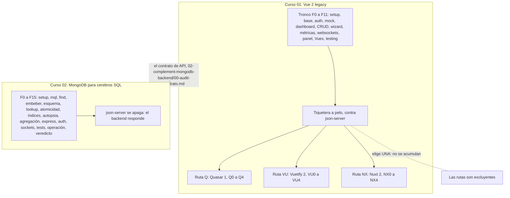

# 🎫 Tiquetera — Un sistema legacy completo, de la pantalla a la base

Paquete de dos cursos para **desarrolladores backend senior** que tienen que
entrar a mantener un sistema heredado real. No son dos cursos que se parecen:
son **las dos mitades del mismo sistema**, y el punto donde se tocan es la
lección principal.

El sistema es **la Tiquetera**, la mesa de soporte de Cuadre Software, una
empresa chica de Itagüí que vende pedidos, cuadre de caja y facturación a bares,
estaderos, tiendas y pizzerías: tickets, comentarios, agentes, prioridades, un
dashboard, un panel de soporte y notificaciones en vivo. Época **2018–2021**,
con todo lo que eso implica. De dónde viene y por qué está como está lo cuenta
la ficha [`00-historia-del-sistema.md`](00-historia-del-sistema.md), que
se lee antes de la Fase 0 de cualquiera de los dos cursos.

> 🧭 **La promesa que une los dos cursos, en una línea verificable:**
> **se cambia el `baseURL` del frontend y la aplicación no se entera.**
>
> El Curso 01 construye el frontend y lo deja viviendo de un mock. El Curso 02
> construye el backend real que reemplaza a ese mock **honrando el mismo
> contrato**. Si al final cambias, a lo sumo, una línea y todo sigue
> funcionando, los dos cursos cumplieron.

---

## 📚 Los dos cursos

### 01 · Vue 2 Legacy — el frontend heredado

📁 [`01-vue2-legacy/`](01-vue2-legacy/README.md)

Vue 2 **a pelo** (Options API, Vue CLI, Vuex 3, Bootstrap 4, jQuery dando
vueltas) y después la pregunta que de verdad te vas a encontrar: *¿y cuando
encima del Vue hay un framework?* Tres rutas opcionales y excluyentes —
**Quasar 1**, **Vuetify 2** o **Nuxt 2** — enseñan a distinguir qué es Vue,
qué es el framework, y qué te está haciendo por debajo.

- **12 fases de tronco** (F0–F11) + **7 apéndices** de consulta (dos, solo
  para Mac con chip M)
- **3 rutas × 5 fases** (Q0–Q4 · VU0–VU4 · NX0–NX4)
- Termina con la Tiquetera completa, testeada, y hablándole a un mock

### 02 · MongoDB para cerebros SQL — el backend real

📁 [`02-complement-mongodb-backend/`](02-complement-mongodb-backend/README.md)

No enseña "aprende MongoDB". Enseña a **desaprender el cerebro SQL con
criterio**, para quien lleva años en Oracle, PostgreSQL, MySQL o SQL Server y
traiciona sus instintos en Mongo sin darse cuenta. Cinco cambios de paradigma,
una autopsia de un anti-patrón medido, y un backend Express/Node 14 que
reemplaza al mock del Curso 01.

- **16 fases** (F0–F15) + **5 apéndices** de consulta
- MongoDB 4.4, driver nativo primero y Mongoose después, Express 4
- Termina apagando json-server y con una suite de contrato en verde

---

## 🗺️ Cómo se enganchan

El Curso 01 deja **deudas declaradas** (💸) que el Curso 02 paga: el cliente
que emite el evento de socket que debería emitir el servidor, el `reporter`
que el navegador inventa, el doble "tomar" sin candado, y el cuaderno de "esto
lo debería hacer el backend" que `SECURITY-NOTES.md` viene acumulando desde la
Fase 2. Ese cobro es buena parte del contenido del Curso 02.

---

## 🕵️ El track forense y los cuadernos

Los dos cursos traen, además de las fases, un aparato para lo que de verdad
haces en un sistema heredado: **investigar**. Son tres piezas por curso y se
usan fuera de orden.

| | Curso 01 | Curso 02 |
|---|---|---|
| `forense-master.md` — la puerta, con el 🩺 índice de síntomas | ✅ | ✅ |
| `forense-fase-NN.md` — el recorrido paso a paso, con salidas literales | 12 + 3 de ruta | 12 |
| `cuaderno-incidentes.md` — tickets vagos, pistas plegadas y solución de referencia | 13 incidentes | 12 incidentes |

**No se leen de corrido.** Una pieza forense se entra por el síntoma —"la tabla
se quedó igual", "esto va lento"— y por eso la puerta de cada curso es su índice
de síntomas y no un índice de fases. Un incidente se trabaja como un ticket real:
se reproduce, se investiga y solo al final se abre la solución.

> ⚠️ **Un cuaderno por curso, con IDs propios.** Los cursos son independientes:
> se puede hacer solo el frontend. Ningún incidente del Curso 01 cita al Curso
> 02, y los dos incidentes de costura del Curso 02 —el frontend apuntando a tu
> backend— entregan el frontend ya construido, así que se resuelven sin haberlo
> escrito.

Cada fase enlaza su pieza desde la sección **⚠️ Errores comunes y pieza
forense**, con un bloque 🧨 **Rompe a propósito** para provocar el fallo en tu
máquina, y reserva sus incidentes en un bloque 📌 al final. Los apéndices no
llevan nada de esto: explican lo que ya está ahí, y no producen código de fase.

---

## 🧭 Cómo usar el paquete

**Si vas a mantener un frontend Vue 2:** haz el Curso 01 completo. Si tu
empresa usa Quasar, Vuetify o Nuxt, sigue con **esa** ruta. Si no usa ninguna,
el tronco ya te dejó donde tenías que estar. El Curso 02 es opcional.

**Si vas a mantener un backend Mongo:** puedes ir directo al Curso 02. No
necesitas escribir el frontend, pero sí conviene leer el plan del Curso 01 y
el contrato: sin saber qué consume el frontend, "no romper el contrato" no
significa nada.

**Si vas a mantener el sistema entero** —el caso más común en un equipo
pequeño—: Curso 01 hasta F11, después Curso 02 completo, y las rutas al final
si aplican. Es el recorrido para el que está diseñado el paquete.

> ⚠️ **F10 (Vuex) y F11 (Testing) del Curso 01 no son opcionales si vas a
> hacer una ruta.** El conflicto central de Q3/VU3/NX3 es *el framework quiere
> el estado que tu store ya controla* — sin F10 no lo ves venir. Y sin F11 no
> puedes escribir la red de seguridad de X0, y **sin red no se migra nada**.

---

## 📂 Qué hay en la raíz

| Archivo | Qué es |
|---|---|
| [`00-historia-del-sistema.md`](00-historia-del-sistema.md) | 📖 **La ficha del sistema**: de dónde viene la Tiquetera, quién la escribió y por qué está como está |
| [`00-convencion-de-git-y-tags.md`](00-convencion-de-git-y-tags.md) | 🏷️ **Cómo versionas tu código mientras haces los cursos.** Dos repos, un tag por fase, tags de ejercicio y los comandos que te dicen dónde te quedaste |
| [`LICENSE.md`](LICENSE.md) | 📜 La licencia del paquete |

> 🧭 **Un paquete, dos cursos, un solo material de autoría.** Este paquete nació como **un curso con dos
> capas** —la pantalla y la base del mismo sistema— que se partió en dos subcursos, y por eso comparten una
> guía, un contrato y un diccionario. El contrato de API se publica y lo lee el alumno: está en
> [`02-complement-mongodb-backend/00-audit-contrato.md`](02-complement-mongodb-backend/00-audit-contrato.md).
>
> El resto del material de autoría (la guía de estilo, las plantillas de fase, los formatos de las piezas
> forenses y del cuaderno, y el diccionario de código) vive aparte y no se publica. Lo que el lector necesita
> de él está escrito en cada curso.

---

## ✍️ Las reglas de forma, en cinco líneas

Estas cinco no se negocian, en ninguno de los dos cursos:

0. **Un repo por curso, y un tag por fase cerrada** — `fase-04-dashboard-tickets`
   y sus hermanos. No ocupan espacio, no cuestan nada, y son la diferencia
   entre "creo que iba por la fase 6" y saberlo.
1. **Código en inglés** — identificadores, endpoints, colecciones, campos,
   constantes y enums. `ticket` es `ticket` en Vue, en Express y en Mongo.
2. **Comentarios, textos de interfaz y narrativa en español** — español
   latinoamericano neutro, **con tuteo**. Nada de voseo ni de vosotros.
3. **Código de época** — Options API, driver nativo antes de Mongoose,
   versiones fijadas. Lo moderno aparece como comparación, no como norma.
4. **Deuda técnica explícita** — se marca 💸, se dice por qué se acepta y en
   qué fase se paga. Aunque la fase sea del otro curso.

---

## ✅ Estado del paquete

Los dos cursos están completos, y su código **se ejecutó** entre el 14 y el 18 de octubre de 2026,
en contenedores, tal como está escrito: el repositorio del alumno construido fase a fase, las
suites en verde, los incidentes de los dos cuadernos reproducidos con su prueba en rojo y luego en
verde, y la promesa del `baseURL` probada llamada por llamada contra json-server y contra el
backend. Cada fragmento publicado se comparó con el código que corrió. El detalle de cada curso está
en la sección «Cómo se validó» de su `README.md`.

Para el Curso 01 necesitas **Node 14** con NVM y **git**; el Curso 02 suma **Docker** para MongoDB.
La Fase 0 de cada curso dice qué instalar y cómo.

---

## 🎓 La promesa, en las palabras del que ya la cumplió

**Del Curso 01:**

> "Me sueltan mañana en un Vue 2 ajeno de 80.000 líneas y no siento pánico: sé
> leer sus patrones, sé dónde vive cada tipo de cosa, sé qué oler, por dónde
> empezar a testear — y sé qué NO tocar todavía."

**Del Curso 02:**

> "Heredé una base Mongo que alguien 'migró' desde Postgres tabla por tabla. Sé
> medir cuánto cuesta eso, sé rediseñarla, y sé decir con números si Mongo era
> la herramienta correcta — o si fue la moda de 2015 con uniforme."

**Del paquete completo:**

> "Apagué el mock, apunté el frontend al backend que escribí, y ninguna vista
> se enteró."

---

## 📜 Licencia y ficción

Texto y código, bajo **CC BY-SA 4.0**. Los detalles y los enlaces están en [`LICENSE.md`](LICENSE.md).

Cuadre Software, la Tiquetera, sus clientes y su gente son **inventados** para estos cursos. Si un
nombre se parece al de una empresa, un producto o una persona reales, es coincidencia; *tiquetera*
es, además, una palabra común en Colombia.
