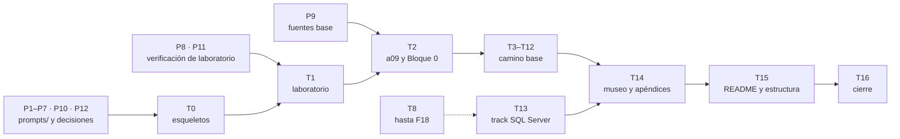

# 🗓️ Plan de producción: tandas, estado y checklist
## Ruta SQL

Este documento dice **en qué orden se prepara y se escribe el curso, cuándo una tanda está terminada y
dónde va la producción**. Hay dos fases: la **preparación** (tandas `P1`–`P11`), que solo toca
`prompts/` y el laboratorio de verificación y no escribe ni una fase, y la **escritura** (tandas
`T0`–`T16`), que arranca cuando está cerrada la parte de la preparación que cada tanda necesita
(regla 7). Es operativo: se actualiza al
cerrar cada sesión, y cualquier sesión que retome `ruta-sql/` empieza leyendo §3 (estado), §6
(deuda), §7 (bitácora) y §8 (checklist).

- La forma la manda [`guia-de-estilo-y-convenciones.md`](guia-de-estilo-y-convenciones.md).
- Los nombres, [`contrato-de-nombres.md`](contrato-de-nombres.md) y
  [`diccionario-de-terminos.md`](diccionario-de-terminos.md).
- El qué lo manda [`alcance-del-proyecto.md`](alcance-del-proyecto.md).
- Horas, ejercicios y fichas: [`propuesta-fases-y-alcance.md`](propuesta-fases-y-alcance.md) y
  [`propuesta-apendices-y-alcance.md`](propuesta-apendices-y-alcance.md).
- La entrada de cada tanda es su prompt: [`prompts-de-fase.md`](prompts-de-fase.md),
  [`prompts-de-apendice.md`](prompts-de-apendice.md) y
  [`prompts-sqlserver-fase.md`](prompts-sqlserver-fase.md).
- **El orden lo manda este documento.**

> **Caducidad:** es un documento de producción. Al cerrar T16 se conserva en `prompts/` como
> referencia (que no viaja al repositorio público), salvo que Oskar pida borrarlo;
> `_desechable-propuesta-ruta.md` se borra con su permiso. **No se cita desde ninguna fase, apéndice
> ni README.**
>
> **Vigencia:** 2026-10-12.

**Salto rápido:** [1](#1--las-reglas-de-orden) · [2](#2--qué-es-una-tanda) · [3](#3--estado) · [4](#4--las-verificaciones) · [5](#5--las-tandas-una-por-una) · [6](#6--deuda-de-enlaces-abierta) · [7](#7--bitácora) · [8](#8--checklist-final) · [9](#9--directorios-de-zz-code)

---

## 1. 🧭 Las reglas de orden

Son veintisiete fases, once apéndices, cinco fases de track y tres documentos vivos. Escritos en
orden de carpeta, el Bloque II mediría sobre un modelo que todavía no existe y la bitácora iría
siempre atrasada. Las tandas van por **dependencia**, y cada una deja el curso coherente y
publicable hasta donde llega. Diez reglas:

1. **Ninguna tanda se cierra con un documento vivo ni un solucionario atrasado.** Las mediciones de
   la tanda entran en `bitacora-de-medicion.md`, los errores en `a08-catalogo-de-errores.md` y los
   instintos en `INSTINTOS.md`, y cada documento con ejercicios nace con su
   `soluciones/<mismo-nombre>.md` completo y ejecutado (D18, guía §10.3), en la misma tanda.
2. **Ningún enlace interno apunta a un documento que no existe.** La referencia va en prosa y se
   anota en la deuda de enlaces (§6); la tanda que escribe el destino la convierte en enlace.
3. **Los README y `0-ESTRUCTURA-CURSO.md` se escriben en una tanda final y aparte (T15), y ninguna
   otra tanda los toca.** Escribir una fase o un apéndice **no crea ni actualiza** ningún
   `README.md` (ni el de la raíz del curso ni los de `src/`) ni `0-ESTRUCTURA-CURSO.md`. Tampoco se
   agregan filas, enlaces ni estados "para ir adelantando". Lo que una tanda querría decir en uno de
   ellos se anota en §6 como deuda de T15. **Mientras tanto, el mapa son los desechables**: §3 de
   este plan para el estado y la propuesta de fases §11 para el temario.
4. **Nada se nombra sin comprobarlo en la misma sesión**: imagen y digest, versión, función del motor,
   URL por código de estado, libro con edición y capítulo.
5. **Una fase no se cierra sin haberse corrido entera**: el laboratorio, las mediciones, la rotura y
   la prueba de fuego, con la salida literal y fechada.
6. **Ningún número de Oracle ni de SQL Server entra en un documento publicado.** Las corridas
   privadas viven fuera del repositorio (alcance §6.1).
7. **Ninguna tanda de escritura empieza con su preparación abierta.** Cada una exige lo suyo:
   - **T0** exige P7 y P10: todas las decisiones cerradas y trasladadas. ✅ desde el 30/09/2026.
   - **T1** exige además **P8** (la verificación de laboratorio) y **P11** (lo verificado,
     trasladado): sin digests, sin RAM medida y sin perfiles calibrados no hay `a01`, `a02`, `a05`
     ni `a06`. ✅ desde el 11/10/2026.
   - **T2** exige además **P9**: `a09` cita el texto de las licencias, y F00–F02 citan los libros
     base. ✅ desde el 11/10/2026.
8. **Sin commits**: git lo hace Oskar. Se borra con `rm`, nunca con `git rm`.
9. **La máquina de Oskar no se toca sin permiso**: nada se instala ni genera cargos. Los contenedores
   de las pruebas llevan la etiqueta `curso=ruta-sql`, usan **puertos altos y aleatorios** (nunca los
   de por defecto, que otro contenedor puede tener ocupados; el curso sí puede publicarlos) y se
   borran **con sus volúmenes** al terminar, comparando contra un inventario inicial; nada que ya
   existía se borra.
10. **Todo el código de las sesiones va a `zz-code/`**: un directorio por sesión
    (`python3 zz-code/nuevo.py ruta-sql`), registrado en §9 con su estado. Lo efímero (logs, salidas,
    copias) va a su `salidas/`; nada en el scratchpad ni en `/tmp`. Los comandos sueltos que producen
    algo citable se copian a un archivo, y el `README.md` de cada directorio dice cómo correr y medir
    cada prueba. Ningún documento del curso cita `zz-code/` (guía §19.5).

Las dependencias, en un vistazo:



**Prioridad si el tiempo aprieta:** T1 → T2 → T3 → T4 (Bloque 0 y Bloque I, con su boss: un curso
utilizable por sí solo), después **T7** (F15–F16, el folio sin huecos, que es la fase estrella y el
primer vídeo). Lo que falte de las tandas saltadas va en prosa y a la deuda de enlaces.

---

## 2. 📦 Qué es una tanda

### 2.0 Una tanda de preparación

Un documento de `prompts/`, o un paso que lo deja coherente con los demás: una decisión, una
verificación, un traslado. **No crea nada fuera de `prompts/`**, salvo P8, que prueba en
`zz-code/` y deja sus hallazgos en `prompts/verificacion-de-laboratorio/hallazgos.md`. Terminada cuando sus enlaces pasan §4 y los documentos que la
citan están al día.

### 2.1 Una tanda de escritura

Un grupo de fases o apéndices que se enlazan entre sí, con su laboratorio corrido. La rutina, igual
en todas:

1. Pegar el prompt de cada documento y seguir su protocolo de tres pasos.
2. Tener delante el checklist de la guía §16, que se recorre **al cerrar cada archivo**.
3. Releer la ficha de la propuesta: el "Entra" es el piso, la apuesta y la rotura son candidatas.
4. Comprobar versiones, funciones del motor, URLs y libros **antes** de escribirlos.
5. Ejecutar y anotar (el error antes de arreglarlo), después escribir.
6. Escribir el solucionario de cada documento en la misma sesión, y alimentar los tres documentos
   vivos.
7. Resolver la deuda de enlaces que la tanda cierra.
8. Correr las verificaciones de §4 (`verificar-corpus.py` en cero, sin el aviso `README`).
9. Actualizar §3, §6, §7 y §8 de este documento, que es el mapa hasta T15.

### 2.2 Peso de cada tanda

```text
ligera   T0 · T15 · T16                         esqueletos, README y estructura, o cierre
normal   T2 · T3 · T4 · T5 · T6 · T7 · T8 · T9 · T12 · T14
densa    T1 · T10 · T11 · T13                   infraestructura nueva: lab, API y broker, SQL Server; T10 por ser la fase de 15 h (D49)
```

Las **densas** llevan verificación de imagen, digest y memoria antes de escribir una línea, anotada
con fecha en el documento.

---

## 3. 📊 Estado

Leyenda: ⬜ pendiente · 🟡 en curso · ✅ terminada y verificada.

| Tanda | Entrega | Docs nuevos | Peso | Estado |
|---|---|---|---|---|
| **P1** | Guía de estilo y convenciones, derivada de la de la NoSQL Lite | 1 | — | ✅ |
| **P2** | Alcance del proyecto | 1 | — | ✅ |
| **P3** | Propuestas de fases y de apéndices, con el registro de decisiones | 2 | — | ✅ |
| **P4** | Plantillas de capítulo (tema, Bloque 0, árbitro, track, apéndice) | 1 | — | ✅ |
| **P5** | Prompts de fase, de apéndice y del track | 3 | — | ✅ |
| **P6** | Este plan | 1 | — | ✅ |
| **P7** | Decisiones D1–D16 cerradas por Oskar | — | — | ✅ |
| **P8** | Verificación de laboratorio: imágenes, digests, RAM, emulación, drivers, perfiles de volumen | 1 | densa | ✅ |
| **P9** | Fuentes base: edición y año de los seis libros de la guía §11; texto de las licencias para `a09` | — | — | ✅ |
| **P10** | Traslado de las decisiones a alcance, guía, propuestas y prompts | — | — | ✅ |
| **P11** | Traslado de lo verificado en P8 y P9 (versiones, perfiles, driver, ediciones) | — | — | ✅ |
| **P12** | Alineación con los lineamientos de producción: diccionario, contrato de nombres, `prompts/README.md`, verificador, guía §17 y §19, alcance §12.1 | 5 | — | ✅ |
| **T0** | Arranque: esqueletos de los documentos vivos y de a03, a04, a07, y `src/.gitignore` | 6 | ligera | ✅ |
| **T1** | Laboratorio: a01, a02 (+ compose), a05 (+ generador), a06 | 4 | densa | ✅ |
| **T2** | a09 y Bloque 0: F00, F01, F02 | 4 | normal | ✅ |
| **T3** | Bloque I, primera mitad: F03, F04, F05 | 3 | normal | ✅ |
| **T4** | Bloque I, segunda mitad: F06, F07, F08 y 💀 boss I | 3 | normal | ✅ |
| **T5** | Bloque II, primera mitad: F09, F10, F11 | 3 | normal | ✅ |
| **T6** | Bloque II, segunda mitad: F12, F13, F14 y 💀 boss II | 3 | normal | ✅ |
| **T7** | Bloque III, primera mitad: F15, F16 | 2 | normal | ✅ |
| **T8** | Bloque III, segunda mitad: F17, F18 y 💀 boss III | 2 | normal | ✅ |
| **T9** | Bloque IV: F19, F20, F21 y 💀 boss IV | 3 | normal | ✅ |
| **T10** | F22: la exportación, CDC y la cola en la base | 1 | densa | ✅ |
| **T11** | F23: PostgREST y RLS, 💀 boss V y 💀☕ boss del puente (Java 25 y Apache Artemis) | 1 | densa | ✅ |
| **T12** | Bloque VI: F24, F25, F26 y el cierre de 🏆 "Un martes" | 3 | normal | ✅ |
| **T13** | Track SQL Server: ss01–ss05 y ssa-01 | 6 | densa | ✅ |
| **T14** | a10 (+ extraer la prueba del Access de `zz-code/`) y cierre de a03, a04, a07, a08 | 1 | normal | ✅ |
| **T15** | Los README y la estructura, aparte: el README del curso, los de `src/` y `0-ESTRUCTURA-CURSO.md` | 2 | ligera | ✅ |
| **T16** | Cierre: verificación global, borrar plan y propuesta | — | ligera | ✅ |
| **E9** | Publicación: la carpeta lista para su repositorio público, sin `prompts/` | — | ligera | ✅ (falta la copia, que hace Oskar) |

> 🚦 **Dónde está la producción (14/10/2026).** **T0 a T8 ✅**: el Bloque 0 y los Bloques I, II y III completos, con sus tres
> boss; T7 y T8 esperan la revisión de Oskar. Los pasos 1 se hicieron de a varias tandas: T0–T5 (D23–D42) y T7–T8 (D43–D45), en la
> propuesta de fases §12. **T9 cerrada (14/10/2026, por defecto):** F19, F20 y F21 con sus solucionarios, y el 💀 boss IV con su arnés (2 de 5 en el punto de partida, 5 de 5 con la solución fuera del repositorio). **T10 cerrada (14/10/2026, por defecto):** F22 con su solucionario. **T11 cerrada (14/10/2026, por defecto, D50):** F23 con su solucionario, el boss V y el boss del puente. **T12 cerrada (15/10/2026, D50 y D51):** F24, F25 y F26 con sus solucionarios, y el 🏆 "Un martes" (0 de 5 en el punto de partida, 5 de 5 con la solución fuera del repositorio); el curso base está entero. **T13 cerrada (18/10/2026, D50 y D52):** ss01–ss05 y ssa-01 con sus solucionarios, y `lab` con el extra `sqlserver`. **T14 cerrada (18/10/2026, D50):** `a10` con `src/a10-el-access-de-museo/` vuelto a ejecutar, y `a03`, `a04`, `a07` y `a08` cerrados con sus ejercicios y solucionarios. **T15 cerrada (18/10/2026, D51):** el README del curso con las tres rutas, `0-ESTRUCTURA-CURSO.md` y los diez README de `src/`. **T16 y E9 cerradas (18/10/2026, por defecto):** el curso está terminado y listo para copiar a su repositorio público. Queda lo de Oskar: commits, tags, la copia sin `prompts/`, `limpiar.py --borrar` y las decisiones de `prompts/pendientes-a-futuro.md`. Lo que Oskar puede querer
> mirar está en la bitácora (§7, 14/10, T7 y T8).

**Total: 91 documentos del curso** (27 fases, 11 apéndices, 5 fases de track, **43 solucionarios**
—uno por cada uno de esos documentos, todos con ejercicios—, los 2 de raíz que crecen con el curso
—`INSTINTOS.md` y `bitacora-de-medicion.md`—, los 2 que se escriben en T15
—`0-ESTRUCTURA-CURSO.md` y el README— y la historia), más los 14 documentos de `prompts/` que
existen durante la producción (2 de ellos desechables, y `verificacion-de-laboratorio/hallazgos.md`), los dos scripts del verificador y el código
de `src/`.

**Por qué el track va después del Bloque VI:** es opcional y depende del camino base hasta F18. Se
puede adelantar a después de T8 si hay un motivo (un vídeo, un lector de un shop .NET), sin tocar
ninguna otra tanda.

**Por qué a09 va en T2 y no en T1:** no bloquea el laboratorio, pero la regla de publicación se usa
desde F03, y conviene que el texto de la licencia esté citado antes.

---

## 4. 🔍 Las verificaciones

Se corren al cerrar cada tanda, y todas en T16.

**El verificador del curso**, desde la raíz de `ruta-sql/` (guía §19.4):

```bash
python3 prompts/verificar-corpus.py                 # enlaces, anclas, restos, ejercicios, palabras, diagramas
python3 prompts/verificar-corpus.py --publicacion   # además, prompts/ y material privado (E9)
```

- Reemplaza el script de enlaces y anclas que estaba aquí hasta el 06/10/2026, que calculaba mal las
  anclas de los encabezados con ⚠️, ⚖️ o 🗂️ (el U+FE0F que GitHub conserva).
- Su aviso `README` salta si `README.md` o `0-ESTRUCTURA-CURSO.md` aparecen antes de T15; T15 cambia
  `ESCRITOS_LOS_README` a `True`.
- Cada bloque `mermaid` nuevo se dibuja con `mmdc` antes de publicarlo (D-12, guía §19.1).

**Ningún documento del curso cita un desechable**, desde la raíz de `ruta-sql/`:

```bash
grep -ln "_desechable-" *.md    # no debe devolver nada
```

**Ningún README cambió fuera de T15**, desde la raíz de `ruta-sql/` (solo lectura: git lo maneja
Oskar):

```bash
git status --short -- ':(glob)**/README.md'    # fuera de T15 no debe devolver nada
ls 0-ESTRUCTURA-CURSO.md 2>/dev/null             # antes de T15 no debe existir
```

**Ejercicios contra la propuesta y longitud del cuerpo:** los dos los cuenta el verificador
(`EJERCICIOS`, `NUMERACION` y `PALABRAS`), contra la propuesta §11 y §10 y la banda de la guía §9.

**Ningún número de Oracle ni de SQL Server**: no hay forma de automatizarlo bien. Al cerrar cada
fase se relee cada mención de Oracle y de SQL Server y se confirma que va como 🪞🔒, como estructura
de plan o como mensaje de error.

**URL externas**, por código de estado y sin seguir a ciegas las redirecciones: aterrizar en la
portada de la documentación cuenta como roto.

---

## 5. 📦 Las tandas, una por una

Lo que cada documento escribe, pesa y arriesga está en su ficha y en su prompt. Aquí va solo lo que
no cubren: por qué la tanda va en ese lugar y cuándo está terminada.

### P1 a P6 — Los documentos de `prompts/`

Escritos el 2026-09-30, en este orden: el alcance primero, porque decide el qué; la guía, porque
todo lo demás la cita; las propuestas, que fijan nombres, horas y ejercicios; las plantillas; los
prompts, que citan las fichas en lugar de copiarlas; y este plan. Si uno cambia, se corrigen después
los que cuelgan de él, **nunca al revés**.

### P7 — Decisiones

Cerradas por Oskar el 2026-09-30 sobre la tabla de la propuesta de fases §12. Cambiaron respecto de
lo propuesto: **D3** (el puente Java pasa a ser un boss y F22 queda en SQL y Python), **D4** (S y M
por defecto, M acotado por 16 GB), **D9** (se suma el boss del puente), **D10** (palabras completas
y convención habitual de SQL), **D11** (Java solo en el boss y en `a10`), **D12** (última estable o
LTS a la fecha de la verificación) y **D13** (`legacy` donde hace falta).

### P8 — Verificación de laboratorio

**Entrega:** `prompts/verificacion-de-laboratorio/hallazgos.md` (formato de la Lite: `H1`, `H2`…).
Los scripts, el `compose.yaml` de prueba y los *logs* van a un directorio de `zz-code/` (regla 10),
con su `README.md` de corrida y medición; `hallazgos.md` lo nombra. **Qué se verifica:**

- **las versiones según D12** (la última estable, o la última LTS donde el fabricante tenga esa
  línea: MySQL y Java), con la fecha de la comprobación;
- las imágenes de Postgres, MySQL, Oracle Free, MongoDB, Artemis, PostgREST y SQL Server: digest,
  arranque, *healthcheck*, **memoria en reposo y con el perfil M cargado**;
- **Oracle Free en arm64**: si corre nativo o necesita emulación, y cuánto tarda en estar listo;
- **SQL Server con Rosetta en Docker Desktop y en Podman** (riesgo declarado en el alcance §8);
- la tabla de RAM: qué combinaciones de perfiles entran en 16 GB;
- los drivers de Python de los tres motores, con transacciones y `autocommit`, y la elección del de
  MySQL;
- **el prototipo del generador**: que produce la suciedad con las proporciones de la historia, que
  guarda la verdad y que los perfiles S y M se cargan en un tiempo razonable (D4);
- las funciones que las fases dan por supuestas en la versión elegida: `uuidv7()`, `WITHOUT
  OVERLAPS`, *skip scan*, `pg_hint_plan` disponible, `pgstattuple`, `pg_trgm`, `pgvector`.

**Terminada cuando** todas tienen un hallazgo con fecha, y lo que no funciona tiene alternativa
decidida. Solo macOS arm64 es obligatorio; Linux y WSL2 quedan como pendiente transversal, igual que
en la Lite.

✅ **Hecha el 11/10/2026**, en `zz-code/ruta-sql-20261011-2b0e/`: trece hallazgos (H1–H13). Lo que no
funcionó tiene su alternativa: MongoDB 9 no arranca (8.0.20, como la Lite), SQL Server no arranca en
Podman (el track exige Docker Desktop en Apple Silicon), `pg_hint_plan` no viene en la imagen
(ejercicio 🔥 con imagen derivada).

### P9 — Fuentes base

Edición y año de los seis libros de la guía §11, comprobados una vez en páginas de la editorial o
del autor. **Los capítulos concretos no se fijan aquí**: se comprueban en la tanda que los cita. Y el
texto vigente de las licencias de Oracle Database Free y de SQL Server en lo que toca a divulgar
resultados, con enlace y fecha, para `a09`.

✅ **Hecha el 11/10/2026** (`hallazgos.md` §F1 y §F2). Lo que cambió: Kleppmann tiene segunda edición
con Riccomini (2026), el de Kyte es la cuarta, de Kuhn y Kyte (21c), y **los *Free Use Terms* de Oracle
Free no tienen cláusula DeWitt**: Oskar decidió mantener la regla igual (D20).

### P10 — Traslado de las decisiones

Hecho el 2026-09-30: lo decidido en P7 pasó a alcance §9, §7.1, §11, §12 y §13, a la guía §5, §10.1,
§12 y §18, a las dos propuestas y a los prompts de fase y de apéndice. La propuesta de fases queda
como temario y registro.

### P11 — Traslado de lo verificado

Lo que salga de P8 y P9 pasa a su sitio: versiones y digests a `a02` (y a la guía §18, que hoy dice
que están sin fijar), conteos de los perfiles a `a05` y al alcance §7.1, el driver de MySQL a la
propuesta de apéndices §14, las ediciones de los libros a la guía §11, y cualquier función de
Postgres que no exista en la versión elegida a la ficha de la fase que la usaba. **Terminada cuando**
ningún documento de `prompts/` dice "a verificar" sobre algo que P8 o P9 ya verificaron, y §4 sale
limpia sobre `prompts/`.

✅ **Hecha el 11/10/2026**: alcance (§4, §6.1, §7.1, §8, §9, §12), guía (§6.1, §10.1, §11, §12, §18 y
§19), las dos propuestas (con D19–D22 en el registro), el contrato (§2, §4, §5 y §8 con los perfiles),
los tres archivos de prompts y el README de `prompts/`. Las versiones y los digests no se copiaron a
ningún documento: viven en `hallazgos.md` hasta que `a02` los fije (D12).

### T0 — Arranque

**Entrega:** los esqueletos de `INSTINTOS.md`, `bitacora-de-medicion.md`,
`a08-catalogo-de-errores.md`, `a03`, `a04` y `a07`, con su encabezado y la nota "crece con el
curso", **sin enlaces** a fases que todavía no existen; y `src/.gitignore`, el único del curso (guía
§19.5). `0-ESTRUCTURA-CURSO.md` **no** se crea aquí:
va en T15 (regla 3).

### T1 — Laboratorio

a01, a02, a05 y a06, en ese orden, más `src/lab/compose.yaml` y `src/lab/generator/`. **Terminada
cuando** `lab up`, `lab load --profile m` y `lab measure` corren en macOS arm64 con los tres motores,
y la prueba de fuego de F01 da el número del generador.

### T2 a T9 — El camino base hasta el Bloque IV

Una tanda por medio bloque, en orden. Cada tanda que cierra un bloque (T4, T6, T8, T9) incluye su
💀 boss, con el sistema roto de partida en `src/` y la solución fuera del repositorio publicado,
como en la Lite. **Terminadas cuando** sus fases pasan la guía §16, los documentos vivos están al
día y §4 sale limpia.

### T10 y T11 — La base en la red

T10 es densa (D49, por ser la fase de 15 h), aunque F22 trabaja con Postgres, Python y la decodificación lógica, que ya están en el
laboratorio. T11 es densa porque suma dos perfiles del compose: `api` (PostgREST) y `puente` (Apache Artemis
y el servicio Java 25 del boss del puente). Los dos se verifican antes de escribir; P8 ya dejó sus
arreglos (`hallazgos.md` §H8 y §H9).

### T12 — El árbitro

**Terminada cuando** cada argumento de F24–F26 cita su entrada de la bitácora, y el 🏆 "Un martes"
cierra con la facturación corriendo sobre la base nueva.

> ✅ **Resuelto en T12 (D50 y D51):** los convenios quedaron declarados sin tocar la caja, y el boss lo dice. Lo que sigue es el registro.
>
> ⚠️ **Antes de escribir la facturación (anotado en T4, 14/10/2026):** los protocolos de la caja no siguen los
> convenios de `planillas/convenios_2026.xlsx` (de 427.230 prácticas de 2026 con obra social, 154.053 caen en un
> convenio). Ninguna cifra publicada hasta T4 depende de eso. Si el Bloque VI cruza protocolos con convenios, o el
> generador hace que los protocolos respeten los convenios (un flujo nuevo, sin mover lo publicado), o la fase
> lo declara y mide sobre lo que hay. Es una decisión de Oskar en el paso 1 de T12.

### T13 — El track

Opcional y movible (§3). Densa por la emulación.

### T14 — El museo y los apéndices que crecen

`a10` copia la prueba de concepto de `zz-code/ruta-sql-20261006-fc2f/accdb-museo/` a
`src/a10-el-access-de-museo/` (sin `lib/` ni `out/`) y vuelve a ejecutar todo; su `README.md` se
copia **sin editarlo**, y se reescribe en T15. El directorio de `zz-code/` pasa a *extraído* en §9. `a03`,
`a04`, `a07` y `a08` se cierran: índice completo y ejercicios finales. `a08` llega a cincuenta
entradas o dice cuántas le faltan.

### T15 — Los README y la estructura

Una tanda propia, **después de que todo el contenido exista**, porque un README o un temario escritos
a medias describen un curso que no es el que se publica. Escribe:

- `0-ESTRUCTURA-CURSO.md`: el temario en una página, con horas, ejercicios, estado real y enlace a
  cada fase, apéndice y boss (como el `0-ESTRUCTURA-CURSO.md` de la Lite). Sale de la propuesta de
  fases §11 y de §3 de este plan, que dejan de ser el mapa;
- el `README.md` de la raíz del curso (qué es, para quién, cómo se sigue, el track y los apéndices);
- los README de `src/`, incluido el que `a10` trajo de `zz-code/` sin editar.

Salda toda la deuda de §6 dirigida a T15. **Terminada cuando** los tres describen lo que existe y
sus enlaces pasan §4.

### T16 — Cierre

**Terminada cuando** §4 sale limpia en todo el curso, las URL externas están verificadas, ningún
directorio de `zz-code/` queda *vigente* en §9, los contenedores del curso están borrados con sus
volúmenes, y —con permiso de Oskar— `_desechable-propuesta-ruta.md` está borrado sin menciones. Este
plan se conserva en `prompts/` como referencia, salvo que Oskar pida borrarlo.

---

## 6. 🧾 Deuda de enlaces abierta

Cada mención en prosa que espera a que exista su destino. Formato: origen → destino → tanda que la
cierra.

| Origen | Destino pendiente | La cierra |
|---|---|---|
| — | ninguna abierta desde T14 (18/10/2026): la de `a06` a `a10` se cerró, junto con las menciones de F04 y de la historia | — |

---

## 7. 📓 Bitácora

Una entrada por sesión, **la más reciente arriba**: qué se cerró, qué quedó a medias y por qué, qué se
comprobó y cómo, **las trampas que la próxima sesión debe conocer**, los recursos que quedan
levantados, el directorio de `zz-code/`, los tags para el autor y qué sigue.

**2026-10-18 · T16 y E9, cerradas: el curso terminado.** Pedido de Oskar: *"Decisiones por defecto, cerremos T16 y E9 para culminar la elaboración del curso"*. **Restos de producción:** los 📌 *Pendientes sugeridos* de F03–F07, F25, F26 y ss01–ss05 salieron de lo publicado y pasaron a `prompts/pendientes-a-futuro.md`, con lo ya resuelto marcado; F22 dejó de nombrar "T11". **Deuda de palabras (D51):** F19–F23 llegan a su banda (4.142, 4.041, 4.004, 5.005 y 5.017), con prosa de mecanismo y sin cifras sin ejecutar: `jsonb` por dentro y Oracle (F19), el validador, las *Duality Views* y el tamaño del documento, 1.209 B de media (F20), trigramas y raíces con un hallazgo, **M-78: el diccionario `spanish` junta MARIA y MARIO, 8.149 contra 4.382** (F21), `now()` contra `clock_timestamp()`, la replicación lógica con `max_slot_wal_keep_size` en `-1`, NOTIFY y las colas de Oracle (F22), PostgREST paso a paso, el JWT, la política vista en el `EXPLAIN` como condición de índice, quién no pasa por RLS, lo que no protege, VPD y cómo se prueba (F23). El conteo de F19 cortaba en el 🧪 de su sección 7 (pasó a ✍️). **Otras correcciones:** `a02` con PostgREST, Artemis y DAB (perfil, versión, digest, puertos, memoria); F07 remite a la Fase 23 para el "quién"; la nota del UUIDv7 en F10 **no se agregó** (regla del track; queda para Oskar); "del repositorio" pasó a "del mismo autor" donde se nombran otros cursos; un comentario de `src/19-…/04_mysql_setup.sql` citaba `zz-code`. **URL:** 281; 242 con 200; 34 de MySQL con 403 (bloqueo a clientes sin navegador, como en T12); la de muestreo dinámico de Oracle (404) pasó a su página de la 26; el PDF de Bioanálisis ya no existe y salió de las fuentes de la historia. **Cierre:** el laboratorio borrado con `docker compose --profile '*' down -v` (8 contenedores, 6 volúmenes, la red; inventario en `zz-code/…527b/t16/`); las imágenes del curso (las de los motores y `ruta-sql-libreoffice:a10`, `ruta-sql-uv-mssql:t13`, `ruta-sql/postgres-hint-plan:f13`) quedan para Oskar; `zz-code/`: los seis directorios *archivados* o *extraído*, el README de `d471` completado, vista previa de `limpiar.py` (8 GB, sin borrar; ojo: `527b/salidas/` tiene el registro del incidente del `prune`); `_desechable-propuesta-ruta.md` copiado a `zz-code/…527b/t16/` y borrado con `rm`. **E9:** `LICENSE.md` (CC BY-SA 4.0, aviso de ficción y licencias de lo que se baja), sección de licencia y ficción en el README, `uv` entre los requisitos, `.gitignore` de la raíz (sistema operativo y editores); verificador del curso 0/0 en los dos modos y el de `zz-instrucciones` con 0 en los cuatro grupos de E9. **Queda para Oskar:** los commits y los tags (los de las fases, los del track, `apendice-a02-compose`, `apendice-a05-la-caja`, `apendice-a10-access-de-museo`), la copia de la carpeta sin `prompts/`, `limpiar.py --borrar`, las imágenes, y `prompts/pendientes-a-futuro.md`.

**2026-10-18 · T15, cerrada: los README y la estructura.** Pedido de Oskar: *"Termina T13 y avanza hasta T15"*; paso 1 por D51. **Escrito:** `README.md` del curso (qué es, para quién, cuánto cuesta, los motores, la empresa, **las tres rutas de D51**: mínima F00–F08 en 60 h, rendimiento F00–F18 en 160 h, completa con el track en 292 h, los boss, la organización y dónde encaja, con la Lite y el curso de Docker solo en prosa); `0-ESTRUCTURA-CURSO.md` (las 27 fases con horas, ejercicios y estado, el track, los diez apéndices, los seis boss y el martes con sus enlaces, la nota de palabras de F19–F23 y el orden de escritura); los README de `src/` (global, `lab/`, los cinco `boss/`, `puente/`, `martes/` y el de `a10`, reescrito). **También:** `ESCRITOS_LOS_README = True`; `src/.gitignore` ignora `23-…/puente/lib/`, que el `pom.xml` llena y no estaba ignorado; la convención de git pierde la nota de "curso en preparación". **Comprobado:** la descarga de las dependencias del puente con la imagen de Maven de `a02` (tres jars, en `zz-code/…527b/t15/puente-lib/`); §4 en 0 errores en los dos modos (los cinco avisos de palabras de F19–F23 siguen para T16); los enlaces de los README de `src/`, uno por uno. **Error durante el trabajo:** el README decía "siete boss" (son seis más el martes) y que Podman servía para el camino base, cuando solo se probó con SQL Server; corregido antes de verificar. **Deuda de §6:** no había ninguna dirigida a T15. **Recursos:** Postgres, PostgREST y DAB arriba; SQL Server, MySQL, Oracle, Mongo y Artemis detenidos. **No se volvió a levantar SQL Server ni Artemis** porque la VM tenía 2,5 GB libres con catorce contenedores ajenos al curso corriendo: hacerlo arriesgaba matarlos por memoria. **Tags para el autor:** ninguno propio de T15. **Sigue:** T16, con permiso de Oskar para lo que borra.

**2026-10-18 · T14, cerrada: el museo y los apéndices que crecen.** Pedido de Oskar: *"Termina T13 y avanza hasta T15"*; paso 1 por D50. **Escrito:** `a10-el-access-de-museo.md` y su solucionario (6 ejercicios); `src/a10-el-access-de-museo/` con los siete archivos y el `README.md` de `zz-code/…fc2f/accdb-museo/` sin editar, más `Dockerfile.libreoffice` (LibreOffice 25.2.3, Python 3.13.5 y mdbtools 1.0.1 sobre `debian:trixie-slim` por digest, etiquetada); `a03` (correr un archivo en los tres clientes, `\timing`, `\watch`, CSV, `EXIT` de `sqlplus`, cuándo usar qué, 8 ejercicios); `a04` (tamaños y relleno, WAL, estadísticas acumuladas, SQL Server en `measure` y `race`, cuándo usar qué, 8 ejercicios); `a07` entero (desde Access y T-SQL, hacia atrás, entre motores con los falsos amigos, aislamiento por comportamiento, la NoSQL Lite, el glosario con otros países y fuentes, MariaDB, 6 ejercicios corridos en los tres motores); `a08` con E-102 y 10 ejercicios (102 entradas); los cinco solucionarios; bitácora M-75 a M-77; enlaces a `a10` desde `a06`, F04 y la historia; nota de `--patience` en ss02. **Medidas y hallazgos:** el ciclo del museo dio los dos CSV idénticos byte a byte a los del 29/09, con Java 25.0.4.1 y Python 3.13; el CSV de `mdb-export` es idéntico al de Jackcess; `mdb-sql` 1.0.1 devuelve 0 filas con `IS NULL` (son 64) y se cae con `-P`; las pruebas del `.bas` dan 40, 31 y 39 de 40 (y 38 desde 1900), **pero la ventana "por defecto" cambió**: 1930 en LibreOffice 25.2.3 y 1950 en 26.2.1, así que el tercer número se publica con la ventana explícita (M-77); la carga de la caja deja `Edad` vacía como 1.481 `''` y 1.417 `NULL` en Postgres, 2.898 `''` en MySQL y 2.898 `NULL` en Oracle; `||` es un `OR` en MySQL; `coalesce(x, '') = ''` da 0 en Oracle; el WAL de cien filas va de 160 a 100 B por fila en tres corridas (M-75); el `UPDATE` que no cambia nada hace crecer la tabla un 49 % (M-76); el *write skew* `SERIALIZABLE` en SQL Server salió "imposible" una vez con la paciencia de fábrica (E-102) y la víctima del 1205 cambia de corrida en corrida. **Errores durante el trabajo:** (1) afirmé en a10 que la Fase 03 decía algo que no dice, y lo cambié antes de publicar; (2) el solucionario de a07 recomendaba `coalesce` para Oracle, y la prueba mostró que da 0: quedó `NULLIF`; (3) escribí "unos dos meses" para 70.073 protocolos sin medir el ritmo, y son más de cuatro; (4) dos comandos en zsh con la orden en una variable no corrieron, y se pasaron a funciones; (5) la primera carrera de `lock_timeout` no lo provocaba (la permutación dejaba confirmar antes). **Recursos y trampas para la próxima sesión:** **Oracle no tenía la caja**: su volumen se recreó el 14/10 y solo existía `ALAMEDA`; se cargó `LEGACY` con las cuatro tablas de M (`correr-src.sh` ganó `LAB_ORACLE_HOST`). **Otra carga de la máquina, ajena al curso, dejó la VM de Docker sin memoria** y mató por OOM a Artemis (21:57), SQL Server (22:47) y MySQL (22:49, hora de Córdoba); no se tocó ningún contenedor ajeno, y desde ahí se trabajó con un motor a la vez. La caja que dice `lab measure` en Postgres es `3e59292e9918` y en SQL Server `258082ddb7fa` (la de T9, que agrega los antibiogramas). **Lo que el lab deja:** Postgres, PostgREST y DAB arriba; SQL Server, MySQL, Oracle, Mongo y Artemis detenidos, con sus volúmenes; la imagen `ruta-sql-libreoffice:a10`. **`zz-code/`:** `…fc2f/` pasa a *extraído*; `…527b/` suma `a03/`, `a04/`, `a07/`, `a08/` y `a10/`. **Tags para el autor:** `apendice-a10-access-de-museo`. **Sigue:** T15.

**2026-10-18 · T13, cerrada: el track de SQL Server.** Pedido de Oskar: *"sugiere respuesta para las decisiones"* (las tres de T12) y *"Sí de acuerdo, comienza con T13"*; después, *"Termina T13 y avanza hasta T15"*. **Antes del track (las tres decisiones de T12):** `shm_size: 512m` en Postgres, con M-58 (con 64 MB y cuatro *workers* falla desde `work_mem` 4 MB; con 512 MB, hasta 32 MB; `shm_size` corre el borde, no lo elimina) y E-69 al día; `99_deshacer.sql` en `zz-code/…80f7/martes-solucion/` (el punto de partida vuelve a 0 de 5); los núcleos del SIH en la historia (dos Xeon de 16, primario y *standby*, más del 70 % de CPU en los picos) y en F26. **Paso 1 (D52):** el código del track va en `lab` como extra `sqlserver`; el driver, `mssql-python` 1.15.0. **Escrito:** `ss01`–`ss05`, `ssa-01` y sus seis solucionarios; `lab/engines/sqlserver.py` (carga por la copia masiva de TDS con el CSV leído en Python, que conserva `""` y Latin-1; `measure` con la estructura del plan; `plan_lines`), `--engine sqlserver` en `load`, `measure` y `race` (con `@database` y `snapshot`), el perfil `dab` (DAB 2.1.5 por digest) y el montaje de la caja en `sqlserver`; `src/ss01-…` a `src/ss05-…`; `a08` E-73 a E-101 (101 entradas); bitácora M-58 a M-74; INSTINTOS 30; contrato §8 T13; D52; el enlace de `a01` a ss01. **Hallazgos (todos publicados como mensaje, estructura o apuesta sin resolver):** `bcp in` no lee la caja (comillas); en Linux `BULK INSERT` no acepta `CODEPAGE` y no lee Latin-1, y su `FORMAT = 'CSV'` no distingue `""` de NULL (🔒); el port de 2016 de la Fase 04 y el original (🔒); el corte de dos cifras no vale en la conexión que lo cambia (🔒); `QUOTED_IDENTIFIER` apagado en `sqlcmd` (E-87); el 3902 después de un 1205; *sniffing* visible en la estructura en nivel 170 y 100 (una primera corrida en nivel 100 no se reprodujo, y se dice); el plan forzado que falla con `NO_INDEX` en silencio y el *hint* con Msg 308; el ajuste automático es solo Enterprise; el UUIDv7 de la aplicación no ordena en un `uniqueidentifier` (SQL Server compara los bytes 10–15 primero: la nota para F10 queda como decisión de Oskar); `NEWSEQUENTIALID` y el reinicio en Linux (🔒); la tabla temporal no guarda quién, versiona aunque no cambie nada, no escribe el pasado y guarda UTC; DAB con `AppService` acepta una identidad fabricada (115 resultados ajenos, M-74); DAB fija el contexto con `@read_only = 0`; `date` como medianoche UTC en GraphQL; la clave repetida en `json` contra `jsonb`. **Errores durante el trabajo:** (1) `mssql-python` no carga en Debian sin `libltdl7`, `libkrb5-3` y `libgssapi-krb5-2` (E-76: imagen derivada en `zz-code`); (2) `SUM(CASE WHEN EXISTS …)` (E-77); (3) un alias `try_convert` (Msg 156); (4) las pruebas de ss02 pisaron `staging.hemogram.notes` de la Fase 18 en Postgres: se restauró con el SQL de la Fase 18 y los scripts pasaron a cambiar `version`; (5) el `sqlcmd.sh` de la sesión lleva `-b` y cortaba scripts que tenían que seguir; (6) el contenedor de SQL Server murió por OOM (`OOMKilled`) en ss05 con 2, 3 y 4 GB y también con `max server memory` en 1.024 MB, recorriendo los 12,7 M de resultados: no se encontró causa ni configuración que lo evite; se revirtieron los cambios de memoria y queda documentado como E-98; (7) DAB no se reconecta después de recrear SQL Server (E-99); (8) **un `docker volume prune -f --filter label!=nada` borró 15 volúmenes anónimos sin contenedor, 14 ajenos al curso** (lista en `zz-code/…527b/salidas/INCIDENTE-volumenes-borrados-por-prune.txt`; los volúmenes con nombre no se tocaron; la memoria lo prohíbe desde ahora); (9) un archivo vacío en `/tmp`, borrado al instante. **Sin resolver:** la causa del OOM de E-98; Podman no se volvió a probar; la nota de F10 sobre el UUIDv7 (cambio a un documento del camino base: lo decide Oskar); `a04` y `a07` todavía no tienen lo del track (T14). **Lo que el lab deja:** las bases `ALAMEDA` (la caja M entera, con `fn_ExtraerDNI`), `ss01_pruebas`, `ss02` (RCSI y `SNAPSHOT` encendidos), `ss03`, `ss04` (con `dbo.resultado` versionada y `resultado_ledger`), `ss05` (con la política `api.portal` y el *login* `dab_api`); `max server memory` de fábrica. **Recursos:** Postgres, SQL Server, DAB, PostgREST y Artemis arriba; MySQL, Mongo y Oracle detenidos; la imagen `ruta-sql-uv-mssql:t13` (etiquetada). **Tags para el autor:** `ss-fase-01-la-base-en-su-motor-original`, `ss-fase-02-pesimista-contra-rcsi`, `ss-fase-03-query-store-y-parameter-sniffing`, `ss-fase-04-clustered-newsequentialid-y-temporales`, `ss-fase-05-data-api-builder-y-json`. **Sigue:** T14.

**2026-10-15 · T12, cerrada: el Bloque VI y el 🏆 "Un martes".** Pedido de Oskar: *"continuemos con el plan de producción con T12 a T15. Preguntas necesarias interactivas"*. **Paso 1:** D50 ya cubría T12–T14; se preguntó lo que faltaba y Oskar eligió lo recomendado (D51): el martes es la presentación semanal por obra social, con arnés de cinco criterios y solución en `zz-code`; se arreglan «de 26» y las notas 🏆 de F21 y F23; F24–F26 en banda y la deuda de palabras de F19–F23 a T16; `a08` conserva E-51–E-53; para T15, README de `src/` global, de `lab/`, de cada boss y de `a10`, y tres rutas de lectura. Método: se para al cerrar T12. **Escrito:** `24-el-diseno.md`, `25-la-migracion-sin-parar.md`, `26-el-comite.md` con sus solucionarios (66 ejercicios); `src/24-…` (inventario y ejercicios), `src/25-…` (01 anchas, 02 reconciliación, 03 cantidad, 04 CDC, `cdc.py`, 05 convivencia, 06 SIH, 07 corte, 08 deshacer, 09 ejercicios), `src/26-…` (`01_factura.py` y `martes/`); bitácora M-52 a M-57 (el índice del Bloque VI ya no dice "cita, no mide"); INSTINTOS 27–29; `a08` E-69–E-72 (72 entradas); contrato de nombres §8 T12. **Medidas:** las 71 tablas (230.944 filas) dan 578.005 resultados, 14.353 rechazos y 0 de diferencia en conteos, sumas y verdad, y la señora gana 152 antecedentes desde 1999; al modelo le faltaban 32.866 unidades (la Fase 07 no trajo la cantidad); convivencia con 0 diferencias en cuatro corridas; el SIH, 0 errores en el nivel automático; corte de 0,3 a 0,5 s y vuelta atrás en 1,0 s; licencias de EE a USD 1,6 M a cinco años en el escenario declarado; el martes, 0 → 5 de 5, con la planilla reconciliada al centavo. **Hallazgos y errores durante el trabajo (en orden):** (1) `/dev/shm` de 64 MB lleno por una consulta en paralelo (E-69; queda propuesto `shm_size` en el compose, sin tocar); (2) las claves de las anchas, desde el último `IdItem`, chocaron con la identidad de legacy y el `ON CONFLICT` pisó 3.321 resultados (se corrigió con el rango de mil millones y un `ON CONFLICT` condicionado: es una autopsia de F25); (3) el máximo de `IdProtocolo` es 2.147.413.574, de la replicación de 2004: el simulador numera ahora como la identidad de SQL Server; (4) el simulador elegía obras sociales que el modelo no tiene y el aplicador las descartaba sin rechazo (73); (5) la reconciliación del corte tardó 97 s por `IdProtocolo` sin índice; (6) psycopg no crea un slot después de escribir en la misma transacción implícita (E-71, `cdc.correr_sql`); (7) partir rangos de precios en dos sentencias choca con la clave foránea con período (E-70); (8) la caja no trae paneles en 2026 y casi la mitad de lo facturado cae fuera de convenio (D50): el arnés agrega un panel y lo declara; (9) facturación no veía protocolos por la RLS de F23; (10) escribí en `/tmp` un ayudante al empezar y lo borré. **También en T12:** «Fase NN de 26» pasó a «de 27» en F00–F18, prompts, guía y plantillas; F19–F23 no tenían ni la señal de cierre ni el bloque 🏷️, y se agregaron, con las notas 🏆 de F21 y F23; la deuda de enlaces de F02 y F18 a F25 quedó cerrada; las URL de F24–F26 se comprobaron por código de estado (las de MySQL dan 403 a `curl` y 200 por navegador). **Sin resolver, en deuda:** palabras de F19–F23 (T16); URL de F19–F23 sin comprobar; T9–T11 no dejaron su sección en el contrato de nombres; la historia no dice cuántos núcleos tienen los servidores (la factura es un escenario). **Lo que el lab deja:** el aumento de octubre en `legacy."Precios"`, las columnas `lab_order.copay` y `billed_practice.lab_order_id` de la solución del martes, el día de convivencia del 12/10/2026 en legacy y en el modelo; ningún slot. **Recursos:** Postgres, MySQL, Mongo, PostgREST y Artemis arriba (Oracle parado). **`zz-code/`:** `ruta-sql-20261015-80f7/` (§9). **Tags para el autor:** `fase-24-el-diseno`, `fase-25-la-migracion-sin-parar`, `fase-26-el-comite` (y los de F19–F23, que ahora tienen su bloque). **Sigue:** T13, el track de SQL Server.

**2026-10-14 · T11, cerrada.** Pedido de Oskar: *"Sigamos con T11 a T14"*; paso 1 de las cuatro tandas junto, contestado *"todo default"* (D50). **Infraestructura:** perfiles `api` (PostgREST v16.4, arreglo de H8) y `puente` (Artemis 2.57.0, `--no-autotune` de H9, volumen `artemis-data`) en el compose y en el CLI; Java 25 y Maven en contenedor, jars en `zz-code/…d471/puente/lib/`. **Escrito:** `23-la-base-como-producto.md` (con el boss V en §16 y el boss del puente en §16b), `src/23-la-base-como-producto/` (01 roles, `api` y RLS con `alameda.referral` nueva; 02 RLS medido; 03 MD5; 04 API por HTTP; 05 ejercicios; `boss/` y `puente/` con sus arneses), `soluciones/23-…md`, INSTINTOS 24–26, `a08` E-64–E-68, bitácora M-47–M-51; `a02` documenta los perfiles; enlaces de F10, F17, `a02` y `a06` cerrados (incluida la deuda de T10 que había quedado abierta). **Medidas:** paciente 600 → 692 bloques con RLS; médico 14.573 bloques sin índice, 9.684 con índice en `referral` (la política por subconsulta recorre `lab_order`), 5 con la columna en la tabla protegida (**apuesta ganada, con condición**); MD5 del portal revertido entero en unos 3,5 s; API de 5 a 7 ms. Boss V: 0 → 5 de 5. Boss del puente: 1 → 5 de 5; Artemis consume 6.651 mensajes en 13,1–15,9 s frente a 5,5 s de la cola de F22, y publica en 26,8–37,2 s (journal sobre el sistema de archivos de Docker Desktop): **para la exportación interna no hacía falta un broker; para el SIH sí, por el contrato**. **Hallazgos y errores durante el trabajo:** la prueba del protocolo ajeno usaba una subconsulta que corría bajo RLS; `api.claim` fallaba con claims vacíos (`nullif`); `CLIENT_ACKNOWLEDGE` con `recover()` dio `AMQ229027` (se pasó a sesiones transaccionales); monté las jars sobre `/lib` del contenedor y no arrancaba; P2 del arnés pasaba en verde con cero filas (corregido); `a02` decía que F22 usaba el binlog de MySQL (corregido). **Cambio del modelo:** `alameda.referral` nueva y RLS activada en `alameda.lab_order` y `alameda.result` (el superusuario no pasa por RLS: las otras fases no cambian); `lab load --model` la borra, y `01_setup.sql` la rehace. **Sin resolver, en deuda:** URL de F23 sin comprobar; F23 con 2.599 palabras frente a 5.000–6.500; los prompts y las lecciones de F00–F18 siguen diciendo «de 26» y las de F19 en adelante «de 27». **Recursos:** Postgres, MySQL, Mongo, PostgREST y Artemis arriba (Oracle parado). **Sigue:** T12.

**2026-10-14 · T10, cerrada.** Pedido de Oskar: *"Todo default. Termina T10 para que cerremos esta sesión"*. **Paso 1** con seis preguntas, todas por defecto (D49): el día real de 2025 más escala declarada, mensajes del SIH simulados, `truth.result_value` como verdad, carreras con `lab race` y con concurrencia real, `test_decoding`, sin broker; T10 pasa a densa y el prompt de F22 a «de 27». **Escrito:** `22-la-exportacion-de-las-9-40.md`, `src/22-la-exportacion-de-las-9-40/` (01 preparación, 02 marca de agua con hilos, 03 cola, 04 `.race`, 05 CDC, 06 outbox y versiones, 07 ejercicios 1–16), `soluciones/22-…md` (28 ejercicios), INSTINTOS 22–23, `a08` E-62–E-63, bitácora M-42–M-46. **Medidas:** marca ingenua, pérdida en 10 de 10 corridas, mediana 2.385 de 6.651 (36 %); con ventana de 1 h del día, 0 de 10 (**apuesta ganada**); cola con `SKIP LOCKED`, 0 duplicados y 0 faltantes en 10 de 10, mediana 5,49 s; envío fuera de la transacción, 140–142 duplicados sin clave y 0 con clave; outbox 0 perdidos frente a 19 de la doble escritura; versiones 0 frente a 86 de 100; CDC: 6.656 líneas para el día, la transacción revertida no aparece, las temporales no se decodifican. **Hallazgos que cambiaron el modelo (en orden):** (1) barajar los lotes daba pérdidas de casi todo el día; (2) lotes de 50 filas consecutivas abarcaban horas; (3) sin pacing, el GIL reordenaba transacciones rápidas; (4) con un día de 15 s, los escritores iban atrasados (mediana de retraso 76 ms), así que se pasó a 30 s; (5) aun así se perdían protocolos rápidos: **la caja registra al minuto** (357 instantes, 162 compartidos por 406 protocolos), y `recorded_at > marca` pierde los empates; (6) con la ventana, el exportador no terminaba nunca porque siempre veía filas en el retroceso: ahora descarta lo ya enviado. El día de la caja va de 09:01 a 17:59, no de 00:00 a 23:59 como decía la primera redacción. **Errores míos durante el trabajo:** lancé dos corridas a la vez sobre las mismas tablas (E-62); escribí un archivo en `/tmp` en lugar del scratchpad y lo borré; un ejercicio usó tablas temporales, que el CDC no ve. **Sin resolver, en deuda:** las URL de F22 sin comprobar; F22 tiene 3.776 palabras frente a la banda de 5.000–6.500; LISTEN/NOTIFY queda en prosa, sin medir; los prompts de F00–F21 siguen diciendo «de 26». **Recursos:** Postgres, MySQL y Mongo arriba (Oracle parado); no quedan slots de replicación. **Sigue:** T11.

**2026-10-14 · T9, cerrada.** Pedido de Oskar: *"Termina T9"*, con las preguntas por defecto. **Escrito:** `21-hasta-donde-llega-el-motor.md`, `src/21-hasta-donde-llega-el-motor/` (01 preparación, 02 nombres, 03 recursión, 04 vectores, 05 ejercicios 1–16, y `boss/` con `informe.py` y `arnes.py`), `soluciones/21-hasta-donde-llega-el-motor.md`, los documentos vivos (INSTINTOS 19–21, `a08` E-54 a E-61, bitácora M-35 a M-41), `a05` con el hash nuevo de la caja M y `truth.antibiogram`, y `a02` enlazado a F20 y F21. **Medidas de F21:** `LIKE` 15,4 ms; texto completo con GIN 2,9 ms; trigramas 5,0 ms; el prefijo de texto completo busca palabras (8.577 frente a 7.748); el error de tipeo no lo ve el texto completo (139 frente a 4.127) y los trigramas traen ruido según el umbral. **Recursión:** el informe fijo de cuatro niveles ve 9 de 10 nodos con profundidad 5; la recursiva, los 10. **Apuesta de la recursión: no decidida y mal planteada** (con siete filas no hay diferencia de costo; la de completitud sí decide). **Vectores:** sin modelo, el vector es léxico (`HEMOGRAMA` se parece a `HEPATOGRAMA`); HNSW se usa con la subconsulta escalar y no con `JOIN`. **Supuesto declarado:** la composición de paneles no está en la caja; `staging.practice_composition` la declara sobre códigos reales (D47). **Boss IV:** punto de partida 2 de 5; solución 5 de 5 (D48). **Hallazgos corregidos durante el trabajo:** el GiST con `<->` deja fuera al paciente correcto y el orden por similitud sobre `PEREZ` tarda 121 ms, así que el boss separa término corto de nombre completo; `%` con parámetros necesita `%%`; un parámetro sin cast no tiene tipo; y el primer arnés corrió sobre un estado contaminado, por eso `reiniciar-estado.sh`. **Limitación declarada:** la rotura de la ficha con abreviaturas de observaciones no se puede medir, porque la caja tiene seis textos de observación y ninguna abreviatura (§4.3 de la lección). **Sin resolver, en deuda:** las URL de la bibliografía de F19 a F21 sin comprobar con su código de estado; las tres lecciones están por debajo de la banda de palabras (2.174, 3.078 y 3.021 frente a 4.000–5.000), y el verificador lo avisa; `prompts/prompts-de-fase.md` sigue diciendo «de 26» en las fases 00–21. **Recursos:** Postgres, MySQL y Mongo arriba (Oracle parado). **Sigue:** T10, F22.

**2026-10-14 · T9, F20 (por defecto, misma sesión).** **Escrito:** `20-la-propuesta-de-florencia.md`, `src/20-la-propuesta-de-florencia/` (01 muestra, 02 carga de Mongo con `$jsonSchema`, 03 documento `jsonb`, 04 harness de las cinco operaciones, 05 ejercicios 1–16 ejecutados) y `soluciones/20-la-propuesta-de-florencia.md`. **Muestra:** 50.000 protocolos de 2025 con 531.736 resultados y 21.198 correcciones **simuladas** (la caja no guarda auditoría; declarado en el script y en la lección). **Medidas (mediana de 5, con calentamiento):** O1 lectura R 0,78 ms, J 0,54, M 0,65 (empate); O2 corrección R 2,45 ms, J 1,83, M 1,46 (**Florencia gana, 1,7 veces**); O3 presentación R 16,1 ms, M 26,9 (R gana); O4 cruce R 25,8 ms, M 289 ms sin índice y 252 con índice multikey (R gana, 10–11 veces); O5 auditoría R 0,72 ms, M 103 sin índice y 83 con índice (R gana, 115–143 veces). **Apuesta ganada en las dos mitades** (lectura con `json_agg` 1,2 veces el documento, no 3; cruce sin índice examina el 100 %). **Hallazgos corregidos durante el trabajo:** el índice multikey no se usa con el `$match` después del `$unwind` (medido, 226 frente a 83 ms); `explain` sin `executionStats` no da documentos examinados; el `$count` con índice cuenta sin leer documentos (por eso el ejercicio 15 usa `find`); la construcción de `jsonb` con subconsultas correlacionadas tardaba más de 120 s, y se reescribió en agregación por conjuntos. **Sin resolver:** las URL de la bibliografía de F20 sin verificar (deuda, §4); el tiempo del ejercicio 15 es de una corrida; la diferencia de tamaño BSON frente a `jsonb` no se desarma. **Recursos:** Mongo 8.0.20 arriba con 50.000 protocolos (y el índice de `payer.code`); Postgres arriba con la caja nueva. **Sigue:** F21 y el boss IV.

**2026-10-14 · T9, paso 1 y F19.** Pedido de Oskar: *"T9 a T15 en esta sesión, las preguntas necesarias interactivo, para en cada tanda"*; el paso 1 de T9 se contestó con **todos los valores por defecto** (D46 opción A, 27 fases, criterios del boss IV, Oracle sin números, Mongo 8.0.20). **D46:** la verdad de antibiogramas va a `truth/antibiogram.csv` (469.863 filas, 60.001 cultivos), en un flujo propio (`lab/generator/antibiogramas.py`); la caja M con la semilla 1996 se regeneró en `zz-code/ruta-sql-20261014-d471/salidas/caja-t9/`, y **los 439 archivos anteriores tienen el mismo hash** que el manifiesto publicado (solo se suma el archivo nuevo). La caja publicada en `zz-code/…88f6/` no se tocó. Postgres se recreó con la caja nueva montada; `truth` se cargó con `cargar-verdad.py` sin tocar `legacy` ni los modelos. **Escrito:** `19-json-en-los-motores.md`, `src/19-json-en-los-motores/` (01 a 06) y `soluciones/19-json-en-los-motores.md` (24 ejercicios: 🟢 y 🟡 ejecutados, 🟠 y 🔴 con rúbrica). **Medidas:** búsqueda por meropenem resistente, forma larga 4.686 bloques, documento 1.920, GIN `jsonb_ops` 1.632, GIN `jsonb_path_ops` 527; **apuesta de lectura perdida** (27 % del seq scan, no menos del 1 %); con un btree y `CLUSTER` la misma búsqueda pasa de 527 a 17 bloques (ejercicio 11). WAL por corrección, en régimen: fila 112 B, documento de cultivo 672 B, historia del paciente 1.528 B; **apuesta ganada con matiz** (el umbral TOAST no se alcanza). MySQL: escaneo de 60.001 filas 40,7 ms frente a 0,2 ms con la columna generada indexada; el redo de InnoDB no distingue fila y documento a este tamaño (granularidad de 512 B). **Hallazgos de corrección durante el trabajo:** (1) el `CHECK` con subconsulta no se permite en Postgres (se usa `jsonpath` con `@?`, probado, o una función `IMMUTABLE`); (2) `jsonb_path_ops` no es más chico que `jsonb_ops` en esta caja (816 kB frente a 808 kB), y el texto lo dice; (3) la primera escritura después de un `CHECKPOINT` contamina la medida de WAL, así que se calienta y se repite; (4) MySQL no deja actualizar una tabla con subconsulta sobre la misma tabla. **Sin resolver:** las URL de la bibliografía de F19 no se comprobaron con su código de estado (deuda, plan §4); `prompts/prompts-de-fase.md` dice «de 26» en las fases 00–21 y la propuesta dice 27 (§1.1), y la corrección de esos prompts queda para cuando se escriba F20. **Pendiente de T9:** F20 (Mongo 8.0.20 con el perfil `mongo`, y la propuesta de Florencia), F21 (búsqueda de texto, `WITH RECURSIVE`, `pgvector`) y el 💀 boss IV, con sus solucionarios; los enlaces de `a02` a 20 y 21; los documentos vivos (`INSTINTOS.md`, `a08`, `bitacora-de-medicion.md`); y el verificador. **Recursos levantados:** Postgres y MySQL arriba (Oracle parado, como en T8); MySQL tiene la tabla `staging.antibiogram_long` y `staging.culture_doc` de F19 con su columna generada. **`zz-code/`:** `ruta-sql-20261014-d471/` (§9). **Tags para el autor:** ninguno todavía. **Sigue:** F20, con su paso 1 ya contestado por defecto en la propuesta.

**2026-10-14 · T7 y T8, el Bloque III cerrado.** Pedido de Oskar: *"Sigamos con T5 (cerrar bloque I) hasta T8 (Cerrar Bloque
II)"*; como T5 y T6 ya estaban cerradas y T8 cierra el Bloque III, se le preguntó y eligió "T7 y T8". **Paso 1** de las dos tandas
juntas, con cuatro preguntas: D43 (`lab race`: archivo `.race` y API de Python), D44 (la muestra asignada dos veces entra a la
historia, en la lista de 2020, y F15 la arma en `staging`), D45 (el web service fiscal, un módulo de Python), y las cuatro apuestas
aprobadas como estaban. **Escrito:** `lab race` (`src/lab/race.py` y el subcomando) con su receta en `a04`; F15 a F18 con sus cuatro
solucionarios (102 ejercicios, cada solución ejecutada) y sus scripts en `src/15-…` a `src/18-…`; el boss III en la sección 16 de
F18, con su punto de partida en `src/18-…/boss/` (el arnés `afternoon.py` evalúa cinco criterios) y la solución ejecutada en
`zz-code/ruta-sql-20261012-88f6/boss3/` (D42); la bitácora sube a M-34, `INSTINTOS.md` a 18 entradas, `a08` a 53 (con tres mensajes
de Oracle obtenidos en una corrida privada, sin condiciones ni resultados); el contrato de nombres con sus secciones T7 y T8; la
historia con la viñeta de la PCR (D44). **Las apuestas:** F15 ganada (el *write skew* pasa en `REPEATABLE READ` y `SERIALIZABLE` lo
frena con `40001` en Postgres y con *deadlock* 1213 en MySQL); F16 ganada (10.000 comprobantes sin huecos ni repetidos, y la espera
de 5,5 a 36,0 ms según lo que retiene el número); F17 perdida en el tamaño (la peor media hora de la caja, 620 correcciones, infla
la tabla del día 1,10 veces) y ganada en que `VACUUM` no achica; F18 ganada (30 de 30 lecturas en la cola de un `ALTER` de 2 ms).
**Hallazgos que cambiaron el arnés o el texto:** (1) `information_schema.innodb_trx`, consultada cada 5 ms, no mostró nunca una
espera (0 de 272): el monitor de `lab race` usa `performance_schema.data_lock_waits` (`a04`); (2) un *setup* con `DELETE` en MySQL da
resultados distintos según el *purge*: los escenarios usan `TRUNCATE` (`a04`); (3) una espera falsa en una de nueve corridas: el
arnés exige verla en dos consultas seguidas; (4) el informe imprimía un paso destrabado antes que el que lo destrabó: se ordena;
(5) `SKIP LOCKED` con el estado en otra tabla duplica (153–157 de 400) y en MySQL, sin índice, no reparte nada; (6) la solución 7 de
F00 decía que con `UltimoNumero` el organismo rechaza "el segundo": rechaza los dos (corregido); (7) la caja trae
`vba/ModFolio.bas`, que F16 muestra; (8) `mvcc.py results` tocaba `alameda.result`: ahora usa una copia, pero **`alameda.result` de
este laboratorio quedó con 5 páginas más** (87.784), lo que puede mover en unidades los bloques de F12 a F14 hasta el próximo
`--model`; (9) el criterio 4 del boss pasó de "el contador en 2 páginas" (no discrimina) a "ninguna transacción abierta más de 2 s".
**Para que Oskar mire:** (1) los tres mensajes de Oracle en `a08` salen de una corrida privada (Oracle se levantó, se usó un *undo*
de prueba, se restauró y se paró); si prefiere que `a08` no tenga mensajes de corridas privadas, se quitan E-51 a E-53 y `a08` queda
en 50; (2) F17 publica su apuesta como perdida en una mitad y ganada en la otra. **Validación del cierre del Bloque III** (`zz-code/…88f6/validacion-t8/bloque3.sh`, F15 a F18 y el boss en orden, 4 min 56 s,
sobre el laboratorio actual): todas las formas se reproducen (la matriz, los errores y su orden, los 10.000 comprobantes sin huecos,
las 45 páginas del contador, el 1,10 de la apuesta, la cola del `ALTER`, los cinco criterios en rojo). Lo que movió lo publicado:
los rangos de `technicians.py` (123–129, 695–773 y 153–165), la espera con 10 ms de armado (31,9 ms), la reescritura volátil (8,8 s),
`CONCURRENTLY` (12 ms), la *history list length* sin lectura (64) y los rechazos de la tarde rota (46): F15, F16, F17, F18 y sus
solucionarios dicen ahora el rango. La solución del boss pasó los cinco criterios en dos corridas antes de la validación. **Recursos levantados:** Postgres y
MySQL arriba (pedido de Oskar); el contenedor de Oracle quedó parado (`Exited`), con su volumen. **`zz-code/`:** el mismo
`ruta-sql-20261012-88f6/` (§9), con `f15/` a `f18/`, `t7/` (ayudantes de los documentos vivos), `boss3/`, `t8-oracle-privado/`,
`validacion-t8/` y `correr-src.sh` (corre un script de `src/` con sus argumentos). **Tags para el autor:**
`fase-15-aislamiento-comparado`, `fase-16-el-folio-sin-huecos`, `fase-17-mvcc-y-su-factura` y `fase-18-bloqueos-deadlocks-y-ddl`.
**Sigue:** T9, con su paso 1, cuando Oskar lo diga.

**2026-10-14 · T5 y T6, el Bloque II cerrado y validado con el I.** Pedido de Oskar: *"Sigue con T5 y T6 y al final
validamos cierre de Bloque I y Bloque II"*. **Escrito:** F09 a F14 con sus seis solucionarios (152 ejercicios y un 🔥, cada
solución ejecutada) y sus scripts en `src/09-…` a `src/14-…`; el boss II en la sección 16 de F14, con su punto de partida en
`src/14-…/boss/` y la solución ejecutada en `zz-code/ruta-sql-20261012-88f6/boss2/` (D42); la bitácora sube a M-26,
`INSTINTOS.md` a 14 entradas y `a08` a 40; la deuda de enlaces del Bloque II, cerrada. **Las apuestas:** F09 perdida
(reordenar `result` no cambia un bloque), F10 perdida (UUIDv7 +23 %, no menos del 10), F11 perdida (el WAL no sigue el ancho
del índice; HOT depende de qué cubre el índice, no de cuántos hay), F12 **ganada con sorpresa** (163 veces de error y el método
cambia, pero el plan corregido es 5 veces más lento por un segundo error entre tablas), F13 perdida al revés (es el centro chico
el que hereda el plan del central, 8,1 veces más bloques), F14 ganada (22.128 filas por fila mostrada). **Desvíos de las fichas,
decididos al medir:** (1) F12: la autopsia es el informe de PCR repetidas de la pandemia (`COVPCR` no existía en las
estadísticas): 40,9 s contra 0,1 s con dos meses, cancelado a los 300 s contra menos de un segundo con veintidós, unas 3,4 h
extrapoladas; (2) F13: la autopsia es "el hint que sobrevivió a la sede que cerró" (`FORCE INDEX` y la sede `E`, 691.136
entradas contra 50), no "tres versiones del motor", que la historia no tiene; (3) F14: la rotura se mide con ocho clientes de
`pgbench` (61 % de las páginas con `OFFSET` sobre 100 ms), porque una página sola, con la caché caliente, no rompe; y la
autopsia toma la licencia de 2014 como la historia la cuenta (se compró por el techo de 10 GB). **Validación del cierre de los
Bloques I y II** sobre una carga nueva (`lab load --profile m --model`, el modelo en 274 s): F01, F03, F04 idénticos; F05 a F08
con las mismas filas reales y los bloques a una o dos unidades; F09 a F14 reproducen todas las formas. **Lo que la validación
cambió en lo publicado:** (1) `02_report_files.sql` de F09 dejaba huérfanos los objetos grandes al volver a correrlo
(`pg_largeobject` de 241 a 482 MB): ahora los borra, y F09 lo cuenta en sus errores comunes; (2) el UUIDv4 de MySQL mide 95,8 MB
en otra corrida (F10 y M-25); (3) el WAL por índice de F11: la suma con ocho se repite (672,4) y el reparto entre índices no
(F11, `INSTINTOS` 11 y M-26); (4) el BRIN de la copia ordenada lee 717 bloques si antes corrió el `UPDATE` del ejercicio 8 de F11
(su solucionario lo dice); (5) F12: tiempos y el histograma de MySQL, que cambia con la muestra; (6) el modelo tarda entre 257
y 274 s (F08, `a05`). Todos los errores de las salidas son los que las fases provocan. Scripts en
`zz-code/ruta-sql-20261012-88f6/validacion-t6/`. **El laboratorio queda arriba** (pedido de Oskar), con la carga de la
validación. **Trampas para T7:** (1) F12 quita el BRIN de F11 sobre `result_as_is` (`03_plan_cliff.sql`), y F11 lo vuelve a
crear: el orden de las fases importa en `staging`; (2) la imagen `ruta-sql/postgres-hint-plan:f13` (etiqueta del curso) queda
para el 🔥 de F13; (3) otros contenedores ajenos al curso consumían CPU durante las mediciones de tiempo: los tiempos de F12 a F14
se publicaron como rangos o con dos corridas. **Sigue:** T7 (`lab race` en `a04`, F15 y F16), cuando Oskar lo diga.

**2026-10-14 · T4, el Bloque I cerrado.** Pedido de Oskar: *"sigue con T04"*. **Escrito:** F06, F07 y F08 con
sus tres solucionarios (70 ejercicios, cada solución ejecutada) y sus scripts en `src/06-…` a `src/08-…`; el boss
I en la sección 16 de F08, con su punto de partida en `src/08-…/boss/` y la solución ejecutada en
`zz-code/ruta-sql-20261012-88f6/boss1/` (D42); `uv run lab load --profile m --model` (D41) en `src/lab/model.py`,
documentado en `a05`; la bitácora sube a M-13, `INSTINTOS.md` a 8 entradas y `a08` a 28; las menciones a F06–F08
de F03–F05 y sus solucionarios, ahora enlaces. **Las apuestas:** F06 ganada (0 espurios con la regla cíclica, 107
sin ella), F07 perdida (los rangos no devuelven nada en 425 pares de práctica y mes; con la UB del mes, todos),
F08 perdida (el EAV lee 1,5 veces lo del tipado, no 10, y la tabla ancha gana la consulta clínica). **Dos
decisiones de Oskar:** (1) la 4FN de F06 con médicos derivantes y teléfonos, porque la caja trae una sola obra
social por persona (la ficha de la propuesta se actualizó); (2) arreglar `ub_value()`, que daba la UB de 2026
antes de septiembre de 2002: cambian `Precios_2002_09` y los coseguros, recibos y deudores anteriores, no los
conteos; hashes nuevos S `49cfb8db4194…` y M `3e59292e9918…` en todo el curso (S verificado en Linux), y F01
recapturado (la foto del catálogo y las estimaciones de MySQL; los 15.696 bloques no cambian). **Corregido de
paso:** `lab load` recrea solo `legacy` y `truth` (la trampa de T3 lo decía mal); `03_payer.sql` (F04) y
`04_identity.sql` (F05) borran con `CASCADE`, porque las fases siguientes los referencian. **Para que Oskar
mire:** (1) los protocolos de la caja no siguen los convenios (154.053 de 427.230 prácticas de 2026 caen en uno),
en los pendientes de F06; (2) el comentario del generador dice que la señora tiene dos controles de 2019 en la
ficha del nieto y la caja trae uno, en los pendientes de F08. **Resuelto después de la revisión:** (1) queda como aviso en §5, T12; (2) el
comentario de `world.py` se corrigió (no cambia ningún byte de la caja) y el pendiente de F08 se quitó. **Validación del cierre de T0–T4 (14/10/2026, después de la revisión):** laboratorio
arriba con `lab load --profile m --model` y MySQL con sus cuatro tablas; coinciden la caja (`3e59292e9918…`), la
prueba de fuego, los 15.696 bloques de F01, F03, F04 (23.045 de 25.575, 10.903, las trece reglas), F05, F06 y F07
exactos, y en F08 los 31.083 de los cuatro modelos, con los bloques a una unidad y las estimaciones movidas por
`ANALYZE` (agregado a la fase). Scripts en `zz-code/ruta-sql-20261012-88f6/validacion-t4/`. **El laboratorio queda
arriba para T5** (pedido de Oskar). **Trampas para T5:** (1) el modelo se arma con `uv
run lab load --profile m --model`, 257 s después de la caja; (2) la solución del boss I modifica el modelo
(fusiona a la señora): para medir el Bloque II, recargar con `--model`; (3) en `alameda.result`, las glucemias
están repartidas en toda la tabla y un índice por valor no baja los bloques (ejercicio 15 de F08): es el punto de
partida de F09 y F11. **Recursos levantados:** ninguno (`down -v` al cerrar). **`zz-code/`:** el mismo
`ruta-sql-20261012-88f6/` (§9), con `f06/` a `f08/`, `boss1/` y `rehacer-modelo.sh`. **Tags para el autor:**
`fase-06-cuarta-y-quinta-forma-normal`, `fase-07-el-tiempo-en-el-modelo` y
`fase-08-los-dos-extremos-del-mismo-error`. **Siguiente:** T5, después de la revisión.

**2026-10-13 · T3, el Bloque I hasta F05.** Pedido de Oskar: *"Sigue con la T3"*. **Escrito:** F03, F04 y
F05 con sus tres solucionarios (70 ejercicios, cada solución ejecutada) y sus scripts en `src/03-…`,
`src/04-…` y `src/05-…`; la bitácora sube a M-09 (M-05, M-07 y M-08 publicadas; M-04, M-06 y M-09, apuestas
de Oracle sin resolver, entre ellas la de F01 que T2 no había registrado); `INSTINTOS.md` con las entradas
3 a 5; `a08` con E-18 a E-23; las menciones a F03, F04 y F05 de F01, F02 y sus solucionarios, ahora
enlaces. **Las apuestas:** F03 perdida (la presentación pierde 210 prácticas y duplica 111), F04 ganada (el
parser acierta el 90,1 %), F05 perdida (85,7 % con 0,89 % de falsos; sin los `RN`, 99,0 %). **Tres cambios al
generador, los tres con decisión de Oskar y sin mover conteos:** (1) los huérfanos de `ResultadoItem`; (2) la
fecha dentro de `Nombre` es la de nacimiento; (3) la numeración nacional única, sin consumir azar (407
números repetidos en 814 personas). Los hashes vigentes, en el contrato §8 (T3): S `b836636c7108…`, M
`5eedfb8b158b…`, recapturados en `a04`, `a05`, F01 y sus solucionarios; el de S verificado también en Linux.
Por el cambio (3), `DNI → Nombre` de F04 pasa de 11.120 a 10.903. **Verificado:** la libreta conserva su
número al canjearse por DNI (argentina.gob.ar); la historia §8 pasa esa fila a ✅ con fuente. SQL Server 2025
trae `EDIT_DISTANCE` y `JARO_WINKLER_SIMILARITY` en *preview* (traducción de F05). **Corregido de paso:** los
solucionarios de F03 y F04 enlazaban a `#EJ-N`, que no existe; ahora usan el ancla del encabezado, como F01 y
F02. **Para que Oskar mire:** (1) la historia §3.2 dice que el país del pasaporte iba en el nombre, y la caja
no lo trae: queda en los pendientes de F05, con la decisión de Oskar de no tocar la caja; (2) la historia dice
que el `.bas` tiene unas cuatrocientas líneas y la caja trae 272 (pendiente de F04). **Trampas para T4:** (1)
`lab load` recrea los esquemas: después de cargar, los scripts de F04 y F05 se corren otra vez, en orden; (2)
`staging.patient_clean.document_digits` le quita la letra al pasaporte, y eso junta 118 números con DNI
ajenos: sirve para bloquear, no como documento; (3) el MySQL y el Oracle del laboratorio tenían cargada la
caja anterior; MySQL se recargó y Oracle no (si T4 lo necesita, se recarga). **Recursos levantados:** ninguno (`down -v` al
cerrar). **`zz-code/`:** el mismo `ruta-sql-20261012-88f6/` (§9), con `f03/`, `f04/` y `f05/`. **Tags para el
autor:** `fase-03-lo-que-sql-le-hace-al-modelo`, `fase-04-un-valor-un-hecho` y
`fase-05-una-persona-no-es-su-documento`. **Siguiente:** T4, después de la revisión.

**2026-10-12 · T2, `a09` y el Bloque 0.** Pedido de Oskar: *"Sigue"*. **Escrito:** `a09` (licencias,
publicación y riesgo de MySQL), F00, F01 y F02, con sus cuatro solucionarios (51 ejercicios); `a03` con
las tres CLIs; `a08` sube a 17 entradas; la bitácora con M-01 (la prueba de fuego) y M-02 y M-03 (los
dos instintos de `a06`), que abren `INSTINTOS.md` con sus dos primeras entradas; las menciones a `a09` y
a la Fase 01 de los apéndices de T1, ahora enlaces. **`a09`:** los textos se volvieron a descargar el
12/10: SQL Server 2025 trae la cláusula en su §5 (PDF del 05/12/2025); los *Free Use Terms* de Oracle
(9/6/2021) no la tienen, y siguen con la frase de *third party training*, sin autorización expresa en la
página de Free ni en su manual; la cláusula sí está en el *OTN License Agreement*. El riesgo de MySQL, con
fuentes fechadas: despidos de septiembre de 2025, la "nueva etapa" de Oracle y la carta de Percona de
febrero de 2026, y 9.7 LTS con soporte hasta 2031. El origen de la cláusula DeWitt no tiene fuente
primaria y no se cuenta. **F01:** el manifiesto declara ahora la prueba de fuego (`fire_test`, contado
sobre el CSV escrito): 18.936 en M y 1.959 en S, iguales en los tres motores; los hashes de las cajas no
cambiaron, el de `MANIFIESTO.json` sí (corregido en el solucionario de `a05`). **Hallazgos que
corrigieron la ficha:** (1) la carga en UTF-8 no se cae con un `MUÑOZ` sino con `43 años`, en `Edad`;
(2) **Oracle no rechaza el Latin-1**: la tabla externa con `AL32UTF8` guarda los bytes tal cual, aun en
una copia a tabla real, y el error aparece en `sqlplus` (`SP2-0784`); Postgres y MySQL sí lo rechazan.
**Para que Oskar mire:** los dos instintos de `a06` entraron a `INSTINTOS.md` con entradas de bitácora
de un apéndice (M-02, M-03), porque se midieron allí; si prefiere que `INSTINTOS.md` arranque con una
fase, se mueven. **Trampas para T3:** (1) `lab load` no replica las cuatro claves foráneas `WITH NOCHECK`
de `ALAMEDA.sql`; si F03 las necesita para contar huérfanos, las lee del script; (2) en `psql`, los
patrones de `\dt` con mayúsculas se citan sin el comodín; (3) `legacy` tiene 21 tablas anchas sin clave
y 50 con ella (la historia no da la cifra). **Recursos levantados:** ninguno. **`zz-code/`:** el mismo
`ruta-sql-20261012-88f6/` (§9), con `f01/`, las capturas de `a03` y las fuentes de `a09`. **Tags para el
autor:** `fase-00-la-base-que-nadie-diseno`, `fase-01-la-caja-y-el-arnes` y
`fase-02-las-cinco-preguntas-desde-el-otro-lado`. **Siguiente:** T3, después de la revisión.

**2026-10-12 · T1, el laboratorio.** Pedido de Oskar: *"sigue"* (después de T0), y *"recuperado el
stash sigue"* tras el incidente de abajo. **Escrito:** `a01`, `a02`, `a05` y `a06` con sus
solucionarios (26 ejercicios ejecutados); `a04` con la receta de `lab measure`; `a08` con 13 entradas
literales; `a03` y `a07` enlazan `a02`; la bitácora, la máquina con Python y `uv`; el contrato §2, §4,
§5 y §8 (conteos de la semilla 1996, columnas de `truth`, opciones de `lab`); el alcance §7.1, las dos
propuestas y el prompt de `a05`, con los conteos nuevos. **Código en `src/`:** el `compose.yaml`, el
CLI `lab` (`up`, `down`, `ps`, `generate`, `load`, `measure`), el generador entero (419 tablas,
`truth` con seis tablas, los `.bas`, el T-SQL, el `LEEME.txt`, las planillas), `pyproject.toml` y
`uv.lock`. **Comprobado:** `lab up`, `lab load --profile m` y `lab measure` en los tres motores en
macOS arm64; **la prueba de fuego de F01**: `truth.patient_record` tiene 25.575 filas con
`dni_in_name`, las mismas que el `MANIFIESTO.json` (`rows_with_document_in_name`), y un `LIKE '%DNI%'`
ingenuo encuentra 18.936; el parser de Rubén acierta el 90,1 % en M; `ALAMEDA.sql` y
`fn_ExtraerDNI.sql` corren en SQL Server (419 tablas, 353 sin PK), y la función de 2016 coincide con
el port de Python en 3.982 de 3.983 nombres (el distinto, `OTRO`, como dice el `.bas`);
`verificar-corpus.py` 0/0 en los dos modos. **Incidente:** a las 12:43 un `git stash -u` (no de esta
sesión) se llevó todo lo no commiteado del repositorio; Oskar lo recuperó y la tanda siguió.
**Hallazgos que corrigieron el código antes de publicar nada:** (1) el equipo de cada resultado salía
de un hash y medía colesterol en un coagulómetro: ahora depende de la disciplina y del año
(`SYSMEX XT-1800i` hasta 2014, etc.), con coma 44,5 % y punto 44,3 %; (2) **el volumen por año tenía un
doble sesgo** (la fecha de alta ya pesada por la curva, y las visitas pesadas otra vez desde ella):
2026 tenía 69 veces los protocolos de 2019 y la curva pide 6; ahora el primer protocolo es el del
alta y los demás salen de la curva global, y los `NroProtocolo` repetidos dan los "dos o tres por
semana" de 2005 a escala real; (3) cada carga de M sumaba más de 1 GB de binlog en MySQL: `lab load`
apaga `sql_log_bin` en su sesión; (4) `max_wal_size=4GB` no aceleraba la carga (54 s contra 59 s) y
dejaba 3 GB de WAL: se quitó; (5) `lab.loaded` acumulaba cargas viejas; (6) `requires-python` acotado
a 3.13, porque el hash depende de `random`. **Para que Oskar mire:** D30 pedía 10,9 % de documento en
`Nombre` y M da 10,5 % (S, 10,9 %); se publica el medido. Y **el piso de memoria de Oracle no es fijo**:
con 512 MB el kernel lo mata siempre, pero con 1 y 1,5 GB falló con el laboratorio cargado al lado y
arrancó con la VM sola; `a01` lo cuenta así, sin la regla "menos de 2 GB no arranca" que decía P8.
**Trampas para T2:** (1) los dos 🪞 de `a06` (el DDL que confirma, JDBC con *autocommit*) entran a
`INSTINTOS.md` cuando F02 fije las cinco preguntas, que la entrada pide; (2) la prueba de fuego de F01
publica 25.575 contra 18.936 y no el 10,9 %; (3) M ya no es "unos 250.000 pacientes y 17 M de
resultados": son 242.427 y 12,1 M (contrato §8); (4) `prompts/README.md` sigue modificado desde P12,
sin commit; no es un README del curso. **Recursos levantados:** ninguno (todo con `down -v`; queda la
imagen `maven:3.10.0-eclipse-temurin-25-noble`, que usa T11). **`zz-code/`:**
`ruta-sql-20261012-88f6/` (§9). **Tags para el autor:** `apendice-a02-compose` y
`apendice-a05-la-caja`, en el commit que cierre T1. **Siguiente:** T2, después de la revisión.

**2026-10-12 · T0 y el paso 1 de T0–T5.** Pedido de Oskar: *"trabaja en T0-T5, hazme todas las
preguntas de forma interactiva"*. **Método:** el paso 1 de todos los documentos de T0–T5 se hizo de
una vez, en seis rondas de preguntas; la escritura para al cerrar cada tanda para que Oskar la
revise. **Decisiones de Oskar (D23–D42, propuesta de fases §12):** 🔑 aceptado en la guía §8.3;
`ALAMEDA` pasa a **unas 420 tablas** (la historia decía 214 y listaba 351 solo entre precios y
anchas); semilla **`1996`**; proyecto `alameda-lab`; puertos `2xxxx` por variable; CLI `uv run lab`;
`sqlplus`; las proporciones del prototipo; esquema `truth` en Postgres (cinco tablas); el generador
produce **todo el inventario** con un flujo aleatorio por tabla; `LOAD DATA INFILE` del servidor;
esquemas `alameda` y `staging`; el 90 % de Rubén calibrado en el generador; el parser T-SQL portado a
PL/pgSQL; la tabla de rechazos `staging.rejection`; los 🔍 de F05 se verifican; la 5FN con la regla
cíclica en la caja y la no cíclica en un script de F06; la señora del boss I plantada; `uv run lab
load --profile m --model` al cerrar F08; la solución de los boss en `zz-code/`. **Trasladado:**
propuesta §12, contrato §2, §5 y §8, guía §8.3 y §10.1, historia §4, el prompt de F02 (que decía
"enlaza" la NoSQL Lite, contra D-03) y el verificador (🔑). **Hecho:** los seis esqueletos y
`src/.gitignore` (la caja en `src/lab/caja/`). **Comprobado:** `verificar-corpus.py` 0/0; ningún
desechable citado; ningún README del curso tocado (`prompts/README.md` figura modificado desde P11,
sin commit). **Trampas para T1:** (1) con la semilla nueva, los conteos de P11 y las proporciones
medidas se rehacen, y el contrato §8 se reescribe; (2) el prototipo de `zz-code/ruta-sql-20261011-2b0e/`
solo genera tres tablas: el generador de `a05` es una reescritura, no una copia; (3) los números de la
caja que publique la historia (las 420 tablas, el 90 %) se contrastan con lo que dé el generador.
**Recursos levantados:** ninguno. **`zz-code/`:** nada nuevo. **Tags para el autor:** ninguno.
**Siguiente:** T1.

**2026-10-11 · P8, P9 y P11: la preparación, cerrada.** Pedido de Oskar: *"hagamos un cierre de
P1-P12 para comenzar con las tandas"*. **P8:** las versiones según D12 (Postgres 18.6, MySQL **9.7.2
LTS** en lugar de la 8.4 que nombraba el alcance, Oracle AI Database 26ai Free 23.26.3, PostgREST
v16.4, Apache Artemis 2.57.0, SQL Server 2025 CU9) y sus digests; arranque y RAM de cada servicio;
**Oracle Free nativo en arm64**; el laboratorio entero, con M cargado y todos los perfiles arriba, en
unos 5,3 GiB de pico, dentro de la VM de 8 GB que Docker Desktop da a un Mac de 16 GB; los cuatro
drivers de Python; las funciones de Postgres 18 (todas, menos `pg_hint_plan`); y el prototipo del
generador, determinista y con las proporciones de la historia (M: 252.000 pacientes y 16,8 M de
resultados, cargado en Postgres en 16 s y en MySQL en 51 s). **P9:** las ediciones de los seis libros
y el texto de las dos licencias. **P11:** el traslado a todo `prompts/` (detalle en §5). **Decisiones
de Oskar:** D19 (Java 25 LTS en lugar de 21), D20 (la regla de Oracle se mantiene aunque Oracle Free no
lleve la cláusula DeWitt), D21 (imagen de gvenzl `slim-faststart`), D22 (PyMySQL); por defecto, a
revisar: el track exige Docker Desktop en Apple Silicon, y `pg_hint_plan` queda como ejercicio 🔥.
**Corregido:** el verificador contaba `00-convencion-de-git-y-tags.md` (agregado el 07/10) como F00 y
daba un error de ejercicios; ahora lo excluye, como el de la Lite. **Comprobado:** `verificar-corpus.py`
0 errores en los dos modos, con un aviso. **Trampas para la próxima sesión:** (1) ese aviso es el
callout `🔑` de `00-convencion-de-git-y-tags.md`, que la guía no define; el archivo lo generó la sesión
de convenciones de git (`zz-code/convenciones-git-20261007-7514/generar.py`), así que se arregla allí o
se agrega `🔑` a la guía, y lo decide Oskar; (2) `docker compose rm -sf` deja los volúmenes anónimos
de la imagen (los de `mongo` y `artemis`): usar `down -v` o `rm -sfv`; (3) para MySQL, `LIKE '%Ñ%'`
encuentra las N (§H6 de los hallazgos); (4) la semilla del prototipo es `1979`, sin significado
narrativo, y `a05` puede cambiarla antes de publicar cualquier número. **Recursos levantados:**
ninguno; contenedores, volúmenes y redes iguales al inventario inicial, y la máquina de Podman creada
para la prueba (con permiso de Oskar), borrada. Quedan las nueve imágenes elegidas, para T1.
**`zz-code/`:** `ruta-sql-20261011-2b0e/` (vigente hasta T1). **Tags para el autor:** ninguno.
**Siguiente:** T0.

**2026-10-07 · Plan al formato de los lineamientos.** Pedido de Oskar: *"reescribe … con el formato de
@zz-instrucciones/"*. El plan ya seguía la plantilla sección por sección; se agregaron lo que le
faltaba: el subtítulo con el nombre del curso, el diagrama de dependencias de §1 y el aviso 🚦 de §3.
Sin cambios de contenido, de orden ni de estado. **Comprobado:** nada (solo `prompts/`). **Recursos
levantados:** ninguno. **`zz-code/`:** nada. **Tags para el autor:** ninguno. **Siguiente:** T0, y P8 y
P9 en sus propias sesiones.

**2026-10-06 · D-05 cerrada: solucionario aparte (D18).** Pedido de Oskar: *"ejercicios con solución
en archivo separado, deja anotada la solución donde corresponda"*. Todo ejercicio —de fase, apéndice
y track— lleva solución en `soluciones/<mismo-nombre>.md`, escrita y ejecutada en la misma sesión
que su documento: completa en 🟢 y 🟡, de referencia con rúbrica en 🟠 y 🔴, sin números de Oracle ni
de SQL Server. **Confirmado por Oskar el mismo día:** los boss siguen sin publicar su solución (es un
encargo, no un ejercicio). Trasladado a alcance §12 (11) y §12.1 (D-05), propuesta
de fases §2 y §12 (D18), propuesta de apéndices, guía §5.2, §10, §10.3 nueva, §16, §17 (excepción 9
retirada) y §19, plantillas (plantilla de solucionario nueva), contrato §3, los marcos de los prompts,
el README de `prompts/`, el verificador (`SOLUCIONARIO` y `ENLACE-SOL`) y este plan (regla 1, §2.1,
§3, §8). **Trampa:** el ancla de vuelta desde la solución al ejercicio es la del encabezado completo
(`#-ejercicio-1--contar-…`), no `#ejercicio-1`; la de ida, a `soluciones/`, sí es `#ejercicio-1`.

**2026-10-06 · P12. Revisión contra los lineamientos de producción.** Pedido de Oskar: *"revisión
final de que ruta-no-sql-lite y ruta-sql se pliegan a la estructura de zz-instrucciones, y los
ajustes en sus directorios prompts, nombres de archivos de historia, contenido…"*. **Decisiones de
Oskar:** D-03 editorial sin enlaces, D-12 Mermaid obligatorio, mover `taller/accdb-museo/` a
`zz-code/` (alcance §12.1). **Por defecto, a revisar:** que los ejercicios no traigan solución
publicada (guía §17, excepción 9). **Hecho:** diccionario, contrato de nombres (con ⏳ para lo que fija
T1), `prompts/README.md`, verificador (`verificar-corpus.py` sobre `verificador_base.py`), guía §17
(excepciones 8 y 9) y §19, alcance §12.1 y §15, y este plan (reglas 9 y 10, §4 con el verificador, §9).
La historia de Alameda dejó de ser borrador: encabezado con `Vigencia`, sin citas a `prompts/` ni a
otros cursos, un emoji por sección y la §9 ("lo que el borrador no decide", ya decidido) reescrita
como "cómo usa el curso esta historia". `taller/accdb-museo/` → `zz-code/ruta-sql-20261006-fc2f/`,
con su README de corrida; `taller/` ya no existe. Las instrucciones de "enlazar" la Lite y el curso de
Docker pasaron a "nombrar en prosa". **Corregido:** la guía §9 ponía el track en la banda de 10 h; la
propuesta le da 8 h por fase. **Comprobado:** `verificar-corpus.py` 0/0 en los dos modos. **No se
ejecutó** nada del laboratorio. **Recursos levantados:** ninguno. **`zz-code/`:**
`ruta-sql-20261006-fc2f/` (vigente hasta T14). **Tags para el autor:** ninguno. **Siguiente:** T0, y
P8 y P9 en sus propias sesiones.

**2026-09-30 · La estructura, al final.** Por decisión de Oskar, `0-ESTRUCTURA-CURSO.md` sigue la
regla de los README: se escribe en T15 y ninguna otra tanda lo crea ni lo toca. Hasta entonces el
mapa son los desechables (§3 de este plan y la propuesta de fases §11). T0 baja a seis esqueletos.
Declarado como excepción al `CLAUDE.md` en la guía §17.

**2026-09-30 · P7 y P10. Decisiones cerradas y trasladadas.** Oskar cerró D1–D16. Las que cambiaron
respecto de lo propuesto están en §5, P7; la más visible es **D3**: el puente Java con Artemis deja
de ser el laboratorio de F22 y pasa a ser un **boss propio, "El puente"**, al cierre del Bloque V
junto al boss V, pedido por Matías. F22 queda en SQL y Python, mide la cola dentro de la base y deja
la pregunta "¿hacía falta un broker?" como deuda para ese boss. T10 baja a normal y T11 sube a densa.
**D4** fija S como perfil por defecto de `lab load` y M acotado por 16 GB; **D10**, palabras
completas con el límite de 63 bytes de Postgres y los sufijos de restricción por defecto; **D13**,
`legacy` en Postgres siempre y por tablas en los otros dos. P10 se partió: las decisiones ya están
trasladadas, y el traslado de lo verificado pasa a una tanda nueva, **P11**. La regla 7 ahora exige
a cada tanda solo la preparación que necesita: **T0 ya puede empezar**; T1 espera a P8 y P11, y T2 a
P9. **Siguiente:** T0 en una sesión nueva, y P8 y P9 en sus propias sesiones.

**2026-09-30 · Regla de los README.** Por pedido de Oskar, los README van en una tanda final y
aparte (T15), y **ninguna otra tanda los toca**, ni el de la raíz ni los de `src/`. El cierre pasa a
T16. La regla quedó en §1 (regla 3), §4 (verificación con `git status`), la guía §14 y §16, las
plantillas y los marcos de los prompts de fase y de apéndice. P7–P10 siguen abiertas.

**2026-09-30 · P1–P6.** Discutido el temario con Oskar sobre la propuesta de diseño y la historia de
Alameda, y escritos los ocho documentos de `prompts/` que no son desechables, más este plan: alcance,
guía (derivada de la de la NoSQL Lite, con la regla de publicación por licencia como divergencia
principal), propuestas de fases (27 fases, 252 h, 634 ejercicios) y de apéndices (10 más `ssa-01`),
plantillas (cinco), prompts de fase, de apéndice y del track. Los prompts **citan las fichas de la
propuesta en lugar de copiarlas**, para que no se desincronicen. Reubicados: la historia pasó a
`00-historia-de-alameda.md` (con su nota de estado al día) y la propuesta de diseño a
`prompts/_desechable-propuesta-ruta.md`. **No se tocó `taller/accdb-museo/`**: pasa a `src/` en T14.
Decisiones D1–D16 escritas con el valor recomendado y **pendientes de Oskar**; se escribió con esos
valores. Nada ejecutado todavía: ninguna versión, ningún número. **Siguiente: P7** (Oskar), y en
paralelo se puede empezar **P8**, que no depende de P7 salvo en D4 y D12.

---

## 8. ✅ Checklist final

Se marca `[x]` al cerrar cada punto. Una tanda se marca terminada solo cuando todos sus puntos lo
están, y entonces se cambia su estado en §3.

### Preparación (`prompts/`)

- [x] P1 · `prompts/guia-de-estilo-y-convenciones.md`
- [x] P2 · `prompts/alcance-del-proyecto.md`
- [x] P3 · `prompts/propuesta-fases-y-alcance.md` y `prompts/propuesta-apendices-y-alcance.md`
- [x] P4 · `prompts/plantillas-de-capitulo.md`
- [x] P5 · `prompts/prompts-de-fase.md`, `prompts/prompts-de-apendice.md` y `prompts/prompts-sqlserver-fase.md`
- [x] P6 · `prompts/_desechable-plan-de-produccion.md`
- [x] P7 · D1 · D2 · D3 · D4 cerradas
- [x] P7 · D5 · D6 · D7 · D8 cerradas
- [x] P7 · D9 · D10 · D11 · D12 cerradas
- [x] P7 · D13 · D14 · D15 · D16 cerradas
- [x] P8 · Versiones según D12, con fecha
- [x] P8 · Imágenes y digests de los siete servicios, con memoria medida
- [x] P8 · Oracle Free en arm64 y SQL Server con Rosetta (Docker y Podman)
- [x] P8 · Tabla de RAM en 16 GB
- [x] P8 · Drivers de Python y elección del de MySQL
- [x] P8 · Prototipo del generador: suciedad, verdad y perfiles S y M
- [x] P8 · Funciones de Postgres que las fases dan por supuestas
- [x] P9 · Edición y año de los seis libros base
- [x] P9 · Texto de las licencias de Oracle Free y SQL Server sobre divulgación de resultados
- [x] P10 · Decisiones trasladadas; ⏳ del alcance cerradas; §4 limpia sobre `prompts/`
- [x] P11 · Lo verificado en P8 y P9 trasladado; nada "a verificar" que ya esté verificado; los ⏳
      del contrato de nombres que dependen de P8, fijados
- [x] P8–P11 · D19–D22 cerradas por Oskar y registradas en la propuesta de fases §12
- [x] P12 · `prompts/diccionario-de-terminos.md` y `prompts/contrato-de-nombres.md`
- [x] P12 · `prompts/README.md`, `prompts/verificar-corpus.py` y `prompts/verificador_base.py`
- [x] P12 · Guía §17 (excepciones 8 y 9) y §19; alcance §12.1 (D-01–D-13) y §15
- [x] P12 · La historia sin citas a `prompts/` ni a otros cursos; `taller/` en `zz-code/`
- [x] P12 · D-05 cerrada por Oskar: solución en archivo separado (D18, guía §10.3); excepción 9 retirada

### T0 — Arranque

- [x] Esqueletos de `INSTINTOS.md`, `bitacora-de-medicion.md` y `a08`
- [x] Esqueletos de `a03`, `a04` y `a07`
- [x] `src/.gitignore`, el único del curso
- [x] Paso 1 de T0–T5: D23–D42 cerradas por Oskar y trasladadas

### T1 — Laboratorio

- [x] a01 · Laboratorio contenerizado
- [x] a02 · El `compose.yaml` de la ruta, con `src/lab/compose.yaml`
- [x] a05 · La caja y el generador, con `src/lab/generator/`
- [x] a06 · Python, Java y los drivers
- [x] `lab up`, `lab load --profile m` y `lab measure` corridos en macOS arm64
- [x] Solucionarios de a01, a02, a05 y a06; a04 con la receta de `lab measure`; a08 con 13 entradas;
      contrato §8 con los conteos de la semilla 1996 y las columnas de `truth`

### T2 — a09 y Bloque 0

- [x] a09 · Licencias, publicación y riesgo
- [x] F00 · La base que nadie diseñó
- [x] F01 · La caja y el arnés, con la prueba de fuego corrida
- [x] F02 · Las cinco preguntas, desde el otro lado
- [x] Solucionarios y documentos vivos al día · §4 limpia

### T3 — Bloque I, primera mitad

- [x] F03 · Lo que SQL le hace al modelo relacional
- [x] F04 · Un valor, un hecho (fija el formato de la tabla de rechazos)
- [x] F05 · Una persona no es su documento
- [x] Solucionarios y documentos vivos al día · §4 limpia

### T4 — Bloque I, segunda mitad

- [x] F06 · Cuarta y quinta forma normal
- [x] F07 · El tiempo en el modelo
- [x] F08 · Los dos extremos del mismo error
- [x] 💀 Boss I · La señora que es tres pacientes
- [x] Solucionarios y documentos vivos al día · §4 limpia

### T5 — Bloque II, primera mitad

- [x] F09 · El tamaño de las cosas
- [x] F10 · Identificadores (deja la deuda del IDOR para F23)
- [x] F11 · Índices y lo que cuestan
- [x] Solucionarios y documentos vivos al día · §4 limpia

### T6 — Bloque II, segunda mitad

- [x] F12 · Estadísticas y cardinalidad
- [x] F13 · El optimizador en tres motores
- [x] F14 · La base no estaba lenta
- [x] 💀 Boss II · El portal de 2018
- [x] Solucionarios y documentos vivos al día · §4 limpia

### T7 — Bloque III, primera mitad

- [x] `lab race` descrito en a04 y funcionando
- [x] F15 · Aislamiento comparado
- [x] F16 · El folio sin huecos
- [x] Solucionarios y documentos vivos al día · §4 limpia

### T8 — Bloque III, segunda mitad

- [x] F17 · MVCC y su factura
- [x] F18 · Bloqueos, deadlocks y DDL
- [x] 💀 Boss III · Una tarde de julio
- [x] Solucionarios y documentos vivos al día · §4 limpia

### T9 — Bloque IV

- [x] F19 · JSON en los motores (con `src/19-json-en-los-motores/` y `soluciones/19-json-en-los-motores.md`)
- [x] F20 · La propuesta de Florencia, medida (con `src/20-la-propuesta-de-florencia/` 01 a 05, `soluciones/20-la-propuesta-de-florencia.md`; Mongo 8.0.20 con 50.000 protocolos)
- [x] F21 · Hasta dónde llega el motor (con `src/21-hasta-donde-llega-el-motor/` 01 a 05 y `boss/`, `soluciones/21-hasta-donde-llega-el-motor.md`)
- [x] 💀 Boss IV · El informe en la app (arnés de 5 criterios; solución en `zz-code`, fuera del repositorio)
- [x] Solucionarios y documentos vivos al día · §4 limpia (verificador en 0 errores; avisos de palabras, en deuda)

### T10 — F22

- [x] F22 · La exportación de las 9:40 (sin Java: la pregunta del broker queda para el boss del puente), con `src/22-la-exportacion-de-las-9-40/` 01 a 07 y `soluciones/22-…md`
- [x] Solucionarios y documentos vivos al día · §4 limpia (verificador en 0 errores; aviso de palabras en deuda)

### T11 — F23

- [x] Perfiles `api` (PostgREST) y `puente` (Apache Artemis y Java 25) del compose verificados (`api` sano en segundos; Artemis activo en unos 5 s con `--no-autotune`)
- [x] F23 · La base como producto (cierra la deuda de F10 y la de F22), con `src/23-la-base-como-producto/` 01 a 05
- [x] 💀 Boss V · Las 9:40 (`boss/`: 0 de 5 en el punto de partida; solución en `zz-code/…d471/boss5/`, 5 de 5)
- [x] 💀☕ Boss del puente · El puente, con "¿hacía falta un broker?" medido (`puente/`: 1 de 5; solución en `zz-code/…d471/puente-solucion/`, 5 de 5)
- [x] Solucionarios y documentos vivos al día · §4 limpia (verificador en 0 errores; aviso de palabras en deuda)

### T12 — Bloque VI

- [x] F24 · El diseño
- [x] F25 · La migración sin parar
- [x] F26 · El comité
- [x] 🏆 Boss global "Un martes", cerrado
- [x] Solucionarios y documentos vivos al día · §4 limpia (0 errores en los dos modos; avisos de palabras de F19–F23, en deuda para T16)

### T13 — Track SQL Server

- [x] Perfil `sqlserver` verificado con emulación (Docker Desktop; Podman no se volvió a probar)
- [x] ss01 · La base en su motor original
- [x] ss02 · Pesimista contra RCSI
- [x] ss03 · Query Store y parameter sniffing
- [x] ss04 · Clustered, NEWSEQUENTIALID y tablas temporales
- [x] ss05 · Data API builder y el tipo json
- [x] ssa-01 · Qué cambia en Windows
- [x] Solucionarios de `ss01`–`ss05` y `ssa-01` · §4 limpia (0 errores en los dos modos; los avisos de palabras de F19–F23, en deuda para T16)

### T14 — El museo y los apéndices que crecen

- [x] a10 · El Access de museo, con la prueba de `zz-code/ruta-sql-20261006-fc2f/accdb-museo/` extraída a `src/a10-el-access-de-museo/` y vuelta a ejecutar
- [x] a03, a04 y a07 cerrados
- [x] a08 con cincuenta entradas, o con lo que falta dicho (102)
- [x] Solucionarios de a03, a04, a07, a08 y a10 completos con sus ejercicios finales

### T15 — Los README y la estructura

- [x] `0-ESTRUCTURA-CURSO.md`, con el estado real
- [x] `README.md` del curso
- [x] README de `src/`, incluido el de `src/a10-el-access-de-museo/`
- [x] Deuda de §6 dirigida a T15, saldada (no había)
- [x] `ESCRITOS_LOS_README = True` en `prompts/verificar-corpus.py`

### T16 — Cierre

- [x] §4 limpia en todo el curso (0 errores y 0 avisos en los dos modos); URL externas verificadas (281: 242 dan 200, 34 de MySQL dan 403 al cliente sin navegador, como en T12; dos 404 corregidos)
- [x] Contenedores del curso borrados con sus volúmenes, comparados contra el inventario (8 contenedores, 6 volúmenes y la red; las imágenes quedan para Oskar)
- [x] `zz-code/`: ningún directorio del curso *vigente* en §9; cada uno con su `README.md` completo (el de `d471` se llenó en T16);
      vista previa de `zz-code/limpiar.py` mostrada a Oskar (8 GB)
- [x] Con permiso de Oskar ("decisiones por defecto"): `_desechable-propuesta-ruta.md` borrado (copia en `zz-code/…527b/t16/`), menciones limpias; este plan se
      conserva

### E9 — Publicación

- [x] `python3 prompts/verificar-corpus.py --publicacion` sin errores (y `zz-instrucciones/herramientas/verificador_base.py --perfil=publicacion`: 0 en `FUERA`, `PROMPTS`, `ZZ-CODE` y `PRIVADO`; sus 189 avisos son `CALLOUT` que la guía del curso declara)
- [x] README que se sostiene solo; licencia (`LICENSE.md`, CC BY-SA 4.0, con el aviso de ficción); `.gitignore` del repositorio público (en la raíz del curso)
- [x] Ningún secreto ni dato personal en el código ni en los ejemplos (solo las claves del laboratorio, declaradas)
- [ ] Oskar copió la carpeta sin `prompts/` a su repositorio público

---

## 9. 🧪 Directorios de `zz-code/`

Cada directorio de código intermedio de las sesiones de este curso, con su estado (*vigente*,
*extraído* o *archivado*). El detalle, en su `MANIFIESTO.md`; cómo se corre, en su `README.md`.

| Directorio | Tanda | Qué se probó | Estado | README completo | Regenerable liberado |
|---|---|---|---|---|---|
| `zz-code/ruta-sql-20261018-527b/` | T13 (el track de SQL Server) y las correcciones de antes | `shm_size` (M-58), el deshacer del martes, la carga de la caja en SQL Server y sus roturas, las carreras de ss02, Query Store, las cinco claves y la tabla temporal, DAB y el tipo `json`, las corridas privadas de SQL Server (`salidas/privado/`, no se publica nada), la imagen `ruta-sql-uv-mssql:t13` (`imagen-uv/`) y el registro del incidente del `prune`; en T14, el museo vuelto a correr (`a10/`) y los ejercicios de `a03`, `a04`, `a07` y `a08` | archivado (18/10/2026, T16) | sí | sí (`salidas/uv-*`) |
| `zz-code/ruta-sql-20261015-80f7/` | T12 (F24 a F26 y el boss global) | la migración de las anchas y sus reconciliaciones, la cantidad de lo facturado, la convivencia por CDC (con la corrida de la colisión), el SIH, el corte, la factura de licencias con sus fuentes, el arnés del martes y su solución (`martes-solucion/`, D42) | archivado (18/10/2026, T16) | sí | sí (`salidas/uv-*`) |
| `zz-code/ruta-sql-20261014-d471/` | T9 a T11 (F19 a F23, boss IV, boss V y boss del puente) | la verdad de antibiogramas (D46) y la caja M regenerada con ella (`salidas/caja-t9/`, 2,1 GB, con su `MANIFIESTO.json`), el comprobador de hashes, la carga de `truth` (`cargar-verdad.py`), las medidas de F19 en Postgres y MySQL (`salidas/f19-*.txt`) y los ejercicios de F19 | archivado (18/10/2026, T16) | sí (completado en T16) | no (`salidas/caja-t9/`, 2,1 GB) |
| `zz-code/ruta-sql-20261012-88f6/` | T0 a T8 (12 al 14/10/2026) | el generador con S y M, la carga en los tres motores, arranque y RAM de cada servicio, el piso de memoria de Oracle, `fn_ExtraerDNI` en SQL Server, los drivers y Java 25, `lab measure`, las licencias de `a09`, la carga sucia y el catálogo de F01, las capturas de los solucionarios, la presentación de F03, los parsers de F04, el *matcher* de F05, F06 a F18, la solución de los boss I, II y III (`boss1/`, `boss2/`, `boss3/`, D42), las corridas privadas de Oracle de T8 (`t8-oracle-privado/`, no se publica nada salvo los mensajes) y las validaciones de cierre (`validacion-t4/`, `validacion-t6/`, `validacion-t8/`) | archivado (18/10/2026, T16) | sí | sí (`salidas/`, 2,6 GB, con las cajas S y M) |
| `zz-code/ruta-sql-20261011-2b0e/` | P8, P9 y P11 (11/10/2026) | versiones, digests, arranque y RAM de los ocho servicios, Oracle en arm64, SQL Server en Docker Desktop y en Podman, drivers, funciones de los tres motores, el prototipo del generador con la carga de M, Java 25, las URL y las licencias de P9 | archivado (T1 lo reemplazó; queda como registro de P8) | sí | sí (`salidas/`, 1,1 GB, con la caja) |
| `zz-code/ruta-sql-20261006-fc2f/` | diseño (29/09/2026), mudado en P12 | la prueba de concepto del Access de museo (`accdb-museo/`), el script que alineó la historia y la prueba del chequeo de solucionarios del verificador | extraído (18/10/2026, T14) a `src/a10-el-access-de-museo/` | sí | no (`lib/` y `out/`, 12 MB) |
